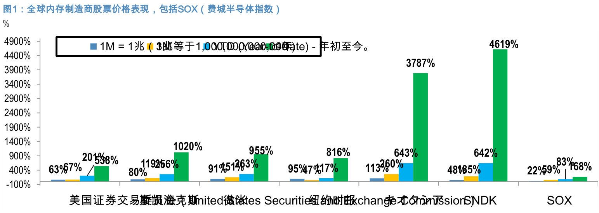
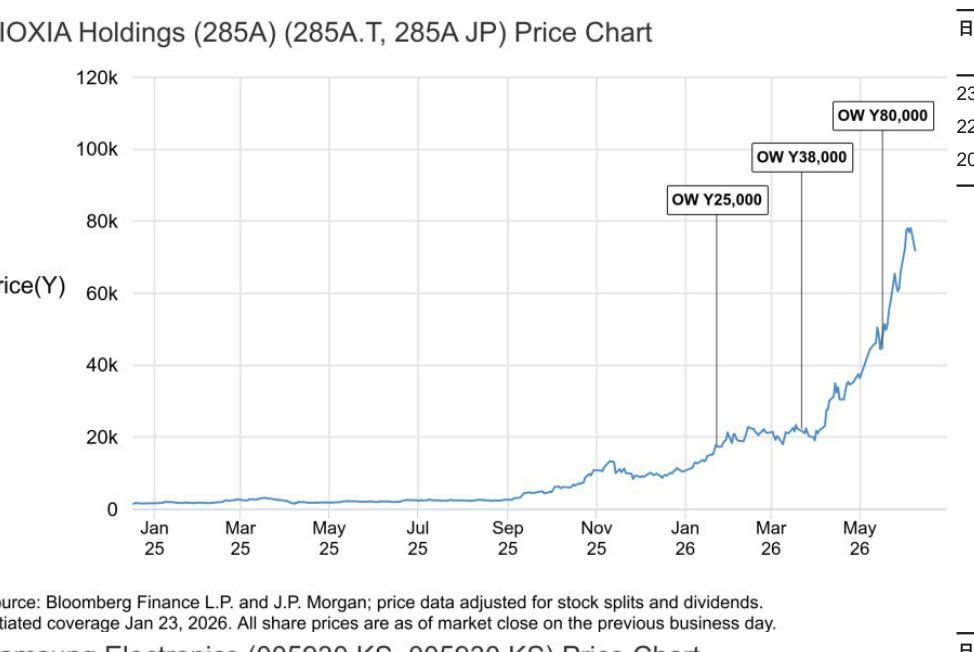
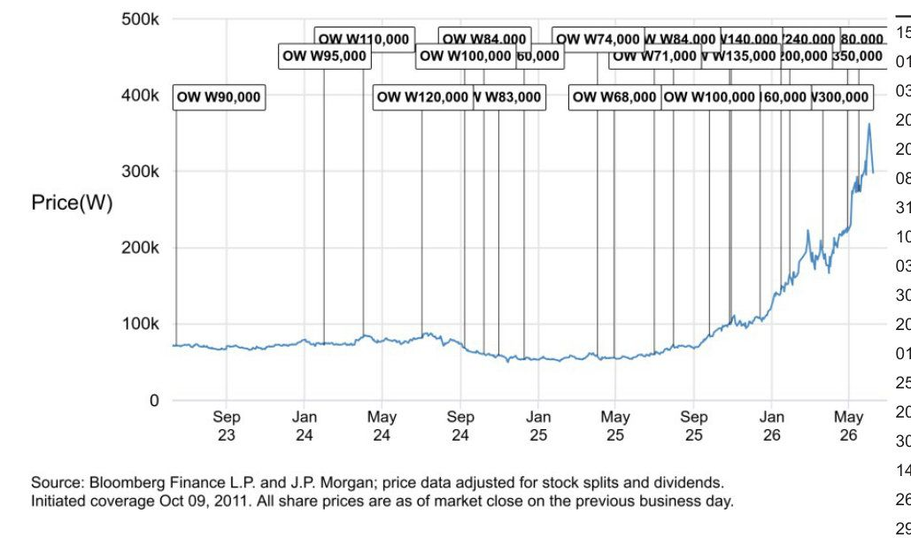
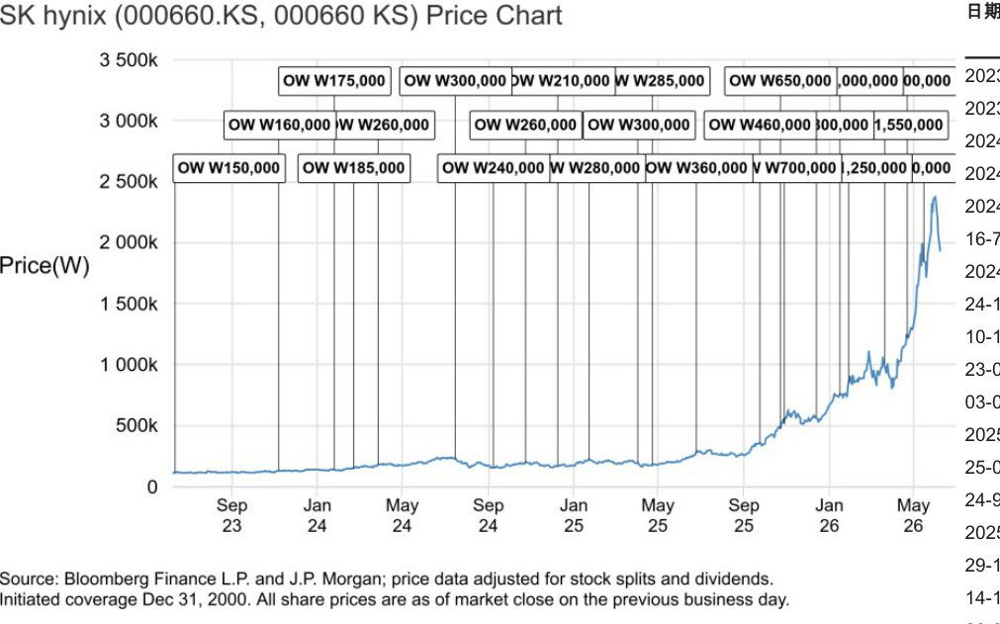

## Document Metadata

- Document ID: 7bf586577404ee8d15019df241efb1a06564e607
- Document Title: 记忆市场更新：SOCAMM内容噪声提供了购入机会；关于NVDA-SKH合作的想法以及从2026年Computex的收获
- Document Type: PDF
- Issuing Organization: J.P. Morgan – Asia Pacific Equity Research（摩根大通亚太股权研究）
- Publication Date: 2026-06-08
- Reporting Period: null
- Source File: [M174_【中文】摩根大通_Memory_Market_Update-_SOCAMM_content_controversy_brings_buyin.pdf](https://github.com/jadennevercode/CJCC-Knowledge-Base/blob/5ec8511eb834073c8bfbd79c94af196282d483cf/materials/%E8%B7%A8%E9%93%BE%EF%BC%9A%E4%BE%9B%E9%9C%80%E4%B8%8E%E4%BB%B7%E6%A0%BC%E5%8F%A3%E5%BE%84/M174_%E3%80%90%E4%B8%AD%E6%96%87%E3%80%91%E6%91%A9%E6%A0%B9%E5%A4%A7%E9%80%9A_Memory_Market_Update-_SOCAMM_content_controversy_brings_buyin.pdf)

## Structured Content

> 原文件：[M174_【中文】摩根大通_Memory_Market_Update-_SOCAMM_content_controversy_brings_buyin.pdf](https://github.com/jadennevercode/CJCC-Knowledge-Base/blob/5ec8511eb834073c8bfbd79c94af196282d483cf/materials/%E8%B7%A8%E9%93%BE%EF%BC%9A%E4%BE%9B%E9%9C%80%E4%B8%8E%E4%BB%B7%E6%A0%BC%E5%8F%A3%E5%BE%84/M174_%E3%80%90%E4%B8%AD%E6%96%87%E3%80%91%E6%91%A9%E6%A0%B9%E5%A4%A7%E9%80%9A_Memory_Market_Update-_SOCAMM_content_controversy_brings_buyin.pdf)
> 转换方式：多模态逐页转录（页面图像 + 文本层交叉校验）

[Source Page: 1]

# 记忆市场更新

SOCAMM内容噪声提供了购入机会；关于NVDA-SKH合作的想法以及从2026年Computex的收获

**亚太股权研究**
2026年6月8日

**技术 - 半导体**

**Jay Kwon** AC
(82-2) 758-5725
jay.h.kwon@jpmorgan.com
J.P. Morgan Securities (Far East) Limited，首尔分行

**李桑石**
(82-2) 758 5146
sangsik.lee@jpmorgan.com
摩根大通证券（远东）有限公司，首尔分支

**内拉伊·卡玛特**
(91-22) 6157 3764
neelay.kamath@jpmchase.com
摩根士丹利印度私人有限公司

**Mio Shikanai**
(81-3) 6736 1313
mio.shikanai@jpmorgan.com
稻中证券株式会社

- **真相在于为维拉·鲁宾剪裁的SOCAMM内容背后的真相。** 多家媒体突出了SOCAMM将VR NVL72机架的内容从192GB下调至96GB（或内容从1.5TB减少至每CPU 768GB），引发投资者对于冷却CPU相关内存需求的担忧（链接）。CPU驱动的内存需求增长是2027E内存需求加速增长的核心动力（JPMe：2026/27E DRAM位需求增长+33%/+34%，详细信息见我们的GMM报告）。根据我们的供应链检查，我们感受到对96GB SOCAMM模块的需求不断增长。**尽管相信需求的变化主要是由于有限的内存供应，而非性能降级导致。** 尽管96GB等级的SOCAMM SKU更高，但我们观察到整体SOCAMM位采购需求没有变化，这表明内容向下调整很可能会被SOCAMM模块需求增加所抵消（例如，根据内存供应和内容配置重新调整内容和数量）。

**表1：基于Vera CPU内容配置的NVDA需求敏感性分析**

单位为千，内容为GB

| 人工智能头节点 | 2026E | 96GB的50%和192GB的50% | 96GB的75%和192GB的25% | 96GB的100%和192GB的0% |
| --- | --- | --- | --- | --- |
| **#CPU数量** |  |  |  |  |
| 鲁宾 | 1,050 | 1,400 | 1,680 | 2,100 |
| 布莱克威尔 | 2,568 | 2,568 | 2,568 | 2,568 |
| **内容/每CPU** |  |  |  |  |
| 鲁宾 | 1,536 | 1,152 | 960 | 768 |
| 布莱克威尔 | 512 | 512 | 512 | 512 |
| **产品对位的需求** |  |  |  |  |
| 鲁宾 | 1,613 | 1,613 | 1,613 | 1,613 |
| 布莱克威尔 | 1,315 | 1,315 | 1,315 | 1,315 |
| **比特需求（8Gb，最小等效）** | **2,928** | **2,928** | **2,928** | **2,928** |
| **独立CPU** |  |  |  |  |
| # of Vera CPU | 600 | 600 | 600 | 600 |
| 内容/每CPU | 768 | 768 | 768 | 768 |
| **比特需求（8Gb，最小等效）** | **461** | **461** | **461** | **461** |
| **NVDA比特需求** | **3,388** | **3,388** | **3,388** | **3,388** |

来源：摩根大通估计。

- **加强NVDA和SKH间的合作** Nvidia（由摩根士丹利分析师Harlan Sur负责覆盖）和SK海力士宣布了一项为期多年的技术合作，共同开发下一代HBM内存，用于全球AI数据中心，SK海力士正式成为Nvidia最大的内存合作伙伴（为期2年，可延长）。该协议远超数据中心HBM，SK海力士将参与Nvidia全栈内存的开发，包括Vera Rubin超级计算机（摩根士丹利：包括HBM/DRAM/NAND的AI内存产品）、Vera CPU（摩根士丹利：SOCAMM2）、RTX Spark PC（摩根士丹利：LPDDR5X）和Jetson Thor机器人平台，有效地使SK海力士多元化进入Nvidia正在创造的AI基础设施、个人AI和物理AI市场（详见更多详情，链接）。我们相信多年合作意味着对需求的长期可预见性（预计至27E）并强调，这在供应可能有限的情况下，也有利于其他现有内存制造商。此外，英伟达宣布与领先的韩国科技公司建立一系列合作伙伴关系，以构建大型AI

**请参阅第4页，了解分析师认证和重要披露信息，包括非美国分析师的披露信息。**

[Source Page: 2]

亚洲基础设施，寻求巩固其数据中心足迹并扩展其AI生态系统（更多详情见下表2）。最后，首席执行官Jensen提到（链接）未来五年内2倍DRAM晶圆产能扩张计划可能不足，暗示未来人工智能对内存的需求可能更加强劲（与以下一致：*JP摩根观点*）。

**表2：NVIDIA与韩国主要企业的合作公告**

| 合作伙伴 | 交易性质 | 关键细节 |
| --- | --- | --- |
| SK海力士 | 多年记忆技术合作伙伴关系 | 下一代AI数据中心内存芯片；确保高级内存稳定供应。被评为Nvidia最大内存合作伙伴；2年以上，可选延长。 |
| SK电信 | 吉瓦级人工智能云 | 在Nvidia技术上构建GW级人工智能云；首个数据中心将于2027年上线。 |
| 纳维 | GW-scale人工智能工厂路线图 | 从Gak Sejong数据中心开始，扩展容量后建设额外的GW规模人工智能工厂；2027年开始55MW项目。 |
| 斗山 | 物理AI/机器人技术 | 开发机器人技术，为Nvidia GPU制造组件；与Nvidia计划多个项目。 |
| Krafton / NC | 游戏至物理AI | 与游戏开发者合作进行AI和下一代机器人研究；Nvidia将游戏视为物理AI/类人机器人的战略要务。 |
| 三星/现代AI工厂 |  | 两家公司都将投资AI工厂。 |

来源：NVIDIA新闻室、路透社和华尔街日报。

- **从2026年台湾Computex的收获** 上周我们参加了2026年Computex，留下了积极的印象，对我们的行业有几点启示：

  - **SK Hynix:** 我们参观了SK海力士的展台，关键要点如下：1) 12 Hi HBM4的大规模生产正在按计划进行，这与CEO詹森的观点相呼应，即三家内存制造商都通过了HBM4的认证（链接）；2) 对支持最高16 Gbps的12-Hi 48GB HBM4E的兴趣更高，而16-Hi HBM4E与SEC近期向客户提供的12-Hi HBM4E样品在广泛上相似（链接）；3) 类似于HBF的AI-N B（简称HBF），具有类似于HBM的吞吐量以及类似于SSD的容量，适用于推理批量，尽管2030年的需求增长似乎保守（与SKH对HBF的需求预测一致；链接）。

  - **Solidigm：固态存储解决方案提供商** 我们参加了Solidigm的主题演讲会，关键收获如下：1）存储正成为各种AI数据管道的关键基础设施（例如，用于数据准备、训练和推理的本地SSD（G3）；用于推理的KV缓存层的性能SSD（G3.5）；用于存储非活动KV和归档目的的共享存储（G4）；2）将KV缓存卸载到NAND的价值，使得首次标记时间（TTFT）比重新计算上下文快27倍；3）与VAST的软件结合的Solidigm SSD解决方案，相比硬盘，数据中心空间成本可节省90%（链接）。

  - **Kioxia: 契克夏** 我们参加了Kioxia的专题演讲会，其中一些信息与投资者日公告重叠（报告）。我们发现Kioxia与NVDA之间广泛的合作伙伴关系合作细节富有建设性——Kioxia提供了一种成本效益高的超大规模RAG（检索增强生成）服务器解决方案，主要利用Kioxia的AiSAQ软件。SSD软件开发对我们来说是个惊喜，因为该解决方案从硬件供应商跳过，具有粘性。我们相信，软件合作伙伴关系和承诺将成为Kioxia与NAND竞争对手的强大差异化因素。

- **11%内存份额修正提供了抄底买入的机会。** 我们认为内存上周纠正了11%的涨幅（与SOX相比：-6%），主要是因为SOCAMM内容剪辑噪声和日益升级的地缘政治问题。我们相信SOCAMM内容剪辑噪声具有误导性，并预期Vera CPU体积增长足以抵消96GB SOCAMM SKU的负面影响。在NVDA和SKH宣布的多个合作项目中，我们认为2年以上的合作前景光明，对2027E的长期需求展望持乐观态度。在NAND领域，我们重申eSSD在AGI中的关键基础设施层日益增长的作用，这对其中长期需求展望应该是有利的。我们不排除未来内存内容进一步削减或优化的可能性；然而，我们认为这是终端客户对严重情况的必要反应。

[Source Page: 3]

内存供应短缺。我们更愿意专注于持续的客户需求，向系统中部署更高内存内容以获得更好的性能。总的来说，我们认为最近的市场调整是从中期的角度来看的一个良好的买入机会，并建议投资者在回调时增加投资，关注“更高更久”的周期上升。**关键OW**亚洲的名字是：**美国证券交易委员会（United States Securities and Exchange Commission）**、**SK海力士**，并且**キオクシア**。接下来关键催化剂包括：a）CSP/内存供应商长期供应协议公告更新，b）x86和ARM CPU相关内存采购和需求更新（包括Vera CPU），c）3Q26合同价格更新，以及d）MU五月季度业绩及展望评论（预计于6月下旬发布）。

**图1：全球内存制造商股票价格表现，包括SOX（费城半导体指数）**

- 纵轴：%
- 图例：1M、3M、YTD（Year-to-Date）- 年初至今、1年（图上图例文字相互压叠，实际可见为“1M = 1兆（1兆等于1,000,000,000,000）”“3M”“YTD (Year-to-Date) - 年初至今。”“1年”）
- 横轴类别：美国证券交易委员会（United States Securities and Exchange Commission）、斯凯海克斯、微米、纽约时报、キオクシア、SNDK、SOX（类别标签相互压叠）
- 柱上数据标签（按图例顺序1M / 3M / YTD / 1年；标签亦有压叠，按各柱纵向位置读出）：

| 类别 | 1M | 3M | YTD | 1年 |
| --- | --- | --- | --- | --- |
| 美国证券交易委员会（United States Securities and Exchange Commission） | 63% | 67% | 201% | 538% |
| 斯凯海克斯 | 80% | 119% | 256% | 1020% |
| 微米 | 91% | 151% | 263% | 955% |
| 纽约时报 | 95% | 47% | 117% | 816% |
| キオクシア | 113% | 260% | 643% | 3787% |
| SNDK | 48% | 185% | 642% | 4619% |
| SOX | 22% | 59% | 83% | 168% |

来源：彭博商业周刊

[Source Page: 4]

## 公司在本报告中讨论

（本报告中所述价格均为截至2026年6月8日市场收盘价，除非另有说明）

**分析师认证：** 研究报告封面上的“AC”标记所指的研究分析师（或，若多个研究分析师主要负责本报告，则封面或文档中标记为“AC”的研究分析师分别认证，针对研究分析师在本研究中覆盖的每只证券或发行人）证明如下：（1）本报告中表达的所有观点准确反映了研究分析师对任何和所有主题证券或发行人的个人观点；（2）研究分析师的任何部分薪酬均未、现在或将来直接或间接与报告中研究分析师（们）提出的具体建议或观点相关。对于所有列于封面前页的韩国研究分析师，如适用，他们还根据KOFIA要求认证，研究分析师的分析是在良好信念下进行的，且观点反映了研究分析师自己的意见，没有受到不适当的干预或影响。

所有在本报告中提及的作者均为研究分析师，除非另有说明，他们进行独立研究。在欧洲，本报告中的行业专家（销售和交易）可能会作为联系人列出，但并非报告的作者或研究部门的成员。

## 重要披露

- **市场做市商/流动性提供者：** 摩根大通是KIOXIA控股（285A）、三星电子、SK海力士或相关实体的金融工具的市场做市商和/或流动性提供者。
- **经理或共同经理：** 摩根大通在过去12个月内担任或共同担任了三星电子及其相关实体的证券或金融工具（如指令2014/65/EU所定义）的公开发行经理或共同经理。
- **受益所有权（1%或以上）：** 摩根大通有益地持有三星电子或相关实体的1%或更多普通股权证券。
- **客户：** 摩根大通目前在过去12个月内拥有以下客户：KIOXIA控股（285A）、三星电子，SK海力士或相关实体。
- **客户/投资银行：** 摩根大通目前拥有，或在过去12个月内曾经拥有以下实体作为投资银行：客户：三星电子或相关实体。
- **客户/非投资银行业务，与证券相关：** 摩根大通目前或在过去12个月内拥有以下客户，提供的服务为非投资银行业务、证券相关服务：三星电子、SK海力士或相关实体。
- **客户/非证券相关** 摩根大通目前或在过去12个月内拥有以下客户，提供的服务与非证券相关：三星电子、SK海力士或相关实体。
- **投资银行薪酬收到的：** 摩根大通在过去12个月内从三星电子或相关实体获得了投资银行服务的报酬。
- **潜在投资银行薪酬：** 摩根大通预计将在未来三个月内从KIOXIA Holdings（285A）、三星电子、SK海力士或相关实体获得或寻求投资银行服务的补偿。
- **非投资银行业务薪酬收入：** 摩根士丹利在过去12个月中，从三星电子、SK海力士或其关联实体获得了除投资银行以外的产品或服务的报酬。
- **债务状况：** 摩根大通可能持有任何相关的KIOXIA控股公司（285A）、三星电子、SK海力士或其关联实体的债券证券头寸。

**公司特定披露** J.P. Morgan与其研究报告涵盖的公司进行交易，并寻求与这些公司进行交易。因此，投资者应意识到该机构可能存在利益冲突，这可能会影响本报告的客观性。投资者应将本报告视为做出投资决策的唯一因素。重要披露，包括价格图表和信用观点历史表格（如有适用），可通过访问以下网址获取：https://www.jpmm.com/research/disclosures ，拨打1-800-477-0406，或发送电子邮件 research.disclosure.inquiries@jpmorgan.com 遵照您的请求。

[Source Page: 5]

KIOXIA Holdings (285A) (285A.T, 285A JP) Price Chart

- 纵轴：Price(Y)（0–120k）
- 横轴：Jan 25、Mar 25、May 25、Jul 25、Sep 25、Nov 25、Jan 26、Mar 26、May 26
- 价格目标标注：OW Y25,000、OW Y38,000、OW Y80,000

| **日期** | **评分** | **价格（Y）** | **价格目标（Y）** |
| --- | --- | --- | --- |
| 23-01-26 | OW | 17910 | 25,000 |
| 22-03-26 | OW | 22360 | 38,000 |
| 2026年5月17日 | OW | 44450 | 80,000 |

Source: Bloomberg Finance L.P. and J.P. Morgan; price data adjusted for stock splits and dividends. Initiated coverage Jan 23, 2026. All share prices are as of market close on the previous business day.

Samsung Electronics (005930.KS, 005930 KS) Price Chart

- 纵轴：Price(W)（0–500k）
- 横轴：Sep 23、Jan 24、May 24、Sep 24、Jan 25、May 25、Sep 25、Jan 26、May 26
- 价格目标标注：共21个标注框，彼此压叠、相互覆盖，无法完整辨读 [OCR_UNCERTAIN]；可辨读的片段有 `OW W90,000`、`OW W95,000`、`OW W110,000`、`OW W120,000`、`OW W100,000`、`OW W84,000`、`OW W74,000`、`OW W68,000`、`OW W83,000`、`OW W71,000`，其余数字被相邻标注框覆盖

| **日期** | **评分** | **价格（W）** | **价格目标** **(W)** |
| --- | --- | --- | --- |
| 15-06-23 | OW | 71900 | 90,000 |
| 01-02-24 | OW | 72700 | 95,000 |
| 03-04-2024 | OW | 85000 | 110,000 |
| 2024年7月3日 | OW | 81800 | 120,000 |
| 2024年9月8日 | OW | 68900 | 100,000 |
| 08-10-24 | OW | 61000 | 84,000 |
| 31-10-24 | OW | 59100 | 83,000 |
| 10-12-24 | N | 53400 | 60,000 |
| 03-04-25 | OW | 58800 | 74,000 |
| 30-4-25 | OW | 55800 | 68,000 |
| 2025年7月2日 | OW | 60200 | 71,000 |
| 01-08-25 | OW | 71400 | 84,000 |
| 25-09-25 | OW | 85400 | 100,000 |
| 2025年10月27日 | OW | 98900 | 135,000 |
| 30-10-25 | OW | 101700 | 140,000 |
| 14-12-25 | OW | 108500 | 160,000 |
| 26-01-16 | OW | 145000 | 200,000 |
| 29-01-26 | OW | 164300 | 240,000 |
| 22-03-26 | OW | 199800 | 300,000 |
| 30-4-26 | OW | 226500 | 350,000 |
| 2026年5月17日 | OW | 273500 | 480,000 |

Source: Bloomberg Finance L.P. and J.P. Morgan; price data adjusted for stock splits and dividends. Initiated coverage Oct 09, 2011. All share prices are as of market close on the previous business day.

[Source Page: 6]

SK hynix (000660.KS, 000660 KS) Price Chart

- 纵轴：Price(W)（0–3 500k）
- 横轴：Sep 23、Jan 24、May 24、Sep 24、Jan 25、May 25、Sep 25、Jan 26、May 26
- 价格目标标注：共22个标注框，彼此压叠、相互覆盖，无法完整辨读 [OCR_UNCERTAIN]；可辨读的片段有 `OW W150,000`、`OW W160,000`、`OW W175,000`、`OW W185,000`、`OW W240,000`、`OW W260,000`、`OW W280,000`、`OW W300,000`、`OW W360,000`、`OW W460,000`、`OW W650,000`、`OW W700,000`，其余数字被相邻标注框覆盖

| **日期** | **评分** | **价格（W）** | **价格目标** **(W)** |
| --- | --- | --- | --- |
| 2023年6月12日 | OW | 115400 | 150,000 |
| 2023年11月7日 | OW | 133000 | 160,000 |
| 2024年1月25日 | OW | 141500 | 175,000 |
| 2024年2月22日 | OW | 149000 | 185,000 |
| 2024年3月28日 | OW | 181200 | 260,000 |
| 16-7-24 | OW | 230000 | 300,000 |
| 2024年9月8日 | OW | 156400 | 240,000 |
| 24-10-24 | OW | 196000 | 260,000 |
| 10-12-24 | OW | 168900 | 210,000 |
| 23-01-25 | OW | 225500 | 280,000 |
| 03-04-25 | OW | 197900 | 300,000 |
| 2025年4月24日 | OW | 181000 | 285,000 |
| 25-06-25 | OW | 278500 | 360,000 |
| 24-9-25 | OW | 361000 | 460,000 |
| 2025年10月23日 | OW | 481000 | 650,000 |
| 29-10-25 | OW | 519000 | 700,000 |
| 14-12-25 | OW | 571000 | 800,000 |
| 26-01-16 | OW | 756000 | 1,000,000 |
| 29-01-26 | OW | 862000 | 1,250,000 |
| 22-03-26 | OW | 1006000 | 1,550,000 |
| 23-4-26 | OW | 1220000 | 1,800,000 |
| 2026年5月17日 | OW | 1848000 | 3,000,000 |

Source: Bloomberg Finance L.P. and J.P. Morgan; price data adjusted for stock splits and dividends. Initiated coverage Dec 31, 2000. All share prices are as of market close on the previous business day.

图表显示摩根大通对股票的持续覆盖；当前分析师可能在整个期间内覆盖了也可能没有覆盖。
J.P.摩根评级或标识：OW = 过度配重，N = 中性，UW = 配重不足，NR = 未评级

### 解释股票研究评级、称号及分析师覆盖范围：

摩根大通采用以下评级系统：超配（在本报告所指的价格目标期间，我们预计该股票的表现将超出研究分析师或研究分析师团队覆盖范围内的股票平均总回报）；中性（在本报告所指的价格目标期间，我们预计该股票的表现将与研究分析师或研究分析师团队覆盖范围内的股票平均总回报相当）；低配（在本报告所指的价格目标期间，我们预计该股票的表现将低于研究分析师或研究分析师团队覆盖范围内的股票平均总回报。NR表示未评级。在这种情况下，由于缺乏足够的根本原因或法律、监管或政策原因，摩根大通已取消对该股票的评级以及（如果适用）价格目标。以前的评级以及（如果适用）价格目标不应再被依赖。NR标识既不是推荐也不是评级。一些被覆盖的股票有评级但没有价格目标；在这些情况下，我们预计该股票的表现将超出/相当于/低于相关区域研究分析师或研究分析师团队覆盖范围内的股票的平均总回报。在我们对亚洲（不含澳大利亚和印度）和英国中小盘股票的研究中，每只股票的预期总回报将与基准国家市场指数的预期总回报进行比较，而不是与那些研究分析师的覆盖范围进行比较。如果在本报告的重要披露部分未出现，可从摩根大通研究网站找到认证研究分析师的覆盖范围。https://www.jpmorganmarkets.com .

**覆盖宇宙：权，杰** LG集团（003550.KS）、LG显示（034220.KS）、LG电子（066570.KS）、LG Innotek（011070.KS）、南亚科技（2408.TW）、SK公司（034730.KS）、SK海力士（000660.KS）、SKC（011790.KS）、三星C&T（028260.KS）、三星电机（009150.KS）、三星电子（005930.KS）、三星SDS（018260.KS）

**摩根士丹利股票研究评级分布，截至2026年4月4日**

|  | **超重** | **中立** | **体重不足** |
| --- | --- | --- | --- |
|  | **购买** | **（握住）** | **（销售）** |
| J.P. Morgan全球股票研究覆盖范围* | 51% | 37% | 12% |
| IB客户** | 83% | 79% | 74% |
| JPMS股权研究覆盖 | 49% | 39% | 13% |
| IB客户** | 94% | 93% | 85% |

请注意，由于四舍五入，百分比可能无法总和达到100%。*过去12个月内，摩根士丹利为以下“买入”、“持有”和“卖出”类别中每类所属公司的百分比提供投资银行服务。*

**仅就FINRA评级分配规则而言，我们的增持评级属于买入评级类别；我们的中性评级属于持有评级类别；我们的减持评级属于卖出评级类别。请注意，带有NR标识的股票不包括在上面的表格中。以上信息截至最近一个日历季度的末尾。**

[Source Page: 7]

**股权估值与风险：** 关于估值方法和与被覆盖公司相关的风险，或被覆盖公司的价格目标，请参阅最新的公司特定研究报告。http://www.jpmorganmarkets.com 联系主要分析师或您的摩根士丹利代表，或发送电子邮件 research.disclosure.inquiries@jpmorgan.com 有关用于私有模型的材料信息，请参阅公司研究报告中财务概况的总结和公司报表，它们可在客户网站上的公司页面上下载。http://www.jpmorganmarkets.com 本报告还列出了其中使用的基于材料的基本假设。

**投资推荐的历史：**

A history of J.P. Morgan investment recommendations disseminated during the preceding 12 months can be accessed on the Research & Development section of the website.

评论页面，可在http://www.jpmorganmarkets.com搜索分析师姓名、行业或金融工具。

J.P. Morgan在过去的12个月内发布的投资建议的历史记录可以在网站的“研究与开发”部分查阅。

**分析师薪酬：** 负责准备本报告的研究分析师的薪酬基于各种因素，包括研究质量与准确性、客户反馈、竞争因素以及公司整体收入。

**非美分析师登记：** 除非另有说明，本报告首页列出的非美国分析师是摩根士丹利证券有限责任公司非美国分支机构的雇员，可能未按照FINRA规则注册为研究分析师，可能不是摩根士丹利证券有限责任公司的关联人员，并且可能不受FINRA第2241号或2242号规则关于与受保护公司通信、公开露面和交易研究分析师账户持有证券的限制。

## 其他披露

JP摩根是摩根大通公司与全球子公司及关联公司投资银行业务的营销名称。

**英国MiFID FICC研究拆分豁免：** 英国客户应查阅 英国MiFID研究拆分豁免 关于摩根大通实施FICC研究豁免的细节以及相关FICC研究分类的指导。

所有提供给客户的研究资料同时可在我们的客户网站JP Morgan Markets上找到，除非相关法律规定另行许可。并非所有研究内容均予以再分配、电子邮件发送或提供给第三方聚合器。关于特定股票的所有研究资料，请联系您的销售代表。

在本文档中，对中国的各种称谓，包括香港、台湾和澳门，分别使用以下术语：中国大陆；香港特别行政区（中国）；台湾（中国）；以及澳门特别行政区（中国）。

摩根大通研究可能会不时撰写关于美国、欧盟、英国或其他相关司法管辖区政府当局实施或管理的经济或金融制裁的目标发行人或证券（受制裁证券）的文章。本报告中的任何内容均无意被视为鼓励、促进、批准或以其他方式支持对这类受制裁证券的投资或交易。客户在做出投资决策时应了解自身的法律和合规义务。

本研究报告中所讨论的任何数字或加密资产都可能受到快速变化的监管环境的影响。关于加密资产的相关监管建议，包括比特币和以太坊，请参阅 https://www.jpmorgan.com/disclosures/cryptoasset-disclosure .

本研究报告的作者可能未经您所在司法管辖区授权进行受监管活动，如未经授权，则不得声称有能力进行此类活动。

**交易所交易基金（ETFs）：** J.P. Morgan Securities LLC（JPMS）是美国上市ETF的主要授权参与者。在本报告中提及的任何ETF，JPMS可能因分销这些ETF份额而获得佣金和基于交易的报酬，并且可能因提供其他与交易相关的服务（如向ETF份额的卖空者提供证券借贷）而收取费用。JPMS还可以为ETF本身提供服务，包括作为ETF的经纪商或交易商。此外，JPMS的关联公司可能为ETF提供服务，包括信托、托管、管理、借贷、指数计算和/或维护及其他服务。

**期权与期货相关研究：** 如果这里所包含的信息与期权或期货相关研究有关，此类信息仅供已收到适当的期权或期货风险披露文件的人员查阅。请联系您的摩根大通代表或访问 https://www.theocc.com/components/docs/riskstoc.pdf 关于获取期权清算公司标准期权特性及风险概述的副本，请参阅以下内容：

https://www.finra.org/sites/default/files/2020-08/Security_Futures_Risk_Disclosure_Statement_2020.pdf 请提供《证券期货风险揭示声明》的副本。

**利率变动：银行间拆借利率（IBORs）和其他基准利率的变化** 某些利率基准目前或将来可能会受到持续的国际、国家和其他监管指导、改革及改革建议的影响。更多信息，请咨询： https://www.jpmorgan.com/global/disclosures/interbank_offered_rates

**通知：信用评级** 如果此材料包含信用评级，则由日本信用评级机构有限公司（JCR）和评级与投资信息公司（R&I）提供的信用评级，是依据日本金融工具交易法（FIEL）注册的信用评级机构提供的信用评级。至于由JCR和R&I以外的信用评级机构提供的信用评级，且没有规定这些信用评级由注册信用评级机构提供的情况，这意味着：

[Source Page: 8]

该等信用评级为非注册评级（非根据FIEL注册的信用评级机构提供的信用评级）。在非注册评级中，针对由标准普尔全球评级（S&P）、穆迪投资者服务（Moody's）或惠誉评级（Fitch）提供的信用评级，在根据此类非注册评级做出投资决策之前，请仔细阅读我们分别已发送或将发送的对应信用评级机构的“关于非注册评级的说明信”。

**私人银行客户：** 您作为摩根大通公司及其子公司（“摩根士丹利私人银行”）提供的私人银行业务的客户，所接收的研究由摩根士丹利私人银行提供，而非摩根士丹利其他部门，包括但不限于摩根士丹利企业及投资银行及其全球研究部门。

**法律实体负责研究和分发：** 以下列在Reg AC研究分析师姓名之下的法律实体是该研究生产的责任实体。如果有多个Reg AC研究分析师以不同法律实体列名共同撰写此材料，则这些法律实体共同对研究生产负责。如果分析师姓名下有多个法律实体，除非另有说明，第一法律实体负责生产。来自不同摩根大通附属机构的分析师可能已参与此材料的生产，但可能未获得在您所在司法管辖区进行受监管活动的许可（并且不声称能够这样做）。除非在法律实体披露中另有说明，否则此材料已由负责生产的法律实体分发，或者如果分析师姓名下有多个法律实体，则第一法律实体将负责分发。如果您有任何疑问，请联系您所在司法管辖区内的相关研究分析师或分发此研究材料的实体。

**法律实体披露和地区/国家特定披露：**

**阿根廷：** 摩根大通银行股份有限公司布宜诺斯艾利斯分行受阿根廷中央银行（“BCRA”）和阿根廷证券委员会（“CNV”- 阿根廷证券委员会 - ALYC y AN Integral N°51）监管。

**澳大利亚：** J.P. Morgan Securities Australia Limited（“JPMSAL”）（ABN 61 003 245 234/AFS 许可证号：238066）受澳大利亚证券投资委员会监管，是ASX Limited的市场参与者、ASX Clear Pty Limited的清算和结算参与者以及ASX Clear (Futures) Pty Limited的清算参与者。此材料仅由JPMSAL或其代表在澳大利亚向“批发客户”（根据《2001年公司法》第761G节定义）发行和分发。所有涵盖的金融产品列表可通过访问获取。 https://www.jpmm.com/research/disclosures 摩根大通寻求覆盖所有全球行业分类标准（GICS）行业以及不同市值规模的相关公司，覆盖国内外投资者群体。在开展对目标公司（或公司群）的公开尽职调查过程中，研究分析师团队有时会通过企业参与等方式进行尽职调查，例如实地考察、与公司代表讨论、管理演示等。JPMSAL发布的研究已根据摩根大通澳大利亚的研究独立性政策编制，该政策可通过以下链接查阅： J.P. Morgan澳大利亚 - 研究独立性政策 .

**巴西** Banco J.P. Morgan S.A. 受巴西证券委员会（CVM）和巴西中央银行的监管。J.P. Morgan客户投诉专员：0800-7700847 / 0800-7700810（听力受损者适用）/ ouvidoria.jp.morgan@jpmchase.com .

**加拿大：** 加拿大摩根大通证券公司是一家注册投资经纪人，受加拿大投资监管机构及安大略省证券交易委员会的监管，并且在加拿大交易所中为参与成员。本资料由加拿大摩根大通证券公司或其代理分发。

**智利：** J.P.摩根投资有限责任公司是一家在智利成立的未经监管的实体。

**中国：** 摩根大通证券（中国）有限公司已获中国证监会批准开展证券投资咨询业务。

**哥伦比亚：** Banco J.P. Morgan Colombia S.A. 由哥伦比亚金融监管局（SFC）监管。本材料中提及的哥伦比亚银行以外的实体在海外提供的任何产品或服务仅作描述之用。此类提及不构成，也不应被视为在哥伦比亚境内（根据适用的哥伦比亚法规定义）进行促销活动或提供金融产品或服务的依据。

**迪拜国际金融中心（DIFC）** 摩根大通银行股份有限公司迪拜分行受迪拜金融服务局（DFSA）监管，其注册地址为迪拜国际金融中心-大门，西翼，3层和9层，邮政信箱506551，迪拜，阿联酋。本材料已由摩根大通银行股份有限公司迪拜分行分发给被视为DFSA规则下定义的专业客户或市场交易对手的人员。

**欧洲经济区（EEA）** 除非另有说明，本研究由J.P.摩根欧洲工商金融公司（J.P. Morgan SE，“JPM SE”）在欧盟经济区（EEA）分发，JPM SE已被联邦金融监管局（Bundesanstalt für Finanzdienstleistungsaufsicht，BaFin）授权为信贷机构，并由BaFin、德国央行（Deutsche Bundesbank）和欧洲央行（ECB）共同监管。JPM SE是一家总部位于法兰克福的公司，注册地址为德国法兰克福市泰努斯塔楼，泰努斯托尔1号，60310。根据《MiFID II》第4条第1款第10项和附件II，以及在其所在司法管辖区内的相应实施规定，这些材料在欧盟经济区分发给被视为专业投资者（或等同）的人员（“EEA专业投资者”）。本材料不得由非EEA专业投资者执行或依赖。与该材料相关的任何投资或投资活动仅面向EEA相关人士，并且仅与EEA相关人士进行。

**香港** 摩根士丹利证券（亚太）有限公司（CE编号AAJ321）受香港金融管理局和香港证券及期货事务监察委员会监管，摩根士丹利经纪（香港）有限公司（CE编号AAB027）则受香港证券及期货事务监察委员会监管。

[Source Page: 9]

香港证券及期货事务监察委员会。美国摩根大通银行有限公司香港分行（CE编号AAL996）受香港金融管理局和香港证券及期货事务监察委员会监管，根据美国法律设立，承担有限责任。如本材料在香港的分发是一项受监管活动，则由摩根大通证券（亚太）有限公司或摩根大通证券经纪（香港）有限公司在香港分发或通过其分发。

**印度** J.P. Morgan印度私人有限公司（企业识别号-U67120MH1992FTC068724），注册办公地址位于孟买圣克鲁斯-东区卡琳娜C.S.T.路J.P.摩根大厦，已在中国证券监督管理委员会（SEBI）注册为“分析师”，注册号为INH000001873。J.P. Morgan印度私人有限公司还作为印度国家证券交易所有限公司和孟买证券交易所有限公司的成员以及证券经纪人（SEBI注册号- INZ000239730）在中国证券监督管理委员会注册，并作为证券经纪人（SEBI注册号 - MB/INM000002970）。电话：91-22-6157 3000，传真：91-22-6157 3990，网址：http://www.jpmipl.com 摩根大通银行（印度）私人有限公司-孟买分行，经印度储备银行（RBI）（许可证号：53/许可证号：BY.4/94；SEBI - IN/CUS/014/ CDSL：IN-DP-CDSL-444-2008/ IN-DP-NSDL-285-2008/ INBI00000984/ INE231311239）批准，在印度作为一家规定的商业银行经营，这是其主要许可证，允许其在印度进行银行业务和其他活动，这些活动是印度银行分行被允许进行的。对于非本地研究资料，摩根印度私人有限公司不向印度分发此资料。合规官员：阿舒托什·沙尔马 ashutosh.j.sharma@jpmchase.com +912261575002。投诉官：拉姆普拉斯达赫·K， jpmipl.research.feedback@jpmorgan.com +912261573000。已获得SEBI注册和NISM认证，但并不保证中介机构的业绩或为投资者提供任何收益保证。请访问 《服务条款》和《最重要服务条款》（MITC） . 年度合规审计报告可在以下地点获得： http://www.jpmipl.com/#research .

**印度尼西亚** PT J.P. Morgan Sekuritas Indonesia是印尼证券交易所的成员，并经金融服务管理局（OJK）注册和监管。

**韩国** J.P. Morgan Securities (Far East) Limited，首尔分行，是韩国交易所（KRX）的会员。摩根大通银行（N.A.），首尔分行，在韩国作为外国银行（摩根大通银行N.A.）的分行获得许可。这两个实体均受金融服务委员会（FSC）和金融监督服务局（FSS）的监管。对于非宏观研究材料，该材料由J.P. Morgan Securities (Far East) Limited，首尔分行在韩国分发或通过其分发。

**日本** 摩根士丹利证券日本有限公司和摩根大通银行，东京分行受日本金融厅监管。

**马来西亚** 此项资料由大华证券（马来西亚）私人有限公司（18146-X）在马来西亚发布和分发，该公司是吉隆坡交易所股份有限公司的参与组织，持有马来西亚证券委员会颁发的资本市场服务许可。

**墨西哥** J.P. Morgan Casa de Bolsa, S.A. de C.V.，J.P. Morgan Grupo Financiero是墨西哥证券交易所（“墨西哥价值交易所”）和机构证券交易所（“机构价值交易所”）的成员，并获得国家银行和证券交易委员会（“国家银行与价值委员会”）的授权，可作为经纪人/交易商进行操作。

**新西兰** 此材料仅由新西兰JPMSAL向“批发客户”（根据2013年金融市场监管法定义）发行和分发。JPMSAL已在2008年金融服务提供者（注册和争议解决）法下注册为金融服务提供者。

**菲律宾** JP摩根证券菲律宾有限公司是菲律宾证券交易所的交易参与方，菲律宾证券结算公司的会员，以及证券投资者保护基金。该公司受到菲律宾证券交易委员会的监管。

**新加坡** 该材料由J.P. Morgan Securities Singapore Private Limited（JPMSS）[MDDI（P）057/08/2025及公司登记号：199405335R]在新加坡发行和分发，该公司为新加坡证券交易所有限公司会员，以及或为摩根大通银行（新加坡）分行（JPMCB Singapore），两者均受新加坡金融管理局监管。该材料仅限于根据《证券及期货条例》第289章第4A条定义的合格投资者、专业投资者和机构投资者在新加坡发行和分发。该材料不针对任何零售投资者或不符合“合格投资者”、“专业投资者”或“机构投资者”定义的其他投资者发行或分发。《证券及期货条例》第289章第4A条。新加坡收到该材料的人员应就与该材料相关的任何事宜联系JPMSS或JPMCB Singapore。

**南非** 摩根士丹利股票南非有限公司和摩根大通银行，美国分行，约翰内斯堡分行是约翰内斯堡证券交易所的会员，并受金融服务业行为管理局（FSCA）监管。

**台湾** 摩根士丹利华泰证券有限公司是台湾证券交易所（公司型）的参与者，并受台湾证券暨期货监督管理委员会监管。与股权证券相关的材料由摩根士丹利华泰证券有限公司在台湾发行和分发，须遵守许可范围、台湾适用的法律和法规。 在J.P. Morgan Securities (Taiwan) Limited就未在台湾证券交易所或台北证券交易所上市的证券（“未在台湾上市证券”）产生研究材料的范围内，这些材料不构成适用台湾法规的证券推荐，并且为避免疑义，J.P. Morgan Securities (Taiwan) Limited不作为未在台湾上市证券的经纪人。

根据《证券公司荐股业务管理办法》第七条第（一）款第二段的规定

（经修改或补充的）以及/或其他适用的法律法规，请注意，本材料的接收者不得从事任何可能与该材料产生利益冲突的活动，除非在本材料中的“重要披露”部分另有说明。

[Source Page: 10]

**泰国** 此材料由泰国摩根士丹利证券（泰国）有限公司发行和分发，该公司是泰国证券交易所的会员，受财政部和证券交易委员会监管。注册地址为：曼谷Pathum Wan分区Lumphini，Ploenchit路第548号One City Center Building，50层，邮编10330。

**英国：** J.P. Morgan证券股份有限公司（以下简称“JPMS plc”）在英国进行研究成果的发布，JPMS plc是伦敦证券交易所的成员，受英国审慎监管局授权和英国金融行为监管局及审慎监管局监管，或由J.P. Morgan Markets Limited（以下简称“JPMML Ltd”）进行，JPMML Ltd受英国金融行为监管局授权和监管。除非另有说明，本材料仅在英国由JPMS plc分发，且仅针对以下在英国的个人：（a）拥有根据《2000年金融服务和市场法案》（金融服务推广）（命令）2005年第19（5）条所述与投资相关事宜的专业经验的人员；（b）在《金融服务和市场法案》（金融服务推广）第49条中概述的人员（高净值公司、非法人协会或合伙企业、高价值信托的受托人等）；或（c）可以依法向其发出本信息的任何人员；所有这些人员统称为“英国相关人员”。本材料不得被非英国相关人员进行行动或依赖。与本材料相关的任何投资或投资活动仅向英国相关人员提供，并仅与英国相关人员开展。有关J.P. Morgan EMEA预防和避免与研究成果生产相关的利益冲突的政策描述，请见以下链接： 摩根大通EMEA - 研究独立性政策 .

**美国** ．：J.P.摩根证券有限责任公司（“JPMS”）是纽约证券交易所、FINRA、SIPC和NFA的成员。摩根大通银行股份有限公司是美国联邦存款保险公司（FDIC）的成员。非美国分支机构发布的材料在美国由JPMS分发，并对其内容承担法律责任。

**一般：** 如有需要，可提供更多信息。本材料中的信息均来源于被认为可靠的来源。虽然我们已尽一切合理的努力确保本材料中陈述的事实准确，并且其中包含的预测、观点和期望是公正合理的，但摩根大通公司（JPMorgan Chase & Co.）及其子公司或关联公司（统称为“J.P. Morgan”）对所提供的材料的完整性和准确性不作任何保证。此处的例外情况仅限于与J.P. Morgan以及研究分析师与本材料主题相关的发行人之间的关系披露。因此，不应依赖本材料中包含的信息的准确性、公正性或完整性。由于计算、调整、翻译成不同语言以及/或其他当地法规限制等原因，本材料可能存在某些数据差异和/或内容上的局限。这些差异不应影响对本材料中讨论的公司（们）进行的整体投资分析、观点和/或建议。在准备本材料时，可能使用了人工智能工具，包括协助进行数据分析、模式识别以及研究材料的内容撰写。J.P. Morgan对因使用本材料或其内容而产生的任何损失不承担任何责任，并且J.P. Morgan及其各自的董事、管理人员或员工，除因相关司法管辖区的监管机构可能施加的义务和责任外，均不对本材料的内容负责。本材料中包含的观点、预测或展望仅代表J.P. Morgan在材料发布时的当前意见或判断，因此可能会随时更改，恕不另行通知。我们将根据公司的具体发展情况或公告、市场状况或其他公开信息，定期提供有关公司/行业的更新。我们无法保证未来的结果或事件将与上述任何观点、预测或展望一致，这些仅代表一种可能的结果。此外，这些观点、预测或展望受到某些未经验证的风险、不确定性和假设的影响，实际的未来结果或事件可能会发生重大差异。所提及材料中涉及的任何投资的价值或收益可能会波动，并/或受汇率变化的影响。所有价格均为在讨论的证券交易时段结束时的参考价，除非另有说明。过去的表现并不预示未来的结果。因此，投资者收回的金额可能低于最初投入的金额。本材料不构成对任何金融工具的购买或出售的要约或征求。本文中的观点和建议未考虑个别客户的具体情况、目标或需求，也不构成对特定证券、金融工具或策略向特定客户的推荐。本材料可能包含有关结构化证券、期权、期货和其他衍生品的观点。这些是复杂的工具，可能涉及高风险，并且仅适用于能够理解并承担相关风险的专业投资者。接收本材料的方应就本文提及的任何证券或金融工具做出独立的决策，并在必要时寻求独立的财务、法律、税务或其他顾问的建议。J.P. Morgan可能会根据研究分析师的观点和研究进行交易，并且也可能以与本文中表达的观点不一致的方式，为自身账户或客户账户进行交易，J.P. Morgan无义务确保此类其他信息传达给本材料的任何接收方。J.P. Morgan的其他部门，包括策略师、销售人员和其他研究分析师，可能会持有与本文中表达的观点不同的观点。未参与准备本材料的J.P. Morgan员工可能持有在本材料中提及的证券（或此类证券的衍生品）的投资，并且可能以不同于本文讨论的方式进行交易。本材料并非在任何司法管辖区对任何发行人、其产品或服务或其证券进行的广告或营销。

**保密与安全通知** 本传输可能包含机密、保密、法律上受到保护的，或根据适用法律免除公开的信息。如果您不是预期的收件人，特此通知，任何披露、复制、分发或使用本传输所包含的信息（包括任何据此做出的依赖）都是严格禁止的。尽管相信本传输及任何附件不含可能影响接收并打开它的任何计算机系统的病毒或其他缺陷，但确保无病毒的责任在于收件人，摩根大通公司及其子公司和关联公司对任何因使用而产生的损失或损害不承担任何责任。如果您错误地收到本传输，请立即联系发送人，并销毁所有材料，无论是电子版还是纸质版。本消息受电子监控： https://www.jpmorgan.com/disclosures/email

**MSCI：** 本文件中某些信息（“信息”）经MSCI公司、其关联公司和信息提供者（“MSCI”）许可复制。

[Source Page: 11]

©2026. 未经适当许可，禁止复制或传播信息。MSCI不对信息（包括但不限于适销性和适用性）作出明示或默示的保证，并在此范围内免除所有法律责任。除非是MSCI ESG Research适用的信息，否则任何信息均不构成投资建议。此外，还受以下条款约束： msci.com/免责声明

**Sustainalytics：** 本文件中包含的信息、数据、分析和意见系经Sustainalytics许可复制，包括：（1）Sustainalytics的专有信息；（2）未经特别授权，不得复制或重新分发；（3）不构成投资建议，也不代表对任何产品或项目的认可；（4）仅提供信息目的；（5）不保证其完整性、准确性或时效性。Sustainalytics不对与它或其使用相关的任何交易决策、损害或其他损失承担责任。数据使用受可用条件约束。 https://www.sustainalytics.com/legal-disclaimers 版权所有 ©2026 持续研究有限公司。保留所有权利。

其他披露，最后修订日期：2026年5月16日。

**版权所有2026摩根大通公司。保留所有权利。未经摩根大通书面同意，本材料或其中任何部分不得复印、出售或重新分发。未经摩根大通事先书面同意，不得使用或分享从摩根大通或经授权的第三方（“摩根大通数据”）获得的研究材料（“摩根大通数据”），包括任何第三方人工智能（“AI”）系统或模型，当此类摩根大通数据可由第三方访问时。**

完成于2026年6月9日上午12:19香港时间

发布2026年6月9日上午12:19香港（中国香港）时间

## Processing Notes

- 页码：转换稿的逐页 HTML 注释标记统一改为 `[Source Page: N]`，页间的 `---` 版式分隔线删除；11 页标记连续完整。
- 断句/断词修复约 15 处：跨行拼接（如「GMM）。 报告 」→「GMM报告）」、「重叠。 报告 我们发现」→「重叠（报告）。我们发现」）；散落的 `链接`/`( 链接 )` 归位为「（链接）」共 6 处；括号错位（「（与以下一致： ）*JP摩根观点*）。」→「（与以下一致：*JP摩根观点*）。」）；第1页末与第2页首、第2页末与第3页首的跨页句子已按原顺序接续，页码标记保留在页首。
- 重复页脚/页码：转换稿本身未带重复页眉页脚与水印，删除 0 处；第1页首次出现的「请参阅第4页…披露信息」为实质声明，予以保留。
- 已修正并核对的项目：①「Jay Kwon 交流电。」→「Jay Kwon AC」（"交流电"为 AC 误译）；②删除重复邮箱残留「sangsik.lee@jpmorgan.com李桑石 @ 摩根大通.com」中的后半段；③第5页 KIOXIA 表头「价格目标（无内容）」→「价格目标（Y）」（据图内 `OW Y25,000/38,000/80,000` 标注及纵轴 `Price(Y)` 确认）；④第5页三星表 `25-九-25`→`25-09-25`（中文数字混入日期）；⑤第5页三星表 `2023年7月2日`→`2025年7月2日`（该行在时间序列中位于 2025 年各条之间，英文原版为 02-Jul-25）。
- 表格：表1、表2 与三张股价图下方的评级/价格目标表均按转换稿行列关系重建为 Markdown 表格，未计算、未插值，空单元格保留；未出现需标注 `[TABLE_RECONSTRUCTION_UNCERTAIN]` 的情形。
- 遗留不确定项：①第5、6页三星与 SK 海力士股价图的 21/22 个价格目标标注框相互压叠，原 `[OCR_UNCERTAIN]` 标记保留（价格目标数值已由下方表格覆盖）；②图1 图例与横轴类别标签压叠，保留转换稿的描述与数据标签表（数值已对图内柱标签核对一致）；③第6页评级分布表首行、首列表头为空，按原样保留。
- 译文层面的系统性误译未改动（属翻译问题而非 OCR 噪声，仅此提示）：文中多处把 J.P. Morgan 译作「摩根士丹利」、把「JPMorgan Securities Japan Co., Ltd.」译作「稻中证券株式会社」、把三星电子（SEC）译作「美国证券交易委员会（United States Securities and Exchange Commission）」、把 SK hynix 译作「斯凯海克斯」、把 Micron 译作「微米」、把 SEBI 译作「中国证券监督管理委员会」；这些译名与图1图内标签、转换稿保持一致。
