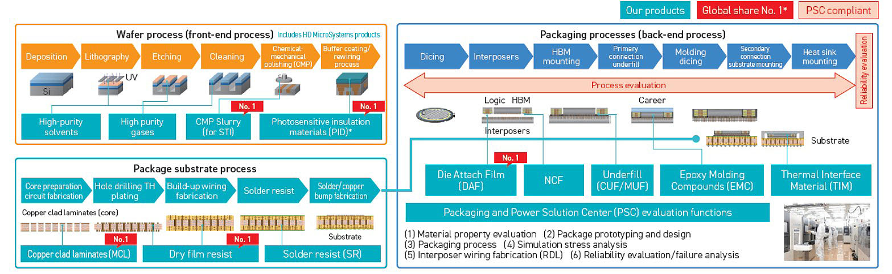

## Document Metadata

- Document ID: 60e38ba7c7ebb72b78e2acc1a307ce17ca74a5fc
- Document Title: Business Strategies - Front-end / Back-end Semiconductor Materials | レゾナック
- Document Type: HTML
- Issuing Organization: Resonac
- Publication Date: null
- Reporting Period: null
- Source File: [46_resonac.com_semi.html](https://github.com/jadennevercode/CJCC-Knowledge-Base/blob/564ab11aa9785e569e3853c8a4d7ce86f88e7535/materials/%E4%B8%8A%E6%B8%B8%EF%BC%9ACMP%E5%8F%8A%E5%B0%81%E8%A3%85%E6%A8%A1%E7%BB%84%E6%9D%90%E6%96%99/46_resonac.com_semi.html)

## Structured Content

## Products Line-up

“Structure-based” proposal capabilities realized through advanced semiconductor materials and evaluation foundations.  In addition to our broad lineup of products with high market share, we will leverage our World-Class packaging evaluation foundation to move toward material proposals “created proactively” starting from packaging structures

图中标示：Our products；Global share No. 1*；PSC compliant。

Wafer process (front-end process) — Includes HD MicroSystems products: Deposition；Lithography；Etching；Cleaning；Chemical-mechanical polishing (CMP)；Buffer coating/rewiring process。产品：High-purity solvents；High purity gases；CMP Slurry (for STI) [No. 1]；Photosensitive insulation materials (PID)* [No. 1]。

Package substrate process: Core preparation circuit fabrication；Hole drilling TH plating；Build-up wiring fabrication；Solder resist；Solder/copper bump fabrication。产品：Copper clad laminates (MCL) [No. 1]；Dry film resist [No. 1]；Solder resist (SR)。图中还标有 Copper clad laminates (core)、Substrate。

Packaging processes (back-end process): Dicing；Interposers；HBM mounting；Primary connection underfill；Molding dicing；Secondary connection substrate mounting；Heat sink mounting。图中标有 Process evaluation、Reliability evaluation、Logic、HBM、Career、Interposers、Substrate。产品：Die Attach Film (DAF) [No. 1]；NCF；Underfill (CUF/MUF)；Epoxy Molding Compounds (EMC)；Thermal Interface Material (TIM)。

Packaging and Power Solution Center (PSC) evaluation functions: (1) Material property evaluation；(2) Package prototyping and design；(3) Packaging process；(4) Simulation stress analysis；(5) Interposer wiring fabrication (RDL)；(6) Reliability evaluation/failure analysis。

- ※ Source: Fuji Chimera Research Institute “2024 Electronics Packaging New Materials Handbook,” Copper Clad Laminate for Package 2023 actual (value basis), Dry Film Resist 2023 actual (shipping value basis), Encapsulant 2023 actual (volume and value basis), Underfill for Primary Jisso 2023 actual (volume and value basis); Photosensitive insulation materials\*, Buffer coating materials and rewiring materials 2023 actual (volume:\* products of HD MicroSystems L.L.C., a group company)
- ※ Source:Fuji Keizai “2025 Semiconductor Materials Market: Current Status and Future Outlook”: Die bonding film, 2024 actual results (volume); CMP slurry (for STI), 2024 actual results (value)

## Vision for 2030 and Roadmap to Achieve It

| Achievements to Date | Issues | Priority Measures for Phase 2 |
| --- | --- | --- |
| - Promoted the expansion of materials and concentrated investments in strategic products for growth areas such as AI semiconductor packages and advanced logic and memory applications - Contributed to improvements in revenue and the EBITDA margin through portfolio strategies - Established US-JOINT and JOINT3 as frameworks for global co-creation activities with equipment and materials manufacturers, and accelerated the technological development of advanced semiconductor packages - Built a robust supply chain to respond to geopolitical risks in a bid to secure stable supply and strengthen our competitive edge | - *Enhancement of ability to respond to accelerating technological advancements* Amid the spread of generative AI and the advancement of digital infrastructure, the speed of semiconductor technology evolution and the level of customer demands are increasing. Strengthening our technological and product development capabilities to continue to meet these demands is a challenge. - *Continuing to provide value for next-generation semiconductors* To continuously provide value in the field of next-generation semiconductors, innovative evolution is required in all aspects of our products, supply, and business operations - *Advancement of supply chain management, which supports stable supply* Amid rising geopolitical risks, demands for supply stability are mounting, making the advancement of management that oversees the entire supply chain a key issue to be addressed | - Further deepen business operations centered on co-creation to strengthen competitiveness in the field of next-generation semiconductors - Enhance product capabilities by strengthening collaboration with partners through JOINT activities, while promoting contributions to energy conservation and reducing environmental impacts by improving material performance - In light of geopolitical risks, advance the sophistication of the supply chain management system centered on collaboration with suppliers, aiming to achieve both a stable supply and business growth |

| Plans for 2026 |
| --- |
| *Priority Measures: Growth Strategy for Next-Generation Semiconductors Field* In 2026, we will further promote product portfolio reform and aim to expand high-value-added businesses centered on the next-generation semiconductors field. We will steadily advance the growth of strategic products for growth fields while leading to medium- to long-term business growth through the continuous market introduction of new products. US-JOINT and JOINT3 will fully start initiatives leading to the creation of new technological themes and product concepts through collaboration with partners. At the same time, we will work to foster a sense of unity at the business headquarters and develop human resources through global dialogues, as well as strengthen manufacturing capabilities utilizing SPC (Statistical Process Control). Furthermore, in advancing our supply chain management system, we will improve supply stability by strengthening our collaboration with strategic suppliers and promoting multi-sourcing, as well as improve our adjustment capabilities through the visualization of supply-demand data. Additionally, we will strengthen risk resilience by diversifying our bases and establishing alternative production systems. |

Growth opportunities for advanced packaging and back-end process materials created by AI server demand. Advancement of generative AI and sophistication of packaging requirements are driving demand for back-end process materials. “Backed by the enhancement of quantity and quality, we expect AI-related back-end process materials to exceed market growth at a CAGR of 25-50%”。

- Increase in no. of servers: Increase in demand for AI servers, CAGR 20% (2025-2030)；Increase in computational intensity；Infrastructure expansion。
- Sophistication of performance requirements: Advancement of processing power；Optimization of power consumption；Enhancement of heat management。
- Higher capacity of package structure: Larger package and interposers +80% or more (2025: 70x80 to 100x100 mm)；Increase in substrate wiring layers +15 to +20% (2025: 20-22 layers)；Increase in HBM layers +60 to +150% (2025: 8 or 12 layers)。
- Advancement of back-end process materials: Dimensional stability and warpage control — Copper clad laminates, solder resist, etc.；Miniaturization and low loss — Dry Film Resist, photosensitive insulation materials, etc.；Thinner film and uniformity — NCF, etc.；Thermal Interface Material, Epoxy Molding Compounds, etc. — Thermal conductivity materials, encapsulants, etc.

* The figures in this illustration are our estimates assuming the period from 2025 to 2030, and may vary depending on market trends.

