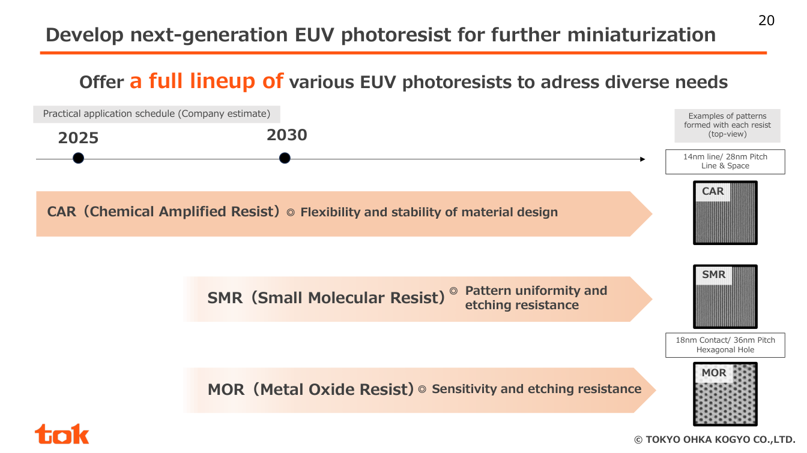
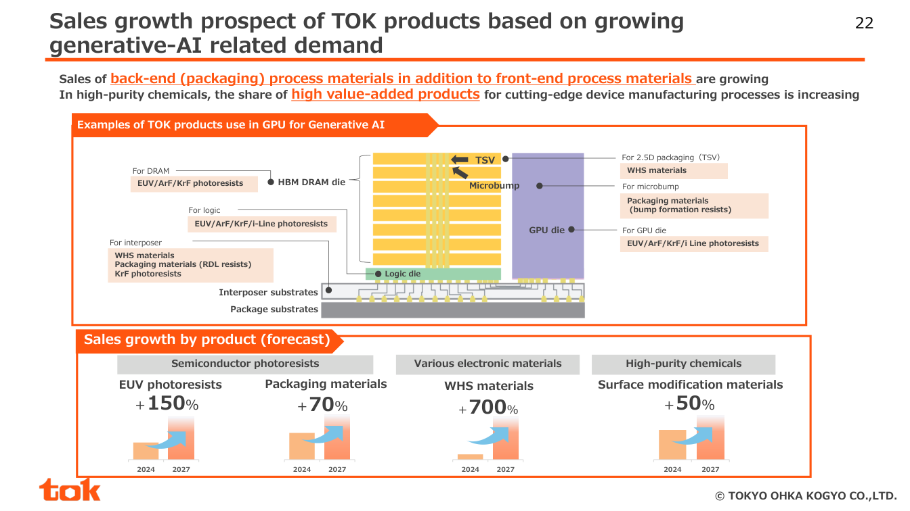

## Document Metadata

- Document ID: dfe08dcd8068e44adc230e3b0ce2a840671ae13b
- Document Title: Business Results - The Fiscal Year ended Dec. 2025
- Document Type: Business Results Presentation
- Issuing Organization: TOKYO OHKA KOGYO CO., LTD.
- Publication Date: 2026-02-09
- Reporting Period: FY2025 (2025-01 to 2025-12)
- Source File: [45_tok.co.jp_account_2512_4_en.pdf](https://github.com/jadennevercode/CJCC-Knowledge-Base/blob/564ab11aa9785e569e3853c8a4d7ce86f88e7535/materials/%E4%B8%8A%E6%B8%B8%EF%BC%9A%E5%85%89%E5%88%BB%E6%9D%90%E6%96%99/45_tok.co.jp_account_2512_4_en.pdf)

## Structured Content

[Source Page: 3]

## Summary for FY2025

### FY2025 Results

- Revised upward the full-year financial results forecast on January 30
- Net sales, operating income, ordinary income and profit attributable to owners of parent hit a record high for two consecutive years.
- Both net sales and operating income increased significantly by capitalizing on the expansion of the electronics market including an increase in demand for generative AI-related products.

### FY2026 Consolidated Forecasts

- Assumptions: Expect growth in advanced semiconductor materials and the launch of operations of customers’ new plants, with the continued strong demand for generative AI-related products.

  Assumed exchange rate ¥148.6/$ (FY2025 actual) ⇒ ¥150.0/$ (FY2026)

- Expect YoY growth in both net sales and operating income significantly exceeding FY2025 based on the market situation and the adoption status of our products. Expect to reach a record high for three consecutive years.

[Source Page: 4]

## Summary (FY2025)

(Millions of yen)

| | FY2024 | FY2025 | Change | % |
| --- | --- | --- | --- | --- |
| Net sales | 200,966 | 237,029 | +36,062 | +17.9 |
| Electronic functional materials | 107,515 | 124,700 | +17,184 | +16.0 |
| High purity chemicals | 91,476 | 109,400 | +17,923 | +19.6 |
| Other | 1,974 | 2,928 | +954 | +48.3 |
| Operating income | 33,090 | 47,386 | +14,295 | +43.2 |
| Ordinary income | 34,554 | 49,274 | +14,720 | +42.6 |
| Profit attributable to owners of parent | 22,683 | 33,345 | +10,661 | +47.0 |
| EBITDA | 41,424 | 56,194 | +14,769 | +35.7 |
| ROE (%) | 11.8 | 15.6 | +3.8 | - |

Average exchange rate (US$): ¥150.8/$ (FY2024) ⇒ ¥148.6/$ (FY2025)

- Net sales: Up 17.9% YoY. Both electronic functional materials and high-purity chemicals acheived significant sales growth due to higher demand for generative AI-related products and steady growth for replacement of PCs.
- Operating income: Up 43.2% YoY. Significant YoY increase due to higher sales of high value-added products, mainly advanced materials. (Including a one-off profit recorded in connection with the recognition of inventories such as development-related materials in 4Q)
- Profit attributable to owners of parent: Up 47.0% YoY due to increased operating income. (Including extraordinary income associated with the transfer of Equipment Business in 1Q)

[Source Page: 18]

## Revision of Quantitative Objectives of tok Medium-Term Plan 2027

### Background of revision

(1) Changes in semiconductor market trends

Demand for tok products is growing at a pace exceeding initial forecast, driven by increasing demand for generative AI secmiconductors.

(2) Changes in exchange rate

The yen has been weaker than initially forecasted, which is expected to contribute to higher net sales and operating income.

(Average exchange rate for FY2025 to FY2027 (US$)…Initial forecast: ¥135.0/$ ⇒ After revision: ¥150.0/$)

Upwardly revised net sales, operating income, EBITDA, and ROE target. Qualitative Objectives and Key Strategies are not revised.

| | FY2025 Results | FY2027 Initial targets (announced in Jan. 2025) | FY2027 Revised targets (announced in Feb. 2026) |
| --- | --- | --- | --- |
| Net sales (billion yen) | 237.0 | 270.0 | 295.0 |
| Operating income (billion yen) | 47.3 | 48.0 | 58.0 |
| EBITDA (billion yen) | 56.1 | 60.0 | 72.0 |
| ROE | 15.6% | 13.0% | 14.0% |

[Source Page: 20]

## tok Medium-Term Plan 2027: Target/Strategy/Progress by Segment

| Segment | Targets in Medium-Term Plan | Net sales growth (FY2024 → FY2027): Initial target (announced in Feb. 2025) | Net sales growth (FY2024 → FY2027): Revised target (announced in Feb. 2026) | Strategy | Progress |
| --- | --- | ---: | ---: | --- | --- |
| Semiconductor photoresist —Advanced materials —KrF resist —Legacy materials —Packaging materials | Sales increase by exceeding market growth with share expand | +37% | +42% | Expand technology portfolio Enhance quality control toward further miniaturization Differentiate through advanced production technologies and stable supply of high-quality products | Demand is growing and our market share is expanding in the innovative field (logic/memory) including generative AI semiconductors |
| Various electronic materials —MEMS materials —WHS materials —Display materials —Other | Sales expand by increasing share in existing and new markets | +20% | +143% | Uncover potential needs by anticipating technology trends | Growth of the advanced packaging market and expand customers’ base |
| High-purity chemicals —Thinners —Developer —Surface modification materials | Sales expand by demand increase and build supply system | +34% | +44% | Establish a global supply system Gain adoption of our products for cutting-edge device manufacturing process | Demand is growing due to construction of customers’ new plants Sales are expanding in the US, Taiwan, China and Japan Commenced the build-out of a supply system of high-purity chemicals in South Korea |

[Source Page: 21]

## Develop next-generation EUV photoresist for further miniaturization

Offer a full lineup of various EUV photoresists to adress diverse needs.

Practical application schedule (Company estimate): 2025–2030; see original chart for timing.

- CAR (Chemical Amplified Resist): Flexibility and stability of material design
- SMR (Small Molecular Resist): Pattern uniformity and etching resistance
- MOR (Metal Oxide Resist): Sensitivity and etching resistance

Examples of patterns formed with each resist (top-view): 14nm line/ 28nm Pitch Line & Space; 18nm Contact/ 36nm Pitch Hexagonal Hole.

[Source Page: 22]

### Industry-academia collaboration: Joint study with Univ. of Hyogo

Concluded an agreement on promoting cooperation and collaboration with the University (2025). Working to enhance patterning resolution under the theme of “Beyond EUV” by further shortening the wavelength of light sources used in existing EUV lithography.

### Inter-industry collaboration: Participation in JOINT3

Participated in "JOINT3," a consortium to develop next-generation semiconductor packaging (2025). Accelerating the development of panel-level packaging materials through co-creation with material, equipment and design companies.

[Source Page: 23]

## Sales growth prospect of TOK products based on growing generative-AI related demand

Sales of back-end (packaging) process materials in addition to front-end process materials are growing. In high-purity chemicals, the share of high value-added products for cutting-edge device manufacturing processes is increasing.

### Examples of TOK products use in GPU for Generative AI

| Application | TOK products |
| --- | --- |
| For DRAM | EUV/ArF/KrF photoresists |
| For logic | EUV/ArF/KrF/i-Line photoresists |
| For interposer | WHS materials; Packaging materials (RDL resists); KrF photoresists |
| For 2.5D packaging (TSV) | WHS materials |
| For microbump | Packaging materials (bump formation resists) |
| For GPU die | EUV/ArF/KrF/i Line photoresists |

Diagram labels: HBM DRAM die, Logic die, Interposer substrates, Package substrates, TSV, Microbump, GPU die.

### Sales growth by product (forecast), 2024–2027

| Product | Growth |
| --- | --- |
| Semiconductor photoresists: EUV photoresists | +150% |
| Semiconductor photoresists: Packaging materials | +70% |
| Various electronic materials: WHS materials | +700% |
| High-purity chemicals: Surface modification materials | +50% |

[Source Page: 24]

## Expanding Cash Generating Ability by Strengthening Manufacturing Capital

### Estimated EBITDA trends through 2030

- 2025 result: EBITDA ¥56.1 billions.
- 2027 target: EBITDA ¥72.0 billions.
- The figure labels 2026/1H, 2027/1H, 2027/2H and 2030 and includes “EBITDA generated by existing facilities + other investments.”

- TOKAM/ Incheon Plant (South Korea): Constructed a new inspection building. Investment amount: Approx. ¥7.0 billions.
- TOK/Aso Plant, Aso Kumamoto Site (Japan): Constructed a new production plant for High-purity chemicals. Investment amount: Approx. ¥13.0 billions.
- TOK/ Koriyama Plant (Japan): Construction underway on world's largest photoresist manufacturing building. Investment amount: over ¥20.0 billions.
- TOKAM/ Pyeongtaek Plant (South Korea): Construction underway on a High-purity chemical manufacturing building. Investment amount: Approx. ¥12.0 billions.

