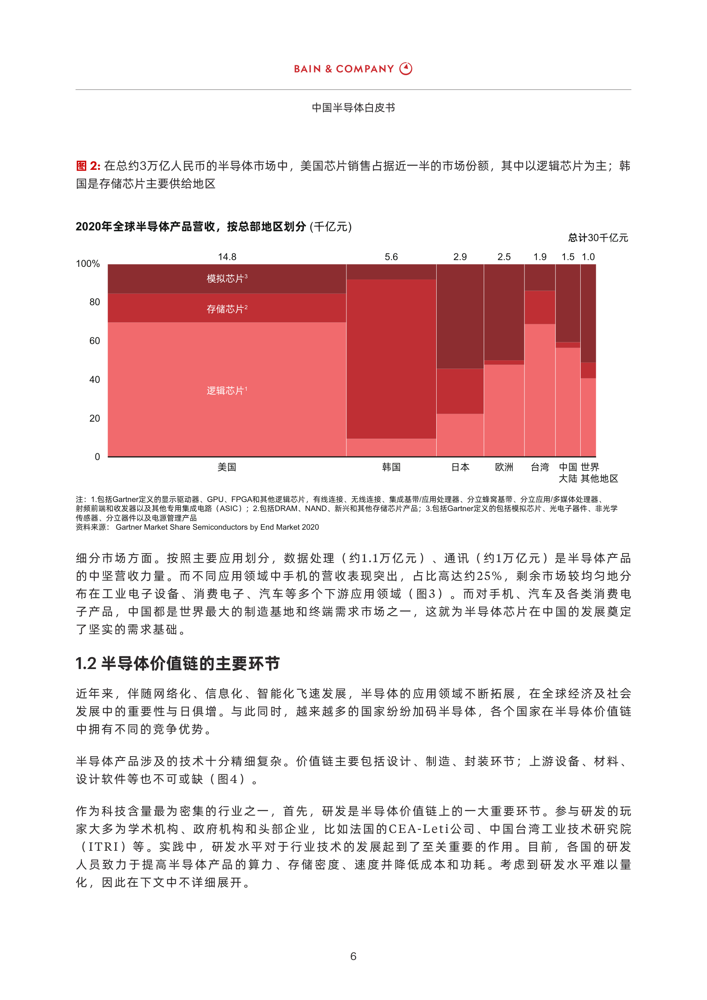
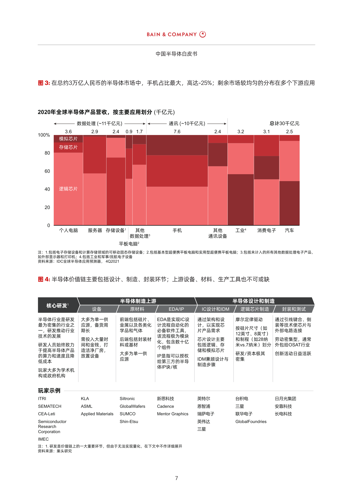
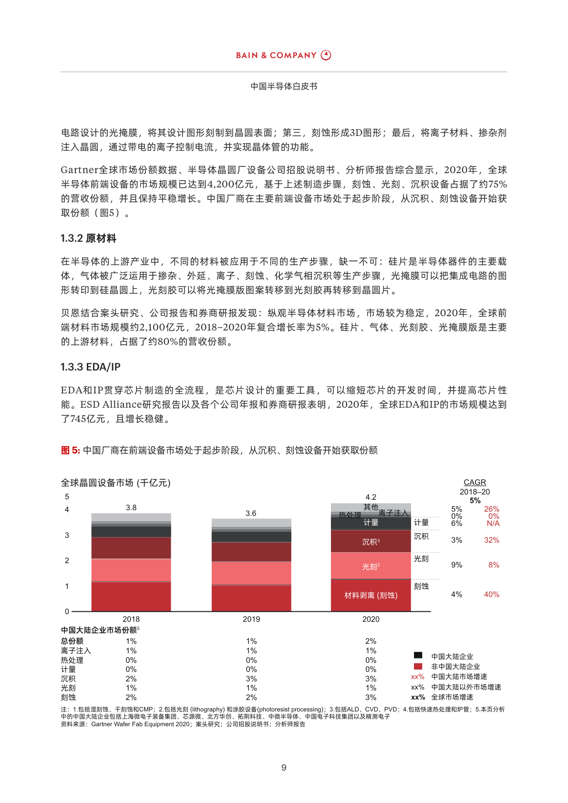
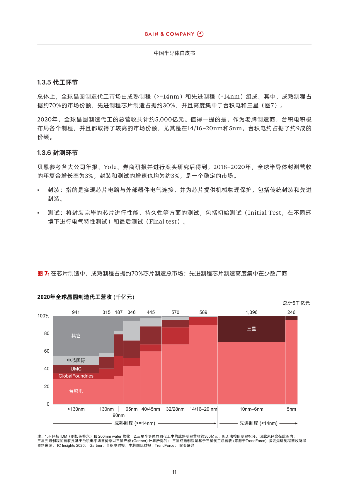
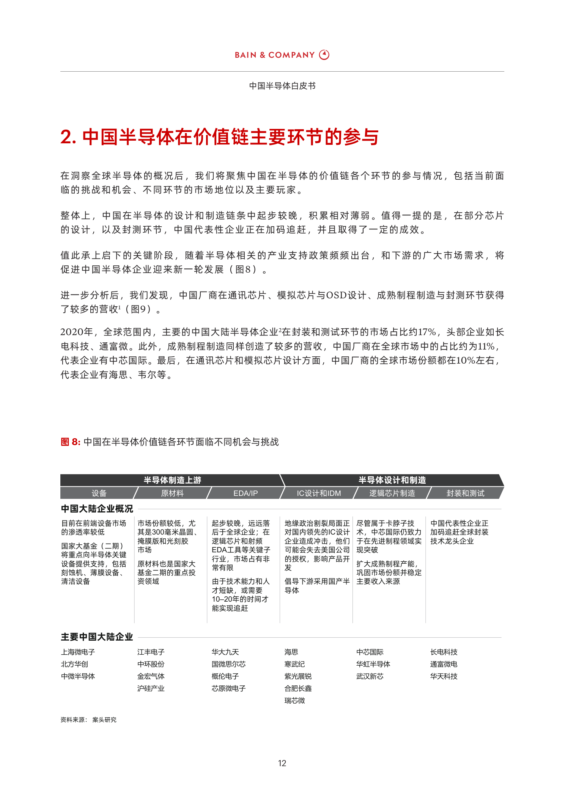
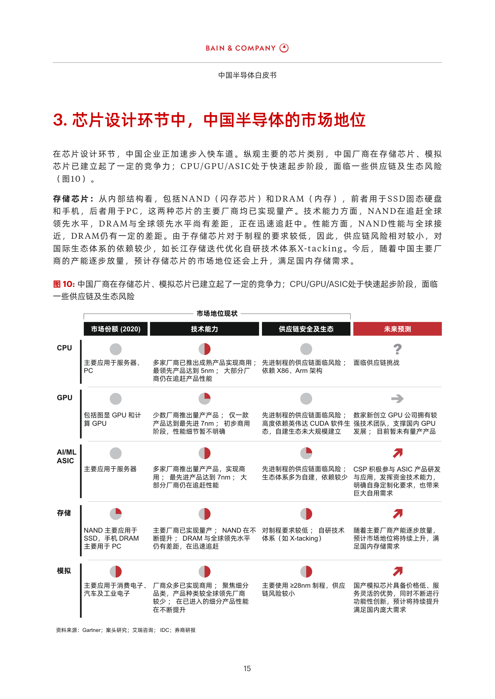
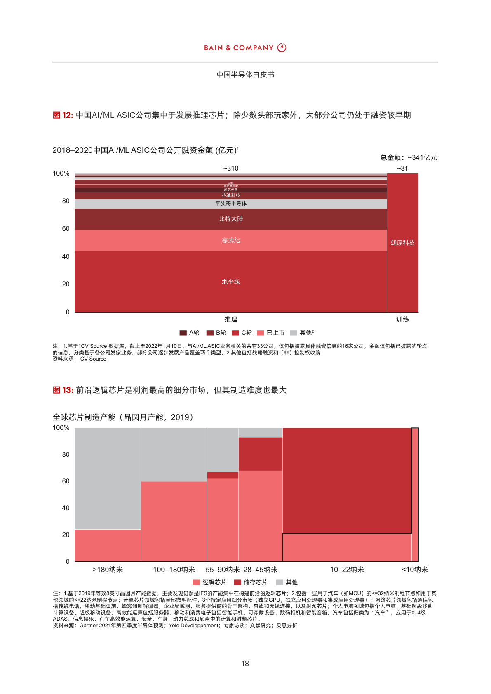

## Document Metadata

- Document ID: 66731e3265e36cee828aef00e140b537375b12b8
- Document Title: 中国半导体白皮书
- Document Type: PDF
- Issuing Organization: 贝恩公司
- Publication Date: null
- Reporting Period: null
- Source File: [23_www.bain.cn_202208220536478028.pdf](https://github.com/jadennevercode/CJCC-Knowledge-Base/blob/564ab11aa9785e569e3853c8a4d7ce86f88e7535/materials/%E4%B8%8A%E6%B8%B8%EF%BC%9A%E5%8D%8A%E5%AF%BC%E4%BD%93%E7%BA%A7%E5%8E%9F%E6%9D%90%E6%96%99/23_www.bain.cn_202208220536478028.pdf)

## Structured Content

[Source Page: 7]

按照企业所在地划分，在上述总量约 3 万亿元的半导体市场中，美国的芯片销售占据了近一半的市场份额，尤其以逻辑芯片为主，而韩国是存储芯片的主要供给地区（图 2）。

2020 年全年，美国的芯片销售额达到了 1.48 万亿元，逻辑芯片占比超过 60%，此后是韩国（5,600 亿元），日本（2,900 亿元），欧洲（2,500 亿元），中国台湾地区（1,900 亿元）和中国大陆（1,500 亿元）。

[Source Page: 8]

**图 2：**在总约 3 万亿人民币的半导体市场中，美国芯片销售占据近一半的市场份额，其中以逻辑芯片为主；韩国是存储芯片主要供给地区。

2020 年全球半导体产品营收，按总部地区划分（千亿元）：

| 总部地区 | 营收（千亿元） |
| --- | ---: |
| 美国 | 14.8 |
| 韩国 | 5.6 |
| 日本 | 2.9 |
| 欧洲 | 2.5 |
| 台湾 | 1.9 |
| 中国大陆 | 1.5 |
| 世界其他地区 | 1.0 |
| 总计 | 30 |

图中分为逻辑芯片¹、存储芯片²、模拟芯片³；各地区分项占比未标出精确数值，保留原图，不作估算。

注：

1. 包括 Gartner 定义的显示驱动器、GPU、FPGA 和其他逻辑芯片，有线连接、无线连接、集成基带/应用处理器、分立蜂窝基带、分立应用/多媒体处理器、射频前端和收发器以及其他专用集成电路（ASIC）。
2. 包括 DRAM、NAND、新兴和其他存储芯片产品。
3. 包括 Gartner 定义的包括模拟芯片、光电子器件、非光学传感器、分立器件以及电源管理产品。

资料来源：Gartner Market Share Semiconductors by End Market 2020。

[Source Page: 9]

**图 4：**半导体价值链主要包括设计、制造、封装环节；上游设备、材料、生产工具也不可或缺。

| 环节 | 原图描述 | 玩家示例 |
| --- | --- | --- |
| 核心研发¹ | 半导体行业是研发最为密集的行业之一，研发推动行业技术的发展；研发人员始终致力于提高半导体产品的算力和速度且降低成本；玩家大多为学术机构或政府机构 | ITRI；SEMATECH；CEA-Leti；Semiconductor Research Corporation；IMEC |
| 设备 | 大多为单一供应源，备货周期长；需投入大量时间和金钱，打造洁净厂房，放置设备 | KLA；ASML；Applied Materials |
| 原材料 | 前端包括硅片、金属以及各类化学品和气体；后端包括封装材料或基材；大多为单一供应源 | Siltronic；GlobalWafers；SUMCO；Shin-Etsu |
| EDA/IP | EDA 是实现 IC 设计流程自动化的必备软件工具，该流程极为模块化，包含数十亿个组件；IP 是指可以授权给第三方的半导体 IP 块/核 | 新思科技；Cadence；Mentor Graphics |
| IC 设计和 IDM | 通过架构和设计，以实现芯片产品需求；芯片设计主要包括逻辑、存储和模拟芯片；IDM 兼顾设计与制造步骤 | 英特尔；恩智浦；瑞萨电子；英伟达；三星 |
| 逻辑芯片制造 | 摩尔定律驱动；按硅片尺寸（如 12 英寸、8 英寸）和制程（如 28 纳米 vs. 7 纳米）划分；研发/资本极其密集 | 台积电；三星；联华电子；GlobalFoundries |
| 封装和测试 | 通过引线键合、倒装等技术使芯片与外部电路连接；劳动密集型，通常外包给 OSAT 行业；创新活动日益活跃 | 日月光集团；安靠科技；长电科技 |

注：1. 研发是价值链上的一大重要环节，但由于无法实现量化，在下文中不作详细展开。资料来源：案头研究。

[Source Page: 10]

#### 半导体制造的上游支撑产业

最上游的企业负责生产半导体设计制造所需的设备、原材料和EDA软件。这些设备、原材料、EDA软件被广泛应用于制造集成电路（IC）、光电子器件、分立器件、传感器等领域，是半导体产品设计制造的前道工序，也是整个价值链中不可或缺的组成部分。

具体看，半导体的生产设备备货周期长，大多为单一供应源，并且在全球范围内涌现出了一批代表性企业，比如，专注于光刻机领域的荷兰公司阿斯麦尔（ASML）、提供晶圆缺陷监测系统的美国KLA-Tencor公司。为了打造洁净的厂房并放置生产设备，这些公司通常需要投入大量的时间和金钱，属于重资产公司。

除设备以外，在制造半导体的过程中，还离不开前端及后端原材料，前端材料包括硅片、金属以及各类化学品和气体，后端则包括封装材料或基材。类似生产设备，半导体原材料大多为单一供应源。以硅晶圆为例，由于半导体级硅晶圆对于纯度的要求极高（99.999999999%），因此，行业壁垒高，当前，领先企业包括德国硅晶圆制造商世创（Siltronic）和日本信越半导体（Shin-Etsu）等。

此外，在半导体制造的上游产业中，由数十亿个组件构成的EDA（电子设计自动化）是实现半导体元器件和集成电路设计流程自动化的必备软件工具，是半导体市场的先驱和风向标。在该领域，国内企业与三大国际巨头新思科技（Synopsys）, 明导国际（Mentor Graphics）, 楷登电子（Cadence）仍存在一定差距，需要长时间与晶圆代工联动的设计数据库积累，和相关人才投入，逐步提升产品竞争力。

值得一提的是，随着集成电路技术升级，半导体行业的分工趋于细化，半导体IP核，即可以授权给第三方的知识产权核迎来新一轮增长

#### 半导体设计和代工

经过多年的发展，半导体生态逐步完善，主要包括设计、代工、封装和测试环节。

设计环节。主要有IC设计（集成电路设计）和IDM（垂直整合制造）两类企业，前者只参与芯片和集成电路的架构和设计，后者则兼顾了设计与制造步骤。代表企业有英伟达、恩智浦半导体、英特尔、三星等。

代工环节。一直以来，逻辑芯片的制造受到摩尔定律的驱动，遵循集成电路上可以容纳的晶体管数目大约每两年会增加一倍的规律演进，而在摩尔定律的推动下，半导体制造走向“更大硅片”和“更小制程”以降低制造成本和功耗。按照尺寸和制程划分，当前主流为8英寸/12英寸硅片；以及65纳米/28纳米/7纳米等不同制程。代表企业有台积电、联华电子等。

封装和测试环节。封测指的是通过引线键合、倒装等技术，使芯片与外部电路连接，是半导体价值链中必不可少的下游环节，具有劳动密集型的特征，通常由外包半导体封装测试行业（OSAT）完成。值得注意的是，贝恩观察到，封测厂商常常需要提供定制化服务，与设计厂商进行联合开发，以此保证紧跟芯片产品的需求，所以，该环节的创新活动日益活跃。代表企业有日月光集团、安靠科技等。

### 1.3 半导体价值链：各大环节的分布情况及主要玩家

#### 1.3.1 前端设备

晶圆制造通常包含沉积、光刻、刻蚀、离子注入4 大核心步骤组成。首先，使用沉积设备（如CVD、PVD、ALD）在基材表面沉积多层薄膜；其次，在晶圆表面均匀涂上光刻胶，使射强激光通过含有

[Source Page: 11]

*原报告印刷页码：9*

电路设计的光掩膜，将其设计图形刻制到晶圆表面；第三，刻蚀形成 3D 图形；最后，将离子材料、掺杂剂注入晶圆，通过带电的离子控制电流，并实现晶体管的功能。

Gartner 全球市场份额数据、半导体晶圆厂设备公司招股说明书、分析师报告综合显示，2020 年，全球半导体前端设备的市场规模已达到 4,200 亿元，基于上述制造步骤，刻蚀、光刻、沉积设备占据了约 75% 的营收份额，并且保持平稳增长。中国厂商在主要前端设备市场处于起步阶段，从沉积、刻蚀设备开始获取份额（图 5）。

#### 1.3.2 原材料

在半导体的上游产业中，不同的材料被应用于不同的生产步骤，缺一不可：硅片是半导体器件的主要载体，气体被广泛运用于掺杂、外延、离子、刻蚀、化学气相沉积等生产步骤，光掩膜可以把集成电路的图形转印到硅晶圆上，光刻胶可以将光掩膜版图案转移到光刻胶再转移到晶圆片。

贝恩结合案头研究、公司报告和券商研报发现：纵观半导体材料市场，市场较为稳定，2020 年，全球前端材料市场规模约 2,100 亿元，2018–2020 年复合增长率为 5%。硅片、气体、光刻胶、光掩膜版是主要的上游材料，占据了约 80% 的营收份额。

#### 1.3.3 EDA/IP

EDA 和 IP 贯穿芯片制造的全流程，是芯片设计的重要工具，可以缩短芯片的开发时间，并提高芯片性能。ESD Alliance 研究报告以及各个公司年报和券商研报表明，2020 年，全球 EDA 和 IP 的市场规模达到了 745 亿元，且增长稳健。

**图 5：**中国厂商在前端设备市场处于起步阶段，从沉积、刻蚀设备开始获取份额。

全球晶圆设备市场（千亿元）：2018 年 3.8，2019 年 3.6，2020 年 4.2；2018–20 CAGR 5%。

中国大陆企业市场份额⁵：

| 类别 | 2018 | 2019 | 2020 |
| --- | ---: | ---: | ---: |
| 总份额 | 1% | 1% | 2% |
| 离子注入 | 1% | 1% | 1% |
| 热处理 | 0% | 0% | 0% |
| 计量 | 0% | 0% | 0% |
| 沉积 | 2% | 3% | 3% |
| 光刻 | 1% | 1% | 1% |
| 刻蚀 | 2% | 2% | 3% |

图中 CAGR（2018–20）：

| 类别 | 全球市场增速 | 中国大陆市场增速 |
| --- | ---: | ---: |
| 其他 | 5% | 26% |
| 热处理 | 0% | 0% |
| 计量 | 6% | N/A |
| 沉积 | 3% | 32% |
| 光刻 | 9% | 8% |
| 刻蚀 | 4% | 40% |

注：1. 包括湿刻蚀、干刻蚀和 CMP；2. 包括光刻（lithography）和涂胶设备（photoresist processing）；3. 包括 ALD、CVD、PVD；4. 包括快速热处理和炉管；5. 本页分析中的中国大陆企业包括上海微电子装备集团、芯源微、北方华创、拓荆科技、中微半导体、中国电子科技集团以及精测电子。

资料来源：Gartner Wafer Fab Equipment 2020；案头研究；公司招股说明书；分析师报告。

[Source Page: 12]

2020 年，逻辑芯片贡献了约一半的销售额，大约 1.6 万亿元，但是不同细分领域有各自的领先玩家。比如，在 GPU 领域，头部企业英伟达占据了约八成的销售额；在 MPU 领域，英特尔拥有较强的优势；在应用/媒体处理器领域，苹果和联发科表现亮眼。

有别于逻辑芯片，存储芯片市场高度集中，2020 年的营收额约 8,000 亿元。无论在内存（DRAM）还是闪存（NAND）领域，三星都是主力军，SK 海力士、美光紧随其后，铠侠和西部数据则更加专注于 NAND 领域。

模拟芯片的厂商众多，在三大芯片中，格局最分散：德州仪器、亚德诺占据了模拟领域的半壁江山；分立器件、光电子领域中，各大厂商不分伯仲；传感器领域同样如此，除博世以外，其他厂商竞争激烈。

[Source Page: 13]

*原报告印刷页码：11*

#### 1.3.5 代工环节

总体上，全球晶圆制造代工市场由成熟制程（>=14nm）和先进制程（<14nm）组成。其中，成熟制程占据约 70% 的市场份额，先进制程芯片制造占据约 30%，并且高度集中于台积电和三星（图 7）。

2020 年，全球晶圆制造代工的总营收共计约 5,000 亿元。值得一提的是，作为老牌制造商，台积电积极布局各个制程，并且都取得了较高的市场份额，尤其是在 14/16–20nm 和 5nm，台积电约占据了约 9 成的份额。

[Source Page: 13]

**图 7：**在芯片制造中，成熟制程占据约 70% 芯片制造总市场；先进制程芯片制造高度集中在少数厂商。

2020 年全球晶圆制造代工营收，原图标题标为“千亿元”，总计标为“5 千亿元”；各制程柱顶原始数值如下：

| 制程 | 原图数值 |
| --- | ---: |
| >130nm | 941 |
| 130nm | 315 |
| 90nm | 187 |
| 65nm | 346 |
| 40/45nm | 445 |
| 32/28nm | 570 |
| 14/16–20nm | 589 |
| 10nm–6nm | 1,396 |
| 5nm | 246 |

[OCR_UNCERTAIN] 图中数值、图题单位与总计的对应口径不明确；按原页保留，不进行单位换算。厂商分项占比未标精确数值，见原图。

注：1. 不包括 IDM（例如英特尔）和 200mm wafer 营收；2. 三星半导体晶圆代工中的成熟制程营收约 360 亿元，但无法按照制程拆分，因此未包含在此图内；三星先进制程的营收是基于台积电平均售价乘以三星产能（Gartner）计算所得的；三星成熟制程营收是基于三星代工总营收（来源于 TrendForce）减去先进制程营收所得。

资料来源：IC Insights 2020；Gartner；台积电财报；中芯国际财报；TrendForce；案头研究。

[Source Page: 14]

## 2. 中国半导体在价值链主要环节的参与

在洞察全球半导体的概况后，我们将聚焦中国在半导体的价值链各个环节的参与情况，包括当前面临的挑战和机会、不同环节的市场地位以及主要玩家。

整体上，中国在半导体的设计和制造链条中起步较晚，积累相对薄弱。值得一提的是，在部分芯片的设计，以及封测环节，中国代表性企业正在加码追赶，并且取得了一定的成效。

值此承上启下的关键阶段，随着半导体相关的产业支持政策频频出台，和下游的广大市场需求，将促进中国半导体企业迎来新一轮发展（图 8）。

进一步分析后，我们发现，中国厂商在通讯芯片、模拟芯片与 OSD 设计、成熟制程制造与封测环节获得了较多的营收¹（图 9）。

2020 年，全球范围内，主要的中国大陆半导体企业²在封装和测试环节的市场占比约 17%，头部企业如长电科技、通富微。此外，成熟制程制造同样创造了较多的营收，中国厂商在全球市场中的占比约为 11%，代表企业有中芯国际。最后，在通讯芯片和模拟芯片设计方面，中国厂商的全球市场份额都在 10% 左右，代表企业有海思、韦尔等。

**图 8：**中国在半导体价值链各环节面临不同机会与挑战。

| 环节 | 中国大陆企业概况 | 主要中国大陆企业 |
| --- | --- | --- |
| 设备 | 目前在前端设备市场的渗透率较低；国家大基金（二期）将重点向半导体关键设备提供支持，包括刻蚀机、薄膜设备、清洁设备 | 上海微电子；北方华创；中微半导体 |
| 原材料 | 市场份额较低，尤其是 300 毫米晶圆、掩膜版和光刻胶市场；原材料也是国家大基金二期的重点投资领域 | 江丰电子；中环股份；金宏气体；沪硅产业 |
| EDA/IP | 起步较晚，远远落后于全球企业；在逻辑芯片和射频 EDA 工具等关键子行业，市场占有非常有限；由于技术能力和人才短缺，或需要 10–20 年的时间才能实现追赶 | 华大九天；国微思尔芯；概伦电子；芯原微电子 |
| IC 设计和 IDM | 地缘政治割裂局面正对国内领先的 IC 设计企业造成冲击，他们可能会失去美国公司的授权，影响产品开发；倡导下游采用国产半导体 | 海思；寒武纪；紫光展锐；合肥长鑫；瑞芯微 |
| 逻辑芯片制造 | 尽管属于卡脖子技术，中芯国际仍致力于在先进制程领域实现突破；扩大成熟制程产能，巩固市场份额并稳定主要收入来源 | 中芯国际；华虹半导体；武汉新芯 |
| 封装和测试 | 中国代表性企业正加码追赶全球封装技术龙头企业 | 长电科技；通富微电；华天科技 |

资料来源：案头研究。

[Source Page: 15]

### 2.1 前端设备

中国厂商在前端设备市场处于起步阶段，市场份额普遍较低。Gartner 和相关公司招股说明书显示，2020 年，全球晶圆设备市场总规模达到了 4,200 亿元。

其中，中国大陆企业³在沉积、刻蚀设备上与全球领先企业差距较小，开始获取份额，有望在 5–10 年内赶超世界领先水平；而光刻、离子注入、测量等仪器则还有较大差距，在较长时间内应用场景限制在非关键生产步骤，或非先进制程。

薄膜沉积是集成电路制造过程中必不可少的环节，指的是任何在硅片衬底上沉积一层膜的工艺，包括原子层沉积（ALD）、化学气相沉积（CVD）、物理气相沉积（PVD）。2018–2020 年，中国大陆市场的沉积设备的市场规模从 17 亿元左右上升至 30 亿元左右，年均复合增长率达到了 32%，增速远超全球市场。

刻蚀工艺是半导体制造工艺中的关键步骤，对于器件的电学性能非常重要，包括湿法刻蚀、干法刻蚀和化学机械平坦化（CMP）。2018–2020 年，中国大陆市场的刻蚀设备国产化成就斐然，从 18 亿元左右升至约 35 亿元，年均复合增长率高达 40%，涌现出中微半导体、北方华创等代表企业。

1. 仅指与半导体有关的收入。
2. 中国大陆企业是指在各细分市场有公开信息的主要企业。
3. 中国大陆企业包括上海微电子装备集团、芯源微、北方华创等。

[Source Page: 16]

*原报告印刷页码：14*

### 2.2 原材料

2018年以来，中国半导体材料企业持续扩充自身产能，相关产品也在加速推进：中国大陆企业⁴在硅片、气体材料中逐步获取市场份额。

硅片是半导体制造的核心原材料，2018–2020年，中国大陆的硅片市场规模从约30亿元稳步上升至42亿元左右，年均复合增长率为16%，硅片赛道的领先企业有中环领先、江丰电子等。

从芯片生产到器件封装，几乎每一个步骤都离不开气体材料，因此，在所有原材料中，气体材料的市场需求仅次于硅片。在国内半导体市场蓬勃发展的背景下，2018–2020年，中国大陆气体材料的年均复合增长率达到了20%，增速约是全球市场的3倍，后者为7%。

### 2.3 EDA/IP

由于中国起步较晚，所以，EDA/IP方面的技术能力和人才短缺，市场占有有限。贝恩结合ESD联盟研究报告、公司招股说明书和分析师报告，通过案头研究后发现2020年，中国大陆⁵EDA/IP在全球市场中的占比仅为2%。类似的情况也出现在逻辑芯片和射频EDA工具等子行业，预计需要10–20年实现追赶。这背后需要长时间与晶圆制造（Foundry）厂联动的设计数据库积累，和相关人才投入，才能逐步提升产品竞争力。

[Source Page: 16]

### 2.5 代工环节

McClean报告表明，当前，中国厂商在成熟制程代工市场已经建立了一定的市场份额。

2019年，中芯国际实现14纳米FinFET量产。中国厂商除了扩大成熟制程产能，如中芯国际在内的部分厂商仍致力于在先进制程领域实现突破。展望未来，中国厂商依然需要巩固成熟制程的市场份额并稳定主要收入来源。

### 2.6 封测环节

2018年以来，中国厂商在封测环节增长迅速，在全球范围内呈现出一定的竞争优势。基于Gartner报告中的全球规模数据，2020年，中国大陆企业在全球封测市场中的总份额达到了17%，其中，封装环节占比为19%，测试环节为9%。未来，国内封测企业的持续发展的同时，需要紧跟全球行业发展的趋势，例如与上游晶圆代工厂在先进封装上的紧密合作。

4. 仅指与半导体有关的收入  
5. 中国大陆企业是指在各细分市场有公开信息的主要企业

[Source Page: 17]

*原报告印刷页码：15*

## 3. 芯片设计环节中，中国半导体的市场地位

在芯片设计环节，中国企业正加速步入快车道。纵观主要的芯片类别，中国厂商在存储芯片、模拟芯片已建立起了一定的竞争力；CPU/GPU/ASIC 处于快速起步阶段，面临一些供应链及生态风险（图 10）。

**存储芯片：**从内部结构看，包括 NAND（闪存芯片）和 DRAM（内存），前者用于 SSD 固态硬盘和手机，后者用于 PC，这两种芯片的主要厂商均已实现量产。技术能力方面，NAND 在追赶全球领先水平，DRAM 与全球领先水平尚有差距，正在迅速追赶中。性能方面，NAND 性能与全球接近，DRAM 仍有一定的差距。由于存储芯片对于制程的要求较低，因此，供应链风险相对较小，对国际生态体系的依赖较少，如长江存储迭代优化自研技术体系 X-tacking [OCR_UNCERTAIN]。今后，随着中国主要厂商的产能逐步放量，预计存储芯片的市场地位还会上升，满足国内存储需求。

**图 10：**中国厂商在存储芯片、模拟芯片已建立起了一定的竞争力；CPU/GPU/ASIC 处于快速起步阶段，面临一些供应链及生态风险。

| 类型 | 市场份额（2020）栏的应用说明 | 技术能力 | 供应链安全及生态 | 未来预测 |
| --- | --- | --- | --- | --- |
| CPU | 主要应用于服务器、PC | 多家厂商已推出成熟产品实现商用；最领先产品达到 5nm；大部分厂商仍在追赶产品性能 | 先进制程的供应链面临风险；依赖 X86、Arm 架构 | 面临供应链挑战 |
| GPU | 包括图显 GPU 和计算 GPU | 少数厂商推出量产产品；仅一款产品达到最先进 7nm；初步商用阶段，性能细节暂不明确 | 先进制程的供应链面临风险；高度依赖英伟达 CUDA 软件生态，自建生态未大规模建立 | 数家新创立 GPU 公司拥有较强技术团队，支撑国内 GPU 发展；目前暂未有量产产品 |
| AI/ML ASIC | 主要应用于服务器 | 多家厂商推出量产产品，实现商用；最先进产品达到 7nm；大部分厂商仍在追赶性能 | 先进制程的供应链面临风险；生态体系多为自建，依赖较少 | CSP 积极参与 ASIC 产品研发与应用，发挥资金技术能力，明确自身定制化要求，也带来巨大自用需求 |
| 存储 | NAND 主要应用于 SSD、手机，DRAM 主要用于 PC | 主要厂商已实现量产；NAND 在不断提升；DRAM 与全球领先水平仍有差距，在迅速追赶 | 对制程要求较低；自研技术体系（如 X-tacking [OCR_UNCERTAIN]） | 随着主要厂商产能逐步放量，预计市场地位将持续上升，满足国内存储需求 |
| 模拟 | 主要应用于消费电子、汽车及工业电子 | 厂商众多已实现商用；聚焦细分品类，产品种类较全球领先厂商较少；在已进入的细分产品性能在不断提升 | 主要使用 ≥28nm 制程，供应链风险较小 | 国产模拟芯片具备价格低、服务灵活的优势，同时不断进行功能性创新，预计将持续提升，满足国内庞大需求 |

原图以饼图和箭头符号表示状态，但未给出符号对应的数值，保留原图，不推算市场份额。

资料来源：Gartner；案头研究；艾瑞咨询；IDC；券商研报。

[Source Page: 18]

*原报告印刷页码：16*

除了主流的NAND的DRAM [OCR_UNCERTAIN]，利基市场的NOR Flash由于设计和制程门槛较低（专利已放开，主流制程65nm）也吸引了众多国内公司进行探索。

模拟芯片：广泛应用于消费电子、汽车及工业电子。技术能力方面，众多厂商已实现商用，大多数厂商聚焦于生产细分品类产品，所以中国市场提供的产品种类较少，但是，已经进入量产的细分产品的性能接近全球水平。模拟芯片主要使用28nm以上的制程。今后，在价格低、服务灵活的优势下，国产模拟芯片若持续开展功能性创新，预计将满足国内庞大的市场需求。

CPU（中央处理器）。CPU是电子计算机的主要配件之一，常用于服务器和PC。Gartner 2020全球半导体终端市场份额显示，2020年，全球CPU市场规模约5千亿元，中国芯片设计公司营收总占比为7%。

技术能力方面，多家中国厂商已经推出了服务器、桌面CPU等产品，并应用于政务、高性能计算、工控等商用场景。但整体国内厂商在稳定性，兼容性方面仍在追赶中。CPU生态依赖X86和ARM架构，且对于先进制成的追求较高，因此，中国厂商面临很大的供应链挑战（包括上游EDA/IP设计工具，下游代工厂的先进制成服务，以及终端软件的适配）。今后，随着国产CPU厂商的产品生态趋于完善，中国厂商有望逐步小幅度提升市场占有率。

在颠覆性的计算芯片架构出现之前，ARM将凭借比RISC-V和MIPS, Alpha更完善的生态系统，和相较于X86更开放的授权体系，以及国内大量的人才储备，成为中国CPU玩家的首选架构。

GPU（显示芯片）。包括图显GPU和计算GPU。技术能力方面，少数厂商实现量产，仅有一款产品达到最先进的7nm制程，并且仍处于初步商用阶段。GPU先进制程供应链面临一定的挑战，自建生态尚未大规模建立，依赖英伟达CUDA软件生态。贝恩观察到，新成立的数家GPU公司拥有强大的技术团队，有助于加速国内GPU发展。

AI/ML ASIC。主要运用于服务器，分为AI训练和AI推理。2020年，中国AI训练芯片市场规模约46亿元，AI推理约25亿元。技术能力方面，多家中国厂商完成量产，实现商用，其中，最先进的产品达到了7nm，少数玩家在AI训练、推理芯片领域的性能接近了全球领先水平。和GPU的情况类似，AI/ML ASIC依赖先进制程，但是，生态体系以自建为主，对于外部的依赖较少。在强大的资金、技术能力的支持下，大型云计算服务商（CSP）正积极参与ASIC产品研发和应用，贝恩建议，云计算服务商需要明确自身定制化要求，从而提升在自研芯片领域的投资效率。

[Source Page: 20]

**图 13：**前沿逻辑芯片是利润最高的细分市场，但其制造难度也最大。

全球芯片制造产能（晶圆月产能，2019）：原图按 >180 纳米、100–180 纳米、55–90 纳米、28–45 纳米、10–22 纳米和 <10 纳米制程显示逻辑芯片、储存芯片及其他类别的占比。各分项未标精确值，不作估算。

注：1. 基于 2019 年等效 8 英寸晶圆月产能数据，主要发现仍然是 IFS 的产能集中在构建前沿的逻辑芯片；2. 包括一些用于汽车（如 MCU）的 <=32 纳米制程节点和用于其他领域的 <=22 纳米制程节点；计算芯片领域包括全部微型配件、3 个特定应用细分市场（独立 GPU、独立应用处理器和集成应用处理器）；网络芯片领域包括通信包括传统电话、移动基础设施、蜂窝调制解调器、企业局域网、服务提供商的骨干架构、有线和无线连接，以及射频芯片；个人电脑领域包括个人电脑、基础超级移动计算设备、超级移动设备；高效能运算包括服务器；移动和消费电子包括智能手机、可穿戴设备、数码相机和智能音箱；汽车包括归类为“汽车”、应用于 0–4 级 ADAS、信息娱乐、汽车高效能运算、安全、车身、动力总成和底盘中的计算和射频芯片。

资料来源：Gartner 2021 年第四季度半导体预测；Yole Développement；专家访谈；文献研究；贝恩分析。

[Source Page: 22]

新冠疫情发生以来，在国家政策加码和国产化提速的双重因素下，半导体融资数量大幅上涨，从2018年的263起到2021年的498起。在这个过程中，B轮及以后的融资比重增加，投资市场随半导体企业的成长一同成熟。

在总投资规模中，投向设计的比例约70%，位列所有细分赛道首位。在建立本土半导体产业链的政策影响下，上游材料与设备吸引了新的投资热点，从2019年的13%快速提升至2020年的19%。

[Source Page: 23]

*原报告印刷页码：21*

同时，在摩尔定律发展放缓的大环境下，通过先进封装技术提高系统性能的优势越发显著，导致下游封装环节与上游设计及晶圆代工的联动愈加紧密，而提前布局2.5D/3D先进封装赛道的中国封装厂商与其上游联动方因此也值得关注。

