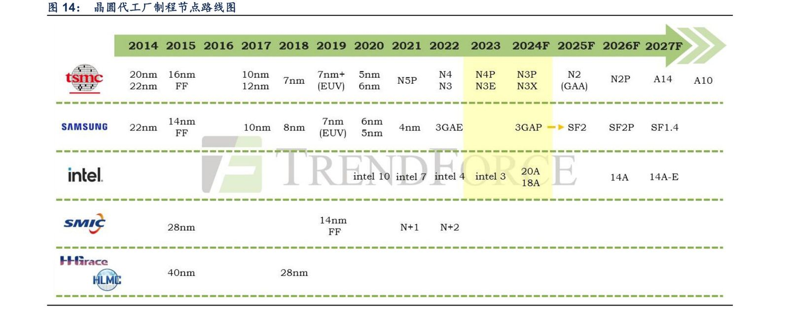
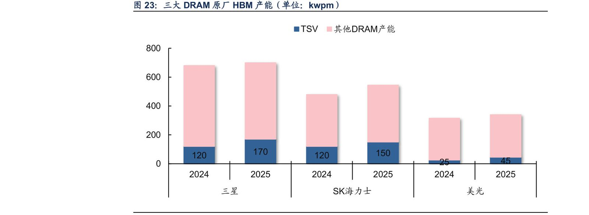
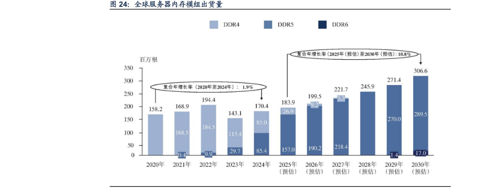
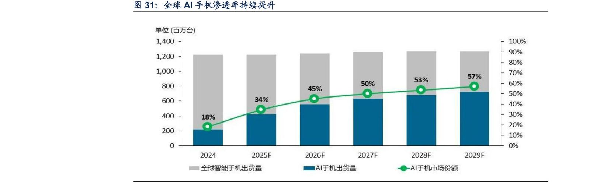

## Document Metadata

- Document ID: 17c98c7159eb62394dc97f6ee06c967d6e2b7c58
- Document Title: 电子行业2026年度策略报告：云端共振，算存齐飞
- Document Type: PDF
- Issuing Organization: 信达证券股份有限公司（CINDA SECURITIES CO.,LTD）
- Publication Date: 2025-12-02
- Reporting Period: 2026年度
- Source File: [M158_pdf.dfcfw.com_H3_AP202512021792421898_1.pdf](https://github.com/jadennevercode/CJCC-Knowledge-Base/blob/5ec8511eb834073c8bfbd79c94af196282d483cf/materials/%E4%B8%8B%E6%B8%B8%EF%BC%9A%E4%BA%91%E8%AE%A1%E7%AE%97%E4%B8%8EAI%E9%9C%80%E6%B1%82%E4%BC%A0%E5%AF%BC/M158_pdf.dfcfw.com_H3_AP202512021792421898_1.pdf)

## Structured Content

> 原文件：[M158_pdf.dfcfw.com_H3_AP202512021792421898_1.pdf](https://github.com/jadennevercode/CJCC-Knowledge-Base/blob/5ec8511eb834073c8bfbd79c94af196282d483cf/materials/%E4%B8%8B%E6%B8%B8%EF%BC%9A%E4%BA%91%E8%AE%A1%E7%AE%97%E4%B8%8EAI%E9%9C%80%E6%B1%82%E4%BC%A0%E5%AF%BC/M158_pdf.dfcfw.com_H3_AP202512021792421898_1.pdf)
> 转换方式：多模态逐页转录（页面图像 + 文本层交叉校验）

[Source Page: 1]

# 电子行业2026年度策略报告：云端共振，算存齐飞

2025年12月2日

[Source Page: 6]

# AI算力：全球基建浪潮高增，核心产业链全面受益

## AI大模型你追我赶，全球CSP加大CapEx投入

全球AI大模型的你追我赶，是推动上游算力基础设施需求爆发的重要驱动力。目前，以谷歌Gemini 3 Pro为代表的新一代多模态大模型，凭借其在复杂推理、长文本理解和跨模态交互方面的卓越表现，正在引领全球AI技术前沿。这种旗舰模型的迭代速度和对算力消耗的指数级增长，直接决定了全球云服务商必须持续加大资本开支以满足训练和部署需求。与此同时，国内头部互联网公司和AI初创企业亦在大模型领域展开激烈竞争，国产模型如通义千问、Kimi、文心一言等，在中文语境和特定场景应用上不断优化，技术差距正加速缩小，并积极适配国产算力平台。这种全球范围内技术你追我赶的态势，奠定了未来几年AI硬件产业链高景气的基调。

[Source Page: 7]

北美巨头与国内大厂在AI基础设施投入上形成共振，全球CSP资本开支大幅提升。受AI强劲需求的驱动，全球云服务商（CSP）正迎来新一轮的资本开支扩张周期。北美科技巨头为抢占AI技术高地，持续加码基础设施建设，推动投资重心坚定地向算力侧及自研芯片倾斜。与此同时，随着大模型商业化进程的加速及自研训练需求的释放，国内云厂商的投资意愿也显著回暖，正在走出调整期并重回增长轨道。展望未来，在中美两大市场需求的“共振”下，AI算力竞赛将持续深化，这为全球CSP资本开支维持长期上行趋势提供了坚实的逻辑支撑。

**2026年CSP资本支出合计或增长至6000亿美元以上，算力迈入新一轮结构性成长周期。** TrendForce上修2025年全球八大主要CSP资本开支总额增长率至65%（原值61%），并预期2026年CSPs仍将维持积极的投资节奏，合计资本支出将进一步推升至6000亿美元以上，年增40%，展现出AI基础建设的长期成长潜能。这波资本支出成长将激励AI Server需求全面升温，并带动GPU/ASIC、存储器、封装材料等上游供应链，以及液冷散热模块、电源供应及ODM组装等下游系统同步扩张，驱动AI硬件生态链迈入新一轮结构性成长周期。

[Source Page: 8]

**全球AI基建CapEx动能强劲，拉动AI服务器出货保持高增长。** 2026年来自CSP、主权云的需求持续稳定，加上AI推理应用蓬勃发展，我们预计AI服务器出货量维持高增速。根据Gartner数据，2024年全球AI服务器出货量160万台，同比增长59%，预计2025/2026年将增长至200万/240万台，同比增长24%/17%。

## 海外链：GPU与ASIC共振，关注服务器与PCB等环节价值重塑

**英伟达作为AI算力的领军者，其产品迭代节奏显著加快，持续引领行业性能天花板。** 从Hopper架构到Blackwell架构，英伟达GPU在算力及HBM显存等指标上实现显著提升。英伟达预计在26H2推出Rubin GPU芯片，Rubin GPU由两颗Reticle尺寸的核心组成，具备50 PFLOPS的FP4精度算力，并配备288GB HBM4高带宽内存。性能方面，Vera Rubin NVL144平台可达成3.6 Exaflops的FP4推理与1.2 Exaflops的FP8训练算力，较GB300 NVL72提升约3.3倍。

[Source Page: 9]

英伟达计划在27H2推出更高阶的Rubin Ultra NVL576平台，将进一步把性能提升至15 Exaflops。

表1：英伟达GPU芯片roadmap

| 项目 | 2022 | 2023 | 2024 | 2025 | 2025 | 2026 | 2027 |
| --- | --- | --- | --- | --- | --- | --- | --- |
| 架构 | Hopper | Hopper | Blackwell | Blackwell | Blackwell | Rubin | Rubin |
| Accelerator | H100 (SXM) | H200 | B200/GB200 | GB300 (Ultra) | B300 (single die, B300A) | VR200 | VR300 (Ultra) |
| GPU TDP (W) | 700 | 700 | 700/1200 | 1,400 | 600 | 1,800 | 3,600 |
| Foundry Node | 4N | 4N | 4NP | 4NP | 4NP | N3P (3NP) | N3P (3NP) |
| Logic Die Configuration | 1 x Reticle Sized GPU | 1 x Reticle Sized GPU | 2 x Reticle Sized GPU | 2 x Reticle Sized GPU | 2 x Reticle Sized GPU | 2 x Reticle Sized GPU, 2x I/O chiplet | 4 x Reticle Sized GPU, 2x I/O chiplet |
| FP4 PFLOPs - Dense (per Package) | 4 | 4 | 10 | 15 | 4.6 | 33.3 | 66.7 |
| HBM | 80GB HBM3 | 141GB HBM3E | 192GB HBM3E | 288GB HBM3E | 144GB HBM3E | 288GB HBM4 | 1024GB HBM4E |
| HBM Stacks | 5 | 6 | 8 | 8 | 4 | 8 | 16 |
| HBM Bandwidth | 3.35TB/s | 4.8TB/s | 8TB/s | 8TB/s | 4TB/s | 3TB/s | 32TB/s |
| Packaging | CoWoS-S | CoWoS-S | CoWoS-L | CoWoS-L | CoWoS-L | CoWoS-L | CoWoS-L |
| SerDes speed (Gb/s uni-di) | 112G | 112G | 224G | 224G | 224G | 224G | 224G |
| Nvidia CPU | Grace | Grace | Grace | Grace | Grace | Vera | Vera |

资料来源：semianalysis，信达证券研发中心

**产能瓶颈有望突破，英伟达Blackwell+Rubin至26年底预期出货2000万颗。** 黄仁勋在美国华盛顿特区GTC DC 2025大会上预计，到2026年底前，Blackwell与Rubin GPU总出货量或将达到2000万颗，Blackwell与Rubin将合计带来5000亿美元的GPU销售额。对比而言，上一代Hopper架构芯片在整个生命周期内仅出货了400万块。

大模型厂商你追我赶，推理需求提升推动ASIC芯片需求增长。LLM推理可以分为预填（Prefill）、译码（Decode）两个阶段，Prefill阶段需要可以进行高度并行的大矩阵计算，

[Source Page: 10]

Decode阶段则需要高带宽、低延迟的存储器，两个阶段对芯片的要求侧重不同。目前市场上的AI芯片（多数是GPU），通常采用“一体适用”的设计，也就是用同一颗芯片来跑完Prefill和Decode两个阶段，造成了一定的资源浪费。为顺应推理需求增长，各大CSP积极开发自研ASIC，考量成本效益与高能效比。其中Google于2025年4月份推出了首款适用于AI推理时代的第7代TPU-Ironwood，Meta的MTIA 2同样也已于2025年第三季量产。

**AI服务器架构升级，关注ODM、PCB等环节价值量提升。** AI服务器正从单GPU组件升级向机架级（rack）集成设计演进，叠加算力密度的跳跃式提升，机柜需求或将迎来快速增长。英伟达2024年推出GB200 NVL72采用第一代Oberon架构，2025年量产第二代Oberon架构产品GB300 NVL72，预计2026年下半年推出第三代Oberon架构的Vera Rubin NVL144，且27年推出的Vera Rubin NVL576有望升级为Kyber架构。架构升级有望带来ODM毛利率不断提升，工业富联作为全球AI服务器ODM龙头，已切入英伟达及ASIC AI服务器核心供应链，市场份额有望稳定提升。

[Source Page: 11]

**Rubin平台服务器采用的无缆化互连设计，驱动PCB成为算力核心。**过去GPU与Switch间的高速传输依赖线缆，如今改由Switch tray、Midplane与CX9/CPX等多层PCB板直接承接，使讯号完整性（Signal Integrity, SI）与传输稳定性成为设计的核心指标。而Rubin平台为达成低损耗与低延迟，全面升级使用材料，包括Switch Tray采用M8U等级（Low-Dk2 + HVLP4）和24层HDI板设计，Midplane与CX9/CPX则导入M9（Q-glass + HVLP4），层数最高达104层。这让单台服务器的PCB价值比上一代提升逾两倍，并使设计重点从板面布线转向整机互连与散热协同。此外，Rubin的设计逻辑已成为产业共同语言，包括Google TPU V7、AWS Trainium3等ASIC AI服务器同样导入高层HDI、低Dk材料与极低粗糙度铜箔。

## 国产链：软硬解耦加速AI算力落地，产业链上下游共同受益

**在供应链安全与自主可控需求的推动下，国产算力芯片正加速缩小与国际先进水平的差距。**一方面，国内AI大模型的性能水平在全球保持较强的竞争实力，CSP龙头在AI基建的投资需求扩张；另一方面，美国对华芯片制裁使得英伟达GPU在大陆禁售，给国产AI算力芯片带来大量空间。以**华为昇腾、寒武纪、海光信息**为代表的国产算力芯片性能不断提升，并随着良率突破，市场份额有望不断增长。以华为昇腾芯片为例，25Q1推出昇腾910C芯片，后续或将在26Q1推出全新的昇腾950PR芯片，26Q4推出昇腾950DT芯片，27Q4，华为将推出昇腾960芯片，28Q4推出昇腾970芯片。

表3：华为昇腾芯片roadmap

|  | Ascend 910C | Ascend 950PR | Ascend 950DT | Ascend 960 | Ascend 970 |
| --- | --- | --- | --- | --- | --- |
| 发布时间 | 2025Q1 | 2026 Q1 | 2026Q4 | 2027 Q4 | 2028Q4 |
| 微架构 | SIMD | SIMD/SIMT | SIMD/SIMT | SIMD/SIMT | SIMD/SIMT |
| 数值类型 | FP32/HF32/FP16/BF16/INT8 | FP32/HF32/FP16/BF16/FP8/MXFP8/HiF8/MXFP4 | FP32/HF32/FP16/BF16/FP8/MXFP8/HiF8/MXFP4 | FP32/HF32/FP16/BF16/FP8/MXFP8/HiF8/MXFP4 | FP32/HF32/FP16/BF16/FP8/MXFP8/HiF8/MXFP4 |
| 互联带宽 | 784GB/s | 2TB/s | 2TB/s | 2.2TB/s | 4TB/s |
| 算力 | 800 TFLOPS FP16 | 1 PFLOPS FP8, 2 PFLOPS FP4 | 1 PFLOPS FP8, 2 PFLOPS FP4 | 2 PFLOPS FP8, 4 PFLOPS FP4 | 4 PFLOPS FP8, 8 PFLOPS FP4 |
| 内存 | 128GB,3.2TB/s | Ascend 950PR: 128GB, 1.6TB/s | Ascend 950DT: 144GB, 4TB/s | 288GB,9.6TB/s | 288GB,14.4 TB/s |

资料来源：芯智讯，信达证券研发中心

[Source Page: 12]

**DeepSeek-V3.1使用UE8M0 FP8 Scale的参数精度，国产AI芯片迎接战略性机遇。**DeepSeek发布的V3.1模型使用了UE8M0 FP8 Scale的参数精度，是针对即将发布的下一代国产芯片设计的。UE8M0是MXFP8路径里的“缩放因子”，其优势包括缩短时钟关键路径；指数表容纳跨度大，为后续块缩放提供充足空间；在保持8 bit张量精度的同时大幅减少信息损失。我们关注到，目前多家国产AI芯片厂商的下一代产品都或将支持FP8计算，这表示国产AI正走向软硬件协同阶段，或能实质性减少对海外算力的依赖，我们认为，V3.1的发布为国产AI芯片产业链带来了战略性机遇，AI芯片替代进程有望提速。

图13：首批通过DeepSeek适配测试名单

| 产品名称 | 企业名称 | 适配结果 |
| --- | --- | --- |
| 星辰MaaS平台 | 中国电信 | 通过 |
| 推理服务器 | 华为 | 通过 |
| AIDC®一体机 | 寒武纪 | 通过 |
| P800一体机 | 昆仑芯 | 通过 |
| DCU加速卡 | 海光 | 通过 |
| C550一体机及智算集群 | 沐曦 | 通过 |
| 泰则®GPTPU人工智能服务器 | 中昊芯英 | 通过 |
| 中科加禾模型推理引擎SigInfer V1.0 | 中科加禾 | 通过 |

资料来源：中国信通院，信达证券研发中心

**先进制程的演进虽然面临外部限制，但晶圆代工厂的技术突围仍在持续。**尽管面临地缘政治挑战，全球晶圆代工厂在制程节点的推进上依然按部就班。从FinFET向GAA（全环绕栅极）晶体管架构的演进，将进一步提升芯片的能效比。对于国产算力而言，利用成熟制程通过Chiplet（小芯片）架构和先进封装技术提升系统级性能，已成为明确的技术路径。

[Source Page: 13]

图14：晶圆代工厂制程节点路线图

横轴为年份：2014、2015、2016、2017、2018、2019、2020、2021、2022、2023、2024F、2025F、2026F、2027F；纵轴为晶圆代工厂，各厂节点标注（自左至右按版面顺序）：

- TSMC：20nm / 22nm；16nm FF；10nm / 12nm；7nm；7nm+（EUV）/ 6nm；5nm；N5P；N4 / N3；N4P / N3E；N3P / N3X；N2（GAA）；N2P；A14；A10
- SAMSUNG：22nm；14nm FF；10nm；8nm；7nm（EUV）/ 5nm；6nm；4nm；3GAE；3GAP；SF2；SF2P；SF1.4
- intel：intel 10；intel 7；intel 4；intel 3；20A / 18A；14A；14A-E
- SMIC：28nm；14nm FF；N+1；N+2
- HHgrace、HLMC：40nm；28nm

资料来源：TrendForce，信达证券研发中心（注：预测时间2024.3）

**国内IP授权及芯片定制服务商显著受益于系统厂商造芯的浪潮。**随着互联网大厂及系统厂商纷纷涉足自研芯片，对上游IP核及设计服务的需求激增。以芯原股份为代表的一站式芯片定制服务商，能够提供从芯片定义、设计到流片的完整解决方案，帮助客户降低研发风险并缩短上市周期。在算力专用化趋势下，这类赋能型企业的价值量有望持续提升。

[Source Page: 14]

# AI存力：周期回升叠加AI需求，“超级周期”趋势形成

## 涨价周期：原厂控产效果显现，新一轮上行周期确立

存储原厂坚定的减产保价策略已逐步扭转供需格局，DRAM和NAND Flash价格步入上行通道。回顾过去几个季度，主要存储原厂通过严格控制晶圆投片量和优化库存结构，成功推动了存储价格触底反弹。从合约价和现货价走势来看，DRAM和NAND Flash均已走出一波明显的上涨行情。展望2026年，鉴于原厂在扩产方面依旧保持谨慎，且新增产能主要集中在HBM等高端产品，我们预计常规存储产品的供需将持续处于紧平衡状态，价格中枢有望进一步抬升。

[Source Page: 15]

随着AI旺季的到来及传统消费电子的温和复苏，预计2025年第四季度存储价格将维持强势。根据TrendForce预测，受服务器端强劲需求拉动，4Q25 DRAM合约价预计将环比上涨18%-23%，其中HBM及高密度DDR5产品的涨幅更为显著。NAND Flash方面，虽然消费端需求相对平稳，但企业级SSD的需求爆发支撑了价格的稳步上行，预计4Q25涨幅在5%-10%区间。价格的持续上涨将显著修复存储原厂及模组厂商的盈利能力。

表4：预计4Q25 DRAM和NAND Flash价格继续大幅提升

|  | 3Q25 | 4Q25F |
| --- | --- | --- |
| Total DRAM | Conventional DRAM: up 10%~15% | Conventional DRAM: up 18%~23% |
|  | HBM Blended: up 15%~20% | HBM Blended: up 23%~28% |
| Total NAND Flash | up 3%~8% | up 5%~10% |

资料来源：TrendForce，信达证券研发中心

## DRAM：HBM产能挤兑效应显著，服务器高端存储加速提升

**HBM作为AI算力的“加油站”，其技术迭代与产能扩张是当前存储市场的主旋律。**Nvidia及AMD的新一代AI芯片对显存带宽的需求呈指数级增长，推动HBM从HBM3向HBM3e及HBM4快速演进。观察Nvidia和AMD的产品路线图，HBM3e 12hi及后续HBM4将成为2026年的主流配置。单颗GPU搭载的HBM容量从80GB快速提升至288GB甚至更高，这对存储厂商的TSV工艺及封装良率提出了巨大挑战。

三大原厂积极扩产HBM，产能挤兑效应或将导致通用DRAM供应紧张。为了抢占高利润的HBM市场，Samsung、SK Hynix及Micron纷纷加大HBM产能投入。由于HBM的晶圆消耗量是同容量DDR5的数倍，且需要占用大量先进逻辑制程进行Base Die制造，这种产能置换效应极易挤占通用DRAM的产能。我们判断，随着HBM投片量的增加，标准型DDR5内存存在2026年可能出现结构性缺货。

[Source Page: 16]

图23：三大DRAM原厂HBM产能（单位：kwpm）

堆叠柱状图；纵轴为产能0–800（kwpm），横轴按原厂分为三星、SK海力士、美光，各含2024、2025两年；图例：TSV（深蓝）、其他DRAM产能（浅粉）。图中仅标注TSV部分数值：

| 原厂 | 2024 | 2025 |
| --- | --- | --- |
| 三星 | 120 | 170 |
| SK海力士 | 120 | 150 |
| 美光 | 25 | 45 |

资料来源：TrendForce，信达证券研发中心

**服务器内存从DDR4向DDR5切换的进程加速，高密度模组需求旺盛。**在服务器端，随着Intel Sapphire Rapids/Emerald Rapids及AMD Genoa/Turin平台的渗透，DDR5内存已成为新建数据中心的标配。弗若斯特沙利文预计2025年，DDR5的市场渗透率或将超过85%。此外，AI服务器对内存容量的渴求推动了64GB/128GB等高容量RDIMM模组的出货占比提升，进一步拉动了DRAM位元出货量的增长。

图24：全球服务器内存模组出货量

堆叠柱状图；纵轴单位为百万根，刻度0–350（每50一格）；横轴为2020年—2030年（2025年及以后标注“预估”）；图例：DDR4、DDR5、DDR6。柱顶标注合计值，柱内标注各代际销量：

| 年份 | 合计（百万根） | DDR4 | DDR5 | DDR6 |
| --- | --- | --- | --- | --- |
| 2020年 | 158.2 | 158.2 |  |  |
| 2021年 | 168.9 | 168.5 |  | 0.4 |
| 2022年 | 194.4 | 184.5 |  | 9.9 |
| 2023年 | 143.1 | 113.4 |  | 29.7 |
| 2024年 | 170.4 | 85.0 | 85.4 |  |
| 2025年（预估） | 183.9 | 26.9 | 157.0 |  |
| 2026年（预估） | 199.5 |  | 190.2 | 9.2 |
| 2027年（预估） | 221.7 |  | 218.4 | 3.3 |
| 2028年（预估） | 245.9 |  |  |  |
| 2029年（预估） | 271.4 |  | 270.0 | 1.4 |
| 2030年（预估） | 306.6 |  | 289.5 | 17.0 |

（2028年柱内未标注分代数值）

图中标注：复合年增长率（2020年至2024年）：1.9%；复合年增长率（2025年（预估）至2030年（预估））：10.8%

资料来源：弗若斯特沙利文，澜起科技公告，信达证券研发中心

[Source Page: 17]

## NAND Flash：大容量eSSD需求快速增长，HDD替代进程加速

**AI训练对数据吞吐的高要求，正在催化QLC eSSD加速替代近线（Nearline）HDD。**在AI大模型训练和推理过程中，存储设备的读写速度直接影响整体计算效率。AI创造的庞大数据量正冲击全球数据中心存储设施，传统作为海量数据存储基石的Nearline HDD（近线硬盘）已出现供应短缺，促使高效能、高成本的SSD逐渐成为市场焦点，根据TrendForce，大容量的QLC SSD出货可能于2026年出现大幅增长。由于全球主要HDD制造商近年未规划扩大产线，无法及时满足AI刺激的突发性、巨量储存需求。目前NL HDD交期已从原本的数周，急剧延长为52周以上，加速扩大CSP的储存缺口。

表5：Nearline HDD与QLC SSD重点比较

| 产品 | 交付周期 | 每GB平均售价（美元） | 最大容量 | 性能 | 能效 |
| --- | --- | --- | --- | --- | --- |
| Nearline HDD | 52周 | 0.015 | 32TB | 弱 | 较低 |
| QLC SSD | 8周 | 0.05-0.06 | 122TB | 强 | 较高 |

资料来源：TrendForce，信达证券研发中心（注：预测时间2025.9）

推理场景下的RAG（检索增强生成）技术普及，直接推动了大容量SSD的需求爆发。随着AI应用从训练走向推理，RAG技术被广泛应用于提升大模型的准确性。RAG需要频繁地从海量向量数据库中检索信息，这对存储介质的随机读取性能提出了严苛要求。由于语言大模型对数据存储需求大幅增长，AI推理服务器中SSD的配置容量高于传统服务器，我们预计这将推动企业级SSD位元出货量在2026年维持高增长。

[Source Page: 18]

**端侧设备存储容量升级趋势确立，手机与PC单机搭载量稳步提升。**除了数据中心，端侧AI的落地也对本地存储提出了更高要求。为了在本地运行数十亿参数的小模型，智能手机和AI PC需要更大的RAM和ROM空间。历史数据显示，手机和PC的平均NAND搭载量呈逐年上升趋势，AI功能的引入将进一步强化这一趋势，推动512GB/1TB成为旗舰机型的主流配置。

[Source Page: 19]

# 端侧AI：AI重塑终端硬件形态，智能终端迎来革新奇点

## AI手机：换机周期开启，渗透率快速攀升

**全球智能手机市场在经历调整后迎来温和复苏，AI成为激发换机需求的关键变量。**随着宏观经济环境的改善及渠道库存的去化，全球智能手机出货量已重回增长轨道。展望2026年，虽然整体市场规模主要呈现存量博弈特征，但AI手机的结构性机会不容忽视。各大手机品牌厂商纷纷将生成式AI作为旗舰机型的核心卖点，试图通过差异化的AI体验（如实时翻译、图像消除、智能助手）来缩短用户的换机周期。

**算力升级与模型轻量化双管齐下，推动AI手机渗透率跨越式提升。**随着手机SoC（如高通Snapdragon 8 Elite、联发科Dimensity 9400）NPU算力的大幅提升以及端侧模型剪枝压缩技术的成熟，越来越多的手机已具备本地运行大模型的能力。根据Canalys及Omdia预测，全球AI手机的出货量渗透率将从2024年的约18%快速攀升至2026年的45%，甚至在2029年接近60%，标志着手机行业正式进入AI原生时代。

图31：全球AI手机渗透率持续提升

柱状图 + 折线（双纵轴）；单位（百万台）；横轴为2024、2025F、2026F、2027F、2028F、2029F；左轴刻度0–1,400（每200一格）；右轴为市场份额，刻度0%–100%（每10%一格）；图例：全球智能手机出货量（灰柱）、AI手机出货量（蓝柱）、AI手机市场份额（绿线）。仅折线标注市场份额：

| 年份 | AI手机市场份额 |
| --- | --- |
| 2024 | 18% |
| 2025F | 34% |
| 2026F | 45% |
| 2027F | 50% |
| 2028F | 53% |
| 2029F | 57% |

（柱状图未标注出货量数值）

资料来源：Canalys，信达证券研发中心（注：预测时间2025.5）

[Source Page: 20]

## AI眼镜：杀手级应用初现，SoC厂商大有可为

**AI智能眼镜作为这一轮端侧AI浪潮中的黑马，正展现出强劲的增长爆发力。**Ray-Ban Meta眼镜的成功验证了“AI+眼镜”这一产品形态的市场接受度。通过集成多模态AI模型，智能眼镜能够实现第一视角拍摄、实时问答、翻译等功能，完美契合了AI随身助理的场景需求。根据Wellsenn XR数据，全球AI眼镜销量正处于爆发前夜，预计2026年将随着更多科技巨头的入局而迎来大幅增长。

**硬件成本的下降与产业链的成熟，为AI眼镜的普及奠定了坚实基础。**拆解分析显示，AI眼镜的硬件成本（BOM）主要集中在SoC芯片、摄像头、存储及光机模组上。以小米及主流品牌的AI眼镜方案为例，其BOM成本已控制在可大规模商用的范围内。随着高通等芯片厂商推出针对眼镜优化的低功耗平台，以及国内精密制造厂商（如歌尔、蓝思等）在组装和零部件环节的良率提升，AI眼镜有望成为继TWS耳机之后的又一个亿级出货量的穿戴单品。

[Source Page: 21]

## 机器人：具身智能奇点临近，产业链机遇涌现

特斯拉Optimus等标杆产品的快速迭代，标志着人形机器人正在从实验室走向工厂验证。在AI大模型的赋能下，人形机器人的运动控制和环境感知能力取得了突破性进展。特斯拉Optimus Gen 2展现出的灵巧手操作能力及行走稳定性，让市场看到了具身智能商业化的曙光。与此同时，国内厂商如宇数科技（Unitree）推出的通用人形机器人，凭借较高的性价比和快速的迭代速度，也在科研和教育市场占据了一席之地。

[Source Page: 22]

传统消费电子零部件巨头积极布局机器人赛道，供应链外溢效应显著。人形机器人作为集成了视觉、触觉、运控的复杂系统，对高精密零部件有海量需求。蓝思科技等传统果链龙头厂商，正凭借其在玻璃、金属结构件、光学模组领域的制造经验，积极切入机器人供应链。未来，随着人形机器人出货量的量级跃升，具备精密制造能力和规模化降本能力的电子零部件厂商将迎来第二增长曲线。

[Source Page: 23]

## 风险因素

**宏观需求恢复不及预期**：当前宏观经济仍受到地缘政治摩擦、居民消费结构性调整等多重因素影响，恢复节奏或慢于预期进度，这将影响整体下游需求情况；

**科技创新进展不及预期**：以AI为代表的新一轮科技创新仍处于应用的探索期，创新存在一定的不确定性和难以落地风险；

**市场竞争加剧风险**：市场参与者逐渐增多将加剧竞争环境，且市场下行期间同业竞争和产业链上下游挤压或将带来不利因素。
