## Document Metadata

- Document ID: 29fb49fe682d9a31ecd32a8596b0f4e9f77d090b
- Document Title: 2026 年存储行业报告
- Document Type: PDF
- Issuing Organization: 三个皮匠报告网
- Publication Date: 2026
- Reporting Period: null
- Source File: [28_file.sgpjbg.com_5ead08a3e51049439a97cd406dae.pdf](https://github.com/jadennevercode/CJCC-Knowledge-Base/blob/564ab11aa9785e569e3853c8a4d7ce86f88e7535/materials/%E4%B8%8B%E6%B8%B8%EF%BC%9A%E5%BA%94%E7%94%A8%E4%B8%8E%E9%9C%80%E6%B1%82%E7%BB%93%E6%9E%84/28_file.sgpjbg.com_5ead08a3e51049439a97cd406dae.pdf)

## Structured Content

# 2026 年存储行业报告

[Source Page: 3]

## 01 存储行业涨价潮开启

[Source Page: 4]

### 海外各大存储原厂开启涨价潮（闪迪 / 美光 / 三星 / 海力士 / 西部数据）

2025 年 9 月，闪迪率先宣布产品价格上调 10% 以上，打响涨价第一枪。随后美光向渠道商发出通知，宣布存储产品价格将上涨 20%-30%，并暂停所有 DRAM 产品报价一周。三星电子计划将部分 DRAM 价格上调 15%-30%，NAND 闪存价格上调 5%-10%；海力士正与客户谈判价格；西部数据立即开始逐步提高所有机械硬盘产品价格。本轮涨价核心驱动力是全球 AI 算力需求爆炸式增长拉动存储需求爆发，与 2023-2024 年行业低迷期形成鲜明对比。

| 厂商 | 时间 | 涨价情况 |
| --- | --- | --- |
| 闪迪 | 2025.9 | 宣布将面向所有渠道和消费者客户的产品价格上调 10% 以上。 |
| 美光 | 2025.9 | 向渠道商发出通知，宣布其存储产品价格将上涨 20%-30%。从 9 月 12 日起，所有 DDR4、DDR5、LPDDR4、LPDDR5 等存储产品全部停止报价，协议客户价格全部取消，暂停报价一周。 |
| 三星 | 2025.9 | 三星电子计划将部分 DRAM 价格上调 15% 至 30%，NAND 闪存价格上调 5% 至 10%。 |
| 海力士 | 2025.9 | 市场传闻正在跟客户谈判价格。 |
| 西部数据 | 2025.9 | 西部数据已通知客户，将立即开始逐步提高所有机械硬盘产品的价格。 |

数据来源：三个皮匠报告。www.sgpjbg.com

[原页表格](../../materials_md_cleaned/_assets/sgpjbg_storage_2026_original/page-4.png)

[Source Page: 5]

## 25Q4 存储芯片价格预测（Server/Mobile/PC 各品类涨幅）

服务器市场：大型云服务商对高容量 DDR5 和 eSSD 新增需求显著，Q4 eSSD 涨幅预计达 10%，DDR5 RDIMM 约 10%-15%，DDR4 RDIMM 15%-20%。手机市场：原厂产能全面转向服务器，收紧嵌入式存储供应，Mobile NAND ASP 预计上涨 5%-10%，LPDDR4X/5X 10%-15%。PC 市场：供需双方拉锯，cSSD 涨幅预计 5%-10%，PC DDR5/LPDDR5X 10%-15%。存储芯片全面涨价反映了从服务器到消费端的全产业链供需改善。

| 市场 | 品类 | 4Q25 涨价幅度（QoQ） |
| --- | --- | --- |
| Server | NAND | up~10% |
| Server | DDR5 | up 10%~15% |
| Server | DDR4 | up 15%~20% |
| Mobile | NAND | up 5%~10% |
| Mobile | LPDDR5/X | up 10%~15% |
| Mobile | LPDDR4/X | up 10%~15% |
| PC | NAND | up 5%~10% |
| PC | LPDDR5X/DDR5 | up 10%~15% |

数据来源：三个皮匠报告　www.sgpjbg.com

[Source Page: 6]

### 三大存储原厂（三星 / 海力士 / 美光）营收与利润趋势

三星 DS 部门营收自 2023Q1 低点持续回升，利润于 2024Q3 转正并加速改善；海力士营收快速攀升，净利润由 2023 年巨亏转为高盈利，受益于 HBM 高增长；美光营收自 2024Q3 起强劲复苏，净利润于 2024Q4 转正后持续扩大。三大原厂业绩同步改善印证存储行业已进入新一轮上行周期，量价齐升趋势明确，与 AI 服务器、企业级存储需求爆发高度相关。

[OCR_UNCERTAIN] 原页嵌入柱状图未列出各柱的精确数值；图中可见的图例和页面标题涉及的三家厂商、营收及利润之间的对应关系不完整，不据图估算或补配。

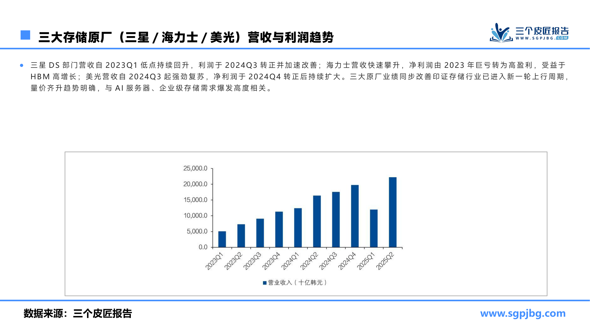

数据来源：三个皮匠报告。www.sgpjbg.com

[Source Page: 7]

### 中国台湾存储厂商月度营收变化（华邦电 / 旺宏 / 南亚科）

华邦电 2025 年 9 月营收 79.2 亿新台币（同比 +9.52%），南亚科 9 月营收 66.64 亿新台币（同比 +157.81%），均呈现强劲增长态势。华邦电自 2024 年下半年起营收同比转正并稳步提升，南亚科 2025 年 3 月以来营收同比增速持续高增，5 月达 +94.95%、6 月 +141.32%、9 月 +157.81%。中国台湾存储模组厂商业绩持续改善反映行业需求回暖及涨价效应传导。

[OCR_UNCERTAIN] 原页所配折线图的图例为 DRAM 指数、NAND 指数，与该页标题和正文所述厂商月度营收主题不一致；保留原图，不推定图表含义或修改原文。

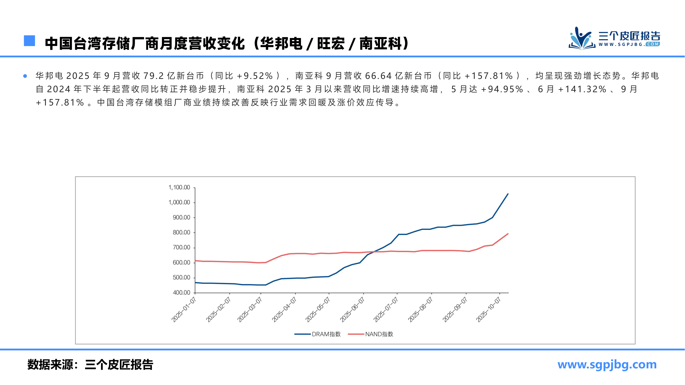

数据来源：三个皮匠报告。www.sgpjbg.com

[Source Page: 8]

### DRAM 和 NAND 指数走势

DRAM 和 NAND 指数自 2024 年下半年触底后震荡上行，2025 年 Q3 以来上涨斜率明显加大，反映存储芯片价格进入加速上升通道。指数上行趋势与各大原厂涨价行动、下游补库需求以及 AI 服务器强劲拉货相互印证，存储行业景气度持续上行。

原页嵌图标题为“2024–2030 bit demand growth”，可辨文字如下：

| 图示类别 | 2024–2030 CAGR | 图中 AI induced 标注 |
| --- | --- | --- |
| NAND bit demand growth（整体） | 21% | — |
| PC | ~15% | &lt;10% |
| Datacenter | 26% | &gt;50% |
| Mobile | &lt;15% | ~10% |
| Other | ~20% | — |

图中注释：AI-induced refers to the amount of GB required to run AI workloads, not the storage embedded in AI-enabled devices. 图中“—”表示该项未见对应数值标注。

[OCR_UNCERTAIN] 原页嵌图显示 NAND bit demand 相关内容，和标题中的 DRAM / NAND 指数走势不一致；嵌图可辨文字已转写，保留原图，不推定两者关系或补造数据。

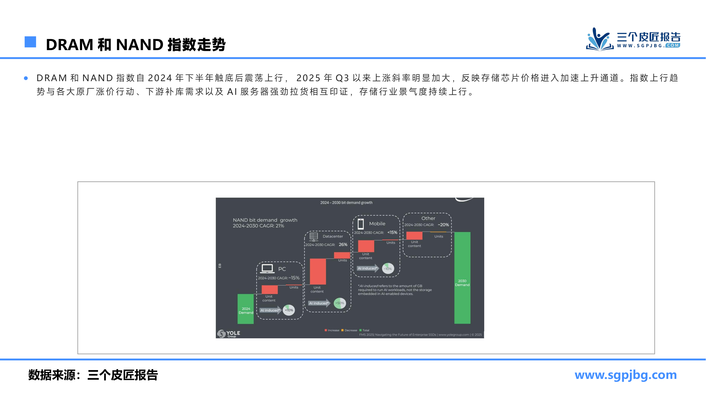

数据来源：三个皮匠报告。www.sgpjbg.com

[Source Page: 9]

## 02 AI 驱动 NAND 需求高增长

[Source Page: 10]

### 2024-2030 年 NAND 不同下游应用需求增速（数据中心 CAGR 26% 领跑）

据 Yole 预测，2024-2030 年 NAND 位元需求 CAGR 约 21%。数据中心 CAGR 约 26%，其中超 50% 需求与 AI 工作负载直接相关，是最大驱动力；PC 市场 CAGR 约 15%，AI 额外需求不到 10%；手机 CAGR 低于 15%，AI 额外需求约 10%；车载、IoT 等其他应用约 20%。AI 算力爆发使数据中心从“通用计算”向“AI 加速计算”转型，存储需求结构发生深刻变化——AI 推理阶段的 RAG 向量数据库、模型存储等场景催生大量新增存储需求。

原页嵌图标题：DATACENTER BIT DEMAND INDUCED BY AI — 3 main growth drivers。

- Training：Dataset、GPU、eSSD、Checkpoint save/load。
- Inference：Query + prompt、Retriever、Relevant information、RAG vector database、Model storage、Answer。
- Data storage：Data storage、Data cleaning, ETL、Cleaned Data。
- Server attached SSDs：Checkpoint save/load SSDs；Boot, Software storage SSDs；1 to 16 TB；TLC → (p)SLC。
- Storage SSDs：Dataset Storage；Data storage；Data cleaning, ETL；Cleaned data；Model storage；RAG vector database；≥32TB；TLC → QLC。

[OCR_UNCERTAIN] 原页配图为 AI 数据中心需求示意图，未给出正文中的各应用 CAGR；部分嵌图文字较小。保留原图，不推断图文对应关系。

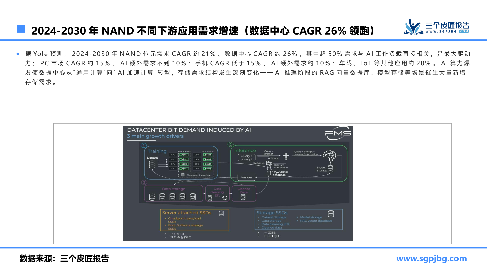

数据来源：三个皮匠报告。www.sgpjbg.com

[Source Page: 11]

### AI 训练和推理中 SSD 是关键支撑（训练 / 推理 / 数据存储三阶段）

AI 工作负载对存储的需求体现在三个阶段：训练阶段——大模型训练需要超大规模数据集，GPU 依赖 eSSD 做数据加载和检查点保存，容量从 1TB 到 16TB；推理阶段——Query 被送到 RAG 向量数据库检索相关信息，结合模型参数生成答案，需要大量存储 SSD 支持模型存储和数据库操作，容量通常大于 32TB；数据存储与处理——原始数据需经存储、清洗、ETL 处理生成干净数据集，SSD 是关键支撑。AI 存储需求从“训练端”向“推理端”延伸，推理场景的存储需求增速更快。

[OCR_UNCERTAIN] 原页所配图为 HDD 与 SSD 的 TCO 对照，与本页标题主题不一致。以下保留配图文字与表格。

- The $/GB gap remains important → QLC penetration will help in reducing it but won’t close it.
- SSDs are becoming increasingly competitive when evaluated through a TCO lens, which factors W/TB, bandwidth, and storage density.

|  | HDD | SSD | 图中比较 |
| --- | --- | --- | --- |
| Price | 0.015$/GB | 0.09$/GB | 6x more expensive |
| Read Bandwidth | SAS / SATA; Bandwidth: &lt;300MB/s | SAS / SATA / PCIE 4; Bandwidth: up to 7000MB/sec | &gt;20x higher |
| Storage density | Up to 32TB in HDD; 100GB/cm3 | Up to 120TB in U.2; 1TB/cm3 | &gt;10x denser |
| W/TB | ~200mW/TB | 40 to 125mW/TB | ~2 to 5x more efficient |

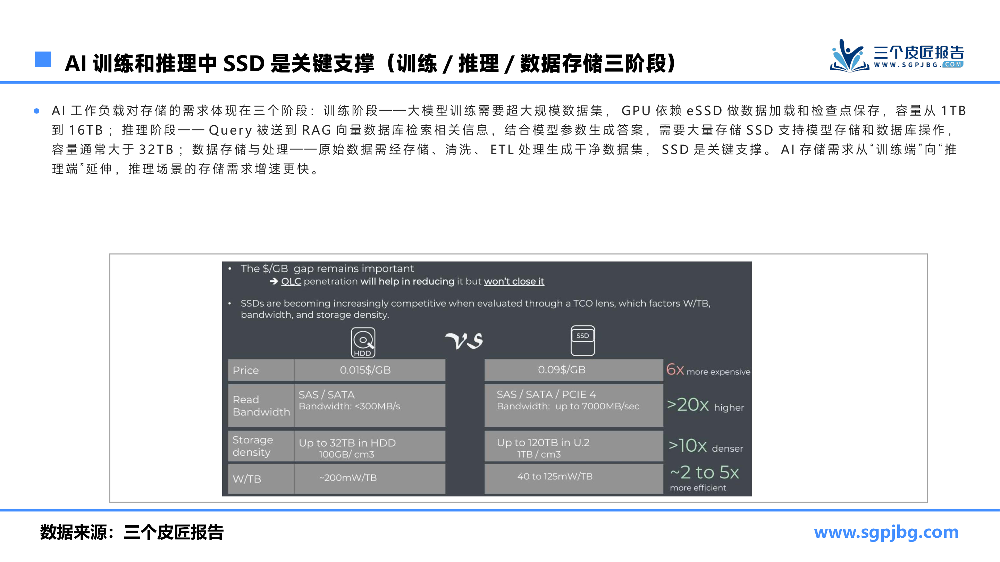

数据来源：三个皮匠报告。www.sgpjbg.com

[Source Page: 12]

### 企业级 SSD 和 HDD 对比（价格 / 性能 / 密度 / 功耗 TCO 优势）

SSD 的竞争力已从“单一性能优势”升级为“总拥有成本（TCO）优势”：价格方面，HDD 约 0.015 美元/GB，SSD 约 0.09 美元/GB（贵约 6 倍）；读写速度，HDD 低于 300MB/s，SSD 最高 7000MB/s（快 20 倍以上）；存储密度，HDD 最高 32TB/100GB/cm³，SSD 最高 120TB/1TB/cm³（密度高 10 倍）；功耗，HDD 高于 200mW/TB，SSD 仅 40-125mW/TB（节能 2-5 倍）。QLC eSSD 通过提升容量密度进一步降低 $/GB，加速企业从 HDD 向 eSSD 迁移。

原页嵌图标注：STORAGE SSDS — SSD share rising, HDD growth still strong。

- Storage eSSD bit demand 图示预测情景：eSSD 20%、11%、5.5% of eStorage；图中另有 AI boost 标注。
- Bit demand forecast HDD and eSSD：HDD 26% bit CAGR 24–30；eSSD 54% bit CAGR 24–30。
- 原图文字：Historically, eSSDs have accounted for about 3% of storage. Based on the 11% scenario, the eSSD storage bit demand is expected to grow by 54% CAGR 24–30. This still leaves a lot of room for HDD bit demand growth (26% CAGR 24–30).

[OCR_UNCERTAIN] 原页嵌图展示 SSD 需求份额和 HDD 增长预测，和本页文字对比指标的主题并不完全一致；图中可辨的标注已转写；未标注的具体数据保留原图，不作估算。

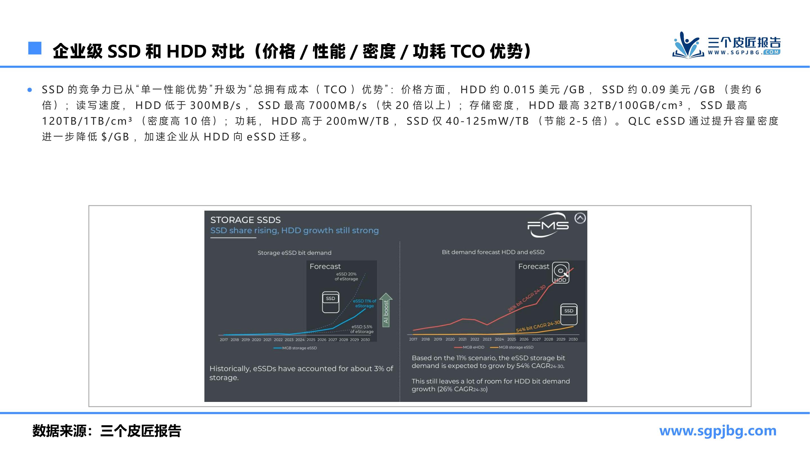

数据来源：三个皮匠报告。www.sgpjbg.com

[Source Page: 13]

### 企业级 SSD 和 HDD 需求增速和占比（eSSD CAGR 54% vs HDD 26%）

历史上企业级 SSD 在整个存储中仅占约 3% 份额，但 AI 带来的存储需求暴增使 SSD 增长曲线明显变陡。按预测，2030 年 eSSD 市场份额预计达 11%（乐观条件下可达 20%）。HDD 需求依旧坚挺，2024-2030 年 CAGR 预计 26%，而企业级 SSD 增速更高，CAGR 可达 54%。AI 是 eSSD 增长的最大引擎——存储类 SSD（数据集存储 / RAG 向量数据库 / 数据清洗等）CAGR 高达 54%，AI 服务器挂载 SSD 约 20%，非 AI 服务器 SSD 仅 12%。

原页表题：Nearline HDD 与 QLC SSD 重点比较。

| 产品 | 交付周期 | 每 GB 平均售价（美元） | 最大容量 | 性能 | 能效 |
| --- | --- | ---: | --- | --- | --- |
| Nearline HDD | 52 周 | 0.015 | 32 TB | 弱 | 较低 |
| QLC SSD | 8 周 | 0.05–0.06 | 122 TB | 强 | 较高 |

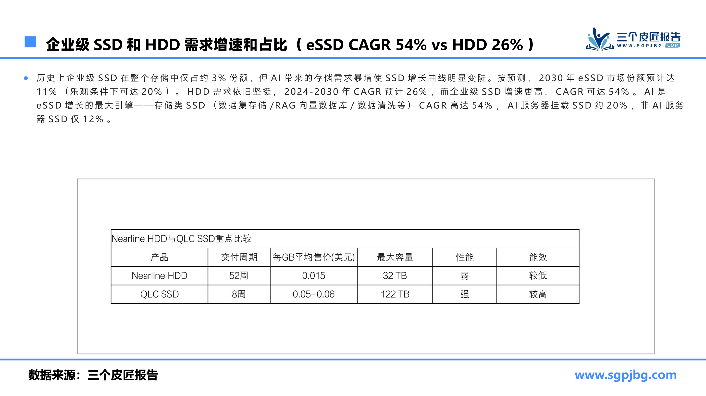

数据来源：三个皮匠报告。www.sgpjbg.com

[Source Page: 14]

### Nearline HDD 与 QLC SSD 重点对比（交期 52 周 vs 8 周）

AI 推理需求快速推升实时存取、高速处理海量数据的需求，但 HDD 市场正面临巨大供应缺口。NL HDD 交期已从原本数周急剧延长至 52 周以上，而 QLC SSD 交期仅 8 周。每 GB 平均售价方面，HDD 约 0.015 美元，QLC SSD 约 0.05-0.06 美元（SSD 约贵 3-4 倍，而非历史 6 倍），价差持续收窄。最大容量方面，HDD 32TB，QLC SSD 已达 122TB。性能方面 SSD 远优于 HDD。HDD 正面临技术换代阵痛期——HAMR 技术产线投资高昂造成产能扩张瓶颈，而 NAND Flash 通过 3D 堆栈技术演进使产能提升速度远快于 HDD，预期 2026 年 2Tb QLC 芯片产出逐步放量，将成降低 Nearline SSD 成本的主力。

原页嵌图标题为“eSSD bit shipment forecast”，标注 Forecast、Bit CAGR 24–30: 26%；各色区域标注如下：

| 图例 | Bit CAGR 24–30 |
| --- | --- |
| Non AI server attached | 12% |
| AI server attached eSSD | 20% |
| Storage eSSD | 54% |

图中 Storage SSDs 包括 Dataset Storage、Data storage、Data cleaning, ETL、Cleaned data、Model storage、RAG vector database；Server attached SSDs 包括 Checkpoint save/load SSDs、Boot, Software storage SSDs。

[OCR_UNCERTAIN] 原页配图展示 eSSD 位元出货预测，未直接列出标题所述交期对比；图中可辨标注已转写，保留原图。

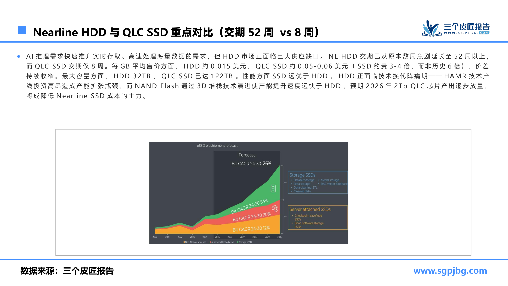

数据来源：三个皮匠报告。www.sgpjbg.com

[Source Page: 15]

### eSSD 需求增速拆分（AI 存储类 SSD CAGR 54% 领涨）

2024-2030 年 eSSD 位出货量 CAGR 预计 26%。三类需求增速差异显著：AI 存储类 SSD（数据集存储、模型存储、RAG 向量数据库、数据清洗、ETL 等）CAGR 高达 54%，是增长最猛的细分；AI 服务器挂载 SSD（训练推理过程中间存储）CAGR 约 20%；非 AI 服务器挂载 SSD（传统业务用途）CAGR 仅 12%。AI 是 eSSD 增长的最大引擎，随着大模型推理应用快速普及，存储类 SSD 受益于数据量的指数级增长，成长弹性最大。

[OCR_UNCERTAIN] 原页所附表格为全球 NAND 厂商产能、产量和营收，与本页标题主题不同；表内未标注统计时期，按原表保留。

| 全球 NAND 厂商 | 月产能（万片） | 产量（百万/等效 1GB） | 营收（百万美金） |
| --- | ---: | ---: | ---: |
| 三星 | 41.5 | 244351 | 19524 |
| 海力士 | 14.5 | 101644 | 5646 |
| Solidigm | 8.5 | 90115 | 4754 |
| Kioxia/WDC/SanDisk | 40 | 265198 | 17817 |
| 美光 | 13 | 102804 | 8703 |
| 长存 | 14.5 | 107905 | 5590 |
| others | 2.1 | 337 | 394 |
| 总计 | 134.1 | 912352 | 62428 |

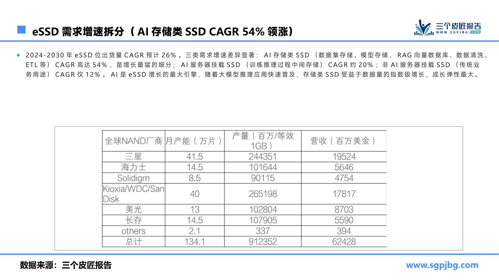

数据来源：三个皮匠报告。www.sgpjbg.com

[Source Page: 16]

## 03 海外原厂控产与供需改善

[Source Page: 17]

## 2024-2025 年全球 NAND 厂商产能/产量/营收变化（减产 10-20%）

2025 年全球 NAND 月产能预计 134 万片，较 2024 年 142 万片下降约 5.6%。主要原厂为应对库存积压和价格下行压力启动减产：三星西安工厂月产量从 20 万片降至 17 万片（减产超 10%），韩国华城 12 号和 17 号线同步调整；美光将 NAND 晶圆启动率下调 10% 并减慢制程节点转移。减产带来供给收缩，叠加 AI 需求爆发，供需格局逆转驱动价格上涨。营收方面，2025 年全球 NAND 营收预计约 624 亿美元，同比增长约 19%（2024 年约 506 亿美元），量价齐升趋势确认。

[OCR_UNCERTAIN] 原页表格展示 2Q25 企业级 SSD 厂商营收和市场份额，与正文所述全年全球 NAND 产能及营收预测不是同一指标；保留原表。

| Ranking | Company | Revenue (US$M) 2Q25 | Revenue QoQ (%) | Market Share (%) 2Q25 | Market Share (%) 1Q25 |
| --- | --- | ---: | ---: | ---: | ---: |
| 1 | Samsung | 1,899.0 | 0.5% | 34.6% | 39.6% |
| 2 | SK Group (SK hynix + Solidigm) | 1461.7 | 47.1% | 26.7% | 20.8% |
| 3 | Micron | 784.6 | −7.9% | 14.3% | 17.9% |
| 4 | Kioxia | 750.3 | 32.5% | 13.7% | 11.9% |
| 5 | SanDisk | 213.0 | −8.2% | 3.9% | 4.9% |
| Total of Top 5 | | 5,108.6 | 12.7% | 93.2% | 95.1% |

数据来源：三个皮匠报告　www.sgpjbg.com

[Source Page: 18]

### 企业级 SSD 收入情况（25Q2 五大厂营收 51 亿美元，+12.7%）

2025Q2，英伟达 Blackwell 平台规模化出货及北美 CSP 持续扩大通用服务器布局，带动企业级 SSD 需求显著增长。前五大品牌厂三星、海力士、美光、铠侠、闪迪营收合计超 51 亿美元，环比增长 12.7%。三星以 34.6% 份额居首（营收 18.99 亿美元）、海力士（含 Solidigm）26.7%（14.62 亿美元，环比 +47.1% 增长最猛）、美光 14.3%（7.85 亿美元）、铠侠 13.7%（7.50 亿美元，环比 +32.5%）、闪迪 3.9%（2.13 亿美元）。韩国厂商在 AI 存储领域优势明显，海力士凭借 HBM 和企业级 SSD 双轮驱动增长最为突出。

[OCR_UNCERTAIN] 本页所附折线图图例为 1Tb QLC、1Tb TLC、512Gb TLC、256Gb TLC，与企业级 SSD 收入正文主题不一致；纵轴未标注单位，也未给各数据点数值，保留原图，不估算。

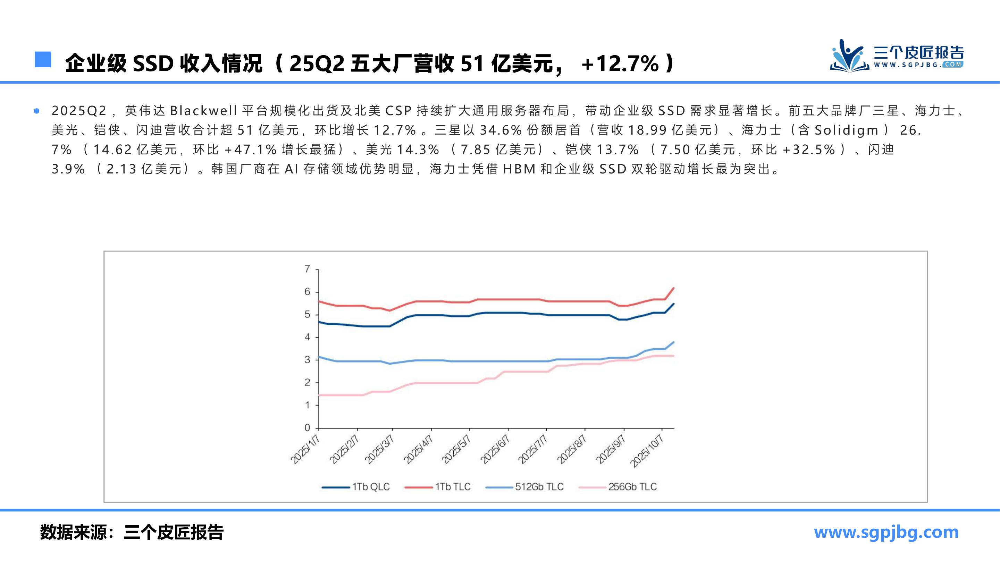

数据来源：三个皮匠报告。www.sgpjbg.com

[Source Page: 19]

### 存储模组价格跟踪（NAND Flash Wafer / SSD / eMMC / UFS / DRAM 现货价格）

NAND Flash Wafer 现货价格自 2024 年中触底后持续回升，2025 年 Q3 涨幅加速；SSD、eMMC、UFS 等模组产品价格跟随上涨。DRAM 现货价格同步上行，行业内存条和渠道内存条价格均呈上涨趋势。LPDDR 现货价格亦有所回升。各类存储产品价格全面上涨反映行业从“供给过剩”向“供需紧平衡”转变，模组厂商业绩弹性最大——上游原厂涨价向模组端传导，模组厂商库存价值重估叠加出货价格提升，盈利能力有望显著改善。

[OCR_UNCERTAIN] 原页表格为 NAND 厂商产能、产量及营收，不是正文所述现货价格；表中未标注统计时期。营收 3050 在原表跨“长存”和“others”两行，不推断各自金额。

| 全球 NAND 厂商 | 月产能（万片） | 产量（百万/等效 1GB） | 营收（百万美金） |
| --- | ---: | ---: | --- |
| 三星 | 47.3 | 245032 | 23,400 |
| 海力士 | 14.4 | 96446 | 7,628 |
| Solidigm | 7.1 | 77684 | 6,382 |
| Kioxia/WDC/SanDisk | 44.3 | 247949 | 16694 |
| 美光 | 14.3 | 93923 | 8,483 |
| 长存 | 12.5 | 60989 | 3050（原表跨长存和 others 两行） |
| others | 2.0 | 425 | 同上（原表跨行） |
| 总计 | 141.7 | 822450 | 65637 |

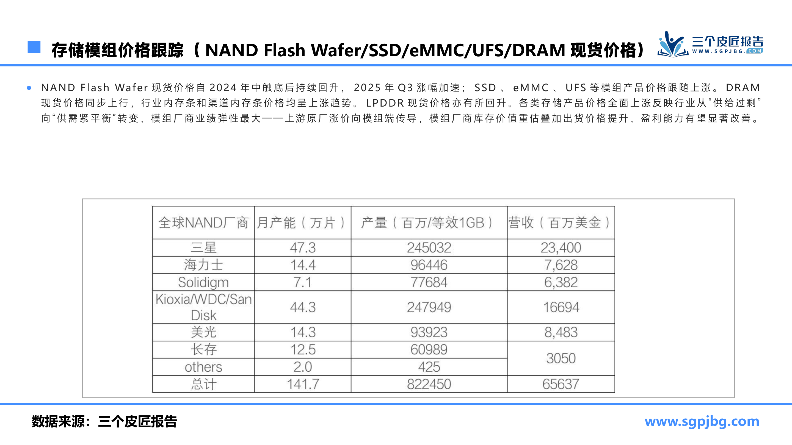

数据来源：三个皮匠报告。www.sgpjbg.com

[Source Page: 21]

风险提示：下游需求不及预期、存货规模较大及跌价风险、供应商集中度较高及原材料供应风险、国内互联网大厂资本开支不及预期。
