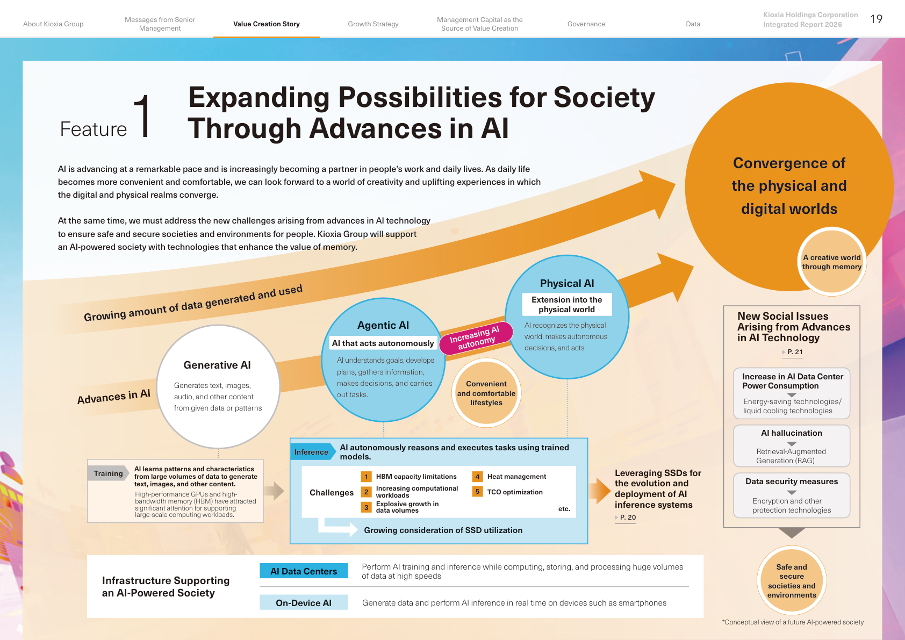
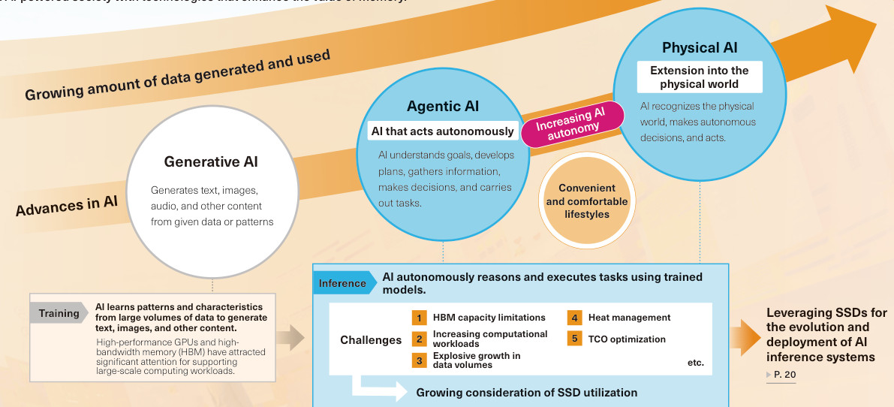

## Document Metadata

- Document ID: a390c9686fc6f881cd80368822826d738e882ecd
- Document Title: Integrated Report 2026
- Document Type: PDF
- Issuing Organization: Kioxia Holdings Corporation
- Publication Date: null
- Reporting Period: FY2025 (April 1, 2025–March 31, 2026); also includes certain information from other periods and recent activities
- Source File: [26_www.kioxia-holdings._Integrated-Report-2026-all-en.pdf](https://github.com/jadennevercode/CJCC-Knowledge-Base/blob/564ab11aa9785e569e3853c8a4d7ce86f88e7535/materials/%E4%B8%AD%E6%B8%B8%EF%BC%9A%E9%87%8D%E7%82%B9%E5%B7%A5%E5%8E%82%E4%B8%8E%E5%88%B6%E9%80%A0%E5%9F%BA%E5%9C%B0/26_www.kioxia-holdings._Integrated-Report-2026-all-en.pdf)

## Structured Content

[Source Page: 7]

#### Flash Memory Production Scale

**Revenue:** 2,337.6 billion yen (FY2025, consolidated basis). Revenue and operating profit reached record highs as Kioxia Group captured expanding demand for flash memory driven by AI applications and enterprise data centers.

**Global share of flash memory production volume on a storage capacity basis:** 28% (FY2025). Kioxia Group, together with its manufacturing joint venture with Sandisk Group, accounts for one of the world’s largest shares of global production volume. Source: TechInsights Inc. NAND Market Report Q1 2026.

**Smart Factories:** Coordination between the Yokkaichi Plant and the Kitakami Plant. The two plants coordinate closely using AI and big data, achieving high production efficiency to meet growing demand for flash memory.

[Source Page: 10]

### Capturing AI Demand to Drive Business Growth

Our financial performance in fiscal 2025 achieved record-high revenue and profit. This success was driven by growing demand for memory solutions fueled by data centers, particularly for generative AI applications, alongside favorable pricing and increased shipment volumes.

As AI transitions from training to inference, we are entering an era where data is utilized in real-time across a broad range of scenarios. Hyperscaler investments in AI data centers remain robust, and demand for enterprise and data center SSDs is poised for continued growth. At the same time, foundational markets like smartphones and PCs remain vital. Rather than over-indexing on specific applications, we will take a holistic view of market trends, ensure stable yet agile production, and meet the soaring demand for AI infrastructure.

### Driving Competitiveness Through Technology, Scale, and Customer Engagement

The foundation of Kioxia Group’s competitiveness rests on three pillars: our technology development capabilities, manufacturing scale, and customer engagement. As a provider of flash memory and SSDs, technology development is our most critical driver. We are committed to continuously pioneering cutting-edge technologies and products that deliver superior value to our customers and the market.

While we operate on a global scale, our major production bases remain in Japan. Our manufacturing foundation—anchored by the Yokkaichi Plant and the Kitakami Plant—combined with robust partnerships with leading global companies, constitutes a compelling operational strength. Looking ahead, we will deepen collaboration across our Memory and SSD Divisions, integrating Research and Development, Manufacturing, and Sales. By strengthening this end-to-end system, we can swiftly deliver products that anticipate and meet dynamic market needs.

As AI evolves, so do data center architectures. To rapidly and efficiently process massive data sets, storage performance must continuously advance. In lockstep with our partners, Kioxia Group will refine the storage technologies enabling this AI paradigm shift and strategically execute growth investments. We are positioned to capture future market opportunities and deliver highly competitive solutions.

[Source Page: 14]

### Consecutive Years of Record Financial Performance Leveraging AI Demand as a Core Growth Driver to Exceed Capital Market Expectations

In fiscal 2025, our consolidated revenue was 2,337.6 billion yen, with non-GAAP operating profit of 876.2 billion yen, the second consecutive year of record highs for both metrics. Growing demand from the AI inference market has significantly boosted our financial performance and is driving expectations for further growth.

Following our strong performance, expectations for our growth continue to rise. There is keen interest among investors and analysts in the potential contribution of long-term agreements (LTAs) with our customers, in the competitiveness of our technology and products with BiCS FLASH™ at the core, in our financial strategy, and in shareholder returns. We will be sure to clearly communicate this potential to the markets and ensure it is firmly reflected in our management strategy.

### Strategic Portfolio Transformation and Accelerated Investment Execution

Concentrating on High-Growth Areas Helps Ensure High-Quality Profit

Within the growing flash memory market, demand is shifting from the consumer sector to the industrial and enterprise sectors. Driven by investment in hyperscale infrastructure, demand for AI and data centers remains exceptionally robust. Few companies globally can provide a stable supply of flash memory, so we anticipate this positive trend will continue through 2027.

Kioxia Group is seizing the opportunities this structural shift provides. We are shifting our portfolio mix, aiming for data center and enterprise business to account for at least 60% of our total sales. We will maintain our focus on the smartphone and PC sectors—our bedrock—while making inroads into the edge AI market. Furthermore, we will leverage LTAs to increase the predictability of our revenues and stabilize our profits.

[Source Page: 15]

Note: As of Investor Day 2026 (June 2026)

Enhancing profitability quality through capital expenditure, R&D, and human capital investments that support high-growth, high-margin sectors:

- Market / Portfolio: Percentage of overall revenue generated by our data center business: over 60% (~FY28).
- Technology Leadership / R&D: focused on advanced development; over 60% (vs. FY25).
- Capital Expenditure: Efficient Capital Expenditure, 470 billion yen/year (FY26–FY28 Average).
- Cost Competitiveness / Migration: Percentage of overall product base accounted for by BiCS FLASH™ Generation 8: over 80% (end of FY26, production GB base).

[Source Page: 20]

### Training and Inference

Training: AI learns patterns and characteristics from large volumes of data to generate text, images, and other content. High-performance GPUs and high-bandwidth memory (HBM) have attracted significant attention for supporting large-scale computing workloads.

Inference: AI autonomously reasons and executes tasks using trained models.

Challenges:

1. HBM capacity limitations
2. Increasing computational workloads
3. Explosive growth in data volumes
4. Heat management
5. TCO optimization

The figure also labels “Growing consideration of SSD utilization” and “Leveraging SSDs for the evolution and deployment of AI inference systems” (P. 20).

### New Social Issues Arising from Advances in AI Technology

- Increase in AI Data Center Power Consumption: Energy-saving technologies/liquid cooling technologies.
- AI hallucination: Retrieval-Augmented Generation (RAG).
- Data security measures: Encryption and other protection technologies.

The original figure references P. 21.

### Infrastructure Supporting an AI-Powered Society

- AI Data Centers: Perform AI training and inference while computing, storing, and processing huge volumes of data at high speeds.
- On-Device AI: Generate data and perform AI inference in real time on devices such as smartphones.

*Conceptual view of a future AI-powered society.

[Source Page: 21]

### Feature 2: AI Infrastructure: Kioxia Group Technologies Supporting AI Data Centers

The emergence of autonomous AI, such as agentic AI and physical AI, is driving exponential growth in inference workloads. Kioxia Group will support AI data infrastructure with its flash memory and SSD technologies.

**AI Data Center (Overview):** GPU servers (Computation): perform AI training and inference. High-speed storage (Memory): store and supply data and models. Network (Communication); power supply equipment; cooling equipment.

**Challenges in the Evolution and Deployment of AI Inference Systems:** 1 HBM capacity limitations; 2 increasing computational workloads; 3 explosive growth in data volumes; 4 heat management; 5 TCO (Total Cost of Ownership) optimization.

**Expanding SSD Adoption and the Value Created by Kioxia Group Technologies:** SSDs are evolving from data storage devices into core infrastructure that enhances AI performance and efficiency. Kioxia Group supports the evolution of AI with products and solutions that address diverse needs, powered by flash memory technologies delivering high capacity, high performance, and low power consumption.

1. High-Performance SSDs: Resolving HBM capacity bottlenecks.
2. High-Bandwidth SSDs: Efficient storage of GPU computation results and more efficient data transfer.
3. High-Capacity SSDs: Storing growing volumes of data as inference complexity increases. KIOXIA AiSAQ™: Improving AI response accuracy by using SSDs in RAG; Open-Source Vector Search Software.
4. Certain SSD products support liquid cooling, which is increasingly being adopted in AI data centers as an alternative to air cooling, enabling efficient heat dissipation in high-performance AI server environments.
5. Kioxia Group provides SSDs and solutions for diverse next-generation AI infrastructure applications, helping to optimize TCO by reducing computational workloads, improving power efficiency, and saving space.

Contributing to the Evolution of AI; Expanding the Value of Memory.

[Source Page: 22]

#### Social Issues and Kioxia Group Technologies Helping to Address Social Issues

**Increase in AI Data Center Power Consumption:** Power consumption is increasing as the number of AI data centers grows.

**Improving Product Power Efficiency:** We developed the KIOXIA CM10 Series of enterprise SSDs equipped with 10th-generation BiCS FLASH™ TLC flash memory, achieving significant improvements in power efficiency and cooling flexibility, including support for direct liquid cooling.

**Contributing to Greater Energy Efficiency in Data Centers:** We are enabling next-generation green data centers by developing high-bandwidth optical SSDs that optimize computing performance and improve power efficiency. P. 42.

**SSD Security and Encryption Options for Diverse Needs:** We are addressing the need to protect personal and business data through products such as enterprise-, data center-, and client SSDs.

Note: Optional security feature-compliant drives are not available in all countries due to export and local regulations.

[Source Page: 24]

### Market and Social Environment

#### Expansion of the Flash Memory Market Driven by Rapid Advances in AI

**Increase in Worldwide Digital Data Generation**

With the advancement of a digital society driven by AI, the volume of digital data continues to grow. The total volume of data generated worldwide is projected to reach 718.5 zettabytes (ZB) annually in 2030.

Global Data Generation: 2030 forecast, 718.5 ZB. A zettabyte (ZB) is 10²¹ bytes, and is a unit that indicates the volume of data. Source: IDC, Worldwide IDC Global DataSphere Forecast, 2025–2030, #US53425426. Individual bars for 2025–2029 are not numerically labelled.

**Soaring Flash Memory Demand Driven by AI Inference**

The main applications in the flash memory market are data centers, smartphones, and PCs. We believe that the market will continue to grow through a virtuous cycle of increasing data volumes, driven by expanding AI server storage capacity, and technological advances in flash memory.

The NAND flash memory market is expected to grow at a compound annual growth rate (CAGR) of 22% from 2025 to 2028. Compared with the overall volume of data generated, approximately 0.25% is recorded on flash memory.

Focusing on demand for flash memory in data centers, the market is expected to grow at a CAGR of 46% from 2025 to 2028. Within this market, AI inference applications are projected to grow at a CAGR of 86%, making them a major driver of flash memory market growth.

Flash Memory Market (EB): 2025, 997; 2028, 1,807; CAGR 22%. Data center segment: 2025, 295; 2028, 909; CAGR 46%. PC/Smartphone market: 8%; same level or slight decrease. Data Center Flash Memory Market: inference 86%, training 16%, traditional 16%. Intermediate bars are not numerically labelled.

*An exabyte (EB) is 10¹⁸ bytes. Source: TechInsights Inc., NAND Market Report Q2, 2026. As of Investor Day 2026 (June 2026).

[Source Page: 25]

### Market and Social Environment

#### Changing Role of Storage in the AI Ecosystem

**Rapid Increase in Inference Workload**

Since the second half of 2025, AI has been shifting from a focus on training to inference for real- world applications. Moreover, AI is evolving from a tool used by people, such as generative AI, into an autonomous agent, typified by agentic and physical AI, that uses a wide range of data to achieve its objectives. Explosive growth in the volume of information processing required for AI inference is driving rapid evolution in technologies such as Retrieval-Augmented Generation (RAG), which leverages external knowledge, and key-value (KV) caching, which stores past inference results.

**Storage as Key Determinant of AI System Performance**

Traditionally, storage in AI systems has functioned primarily as a storage repository for large volumes of training data and computation results. As AI use expands, the importance of high-speed, energy-efficient storage is increasing. Furthermore, rapid advances in AI inference are prompting discussion across the AI ecosystem about redefining AI systems as a whole. Within this context, storage is expanding beyond its traditional role as a data repository to become a core component that, alongside GPUs and HBM, plays a key role in determining the performance of AI systems.

**New Uses for SSDs Created by AI Inference Systems (Conceptual Illustration):** Inference GPU server; improved inference efficiency (KV cache), storage of previous computation results; complementing HBM capacity; high-bandwidth SSDs for KV cache; high-performance SSDs. RAG server: improving answer accuracy by retaining knowledge; database generation and database retrieval; high-capacity SSDs. Storage server: storing the rapidly growing volumes of generated output; high-capacity SSDs.

#### Increase in Electricity Consumption by Data Centers

As data centers proliferate globally with the advance of AI, their growing electricity consumption is becoming a social issue.

According to the Energy and AI report released by the International Energy Agency (IEA) in April 2025, electricity consumption by data centers worldwide is projected to double from 2024 to 2030 to approximately 945 TWh, slightly exceeding Japan’s current total electricity consumption. The report also notes that the rise of AI is accelerating the adoption of high-performance, high-speed servers, increasing the power density of data centers.

Kioxia Group is working to reduce the power consumption and increase the capacity of flash memory and SSDs, thereby contributing to the development of a sustainable society underpinned by AI.

Global Data Center Electricity Consumption in the Base Case, 2020–2030 (Historical and Forecast), TWh: accelerated servers; conventional servers; other IT equipment; cooling; other infrastructure. Chart axis 0–1,000 TWh; component values are not individually labelled. Source: IEA, Energy and AI, 2025, https://www.iea.org/reports/energy-and-ai/, License: CC BY 4.0.

[Source Page: 26]

#### Cost Competitiveness and a Stable Supply Enabled by Production Scale and Efficiency

**World-Class Flash Memory Production System to Meet Growing Demand**

The Yokkaichi Plant has one of the world’s largest flash memory production volumes, while the Kitakami Plant supports growing demand. Together, their flash memory output on a storage capacity basis, including production by the manufacturing joint venture between Kioxia Group and Sandisk Group, accounted for approximately 28% of global production in FY2025, placing it among the largest shares worldwide.

Source: TechInsights Inc., NAND Market Report Q1 2026.

**High Productivity Enabled by Smart Factories**

The Yokkaichi Plant and the Kitakami Plant operate as smart factories, utilizing cutting-edge AI and big data to achieve advanced control of production equipment, higher productivity and rigorous quality control.

**Stable Supply Through a Resilient Supply Chain**

Through co-creation with suppliers of materials, manufacturing equipment, and other inputs, we have built a resilient supply chain, enabling a stable supply of high-performance, high-quality products.

Relevant Management Capital: Flash Memory Production Scale, P. 32; Partnerships, P. 40.

[Source Page: 27]

### Growth Strategy in the AI Inference Era

As the use of AI inference enters the phase of full-scale adoption, Kioxia Group will support the core of AI infrastructure with state-of-the-art flash memory and SSD products optimized for AI inference. Leveraging our strengths, we will further enhance corporate value through growth investments centered on the AI market and by strengthening our financial position.

#### Strategic Shift in Business Portfolio

—Shift the focus to the AI infrastructure market—

By focusing on the data center and enterprise business, we aim to increase the percentage of revenue from this business to over 60% in the medium to long term. As well as increasing the competitiveness of existing products, we will develop high-value-added products that contribute directly to greater efficiency in AI systems, thereby improving profitability. In smartphones and PCs, the main markets for flash memory, we will maintain our current scale of sales as a solid business foundation. We will also expand our efforts to develop the edge AI market segment.

Sales Portfolio (Excluding Sandisk sales): percentage of revenue from products for the data center and enterprise markets, 60% or higher.

#### Strengthen Capital Investment and Cost Competitiveness

—Capture opportunities for sustainable growth—

In response to the expansion of the NAND market, which is driven by AI and data center demand, we currently plan capital expenditures averaging approximately 470.0 billion yen per year over the next three years. Through disciplined and efficient capital investment and production that leverages our world-class economies of scale, we will maintain gigabyte costs below the industry average. We will also focus on ensuring a stable supply system by strengthening supply chain resilience, as well as on investing in human capital to support growth.

Planned Annual Capex: Approx. 470 billion yen (three-year average); FY2025 283.7 billion yen; FY2026–FY2028 average 470.0 billion yen; +66%. Categories: manufacturing equipment, buildings/interiors, others. Expansion of existing products; mass production of next-generation products; expedite building infrastructure development; back-end processes.

Achieving High Capital Investment Efficiency: Five-Year Cumulative Capex / Annual GB Output ($/GB), KIOXIA and industry average, CY2015–2025. Values are not individually labelled. Source: TechInsights Inc. NAND Market Report Q2 2026.

#### Invest In and Accelerate R&D

—Maintain technology leadership—

We plan to increase annual R&D investment by 63% from FY2025 to 230.0 billion yen over the next three years. We are developing a diverse range of products tailored to the needs of AI and data centers. Specifically, we are allocating R&D resources to the development of next-generation BiCS FLASH™ products and, in our key focus area of SSDs, to accelerating the introduction of Super High IOPS SSDs. We will also focus on recruiting and developing researchers and engineers to maintain our technology leadership.

Annual R&D Investment: 230 billion yen (three-year average); FY2025 141.1 billion yen; FY2026–FY2028 average 230.0 billion yen; +63%. New Memory Technologies Including OCTRAM; Device Development BiCS FLASH™ Gen. 10/Gen. 11; Strengthening SSD Development, Including in New Areas. Technology P. 36.

As a core company underpinning the AI inference era and driving the next technology paradigm shift, we aim to further enhance our corporate value through growth investments and a stronger financial position.

Note: As of Investor Day 2026 (June 2026).

[Source Page: 28]

#### Breakdown of Revenue by Application

Our products are used in a variety of applications, with revenue classified into three categories by application. “SSD & Storage” primarily comprises SSD and memory products for PCs, data centers, and enterprises. “Smart Devices” comprises embedded memory products with control functions, used in consumer devices such as smartphones, tablets, and televisions, as well as in automotive and industrial devices. “Others” comprises retail products such as SD memory cards and USB flash drives, as well as sales to the Sandisk Group recorded through our manufacturing joint venture.

In FY2025, we achieved record-high revenue across all applications, supported by a favorable external environment with growth in demand, mainly for AI inference applications, and higher selling prices, as well as beneficial effects from productivity gains and the successful strengthening of our business foundation, including an improved capital structure.

Breakdown of Revenue by Application (FY2025); total revenue 2,337.6 billion yen:

| Application | Share | Description |
| --- | --- | --- |
| SSD & Storage | 58.3% | Primarily SSD and memory products for PCs, data centers, and enterprises |
| Smart Devices | 32.5% | Embedded memory products with control functions, used in consumer devices such as smartphones, tablets, and televisions, as well as in automotive and industrial devices |
| Others | 9.2% | Retail products such as SD memory cards and USB flash drives, as well as sales to the Sandisk Group recorded through our manufacturing joint venture |

#### Creating Market Value Through Cross-Divisional Collaboration and Co-Creation with Partners

Kioxia Group has built robust partnerships with leading companies across markets, and has a track record of business relationships with major global customers in the data center, smartphone, and PC sectors. We also collaborate with server and GPU manufacturers to further expand our AI-related business opportunities. The Research and Technology Development Division, Manufacturing Division, and Sales and Marketing Division coordinate closely to respond swiftly to increasingly sophisticated and diverse market needs by providing products that address those requirements.

[Source Page: 29]

### Business Activities

#### Development of High-Capacity, High-Performance 3D Flash Memory

Four technologies enable high-capacity 3D flash memory: vertical memory cell stacking, lateral shrinking of memory cells, multi-level cell technology,* which logically increases the amount of data that can be stored, and the introduction of new architectures. By using a combination of all of these technologies, not just vertical stacking technology, Kioxia Group is increasing bit density (the amount of information stored per unit area) and promoting the development of cost-competitive high-capacity products.

* A technology that increases the amount of data stored in a single memory cell. Depending on the number of bits per cell, memory is classified as SLC (Single-Level Cell: 1 bit/cell), MLC (Multi-Level Cell: 2 bits/cell), TLC (Triple-Level Cell: 3 bits/cell), or QLC (Quad-Level Cell: 4 bits/cell).

#### Dual-Axis Strategy: A Development Roadmap for 3D Flash Memory BiCS FLASH™

Kioxia Group is pursuing a Dual-Axis Strategy: one axis focuses on increasing the number of layers in 3D flash memory to deliver a line of higher-capacity, higher-performance products, while the other leverages CBA technology to achieve high performance with lower per-layer investment. Through these approaches, we will provide competitive products that meet increasingly sophisticated and diverse needs.

**Starting Point: 8th-Generation BiCS FLASH™ with CBA Technology**

CMOS directly Bonded to Array (CBA) technology involves separately manufacturing the CMOS circuit wafer and the memory cell array wafer under their respective optimal processes and temperature conditions, then bonding the wafers together. This approach achieves high performance while reducing the surface area of the chip, thereby increasing bit density and enabling the delivery of cost-competitive products.

We plan to transition around 80% of our output to 8th-generation products on a GB basis by the end of FY2026.

**First Axis: 10th-Generation BiCS FLASH™ Combining High Capacity, High Performance, and Low Power Consumption**

Along the first development axis, we combine increased vertical stacking technology with lateral shrink technology, as in previous generations, to achieve products with higher bit density and higher capacity. Development along this axis primarily targets the enterprise and data center SSD markets.

In July 2026, we began sample shipments of 10th-generation BiCS FLASH™, which delivers the high capacity, high performance, and low power consumption required for the next-generation AI inference market. This generation provides higher interface performance using CBA and OPS* technologies, as well as increased bit density through the combination of a 332-layer architecture and lateral shrink technology optimized for power efficiency and reliability.

*On Pitch Select Gate Drain: A design technology that makes it possible to shorten the bit line and reduce word line capacitance by removing unused memory holes.

**Second Axis: Pursuing Higher Performance Through CBA Technology**

Along the second development axis, we focus on achieving high performance by combining cell technology featuring a lower layer count and the latest CMOS technology. This approach is used in our 9th-generation BiCS FLASH™, for which sample shipments began in July 2025. We are developing products for the low- to medium-capacity range, primarily targeting the market for AI-enabled PCs and mobile devices.

**BiCS FLASH™ Development Roadmap:** Utilizing CBA; high performance through combination of optimal cell technology and optimal CMOS circuit; large capacity through continuous process migration. Gen. 5, Gen. 6, Gen. 8, Gen. 9, Gen. 10, Gen. Y, Gen. 11; 4.8Gbps; 8th-generation BiCS FLASH™ 2 Tb QLC; 8 TB per package, 32-die stacking; 245 TB large capacity SSD. CBA (CMOS directly Bonded to Array): bonding, memory cell array and CMOS circuit.

[Source Page: 30]

### Business Activities

#### SSD Product Development

SSDs are storage devices that use flash memory to store data. They feature resistance to vibration and shock, are lightweight, and boast low power consumption. Kioxia Group’s SSD products combine BiCS FLASH™ with a controller and firmware. We will combine the latest flash memory and SSD technologies to provide products that meet increasingly advanced and diverse needs as AI evolves.

#### Kioxia Group SSD Products for the AI Inference Market

The Group views advances in AI as an important growth opportunity and will support the AI inference market through cutting-edge products that address increasingly advanced and diverse market needs and respond to emerging market trends. As industry players advance the development of next- generation infrastructure for AI inference, SSDs are taking on an increasingly critical role that goes beyond storage, becoming key to improving AI performance and cost efficiency.

**1 Addressing System Memory Shortages**

In AI inference, insufficient GPU memory capacity, particularly high-bandwidth memory (HBM) is an issue. SSDs are used as an extension of the KV cache that stores previous computation results, helping to improve inference efficiency. We are also developing SSDs designed for direct interaction with GPUs, complementing HBM capacity.

**2 Enabling Larger Databases and Faster Generation and Retrieval**

As the databases used by RAG servers continue to grow larger, DRAM capacity becomes a constraint in conventional systems. High-performance, high-capacity SSDs that can replace DRAM help achieve both scalability and cost efficiency.

**3 Storing Large Volumes of Data and Enabling High-Speed Access**

The continued spread of generative AI is driving a rapid increase in data volumes. We are actively developing high-capacity SSDs that underpin high storage density and high throughput.

#### KIOXIA CM Series: High-Bandwidth SSDs with TLC Flash Memory

The CM Series can efficiently store and utilize the growing volume of data generated by long-duration, multi-step inference in agentic AI, enabling high power efficiency. Furthermore, it supports liquid cooling systems and delivers stable performance even in environments with high heat loads.

#### KIOXIA GP Series: High-Performance SSDs with XL-FLASH™

Combining dedicated XL-FLASH™ NAND-type flash memory with a dedicated controller, the KIOXIA GP Series delivers exceptional processing performance to support next-generation AI systems. Designed for direct interaction with GPUs, the GP Series complements HBM capacity.

#### KIOXIA LC Series: High-Capacity SSDs with QLC Flash Memory

The KIOXIA LC Series is suitable for efficiently storing the large volumes of data generated by AI. Products incorporate 32 stacked 2 Tb QLC dies of 8th-generation BiCS FLASH™ in a single package, enabling an ultra-high capacity of 245 TB. The LC Series also contributes to greater overall data center efficiency and optimization of total cost of ownership (TCO).

[Source Page: 31]

### The Evolution of BiCS FLASH™: Meeting the Diverse Needs of the AI Era

Atsushi Inoue, Executive Officer, Vice President of Memory Division, Kioxia Corporation.

As AI continues to evolve, flash memory performance requirements are becoming increasingly sophisticated and diverse. High performance and power efficiency have emerged as critical specifications across a broad spectrum of applications, from AI infrastructure to edge devices. The rapid expansion of generative AI has created a surge in demand for higher-capacity solutions, particularly in the data center and enterprise segments. Recognizing these market dynamics as a growth opportunity, the Kioxia Group is accelerating the development of our cutting- edge three-dimensional flash memory “BiCS FLASH™” in order to address the evolving needs of our customers.

Our development roadmap is based on a dual-axis strategy: pursuing both high capacity and high density alongside high performance. The 8th-generation BiCS FLASH™—our roadmap’s foundation—incorporates CBA technology ( P. 28), achieving exceptional levels of performance, bit density, and power efficiency. We are expanding mass production, with plans to transition approximately 80 percent of our memory output to 8th-generation products by the end of fiscal 2026.

Our first strategic axis targets high-capacity and high-density products designed for large- capacity storage in data centers and enterprise markets. The 10th-generation BiCS FLASH™, sample shipments of which commenced in July, is optimized for next-generation AI inference applications across multiple dimensions, offering higher layer counts, lower cost, enhanced reliability, and greater power efficiency. By continuing to develop CBA technology, we will maintain this performance advantage and deliver highly competitive solutions to the market.

The second strategic axis focuses on high-performance products. Leveraging CBA technology allows us to minimize our investment costs and to target the AI-enabled PC and mobile device markets, where fast processing and power efficiency are increasingly important.

This dual-axis strategy is a key strength of Kioxia Group, enabling us to provide products optimized for a wide range of applications.

We are strengthening internal collaboration between our Memory Division and SSD Division in order to continue developing more advanced flash memory technology, the foundation underpinning AI-era data infrastructure. By integrating our comprehensive technical capabilities— from front-end technologies such as stacking and CBA to back-end processes—we are demonstrating clear technological leadership. We remain committed to solving our customers’ challenges and making our contribution to the development of a sustainable AI society.

### SSDs That Create New Value in the AI Ecosystem

Masashi Yokotsuka, Managing Executive Officer, Vice President of SSD Division, Kioxia Corporation.

The Kioxia Group provides a broad range of SSD products designed for diverse applications, including client PCs, enterprise, and data centers. As the practical application and widespread adoption of inference AI continue to advance, SSDs are evolving beyond their role as mere storage devices for data. They have now become a critical foundational technology that determines the overall performance and efficiency of AI systems; a major expansion of their scope of application.

Looking back on fiscal 2025, our SSD business made significant progress by capitalizing on growing demand driven by advances in AI. Noteworthy achievements include the introduction of our Ultra High-Capacity SSD products designed to support evolving AI functionality, and the technological advancement of KIOXIA AiSAQ™, our proprietary open- source software that enhances the precision and speed of AI inference in RAG (Retrieval- Augmented Generation).

In the emerging ecosystem of inference AI, SSDs transcend their traditional role as auxiliary storage devices and assume critical, core functions. New demand has emerged for a diverse range of advanced capabilities: memory expansion through direct integration with GPUs, the storage of exponentially increasing data volumes, and high-speed data access and processing. Kioxia Group has developed a diverse product lineup that supports these SSD applications; these boost AI system performance and operational efficiency while helping our customers address their various challenges. Additionally, we are helping to optimize power consumption across entire data centers by improving the power efficiency of our products, and we are promoting the development of a sustainable AI ecosystem through our deployment of liquid cooling technology.

Kioxia Group possesses a competitive advantage: the ability to rapidly integrate our cutting-edge flash memory technology into SSD products and provide solutions that maximize storage utilization within AI systems. Through collaborative innovation with our customers and partners, we continue to embrace the challenge of developing new applications and opening up new markets for them.

Going forward, we remain committed to anticipating the evolution of our markets and to creating new value for the AI era through the further enhancement of SSD functionality.

[Source Page: 33]

### Achieving Scale and Cost Competitiveness with State-of-the-Art Flash Memory Plants

**Key Points**

| Capital investment (FY2025) | Global share of flash memory production volume on a storage capacity basis (including joint venture with Sandisk Group, FY2025) |
| --- | --- |
| 283.7 billion yen | 28% |

Source: TechInsights Inc., NAND Market Report Q1, 2026.

- Smart factories maximizing performance through an integrated production system combining the Yokkaichi Plant and the Kitakami Plant
- High cost competitiveness through disciplined capital investment and world-class flash memory production scale

### One of the World’s Largest Flash Memory Production Volumes

The combined flash memory production volume on a storage capacity basis of the Yokkaichi Plant and the Kitakami Plant, including that of the manufacturing joint venture between Kioxia Group and Sandisk Group, accounts for one of the world’s largest shares at 28%.*

Fab7 of the Yokkaichi Plant started operation in October 2022, and Fab2 of the Kitakami Plant started operation in September 2025. These facilities will continue to meet expected growth in demand for flash memory going forward.

Global Share of Flash Memory Production Volume on a Storage Capacity Basis (FY2025): 28%.*

* Source: TechInsights Inc., NAND Market Report Q1, 2026.

### Cost Competitiveness Based on Production Scale and Efficiency

Kioxia Group achieves high production efficiency through close coordination between the Yokkaichi Plant and the Kitakami Plant, which operate as smart factories utilizing AI and big data. These facilities meet growing flash memory demand with high cost competitiveness, supporting our sustainable growth.

One of the world’s largest production capacities × High production efficiency → High cost competitiveness.

### Manufacturing Leadership That Drives Our Joint Venture

Approximately 80% of the production capacity of the Yokkaichi Plant and the Kitakami Plant is shared equally with Sandisk Group through a manufacturing joint venture, while the remaining 20% is held exclusively by Kioxia Group. Accordingly, approximately 60% of the flash memory produced at the two plants is allocated to Kioxia Group. Kioxia Group manages and operates both plants, and possesses advanced manufacturing expertise.

[Source Page: 34]

### Systems and Technologies That Enable Production at Scale

The flash memory manufacturing process can be broadly divided into a front-end process, in which circuits are formed on silicon wafers, and a back-end process, in which the wafers are cut into tiny chips that are stacked and packaged. As the rapid adoption of AI drives demand for higher-capacity flash memory, we are responding through advances in both stages of the manufacturing process: increasing capacity per chip at the front end and increasing capacity per package at the back end.

#### Increased Production Scale and Efficiency Driven by AI and Big Data

At our plants, manufacturing, inspection and metrology equipment generate a substantial amount of manufacturing-related data every day. At the Yokkaichi Plant, the production lines generate approximately 3 billion data points per day. AI is used to analyze data in real time for various purposes, including to help prevent product defects and automatically identify likely causes when defects do occur.

**Amount of Manufacturing-Related Data Generated per Day at the Yokkaichi Plant**

We are working to improve yields amid plant expansion and an exponential rise in the amount of data handled.

| Through 2019: Up to Fab6 in operation | 2025: Up to Fab7 in operation |
| --- | --- |
| Approx. 2 billion data points/day | Approx. 3 billion data points/day |

#### A Digital Twin Enabling Close Coordination between the Yokkaichi Plant and the Kitakami Plant

The data obtained from manufacturing equipment and systems at both plants is replicated in a virtual environment in real time. Leveraging this “digital twin” technology, we optimize manufacturing conditions based on large amounts of data and apply them to the manufacturing processes at both plants, enabling the plants to effectively share expertise and achieve high productivity.

This approach enabled us to rapidly ramp up the Kitakami Plant, which commenced mass production of flash memory products in 2020, and to achieve higher yields more smoothly than in the past. As a recent milestone, we successfully completed a rapid production ramp-up for 10th-generation BiCS FLASH™ products at the Kitakami Plant, leading to sample shipments in July 2026.

Digital Plant — Design and development; Manufacturing; Evaluation. Digital Twin — A data platform for replicating a plant in virtual space. Physical Plant — Design and development; Manufacturing; Evaluation.

### Advancement of Assembly Process Technologies

Kioxia Group has enhanced production efficiency by outsourcing the majority of the semiconductor and SSD assembly processes to contract manufacturers overseas, and is working to strengthen its supply chain. At the Yokkaichi Plant, we are also focusing on developing and enhancing assembly technologies for advanced products.

**TOPICS — Advanced Assembly Technology for Stacking 32 Memory Dies in a 2 mm-High Package**

Kioxia Corporation has successfully developed large-capacity 8-terabyte flash memory by stacking thirty-two 2-terabit memory dies into a package less than 2 mm in height. Kioxia has optimized advanced technologies across multiple assembly processes to support higher-capacity flash memory. These include wafer thinning technology for grinding wafers from a thickness of 0.8 mm down to 30–40 μm, molding resin technology that enables precise control and formation of ultra-thin sections and narrow spaces of less than 100 μm, and wire bonding technology for electrically connecting stacked dies to a substrate.

Schematic cross section: 2mm; Memory die; Adhesive film; Wire; Molding resin; Substrate; Solder ball.

[原页流程图与截面示意图](../../materials_md_cleaned/_assets/kioxia_integrated_2026_section5/page-3.png)

[Source Page: 35]

### Yokkaichi Plant (Yokkaichi City, Mie Prefecture)

Since its establishment in 1992, the Yokkaichi Plant has developed as a state-of-the-art manufacturing site for memory products. There are six Fabs and an assembly facility on the expansive 694,000 m² site. Fab7 started operation in October 2022. Production efficiency has been increased through the use of a production system that integrates the six Fabs, as well as AI and big data. Moreover, through close coordination with the onsite research and technology development departments, there is a smooth transition from new product development to mass production.

**Message — Kazuhiro Shimizu, General Manager of Yokkaichi Plant, Kioxia Corporation**

The Yokkaichi Plant engages in both development and mass production as one of the world’s largest flash memory plants. Leveraging AI and big data to achieve high production efficiency, we deliver both production scale and quality as a smart factory. As a corporate citizen rooted in a region with an excellent industrial foundation, we also engage in social contributions and environmental conservation activities and contribute to the sustainable development of society.

### Kitakami Plant (Kitakami City, Iwate Prefecture)

The Kitakami Plant was established as a mass production site to meet growing demand for flash memory. Fab1 started operation in 2020 and Fab2 started operation in September 2025. Production capacity of the plant will be continuously expanded in line with growth in demand. Specialized in mass production, the plant has increased yields and productivity. Through close digital coordination with the Yokkaichi Plant using digital technologies and by building on its expertise, the Kitakami Plant contributes to highly efficient production of high-quality products.

**Message — Koichiro Shibayama, President and Chief Executive Officer, Kioxia Iwate Corporation**

Aiming to contribute to further increases in Kioxia Group’s production capacity, the Kitakami Plant is expanding its production scale in line with market growth. In July 2026, we commenced production of 10th-generation BiCS FLASH™ products on a newly launched manufacturing line at Fab2, marking another milestone. As we continue to expand and develop, we will contribute to the local economy and community as a company trusted by both our customers and local stakeholders.

### History of Yokkaichi Plant and Kitakami Plant

| Year | Plant | Event |
| --- | --- | --- |
| 1992 | Yokkaichi Plant | Establishment |
| 1993 | Yokkaichi Plant | Started Fab1 operation; Started production of DRAM in a 200 mm clean room |
| 1996 | Yokkaichi Plant | Started Fab2 operation |
| 1999 | Yokkaichi Plant | Started mass production of NAND flash memory |
| 2002 | Yokkaichi Plant | Transferred JV equipment from Dominion Semiconductor in the US to the Yokkaichi Plant |
| 2005 | Yokkaichi Plant | Started Fab3 operation; Started 300 mm-wafer operation |
| 2007 | Yokkaichi Plant | Started Fab4 operation |
| 2010 | Yokkaichi Plant | Discontinued 200 mm wafer production line |
| 2011 | Yokkaichi Plant | Started Fab5 Phase 1 operation |
| 2014 | Yokkaichi Plant | Started Fab5 Phase 2 operation |
| 2016 | Yokkaichi Plant | Started New Fab2 operation |
| 2018 | Yokkaichi Plant | Started Fab6 operation |
| 2019 | Kitakami Plant | Started Fab1 operation [OCR_UNCERTAIN] |
| 2022 | Yokkaichi Plant | Started Fab7 operation |
| 2025 | Kitakami Plant | Started production at Fab2 |

[OCR_UNCERTAIN] 时间轴上 Kitakami Plant 的 Fab1 标注对齐 2019，但同页正文称 Fab1 于 2020 年投运；保留原页两种表述。时间轴另显示 2000、2020、2024 年刻度。

[原页时间轴及厂区图片](../../materials_md_cleaned/_assets/kioxia_integrated_2026_section5/page-4.png)

[Source Page: 36]

#### Preparedness for Business Continuity

For Kioxia Group, which supplies memory products to society, its manufacturing sites are crucial to business continuity. Under our BCM framework (▼ P. 56), we implement disaster-prevention and emergency response measures and develop systems for rapid recovery at our two manufacturing sites in Japan, the Yokkaichi Plant and the Kitakami Plant.

For example, as an earthquake countermeasure we have adopted seismic isolation structures that absorb building vibrations.* Furthermore, we have installed equipment that protects key facilities from power outages and momentary voltage drops. In addition, we take into account natural disasters, as well as geopolitical and other risks, and are working to strengthen supply chain resilience through measures such as supplier diversification, and standardization and reduction of components.

* At the Yokkaichi Plant, all Fabs from Fab4 onward (beginning with its completion in September 2007) are seismically isolated. At the Kitakami Plant, both Fab1 and Fab2 are seismically isolated.

Plant seismic isolation device.

#### Climate Change Countermeasures

Kioxia Group will contribute to the realization of a decarbonized society by reducing greenhouse gas emissions and promoting the use of renewable energy at its manufacturing sites. We have set a target of achieving net-zero greenhouse gas emissions¹ from our business activities by FY2050 (net zero means reducing net emissions to zero by subtracting greenhouse gas removals from emissions), and we will expand our use of renewable energy through measures such as installing solar panels. Furthermore, in the wafer manufacturing process we have installed abatement equipment on all applicable facilities to break down PFCs² and other gases with high global warming potential before they are discharged.

Solar power generation system installed at the New Fab2 of Yokkaichi Plant.

1. Direct emissions from business sites (Scope 1) and indirect emissions resulting from the use of purchased energy (Scope 2).
2. Gases with high global warming potential used in semiconductor manufacturing. The substances used by Kioxia Group are CF4, C4F8, CHF3, SF6, NF3, CH2F2, CH3F, CH4, N2O, and CO2.

#### Effective Use of Water Resources

We continually strive to reduce water withdrawal and wastewater volumes and encourage water recycling at our manufacturing sites. To support business continuity and conserve water resources, we have set voluntary standards that are stricter than legal requirements and are working to reduce environmental impact and recycle water. In addition, we have assessed water-related risks at our manufacturing sites in Japan and overseas through 2040 using specialized tools provided by the World Resources Institute and the Worldwide Fund for Nature, and are working to understand their potential impact on our business activities. Based on investigations into water supply-demand risks, water-related disaster risks, and watershed vulnerability to pollution at our manufacturing sites through 2040, we identified no water risks that could have a material financial or strategic impact on our business.

[Source Page: 38]

### Research and Technology Development Structure for Leading Memory Technology

#### R&D Structure for Turning Research into Products

Kioxia Group has established a research and technology development structure that supports industry-leading memory technology. We create new products through collaboration within our research and technology development structure. This structure consists of a research institute, which studies future technologies from a long-term perspective, development centers, which develop technologies to be applied to products, and business divisions, which develop commercial products.

**Kioxia Group’s Research and Technology Development Structure**

[原页组织和时间结构示意图](../../materials_md_cleaned/_assets/kioxia_integrated_2026_section5/page-7.png)

- Research Institute — Frontier Technology R&D Institute
- Development Center — Advanced Memory Development Center
- Business Divisions — Memory Division; SSD Division
- The future; Three years from now; Present

| Organization | Role |
| --- | --- |
| Frontier Technology R&D Institute | Promotes research and development of technologies to support AI and its applications, high-capacity and high-speed memory system technologies utilizing new principles and new materials, and new process technologies for cost-effective semiconductor memory manufacturing |
| Advanced Memory Development Center | Serves as a bridge between research and development of BiCS FLASH™ 3D flash memory and mass production |
| Memory Division and SSD Division | Plan, develop, and market memory and SSD products that address increasingly sophisticated and diverse needs |

#### Research and Technology Development Sites for Advanced Research

Kioxia Corporation conducts research and technology development primarily at the Yokohama Technology Campus (Yokohama City, Kanagawa Prefecture) and the Memory R&D Center at the Yokkaichi Plant (Yokkaichi City, Mie Prefecture). Our overseas research and technology development sites are located in countries/regions where many advanced IT companies are based, providing us with rapid access to cutting-edge technologies and enabling us to respond flexibly to markets and customer needs.

[Source Page: 39]

### Aligning R&D with the Evolution of the Memory Hierarchy Driven by Advances in AI

Memory hierarchy illustration: DRAM; XL-FLASH™; TLC; QLC. Axes: Performance and Cost; Capacity.

- New Memory Technologies — Including OCTRAM
- Device Development — BiCS FLASH™ Gen. 10/Gen. 11
- SSD Development — New areas including Super High IOPS

#### New Memory Devices: Accelerating Development to Improve OCTRAM Device Characteristics

We have developed highly stackable oxide-semiconductor channel transistors as a foundational technology for the practical implementation of high-density, low-power 3D DRAM. This technology has the potential to achieve lower power consumption in a wide range of applications, including AI servers and IoT products.

#### Development of BiCS FLASH™ Devices

We are developing next-generation devices for our current core products to address the AI inference market, combining increased layer stacking with horizontal scaling to pursue greater capacity and higher density.

#### Development of SSDs for AI Systems

We are developing SSDs for AI systems, led by the KIOXIA GP Series Super High IOPS SSD, which helps achieve low latency and high IOPS (read/write operations) in AI inference systems.

[原页存储层级及研发方向图](../../materials_md_cleaned/_assets/kioxia_integrated_2026_section5/page-8.png)

[Source Page: 41]

### Co-Creation with Customers, R&D Partners, and Suppliers

**Key Points**

- Business operations in 9 countries/regions
- Timely response to global market needs
- Strong Partnerships with Customers, R&D Partners, and Suppliers

Kioxia Group builds strong relationships with customers, R&D partners, and suppliers. We aim to further strengthen these partnerships, develop products and services that anticipate the needs of society, ensure a stable supply of high-quality products, and continuously deliver value to society.

**Customers: Leading global companies in the data center, smartphone, and PC fields**

We have established global sales, technical support, and supply chain networks, and co-create value to society together with customers all over the world.

**R&D Partners: Technology organizations, universities, research institutes, and other companies in Japan and overseas**

We incorporate a wide range of cutting-edge knowledge and ideas to foster innovation, with the aim of further evolving our products and technologies.

**Suppliers: Equipment manufacturers, materials manufacturers, OSATs,* and others**

We work with suppliers to build resilient supply chains that ensure a stable supply of high-quality products, while strengthening our competitiveness by creating new manufacturing technologies.

* Outsourced Semiconductor Assembly and Test.

[Source Page: 42]

#### Examples of Co-Creation with Partners

**Building a Flash-Based Platform for High-Capacity, High-Performance, and Power-Efficient Data Centers for AI Applications**

Kioxia Corporation and Dell Technologies built a system incorporating 40 KIOXIA LC9 Series 245 TB enterprise SSDs, enabling a 2U server configuration capable of scaling up to 9.8 petabytes (PB) for AI applications. The two companies have a long history of developing scalable infrastructure for data-driven applications. This latest milestone underscores a shared commitment to advancing high-density systems that enhance performance, reduce energy consumption, and maximize data center efficiency.

[Source Page: 43]

#### Joint Development: Next-Generation Green Data Center Technology Development (Broadband Optical SSDs)

Kioxia Corporation is working together with Fujitsu Limited, 1FINITY Inc., AIO Core Co., Ltd., Furukawa FITEL Optical Components Co., Ltd., Kyocera Corporation, and NEC Corporation on the “Next-Generation Green Data Center Technology Development Project” (JPNP21029). This project, subsidized by the New Energy and Industrial Technology Development Organization (NEDO), is part of the “Green Innovation Fund Project: Construction of Next-Generation Digital Infrastructure.” Each company is contributing to the development of technologies for improving energy efficiency, increasing capacity, and reducing latency in data centers, including photoelectric fusion technologies that enable more efficient data transfer. By applying these technologies, the project aims to achieve energy savings of at least 35% compared with data centers at the start of technology development.

Kioxia Corporation is responsible for developing broadband optical SSDs that use photoelectric fusion technology, and has confirmed the operation of a PCIe® 5.0-compatible prototype.

To support the realization of next-generation green data centers, we will continue developing technologies to improve compatibility with advanced applications that require high-speed processing of large amounts of data, such as generative AI. We also plan to apply these technologies in proof-of-concept (PoC) testing toward the practical implementation of data center systems that use photoelectric fusion technology.

Note: PCIe is a registered trademark of PCI-SIG.

Image labels: KIOXIA enterprise SSD; Photoelectric conversion module; U.2 connector; Optical connector; Photoelectric conversion bridge board.

▼ P. 39 Academic Collaboration.

### Building Robust Supply Chains Through Co-Creation with Suppliers

Kioxia Group’s products depend on supply chains involving suppliers in a wide range of fields, including semiconductor manufacturing equipment manufacturers, materials manufacturers, and OSATs. Cooperation with suppliers is essential to improving product quality, ensuring a stable supply of products, and minimizing the impact of geopolitical risks and natural disasters on supply chains. In addition to the Group’s own initiatives, such as diversifying procurement sources and standardizing components, we actively work to create robust supply chains by promoting mutual understanding and building trust with suppliers.

[Source Page: 44]

The rapid advancement of AI is drastically transforming our business environment. Expectations of our Group as a provider of flash memory and SSDs indispensable to this AI-driven world are rising, and the competition to acquire technical talent is intensifying. To turn these challenges into opportunities for sustainable growth, we must ensure our organization embodies our mission and vision. This means cultivating an environment where diverse talent with whom these ideals resonate can best showcase their respective strengths.

Securing and developing the human resources who will support our future growth is therefore one of our key management priorities. We are striving to convey the appeal of the semiconductor industry and Kioxia to a wide range of generations, including young people. Simultaneously, we are boosting our hiring of new graduates and experienced professionals, welcoming individuals from diverse backgrounds. In addition, we are developing our management personnel and establishing opportunities for diverse talent to take on new challenges and thrive.

[Source Page: 54]

The semiconductor industry, particularly the memory segment, has historically experienced significant fluctuations driven by market dynamics, a trend that is likely to continue. Navigating these challenges will require swift, accurate decision-making. Our management team must not only address immediate demand but also anticipate technological trends and the broader changes in society, and understand their implications for our company.

[Source Page: 54]

This has been an incredibly exciting period for Kioxia, as the amazing buildout of AI capabilities has significantly boosted demand for our flash memory. Our core technology and cost competitiveness have put us in a very strong position. The tremendous work of our teams across the company in process development, design, manufacturing and sales have propelled Kioxia to the forefront of this industry.

[Source Page: 56]

For business risks, the President and CEO of Kioxia Holdings Corporation is responsible for group-wide management in accordance with the Business Risk Management Regulations. The President and CEO identifies risks associated with matters requiring decisions by the Management Meeting, the Board of Directors, or other such bodies, determines and oversees items to be monitored for risk (such as market trends and geopolitical impacts), and implements necessary measures.

[Source Page: 57]

#### Business Continuity Management

Kioxia Group has formulated a Basic Policy on Business Continuity Management (BCM) and established a framework for minimizing the risk of damage to corporate value resulting from unforeseen events such as natural disasters, accidents, pandemics, and regional conflicts by ensuring the safety of employees and their families, minimizing human casualties, and facilitating the continuation or rapid resumption of business operations.

Under this BCM framework, we have formulated a Business Continuity Plan (BCP) and implement disaster preparedness measures, practical drills, and periodic reviews of the plan at each of the Group’s business sites during normal operations. Specific initiatives include disaster prevention measures at our business sites and factories ( P. 35) and the implementation of a safety confirmation system for employees in Japan. We have also formulated action plans for emergencies in countries and regions that are critical to the Group’s business. In FY2025, we revised our action plans for a potential major earthquake and conducted drills based on those plans.

Risk Management and Compliance.

[Source Page: 60]

Disclosures Aligned with TCFD Recommendations The Group has endorsed the recommendations of the Task Force on Climate-Related Financial Disclosures (TCFD) and is promoting initiatives in line with the recommendations. Specifically, we analyze the impact of climate change on our operations and use the 1.5°C, 2°C, and 4°C scenarios provided by the International Energy Agency (IEA) to consider its effects on stakeholders, business activities, and our value chain.

We also assess future risks and opportunities from short-term and medium- to long-term perspectives. As transition risks, we assume such impacts as increased electricity costs due to the introduction of carbon taxes and higher costs for installing environmental protection equipment as the Group expands production. As physical risks, we assume such impacts as increased air-conditioning costs to control cleanroom temperatures due to rising outdoor temperatures.

As opportunities, we assume business expansion through the provision of products with improved energy efficiency, as well as reduced environmental impact and manufacturing costs through the introduction of energy-saving equipment.

Based on these analyses, the Group is promoting specific initiatives in governance and strategy formulation, risk management, and measures based on metrics and targets to maximize opportunities and minimize risks.

**Environmental Consideration**

Amid worsening worldwide water shortages, Kioxia Group has identified the stable operation of flash memory plants and the conservation of water resources as one of its priorities. We strive to identify regional water risks from both short-term and medium- to long-term perspectives and promote appropriate water resource management.

Moreover, we engage in efficient manufacturing that considers environmental impact and resource circulation, while recognizing the importance of natural capital and ecosystem services. We are also working to provide disclosures based on the recommendations of the Taskforce on Nature- related Financial Disclosures (TNFD).

[Source Page: 64]

#### Electric Power Usage, MWh

| Metric | FY2021 | FY2022 | FY2023 | FY2024 | FY2025 |
| --- | ---: | ---: | ---: | ---: | ---: |
| Non-carbon-free energy | 4,599,700 | 4,814,300 | 4,664,300 | 4,787,495 | 3,731,819 |
| Carbon-free energy | 1,000 | 5,556 | 12,200 | 237,905 | 1,256,142 |
| Total | 4,600,700 | 4,819,856 | 4,676,500 | 5,025,400 | 4,987,961 |

Note: Carbon-free energy refers to purchased electricity that generates no CO₂ emissions during power generation or is effectively regarded as having zero CO₂ emissions, including electricity covered by renewable energy certificates. Boundary: Kioxia Corporation, Kioxia Iwate Corporation, and Solid State Storage Technology Corporation. For FY2025, Kioxia Etoile Corporation is also included.

#### Water Intake, thousand m³

| Metric | FY2021 | FY2022 | FY2023 | FY2024 | FY2025 |
| --- | ---: | ---: | ---: | ---: | ---: |
| Industrial water | 24,417 | 25,153 | 24,673 | 27,614 | 28,811 |
| City water | 71 | 122 | 112 | 141 | 121 |
| Total | 24,488 | 25,275 | 24,785 | 27,755 | 28,932 |

Note: Excludes conserved water. Boundary: Kioxia Corporation, Kioxia Iwate Corporation, and Solid State Storage Technology Corporation.
