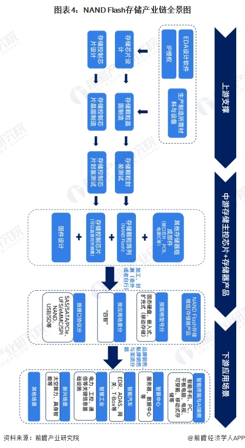
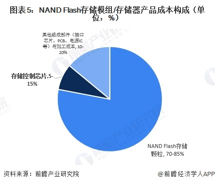
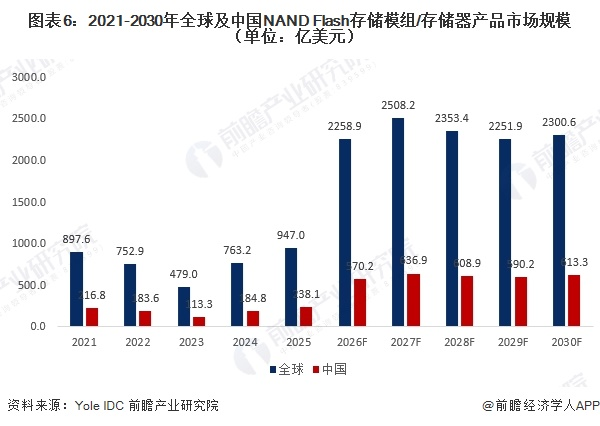
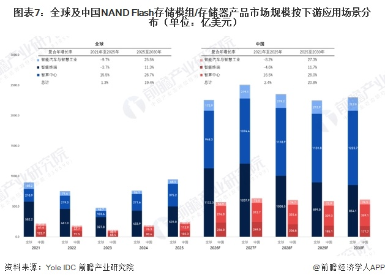
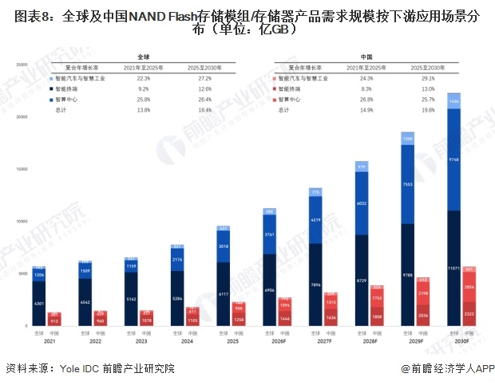
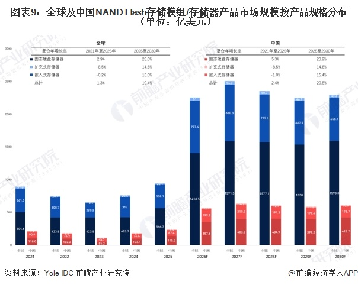
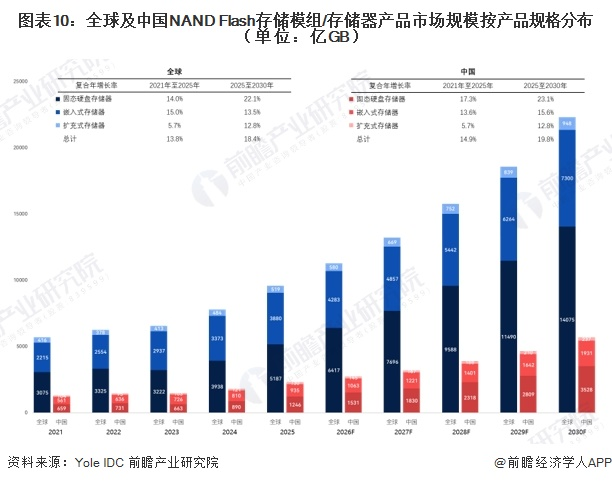
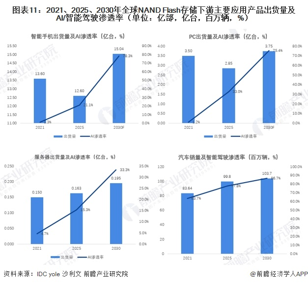
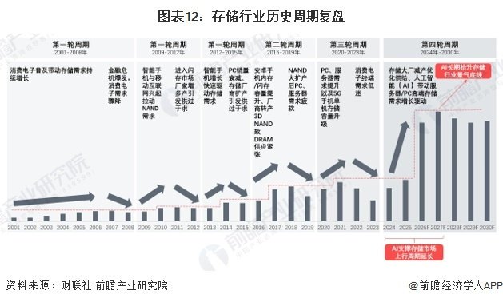

## Document Metadata

- Document ID: df473419c28651a07af3c6a570f5f6ab750fed1f
- Document Title: 预见2026：《2026年NAND Flash存储行业全景图谱》（附市场现状、竞争格局等）_行业研究报告 - 前瞻网
- Document Type: HTML
- Issuing Organization: 前瞻产业研究院
- Publication Date: 2026-08-14 15:13:27
- Reporting Period: null
- Source File: [18_qianzhan.com_snapshot.html](https://github.com/jadennevercode/CJCC-Knowledge-Base/blob/564ab11aa9785e569e3853c8a4d7ce86f88e7535/materials/%E5%9F%BA%E7%A1%80%EF%BC%9ANAND%E4%BA%A7%E5%93%81%E4%B8%8E%E6%8A%80%E6%9C%AF%E8%B0%B1%E7%B3%BB/18_qianzhan.com_snapshot.html)

## Structured Content

# 预见2026：《2026年NAND Flash存储行业全景图谱》（附市场现状、竞争格局等）

**3、NAND FLASH产业链与价值链全景梳理与典型玩家发展模式**

全球NAND Flash存储产业链结构清晰，上游为支撑环节，主要为中游的主控芯片设计公司提供研发工具、原材料和制造服务，中游为半导体存储器方案设计环节，下游为多元化应用市场环节，需求多样且规模巨大；具体来说，全球NAND Flash存储产业链环节包含IP授权、存储颗粒设计制造与封测、存储控制芯片设计制造与封测、存储模组与半导体存储器产品设计加工、品牌销售/贴牌销售与渠道分销、下游应用场景等多个节点。

从下游市场应用来看，可以分为智能终端、智算中心、智能汽车、智慧工业等。其中：

①智能终端：包括智能手机、个人电脑、平板电脑、可穿戴设备、智能家居等。此市场对成本敏感，更新换代快，是目前存储控制芯片出货量最大的市场。

②智能计算：笔记本电脑、台式机、服务器等，部分领域对性能、可靠性、能效和寿命要求极高，其中AI数据中心是当下技术壁垒最高、附加值最大的市场。此用途下，企业级SSD存储控制芯片是关键产品，市场规模增长较为迅速。

③智能汽车（车规级）：包括智能座舱、ADAS（高级驾驶辅助系统）、车载信息娱乐系统、T-Box等。此用途下，要求存储控制芯片满足严苛的车规标准（如AEC-Q100），并在极端环境下保持高可靠性。

④智慧工业（工业级）：应用于工业自动化、医疗设备、5G基站、电力等。此用途下，要求产品具有长生命周期供应、宽温工作范围和高耐久性。

⑤外设/移动式存储与新兴场景（太空算力、具身智能等场景）。

[图表 4 原始图片](https://img3.qianzhan.com/news/202609/21/20260921-4249ba2aa1aac03b.png)

从NAND Flash存储产业链环节价值占比分布来看，存储颗粒在半导体存储器产品中成本占比最高，一般为70-85%，存储颗粒市场最大、资本开支最重，但颗粒价格随着周期波动大，存储控制芯片价格则相对稳定，在半导体存储器产品中占比一般为5-15%，模组其他组成部件和加工成本占比一般为10%-20%。不同档次的SSD存储控制芯片在价值量上存在差异，从消费级（如PCIe5.0接口）到高端企业级（NVMe协议），存储控制芯片的价值量随产品档次的提升而增加。低端消费级SSD存储控制芯片（如SATA、PCIe3.0/4.0）价值量占比通常为5%到10%，而高端产品的占比可以提升至更高水平，尤其是在AI和大数据中心用SSD中，控制器的价值量显著增加。这种趋势显示出随着技术的进步和市场需求的变化，存储控制器的价值量正不断演变。

2025年存储模组厂利润大幅增长，主要受益于DRAM、NAND Flash价格暴涨，属于周期型弹性收益。而存储控制芯片厂商并不直接受NAND价格波动影响，业绩核心驱动力来自产品技术创新，如PCIe4.0/5.0迭代、UFS升级等，依靠技术壁垒获取稳定溢价，盈利更具稳健性与可持续性。在价格传导方面，存储控制芯片虽然周期涨价弹性不及模组厂，但盈利质量更高、抗周期能力更强。

[图表 5 原始图片](https://img3.qianzhan.com/news/202609/21/20260921-bcc209803074a7d5.png)

图中标注：NAND Flash存储颗粒，70–85%；存储控制芯片，5–15%；其他组成部件（接口芯片、PCB、电源IC等）与加工成本，10–20%。资料来源：前瞻产业研究院。

全球NAND Flash存储产业链上四类典型参与企业：

①IDM模式下，以美国美光科技为代表的企业，其生产制造NAND Flash存储颗粒，自研主控芯片用于自身存储器产品，也采购外部存储控制芯片；IDM原厂在高端产品线方面通常会选择自研主控，比如三星的高端消费级SSD（如980PRO、970系列）均100%使用自研存储控制芯片，以维护品牌调性和高端渠道的控制。

②以存储控制芯片设计外销为主，以联芸科技和台湾慧荣科技等企业为代表，企业作为独立第三方，既可以向存储模组厂商销售存储控制芯片，技术先进的企业也可以向颗粒原厂销售存储控制芯片；

独立第三方存储控制芯片厂商的核心优势在于能够灵活适配多品牌的NAND颗粒。例如，慧荣科技存储控制芯片能够兼容三星、海力士、长江存储等多家NAND Flash颗粒制造商的产品。这种兼容性帮助下游模组厂（如Kingston）实现供应链的弹性与多元化，客户只需采购一家存储控制芯片便可搭配多家存储颗粒进行出货，从而降低了采购风险和成本。

③“存储模组/半导体存储器产品+存储控制芯片”双轮驱动发展模式，企业可以选择直接对外销售存储控制芯片，也推出自有品牌的存储器产品（如SSD），以台湾群联电子与得一微为代表。此种模式下，企业作为第三方，既可以向存储模组厂商销售存储控制芯片，技术先进的企业也可以向颗粒原厂销售存储控制芯片，在自有品牌的存储器产品基本采用自研主控。

④以存储模组与存储器产品业务为主，代表企业以佰维存储、大普微和台湾宜鼎国际等，部分企业向产业链上游环节延伸布局、自研存储控制芯片与固件，但依然无法完全避开采购第三方存储控制芯片，其中佰维存储还具备封测生产线。以江波龙、佰维存储为代表的下游模组厂商，近年来也开始投入资源自研主控，其目的并非对外直接销售，而是以自用为主，为存储产品提供差异化、定制化的解决方案，保障供应链安全，并提升综合竞争力。

值得注意的是，在存储产业下行周期，双轮驱动模式的企业可以选择减少存储器产品业务规模，切换为以直接销售存储控制芯片为主，更具备韧性、足以穿越周期；而在上行周期，双轮驱动模式的企业则可以适当增加存储器产品业务规模，受益于存储颗粒涨价带来利润空间上涨。

从国产化来看，长江存储不生产存储控制芯片，而是与专业厂商合作定制开发。这些厂商在主控芯片领域具有专业能力，能够根据长江存储的标准接口进行产品开发。这种分工合作使得长江存储能够专注于闪存颗粒的生产，提高整体生产效率。长江存储的存储控制芯片策略在消费级品牌致态初期及当前的PCIe5.0主控产品中，均采用了台系厂商的方案。近年来，长江存储也在扶持国内存储控制芯片厂商，以配套其Xtacking3.0闪存，促进国内大存储产业链的发展。

**NAND Flash行业发展现状**

**1、全球及中国NAND Flash存储器整体市场规模走势**

在NAND存储器市场，需求增长引擎已完成从消费电子向企业级应用的结构性切换。尽管以智能手机、PC为代表的消费电子需求进入传统周期波动，但AI推理需求驱动的超大规模云服务商和大型互联网厂商持续加大服务器采购力度，直接带动NAND存储器采购量出现阶段性激增。据CFM预测，2026年，服务器端NAND需求占比已从过去的20%以上飙升至37%，且仍在持续扩大。

这一转变的核心驱动力来自AI对存储架构的深刻重塑。以英伟达Vera Rubin平台推出的ICMS架构为例，该架构将KV Cache从HBM分流至SSD，使单台搭载72颗GPU的服务器NAND用量高达1.152PB，较传统架构实现指数级跃升。与此同时，随着NL HDD市场供应持续趋紧，QLC NAND凭借成本与容量的综合优势，需求呈现稳步上升趋势，进一步拓宽了NAND在企业级存储领域的应用边界。AI推理正成为驱动NAND产业穿越传统周期、释放全新价值的核心动力。

前瞻产业研究院结合Yole发布的数据测算，2025年，全球NAND Flash存储模组/存储器产品市场规模达到947亿美元，主要受益于存储颗粒涨价周期到来。根据IDC的数据，预测到2030年，存储颗粒供需失衡带来的涨价效应持续不退，全球NAND Flash存储模组/存储器产品市场规模达到2300亿美元的量级。中国NAND Flash存储模组/存储器产品市场占全球比重为24-26%左右。2025年，中国NAND Flash存储模组/存储器产品市场规模为238.1亿美元，占全球市场比重为25.1%。

[图表 6 原始图片](https://img3.qianzhan.com/news/202609/21/20260921-6480c3edf7725e7b.png)

图表 6 中可辨认的全球市场规模（单位：亿美元）：

| 年份 | 2021 | 2022 | 2023 | 2024 | 2025 | 2026F | 2027F | 2028F | 2029F | 2030F |
| --- | --- | --- | --- | --- | --- | --- | --- | --- | --- | --- |
| 全球 | 897.6 | 752.9 | 479.0 | 763.2 | 947.0 | 2258.9 | 2508.2 | 2353.4 | 2251.9 | 2300.6 |

[OCR_UNCERTAIN] 图中部分数字较小或被图形遮挡，保留原图；无法可靠辨认的数值未转录。

**2、全球及中国NAND Flash存储器市场规模和需求规模按照下游应用场景分布**

从全球NAND Flash存储模组/存储器产品市场规模按下游场景分布来看，2025年，智能终端是全球NAND Flash存储模组/存储器产品最主流的应用市场，市场规模达到501.0亿美元；受AI算力需求的爆发影响，AI服务器对存储容量与性能的指数级消耗，以及AI推理场景对高并发、低延迟数据访问的严苛要求，驱动智算中心成为2025-2030年增长最快的市场，复合年增长率达到26.7%；而新能源汽车智能化与网联化渗透率快速提升，叠加自动驾驶等级升级对数据存储容量、可靠性及实时性的刚性需求，推动车规级存储芯片从GB级向TB级演进，叠加工业数智化对存储容量与耐写寿命的指数级需求，驱动智能汽车和智慧工业领域存储模组/存储器2025-2030年复合年增长率达到25.5%。

中国市场方面，中国NAND Flash存储模组与存储器市场正处于由AI需求引爆的“超级大周期”之中，AI服务器及端侧应用拉动高性能存储需求激增，预计2025-2030年中国NAND Flash存储模组/存储器产品市场规模复合年增长率高于全球增速，达到20.8%。

[图表 7 原始图片](https://img3.qianzhan.com/news/202609/21/20260921-77c1369c4f59c65d.png)

图表 7 中可辨认的复合年增长率：

| 下游应用 | 全球 2021年至2025年 | 全球 2025至2030年 | 中国 2021年至2025年 | 中国 2025至2030年 |
| --- | --- | --- | --- | --- |
| 智能汽车与智慧工业 | -9.7% | 25.5% | -8.2% | 27.3% |
| 智能终端 | -3.7% | 11.3% | -4.6% | 11.7% |
| 智算中心 | 15.5% | 26.7% | 16.5% | 26.0% |
| 总计 | 1.3% | 19.4% | 2.4% | 20.8% |

[OCR_UNCERTAIN] 图中部分数字较小或被图形遮挡，保留原图；无法可靠辨认的数值未转录。

*备注说明：智算中心包含服务器与数据中心等的应用，智能终端包含智能手机、PC、平板电脑、电视、智能家居、智能穿戴产品等的应用，下不赘述。*

从全球NAND Flash存储模组/存储器产品需求规模按下游场景分布来看，2021-2025年，全球NAND Flash存储需求总量将从约5706亿GB增长至约9586亿GB，其中，智能终端应用需求始终占据最大份额，2025年智能终端应用需求规模达到6117亿GB，智算中心应用需求规模达到3018亿GB，智能汽车与智慧工业应用需求规模达到431亿GB。2025-2030年，自动驾驶、车路协同及工业自动化对高耐久、宽温域存储的刚性需求驱动智能汽车与智慧工业应用需求成为增长最快的领域，复合年增长率达到27.2%。智算中心因AI大模型训练与推理需求同样保持高速增长，复合年增长率达到26.4%，智能终端始终占据最大份额但增速相对平缓。

中国市场整体需求将从2021年的约1324亿GB扩张至2025年的约2311亿GB，预计2025-2030年中国市场整体需求年复合增速将达到19.8%，2030年其NAND Flash存储模组/存储器产品需求规模将达到5696亿GB。

[图表 8 原始图片](https://img3.qianzhan.com/news/202609/21/20260921-dc6cb785b50e13b1.png)

图表 8 中可辨认的复合年增长率：

| 下游应用 | 全球 2021年至2025年 | 全球 2025至2030年 | 中国 2021年至2025年 | 中国 2025至2030年 |
| --- | --- | --- | --- | --- |
| 智能汽车与智慧工业 | 22.3% | 27.2% | 24.3% | 29.1% |
| 智能终端 | 9.2% | [OCR_UNCERTAIN] | 8.3% | 13.0% |
| 智算中心 | 25.8% | 26.4% | 26.8% | 25.7% |
| 总计 | 13.8% | 18.4% | 14.9% | 19.8% |

[OCR_UNCERTAIN] 图中部分数字较小或被图形遮挡，保留原图；无法可靠辨认的数值未转录。

**3、全球及中国NAND Flash存储器市场规模和需求规模按照产品规格分布**

从全球NAND Flash存储模组/存储器产品市场规模按产品规格分布来看，固态硬盘存储器始终占据绝对主导份额，2025年固态硬盘市场规模达到566.7亿美元，其次为嵌入式存储产品市场规模，达到358.1亿美元，扩充式存储产品市场规模约22.1亿美元。2025-2030年，受AI数据中心对高性能企业级SSD的强劲需求驱动，固态硬盘存储器将是增长最快的领域，复合年增长率将达到23.0%；嵌入式存储器为第二大品类，受益于智能手机、汽车电子等终端设备存储容量的持续升级，复合年增长率将达到13.0%。

中国方面，中国市场整体规模从2021年的约216.8亿美元增至2030年的613.3亿美元，与全球趋势基本同步，但在固态硬盘领域和嵌入式存储领域的需求增速略高于全球平均水平，反映出国内AI基础设施建设及新能源汽车智能化对存储硬件的强劲拉动。

[图表 9 原始图片](https://img3.qianzhan.com/news/202609/21/20260921-e4e9e16fd368a476.png)

图表 9 中可辨认的复合年增长率：

| 产品规格 | 全球 2021年至2025年 | 全球 2025至2030年 | 中国 2021年至2025年 | 中国 2025至2030年 |
| --- | --- | --- | --- | --- |
| 固态硬盘存储器 | 2.9% | 23.0% | 5.3% | 23.9% |
| 扩充式存储器 | -8.5% | 14.6% | -8.5% | 14.6% |
| 嵌入式存储器 | -0.2% | 13.0% | -1.0% | 15.4% |
| 总计 | 1.3% | 19.4% | 2.4% | 20.8% |

[OCR_UNCERTAIN] 图中部分数字较小或被图形遮挡，保留原图；无法可靠辨认的数值未转录。

从全球NAND Flash存储模组/存储器产品需求规模按产品规格分布来看，2021-2030年，全球NAND Flash存储模组与存储器容量需求总量将从约5706亿GB增长至约2.23万亿GB，2025至2030年复合增长率约18.4%，具体来看，2025年，固态硬盘存储器需求量为5187亿GB，嵌入式存储器为3880亿GB，扩充式存储器为519亿GB。2025-2030年，AI数据中心对高性能企业级SSD的强劲需求驱动固态硬盘存储器始终占据主导地位且增速最快，年复合增速达到22.1%；嵌入式存储器受益于智能手机、汽车电子及AI端侧设备对高密度、低功耗存储的持续升级年复合增速保持在13.5%；扩充式存储器增速相对平缓，年复合增速约12.8%。2021-2030年中国市场整体容量需求将从约1324亿GB增至5696亿GB，2025至2030年复合增长率约19.8%，略高于全球平均水平。

[图表 10 原始图片](https://img3.qianzhan.com/news/202609/21/20260921-9586b2861c188d31.png)

图表 10 中可辨认的复合年增长率：

| 产品规格 | 全球 2021年至2025年 | 全球 2025至2030年 | 中国 2021年至2025年 | 中国 2025至2030年 |
| --- | --- | --- | --- | --- |
| 固态硬盘存储器 | 14.0% | 22.1% | 17.3% | 23.1% |
| 嵌入式存储器 | 15.0% | 13.5% | 13.6% | 15.6% |
| 扩充式存储器 | 5.7% | 12.8% | 5.7% | 12.8% |
| 总计 | 13.8% | 18.4% | 14.9% | 19.8% |

[OCR_UNCERTAIN] 图中部分数字较小或被图形遮挡，保留原图；无法可靠辨认的数值未转录。

**4、NAND Flash存储下游主要应用产品市场发展概况**

随着AI技术的快速发展，其影响力正从深度及广度向下游部门渗透。在智能手机领域，智能手机作为NAND Flash最大的消费级下游市场，AI渗透率正从早期极低水平快速攀升，AI手机对本地大模型推理、实时影像处理和智能助手等功能的支持，意味着单机存储容量正从传统的128GB/256GB向512GB乃至1TB演进，同时对存储读写速度和响应延迟的要求也更为苛刻，智能手机因此继续扮演NAND Flash需求核心基本盘的角色。PC领域，PC市场在经历此前几年的低迷后，正迎来由AI PC驱动的换机周期，AI PC需要本地运行生成式AI应用和大语言模型，这推动DDR5内存与大容量SSD的组合加速成为标配，存储规格面临全面升级，PC端存储需求呈现结构性改善。服务器方面，服务器领域是NAND Flash企业级应用的核心场景，AI大模型训练和推理对算力的爆发式需求直接拉动了AI服务器部署规模的扩张，AI服务器不仅在数量上增长，单机存储配置也大幅提升，训练集群需要高速NVMe SSD支撑海量数据吞吐，推理场景则对低延迟存储有刚性需求，企业级SSD由此成为NAND Flash市场中增长最快、附加值最高的细分赛道。汽车领域正从传统交通工具向智能终端演进，智能驾驶渗透率的稳步提升使得高阶智驾系统对车规级存储的需求显著放量，从传感器数据采集、实时感知融合到AI决策，单车存储需求呈数量级增长，车规级NAND Flash正从边缘应用走向主流，成为存储市场的重要增量来源。

综合来看，NAND Flash下游四大核心场景均在经历AI驱动的深刻变革，AI渗透率的快速提升正从两个维度重塑存储需求，一是单机或单系统存储容量和性能规格的提升，二是AI设备出货占比扩大带来的总量增长，智能手机和PC作为消费级基本盘提供规模支撑，服务器和汽车等领域作为新兴高增场景贡献弹性，四大领域协同发力，共同构成NAND Flash存储需求持续扩张的核心驱动力。

[图表 11 原始图片](https://img3.qianzhan.com/news/202609/21/20260921-46ace0db62095e05.png)

图表 11 中可辨认的出货量数据：

| 产品（单位） | 2021 | 2025 | 2030（图中标注） |
| --- | --- | --- | --- |
| 智能手机（亿台） | 13.60 | 12.60 | 15.04（2030F） |
| PC（亿台） | 3.50 | 2.85 | 3.75（2030F） |
| 服务器（亿台） | 0.150 | 0.163 | 0.195 |
| 汽车（百万辆） | 83.64 | 99.8 | 103.7 |

图表 11 中可辨认的渗透率：

| 应用 | 2025 | 2030 |
| --- | --- | --- |
| PC AI 渗透率 | 33.0% | 75.4% |
| 服务器 AI 渗透率 | 15.3% | 33.3% |

[OCR_UNCERTAIN] 图中部分数字较小或被图形遮挡，保留原图；无法可靠辨认的数值未转录。

**NAND Flash存储行业的周期性分析**

存储行业是半导体产业中周期性最为显著的细分领域。自2001年至今，全球存储行业已历经六轮完整的涨跌周期，除第一轮外，每一轮周期大约历时3至4年，遵循着“需求爆发→价格飙升→产能扩张→供过于求→价格崩盘→行业出清”的经典循环。这一周期性波动的底层逻辑在于：存储芯片作为高度标准化的“大宗商品”，资本开支巨大且产能建设周期长达18至24个月，厂商往往基于当前高价信号决策未来产能，最终必然导致供需的时间性错配。从驱动力的演进来看，四轮周期的核心引擎依次为消费电子兴起（2001-2008年）、手机和移动互联网兴起（2009-2012年）、智能手机普及（2013-2015年）、消费升级与云数据中心扩容（2016-2019年）、疫情催生的居家办公脉冲式需求（2020-2023年），以及当前由AI技术革命驱动的超级周期（2024年至今），需求结构从分散的多点开花逐步演变为AI算力一家独大的集中式爆发。

值得一提的是，当前正在展开的第六轮周期呈现出与以往截然不同的结构性特征。需求端，AI服务器对存储芯片的“吞噬式需求”远超历史任何一轮周期——单台AI服务器的DRAM用量是传统服务器的8至10倍，NAND用量达3倍以上。供给端，经历多轮洗牌后存活下来的三星、SK海力士、美光三大寡头掌握了全球95%以上的DRAM市场份额，同时表现出前所未有的产能纪律性——不再盲目扩张通用DRAM产能，而是将先进产能系统性转向HBM等高利润领域，主动压缩甚至停产消费级产品，库存水平维持在3至5周的历史极低位置。这种“精准控产”策略与历史上“高利润刺激疯狂扩产”的模式形成鲜明对比。

从行业格局的深层变化来看，存储行业的周期属性正在经历从“强周期”向“成长性”的渐进式过渡。摩根士丹利判断本轮为持续数年的“超级周期”，交银国际预计上行周期至少延续至2027年第一季度。与此同时，中国力量的崛起成为本轮周期中不可忽视的关键变量——长江存储在NAND市场份额已超过接近10%，长鑫存储HBM4样品已成功通过华为昇腾910B验证，国际巨头主动退出部分消费级市场为国产替代腾出了明确空间。

尽管物理规律决定了供需错配的周期性波动不会完全消失，但AI作为一次深刻的科技革命，已为存储行业注入了前所未有的长期需求基本盘，AI驱动的企业需求取代波动较大的消费电子成为核心驱动，整体呈现波动适度的上行趋势。一方面，AI端侧设备、智能汽车及具身智能等新兴应用场景的持续扩展，将为存储需求提供强劲持久的增长动力，支撑市场长期发展。另一方面，随着行业级大模型与各经济领域深度融合、赋能，将催生可观的AI推理需求。推理阶段所需的实时数据检索、临时数据存储和高效处理将进一步推动增量存储需求，成为行业的另一个关键增长动力。这意味着即便未来价格从高点回落，其底部也将远高于过往周期——历史的波动中轴线，正被AI这股巨力永久性地抬升和拉长。

[图表 12 原始图片](https://img3.qianzhan.com/news/202609/21/20260921-2aac868d79ce6099.png)
