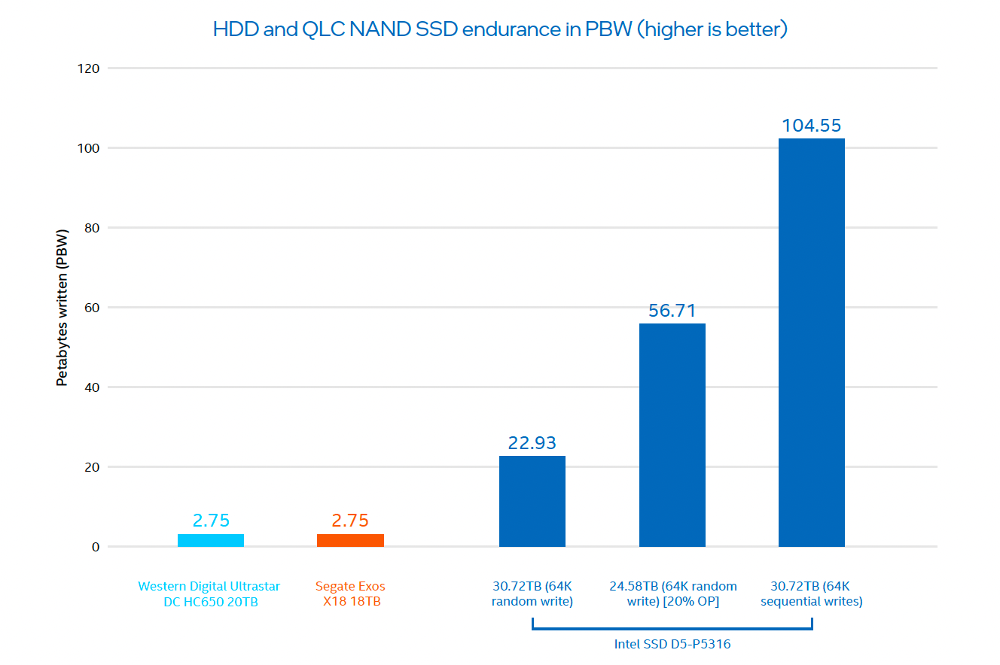

## Document Metadata

- Document ID: 69cee459e19ce753ff744e2fb3d3f4da525711db
- Document Title: Efficiently Accelerate Access to More Warm Data with Solidigm QLC 3D NAND Technology
- Document Type: HTML
- Issuing Organization: Solidigm
- Publication Date: null
- Reporting Period: null
- Source File: [19_solidigmtechnology_efficiently-access-more-warm-d.html](https://github.com/jadennevercode/CJCC-Knowledge-Base/blob/564ab11aa9785e569e3853c8a4d7ce86f88e7535/materials/%E5%9F%BA%E7%A1%80%EF%BC%9ANAND%E4%BA%A7%E5%93%81%E4%B8%8E%E6%8A%80%E6%9C%AF%E8%B0%B1%E7%B3%BB/19_solidigmtechnology_efficiently-access-more-warm-d.html)

## Structured Content

# Efficiently Accelerate Access to More Warm Data with Solidigm QLC 3D NAND Technology

# 利用 Solidigm QLC 3D NAND 技术高效加速访问较常用的数据

Solidigm

技术简介

29 May 2023

## Solidigm QLC 3D NAND SSD 与 HDD 相比可提升容量和性能

---

现代任务关键型工作负载，如人工智能 (AI)、大数据分析和内容交付网络 (CDN)，都依赖于快速访问大量且不断增长的数据。但在数据存储方面，组织很难在性能、容量、成本和可靠性方面做出权衡。 机械硬盘 (HDD) 提供低成本、高容量存储，但无法跟上现代应用程序所需的快速读取访问速度。 三层单元 (TLC) NAND 固态硬盘 (SSD) 为混合工作负载和写入密集型工作负载（例如缓存应用程序）提供更高的性能，但通常无法满足现代以读取数据为主的工作负载成本和容量要求。 因此，企业面临 HDD 与 TLC NAND SSD 之间的性价比差距。 四级单元 (QLC) NAND 固态硬盘有助于填补这一空白，因为它们能够将高成本效益的大容量与出色的温暖数据读取读能结合在一起。特别是，Solidigm QLC 3D NAND 固态硬盘提供经过事实验证的耐用性、可靠性和针对读取优化的性能，同时通过数据中心的整合来降低总拥有成本 (TCO)。 针对实际工作负载已获检验的耐用性驱动器耐用性通常以驱动器每日整盘写入次数 (DWPD) 或总写入字节数来衡量，表示为写入太字节数 (TBW) 或写入拍字节数 (PBW)。 测量耐用性基于联合电子设备工程委员会 (JEDEC) 适用于近乎最坏情况的规范，即 40/60 读/写工作负载，100% 随机写入和 4K 块大小。 这种情况不代表前面介绍的读取密集型工作负载类型，如人工智能或 CDN。 在这两项指标中，Solidigm 认为 PBW 能够更准确地表示耐用性。 DWPD 不考虑容量，尽管大容量固态盘的额外空间可以通过将磨损分散到较大驱动器占用空间中，从而提高耐用性。 相反，PBW 表示在驱动器规定的使用寿命内可以写入的数据总量。 PBW 将容量纳入考量，为大容量 QLC NAND SSD 与众多其他 SSD 和 HDD 比较提供了更有用、更真实的衡量指标。 基于 PBW，Solidigm SSD D5-P5316 为 QLC NAND SSD 提供业界领先的耐用性，其耐用性水平远远超过 HDD，详见图 1。[3]

[原始图像](https://s7d9.scene7.com/is/image/Solidigm/fig-1-hdd-and-qlc-nand-ssd-endurance-in-pbw-1?fmt=avif-alpha&qlt=90)

HDD and QLC NAND SSD endurance in PBW (higher is better):

| 图示产品或配置 | Petabytes written (PBW) |
| --- | ---: |
| Western Digital Ultrastar DC HC650 20TB | 2.75 |
| Seagate Exos X18 18TB | 2.75 |
| Intel SSD D5-P5316 30.72TB (64K random write) | 22.93 |
| Intel SSD D5-P5316 24.58TB (64K random write) [20% OP] | 56.71 |
| Intel SSD D5-P5316 30.72TB (64K sequential writes) | 104.55 |

#### **图 1. Solidigm SSD D5-P5316 耐用性水平分别比两款常用企业级 HDD 高出 8 倍和 38 倍 [3]**

图 1 还突出 QLC NAND SSD 耐用性水平与应用工作负载之间的关联性。例如，依赖于大块数据顺序读取的应用程序对 QLC NAND SSD 的消耗远低于依赖频繁随机写入小块数据的应用程序。 2020 年 2 月召开的 USENIX 会议上发布的一项大规模研究进一步证明 QLC NAND SSD 如何为现代企业所依赖的以读取为中心的工作负载提供足够的耐用性。 该研究作者指出，“据我们预测，对于绝大多数企业用户而言，转向 QLC 的 PE 周期不会带来任何风险，因为 99% 的系统最多使用驱动器额定寿命的 15%。” [4]

NAND SSD 与 HDD 不同，不需复制即可达到可接受的性能水平，而可靠性通常所需的复制量比 HDD 少得多。 更高的 SSD 性能还支持与 HDD 相比更为高效的数据缩减方法。 由于现代压缩和重复数据删除算法针对 SSD 进行优化，因此满足“可用容量”要求的原始存储容量需求远低于 HDD。

与 HDD 相比，SSD 的整合优势可以显著节省温数据存储成本，尤其是在 NAND SSD 成本持续下降的情况下。 Wikibon 研究分析师 David Floyer 指出，到 2026 年，SSD 每 TB 美元成本将比 HDD 更低。 [6]

QLC NAND SSD 的置换机会虽然不如 HDD 大，但与 TLC SSD 部署相比，仍可显著节省成本。 与 TLC NAND 相比，QLC NAND 更高密度的存储和由此带来的每 TB 成本节约可以产生资本支出优势。 并且由于读取性能与 TLC NAND 相同，QLC NAND 为读取密集型工作负载提供了颇具吸引力的 TCO 机会。

### 整合数据可为 CDN 带来大量的节省

视频点播 (VoD) 网络等 CDN 为使用 Solidigm QLC 3D NAND SSD 而非 HDD 整合存储提供了理想的研究案例，同时还可提供满足严格服务水平协议 (SLA) 所需的性能和耐用性。

混合使用 HDD 和 TLC NAND SSD 进行理论中间层 CDN 部署。 为了满足 SLA，阵列需要每节点 480 TB 容量和每节点 190 Gbps 吞吐量。 每台服务器 111 TB 和 51 Gbps 时，HDD 存储必须超需求过度配置容量，才能满足总吞吐量要求。 在此示例中，过度配置阵列全部替换为 QLC-NAND SSD，服务器将实现近 5 倍的整合，总拥有成本降低幅度高达 42%。 [7]

QLC NAND SSD 的读取优化性能推动了这些取得令人钦佩的成绩，它使组织能够不再使用 TLC NAND SSD 作为缓存驱动器，并用更具空间和运行效率的容量存储替换 HDD。

[3] Solidigm SSD D5-P5316 驱动器耐用性基于 64 KB 随机写入和 64 KB 顺序写入工作负载。 “20% OP”表示过度配置驱动器的耐用性。 过度配置可通过创建具有 80% 可用区域规模的命名空间实现。 希捷 Exos X18 耐用性数据来自希捷的数据表: seagate.com/files/www-content/datasheets/pdfs/exos-x18-channel-DS2045-1-2007GB-enSG.pdf。 西部数据 Ultrastar DC HC650 耐用性数据来自西部数据的数据表: https://documents.westerndigital.com/content/dam/doc-library/enus/assets/public/western-digital/product/data-center-drives/ultrastar-dc-hc600-series/data-sheet-ultrastar-dc-hc650.pdf。 HDD DWPD 计算：(550 TB/年)/365 天/容量 (TB)。 HDD PBW 计算：((550 TB/年)\*5 年)/1000。

[4] Stathis Maneas 和 Kaveh Mahdaviani，多伦多大学；Tim Emami，NetApp；Bianca Schroeder，多伦多大学。 “有关大型企业存储部署中 SSD 可靠性的研究。”2020 年 2 月。 [usenix.org/system/files/fast20-maneas.pdf](http://usenix.org/system/files/fast20-maneas.pdf).

[6] Wikibon. “QLC Flash HAMR 机械硬盘‘’，2021 年 1 月。 <https://wikibon.com/qlc-flash-hamrs-hdd/>.

[7] 从混合 TLC-SSD 和 HDD 阵列升级到全 QLC SSD 阵列时，服务器整合率提升近 5倍，总拥有成本降低 42% 数据来源：基准服务器假设 2000 个活动用户，最低容量 480 TB，目标吞吐量为 190 Gbps，85% 高速缓存命中率。 每台服务器混合阵列配置包括 2 个英特尔至强可扩展 6330 处理器、512GB 内存、12 个 2.088 Gbps 吞吐量的 8TB 希捷 Exos HDD，2 个 56 Gbps 吞吐量的 7.68 TB Solidigm SSD D7-P5510。 混合阵列成本（CPU + 内存 + RAID 控制器 + NVM Express [NVMe] 扩展卡 + 机箱 + 电源）净存储：10,530 美元。 每台服务器全 QLC 配置包括 2 个英特尔至强可扩展 6338N 处理器、512 GB 内存、20 个 54.4 Gbps 吞吐量 的 30.72 TB Solidigm SSD D5-P5316。 全 QLC 服务器成本（CPU + 内存 + RAID 控制器 + NVMe 扩展卡 + 机箱 + 电源）净存储：11,530 美元。 HDD 定价数据来自 [serversupply.com/HARD%20DRIVES/SATA-6GBPS/8TB-7200RPM/SEAGATE/ST8000NM000A326073.htm](https://www.serversupply.com/SSD/SATA-6GBPS/)l，截至 2021 年 3 月 15 日。 SSD 定价是 Solidigm 预算定价。 实际价格可能有所变化，可能与 TCO 模型中使用的定价不一致。对 1,100 瓦/服务器运行成本进行估算，功耗和冷却成本 0.12 美元/千瓦时，每 RU 年机架成本 75.76 美元。
