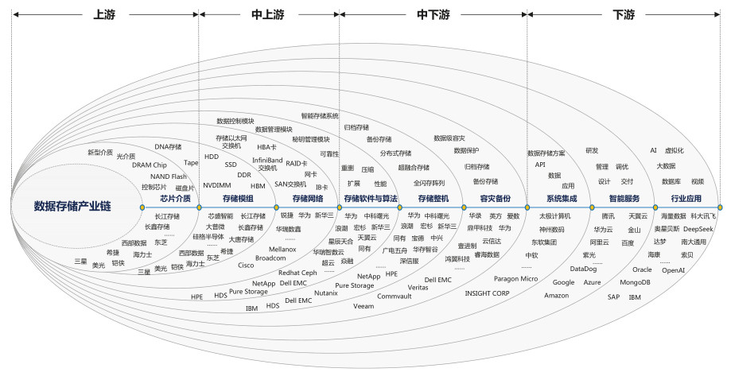

## Document Metadata

- Document ID: 35c8195fec353e475b1cf1e32f236cfde30decad
- Document Title: 数据存储产业发展研究报告（2025年）
- Document Type: PDF
- Issuing Organization: 中国电子工业标准化技术协会数据存储专业委员会
- Publication Date: 2025-11
- Reporting Period: null
- Source File: [20_showfile.cesa.cn_014a616907b1437594f2f27cf20d20ed数据存储产业发展.pdf](https://github.com/jadennevercode/CJCC-Knowledge-Base/blob/564ab11aa9785e569e3853c8a4d7ce86f88e7535/materials/%E5%9F%BA%E7%A1%80%EF%BC%9ANAND%E4%BA%A7%E5%93%81%E4%B8%8E%E6%8A%80%E6%9C%AF%E8%B0%B1%E7%B3%BB/20_showfile.cesa.cn_014a616907b1437594f2f27cf20d20ed%E6%95%B0%E6%8D%AE%E5%AD%98%E5%82%A8%E4%BA%A7%E4%B8%9A%E5%8F%91%E5%B1%95.pdf)

## Structured Content

[Source Page: 15]

### 1.2 有数据即有存储，数据存储产业是战略性基础产业

数据存储作为数据的物理载体与管理基石，其产业能力直接决定了数据要素能否安全存得住、高效流得动、价值挖得深。因此，数据存储产业已超越传统IT 范畴，上升为支撑数字中国建设、保障数字经济安全、争夺人工智能时代制高点的战略性基础产业。

为清晰洞察这一庞大产业，我们将其划分为以下四个关键环节，如图：

图1 数据存储产业构成：原图包含大量细小标签及跨环节连接，保留原页面图像与 OCR 提取图像供核验；不推断连接关系。

（上游）介质与芯片：产业的“原料”，包括NAND Flash（闪存颗粒）、DRAM（动态随机存取存储器）等存储介质，以及主控、接口等核心芯片，是自主创新的源头。

（中上游）部件与模组：产业的“核心部件”，将上游的介质与芯片组合成为SSD（固态硬盘）、HDD（机械硬盘）、内存条（含HBM（高带宽内存））等功能明确的标准化产品，是技术集成与供应链的关键组成。

（中下游）整机与系统：产业的“设备与方案”，通过软硬件协同，将部件与模组集成为全闪存储阵列、分布式存储等企业级存储系统，提供高可靠、高性能的数据存储服务，是数据存储技术的最终产品化体现。

（下游）应用与服务：产业的“价值释放端”，面向金融、通信、医疗等千行百业，提供定制化解决方案与存储即服务（STaaS），是驱动技术持续迭代的最终场景。

这四个环节环环相扣，构成了从底层物理介质到顶层业务应用的完整生态。其中，中游（部件与整机）是产业的主体与价值体现，它直接决定了数据基础设施的性能、可靠性与安全水平。下游蓬勃发展的数字经济与AI 应用，则不断对中游提出更高要求，驱动全产业领域持续创新与迭代升级。

[Source Page: 16]

### 1.3 AI 成为最大增量引擎，数据存储市场规模持续扩大

人工智能（AI）的浪潮正在将数据从静态资源转变为驱动社会发展的核心动力，并从根本上重塑数据存储产业。《全国数据资源调查报告（2024 年）》显示，2024 年全国数据生产总量达41.06ZB，同比增长25%。IDC（国际数据公司）预测，2023 年至2028 年全球数据量年复合增长率（CAGR）将高达24.4%1，而中国数据圈预计在2025 年增至48.6ZB，占全球总量的27.8%，跃居世界第一。数据规模的指数级膨胀，是AI 驱动下存储需求爆发的直观体现。

在数据洪流的驱动下，全球数据存储市场迎来了规模扩张与结构升级并行的新阶段。若以“介质- 部件- 整机- 应用”的产业框架审视，中游市场（部件与整机）构成了产业的价值主体与增长核心。它不仅规模庞大，更是承接上游技术创新、支撑下游业务赋能的关键枢纽。

综合Gartner、集邦咨询、IDC 多方数据，2025 年上游“介质”全球市场规模约1900 亿美元，包括DRAM（含HBM）约1300 亿美元，NAND Flash 约600 亿美元。

中上游“部件”市场（如SSD、HDD、内存模组）2025 年全球市场规模约1580 亿美元，其中内存模组约900 亿美元，SSD 约540 亿美元，HDD 约140 亿美元。

中下游“整机”市场 2025 全球市场规模达 3390 亿美元，包括内置存储（随服务器销售）1760 亿美元，ODM Direct（互联网定制存储）1280 亿美元，企业级外置存储（如企业级存储阵列、分布式存储系统）约 350 亿美元。其中，企业级外置存储直接服务于金融、通信、医疗、制造、政务等复杂业务场景，是存储厂商技术与品牌竞争的核心市场，具有技术密集、专利壁垒高、高附加值等特点，是整个产业中持续快速演进的高价值专业市场。

下游“应用”市场全球企业级数据存储市场规模约1800 亿美元，主要面对金融、通信、制造、医疗等行业数据中心应用领域。

聚焦于全球产业价值核心的中游环节，中国市场的表现尤为突出，已成为全球增长的关键引擎。在核心“部件”领域，中国市场规模约4580 亿元人民币，占全球同类市场约32%；在体现最终解决方案价值的“整机”领域，仅企业级外置存储这一高价值细分市场，规模就达约510 亿元人民币，占全球22%。这两大关键领域的份额清晰地表明，中国存储产业在全球产业链中的影响力与竞争力仍在持续提升。

AI 技术和应用的快速发展，促进存储技术加快迭代，架构创新活跃。HBM 代次快速演进, 近存计算、AI 数据平台等新范式涌现，针对AI 优化和设计的存储系统开始应用，这些变化成为数据存储产业快速发展的强大引擎。

1　 来源：IDC DataSphere 趋势预测

[Source Page: 18]

### 2.1 产业进展：从跟跑到并跑，中国成为全球数据存储产业关键力量

全球数据存储产业格局呈现高度集中态势，主要厂商分布于美国、中国、韩国与日本。在这一竞争格局中，中国数据存储企业依托持续的技术投入、完善的产业环境与蓬勃的市场需求，实现了从“跟跑者”向全球供应链核心参与者的重要转变。中国企业在3D NAND 闪存、DRAM 内存及全闪存存储系统等关键领域，已形成自主能力并取得关键突破，正逐步重塑全球产业格局，成为支撑全球数字经济发展的重要力量，但在部分尖端技术领域仍需持续突破。

在产业链上游的存储介质领域，长江存储通过其创新的Xtacking（晶栈）架构，成功突破了高密度、高性能与低功耗难以协同的技术瓶颈，为全球3D NAND 闪存技术演进提供了新的思路。相关资料2024 年数据显示，长江存储在NAND Flash 全球产能中占比约8%，长鑫存储在DRAM领域占比约10%，标志着中国企业在核心技术自主创新与产能爬坡方面取得实质性进展。与此同时，在企业级固态硬盘（SSD）市场，大普微、忆联、忆恒创源等国内企业积极投入，在产品研发与市场拓展方面表现活跃，共同推动国内存储生态不断完善。

根据IDC报告，在企业级外置存储市场，2024年全球格局呈现“总量稳增、结构优化、中美双强”的态势。DELL、NetApp 等美国厂商仍占据全球一半以上市场份额，而华为、曙光、浪潮等中国厂商凭借超20% 的全球市场份额，已成长为不可忽视的重要力量。随着AI 大模型对高吞吐、低延迟存储需求的持续提升，中国厂商在技术创新与市场拓展方面的表现将深刻影响全球存储产业的未来走向。

[Source Page: 19]

#### 2.2.1 政策环境：存力战略地位提升，支持体系持续完善

国家层面已将数据存力明确为数字基础设施的重要组成部分，并推出一系列举措支持产业发展。工信部等部委在产业政策中多次强调存储关键技术攻关与自主体系建设，例如《电子信息制造业2023—2024年稳增长行动方案》¹中明确提出加快存储芯片与先进存储系统研发与产业化；《算力基础设施高质量发展行动计划》²则设立“强化存力高效灵活保障”专项任务，推动存储闪存化升级与先进存储技术规模化应用，共同促进存力与算力、运力协同发展。2023年国家数据局的成立，为统筹数据基础制度建设与数据资源开发利用提供了重要的组织保障。

[Source Page: 19]

1. 关于印发电子信息制造业2023—2024年稳增长行动方案的通知，https://www.miit.gov.cn/zwgk/zcwj/wjfb/tz/art/2023/art_6ec44841d92a49729b9c04a91b5f89f9.html%5Breference:0
2. 工业和信息化部等六部门关于印发《算力基础设施高质量发展行动计划》的通知，https://www.miit.gov.cn/jgsj/txs/wjfb/art/2023/art_ed448f60021741729f7ee8e36aaafdd7.html

[Source Page: 20]

#### 2.3.1 技术体系架构

数据存储技术体系构建起从基础到应用的金字塔结构。如图2 所示，数据存储技术体系可概括为以系统级能力为枢纽，连接底层硬件资源与顶层业务需求的有机整体。该体系由基础介质与芯片、部件与模块、软件与算法、协议标准构成技术创新基石；系统级关键技术通过软硬件结合方式，将基础能力转化为数据管理、性能优化、数据保护与高可用等通用服务；最终，这些能力被整合成多样化的整机系统与方案，以支撑从核心交易业务到云计算/ 大数据、数据保护与容灾、人工智能等应用场景。这一架构清晰地表明，数据存储技术的竞争焦点与价值重心，已从单部件性能，转向整个系统架构的效率、智能与韧性。

图2 数据存储产业技术图谱：原图包含多层级表格、协议和技术标签。原页面图像保留完整布局；标签过密而无法可靠重建行列关系，标记 [TABLE_RECONSTRUCTION_UNCERTAIN]。

[Source Page: 20]

图 2 中介质与芯片层可可靠辨认的电介质条目：

| NAND Flash | DRAM Chip |
| --- | --- |
| 3D NAND堆叠 | 制程微缩 |
| Xtacking/CuA工艺 | 晶体管架构 |
| QLC/PLC颗粒 | 堆栈设计 |

同一行只用于排版，不表示两个条目之间存在额外关联。

[Source Page: 20]

**介质与芯片**

- 磁介质：
  - 磁盘片：高密度磁记录介质；超平滑保护层；润滑剂技术。
  - 磁带磁性材料：超细磁粉；纳米级涂层；耐久性技术。
- 光介质：光盘记录层；相变材料；多层记录技术；超分辨率刻录。
- 新型介质：DNA存储/玻璃介质等；生物信息编码算法；合成与测序技术；纠错与数据重构；飞秒激光三维刻写；相变/阻变材料工程。
- 存储芯片：
  - 控制芯片：闪存转换层；纠错引擎；垃圾回收算法；固件架构。
  - 接口芯片：编解码器；信号完整性处理；电源管理。

[Source Page: 26]

### 2.7 正视挑战：关键瓶颈与深层次问题亟待突破

在肯定发展成就的同时，必须清醒认识到，中国数据存储产业在由大向强迈进的关键阶段，仍面临一系列核心技术、产业生态与创新体系上的深层次挑战，这些瓶颈是产业实现高质量发展必须攻克的课题。

核心技术与关键部件自主化任重道远。 在存储介质等基础领域，自主能力仍存在显著短板。例如，大容量机械硬盘（HDD） 的核心技术仍由国际巨头主导，且技术与专利壁垒高，是我国产业中自主化难度最大、供应链风险最集中的环节之一。同时，尽管国产固态硬盘（SSD） 在技术上取得重大突破，但仍面临先进产能爬坡、市场生态构建等挑战，在全球市场份额上仍处个位数区间，从技术突破到市场主导的路径依然漫长。

[Source Page: 52]

### 2. NVIDIA与存储头部企业加速定义下一代存储与AI数据平台，产业联盟竞速标准制定

**事件回顾：**

2025 年3 月18 日，在GTC 大会上，NVIDIA 公开Storage NEXT 项目最新进展，联合15 家存储芯片/ 介质厂商和9 家主流存储厂商，共同设计以GPU 为中心的Scada fabric 架构。

与此同时，NVIDIA 联合头部存储厂商共同推出NVIDIA AIDP（AI 数据平台），将企业存储与NVIDIA 加速计算技术相集成，以提高AI 工作流的性能和精度。DDN、DELL、HPE、HitachiVantara、IBM、NetApp、Nutanix、Pure Storage、VAST Data 和 WEKA 等头部存储提供商均选择与 NVIDIA 合作，基于自身存储优势能力，打造可定制化的AI 数据平台，帮助企业充分挖掘数据价值。

2025 年8 月4 日，SNIA（全球存储网络行业协会）宣布启动Storage.AI 倡议，联合全球巨头共同制定AI 存储标准。会员包括AMD、DELL、NetApp、Pure Storage、IBM、DDN、思科、英特尔、美光等14 家科技巨头，为人工智能驱动的存储生态提供统一框架与规范，共同解决AI工作负载中的数据效率难题。

[Source Page: 56]

2025 年7 月15 日，开放闪存平台架构Open Flash Platform（OFP）倡议正式发布。该倡议的首批成员包括：Hammerspace、Linux 社区、洛斯阿拉莫斯国家实验室（LANL）、ScaleFlux、SK Hynix 以及Xsight Systems。

[Source Page: 57]

### 8. QLC闪存技术确立主流地位，产业在持续创新中应对供应链波动

**事件回顾：**

2025 年2 月27 日，三星与长江存储正式官宣合作，三星计划在其未来的NAND 闪存芯片中采用长江存储的“Xtacking”混合键合封装专利技术，此次合作预示着中国企业在封装技术方面实现了部分领先。

[Source Page: 58]

2025 年8 月8 日，闪迪与SK 海力士签署谅解备忘录（MOU），共推高带宽闪存（HBF）技术规范，为下一代人工智能推理提供突破性存储容量与性能。

2025 年8 月12 日，在2025 全球闪存峰会上，英韧科技宣布推出首款兼具SLC+QLC 混合架构的企业级SSD 主控芯片，联手长江存储实现4K 随机写入性能破100K IOPS，PE 寿命从500增至5000，功耗显著下降。

[Source Page: 58]

2025 年8 月25 日，SK 海力士宣布其321 层2Tb QLC NAND 闪存产品已完成开发并开始量产，此举标志着全球首次实现超过300 层QLC 技术的实现，树立了NAND 密度的新标杆。

[Source Page: 58]

2025 年12 月，行业分析显示，受AI 与大模型需求爆发式拉动，全球NAND Flash 市场呈现供不应求态势，企业级SSD 等产品价格出现显著上涨。与此同时，超大规模AI 基础设施计划（如OpenAI 的扩展）对未来产能提出了巨大需求，进一步凸显了供应链的紧张态势。
