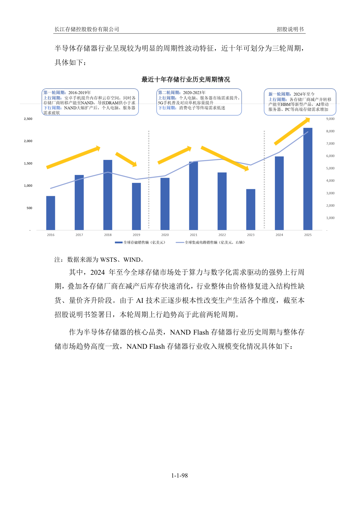
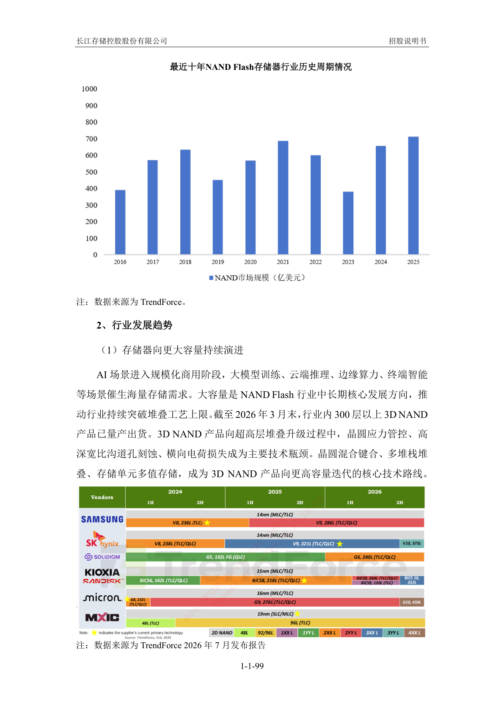
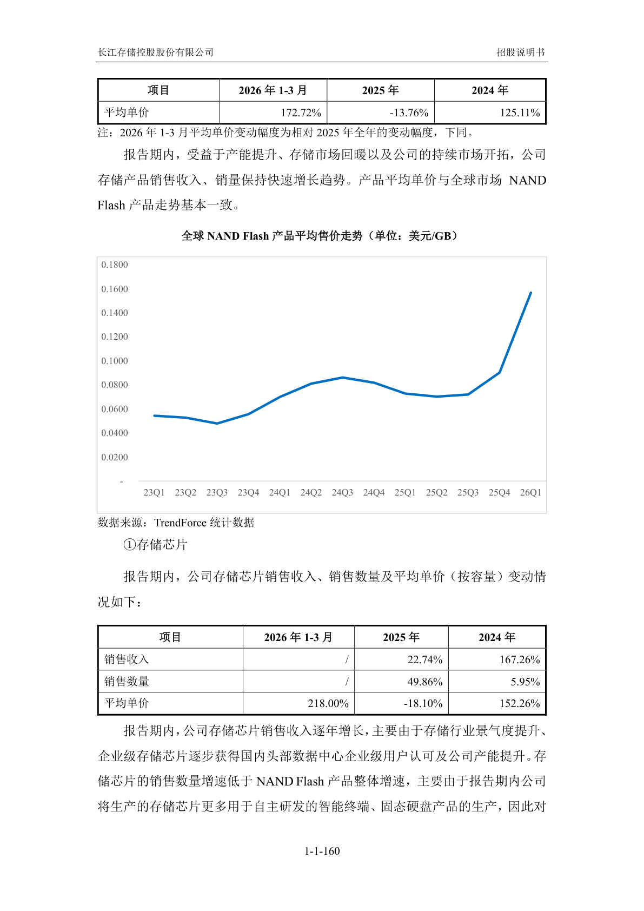

## Document Metadata

- Document ID: f9c07fa56d6afbe4f4fdba85a590c25d147f3076
- Document Title: 长江存储控股股份有限公司首次公开发行股票并在科创板上市招股说明书（申报稿）
- Document Type: 招股说明书（申报稿）
- Issuing Organization: 长江存储控股股份有限公司
- Publication Date: null
- Reporting Period: null
- Source File: [13_pdf.dfcfw.com_H2_AN202608211828282178_1.pdf](https://github.com/jadennevercode/CJCC-Knowledge-Base/blob/564ab11aa9785e569e3853c8a4d7ce86f88e7535/materials/%E5%9F%BA%E7%A1%80%EF%BC%9A%E5%8E%82%E5%95%86%E4%B8%8E%E7%BB%84%E7%BB%87%E7%BB%93%E6%9E%84/13_pdf.dfcfw.com_H2_AN202608211828282178_1.pdf)

## Structured Content

[Source Page: 11]

## 第一节 释义

### 一、一般释义

| 术语 |  | 释义 |
| --- | --- | --- |
| 公司、发行人、长存控股 | 指 | 长江存储控股股份有限公司 |
| 长江存储 | 指 | 长江存储科技有限责任公司 |
| 武汉新芯 | 指 | 武汉新芯集成电路股份有限公司及其前身武汉新芯集成电路制造有限公司 |
| 宏茂微 | 指 | 宏茂微电子（上海）有限公司 |
| 创新中心 | 指 | 长江先进存储产业创新中心有限责任公司 |
| 长存美国 | 指 | Yangtze Memory Technologies, Inc. |
| 宏茂微武汉 | 指 | 宏茂微电子（武汉）有限公司 |

[Source Page: 14]

| 术语 |  | 释义 |
| --- | --- | --- |
| 报告期 | 指 | 2023 年、2024 年、2025 年和2026 年1-3 月 |

[Source Page: 16]

### 二、专业释义

| 术语 |  | 释义 |
| --- | --- | --- |
| NAND Flash | 指 | 一类闪存，具有存储密度高、单位容量成本低的特点，广泛应用于固态硬盘、嵌入式存储、移动存储等大容量场景；当前商用产品以3D 堆叠架构为主，堆叠层数越高，工艺难度与技术壁垒越高 |
| 3D NAND | 指 | NAND Flash 主流三维技术架构，采用存储单元垂直多层堆叠，相较传统平面2D NAND 可大幅提升单晶圆存储密度、降低单位容量成本，为大容量NAND Flash 量产主流方案 |
| SSD | 指 | 固态硬盘（Solid State Drive），以NAND Flash 为主要存储介质、基于主控芯片与固件协同工作的非易失性存储设备；按应用场景分为消费级（cSSD）与企业级（eSSD），按接口协议分为SATA SSD、SAS SSD 与PCIe SSD |

[Source Page: 17]

| 术语 |  | 释义 |
| --- | --- | --- |
| KV 缓存、KV Cache | 指 | 键值缓存（Key-Value Cache），大语言模型推理过程中需保存并复用的历史计算中间数据，按访问频率分为热缓存（高频复用，由DRAM/HBM 承载）与冷缓存（低频复用，由SSD/NAND 承接），冷热分层可缓解HBM 容量瓶颈并降低存储成本 |

[Source Page: 18]

## 第二节 概览

本概览仅针对招股说明书全文做扼要提示。投资者作出投资决策前，应认真阅读招股说明书全文。

### 一、重大事项提示

#### （一）特别风险因素

公司提醒投资者认真阅读本招股说明书“第三节风险因素”全部内容，充分了解公司所披露的风险因素，审慎作出投资决定，并特别关注以下风险因素：

##### 1、持续高额投入风险

存储芯片行业具有持续高投入特点。存储芯片行业产品、技术、工艺迭代速度较快，企业需对行业发展趋势、产品布局、技术路线进行预判并以巨额资金投入前瞻性研发。报告期内，公司累计研发支出约159.53 亿元。同时，产品供应能力和价格是核心竞争因素，规模效应是降低单位成本的主要手段之一。报告期内，公司购建长期资产累计现金支出约963.90 亿元。但公司产能规模与国际存储巨头仍存在差距，未来一段时间仍需保持高额产能建设及产线升级投入，投产后将产生高额折旧摊销费用。报告期内，公司折旧及摊销费用合计约509.49 亿元，为营业成本和期间费用的主要构成部分。

若公司未能从生产经营或其他渠道获得足够资金，可能无法支撑公司前述持续高额投入需求。若未来公司不能及时推出在性能、质量、成本等方面具有综合竞争力的产品，或研发方向出现误判、产品和工艺迭代速度不及预期，将可能在激烈的市场竞争中落后于国际巨头并丧失市场份额。若未来存储芯片技术、市场需求等因素发生重大不利变化，亦可能导致公司花费巨额投入的新产品、新技术、新工艺、新产能无法实现预期商业效益，进而对公司经营业绩造成不利影响。提请投资者注意相关风险。

##### 2、价格及毛利率波动和下滑风险

历史上存储芯片行业受供需影响具有周期性波动特点。需求端，下游主要应用领域受技术迭代、国内外经济状况、消费水平、新兴产业发展等因素影响；供给端，存储芯片行业集中度高，产能建设投资大，产能释放和压降需要一定周期，

[Source Page: 19]

主要供应商产能调整可能对市场供应量构成较大影响。产能集中释放可能在短期内导致市场供给过剩，进而引发产品单价下跌。同时规模庞大且相对稳定的折旧摊销费用将在一定程度上放大单价波动对毛利率及净利润的影响。

截至本招股说明书签署日，全球NAND Flash 市场处于供不应求的高景气周期，公司毛利率及净利润规模随之快速上升。但NAND Flash 市场高景气度持续时间存在不确定性。当市场需求增速放缓或主要存储厂商快速扩产及重新调配产能导致供给大幅增加时，产品价格可能出现回落。同时，公司直面与国际巨头的激烈竞争，国内外经济形势、产品技术发展状况、原材料及设备供应情况、地缘政治等多方面因素均可能影响公司业绩表现，导致公司毛利率、净利润水平明显波动、甚至亏损。提请投资者注意相关风险。

##### 3、地缘政治摩擦风险

存储芯片制造对原材料、设备及备品备件要求较高，全球半导体产业链已形成高度专业化协同分工体系。近年来国际贸易政策不稳定因素增加，若相关情况发生重大不利变化，可能对公司供应链和生产经营稳定性、产品成本控制以及海外市场开拓等方面造成不利影响。提请投资者注意相关风险。

[Source Page: 23]

#### （三）主要原材料及重要供应商

报告期内，公司生产经营采购的主要原材料包括备品备件、硅片、化学品、光阻、气体、靶材等。具体情况详见本招股说明书“第五节业务与技术”之“四、发行人采购情况和主要供应商”。

#### （四）主要生产模式

公司采用IDM 经营模式，业务涵盖芯片设计、晶圆制造、封装测试，并延伸至固态硬盘的模组加工与测试环节。公司具体生产模式详见本招股说明书“第五节业务与技术”之“一、发行人主营业务、主要产品及变化情况”之“（二）主要经营模式”之“2、生产模式”。

[Source Page: 26]

## 第三节风险因素

投资者在评价公司本次发行的股票时，除本招股说明书提供的其他各项资料外，应特别认真考虑下述各项风险因素，排序并不表示风险因素依次发生。

### 一、与发行人相关的风险

#### （一）经营风险

##### 1、人才短缺或流失风险

半导体存储器行业属于人才密集型产业，具有丰富行业经验的研发、生产、采购、销售、运营管理团队是公司保持竞争力的关键。在国家政策大力支持下，我国集成电路产业蓬勃发展，对优秀人才需求与日俱增。未来，若公司核心团队流失、优秀人才短缺或人员能力未能匹配公司业务发展需要，可能对公司业务开展造成不利影响。提请投资者注意相关风险。

[Source Page: 26]

##### 3、产能区域集中度较高风险

公司是集芯片设计、晶圆制造、封装测试及系统解决方案产品于一体的存储器IDM 企业，在多地设有产研基地。基于半导体产业集聚发展、配套协同优化、降低运营成本、提升生产协同效率的布局逻辑，截至本招股说明书签署日，公司核心晶圆制造产能相关的主要经营性资产均位于武汉区域，地理分布距离近、区域集中度较高。若未来公司核心晶圆产能所处地区的电力、能源、水等资源供应、环保或安全生产、公共配套保障、区域性公共突发事件、不可预测的灾害（如地震、洪涝、火灾等）等出现不利情形，可能导致制造流程中止甚至精密设备损坏，从而可能带来产能及产能利用率波动、产品交付延期、生产运营成本上升等问题。提请投资者注意相关风险。

[Source Page: 27]

##### 3、存货减值风险

报告期内，公司存货跌价损失及合同履约成本减值损失金额分别为113.53 亿元、1.16 亿元、6.93 亿元和2.49 亿元。若未来出现客户违约，或产品价格显著下降等情况，可能导致公司需计提大额存货跌价准备。提请投资者注意相关风险。

#### （三）合规和法律风险

##### 1、安全生产风险

公司产品制造过程涉及近千步工艺步骤，需使用具有一定危险性的材料及气体。公司高度重视并已建立了严格的安全生产、健康与环境管理制度、规范及体系，对厂区内人员开展系统性培训，但仍存在相关制度执行不到位发生意外事故、故障等风险。提请投资者注意相关风险。

##### 2、环境保护风险

公司生产过程涉及产生废气、废水、固体废物等污染物。公司拥有相匹配的环保装置和防护措施，报告期内整体运行情况良好。但如未来环保设施运行发生意外故障或有关环境保护制度执行不到位等均可能导致环境污染事件。提请投资者注意相关风险。

##### 3、诉讼纠纷风险

半导体产业属于典型的知识产权密集型行业。公司坚持自主创新，高度重视公司知识产权及商业秘密。但全球存储芯片行业竞争激烈，涉及利益相关方较多，并受国际政治因素影响。国际巨头亦将知识产权诉讼、收取知识产权费用等作为

[Source Page: 28]

竞争甚至创收手段之一。公司在经营过程中存在与竞争对手等相关方产生诉讼纠纷的可能。提请投资者注意相关风险。

### 二、与行业相关的风险

#### （一）地缘政治摩擦风险

详见本招股说明书“第二节概览”之“一、重大事项提示”之“（一）特别风险因素”对应内容。

### 三、其他风险

#### （一）募投项目相关风险

公司已对本次募集资金投资项目可行性进行论证，该等分析论证均基于当时的市场环境、业务状况。项目实施需要一定周期，若前述因素发生重大变化，包括但不限于宏观和市场环境、下游客户需求、产品市场价格、供应链保障、技术路线、产业政策、项目管理、核心团队等，或募投项目所需的其他资金来源无法及时到位，均可能影响项目进度或导致项目实际效益不及预期。

公司实施本次募投项目将新增固定资产在内的投资支出。项目建成后将新增研发、折旧、摊销费用。若未来募集资金投资项目效益不及预期，可能对公司经营业绩构成不利影响。提请投资者注意相关风险。

[Source Page: 40]

### 六、发行人的股权结构

截至本招股说明书签署日，公司股权关系图如下：

| 股东 | 持股比例 |
| --- | --- |
| 湖北长晟 | 26.54% |
| 芯飞科技 | 25.35% |
| 大基金一期 | 11.97% |
| 大基金二期 | 11.38% |
| 光谷产投 | 9.25% |
| 国芯基金 | 5.90% |
| 长江产业集团 | 2.53% |
| 农银投资等16家投资者 | 5.77% |
| 员工持股平台 | 1.29% |

| 图中上级 | 图中下级 | 图示比例或关系 |
| --- | --- | --- |
| 发行人 | 长江存储 | 100% |
| 发行人 | 宏茂微 | 50.94% |
| 发行人 | 长存资本 | 100% |
| 发行人 | 长存科服 | 100% |
| 发行人 | 创新中心 | 100% |
| 发行人 | 长控香港 | 100% |
| 发行人 | 其他子公司 | 控制 |
| 长江存储 | 长存三期 | 50.19% |
| 长江存储 | 长存北京等5家公司 | 100% |
| 宏茂微 | 宏茂微武汉 | 100% |
| 长存资本 | 长存基管 | 100% |
| 长存资本 | 长存鸿图 | 51.00% |
| 长存科服 | 武汉芯时代 | 100% |

[Source Page: 41]

### 七、发行人子公司、分公司及参股公司情况

报告期内，公司注销1 家控股子公司长存二期和1 家控股子公司的分公司长存科服未来分公司。截至本招股说明书签署日，公司主要全资/控股子公司、参股公司或合伙企业、分公司情况如下：

#### （一）重要子公司

截至本招股说明书签署日，长江存储是公司主要的经营主体，对公司的生产、销售、采购、研发等业务具有重大影响，且最近一年营业收入占公司合并口径数据超过90%，因此，长江存储为公司的重要子公司。长江存储的具体情况如下：

| 项目 | 内容 |
| --- | --- |
| 企业名称 | 长江存储科技有限责任公司 |
| 成立时间 | 2016.7.26 |
| 注册资本 | 12,469,608.0404 万元 |
| 实收资本 | 12,469,608.0404 万元 |
| 法定代表人 | 陈南翔 |
| 注册地/主要生产经营地 | 武汉东湖新技术开发区未来三路88 号 |
| 股权结构 | 公司直接持股100.00% |
| 主营业务 | 3D NAND 闪存设计制造及销售 |

[Source Page: 42]

#### （二）其他子公司

| 序号 | 名称 | 股权结构 | 注册资本/股本总额 | 成立时间 | 主营业务 |
| --- | --- | --- | --- | --- | --- |
| 1 | 长存上海 | 长江存储持股100.00% | 50,000.00 万元 | 2019.4.23 | 集成电路及相关产品的设计、研发及销售 |
| 2 | 长存北京 | 长江存储持股100.00% | 5,000.00 万元 | 2019.8.8 | 集成电路及相关产品的设计、研发及销售 |
| 3 | 长存三期 | 长江存储持股50.19%，湖北长晟三期投资发展有限责任公司持股49.81% | 2,072,000.00 万元 | 2025.9.5 | 集成电路及相关产品的制造、研发及销售 |
| 4 | 长控香港 | 公司直接持股100.00% | 3,000.00 万美元 | 2026.5.4 | 产品销售 |
| 5 | 长存香港 | 长江存储持股100.00% | 5,000.00 万美元 | 2020.2.25 | 产品销售 |
| 6 | 长存日本 | 长江存储持股100.00% | 10,000.00 万日元 | 2017.10.13 | 销售支持 |
| 7 | 长存美国 | 长江存储持股100.00% | 5,000.00 万美元 | 2016.10.18 | 销售支持 |
| 8 | 长存科服 | 公司直接持股100.00% | 145,000.00 万元 | 2017.10.16 | 物业园区管理 |
| 9 | 武汉芯时代 | 长存科服持股100.00% | 500.00 万元 | 2022.8.10 | 园区生活服务 |
| 10 | 长存资本 | 公司直接持股100.00% | 80,750.00 万元 | 2022.11.11 | 产业投资 |
| 11 | 长存基管 | 长存资本持股100.00% | 2,000.00 万元 | 2023.5.8 | 产业投资 |
| 12 | 长存鸿图 | 长存资本持股51.00%，长存基管直接持股0.50%、担任执行事务合伙人 | 50,000.00 万元 | 2025.9.22 | 产业投资 |
| 13 | 创新中心 | 公司直接持股100.00% | 31,500.00 万元 | 2018.12.26 | 新型存储器相关技术及产品研发 |
| 14 | 宏茂微 | 公司直接持股50.94%，其他股东合计持股49.06% | 246,884.36 万元 | 2002.6.7 | 半导体芯片封测 |
| 15 | 宏茂微武汉 | 宏茂微持股100.00% | 20,000.00 万元 | 2025.3.26 | 半导体芯片封测 |

[Source Page: 43]

#### （三）参股公司

| 序号 | 名称 | 股权结构 | 认缴出资额 | 成立时间 | 主营业务 |
| --- | --- | --- | --- | --- | --- |
| 1 | 武汉新芯 | 公司直接持股29.19% | 847,900.64 万元 | 2006.4.21 | 半导体特色工艺晶圆代工企业，聚焦于特色存储、数模混合和三维集成等业务领域 |
| 2 | 长存产业基金 | 长存资本直接持股11.26%，并通过长存基管间接持股0.93%；长存基管为其执行事务合伙人 | 204,300.00 万元 | 2023.8.15 | 私募股权投资基金管理 |

[Source Page: 75]

## 第五节 业务与技术

### 一、发行人主营业务、主要产品及变化情况

#### （一）公司主营业务、主要产品、主营业务收入构成及特征

##### 1、主营业务

公司是代表中国跻身世界一流的存储器IDM 企业，打造全球领先层数、高存储密度、高I/O 速度的NAND Flash 系列产品，广泛应用于企业服务器、数据中心、消费电子等领域。依托中国庞大的应用市场和国际化布局，报告期内公司出货量快速增长。根据TrendForce 数据计算，2026 年1-3 月公司在全球NAND Flash 厂商中按销售金额和出货量排名，均位列全球第三、中国第一。

公司始终坚持原创核心技术攻关，引领我国3D NAND 技术赶超国际先进水平。公司2022 年推出Xtacking®3.0 技术，获得全球存储领域权威峰会FMS“最具创新存储技术奖”，成为全球首批推出200 层以上3D NAND Flash 产品的企业，实现国内存储技术首次领先世界先进水平；2024 年迭代Xtacking®4.0 技术，次年再度获得FMS 权威奖项，重塑全球3D NAND 技术发展路线；2025 年成为中国大陆为数不多的与国际头部厂商达成专利交叉授权的集成电路企业，技术影响力凸显。

[Source Page: 76]

###### 1）智能终端

公司智能终端产品是以闪存晶粒为基础，集成主控芯片、外围电路、配套固件与UFS、eMMC 等标准通信接口，形成系统级存储产品，属于嵌入式存储产品范畴。全球主要供应商包括三星、SK 海力士、美光科技、铠侠、闪迪等。

[Source Page: 76]

###### 2）固态硬盘

公司固态硬盘产品以闪存颗粒为基础，集成主控芯片、外围电路、配套固件与PCIe、SATA 等标准通信接口，形成系统级存储产品。全球主要供应商包括三星、SK 海力士、美光科技、铠侠、闪迪等。

[Source Page: 77]

###### 3）存储芯片

公司存储芯片产品包括晶圆和颗粒两种形态。存储晶圆是以高纯度硅片为基底，通过光刻、刻蚀、离子注入等集成电路制造工艺，在硅片上加工制成具有数据存储功能的电路结构。存储晶圆经切割、分离工艺制成单颗晶粒后，再经过封

[Source Page: 78]

装、测试制成颗粒。全球主要供应商包括三星、SK 海力士、美光科技、铠侠等。公司主要产品型号如下：

[Source Page: 79]

##### （2）其他产品及服务

除NAND Flash 产品，公司目前其他主营业务中包含芯片封测业务，系子公司宏茂微提供芯片封测解决方案和存储器封装测试服务，产品覆盖3D NAND（Raw NAND，eMMC，UFS，eMCP）、2D NAND、NOR 等存储器产品的封装测试。

[Source Page: 80]

#### 2、生产模式

公司采用IDM 经营模式，业务涵盖芯片设计、晶圆制造、封装测试，并延伸至固态硬盘的模组加工与测试环节。鉴于存储产品生产工序复杂，公司基于制造工艺、产能效率及运营成本等综合考量，对各环节实施差异化生产安排：晶圆制造主要由子公司长江存储完成，颗粒和嵌入式产品封装测试由子公司宏茂微或委托第三方封测厂商完成，固态硬盘产品模组加工与测试由公司委托第三方模组厂商完成。公司采用自主生产与外协生产相结合的生产模式符合行业惯例。主要生产流程具体如下：

##### （1）晶圆制造

公司生产部门根据年度商业计划和业务生产计划组织生产，负责安全、产出、质量、成本及效率等目标的达成，并持续优化生产工艺、设备效率及制造成本等工作，保障产品质量及供货时间满足客户要求。质量部门对生产过程质量和产品质量进行品质监控。

公司晶圆制造需要在高清洁度无尘间完成，涉及全天候生命安全系统、高精密空气净化系统、温湿度控制系统、振动与微循环控制系统；生产过程涉及上千台设备、近千步工序，并涉及特种气体、化学品、射线、电磁辐射等要素。公司采用全自动化制造系统进行晶圆制造，通过智能报表工具对产线运行状态进行实时监控。

报告期内，公司持续扩大产能，建成产线运行稳定、量产效率突出、生产良率优异的规模化生产体系，持续产出高性能、高品质晶圆。截至2026 年3 月末，公司已建成中国大陆最大的3D NAND Flash 晶圆生产基地。

##### （2）颗粒和嵌入式产品封装与测试、固态硬盘产品模组加工与测试

在自主研发的基础上，公司采用自主生产与外协加工相结合的生产模式：颗粒和嵌入式产品封装测试一部分由子公司宏茂微完成，一部分委托第三方封测厂商外协完成；固态硬盘产品模组加工与测试委托第三方模组厂商外协完成。公司供应链管理部门根据公司年度商业计划和业务生产计划制定外协产能分配方案，统筹宏茂微和第三方外协厂商生产安排，并跟进产品交付。

[Source Page: 81]

#### 3、销售模式

公司采用直销与经销相结合的销售模式，根据市场动态及客户需求，统筹制定产品整体规划、业务推广策略及产销需求计划。通过前期技术对接导入、产品资质认证，深耕长期合作，向客户提供存储产品与配套技术服务，并以框架协议锁定合作关系。销售部门结合产品库存与可售情况跟进客户下单需求，订单确认后通过内部订单管理系统生成正式销售订单，同步至供应链管理部门统筹安排发货和物流配送。

[Source Page: 83]

### （五）主要产品的工艺流程及核心技术在生产过程中的具体使用情况和效果

公司采用IDM 经营模式，业务涵盖芯片设计、晶圆制造、封装测试，并延伸至固态硬盘的模组加工与测试环节，具体工艺流程如下：

[Source Page: 84]

图示工艺流程：

- 芯片设计：IP → 电路设计 → EDA → 流片。
- 晶圆制造：投片 → 清洗 → 热氧化 → 光刻（涂布/曝光/显影）→ 刻蚀（干法/湿法）→ 离子注入/退火 → 热扩散 → 薄膜沉积 → 化学机械研磨 → 多层金属连接 → 晶圆键合 → 晶圆测试。图中标注长江存储特色工艺：Xtacking®键合、存储、逻辑。
- 封装测试：晶圆减薄及切割 → 芯片贴装及引线键合 → 芯片塑封 → 颗粒植球及切割 → 成品测试 → 颗粒/嵌入式存储。
- 模组加工：闪存颗粒等贴片焊接 → 分板及组装 → 成品测试 → 固态硬盘。

[Source Page: 84]

上述工艺流程相关环节主要内容如下：

| 主要环节 | 工艺流程 | 具体内容 |
| --- | --- | --- |
| 芯片设计 | 设计 | 自主设计IP 模块和引入经过验证的第三方IP 进行电路设计，利用EDA 软件完成电路设计、前端设计与后端物理设计，形成最终确认的集成电路版图文件，进行试生产完成流片 |
| 晶圆制造 | 清洗 | 使用喷淋或沉浸的方式，先用多种化学品对半导体硅片进行清洗，再用超纯水对半导体硅片进行二次清洗去除残留的化学液。清洗工序的目的是去除半导体硅片表面的尘埃颗粒、残留有机物、表面金属离子等杂质，提高后续生长热氧化层的质量，保证后续工艺的稳定性 |
| 晶圆制造 | 热氧化 | 在高温环境下，硅晶圆与氧气或水蒸气等发生化学反应，在硅表面生成一层均匀、致密的绝缘或掩蔽介质薄膜 |
| 晶圆制造 | 光刻 | 对硅片进行氧化处理后，涂上一层光刻胶，并用光刻机通过掩膜版对涂有光刻胶的晶圆进行分步曝光，目的是将芯片图形分步印在晶圆上，经曝光的光刻胶变硬，并在显影过程中留下来，未被曝光的胶层被去掉 |
| 晶圆制造 | 刻蚀 | 用化学反应或物理轰击方法去掉蚀刻区的薄膜形成特定图形，根据工艺特性要求应用湿刻和干刻两种刻蚀方法 |
| 晶圆制造 | 离子注入/退火 | 离子注入将杂质原子掺杂到特定区域，使用热退火将离子注入杂质活化，重复此工艺可在不同区域掺杂不同杂质，形成不同的电性区 |

[Source Page: 85]

| 主要环节 | 工艺流程 | 具体内容 |
| --- | --- | --- |
| 晶圆制造 | 热扩散形成栅极 | 利用特种气体在高温炉管中发生热化学反应，在晶圆表面形成均匀致密的薄膜层，通过沉积栅极薄膜层并结合光刻，蚀刻工艺形成栅氧层和多晶硅层，构成晶体管的栅极，控制晶体管源区和漏区的电流 |
| 晶圆制造 | 薄膜沉积 | 利用化学气相沉积和物理气相沉积的方法分别对栅氧层和金属层进行处理，形成隔离或连接 |
| 晶圆制造 | 化学机械研磨 | 利用化学试剂并结合物理研磨的方法，去除掉多余的金属薄膜，将晶圆表面平坦化，显露出金属连线 |
| 晶圆制造 | 多金属连接 | 根据产品结构信号传输复杂度，循环实施光刻、刻蚀、薄膜沉积、铜电镀填充和化学机械平坦化等工艺流程，通过多层金属水平和垂直交错布线方式将存储阵列、外围电路等器件连通，实现集成电路完整电气互联 |
| 晶圆制造 | 晶圆键合 | 晶圆键合是公司特色工艺，利用范德华力原理在常温常压下将两片晶圆贴合、高温退火键合在一起 |
| 封装测试 | 封装 | 对晶圆进行适当的减薄、切割、贴装、引线键合、塑封、植球及切割后形成封装好的芯片。集成了存储控制芯片、固件和标准接口的为嵌入式存储产品，未集成的为闪存颗粒 |
| 封装测试 | 测试 | 测试封装好的芯片，验证其功能是否符合产品规格要求 |
| 模组加工与测试 | 模组加工 | 通过表面贴装工艺将闪存芯片、控制芯片等元器件焊接在电路板上，完成电路组装及整机装配 |
| 模组加工与测试 | 测试 | 完成固件写入，对固态硬盘成品开展性能、稳定性、环境适应性及耐久度等多项检测，确保产品符合使用标准 |

[Source Page: 86]

### （二）行业主管部门、行业监管体制、行业主要法律法规及政策

#### 1、行政主管部门及监管体系

公司所处行业的行政主管部门主要为国家发改委和工信部，全国性自律组织主要为中国半导体行业协会。

#### 2、近五年行业主要法律法规和政策

<table>
<tr><th>时间</th><th>颁布部门</th><th>文件名称</th><th>主要内容</th></tr>
<tr><td>2026 年3 月</td><td>第十四届全国人大四次会议</td><td>《中华人民共和国国民经济和社会发展第十五个五年规划纲要》</td><td>聚焦战略必争领域和产业链供应链薄弱环节，采取超常规措施，全链条推动集成电路、工业母机、高端仪器、基础软件、先进材料、生物制造等重点领域关键核心技术攻关取得决定性突破</td></tr>
<tr><td>2026 年3 月</td><td rowspan="4">国家发改委、工信部、财政部、海关总署、国家税务总局</td><td>《关于做好2026 年享受税收优惠政策的集成电路企业或项目、软件企业清单制定工作的通知》</td><td rowspan="4">提及国家鼓励的集成电路线宽小于28nm（含）、线宽小于65nm（含）、线宽小于130nm（含）的集成电路生产企业或项目；集成电路线宽小于65nm（含）的逻辑电路、存储器生产企业，线宽小于0.25 微米（含）的特色工艺集成电路生产企业，集成电路线宽小于0.5 微米（含）的化合物集成电路生产企业和先进封装测试企业享受税收优惠的政策条件</td></tr>
<tr><td>2025 年3 月</td><td>《关于做好2025 年享受税收优惠政策的集成电路企业或项目、软件企业清单制定工作的通知》</td></tr>
<tr><td>2024 年3 月</td><td>《关于做好2024 年享受税收优惠政策的集成电路企业或项目、软件企业清单制定工作有关要求的通知》</td></tr>
<tr><td>2023 年3 月</td><td>《关于做好2023 年享受税收优惠政策的集成电路企业或项目、软件企业清单制定工作有关要求的通知》</td></tr>
</table>

[Source Page: 87]

| 时间 | 颁布部门 | 文件名称 | 主要内容 |
| --- | --- | --- | --- |
| 2024 年12 月 | 国家发改委等六部门 | 《国家发展改革委等部门关于促进数据产业高质量发展的指导意见》 | 大力推动云边端计算技术协同发展，支持云原生等技术模式创新，形成适应数据规模汇聚、实时分析和智能应用的计算服务能力。加强新型存储技术研发，支撑规模化、实时性跨域数据存储和流动，提高智能存储使用占比。面向人工智能发展，提升数据采集、治理、应用的智能化水平。强化数据标注、数据合成等核心技术攻关。加快可信数据空间、区块链、隐私计算、匿名化等可信流通技术研发和应用推广 |
| 2024 年7 月 | 中国共产党第二十届中央委员会 | 《关于进一步全面深化改革推进中国式现代化的决定》 | 健全强化集成电路、工业母机、医疗装备、仪器仪表、基础软件、工业软件、先进材料等重点产业链发展体制机制，全链条推进技术攻关、成果应用。建立产业链供应链安全风险评估和应对机制 |
| 2024 年1 月 | 工信部等七部门 | 《工业和信息化部等七部门关于推动未来产业创新发展的实施意见》 | 强化新型基础设施。深入推进5G、算力基础设施、工业互联网、物联网、车联网、千兆光网等建设，前瞻布局6G、卫星互联网、手机直连卫星等关键技术研究，构建高速泛在、集成互联、智能绿色、安全高效的新型数字基础设施 |
| 2023 年10 月 | 工信部等六部门 | 《算力基础设施高质量发展行动计划》 | 持续提升存储产业能力。鼓励存储产品制造企业持续提升关键存储部件等自主研发制造水平，打造存储介质、存储芯片、存储系统和存储应用相互促进、协同发展的产业生态； 推动存算网协同发展。加快存储网络技术研发应用，推动计算与存储融合设计，促进存储与网络和计算协同发展，引导合理配置存算比例，实现数据在算力中心内部和算力中心之间的高效流动 |
| 2023 年8 月 | 工信部、财政部 | 《电子信息制造业2023-2024年稳增长行动方案》 | 提出有序推动集成电路等重点领域重大项目开工建设，在集成电路等领域建立与有关国家间常态化交流合作机制，提升集成电路产业链现代化水平，加快重点标准制定和已发布标准落地实施 |
| 2021 年12 月 | 中央网络安全和信息化委员会 | 《“十四五”国家信息化规划》 | 提出完成信息领域核心技术突破，加快集成电路关键技术攻关。推动计算芯片、存储芯片等创新 |
| 2021 年12 月 | 国务院 | 《国务院关于印发“ 十四五”数字经济发展规划的通知》 | 实施产业链强链补链行动，加强面向多元化应用场景的技术融合和产品创新，提升产业链关键环节竞争力，完善5G、集成电路、新能源汽车、人工智能、工业互联网等重点产业供应链体系 |
| 2021 年3 月 | 第十三届全国人大四次会议 | 《中华人民共和国国民经济和社会发展第十四个五年规划和2035 年远景目标纲要》 | 聚焦高端芯片、操作系统、人工智能关键算法、传感器等关键领域，加快推进基础理论、基础算法、装备材料等研发突破与迭代应用 |

[Source Page: 89]

注：高带宽闪存产品尚未在行业内实现量产。根据公开信息，SK 海力士和闪迪的高带宽闪存工程样品预计将于2027 年实现商用。

不同类型产品的核心构成和下游应用具体如下：

①嵌入式存储

直接集成在设备主板具有嵌入式接口的存储器，包括主要由NAND Flash 制成的非易失性存储器（如eMMC、UFS）和由DRAM 制成的易失性存储器（如LPDDR）。还可通过多芯片封装将NAND Flash 和DRAM 集成为eMCP、uMCP、ePOP 等。嵌入式存储广泛应用于智能手机、平板电脑、智能电视、IoT 智能终端、工业控制设备和车载系统等。

②固态硬盘

主要由NAND Flash 制成，用于个人电脑、游戏主机、AI BOX、服务器的非易失性存储器，根据应用场景分为消费级固态硬盘和企业级固态硬盘。

[Source Page: 90]

##### （2）半导体存储器产业链

半导体存储器产业上游主要为EDA 软件、IP、半导体相关材料、设备及零部件等行业；下游主要为消费电子、汽车电子、工业等应用市场，具体如下：

图示产业链：

- 上游（支撑产业）
  - EDA：数字设计、模拟设计、制造类、封装类……
  - IP：处理器、基础、模拟、接口、安全……
  - 半导体材料：硅片、特气、靶材、湿电子化学品、光刻胶、掩膜版、抛光材料……
  - 半导体设备及零部件：清洗、光刻、刻蚀、离子注入、扩散、薄膜沉积、化学机械研磨、电镀、键合、量检测……
- 中游（制造）：芯片设计 → 晶圆制造 → 封测 → 模组
- 下游（终端应用）：服务器、数据中心存储；智能手机；个人计算；其他消费电子；汽车；工业；其他。

[Source Page: 90]

###### 1）上下游对发行人所处行业的影响

在国家政策支持下，上游软件、设备、材料、零部件等国产供应商正快速实现技术突破和产线导入，为存储芯片产业构建安全、稳定、多元的供应体系，支撑行业长期可持续发展。

受益于国内数字经济快速发展，下游数据中心、企业服务器、消费电子等领域数据量显著增长，对高容量、高带宽、高可靠性的存储产品需求持续旺盛；同时，全球数字化转型浪潮推动国际市场存储需求扩容，为存储芯片产业提供广阔市场空间。

[Source Page: 91]

##### （3）半导体存储器行业和NAND Flash 存储器市场规模

###### 1）半导体存储器行业市场规模

在数字经济快速发展、消费电子产品升级、存储技术迭代及周期修复等因素共同作用下，全球半导体存储器市场规模由2020 年的1,175 亿美元增长至2025年的2,300 亿美元。受供需关系影响，2022 年与2023 年，全球半导体存储器市场出现短暂下跌。2024 年，全球算力基础设施建设提速与数字化应用深化带动存储需求提升，市场规模明显回升并保持增长。

全球半导体存储器市场规模（亿美元）：2020 年 1,175；2021 年 1,538；2022 年 1,298；2023 年 923；2024 年 1,655；2025 年 2,300。

[Source Page: 91]

注：数据来源为WSTS。

根据WSTS 统计，2025 年全球集成电路市场规模约为7,009 亿美元，其中半导体存储器市场规模占集成电路市场规模的32.81%。根据TrendForce 统计，2025 年全球DRAM 存储器产品和NAND Flash 存储器产品的市场规模分别为1,536 亿美元、711 亿美元，占半导体存储器市场规模的66.79%和30.91%，是半导体存储器的重要组成部分。

[Source Page: 92]

###### 2）NAND Flash 存储器行业市场规模

AI 技术的迅猛发展引发全球数据总量及存储需求爆发式增长，NAND Flash市场规模随之扩大，特别是云侧AI 对数据中心及企业级服务器存储的刚性需求，叠加端侧AI 推动智能手机、PC 及其他消费电子设备的存储配置升级，共同驱动行业市场规模整体跨越式提升。

NAND Flash市场规模与出货量：

| 年份 | 市场规模（亿美元） | 出货量（万PB） |
| --- | --- | --- |
| 2020 | 567 | 39 |
| 2021 | 686 | 55 |
| 2022 | 600 | 71 |
| 2023 | 380 | 69 |
| 2024 | 656 | 78 |
| 2025 | 711 | 89 |
| 2026E | 3,037 | 110 |
| 2027E | 4,158 | 138 |
| 2028E | 3,068 | 163 |
| 2029E | 3,368 | 189 |
| 2030E | 4,885 | 228 |

注：数据来源为TrendForce。

[Source Page: 93]

NAND Flash 存储产品主要包括企业级固态硬盘、消费级固态硬盘、嵌入式存储、存储卡等，下游应用包括数据中心/企业用服务器、个人电脑、手机等智能终端、智能穿戴等其他消费电子、汽车、工业自动化设备等。随着数字化应用普及与终端智能化水平提升，产品功能日益丰富，AI 渗透率快速提升，数据存储需求显著增加。

2020–2030年NAND Flash下游应用市场需求占比：

| 年份 | 智能终端 | 数据中心/企业服务器 | 个人电脑 | 存储卡 | 其他 |
| --- | --- | --- | --- | --- | --- |
| 2020 | 36.9% | 18.4% | 19.6% | 7.9% | 17.2% |
| 2021 | 34.7% | 19.7% | 21.9% | 7.8% | 15.9% |
| 2022 | 31.7% | 23.7% | 20.1% | 8.1% | 16.3% |
| 2023 | 33.3% | 18.3% | 18.2% | 10.8% | 19.3% |
| 2024 | 32.8% | 23.9% | 17.6% | 8.5% | 17.3% |
| 2025 | 32.2% | 29.5% | 17.2% | 5.1% | 16.0% |
| 2026E | 24.8% | 44.1% | 12.1% | 4.3% | 14.8% |
| 2027E | 22.5% | 49.6% | 10.3% | 3.2% | 14.5% |
| 2028E | 26.5% | 48.6% | 10.1% | 3.5% | 11.3% |
| 2029E | 24.0% | 50.3% | 9.9% | 3.1% | 12.7% |
| 2030E | 20.4% | 56.7% | 8.6% | 2.2% | 12.1% |

[Source Page: 93]

注：数据来源TrendForce。个人电脑包括使用消费级固态硬盘的笔记本电脑、台式电脑等，智能终端包括手机、使用嵌入式存储的平板电脑和个人电脑等，其他包括智能穿戴等消费电子、汽车、工业自动化设备等。

[Source Page: 95]

C.企业级SSD 替代Near-Line HDD 趋势形成

受技术迭代与供应链安全需求驱动，企业级SSD 正加速替代Near-Line HDD，成为云侧AI 与智能算力存储的主流选择。

在性能端，传统HDD 受限于机械结构，读写速度慢且延迟达毫秒级，导致AI 训练中的GPU 常因等待数据而闲置。而主流QLC SSD 采用电子信号传输，顺序读写速度突破7,000MB/s，随机延迟降至微秒级，可将GPU 利用率提升至85%以上，充分满足AI“高频次、高并发”的数据调用需求。

在场景端，随着NAND Flash 技术演进，企业级SSD 容量提升、单位成本下降，正逐步打破Near-Line HDD 在“大容量+低成本”领域的垄断，由SSD 承接AI 训练日志、模型备份等温数据存储的趋势正加速演进。受此驱动，全球企业级NAND Flash 市场需求迎来爆发。根据TrendForce 预测，2030 年全球企业级NAND Flash 需求规模将超132.5 万PB，2025 至2030 年复合增长率达36.1%，成为半导体存储器市场增长最快的应用领域。

[Source Page: 96]

企业级 NAND Flash 需求量（万 PB）：2020 年 7.1；2021 年 10.6；2022 年 15.3；2023 年 13.1；2024 年 19.9；2025 年 28.3；2026E 50.7；2027E 68.1；2028E 77.6；2029E 95.2；2030E 132.5。

[Source Page: 96]

注：数据来源为TrendForce。

②端侧AI 对冲手机、电脑出货压力，支撑对应存储需求维持相对稳定

端侧AI 拓展了人工智能的应用边界，将传统终端设备升级为具备自主决策能力的智能体，推动消费电子全面AI 化转型。以智能手机和个人电脑为代表的消费电子产品快速普及，对更高算力、更高效数据处理、更大存储容量、更低功耗等方面提出持续诉求。

智能手机领域，高像素拍照、4K/8K 超高清视频录制、多任务并行处理、大型移动游戏等新功能的普及，以及AI 手机新增端侧大模型及量身定做AI 语音助手等，均对设备内置存储容量和性能要求持续提升，推动手机存储配置从128GB 逐渐向256GB、512GB 升级，高端机型已推出1TB、2TB 及以上版本。

个人电脑领域，高清视频编辑、大型游戏运行、多任务处理等需求的提升，AI PC 新增NPU 和本地部署大模型、AI Agent，对电脑内置存储的容量与性能要求持续升级，带动消费级SSD 的主流容量已从256GB 向512GB、1TB 甚至2TB、4TB 迈进，读写速度从SATA 接口的600MB/s 提升至NVMe 接口的3,000MB/s至7,000MB/s 以上，部分高端产品已突破10,000MB/s。

[Source Page: 97]

手机出货量和AI渗透率；个人电脑出货量和AI渗透率：

| 年份 | 手机出货量（百万） | 手机AI渗透率 | 个人电脑出货量（百万） | 个人电脑AI渗透率 |
| --- | --- | --- | --- | --- |
| 2020 | 1,253 | 0.0% | 291 | 0.0% |
| 2021 | 1,333 | 0.0% | 327 | 0.0% |
| 2022 | 1,192 | 0.0% | 252 | 0.0% |
| 2023 | 1,166 | 0.0% | 229 | 0.0% |
| 2024 | 1,224 | 0.0% | 234 | 0.0% |
| 2025 | 1,254 | 0.5% | 246 | 0.0% |
| 2026E | 1,045 | 2.3% | 216 | 0.0% |
| 2027E | 1,024 | 3.7% | 208 | 2.1% |
| 2028E | 1,082 | 7.1% | 227 | 8.4% |
| 2029E | 1,118 | 8.9% | 219 | 11.2% |
| 2030E | 1,142 | 9.5% | 210 | 13.5% |

[Source Page: 97]

注：数据来源为TrendForce。

注：数据来源为TrendForce。

根据TrendForce 数据，虽然全球手机、个人电脑出货量预计有所下滑，但随

[Source Page: 98]

着AI 渗透率显著提升，全球应用于手机、平板电脑等智能终端的NAND Flash和应用于个人电脑的消费级固态硬盘需求将在2026 年略有下降后持续提升。

智能终端NAND Flash需求量及消费级固态硬盘需求量：

| 年份 | 智能终端NAND Flash需求量（万PB） | 消费级固态硬盘需求量（万PB） |
| --- | --- | --- |
| 2020 | 14.3 | 7.6 |
| 2021 | 18.8 | 11.8 |
| 2022 | 20.5 | 13.0 |
| 2023 | 23.9 | 13.1 |
| 2024 | 27.2 | 14.6 |
| 2025 | 31.0 | 16.6 |
| 2026E | 28.5 | 13.9 |
| 2027E | 30.9 | 14.1 |
| 2028E | 42.4 | 16.1 |
| 2029E | 45.5 | 18.7 |
| 2030E | 47.7 | 20.1 |

[Source Page: 98]

注：数据来源为TrendForce。

注：数据来源为TrendForce。

综上，AI 的快速发展迭代导致全球数据生成量指数级上升，存力需求快速伴生增长。

##### （4）半导体存储器行业的周期性特征

受技术迭代、下游应用领域发展与需求变迁、行业供需关系变化等共同影响，

[Source Page: 99]

半导体存储器行业呈现较为明显的周期性波动特征，近十年可划分为三轮周期，具体如下：

最近十年存储行业历史周期情况

图中周期注释：

- 第一轮周期：2016-2019年。上行周期：安卓手机提升内存和云存空间，同时各存储厂商转移产能至NAND，导致DRAM供小于求。下行周期：NAND大幅扩产后，个人电脑、服务器需求疲软。
- 第二轮周期：2020-2023年。上行周期：个人电脑、服务器市场需求提升，5G手机普及对应单机容量提升。下行周期：消费电子等终端需求低迷。
- 新一轮周期：2024年至今。上行周期：各存储厂商减产并转移产能至HBM等新型产品，AI带动服务器、PC等高端存储需求增加。

[OCR_UNCERTAIN] 存储行业历史周期图保留原页图片。

注：数据来源为WSTS、WIND。

其中，2024 年至今全球存储市场处于算力与数字化需求驱动的强势上行周期，叠加各存储厂商在减产后库存快速消化，行业整体由价格修复进入结构性缺货、量价齐升阶段。由于AI 技术正逐步根本性改变生产生活各个维度，截至本招股说明书签署日，本轮周期上行趋势高于此前两轮周期。

作为半导体存储器的核心品类，NAND Flash 存储器行业历史周期与整体存储市场趋势高度一致，NAND Flash 存储器行业收入规模变化情况具体如下：

[Source Page: 100]

最近十年NAND Flash存储器行业历史周期情况

[OCR_UNCERTAIN] NAND Flash 行业历史周期及技术路线图保留原页图片。

注：数据来源为TrendForce。

#### 2、行业发展趋势

##### （1）存储器向更大容量持续演进

AI 场景进入规模化商用阶段，大模型训练、云端推理、边缘算力、终端智能等场景催生海量存储需求。大容量是NAND Flash 行业中长期核心发展方向，推动行业持续突破堆叠工艺上限。截至2026 年3 月末，行业内300 层以上3D NAND产品已量产出货。3D NAND 产品向超高层堆叠升级过程中，晶圆应力管控、高深宽比沟道孔刻蚀、横向电荷损失成为主要技术瓶颈。晶圆混合键合、多堆栈堆叠、存储单元多值存储，成为3D NAND 产品向更高容量迭代的核心技术路线。

注：数据来源为TrendForce 2026 年7 月发布报告

[Source Page: 101]

##### （2）AI 催生高带宽、高速度存储需求

AI 大模型训练与推理呈现高并发、高吞吐、低时延、读多写少的典型特征，对底层存储提出远超传统服务器的性能要求：训练阶段需持续吞吐PB 级海量数据，支撑多轮迭代与参数更新；推理阶段需处理高频次并发请求，对I/O 响应时延极为敏感。上述场景要求NAND Flash 存储产品具备更高带宽、更快接口速度、更低读写时延，以消除数据访问瓶颈，充分释放GPU 算力。

响应前述应用需求，存储芯片行业一方面正加速推出AI SSD，通过控制器深度并行化、NVMe 协议优化、智能固件预取、PCIe 5.0/6.0/CXL 接口升级等技术提升带宽及速度。另一方面研制高带宽闪存等新型产品，以多层堆叠3D NAND为基础，融合硅通孔、微凸点和混合键合技术，在带宽性能接近HBM 的基础上，实现更低成本、更大容量，夯实AI 时代存储底座。

##### （3）单位存力成本持续下降，QLC NAND Flash 占比持续提升

提升存储密度、降低单位存力成本是存储行业长期发展趋势。继SLC、MLC、TLC 技术迭代后，QLC NAND 凭借更高单颗粒存储密度，成为行业降本增效的核心路径。行业持续打磨技术工艺，补齐QLC 早期寿命及稳定性不足短板。AI产业发展加速QLC 商业化进程，QLC NAND Flash 占比持续提升。

大模型运行产生海量冷、温数据，推动传统HDD 存储向QLC SSD 迁移。QLC 规模化应用带动产能与良品率稳步提升，形成技术迭代与成本下降的正向循环，持续降低单位存力成本。

##### （4）NAND 与DRAM 产品深度融合

在大模型超长上下文推理、海量KV 缓存扩容需求驱动下，行业正在从NAND 与DRAM/HBM 物理隔离的传统架构，转向两类介质深度融合、协同创新的全新发展格局，以发挥DRAM 的低延迟优势与NAND 的高容量特性。短期行业已落地AI 服务器机柜标配大容量SSD、冷热KV 缓存分层方案，以SSD 承接冷KV 缓存，缓解HBM 容量瓶颈；中长期产业将推进高带宽闪存技术量产落地，构建HBM-高带宽闪存-DRAM-本地SSD 四级近端存储分层体系，在满足AI高带宽算力需求的同时，实现整体存储方案的成本优化。

[Source Page: 102]

#### 3、行业壁垒

##### （1）市场格局与客户准入壁垒

全球NAND Flash 存储行业集中度极高，头部企业持续占据较高市场份额，与主要下游主流客户建立长期稳定合作关系。NAND Flash 存储行业下游涵盖数据中心、企业服务器、消费电子等应用场景，主要客户为体量巨大的业内龙头。此类客户对产品的可靠性、稳定性要求极为严格。新供应商需要通过复杂苛刻的产品验证，才可能进入其供应商体系及获取订单。客户一旦完成导入验证选定供应商，更换合作方的成本较高。头部厂商主导的市场格局叠加客户长周期准入验证要求，导致新进入企业较难切入及获取市场份额。

##### （2）配套体系与供应链壁垒

NAND Flash 存储芯片设计和制造涉及精密且复杂的工艺流程，对上游设备、核心材料及配套零部件均提出较高要求。新技术的开发落地依托于设备、材料、零部件性能提升。国际存储芯片巨头已与全球主要设备、材料供应商建立长期供货、合作研制关系。新进入者在获得国际先进供应商设备、材料、零部件供应方面处于相对弱势地位，难以保证稳定供应或及时获得最先进产品。境内本土供应商仍处于追赶国际先进水平阶段。在目前国际政治经济环境下，供应链整体技术水平和稳定性构成行业进入壁垒。

##### （3）商业秘密壁垒

NAND Flash 行业的技术壁垒极高，要求企业具备强大的研发实力和长期制造实践经验。经过几十年的激烈竞争，目前全球NAND Flash 存储行业中头部企业掌握大量技术工艺商业秘密及注册专利。后进入者如使用已注册专利技术需支付高昂的授权费，即使获得授权也因缺乏长期生产验证经验难以在短期内消化掌握技术诀窍。如新进入企业不能突破商业秘密壁垒建立自主知识产权体系，推出具有竞争力的产品，将在残酷的市场竞争中淘汰出局。

##### （4）重资产投入与资本壁垒

NAND Flash 存储芯片制造多采用IDM 模式，具有明显的重资产、高投入特征。产线对于无尘、恒温、恒湿、恒压、电压稳定性、地面平整性、防震性等方面要求严苛。高端半导体设备采购价格高昂，单条先进产线投资额高达上百亿美

[Source Page: 103]

元。同时，NAND Flash 存储芯片行业技术迭代速度快，企业需对产线持续升级改造。行业内普遍采取在周期低谷建厂、升级产能的投资策略，领先企业依托雄厚资本实力积极应对行业周期波动，甚至采取激进低价策略抢占市场份额，挤压弱势竞争者生存空间。

全球NAND Flash 芯片头部供应商三星、SK 海力士、美光科技、铠侠、闪迪等均为资金实力雄厚或由政府支持的超大型企业集团，新进入者面临严酷的资本实力竞争压力。

##### （5）高端人才储备壁垒

NAND Flash 存储芯片是高端技术人员高度聚集的产业，需要物理、材料、力学、化学、光学、微电子、数学与计算科学、精密机械工程、电气工程等多领域高精尖人才持续钻研实践。国际行业巨头在全球吸纳一流技术人才，搭建成熟的科研体系与人才培养机制，对新进入企业形成高端人才储备壁垒。

[Source Page: 103]

###### 2）国内消费级市场需求缺口待填补，企业级市场增量空间广阔

当前海外存储市场供需持续紧张，国际存储巨头阶段性倾斜产能优先保障海外客户供货，进一步放大国内消费级市场供给缺口。目前国内存储厂商产能仅能覆盖约半数本土消费级市场需求，亟需通过产能扩张填补缺口，为国内存储产业带来难得的市场空间和发展机遇。

从企业级存储市场来看，当前国内互联网公司资本开支占营业收入比例约为

[Source Page: 104]

10%，显著低于国际头部互联网公司约20%-30%的投入比例。依托国内庞大数字经济应用底座和市场空间，国内互联网厂商后续资本开支存在较大提升空间，有望为本土企业级存储产品带来更多增量机遇。

[Source Page: 104]

##### （2）行业面临的挑战

###### 1）地缘政治对全球化协作布局形成挑战

近年来，地缘政治摩擦升级，国际经贸形势复杂，国内半导体企业面临越来越多的非市场性干预限制，增加了产业链全球化布局、行业生态体系搭建的不确定性。国内NAND Flash 存储产业作为国际贸易管制的重点领域，在设备、零部件、原材料采购以及境外销售方面受到一系列政策管制，对企业全球化经营布局构成挑战。

###### 2）持续高额资本支出成为行业常态压力

NAND Flash 存储器制造产线具备重资产、高投入、高门槛的显著特征，对标国际先进水平的单条产线总投资额普遍达百亿美元量级。无尘生产环境、高标准基建体系对各项指标均设置严苛标准，叠加海量高端精密设备采购，进一步推高产线整体投入。同时，半导体行业技术快速迭代，需要企业长期保持高强度研发和产线投入。能否具备长期稳定大额资本开支能力，直接决定NAND Flash 厂商的行业话语权与长期竞争力。

###### 3）高集中度竞争格局构成突围挑战

现阶段，全球NAND Flash 存储行业经过数十年发展，国际头部企业持续占

[Source Page: 105]

据较高市场份额，该等企业均为国际超大型企业集团，在产品布局、资金实力、技术沉淀、产能规模等方面实力雄厚，拥有丰富的专利储备，并与下游主要客户、上游核心材料及设备供应商建立长期稳定合作关系。国内存储厂商想要突破现有竞争格局，需要集技术研发、供应链体系、运营管理等多重核心能力于一体，长期深耕持续攻坚，方有可能突围赶超。

[Source Page: 108]

###### 2）原创架构技术突破

公司始终坚持原始创新，依托自主研发及底层架构创新，打破海外存储厂商技术壁垒，打造出涵盖闪存晶圆、闪存产品技术的自主技术体系。当前全球3D NAND Flash 向更高堆叠层数演进，混合键合成为行业主流发展方向，公司率先落地并持续迭代的Xtacking®架构能够支撑产品持续迭代升级，推动我国3D NAND Flash 技术领先全球。

###### 3）规模量产高效运营

公司依托原创分段制造技术，有效解决传统制程中的工艺干扰问题。结合IDM 全产业链协同优势与智能化、精细化生产管理，构建起高良率、高设备运行率、低成本的精益制造体系，运营效率位居行业前列。

###### 4）高韧性配套供应体系

公司以先进工艺需求和应用场景为牵引，深度融入国内半导体产业链，积极推动存储芯片产业设备、材料、零部件供应商协同发展。高韧性、高协同的供应链体系是公司抵御外部风险、稳定生产运营的可靠保障和长期发展的重要支撑。

[Source Page: 108]

###### 6）应对重大危机能力

在国际贸易政策最为严峻期间，公司生产经营曾处于极端困难处境。在国内半导体产业链及应用市场的共同努力下，公司凭借明确坚定的战略定力及方向性决策、供应链统筹协同攻关、精益化制造及成本控制能力克服外部冲击干扰，实现逆势扩张。应对重大突发外部危机时公司所体现出的凝聚力、稳健性和韧性是未来直面全球竞争，抵御各种不确定因素的系统性能力。

##### （2）竞争劣势

###### 1）境内集成电路产业起步较晚

[Source Page: 109]

美日韩集成电路产业发展较早，近年我国持续投入最优秀的人才和巨额资金推动集成电路产业发展，但整体生态系统与国际一流水平仍存在差距，产业链各环节发展亦存在一定不均衡：封装测试较强；设计起步较晚，近期快速成长；部分材料、设备与全球最先进水平仍存在差距；先进制程制造仍需关键技术突破。叠加当下复杂的国际贸易环境，产业发展现状在一定程度上影响产业链内企业技术迭代和产品开发进度。

###### 2）融资渠道相对单一

NAND Flash 存储行业具有重资产、高投入的特征，需要持续投入大额长期资本。现阶段公司外部资金来源主要依靠银行贷款，融资渠道相对单一。相较于资金储备雄厚、融资体系多元的国际巨头，综合资本实力存在显著差距。

###### 3）海外市场拓展受限

受地缘政治因素影响，报告期内，公司在海外市场的业务拓展面临不对称竞争壁垒，导致海外市场拓展有限，在一定程度上限制了公司收入来源、国际知名度，以及与国际存储巨头在全球市场直面竞争的实践经验，全球化经营布局仍有待提升。

### （五）盈利能力或财务状况的主要影响因素分析

#### 1、行业景气度与周期波动

存储芯片整体标准化程度高，价格受市场供需波动影响，具有较为明显的周期性特征。需求侧，存储芯片下游应用智能手机、个人电脑及服务器等领域受技术迭代、国内外经济状况、消费水平等因素影响，不同年份单一下游应用市场需求波动较大，造成存储芯片市场需求变动较大。供给侧，存储芯片晶圆厂产能集中度高，产能建设投资金额高、难度大，产能释放和压降需要一定周期。下游需求波动与产能释放周期可能存在错配，导致存储芯片市场价格周期性波动，直接影响存储芯片制造企业的销售规模与利润水平。

#### 2、技术和产品迭代

存储芯片行业具有快速迭代的特点，平均每1.5-2 年完成一次技术迭代。存储芯片厂商需不断进行产品技术研发、工艺迭代升级、产线技改优化等。随着堆

[Source Page: 110]

叠层数提升，对存储芯片厂商的技术与研发、产业链整合、设备与配套工艺、材料等综合能力要求越来越高。若存储芯片厂商无法保持迭代速度，一旦在产品性能和成本方面落后于竞争对手，丧失市场竞争力，可能导致销量大幅下滑，无法消化高额固定成本，显著影响盈利水平。

#### 3、国际贸易政策变化带来的机遇与挑战

一方面，国际贸易政策变化及美国等国家对中国半导体企业关键设备、材料的出口管制，导致我国半导体企业在设备、原材料采购等方面受到一定程度的制约，以及我国半导体企业出口美国等区域客户受到限制和关税成本增加。另一方面，前述情况促使我国半导体关键设备和材料领域加快多元化进程。综合考虑国内半导体市场容量和产业链上下游发展进度，尽管国际贸易摩擦短期内对我国半导体行业造成了一定不利影响，但从长期来看对公司及行业整体带来的机遇大于挑战。

## 三、发行人主要产品销售情况和主要客户

### （一）主要产品的生产情况

报告期内，公司NAND Flash 产品产能利用率情况如下：

| 类别 | 2026年1-3月 | 2025年 | 2024年 | 2023年 |
| --- | --- | --- | --- | --- |
| 产能利用率 | 98.02% | 97.91% | 95.43% | 94.42% |

### （二）主要产品的销售情况

#### 1、主要产品的销售情况

报告期内，公司NAND Flash 产品产销率情况如下：

| 类别 | 2026年1-3月 | 2025年 | 2024年 | 2023年 |
| --- | --- | --- | --- | --- |
| 产销率 | 82.40% | 97.48% | 89.18% | 108.37% |

[Source Page: 111]

### （三）报告期内主要客户情况

报告期内，公司向主营业务的前五大客户合计销售金额分别为1,044,579.19万元、2,921,034.45 万元、3,263,716.42 万元及2,556,512.68 万元，占各期营业收入的比例分别为55.73%、64.62%、51.65%和54.34%，报告期内，发行人不存在向单个客户的销售占比超过百分之五十的情况。截至本招股说明书签署日，报告期各期发行人前五名客户与发行人均不存在关联关系。

## 四、发行人采购情况和主要供应商

### （一）报告期内采购情况

#### 1、主要原材料采购情况

报告期内，公司生产经营采购的主要原材料包括备品备件、硅片、化学品、光阻、气体、靶材等，具体采购情况如下：

单位：万元

| 项目 | 2026年1-3月 采购额 | 2026年1-3月 占比 | 2025年 采购额 | 2025年 占比 | 2024年 采购额 | 2024年 占比 | 2023年 采购额 | 2023年 占比 |
| --- | --- | --- | --- | --- | --- | --- | --- | --- |
| 备品备件 | 316,533.94 | 58.99% | 840,647.54 | 51.80% | 595,047.68 | 48.71% | 369,271.23 | 40.99% |
| 化学品 | 69,040.85 | 12.87% | 244,977.08 | 15.10% | 197,086.79 | 16.13% | 152,037.02 | 16.88% |
| 硅片 | 42,644.75 | 7.95% | 184,537.06 | 11.37% | 143,648.81 | 11.76% | 150,335.98 | 16.69% |
| 光阻 | 42,056.51 | 7.84% | 162,298.36 | 10.00% | 136,613.90 | 11.18% | 101,726.04 | 11.29% |
| 气体 | 37,687.70 | 7.02% | 98,385.42 | 6.06% | 87,774.48 | 7.18% | 84,988.96 | 9.43% |
| 靶材 | 7,665.50 | 1.43% | 20,388.42 | 1.26% | 17,779.85 | 1.46% | 10,855.25 | 1.21% |
| 其他 | 20,988.15 | 3.91% | 71,583.95 | 4.41% | 43,709.94 | 3.58% | 31,581.80 | 3.51% |
| 合计 | 536,617.41 | 100.00% | 1,622,817.83 | 100.00% | 1,221,661.45 | 100.00% | 900,796.28 | 100.00% |

报告期内，公司采购备品备件金额及占比逐年提升，主要原因为系统级产品材料等采购增加所致。其他原材料采购金额及占比波动整体为采购量上升及平均采购价格下降共同作用所致。

#### 2、报告期内主要原材料采购价格变动情况

[Source Page: 112]

报告期内，公司主要原材料采购单价整体呈现下降趋势。假设2023 年采购价格指数为100.00，后续各期采购价格指数以2023 年采购价格指数为基数进行计算的主要原材料采购价格指数如下：

| 项目 | 2026年1-3月 | 2025年 | 2024年 | 2023年 |
| --- | --- | --- | --- | --- |
| 备品备件 | 71.88 | 77.12 | 115.98 | 100.00 |
| 化学品 | 92.30 | 94.57 | 101.62 | 100.00 |
| 硅片 | 56.76 | 66.83 | 72.10 | 100.00 |
| 光阻 | 76.63 | 86.59 | 93.29 | 100.00 |
| 气体 | 84.36 | 69.68 | 82.22 | 100.00 |
| 靶材 | 98.75 | 91.89 | 102.57 | 100.00 |

#### 3、主要能源采购情况

报告期内，公司生产经营所需能源主要为电力和水，供应稳定，采购单价为当地基础能源价格。

| 类型 | 项目 | 2026年1-3月 | 2025年 | 2024年 | 2023年 |
| --- | --- | --- | --- | --- | --- |
| 水 | 金额（万元） | 1,006.04 | 4,312.45 | 3,899.93 | 3,145.70 |
| 水 | 采购量（万吨） | 271.40 | 1,181.45 | 1,078.23 | 862.46 |
| 水 | 采购单价（元/吨） | 3.71 | 3.65 | 3.62 | 3.65 |
| 电 | 金额（万元） | 65,511.55 | 245,115.96 | 208,480.53 | 189,154.14 |
| 电 | 采购量（万度） | 116,716.11 | 438,286.05 | 350,116.40 | 297,456.56 |
| 电 | 采购单价（元/度） | 0.56 | 0.56 | 0.60 | 0.64 |

### （二）前五名供应商的采购情况

报告期内，公司持续构建多元化供应商体系，不存在向单个原材料供应商采购比例超过采购总额50%的情形。公司与前五大原材料供应商不存在关联关系。报告期内，公司前五大原材料供应商采购情况如下：

单位：万元

| 期间 | 供应商 | 采购金额 | 类别 | 主要采购内容 | 采购占比 |
| --- | --- | --- | --- | --- | --- |
| 2026年1-3月 | 供应商B | 123,662.77 | 贸易商 | 备品备件 | 23.04% |
| 2026年1-3月 | 供应商E | 23,171.50 | 原厂 | 备品备件 | 4.32% |
| 2026年1-3月 | 供应商C | 19,238.19 | 原厂 | 化学品 | 3.59% |
| 2026年1-3月 | 供应商D | 17,142.67 | 贸易商 | 硅片 | 3.19% |
| 2026年1-3月 | 供应商R | 15,668.88 | 原厂 | 气体 | 2.92% |

[Source Page: 113]

| 期间 | 供应商 | 采购金额 | 类别 | 主要采购内容 | 采购占比 |
| --- | --- | --- | --- | --- | --- |
| 2026年1-3月 | 合计 | 198,884.01 | - | - | 37.06% |
| 2025年 | 供应商A | 108,476.63 | 贸易商 | 备品备件 | 6.68% |
| 2025年 | 供应商B | 100,407.34 | 贸易商 | 备品备件 | 6.19% |
| 2025年 | 供应商C | 67,156.52 | 原厂 | 化学品 | 4.14% |
| 2025年 | 供应商D | 59,605.29 | 贸易商 | 硅片 | 3.67% |
| 2025年 | 供应商E | 53,980.57 | 原厂 | 备品备件 | 3.33% |
| 2025年 | 合计 | 389,626.35 | - | - | 24.01% |
| 2024年 | 供应商A | 68,303.66 | 贸易商 | 备品备件 | 5.59% |
| 2024年 | 供应商F | 61,205.63 | 原厂/贸易商 | 光阻 | 5.01% |
| 2024年 | 供应商C | 54,328.10 | 原厂 | 化学品 | 4.45% |
| 2024年 | 供应商D | 42,531.01 | 贸易商 | 硅片 | 3.48% |
| 2024年 | 供应商G | 40,264.08 | 原厂/贸易商 | 备品备件 | 3.30% |
| 2024年 | 合计 | 266,632.48 | - | - | 21.83% |
| 2023年 | 供应商H | 47,254.22 | 原厂 | 备品备件 | 5.25% |
| 2023年 | 供应商C | 46,716.18 | 原厂 | 化学品 | 5.19% |
| 2023年 | 供应商I | 46,575.83 | 原厂 | 硅片 | 5.17% |
| 2023年 | 供应商F | 46,343.78 | 原厂/贸易商 | 光阻 | 5.14% |
| 2023年 | 供应商J | 44,301.26 | 原厂 | 硅片 | 4.92% |
| 2023年 | 合计 | 231,191.26 | - | - | 25.67% |

报告期内，公司不存在向单个供应商的采购比例超过采购总额50%或严重依赖于少数供应商的情形。截至本招股说明书签署日，上述主要供应商与公司及其董事、高级管理人员、核心技术人员及持股5%以上的股东之间不存在关联关系。

[Source Page: 114]

## 五、发行人的主要固定资产及无形资产情况

### （一）固定资产

#### 1、自有房屋建筑物

##### （1）有证房产

截至2026 年3 月31 日，发行人及其控股子公司（不包括武汉新芯及其控制的企业）拥有的房屋所有权具体情况如下：

[Source Page: 114]

| 序号 | 权利人 | 证书编号 | 坐落 | 面积（m²） | 用途 |
| --- | --- | --- | --- | --- | --- |
| 1 | 长江存储 | 鄂（2025）武汉市东开不动产权第0035290 号 | 东湖新技术开发区未来三路88 号硅烷站（甲类）栋/单元1 层/号 | 621.57 | 硅烷站 |
| 2 | 长江存储 | 鄂（2025）武汉市东开不动产权第0035292 号 | 东湖新技术开发区未来三路88 号化学品库1a/单元1 层/号 | 1,553.12 | 化学品库 |
| 4 | 长江存储 | 鄂（2025）武汉市东开不动产权第0035295 号 | 东湖新技术开发区未来三路88 号氢氦站1 栋/单元1 层/号 | 522.71 | 氢氦站 |
| 5 | 长江存储 | 鄂（2025）武汉市东开不动产权第0035296 号 | 东湖新技术开发区未来三路88 号废水处理站1 栋/单元1-3 层/号 | 51,131.30 | 废水处理站 |
| 6 | 长江存储 | 鄂（2025）武汉市东开不动产权第0035297 号 | 东湖新技术开发区未来三路88 号化学品库2 栋/单元1 层/号 | 3,957.03 | 化学品库 |
| 8 | 长江存储 | 鄂（2025）武汉市东开不动产权第0035299 号 | 东湖新技术开发区未来三路88 号气化供配厂房1a 栋/单元1层/号 | 2,736.76 | 气化供配厂房 |

[Source Page: 115]

| 序号 | 权利人 | 证书编号 | 坐落 | 面积（m²） | 用途 |
| --- | --- | --- | --- | --- | --- |
| 9 | 长江存储 | 鄂（2025）武汉市东开不动产权第0035302 号 | 东湖新技术开发区未来三路88 号气化供配厂房1b 栋/单元1层/号 | 1,969.84 | 气化供配厂房 |
| 10 | 长江存储 | 鄂（2025）武汉市东开不动产权第0035304 号 | 东湖新技术开发区未来三路88 号特气站1 栋/单元1 层/号 | 1,643.72 | 特气站 |
| 11 | 长江存储 | 鄂（2025）武汉市东开不动产权第0035308 号 | 东湖新技术开发区未来三路88 号特气站2 栋/单元1 层/号 | 842.06 | 特气站 |
| 13 | 长江存储 | 鄂（2025）武汉市东开不动产权第0035311 号 | 东湖新技术开发区未来三路88 号制氢站1 栋/单元1 层/号 | 769.98 | 制氢站 |
| 16 | 长江存储 | 鄂（2025）武汉市东开不动产权第0035314 号 | 东湖新技术开发区未来三路88 号综合动力站1 栋/单元1-4 层（1）号 | 47,690.60 | 综合动力站 |
| 17 | 长江存储 | 鄂（2025）武汉市东开不动产权第0035315 号 | 东湖新技术开发区未来三路88 号化学品库1b 栋/单元1 层/号 | 2,009.92 | 化学品库 |
| 19 | 长江存储 | 鄂（2025）武汉市东开不动产权第0035317 号 | 东湖新技术开发区未来三路88 号压缩机房及配电室1 栋/单元1-2 层/号 | 3,143.82 | 压缩机房及配电室 |
| 22 | 长江存储 | 鄂（2025）武汉市东开不动产权第0041662 号 | 东湖新技术开发区未来三路88 号变电站1a 栋一单元1-2 层1号 | 3,692.44 | 变电站 |

[Source Page: 116]

| 序号 | 权利人 | 证书编号 | 坐落 | 面积（m²） | 用途 |
| --- | --- | --- | --- | --- | --- |
| 24 | 长江存储 | 鄂（2025）武汉市东开不动产权第0041665 号 | 东湖新技术开发区未来三路88 号生产支持厂房1 栋/单元1-6层/号 | 65,395.51 | 生产支持厂房 |
| 27 | 长江存储 | 鄂（2025）武汉市东开不动产权第0041668 号 | 东湖新技术开发区未来三路88 号12 英寸存储器生产厂房1 栋/单元1-4 层/号 | 266,948.51 | 生产厂房 |
| 30 | 长江存储 | 鄂（2025）武汉市东开不动产权第0041678 号 | 东湖新技术开发区未来三路88 号变电站1a 栋一单元电缆夹层1 号 | 1,359.26 | 变电站 |

[Source Page: 118]

| 序号 | 权利人 | 证书编号 | 坐落 | 面积（m²） | 用途 |
| --- | --- | --- | --- | --- | --- |
| 62 | 长江存储 | 鄂（2026）武汉市东开不动产权第0021530 号 | 东湖新技术开发区未来三路88 号12 英寸存储器生产厂房2a栋/单元1-4 层/号 | 135,761.80 | 工业 |
| 63 | 长江存储 | 鄂（2026）武汉市东开不动产权第0021531 号 | 东湖新技术开发区未来三路88 号12 英寸存储器生产厂房2b栋/单元1-4 层/号 | 127,376.76 | 工业 |

[Source Page: 119]

| 序号 | 权利人 | 证书编号 | 坐落 | 面积（m²） | 用途 |
| --- | --- | --- | --- | --- | --- |
| 65 | 长江存储 | 鄂（2026）武汉市东开不动产权第0021533 号 | 东湖新技术开发区未来三路88 号测试厂房栋/单元1-4 层/号 | 63,994.48 | 工业 |
| 66 | 长江存储 | 鄂（2026）武汉市东开不动产权第0021534 号 | 东湖新技术开发区未来三路88 号氮气压缩机房栋/单元1-3 层/号 | 2,304.37 | 氮气压缩机房 |
| 67 | 长江存储 | 鄂（2026）武汉市东开不动产权第0021535 号 | 东湖新技术开发区未来三路88 号废水处理站2 栋/单元1-3 层/号 | 80,334.61 | 废水处理站 |
| 71 | 长江存储 | 鄂（2026）武汉市东开不动产权第0021539 号 | 东湖新技术开发区未来三路88 号氢气站栋/单元1 层/号 | 486.64 | 氢气站 |
| 73 | 长江存储 | 鄂（2026）武汉市东开不动产权第0021541 号 | 东湖新技术开发区未来三路88 号综合动力站2 栋/单元1-4 层1 号 | 48,998.56 | 综合动力站 |
| 74 | 长江存储 | 鄂（2026）武汉市东开不动产权第0021542 号 | 东湖新技术开发区未来三路88 号生产支持厂房2 栋/单元1-7（厂房5 层）层/号 | 54,493.56 | 工业 |
| 76 | 宏茂微 | 沪（2023）青字不动产权第014428号 | 青浦区青浦镇崧泽大道9688 号 | 66,859.73 | 厂房 |

[Source Page: 125]

或其他权利受到限制的情形。

##### （2）无证房产

截至本招股说明书签署日，长江存储存在部分自建房产尚未取得权属证书的情况，具体如下：

| 房产名称 | 坐落 | 用途 | 建筑面积注（㎡） | 所在土地对应的不动产权证 |
| --- | --- | --- | --- | --- |
| 大宗气站Ⅱ氢气棚、制氮厂房、氮气压缩机房、空压机房 | 东湖新技术开发区未来三路88号 | 厂房 | 5,795.32 | 鄂（2016）武汉市东开不动产权第0056100号 |
| 大宗气站Ⅱ压缩机厂房 | 东湖新技术开发区未来三路88号 | 厂房 | 1,406.88 | 鄂（2016）武汉市东开不动产权第0056100号 |
| 220千伏变电站 | 东湖新技术开发区未来三路88号 | 变电站 | 5,518.37 | 鄂（2016）武汉市东开不动产权第0056100号 |
| 倒班宿舍及停车区等 | 东湖新技术开发区科技四路77号 | 员工宿舍 | 109,990.34 | 鄂（2016）武汉市东开不动产权第0056098号 |
| 合计 | - | - | 122,710.91 | - |

注：以上建筑面积为规划面积，实际以届时办理的产权证书为准。

[Source Page: 125]

截至本招股说明书签署日，上述房产正在办理工程结算过程中，尚未办理竣工验收备案手续，暂未取得不动产权证书。该等自建房产占发行人全部已建成房产面积比例较小，且主要系员工宿舍等辅助配套用房，对发行人生产经营的影响较小。

武汉东湖新技术开发区建设管理和交通局和武汉东湖新技术开发区自然资源和规划局均已出具《证明》，说明前述无证房产正在办理工程结算，待工程结算完成后，可正常办理工程竣工备案手续。上述未取证房产属于长江存储合法建设并拥有，长江存储对上述房产的占有和使用合法有效。长江存储在用地、规划、建设及取证过程中不存在违反土地管理、规划、建设工程管理等方面法律法规的情形，亦不存在因此受到行政处罚的情形。

[Source Page: 126]

#### 2、租赁房屋及建筑物情况

截至2026 年3 月31 日，发行人及其控股子公司（不包括武汉新芯及其控制的企业）正在履行的、与生产经营相关且租赁面积在2,000m2 以上的主要租赁房产如下：

| 序号 | 承租方 | 出租方 | 地址 | 租赁用途 | 租赁面积（㎡） | 租赁期限 |
| --- | --- | --- | --- | --- | --- | --- |
| 5 | 宏茂微武汉 | 武汉东湖综合保税区建设投资有限公司 | 武汉市东湖新技术开发区光谷三路777号保税光电子产业园8号楼1-3层整层、9号楼1层部分区域 | 办公生产 | 22,488.52 | 2025.10.1-2035.9.30 |

[Source Page: 128]

根据《关于长江存储控股股份有限公司知识产权诉讼专项法律意见书》《关于长江存储控股股份有限公司境外专利的核查报告》，截至2026 年6 月30 日，长江存储编号为第ZL201820879997.6 号等9 项专利涉及专利权属诉讼案件。根据《关于长江存储控股股份有限公司知识产权诉讼专项法律意见书》，对于长江存储所涉前述专利权属诉讼案件，长江存储败诉风险较低，不会对长江存储核心产品技术和持续经营产生重大不利影响；除此之外，发行人其他专利不存在权属纠纷或潜在纠纷。

根据《关于长江存储控股股份有限公司知识产权稳定性专项法律意见书》《关于长江存储控股股份有限公司境外专利的核查报告》，截至2026 年6 月30 日，长江存储第ZL201980000179.1 号等36 项专利涉及无效程序。根据《关于长江存储控股股份有限公司知识产权稳定性专项法律意见书》，对于长江存储前述涉案专利被全部无效的风险较低，且长江存储已经采取积极措施应对风险专利，涉案专利不涉及长江存储核心技术，专利无效程序不会对长江存储的核心产品技术和持续经营能力产生重大不利影响。

[Source Page: 132]

## 七、发行人核心技术及研发情况

### （一）核心技术情况

#### 1、核心技术先进性和具体表征

公司作为代表中国跻身世界一流的存储器IDM 企业，核心技术覆盖NAND Flash 产品设计、工艺、封测等各环节，具有独立自主的技术路线和技术体系。

公司具有代表性的核心技术主要包括3D NAND 晶圆技术和3D NAND 产品技术，核心技术具体情况如下：

[Source Page: 133]

##### （1）3D NAND 晶圆技术

<table>
<tr><th>序号</th><th>类别</th><th>技术名称</th><th>技术概况及先进性表征</th><th>先进性</th><th>专利</th></tr>
<tr><td>1</td><td>3D NAND 技术</td><td>Xtacking®架构技术</td><td>全球首创Xtacking®架构，依托分合、共享、重构与正反的核心理念，在Xtacking®架构1.0~4.0 的演进过程中实现了异质集成、同质多堆栈堆叠、晶背信号与电源引出、无台阶自对准字线引出多项架构创新，从本质上解决了氢热耦合矛盾和超高层工艺集成难题，开辟了三维闪存技术新路径，为3D NAND 闪存迈向更高层提供了核心技术支撑。其中： ①异构集成是将存储阵列与外围电路通过异质混合键合集成，采用新型铜机械研磨工艺、背面应力补偿工艺与光刻修正技术，开发新型绝缘介质材料，实现了百亿根铜通孔亚微米级对准精度的互连，键合密度领先业界同期一个数量级； ②同质多堆栈阵列架构解决刻蚀设备能力不足的问题，在同等设备能力下存储密度大幅提升； ③晶背信号与电源引出将三维架构底部的复杂三维工艺变为平面工艺，显著降低了集成难度和制造成本，解除了垂直深槽底部立体工艺对三维闪存向更高层数堆叠发展的限制； ④无台阶自对准字线形成与引出架构，通过自对准接触孔代替传统台阶字线引出技术，解决传统架构中台阶字线引出在向更高层数迭代中导致的平面存储面积损失和多维工艺牵制问题，显著提升存储密度； 获得未来内存与存储峰会（FMS）“最具创新存储技术奖”；全球闪存峰会（FMW）“闪存存储创新产品特别奖”；中国闪存市场峰会（CFMS）“最佳技术突破奖”。</td><td>国际领先</td><td>发明专利2,000项以上</td></tr>
<tr><td>2</td><td>MLC 3D NAND</td><td>多阶存储单元调控技术</td><td>自主研发了多阶存储单元调控技术，针对纳米尺度多叠层栅介质结构进行原子级精准调控，解决电荷俘获器件基础科学问题，控制数据失效比在极低水平，实现2bit 存储，应用于第一代3D NAND 产品。</td><td>国际先进</td><td rowspan="3">发明专利350项以上</td></tr>
<tr><td>3</td><td>TLC 3D NAND</td><td>栅堆栈能带调控理论方法</td><td>通过引入栅堆栈能带调控理论方法，有效解决了层数增加带来的层间耦合效应，显著提升了产品可靠性，实现3bit 存储，应用于第二至第五代3D NAND 产品。</td><td>国际先进</td></tr>
<tr><td>4</td><td>QLC 3D NAND</td><td>新型自适应编程、阶梯式电势调控等阵列操作算法</td><td>创新性地提出新型自适应编程、阶梯式电势调控等阵列操作算法，有效解决了存储阵列连接区的器件串扰问题，实现4bit 存储。应用于第三至第五代3D NAND产品。</td><td>国际先进</td></tr>
</table>

[Source Page: 134]

##### （2）3D NAND 产品技术

<table>
<tr><th>序号</th><th>类别</th><th>技术名称</th><th>技术概况及先进性表征</th><th>先进性</th><th>专利</th></tr>
<tr><td>5</td><td>封装</td><td>多层堆叠封装技术</td><td>通过多层堆叠封装技术（DDP/QDP/ODP/HDP/32DP），实现单颗粒容量涵盖512GB~8TB。其中通过晶圆厚度减薄及精准切割技术实现两位数芯片堆叠封装，为目前业界最大容量存储芯片封装，且封装后产品实现业界体积最小。广泛应用于智能手机、电脑、企业级服务器，互联网设备等场景。</td><td>国内领先</td><td>发明专利160项以上</td></tr>
</table>

[Source Page: 138]

冯耀斌在公司任职期间，主要负责芯片模块工艺技术研发，作为核心人员参与多项国家级、省部级重点科研项目。统筹研发工艺团队完成了多个闪存技术代的模块工艺研发，带队攻克了双堆栈深孔对准、极低温深孔刻蚀、晶圆键合精度补偿和台阶深孔形成等系列关键工艺技术。

[Source Page: 138]

顾立勋在公司任职期间，主导了多代三维闪存关键湿法刻蚀工艺和特有设备及配方化学品的研发，公开相关技术专利超50 项。先后主持或参与了多个三维闪存配套的定制化设备和零部件的攻关课题，推动了众多核心设备和关键零部件的大规模量产应用。

[Source Page: 140]

## 八、安全生产及环境保护情况

### （一）发行人环境保护情况

公司不属于重污染行业。公司生产经营过程产生的污染物主要为废水、废气、固体废弃物，公司拥有与之相匹配的环保装置和防护措施。相关设施运行情况良好，具体如下：

| 污染类型 | 主要污染物 | 主要处理设施及处理能力 |
| --- | --- | --- |
| 废气 | 酸性废气、碱性废气、有机废气、含砷废气、纯水站废气、锅炉废气、污水处理站废气等 | 经碱液喷淋塔吸收系统、酸液喷淋塔吸收系统、沸石浓缩转轮焚烧系统、干式吸附、低氮燃烧、酸碱液+氧化剂喷淋等处理，在排放浓度及排放速率符合标准限值要求情况下排放 |
| 废水 | 酸碱废水、含铜废水、含氮废水、有机废水、TMAH 废水、含氟废水、含氟IPA 废水、研磨废水、反冲洗水废水、废气洗涤塔及机台工艺尾气处理喷淋废水等 | 生产废水进入污水处理站根据废水性质或成分输入对应的废水处理系统进行处理后，在排放浓度符合标准限值要求，年排放量满足已批复总量控制指标情况下，排入市政污水管网 |
| 固废 | 废靶材、废芯片、废金属、其他类包装材料等一般固体废弃物； 废酸液、废碱液、废活性炭、废石英砂等危险废物 | 一般固体废弃物委托物资回收单位处理； 危废定期交由有处置资质的单位转运处置 |

报告期内，公司严格遵守环境保护各项法律法规，环保手续齐全，环保设施运行正常，各项污染因子均达标排放。生产经营过程中未发生过严重违反环境保护相关法律法规的行为，亦不存在环保方面的行政处罚。

[Source Page: 157]

##### 2、集成电路产业所得税优惠政策

根据《关于印发新时期促进集成电路产业和软件产业高质量发展若干政策的通知》（国发〔2020〕8 号）、《关于促进集成电路产业和软件产业高质量发展企业所得税政策的公告》（财政部税务总局发展改革委工业和信息化部公告2020 年第45 号），国家鼓励的集成电路线宽小于28 纳米（含），且经营期在15 年以上的集成电路生产企业或项目，第一年至第十年免征企业所得税。国家鼓励的集成电路线宽小于65 纳米（含），且经营期在15 年以上的集成电路生产企业或项目，第一年至第五年免征企业所得税，第六年至第十年按照25%的法定税率减半征收企业所得税。对于按照集成电路生产企业享受税收优惠政策的，优惠期自获利年度起计算。

长江存储属于线宽小于28 纳米的集成电路生产企业，符合上述政策规定，因报告期内尚未到达税法规定的获利年度，在报告期内尚未实际享受上述的所得税优惠政策。武汉新芯属于线宽小于65 纳米的集成电路生产企业，符合上述政策规定，在2021 年至2025 年按照25%的法定税率减半征收企业所得税。

##### 3、增值税加计抵减税收优惠政策

根据《财政部税务总局关于集成电路企业增值税加计抵减政策的通知》（财税〔2023〕17 号）规定，自2023 年1 月1 日至2027 年12 月31 日，允许集成电路设计、生产、封测、装备、材料企业按照当期可抵扣进项税额加计15%抵减应纳增值税税额。

长江存储、宏茂微、武汉新芯为符合条件的集成电路企业，在报告期内按照当期可抵扣进项税额加计15%抵减应纳增值税税额。

##### 4、集成电路产业进口关税优惠政策

根据《国务院关于印发新时期促进集成电路产业和软件产业高质量发展若干政策的通知》（国发〔2020〕8 号）、《财政部海关总署税务总局关于支持集成电路产业和软件产业发展进口税收政策的通知》（财关税〔2021〕4 号），集成电路线宽小于65 纳米（含，下同）的逻辑电路、存储器生产企业，以及线宽小于0.25 微米的特色工艺（即模拟、数模混合、高压、射频、功率、光电集成、

[Source Page: 158]

图像传感、微机电系统、绝缘体上硅工艺）集成电路生产企业，进口国内不能生产或性能不能满足需求的自用生产性（含研发用，下同）原材料、消耗品，净化室专用建筑材料、配套系统和集成电路生产设备（包括进口设备和国产设备）零配件，免征进口关税。集成电路线宽小于0.5 微米的化合物集成电路生产企业和先进封装测试企业，进口国内不能生产或性能不能满足需求的自用生产性原材料、消耗品，免征进口关税。以及上述企业进口自用设备，及按照合同随设备进口的技术（含软件）及配套件、备件，除相关不予免税的进口商品目录所列商品外，免征进口关税。

长江存储、宏茂微、武汉新芯为符合条件的集成电路企业，在报告期内根据实际进口情况享受上述优惠政策。

[Source Page: 160]

1）NAND Flash 产品收入分析

报告期内，公司NAND Flash 产品包括存储芯片、智能终端和固态硬盘，智能终端、固态硬盘在存储芯片的基础上集成主控芯片、固件、标准接口等完成生产。

报告期内，公司NAND Flash 产品销售收入、销售数量及平均单价（按容量）变动情况如下：

| 项目 | 2026年1-3月 | 2025年 | 2024年 |
| --- | --- | --- | --- |
| 销售收入 | / | 42.08% | 182.81% |
| 销售数量 | / | 64.74% | 25.63% |

[Source Page: 161]

| 项目 | 2026年1-3月 | 2025年 | 2024年 |
| --- | --- | --- | --- |
| 平均单价 | 172.72% | -13.76% | 125.11% |

注：2026 年1-3 月平均单价变动幅度为相对2025 年全年的变动幅度，下同。

报告期内，受益于产能提升、存储市场回暖以及公司的持续市场开拓，公司存储产品销售收入、销量保持快速增长趋势。产品平均单价与全球市场NAND Flash 产品走势基本一致。

全球NAND Flash 产品平均售价走势（单位：美元/GB）

[OCR_UNCERTAIN] 原始趋势图无具体数据标签，保留原页图片。

数据来源：TrendForce 统计数据

①存储芯片

报告期内，公司存储芯片销售收入、销售数量及平均单价（按容量）变动情况如下：

| 项目 | 2026年1-3月 | 2025年 | 2024年 |
| --- | --- | --- | --- |
| 销售收入 | / | 22.74% | 167.26% |
| 销售数量 | / | 49.86% | 5.95% |
| 平均单价 | 218.00% | -18.10% | 152.26% |

报告期内，公司存储芯片销售收入逐年增长，主要由于存储行业景气度提升、企业级存储芯片逐步获得国内头部数据中心企业级用户认可及公司产能提升。存储芯片的销售数量增速低于NAND Flash 产品整体增速，主要由于报告期内公司将生产的存储芯片更多用于自主研发的智能终端、固态硬盘产品的生产，因此对

[Source Page: 162]

外销售的数量增长率低于其他类型产品。报告期内存储芯片的平均售价与市场价格走势整体一致。

②智能终端

报告期内，公司智能终端销售收入、销售数量及平均单价（按容量）变动情况如下：

| 项目 | 2026年1-3月 | 2025年 | 2024年 |
| --- | --- | --- | --- |
| 销售收入 | / | 76.50% | 227.44% |
| 销售数量 | / | 92.10% | 72.53% |
| 平均单价 | 127.75% | -8.12% | 89.79% |

报告期内，公司智能终端产品主要应用于智能手机等移动终端，已导入国内主要智能手机厂商，销量和市场份额快速提升。智能终端产品平均售价与市场价格走势整体一致，报告期内销售收入快速增长。

③固态硬盘

报告期内，公司固态硬盘销售收入、销量及平均单价（按容量）变动情况如下：

| 项目 | 2026年1-3月 | 2025年 | 2024年 |
| --- | --- | --- | --- |
| 销售收入 | / | 55.10% | 166.28% |
| 销售数量 | / | 76.55% | 92.73% |
| 平均单价 | 141.40% | -12.15% | 38.16% |

公司固态硬盘产品包括企业级固态硬盘、消费级固态硬盘和致态®系列等个人用户固态硬盘及存储卡。企业级固态硬盘主要应用于互联网基础设施、企业级数据库等领域，主要客户为国内领先的互联网企业、服务器厂商和产业客户等；消费级固态硬盘主要应用于笔记本、台式机等消费电子产品；个人用户产品直接面向零售客户，产品种类涵盖固态硬盘、存储卡等。

报告期内，公司固态硬盘销量保持逐年增长趋势，平均售价与市场价格走势整体一致。

[Source Page: 164]

###### （2）主要产品市场区域构成分析

报告期内，公司主要产品为NAND Flash 产品，销售市场情况如下：

单位：万元

| 项目 | 2026年1-3月 金额 | 2026年1-3月 占比 | 2025年 金额 | 2025年 占比 | 2024年 金额 | 2024年 占比 | 2023年 金额 | 2023年 占比 |
| --- | --- | --- | --- | --- | --- | --- | --- | --- |
| 境内 | 1,661,103.70 | 36.72% | 2,420,492.40 | 42.72% | 2,258,708.89 | 56.64% | 633,377.91 | 44.92% |
| 境外 | 2,862,672.03 | 63.28% | 3,245,475.97 | 57.28% | 1,729,301.46 | 43.36% | 776,783.13 | 55.08% |
| 合计 | 4,523,775.73 | 100.00% | 5,665,968.37 | 100.00% | 3,988,010.34 | 100.00% | 1,410,161.04 | 100.00% |

注：上表按照客户注册地区分境内外销售。

报告期内，公司NAND Flash 产品境内收入占比在35%-60%区间内，境外收入主要来源于中国港澳台地区，主要由于部分下游客户出于外汇结算便利，倾向于在中国香港等地区以美元计价开展交易。

[Source Page: 165]

###### （4）主要产品收入季节性分析

单位：万元

| 项目 | 2026年1-3月 金额 | 2025年 金额 | 2025年 占比 | 2024年 金额 | 2024年 占比 | 2023年 金额 | 2023年 占比 |
| --- | --- | --- | --- | --- | --- | --- | --- |
| 一季度 | 4,523,775.73 | 916,900.32 | 16.18% | 841,684.59 | 21.11% | 186,789.22 | 13.25% |
| 二季度 | / | 1,353,201.87 | 23.88% | 1,006,677.16 | 25.24% | 369,129.65 | 26.18% |
| 三季度 | / | 1,396,736.32 | 24.65% | 1,035,760.39 | 25.97% | 456,542.52 | 32.38% |
| 四季度 | / | 1,999,129.86 | 35.28% | 1,103,888.20 | 27.68% | 397,699.65 | 28.20% |
| 合计 | 4,523,775.73 | 5,665,968.37 | 100.00% | 3,988,010.34 | 100.00% | 1,410,161.04 | 100.00% |

报告期内，公司NAND Flash 产品销量整体取决于市场需求及公司产量，售价主要取决于市场供需情况。销售收入不存在显著季节性波动，偶发市场剧烈波动可能导致下游备货需求随之短期调整。2025 年第四季度占比较高主要由于AI技术的迅猛发展引发全球数据总量及存储需求爆发式增长，NAND Flash 产品需求提升带动产品价格上涨。2026 年第一季度，NAND Flash 供需缺口持续扩大，产品价格进一步上涨使公司NAND Flash 产品收入规模快速增加，较上年同期增长393.38%。

[Source Page: 167]

料、人工、制造费用及其他占比分别为21%-26%、4.7%-5.1%、69%-74%。

材料成本主要包括硅片、气体、化学品、靶材等成本。随着公司持续优化工艺、提升良率，2024 年较2023 年材料成本占比下降并在后续期间保持占比相对稳定。

人工费用占比较低的原因为公司闪存晶圆制造生产线高度自动化，所需制造人力资源投入相对较低。

制造费用及其他占比较高主要原因为厂房、产线建设投入大，相应固定资产折旧金额高。2024 年之后，随着公司二期生产线主体建成转固，相应增加固定资产折旧费用，制造费用及其他占比较2023 年有所提升。

[Source Page: 168]

毛利率逐年提升，主要为NAND Flash 产品售价上升及单位成本下降所致。其他业务成本主要为废料销售成本、验证服务成本、租赁成本等，金额相对较小，毛利率代表性较低。

##### 2、主营业务毛利率分析

###### （1）主营业务毛利率整体分析

报告期内，公司主营业务主要为NAND Flash 产品销售，毛利率水平主要影响因素如下：

1）产品售价

NAND Flash 产品标准化程度较高，售价主要取决于市场供需。2023 年，全球存储行业周期整体下行，产品价格下降。2024 年以来，全球存储行业周期整体回暖。直至2025 年第四季度和2026 年第一季度，产品价格在全球闪存产品需求增长的带动下快速提升。由于公司NAND Flash 产品成本中短期相对稳定的人工、折旧摊销、水电动力费用等成本占比较高，产品售价高于以材料成本为主的变动成本的部分形成新增毛利，售价上升对毛利率提升作用明显。

2）产品技术迭代

公司通过持续技术研发推进产品迭代，报告期内，公司主要销售产品逐步由第三代闪存产品向第四代、第五代闪存产品迭代，新产品的存储密度明显提升。同时，公司通过积累制造经验，不断改善工艺技术、提高产品良率，提升单片晶圆的有效容量，从而摊薄单位成本，支撑毛利率的提升。

3）产能提升

报告期内，公司推进一期生产线升级改造和二期、三期生产线建设。2023年，公司产能利用率处于爬坡阶段，规模效应尚未完全显现；2024 年至2026 年，公司产能、产量均显著提升，有效摊薄新增折旧摊销费用。

[Source Page: 169]

报告期内，公司毛利构成有所波动。2023 年，由于存储行业整体处于下行周期，NAND Flash 产品毛利贡献较低，公司毛利主要来自晶圆代工、芯片封测等业务。2024 年以来，NAND Flash 产品毛利规模及毛利率快速提升，毛利贡献超过90%且逐年增加。

[Source Page: 170]

1）NAND Flash 产品

报告期内，公司NAND Flash 产品毛利率逐年上升，具体如下：

单位：万元

| 项目 | 2026年1-3月 | 2025年 | 2024年 | 2023年 |
| --- | --- | --- | --- | --- |
|  | 销售收入 | 4,523,775.73 | 5,665,968.37 | 3,988,010.34 1,410,161.04 |
| 毛利率 | 78.73% | 36.66% | 34.24% | 1.00% |
| 毛利率（剔除存货跌价准备转销后） | 78.72% | 35.95% | 30.27% | -96.72% |

各类NAND Flash 产品平均单价、单位成本变动及毛利率（剔除存货跌价转销后）情况如下：

| 产品类型 | 项目 | 2026年1-3月 | 2025年 | 2024年 | 2023年 |
| --- | --- | --- | --- | --- | --- |
| NAND Flash 产品 | 平均单价变动 | 172.72% | -13.76% | 125.11% | / |
| NAND Flash 产品 | 单位成本变动 | -9.38% | -20.78% | -20.20% | / |
| NAND Flash 产品 | 毛利率 | 78.72% | 35.95% | 30.27% | -96.72% |
| 其中：存储芯片 | 平均单价变动 | 218.00% | -18.10% | 152.26% | / |
| 其中：存储芯片 | 单位成本变动 | -11.12% | -25.26% | -23.03% | / |
| 其中：存储芯片 | 毛利率 | 84.20% | 43.48% | 38.06% | -102.98% |
| 智能终端 | 平均单价变动 | 127.75% | -8.12% | 89.79% | / |
| 智能终端 | 单位成本变动 | -13.54% | -16.61% | -22.81% | / |
| 智能终端 | 毛利率 | 73.25% | 29.53% | 22.36% | -90.88% |
| 固态硬盘 | 平均单价变动 | 141.40% | -12.15% | 38.16% | / |
| 固态硬盘 | 单位成本变动 | -8.38% | -26.37% | -25.31% | / |
| 固态硬盘 | 毛利率 | 70.27% | 21.67% | 6.55% | -72.88% |

注：2026 年1-3 月平均单价、单位成本变动幅度为相对2025 年全年的变动幅度。

公司智能终端和消费级固态硬盘主要应用于手机、个人电脑等移动终端，终端客户业务体量大、议价能力强，且公司需与国际存储巨头竞争；企业级固态硬盘性能要求最高，需满足低功耗、低延迟、长寿命和高可靠性等要求，在导入初期单位成本较高。上述情况对报告期内智能终端、固态硬盘产品的毛利率形成一定压力。2025 年及2026 年一季度，随着公司产品市场需求增加、市场竞争力提升和单位成本的下降，上述产品毛利率有所提升。

综上，在产品平均单价提升及单位成本下降共同推动下，报告期内公司NAND Flash 产品毛利率逐年提升。

[Source Page: 171]

报告期内，晶圆代工业务包括三维集成、数模混合、特色存储等类型，主要为定制化代工服务，平均价格随具体代工类型及市场供需波动。

报告期内，NOR Flash 产品平均单价在2023 年至2025 年逐年下降，由于产品成本亦逐年下降，毛利率保持相对稳定。2026 年1-3 月，NOR Flash 产品价格上涨，单位成本相对稳定，毛利率有所提升。

报告期内，公司芯片封测业务平均单价、毛利率整体较为稳定，销量有所提升带动收入增长。

[Source Page: 172]

存储类可比公司中，三星电子业务范围涵盖消费电子、IT&移动通信、各类芯片制造及晶圆代工业务，基于其全产业链布局，能够通过自身下游产品消化部分存储产品产能。因此，报告期内其毛利率相对其他存储类可比公司更为稳定。其他从事NAND Flash 业务的存储行业龙头企业毛利率变动趋势与公司相似，即

[Source Page: 173]

2023 年处于较低或负值水平，2024 年和2025 年毛利率回升，2026 年第一季度随着存储器产品市场价格的增长毛利率大幅提升。2026 年第一季度，发行人NAND Flash 产品毛利率已超过美光科技、铠侠及闪迪的综合毛利率，与SK 海力士接近。

晶圆代工及IDM 企业中：台积电、中芯国际、华虹宏力主要从事逻辑类、模拟类芯片代工业务，与公司产品及业务模式存在较大差异；华润微主要从事功率半导体IDM 业务，与公司产品存在较大差异。该等公司报告期内毛利率波动明显小于存储类IDM 企业。

综上，公司与存储类全球主要龙头企业毛利率具有可比性，主要受存储市场行情变化影响，具有合理性，符合业务实际情况。

[Source Page: 179]

报告期内，公司资产减值损失主要为存货跌价损失。2023 年，公司存货跌价损失及合同履约成本减值损失金额较高，主要由于存储市场处于下行周期，NAND Flash 产品价格下跌导致存货可变现净值降低。2024 年以来，随着存储市场回暖，NAND Flash 产品价格上升，存货跌价损失及合同履约成本减值损失金额较2023 年大幅降低。2025 年及2026 年1-3 月，公司存货跌价损失及合同履约成本减值损失金额分别为69,317.52 万元和24,852.17 万元，主要由于公司在生产线建设初期储备部分备品备件，截至2025 年末和2026 年3 月末部分备品备件库龄较长，基于谨慎性考虑计提跌价准备。

[Source Page: 180]

2023 年，公司净利润为负值，主要由于：1、产品销量及价格处于相对低位；2、二期生产线处于产能建设期及部分产线升级改造，产能未充分释放，单位成本较高；3、公司推进产品研发及客户导入，研发投入较高。

2024 年，公司扭亏为盈，主要由于：1、存储行业周期回暖，产品售价提升；2、产能及良率提升，销量增加；3、规模效应显现、产品迭代等带来的单位成本下降。

2025 年及2026 年1-3 月，公司经营业绩进一步提升，主要由于：1、公司二期生产线满产，产销量提升；2、技术持续迭代，良率提升，产品单位成本下降；3、2025 年四季度及2026 年一季度，全球存储产品需求显著增加，NAND Flash

[Source Page: 181]

产品价格大幅提升。

[Source Page: 193]

注1：由于铠侠和闪迪共用合资工厂，固定资产账面价值占营业收入比例可比性较低

[Source Page: 194]

报告期内，公司固定资产账面价值占营业收入的比例高于存储类可比公司行业均值主要由于公司处于产能快速扩张期，固定资产投入较大且成新率较高，但报告期各期固定资产账面价值占营业收入的比例逐年下降，至2026 年1-3 月已与存储类可比公司均值接近，资产效率逐渐显现。

公司固定资产折旧年限与可比公司基本接近。其中，折旧年限超过10 年的机器设备为无尘室系统、气体系统等厂务设备，实际可使用年限长于光刻、刻蚀等半导体制造设备，符合行业特点。

###### （4）在建工程

单位：万元

| 项目 | 2026.3.31 | 2025.12.31 | 2024.12.31 | 2023.12.31 |
| --- | --- | --- | --- | --- |
| 在建工程 | 2,414,058.08 | 2,454,990.27 | 2,393,578.20 | 2,232,825.96 |
| 工程物资 | 634.63 | 281.16 | - | - |
| 合计 | 2,414,692.70 | 2,455,271.43 | 2,393,578.20 | 2,232,825.96 |

报告期内，公司在建工程（不含工程物资）情况如下：

单位：万元

| 日期 | 项目 | 账面原值 | 减值准备 | 账面价值 |
| --- | --- | --- | --- | --- |
| 2026.3.31 | 一期生产线 | 5,276.36 | 65.97 | 5,210.39 |
| 2026.3.31 | 二期生产线 | 266,746.50 | 2,991.66 | 263,754.83 |
| 2026.3.31 | 三期生产线 | 1,024,233.13 | - | 1,024,233.13 |
| 2026.3.31 | 武汉新芯生产线 | 221,675.04 | - | 221,675.04 |
| 2026.3.31 | 其他 | 899,566.81 | 382.12 | 899,184.69 |
| 2026.3.31 | 合计 | 2,417,497.83 | 3,439.75 | 2,414,058.08 |
| 2025.12.31 | 一期生产线 | 5,478.91 | 65.97 | 5,412.94 |
| 2025.12.31 | 二期生产线 | 502,491.49 | 2,991.66 | 499,499.82 |
| 2025.12.31 | 三期生产线 | 850,709.27 | - | 850,709.27 |
| 2025.12.31 | 武汉新芯生产线 | 203,038.03 | - | 203,038.03 |
| 2025.12.31 | 其他 | 896,712.32 | 382.12 | 896,330.20 |
| 2025.12.31 | 合计 | 2,458,430.02 | 3,439.75 | 2,454,990.27 |

[Source Page: 195]

| 日期 | 项目 | 账面原值 | 减值准备 | 账面价值 |
| --- | --- | --- | --- | --- |
| 2024.12.31 | 一期生产线 | 152,633.67 | 66.44 | 152,567.24 |
| 2024.12.31 | 二期生产线 | 842,547.33 | 3,017.42 | 839,529.91 |
| 2024.12.31 | 三期生产线 | 378,725.93 | - | 378,725.93 |
| 2024.12.31 | 武汉新芯生产线 | 258,191.78 | - | 258,191.78 |
| 2024.12.31 | 其他 | 764,945.46 | 382.12 | 764,563.34 |
| 2024.12.31 | 合计 | 2,397,044.17 | 3,465.97 | 2,393,578.20 |
| 2023.12.31 | 一期生产线 | 221,840.45 | 19.97 | 221,820.48 |
| 2023.12.31 | 二期生产线 | 1,292,305.70 | - | 1,292,305.70 |
| 2023.12.31 | 三期生产线 | 165,802.94 | - | 165,802.94 |
| 2023.12.31 | 武汉新芯生产线 | 147,113.55 | - | 147,113.55 |
| 2023.12.31 | 其他 | 406,075.69 | 292.39 | 405,783.30 |
| 2023.12.31 | 合计 | 2,233,138.32 | 312.36 | 2,232,825.96 |

报告期内，2023 年至2025 年在建工程规模逐年提升，2026 年3 月末随转固略有下降，主要由于公司持续推进二期、三期生产线建设。公司在建工程减值为附属设备减值，主要为二期生产线中未安装的个别设备因此前投入生产的同类设备运行情况不及预期而使用其他设备代替，导致前述设备闲置并全额计提减值准备。

报告期内，公司主要在建工程变动情况如下：

单位：万元

| 项目 | 期初金额 | 报告期内投入 | 报告期内转固 | 报告期内其他减少 | 期末金额 | 工程投入比例 |
| --- | --- | --- | --- | --- | --- | --- |
| 二期生产线 | 1,580,231.79 | 4,864,115.41 | 6,177,317.14 | 283.56 | 266,746.50 | 98.61% |
| 三期生产线 | - | 1,392,912.15 | 368,679.02 | - | 1,024,233.13 | 16.76% |

[Source Page: 196]

报告期内，公司无形资产规模整体较为稳定，主要为土地使用权、软件和专利使用权及非专利技术。软件主要外采设计软件等；专利使用权及非专利技术主

[Source Page: 197]

要为技术许可及IP 授权等；尚未验收的无形资产主要为部署中尚未验收的软件项目。

[Source Page: 199]

报告期内，公司应付票据主要为支付国网湖北电力的电费款所开立的银行承兑汇票，均按期兑付。

[Source Page: 203]

报告期内，公司预计负债主要为武汉新芯计提的产品质量保证金。2023 年末预计赔偿款为预期将要赔付给公司外协厂商的代采后段加工环节材料款，前述材料因市场需求变化等因素预计不再使用。

[Source Page: 208]

报告期内，公司经营活动产生的现金流量净额持续为正，2023 年、2024 年、2025 年和2026 年1-3 月分别为9.89 亿元、217.21 亿元、326.84 亿元和267.44 亿元。投资活动产生的现金流量净额持续为大额负数，主要由于二期生产线、三期生产线建设和一期生产线技术改造升级带来的固定资产支出金额较高。2023 年公司筹资活动现金流量净额为正，主要为通过银行贷款、市场化股权融资筹集资金。2024 年、2025 年和2026 年1-3 月筹资活动现金流量净额为负主要系偿还借款及利息所致。

[Source Page: 210]

##### 2、投资活动现金流量分析

报告期内，公司投资活动现金流量持续处于较高支出水平，主要由于芯片制造企业存在技术迭代快、生产线建设标准高、设备采购价格高等特点，需要持续大额资本性支出，因此购建固定资产和其他长期资产支付的现金规模较高。

##### 3、筹资活动现金流量分析

报告期内，公司筹资活动现金流量变化主要由于新增及偿还银行贷款以及股权融资。

#### （四）重大资本性支出计划及资金需求量

##### 1、报告期内发生的重大资本性支出

2023 年、2024 年、2025 年和2026 年1-3 月，公司购建固定资产、无形资产和其他长期资产支付的现金分别为2,131,583.56 万元、3,101,234.89 万元、3,619,224.69 万元和786,983.62 万元，主要为二期生产线、三期生产线建设和一期生产线技术改造升级投入。

##### 2、未来可预见的重大资本性支出

截至本招股说明书签署日，公司重大资本性支出项目的具体情况详见本招股说明书“第七节募集资金运用与未来发展规划”。

[Source Page: 211]

存力是数字时代的基石，是数字基建的核心载体。AI 技术的迅猛发展引发全球数据总量及存储需求爆发式增长，NAND Flash 市场规模随之扩大。根据TrendForce 预测，2027 年全球NAND Flash 市场规模超过4,000 亿美元。

公司作为集芯片设计、晶圆制造、封装测试及系统解决方案产品于一体的存储器IDM 企业，致力于打造全球领先层数、高存储密度、高I/O 速度的NAND Flash 系列产品，广泛应用于企业服务器、数据中心、消费电子等领域。依托中国庞大的应用市场和国际化布局，报告期内公司出货量快速增长，根据TrendForce 数据计算，2026 年1-3 月公司在全球NAND Flash 厂商按销售金额和出货量排名，均位列全球第三、中国第一，未来业务发展前景广阔。

[Source Page: 212]

### 十二、资产负债表日后事项、或有事项、其他重要事项及重大担保、诉讼等事项

2026 年5 月31 日，公司召开2026 年第一次股东会，审议通过《关于公司转让子公司武汉新芯集成电路股份有限公司控股权的议案》，批准公司将所持有武汉新芯39%股权转让给武汉光谷半导体产业投资有限公司及武汉市光新启航投资合伙企业（有限合伙）。本次交易完成后，本公司对武汉新芯的持股比例由68.19%降至29.19%，不再将武汉新芯纳入公司合并报表范围，但仍能够对武汉新芯施加重大影响，将其作为联营企业按照权益法核算剩余股权。前述转让的武汉新芯39%股权已于2026 年7 月9 日完成交割。

[Source Page: 213]

## 第七节募集资金运用与未来发展规划

### 一、募集资金运用概况

#### （一）募集资金投资项目

本次发行募集资金扣除发行费用后，将用于与公司主营业务相关项目，具体如下：

单位：亿元

| 序号 | 项目名称 | 拟使用募集资金 |
| --- | --- | --- |
| 1 | 长江存储量产线技术升级项目 | 208.00 |
| 2 | 研发相关募投项目 | 122.00 |
| 合计 |  | 330.00 |

在上述募集资金投资项目范围内，公司可根据项目进度、资金需求等情况，对相应募集资金投资项目的投入顺序和具体金额等内容进行适当调整。

若本次股票发行后，实际募集资金数额（扣除发行费用后）大于上述投资项目的资金需求，超过部分将根据中国证监会及证券交易所的有关规定用于公司主营业务发展。若本次股票发行后，实际募集资金小于上述投资项目的资金需求，不足部分公司将用自有或自筹资金补足。如本次募集资金到位前，公司需要对上述投资项目进行先期投入，则公司将用自有或自筹资金先行投入，待募集资金到位后以募集资金置换前期投入的自有或自筹资金。

[Source Page: 214]

##### 1、满足快速增长的半导体存储器市场需求

随着人工智能、大数据等领域的蓬勃发展，近年来全球数据存储需求快速增长，对半导体存储器的需求及存储密度、速度、可靠性、功耗等性能指标要求不断提高。市场需求的快速增长对公司的生产与研发能力提出了更高的要求。公司通过实施本次募集资金投资项目将升级先进产能和提升技术研发能力，使得公司可更好地满足未来快速增长的半导体存储器市场需求，为公司实现长期可持续发展提供有力支撑。

##### 2、应对激烈全球竞争，保持公司核心竞争力

全球存储芯片行业集中度较高，同行业国际巨头均具有较强的竞争力。行业内主要企业需对未来发展趋势、技术路线及产品布局进行预判并开展前瞻性研发，以及根据新产品技术要求对产线持续进行迭代升级。只有具备大规模稳定供应能力、产品性能质量优势以及成本优势的企业才可在激烈的市场竞争中生存及发展。本次募集资金投资项目围绕公司半导体存储相关的产线代次升级、产品性能提升、研发与技术提高等方面开展，有利于增强公司与国际巨头竞争的综合能力，保持

[Source Page: 215]

公司在全球半导体存储行业的核心竞争力。

##### 3、推动半导体存储器产业链协同发展

半导体存储器的结构复杂、工艺环节多、生产难度高，对核心环节设备、零部件、材料的需求量大、技术指标要求高。本次募集资金投资项目有利于公司开展半导体关键设备、零部件和材料的多元化测试与验证，推动半导体存储产业链协同发展。

[Source Page: 216]

##### 2、产能与供应链

报告期内，公司闪存晶圆产能增长。一方面通过技术迭代和生产工艺改进，持续优化生产效率和打造成本竞争优势，另一方面建立多元化供应体系，与供应商共同推进适配验证导入，提升供应链保障能力，带动产业链上游技术工艺整体升级迭代。

[Source Page: 227]

###### （2）重大关联销售

报告期内，公司重大关联销售情况如下：

单位：万元

| 关联方 | 交易内容 | 2026年1-3月 | 2025年 | 2024年 | 2023年 |
| --- | --- | --- | --- | --- | --- |
| 客户G | 技术授权 | - | 1,065.65 | 17,100.00 | 28,500.00 |
| 客户F | 研发流片、封装测试等 | 2,018.31 | 391.11 | 20,862.66 | 11,868.03 |
| 芯盟科技 | 研发流片、晶圆代工等 | 1,484.75 | 10,506.54 | 14,745.06 | 1,342.14 |
| 合计 |  | 3,503.06 | 11,963.29 | 52,707.72 | 41,710.16 |
| 占比营业收入 |  | 0.07% | 0.19% | 1.17% | 2.23% |

注：上表2025 年对客户F 关联销售金额为公司确认收入数据。

报告期内，长江存储和武汉新芯向芯盟科技提供研发流片、晶圆代工等业务；长江存储、宏茂微、创新中心向客户F 提供研发流片、封装测试和研发管理服务等业务；武汉新芯向客户G 授予知识产权并收取许可费等业务。

1）芯盟科技

报告期内，长江存储主要为芯盟科技提供研发流片业务，武汉新芯主要为芯盟科技提供晶圆代工等业务，具体如下：

单位：万元

| 代工方 | 交易内容 | 2026年1-3月 | 2025年 | 2024年 | 2023年 |
| --- | --- | --- | --- | --- | --- |
| 武汉新芯 | 晶圆代工等 | 729.56 | 6,941.95 | 8,554.81 | 1,342.14 |
| 长江存储 | 研发流片等 | 755.19 | 3,564.59 | 6,190.25 | - |
| 合计 |  | 1,484.75 | 10,506.54 | 14,745.06 | 1,342.14 |

①长江存储对芯盟科技

报告期内，长江存储为芯盟科技提供研发流片等业务，有利于提升相关工艺技术成熟度和良品率，同时测试相关产品的市场反应，具备商业合理性。双方基于市场化原则针对具体产品及需求协商确定价格，对于加急需求协商提高价格，

[Source Page: 228]

对于仅执行部分工艺步骤的产品折合工艺步骤定价，定价具有公允性。

②武汉新芯对芯盟科技

武汉新芯对芯盟科技主要提供三维集成、数模混合类晶圆代工服务，该服务为非标准化服务，由武汉新芯根据芯盟科技业务需求提供工艺方案及报价，双方遵循市场化原则协商定价，与武汉新芯向第三方提供同类业务定价方式不存在显著差异，具有公允性。

2）客户F

客户F 主营业务为存储级存储器技术研发及相关产品研制销售。报告期内，客户F 尚不具备晶圆制造能力，委托长江存储研发流片，委托宏茂微封装测试，前述业务合作具备合理性和必要性。存储级存储器尚处于探索阶段，无成熟市场价格，长江存储主要基于成本加成方式定价，宏茂微参考类似封装测试业务市场价格定价，遵循市场化原则，具有公允性。

3）客户G

2023 年10 月，武汉新芯与客户G 签订《技术许可合同》，将用于CIS 的制造技术授权给客户G，合同价格主要参考评估值确定。根据协议约定及项目进度，武汉新芯2023 年至2025 年分别确认技术许可收入。

[Source Page: 229]

###### （1）关联采购

报告期内，公司一般关联采购情况如下：

单位：万元

| 关联方 | 交易内容 | 2026年1-3月 | 2025年 | 2024年 | 2023年 |
| --- | --- | --- | --- | --- | --- |
| 华海清科 | 设备、备件等 | - | - | - | 6,794.96 |
| 其他 | 商品服务等 | 241.03 | 651.12 | 377.71 | 743.30 |
| 合计 | - | 241.03 | 651.12 | 377.71 | 7,538.26 |
| 占比营业成本 | - | 0.02% | 0.02% | 0.01% | 0.43% |

注：自2023 年2 月起，华海清科不再属于公司关联方。

2023 年，公司向华海清科采购化学机械抛光设备、设备用备件和再生晶圆等，设备采购价格与华海清科向第三方销售价格不存在明显差异。

[Source Page: 230]

报告期内，武汉新芯向客户H 提供晶圆代工及其他配套业务，均为武汉新芯主营业务，双方合作具有商业合理性。双方合作采取市场化定价，不存在关联交易价格显失公允的情形。

[Source Page: 230]

2）出租

报告期内，创新中心和长存科服主要向客户F 出租设备、房屋。创新中心向客户F 出租设备用于存储级存储器技术研发，通过出租给客户F 提高资产使用效率，按照成本加成方式定价。

[Source Page: 240]

## 第十节其他重要事项

### 一、重大合同

截至2026 年3 月31 日，公司已履行和正在履行的主要合同如下：

#### （一）采购合同

##### 1、原材料采购合同

重大原材料采购合同的选取标准为公司与报告期内累计前五大原材料供应商签订的正在履行或已履行完毕的采购框架协议或金额最大的一笔订单。截至报告期末，重大原材料采购合同如下：

| 序号 | 供应商 | 采购内容 | 合同类型 | 签订日期 | 截至报告期末履行情况 |
| --- | --- | --- | --- | --- | --- |
| 1 | 供应商B | 原材料 | 框架协议 | 2025.7.25 | 正在履行 |
| 2 | 供应商A | 原材料 | 框架协议 | 2024.1.29 | 正在履行 |
| 3 | 供应商C | 原材料 | 框架协议 | 2024.10.14 | 正在履行 |
| 4 | 供应商F1 | 原材料 | 框架协议 | 2023.8.21 | 正在履行 |
| 5 | 供应商H | 原材料 | 框架协议 | 2018.12.1 | 正在履行 |

注：上述采购合同或订单系披露发行人与供应商集团内单体交易额最大的主体报告期内最近一次签订的框架协议或订单。

##### 2、设备采购合同

重大设备采购合同的选取标准为公司与报告期内累计前五大设备供应商签订的正在履行或已履行完毕的采购框架协议或金额最大的一笔订单。截至报告期末，重大设备采购合同如下：

| 序号 | 供应商 | 采购内容 | 合同类型 | 签订日期 | 截至报告期末履行情况 |
| --- | --- | --- | --- | --- | --- |
| 1 | 供应商S | 设备 | 框架协议 | 2019.5.8 | 正在履行 |
| 2 | 供应商E | 设备 | 框架协议 | 2018.11.1 | 正在履行 |
| 3 | 供应商H | 设备 | 框架协议 | 2018.12.1 | 正在履行 |
| 4 | 供应商U | 设备 | 框架协议 | 2024.1.24 | 正在履行 |
| 5 | 供应商V | 设备 | 框架协议 | 2018.10.10 | 正在履行 |

注：上述采购合同或订单系披露发行人与供应商集团内单体交易额最大的主体报告期内最近一次签订的框架协议或订单。

[Source Page: 241]

#### （二）销售合同

重大销售合同的选取标准为公司与报告期内累计前五大客户签订的正在履行或已履行完毕的销售框架协议。重大销售合同如下：

| 序号 | 客户 | 销售内容 | 合同类型 | 签订日期 | 截至报告期末履行情况 |
| --- | --- | --- | --- | --- | --- |
| 1 | 客户A1 | 存储产品 | 框架协议 | 2026.1.1 | 正在履行 |
| 2 | 客户B1 | 存储产品 | 框架协议 | 2026.1.1 | 正在履行 |
| 3 | 客户C | 存储产品 | 框架协议 | 2024.9.20 | 正在履行 |
| 4 | 客户E | 存储产品 | 框架协议 | 2025.8.31 | 正在履行 |
| 5 | 客户D | 存储产品 | 框架协议 | 2024.9.20 | 正在履行 |

注：上述销售合同或订单系披露发行人与客户集团内单体交易额最大的主体报告期内最近一次签订的框架协议或订单。

[Source Page: 242]

### 三、重大诉讼、仲裁及行政处罚

#### （一）诉讼、仲裁

截至2026 年6 月30 日，公司不存在涉案金额超过1,000 万元且占最近一期经审计总资产1%以上的尚未了结或可预见的诉讼、仲裁案件。

截至2026 年6 月30 日，发行人及其控股子公司尚未了结的主要专利诉讼案件为长江存储、长存美国与美光科技及其关联公司的专利诉讼案件。其中，长江存储作为原告的专利诉讼案件，其主要诉讼请求为判令被告立即停止侵害相关涉案专利的行为，判令被告赔偿长江存储的经济损失，以及长江存储为制止侵权行为的合理开支等。长江存储、长存美国作为被告（包括反诉被告）的专利诉讼案件，原告美光科技公司及其关联公司主要诉讼请求为判令被告立即停止侵害相关涉案专利的行为，确认长江存储的部分涉案专利归美光科技公司所有，宣告本诉中涉及的相关专利无效等。

根据锦天城出具的《关于长江存储控股股份有限公司知识产权诉讼专项法律意见书》，对于发行人所涉前述诉讼案件，发行人败诉风险较低，不会对发行人核心产品技术和持续经营能力产生重大不利影响。

[Source Page: 302]

## 附件六：募集资金投资项目具体情况

### （一）长江存储量产线技术升级项目

#### 1、项目概述

为保持公司技术持续迭代和产品领先性，本项目拟通过购置新设备和更新改造部分现有设备，对公司现有产线实施技术升级，推动现有代次产品向更高代次、更高性能3D NAND 产品演进。本项目有助于公司进一步升级优化产线结构和增强产品竞争力，提升更高存储密度、更快I/O 传输速度、更低产品功耗的先进存储产品供给，满足市场快速增长的需求。

本项目实施主体为发行人子公司，项目建设地点为湖北武汉东湖新技术开发区的现有厂区内，不涉及新增土地使用权。

#### 2、项目实施方案与投资概算

本项目主要投资内容包括工艺设备购置、安装、改造等。本项目拟使用募集资金投资金额208 亿元。

#### 3、项目审批及环评情况

本项目已取得项目备案文件，无须相关主管部门环评审批。

#### 4、项目实施安排

本募集资金投资项目实施安排主要包括项目前期准备、设备采购下单、设备进场和安装调试、项目验收。

### （二）研发相关募投项目

#### 1、项目概述

本项目的目标为建设存储器研发平台，用于存储器领域的技术开发及前瞻性技术研究。本募集资金投资项目将有助于发行人优化资源配置、提升研发效率和缩短开发周期。

本项目实施主体为发行人子公司。项目建设地点为湖北武汉东湖新技术开发区的现有厂区内，不涉及新增土地使用权。

[Source Page: 303]

#### 2、项目实施方案与投资概算

本项目主要投资内容包括工艺设备及相关设施等。本项目拟使用募集资金投资金额122 亿元。

#### 3、项目审批及环评情况

本项目已取得项目备案文件和相关环评批复意见。

#### 4、项目实施安排

本募集资金投资项目实施安排主要包括前期准备及下单，以及设备进场和安装调试、验证。

