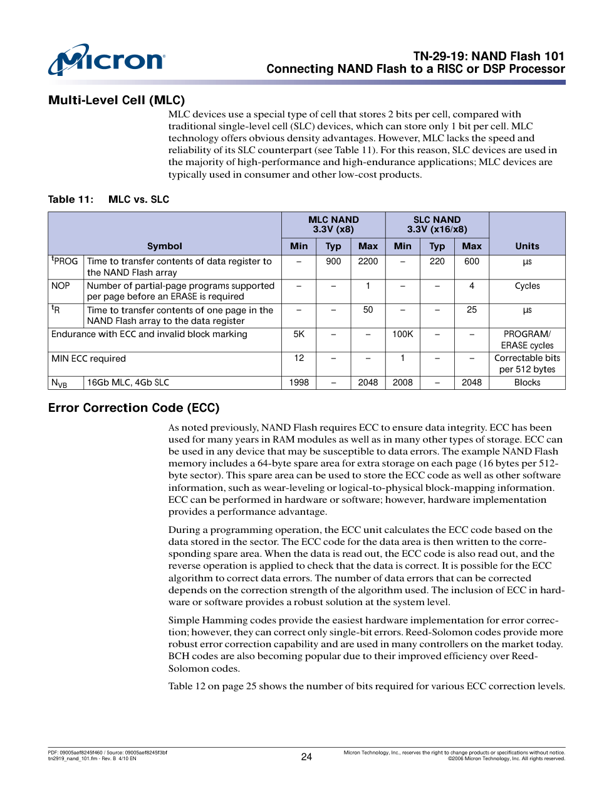

## Document Metadata

- Document ID: d85c00280f7153fb7ca0141c23725d438f393594
- Document Title: NAND Flash 101: An Introduction to NAND Flash and How to Design It In to Your Next Product
- Document Type: Technical Note
- Issuing Organization: Micron Technology, Inc.
- Publication Date: 4/10 (Rev. B; exact day unavailable)
- Reporting Period: null
- Source File: [3_user.eng.umd.edu_micron-tn2919.pdf](https://github.com/jadennevercode/CJCC-Knowledge-Base/blob/564ab11aa9785e569e3853c8a4d7ce86f88e7535/materials/%E5%9F%BA%E7%A1%80%EF%BC%9A%E8%A1%8C%E4%B8%9A%E6%9C%AF%E8%AF%AD%E4%B8%8E%E6%8C%87%E6%A0%87/3_user.eng.umd.edu_micron-tn2919.pdf)

## Structured Content

[Source Page: 1]

# Technical Note

## NAND Flash 101: An Introduction to NAND Flash and How to Design It In to Your Next Product

[Source Page: 4]

[原始页面图像](../../materials_md_cleaned/_assets/micron_tn2919_original/page-4.png)

## NAND vs. NOR Comparison

### Advantages of Each Device

There are specific advantages and disadvantages to using NAND Flash or NOR Flash in embedded systems (see Table 1). NAND Flash is best suited for file or sequential-data applications; NOR Flash is best suited for random access. Advantages of NAND Flash over NOR Flash include fast PROGRAM and ERASE operations. NOR Flash advantages are its random-access and byte-write capabilities.

Random access gives NOR Flash its execute-in-place (XiP) functionality, which is often required in embedded applications. An increasing number of processors include a direct NAND Flash interface and can boot directly from the NAND Flash device (without NOR Flash). These processors provide a very attractive solution when cost, space, and storage capacity are important. Using these processors, XiP capability will cease to be a consideration when designing NAND Flash into embedded applications.

### Disadvantages of Each Device

The main NAND Flash disadvantage is slow random access; NOR Flash is hampered by slow WRITE and ERASE performance.

### Table 1: NAND Flash vs. NOR Flash

| | NAND | NOR |
| --- | --- | --- |
| Advantages | Fast PROGRAMs Fast ERASEs | Random access Byte PROGRAMs possible |
| Disadvantages | Slow random access Byte PROGRAMs difficult | Slow PROGRAMs Slow ERASEs |
| Applications | File (disk) applications Voice, data, video recorder Any large sequential data | Replacement of EPROM Execute directly from nonvolatile memory |

### Random Access Timing

Random access time on NOR Flash is specified at 0.075µs; on NAND Flash, random access time for the first byte only is significantly slower—25µs (see Table 2 on page 5). However, after initial access has been made, the remaining 2111 bytes are shifted out of NAND at a mere 0.025µs per byte. This results in a bandwidth of more than 26 MB/s for 8-bit I/Os and 41 MB/s for 16-bit I/Os.

[Source Page: 5]

[原始页面图像](../../materials_md_cleaned/_assets/micron_tn2919_original/page-5.png)

### Table 2: NAND/NOR Characteristics

| Characteristic | NAND Flash: MT29F2G08A | NOR Flash: TE28F128J3 |
| --- | --- | --- |
| Random access READ | 25µs (first byte) 0.025µs each for remaining 2111 bytes | 0.075µs |
| Sustained READ speed (sector basis) | 26 MB/s (x8) or 41 MB/s (x16) | 31 MB/s (x8) or 62 MB/s (x16) |
| Random WRITE speed | ≈ 220µs/2112 bytes | 128µs/32 bytes |
| Sustained WRITE speed (sector basis) | 7.5 MB/s | 0.250 MB/s |
| Erase block size | 128KB | 128KB |
| ERASE time per block (TYP) | 500µs | 1 sec |

### NAND Flash Design Benefits

The real benefits of NAND Flash are faster PROGRAM and ERASE times, as NAND Flash delivers sustained WRITE performance exceeding 7 MB/s. Block erase times are an impressive 500µs for NAND Flash compared with 1 second for NOR Flash. Clearly, NAND Flash offers several compelling advantages. The one challenge is that it is not well-suited for direct random access. As noted previously, this can be handled with code shadowing.

### Structural Differences

NAND Flash offers several structural advantages over NOR Flash, starting with the pin count. The hardware pin requirements for NAND Flash and NOR Flash interfaces differ markedly. NOR Flash requires approximately 44 I/O pins for a 16-bit device, while NAND Flash requires only 24 pins for a comparable interface (see Table 3). The multiplexed command, address, and data bus reduces the number of required pins by nearly 45%. An added benefit of the multiplexed interface is that higher-density NAND Flash devices can be supported using the same hardware design and printed circuit board (PCB) used for lower densities. The common TSOP-1 package has been in use for many years, and this feature enables customers to migrate to higher-density NAND Flash devices using the same PCB design.

Another advantage of NAND Flash is evident in the packaging options. For example, this NAND Flash device offers a monolithic 2Gb die or it can support up to four stacked die, accommodating an 8Gb device in the same package. This makes it possible for a single package and interface to support higher densities in the future.

### Table 3: Required Hardware Pins

| NAND Flash: 23 Pins (x16) | | NOR Flash: 44 Pins | |
| --- | --- | --- | --- |
| I/O device-type interface, composed of: | | Random-access interface, typically composed of: | |
| CE# | Chip enable | CE# | Chip enable |
| WE# | Write enable | WE# | Write enable |
| RE# | Read enable | OE# | Output enable |
| CLE | Command latch enable | D[15:0] | Data bus |
| ALE | Address latch enable | A[23:0] | Address bus |
| I/O[7:0] | Data bus (I/O[15:0] for x16 parts) | WP# | Write protect |
| WP# | Write protect | | |
| R/B# | Ready/busy | | |

[Source Page: 24]

## Multi-Level Cell (MLC)

MLC devices use a special type of cell that stores 2 bits per cell, compared with traditional single-level cell (SLC) devices, which can store only 1 bit per cell. MLC technology offers obvious density advantages. However, MLC lacks the speed and reliability of its SLC counterpart (see Table 11). For this reason, SLC devices are used in the majority of high-performance and high-endurance applications; MLC devices are typically used in consumer and other low-cost products.

### Table 11: MLC vs. SLC

| Symbol / description | MLC NAND 3.3V (x8) Min | Typ | Max | SLC NAND 3.3V (x16/x8) Min | Typ | Max | Units |
| --- | --- | --- | --- | --- | --- | --- | --- |
| tPROG: Time to transfer contents of data register to the NAND Flash array | – | 900 | 2200 | – | 220 | 600 | µs |
| NOP: Number of partial-page programs supported per page before an ERASE is required | – | – | 1 | – | – | 4 | Cycles |
| tR: Time to transfer contents of one page in the NAND Flash array to the data register | – | – | 50 | – | – | 25 | µs |
| Endurance with ECC and invalid block marking | 5K | – | – | 100K | – | – | PROGRAM/ERASE cycles |
| MIN ECC required | 12 | – | – | 1 | – | – | Correctable bits per 512 bytes |
| NVB: 16Gb MLC, 4Gb SLC | 1998 | – | 2048 | 2008 | – | 2048 | Blocks |

## Error Correction Code (ECC)

As noted previously, NAND Flash requires ECC to ensure data integrity. ECC has been used for many years in RAM modules as well as in many other types of storage. ECC can be used in any device that may be susceptible to data errors. The example NAND Flash memory includes a 64-byte spare area for extra storage on each page (16 bytes per 512-byte sector). This spare area can be used to store the ECC code as well as other software information, such as wear-leveling or logical-to-physical block-mapping information. ECC can be performed in hardware or software; however, hardware implementation provides a performance advantage.

During a programming operation, the ECC unit calculates the ECC code based on the data stored in the sector. The ECC code for the data area is then written to the corresponding spare area. When the data is read out, the ECC code is also read out, and the reverse operation is applied to check that the data is correct. It is possible for the ECC algorithm to correct data errors. The number of data errors that can be corrected depends on the correction strength of the algorithm used. The inclusion of ECC in hardware or software provides a robust solution at the system level.

Simple Hamming codes provide the easiest hardware implementation for error correction; however, they can correct only single-bit errors. Reed-Solomon codes provide more robust error correction capability and are used in many controllers on the market today. BCH codes are also becoming popular due to their improved efficiency over Reed-Solomon codes.

Table 12 on page 25 shows the number of bits required for various ECC correction levels.

[Source Page: 25]

[原始页面图像](../../materials_md_cleaned/_assets/micron_tn2919_original/page-25.png)

### Table 12: Number of Bits Required for Various ECC Correction Strengths

Bits Required in the NAND Flash Spare Area

| Error Correction Level | Hamming | Reed-Solomon | BCH |
| ---: | ---: | ---: | ---: |
| 1 | 13† | 18† | 13† |
| 2 | N/A† | 36† | 26† |
| 3 | N/A† | 54† | 39† |
| 4 | N/A† | 72† | 52† |
| 5 | N/A† | 90† | 65† |
| 6 | N/A† | 108† | 78† |
| 7 | N/A† | 126† | 91† |
| 8 | N/A | 144 | 104† |
| 9 | N/A | 162 | 117† |
| 10 | N/A | 180 | 130 |

† 表示原表中的灰底单元格。

Note: Codes in shaded table cells can fit in the spare area of the example NAND Flash device.

## Software

Software is necessary to perform block management in a NAND Flash device. This software manages wear-leveling and logical-to-physical mapping. The software may also provide ECC if the processor does not include ECC.

It is important to read the status register after a PROGRAM or ERASE operation to confirm successful completion of the operation. If an operation is not successful, the block should be marked bad and should no longer be used. Previously programmed data should be moved out of the bad block into a new, good block.

The specification for a 2Gb SLC NAND Flash device states that it might have up to 40 bad blocks. This maximum number applies to the life of the device (nominally 100,000 PROGRAM/ERASE cycles). Due mostly to their large die size, NAND Flash devices may ship from the factory with a number of bad blocks. The software managing the NAND Flash device maps the bad blocks and replaces them with good blocks. The factory marks these blocks in a specific way so the software can scan all the blocks to determine which are good and which are bad.

The bad-block mark is placed at the first location in the spare area (column location 2048). If location 2048 in page 0 is 00h, then the block must be considered bad and mapped out of the system. The initialization software can simply scan through all blocks to determine which blocks are bad and then build a table of these bad blocks for future reference.

The user must take special care not to erase the bad-block marks. The factory tests each NAND Flash device over a wide range of temperatures and voltages. Some blocks that are marked bad by the factory may be functional at certain temperatures or voltages but could fail in the future. If the bad-block information is erased, it cannot be recovered.

[Source Page: 26]

## Third-Party Software

There are several third-party software offerings on the market today. Many of these packages provide multiple features, including automatic power failure-recovery, PC-file compatibility, ECC, bad-block management, directory support, and wear-leveling. A partial list of third-party NAND Flash software vendors includes:

- Datalight, Inc. – www.datalight.com
- CMX Systems, Inc. – www.cmx.com
- HCC-Embedded – www.hcc-embedded.com
- Blunk Microsystems – www.blunkmicro.com

For Linux implementations, another alternative is Journaling Flash File System, version 2 (JFFS2).

## Processing Notes

- Page 5: Source prose says 24 pins for NAND Flash, whereas Table 3 is headed 23 pins; both values are retained as printed. [OCR_UNCERTAIN]
