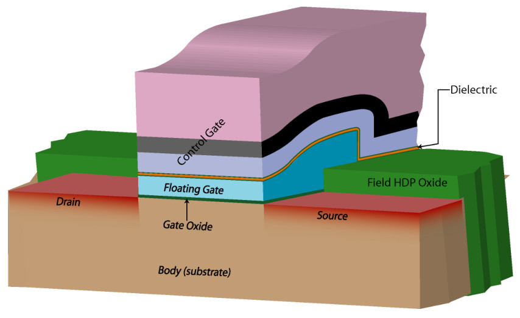

## Document Metadata

- Document ID: 90fdaebdade40bef747024e53c9c1d7a32129e23
- Document Title: M.2 SSD 技术白皮书
- Document Type: PDF
- Issuing Organization: 华为技术有限公司
- Publication Date: 2017-07-09
- Reporting Period: null
- Source File: [4_prob4be7269.pic9.ysj_M2SSD.pdf](https://github.com/jadennevercode/CJCC-Knowledge-Base/blob/564ab11aa9785e569e3853c8a4d7ce86f88e7535/materials/%E5%9F%BA%E7%A1%80%EF%BC%9A%E8%A1%8C%E4%B8%9A%E6%9C%AF%E8%AF%AD%E4%B8%8E%E6%8C%87%E6%A0%87/4_prob4be7269.pic9.ysj_M2SSD.pdf)

## Structured Content

[Source Page: 1]

# M.2 SSD 技术白皮书

文档版本：01  
发布日期：2017-07-09  
华为技术有限公司

[Source Page: 4]

# 1 概述

M.2 SSD是以M.2协议为接口的固态硬盘。M.2原名为NGFF接口，由mSATA演化而来，具有更多的尺寸选择，并且可以选择SATA和PCIe协议。

M.2 SSD基于Flash存储介质。当前业界使用较多的是NAND Flash，NAND Flash因使用Floating Gate存储电子实现数据存储，电子在反复穿过Floating Gate后，会导致存储电子的能力变弱，最终导致击穿，无法存储数据。这特性是NAND Flash的通病，所以在使用NAND Flash时，要充分评估应用业务的写入数据量，避免提前写穿导致器件失效。

[Source Page: 6]

## 2.2 Flash 芯片工作原理

### 2.2.1 Flash 存储单元工作原理

闪存的存储单元为三端器件，与场效应管有相同的名称：源极、漏极和栅极。栅极与硅基之间有二氧化硅绝缘层，用来保护浮置栅极中的电荷不会泄漏。采用这种结构，使得存储单元具有了电荷保持能力。

与场效应管一样，闪存也是一种电压控制型器件。NAND型闪存的擦和写均是基于隧道效应，电流穿过浮置栅极与硅基层之间的绝缘层，对浮置栅极进行充电（写数据）或放电（擦除数据）。

### 2.2.2 Flash 存储单元分类

每个存储单元内存储1个信息比特，称为单阶存储单元(Single-Level Cell，SLC)，使用这种存储单元的闪存也称为单阶存储单元闪存(SLC flash memory)，或简称SLC闪存。

多阶存储单元(Multi-Level Cell，MLC)可以在每个存储单元内存储2个以上的信息比特，其“多阶”指的是电荷充电有多个能阶(即多个电压值)，如此便能存储多个比特的值于每个存储单元中。

三阶储存单元(Triple-Level Cell，TLC)，这种架构的原理与MLC类似，但可以在每个储存单元内储存3个信息比特。TLC的写入速度比SLC和MLC慢，P/E Cycle也比SLC和MLC短，大约500~1000次左右。

### 2.2.3 M.2 SSD 写寿命分析

写放大，WA（Write Amplification），是闪存及SSD相关的一个极为重要的属性。由于闪存必须先擦除才能再写入的特性，在执行这些操作时，数据都会被移动超过1次。这些重复的操作不仅会增加写入的数据量，还会减少闪存的寿命，更消耗闪存的可用带宽而间接影响随机写入性能。

[Source Page: 7]

$$\text{写入放大倍数} = \frac{\text{闪存写入数据量}}{\text{主控写入数据量}}$$

当要写入一个4KB的数据时，最坏的情况是一个块里已经没有干净空间了，但有无效的数据可以擦除，所以主控就把所有的数据读到缓存，擦除块，缓存里更新整个块的数据，再把新数据写回去，这个操作带来的写放大就是实际写4K的数据，造成了整个块的写入操作，那就是放大了256倍。对于一个典型的1024KB的块，原本只需要简单一步写入4KB的操作变成：闪存读取 (1024KB)→缓存改（4KB）→闪存擦除（1024KB）→闪存写入（1024KB），共四步操作，造成延迟大大增加，速度变慢。所以说WA是影响 SSD 随机写入性能和寿命的关键因素。

以100%随机4KB来写入，目前的大多数SSD主控，在最坏的情况下WA可以达到100以上。如果是100%持续的从低LBA写入到高LBA的话，WA可以做到1，实际使用中写放大会介于这两者之间。

影响WA的要素如下：

- 垃圾回收（GC）：垃圾回收过程中，增加了写放大；回收完成后，写放大降低，后续性能提升。
- 预留空间（OP）：增加预留空间能减少写放大。
- Trim：开启Trim后可以减少写放大。
- 安全擦除（Secure Erase）：减少写放大。
- 顺序写（Sequential writes）：减少写放大。
- 随机写（Random writes）提高写放大。
- 静态/动态数据分离（Separating Static and Dynamic Data）：减少写放大。
- 磨损平衡（WL）：提高写放大。

[Source Page: 8]

# 3 M.2 SSD 写寿命风险评估

## 3.1 写寿命评估

M.2 SSD是读密集型存储器件，其每天的全盘擦写次数（DWPD）值较低，只能应用于系统启动盘，不能应用于写密集型业务。以典型的DWPD=0.3，240GB的M.2 SSD来说，在其5年的维保期能写入的最大量为131 TBW（Total Bytes Written），计算公式如下：

$$TBW = \frac{DWPD \cdot \text{硬盘容量} \cdot 365 \cdot \text{维保年限}}{1000}$$

- TBW：Total Bytes Written，总写入字节，是指在 SSD 使用寿命结束之前指定工作量可以写入 SSD 的总数据量。
- DWPD：Diskful Writes Per Day，每日整盘写入次数，指在预期寿命内可每日完整写入SSD固态硬盘所有容量的次数。

## 3.2 风险评估

参照3.1计算，如果M.2 SSD应用于写密集型，在维保期内很容易超过最大写入量TBW，那么M.2 SSD就有极大的介质写穿风险。

### 3.2.1 判断M.2 SSD寿命

在SMART信息中，可以查询到SSD剩余寿命百分比。以Intel M.2 SSD为例，该百分比值初始为100，随着擦写量的增加而线性递减，直到数值为1，表示SSD已达到预期的生命周期。

| E9h | Media Wearout Indicator |
| --- | --- |
| | This attribute reports the number of cycles the NAND media has undergone. The normalized value declines linearly from 100 to 1 as the average erase cycle count increases from 0 to the maximum rated cycles. |
| | Once the normalized value reaches 1, the number will not decrease, although it is likely that significant additional wear can be put on the device. |

[Source Page: 10]

# 4 M.2 SSD 应用场景限制

- M.2 SSD是设计仅用作Boot，仅用于安装Linux操作系统作为Boot设备。
- M.2 SSD的耐久性（Endurance）较低，不能用于数据存储设备，数据存储请选用企业级DWPD较高的SSD或 HDD 替代，尤其是数据擦写较大的场景，因其在短时间内存在写穿风险，不能使用。
- 在M.2 SSD写密集型业务软件将会导致M.2 SSD超出写寿命而永久损坏，不推荐选择M.2 SSD；Cache场景禁止配置。
