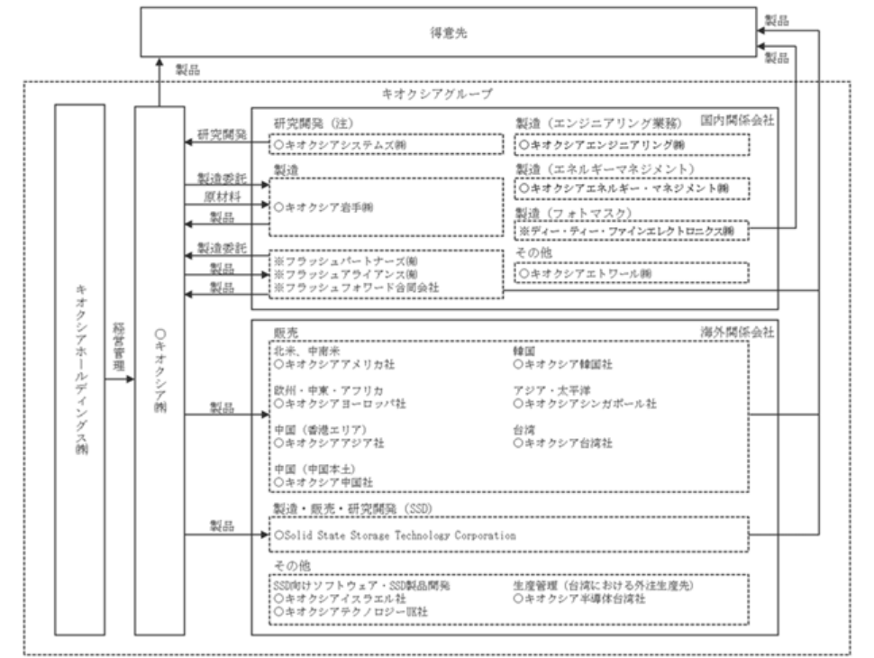

## Document Metadata

- Document ID: 398da3c843bb5f4c9777a478bf04cfa922a92957
- Document Title: 有価証券届出書（新規公開時）
- Document Type: PDF
- Issuing Organization: キオクシアホールディングス株式会社
- Publication Date: 2024-11-08
- Reporting Period: null
- Source File: [5_Kioxia_S100UOKQ.pdf](https://github.com/jadennevercode/CJCC-Knowledge-Base/blob/564ab11aa9785e569e3853c8a4d7ce86f88e7535/materials/%E5%9F%BA%E7%A1%80%EF%BC%9A%E8%A1%8C%E4%B8%9A%E6%9C%AF%E8%AF%AD%E4%B8%8E%E6%8C%87%E6%A0%87/5_Kioxia_S100UOKQ.pdf)

## Structured Content

[Source Page: 6]

##### （２）【手取金の使途】

 
　上記の国内募集における差引手取概算額については、全額を当社の連結子会社であるキオクシア株式会社への投融資資金に充当する予定です。
　キオクシア株式会社では、今後予測されるメモリ市場の伸長に伴うフラッシュメモリの需要増加に対応すると共に、継続的なコスト競争力の向上を図るために生産規模及び生産効率を最大化することを目的として生産能力増強に係る設備投資を予定しております（注）。
　具体的な資金使途の内容及び充当予定時期は、以下のとおりです。
　四日市工場及び北上工場において、今後次世代フラッシュメモリ（第８世代３次元フラッシュメモリ）である218層積層プロセスを適用したBiCS FLASH™向け前工程生産設備の取得費用及び建屋建設費用の一部として充当する予定です。具体的な充当予定時期は、当該設備の取得費用及び建屋建設費用の支払い時期が2025年３月期から2026年３月期の間となる予定であるため、当該期間において上記差引手取概算額の全額を充当する予定です。
　なお、具体的な充当時期までは、安全性の高い金融商品等で運用する方針です。
（注）　当社グループの設備投資方針については、「第二部　企業情報　第３　設備の状況　３　設備の新設、除却等の計画」をご参照下さい。

[Source Page: 27]

#### ３【事業の内容】

 
　当社グループは、本書提出日現在、当社、連結子会社22社（国内７社、海外15社）及び関連会社等６社（国内４社、海外２社）により構成されています。当社グループは、メモリ及び関連製品の製造、販売、研究開発、その他サービスを行っています。当社グループは、メモリ及び関連製品の製造、販売、研究開発、その他サービスを行う、世界最大（注）のフラッシュメモリ専業プレイヤーです。
　（注）　出典：TechInsights Inc.“NAND Market Report Q3 2024”。2023年の売上・物量ベース。
 
　当社グループの報告セグメントは「メモリ事業」単一でありますが、売上収益を製品の用途に応じたアプリケーション別に、「SSD & ストレージ」、「スマートデバイス」及び「その他」に区分しております。「SSD & ストレージ」には主にPC、データセンター、エンタープライズ向けSSD製品及びメモリ製品が含まれております。「スマートデバイス」にはスマートフォン、タブレット、テレビ等の民生機器、車載、産業機器等の用途で使用される制御機能付きの組み込み式メモリ製品が含まれています。「その他」にはSDメモリカード、USBメモリ等のリテール向け製品及び製造合弁会社３社経由で計上されるWestern Digitalグループ向けの売上収益等が含まれています。
 
　当社グループ各社の報告セグメントにおける位置付けと製品分野別の事業内容は以下のとおりです。
（本書提出日現在）

当社及び関係会社の位置付け

| 報告セグメント | 製造 | 販売 | 研究開発 | その他サービス |
| --- | --- | --- | --- | --- |
| メモリ事業 | キオクシア㈱、キオクシア岩手㈱、キオクシアエンジニアリング㈱、キオクシアエネルギー・マネジメント㈱、キオクシア半導体台湾社、Solid State Storage Technology Corporation、フラッシュパートナーズ㈲、フラッシュアライアンス㈲、フラッシュフォワード合同会社、ディー・ティー・ファインエレクトロニクス㈱ | キオクシア㈱、キオクシアアメリカ社、キオクシアヨーロッパ社、キオクシアアジア社、キオクシア中国社、キオクシア韓国社、キオクシアシンガポール社、キオクシア台湾社、Solid State Storage Technology Corporation | キオクシア㈱、キオクシアエンジニアリング㈱、キオクシアシステムズ㈱、キオクシアテクノロジーUK社、キオクシアイスラエル社、Solid State Storage Technology Corporation | キオクシアエトワール㈱ |

メモリ事業ではメモリ製品を開発・製造・販売しています。フラッシュメモリとは、当社グループが1987年に世界で初めて開発し世界標準となった不揮発性半導体メモリ（注１）であり、大容量のデータ保存を可能にする記憶用デバイスです。スマートフォンで写真・動画などを保存するために使われるほか、身近な電子機器やデータセンター等においても、欠かすことのできないコアデバイス（基幹部品）となっています。当社グループは市場の要求に応えるために、フラッシュメモリの微細化（注２）による大容量化、及びコスト低減を推進してきました。もっとも、極度の微細化には電子同士が干渉しエラーが起きやすくなるという課題がありました。そこで当社グループではメモリセルを積み上げることで干渉を防ぐ積層化技術（注３）により、大容量化と信頼性の向上、低消費電力化を実現したBiCS FLASH™を開発しました。本書提出日現在は第８世代BiCS FLASH™を量産しています。第８世代BiCS FLASH™には、高メモリ密度の実現により高性能動作を図るため、CBA（CMOS directly Bonded to Array）（注４）とOPS（On Pitch SGD）（注５）という新技術が用いられています。近年、フラッシュメモリ市場においては、データセンター、エンタープライズ向けSSDの需要が拡大しており、これまで以上に大容量化、信頼性の向上、低消費電力化が求められています。当社グループは、更なる大容量化、高速化に向けた次世代の半導体メモリの開発も進めています。
　フラッシュメモリチップは、当社グループの四日市工場及び北上工場において製造しています。半導体は材料となるシリコンウエハー上に微細な集積回路を作りこむため工程は数百に及び、製造プロセスの効率化は至上命題です。
四日市工場及び北上工場では、生産効率の向上と生産コストの低減に向けた生産ラインの自動化を徹底しており、特に四日市工場では2022年10月に竣工した四日市第７製造棟を含む６つの製造棟を棟間搬送で連結する統合生産体制を確立しております。さらに、高い生産効率を実現するため、開発と量産の拠点一体化、AI・ビッグデータを活用したスマートファクトリー化も進めております。

[Source Page: 28]

また、今後も続くと想定される３次元フラッシュメモリの需要に継続的に対応するため、BiCS FLASH™の生産能力の増強を目的として、2022年４月から北上工場第２製造棟（Ｋ２棟）の建設を開始し、その建屋が2024年７月に完成しました。Ｋ２棟の稼働は2025年秋を見込んでいます。四日市既存製造棟と同様に、地震の揺れを吸収する免震構造を採用するとともに、最新の省エネ製造設備の導入や再生可能エネルギーの利用などで環境面も重視した工場となる予定です。また、四日市工場と共に人工知能（AI）を活用した生産システムの導入などを推進し、全社製造オペレーションの生産性及びフラッシュメモリ製品の品質をさらに向上させます。今後も大容量化に向けた技術開発、生産体制の拡大、コントローラ（ICチップ／ファームウェア）開発等の強化により、技術力とコスト競争力の両面における長期的な優位性の確保に努めてまいります。
　なお、当社グループは、Western Digitalグループとの間で製造合弁契約を締結し、キオクシア株式会社とWestern Digitalグループが共同出資する製造合弁会社３社を設立しています。合弁契約に基づき、製造合弁会社３社が当社グループ及びWestern Digitalグループからの資金借り入れ又は製造合弁会社３社によるリース契約により生産設備を調達し、当社グループの四日市工場及び北上工場に設置、キオクシア株式会社が製造合弁会社３社から製造委託を受け、無償貸与された生産設備にて生産をしております。当社グループとWestern Digitalグループは、合弁事業を通じて四日市工場と北上工場の生産能力合計の約80％を共有し、当社グループが残りの約20％を単独で所有しています。合弁契約に基づき、当社グループとWestern Digitalグループは、それぞれ製造合弁会社３社が所有する生産能力の各半分（すなわち、上記２工場の生産能力合計の各約40％）を割り当てられている一方、当社グループは上記２工場の運営を行い、製造ノウハウを有しています。また、当社グループは、製造合弁会社３社各社の議決権の50.1％を所有しており、IFRSに基づく共同支配事業として、その資産、負債、収益及び費用の50％を連結財務諸表に計上しています。

[Source Page: 28]

（注）１．不揮発性半導体メモリとは、電源を切っても記憶が消えないメモリです。
２．微細化とは、メモリチップの中の回路線幅を狭くすることでメモリセル（１ビットの情報を保持するために必要な回路構成）の面積を縮小する技術です。
３．積層化技術とは、メモリセルを多層構造にする技術です。

[Source Page: 29]

４．CBAとは、メモリセルの制御を担うCMOS回路とメモリセルアレイを２枚のウエハーに別々に作製し、その後２枚のウエハーを貼り合わせる技術です。
５．OPSとは、選択ゲート分離体を、メモリ機能を持つメモリストリング間に配置し、ダミーメモリストリングを削除することで、メモリ密度を高める技術です。
６．小数点以下第２位を四捨五入しております。
 
（事業系統図）
○印は連結子会社、※印は関連会社等です。

（注）　キオクシア株式会社及びキオクシアシステムズ株式会社のほか、キオクシアエンジニアリング株式会社において研究開発活動を行っています。また、キオクシアイスラエル社とキオクシアテクノロジーUK社においてはSSDソフトウェア・SSD製品に係る研究開発活動を、Solid State Storage Technology CorporationにおいてはSSD製品に係る研究開発活動を行っています。

[Source Page: 35]

(2）経営環境及び経営方針
　世界中に広がるデータエコノミーの波の中で、人々が扱うデジタルデータの総量は増加の一途を辿っており、これまで、日々増加するデジタルデータの処理のために、デジタルカメラ、スマートフォン、タブレット端末、PC等においてフラッシュメモリが使用されてきました。今後も、AIの発展を筆頭にクラウド、5G、IoT等の普及により、世界における生成データ量は、2023年から2028年まで年平均成長率24.4％で成長し、2028年には394ZB（ゼタバイト）（注）まで伸長することが予想されています（出典：IDC“Worldwide IDC Global DataSphere Forecast,2024‒2028: AI Everywhere, But Upsurge in Data Will Take Time”, Doc # US52076424, May 2024）。当社は、オートモーティブ、エンターテインメント、ロボティクス、医療・ヘルスケア、インダストリーなど様々なシーンでメモリが果たす役割が重要になると考え、フラッシュメモリの利用も伸長すると見込んでおります。
（注）　ZB（ゼタバイト）とは、10の21乗バイトを指し、データの量やコンピュータの記憶装置の大きさを表す単位として使用されます。
 
　また、フラッシュメモリの技術革新とそれによる記憶容量の増大は、様々なフラッシュメモリのアプリケーションへの採用と新しいマーケットの創出を牽引してきました。さらに、データ量の増加とフラッシュメモリの技術革新によって、HDDから、読み出し性能、衝撃・振動等の耐環境性、静寂性及び待機時の省消費電力性等により優れるSSDへの置き換えも進んでいます。データ量の増加とフラッシュメモリの技術革新の好循環によって、フラッシュメモリ市場は成長を続けるものと当社は考えており、第三者の調査機関であるTechInsightsによれば、フラッシュメモリ全体の需要は約2.7倍に伸長する（2023年-2028年（予想））と見込まれております（出典：TechInsights Inc.“NAND Market Report Q3 2024”）。
　フラッシュメモリ市場における主要なアプリケーションはデータセンター、スマートフォン及びPCであり、TechInsightsによれば、データ総量ベースの各アプリケーションのフラッシュメモリ需要につき、データセンターの年平均成長率は38.9％（2023年-2028年（予想））、スマートフォンの年平均成長率は19.7％（2023年-2028年（予想））、PCの年平均成長率は13.0％（2023年-2028年（予想））と見込まれております（出典：TechInsights Inc.“NAND Market Report Q3 2024”）。

[Source Page: 36]

アプリケーション毎のフラッシュメモリの需要予想　単位：EB（注）

| アプリケーション | 2023年 | 2024年（予想） | 2025年（予想） | 2026年（予想） | 2027年（予想） | 2028年（予想） | 年平均成長率（2023年-2028年）（予想） |
| --- | --- | --- | --- | --- | --- | --- | --- |
| データセンター | 127 | 218 | 295 | 369 | 489 | 658 | 38.9％ |
| スマートフォン | 297 | 346 | 402 | 483 | 589 | 730 | 19.7％ |
| PC | 235 | 258 | 301 | 336 | 391 | 433 | 13.0％ |
| その他 | 44 | 52 | 57 | 69 | 83 | 98 | 17.2％ |
| 合計 | 703 | 874 | 1,055 | 1,256 | 1,552 | 1,919 | 22.2％ |

出典：TechInsights Inc.“NAND Market Report Q3 2024”
（注）　EB（エクサバイト）とは、10の18乗バイトを指し、データの量やコンピュータの記憶装置の大きさを表す単位として使用されます。
 
　近年は、AI活用の普及やクラウドコンピューティング等ビッグデータビジネスの進展により、データセンター、エンタープライズ向けフラッシュメモリ需要の拡大傾向に加え、スマートフォン及びノートPC搭載メモリも大容量化傾向にあります。アプリケーション別では、SSD & ストレージ向けメモリ及びスマートデバイス向けメモリのそれぞれについて、記憶容量ベースでの市場規模は拡大傾向にあり、今後も記憶容量ベースでの市場規模の拡大傾向を当社は見込んでいます。
　新型コロナウイルス感染拡大時においては、在宅勤務や在宅学習への移行によりスマートフォンやPCの需要が急増しましたが、今後はこれらの買替えサイクルが到来することが予想されます。また、かかる買替え需要においては、AI搭載製品の比率が高まると予想されており、これはフラッシュメモリの需要増加にさらにつながる可能性があります。TechInsightsによれば、AI搭載のスマートフォン及びPCは、大規模言語モデル（LLM）及びAI処理専用ロジックASIC（Application Specific Integrated Circuit）を搭載したスマートフォン及びPCが想定されており、各アプリケーションにおけるAI搭載製品の比率（出荷台数ベース）について、スマートフォンにおいては、2024年は0.5％、2025年は3.8％、2028年は47.6％、PCにおいては、2024年は9.8％、2025年は17.5％、2028年は32.6％に増加すると予想されています（出典：TechInsights Inc.“NAND Market Report Q3 2024”）。また、生成AIが生成したデータは自動的にデバイスに保存されることとなるため、その結果、必要な１個当たりメモリ容量が増加することとなり、大容量のAI搭載製品がさらに普及することが予想されます。
　さらに、データセンターからのフラッシュメモリ需要も、AIサーバーを中心に拡大すると予想されています。従来のサーバーとは異なり、AIサーバーには、電力効率が高く、高速なデータ転送ができるストレージが求められるところ、SSDは、DRAM及びHDDと比較して、性能、消費電力及びコストの面でバランスが良いことから、AIサーバーに不可欠なものとなると当社は考えています。TechInsightsによれば、データセンター向けフラッシュメモリ需要全体に占めるAIデータセンター向けSSD比率（記憶容量ベース）は、2023年の18.3％から2028年には53.3％に増加すると予想されており、また、AIデータセンター向けSSD需要は、2023年から2028年にかけて年平均成長率72.0％で成長すると予想されています（出典：TechInsights Inc.“NAND Market Report Q3 2024”）。
データセンター向けフラッシュメモリ需要の推移 　（注）　　　　　　　　　　　　　　　　　　　単位：EB

|  | 2023年 | 2024年（予想） | 2025年（予想） | 2026年（予想） | 2027年（予想） | 2028年（予想） | 年平均成長率（2023年-2028年）（予想） |
| --- | --- | --- | --- | --- | --- | --- | --- |
| AI データセンター向けSSD | 23 | 65 | 114 | 162 | 239 | 351 | 72.0％ |
| 従来型データセンター向けSSD | 97 | 141 | 169 | 196 | 236 | 289 | 24.3％ |
| その他 | 7 | 11 | 12 | 12 | 14 | 19 | 22.8％ |
| 合計 | 127 | 218 | 295 | 369 | 489 | 658 | 38.9％ |

出典：TechInsights Inc.“NAND Market Report Q3 2024”
（注）　フラッシュメモリの消費量（サーバーの販売、データセンター構築等）に基づくものであり、フラッシュメモリ製造事業者によるデータセンターや従来の企業向けメモリ及びSSDの販売量に基づくものではありません。
 
　さらに、データセンター向けフラッシュメモリ需要は、AI学習サーバー及びAI推論サーバー向けフラッシュメモリ需要の増加により加速しており、今後もAI推論サーバーを中心に成長することが見込まれます。TechInsightsによれば、従来型データセンター向けSSD、AI学習向けSSD及びAI推論向けSSDのフラッシュメモリ需要は、2023年の97EB、17EB、6EBから、2029年には289EB、74EB、277EBにそれぞれ増加すると予測されており、AI推論サーバー向けフラッシュメモリ需要は、AI推論サーバーの台数とサーバー当たりの記憶容量の双方が増加することにより増加すると予想されています（出典：TechInsights Inc.“NAND Market Report Q3 2024”）。

[Source Page: 37]

データセンター向けフラッシュメモリ需要予想の内訳　　　　　　　　　　　　　　　　　　　　　　　単位：EB

|  | 2023年 | 2024年（予想） | 2025年（予想） | 2026年（予想） | 2027年（予想） | 2028年（予想） |
| --- | --- | --- | --- | --- | --- | --- |
| AI推論向けSSD | 6 | 33 | 74 | 115 | 179 | 277 |
| AI学習向けSSD | 17 | 32 | 40 | 47 | 60 | 74 |
| 従来型データセンター向けSSD | 97 | 141 | 169 | 196 | 236 | 289 |
| その他 | 7 | 11 | 12 | 12 | 14 | 19 |
| 合計 | 127 | 218 | 295 | 369 | 489 | 658 |

出典：TechInsights Inc.“NAND Market Report Q3 2024”

[Source Page: 37]

他方で、フラッシュメモリ製造事業者においては競合他社が大容量化を推し進め供給を増やすことが予想され、価格競争が見込まれることから、単位記憶容量あたりの販売価格は一定レベルで継続的に下落していく傾向が見込まれます。また、SSDはフラッシュメモリを主記憶デバイスとして使っている製品であるため、今後もフラッシュメモリの価格に連動してSSDの単位記憶容量あたりの販売価格も下落していく傾向が見込まれると当社は考えております。
　加えて、フラッシュメモリ市場は、一般に、急速な技術革新と生産性の向上、顧客からの需要の変動と継続的な価格下落圧力、競合他社との市場シェア獲得競争等により、需給の循環的変動傾向が顕著であり、周期的に市況の改善と悪化が繰り返されていると考えております。

[Source Page: 37]

フラッシュメモリ市場においては、2022年後半から継続した需要低迷に伴い、顧客の在庫水準が上昇し、需給バランスが急激に悪化し、販売価格の大幅な下落を招きました。2023年後半からフラッシュメモリ製造業者各社の減産及び投資抑制が効果を表し始め、また顧客における在庫水準が適正化に向かったため、需給バランスの改善と販売価格上昇が生じました。足元のフラッシュメモリ市場は、顧客の在庫水準の正常化や需要の回復により、需給バランスは改善しました。アプリケーション別では、SSD & ストレージにつきましては、PC向け需要は回復が弱含みましたが、データセンター・エンタープライズSSDの需要は、顧客の在庫水準の正常化やAI需要により伸長しました。AI用途での大容量のSSDに加えて、一般サーバーの需要回復も見込まれています。スマートデバイスにつきましては、スマートフォン向け需要は穏やかに回復しました。今後、オンデバイスAIの普及、メモリ搭載容量の増加に伴う買い替え需要も期待されます。

[Source Page: 38]

［生産・販売］
　当社グループが製造合弁契約を締結しているWestern Digitalグループと合わせたフラッシュメモリの2024年４月から６月までのビット生産量は世界最大級となる約31％（注）のシェアを有しております。さらに、拡大するフラッシュメモリ市場に対応すべく、四日市工場及び北上工場の生産能力の強化により、更なる出荷量の拡大を図ります。また、フラッシュメモリの製造は、材料となるシリコンウエハー上に微細な集積回路を作りこむため、工程は数百に及び、製造プロセスの効率化が重要になります。当社グループは、製造過程におけるAIの活用や、四日市工場において製造棟間を繋ぐ棟間搬送を駆使し、製造棟全体の設備の稼働率を高めることで生産性を向上させる総合生産体制を採用することにより、各工場の知見とデータの相互活用により、高い生産効率の実現を図っていきます。今後も継続して生産効率の向上を図り、フラッシュメモリ市場の需要成長に見合う出荷量成長率（メモリ容量単位の前年比成長率）を維持することを目指しております。また、TechInsightsによれば、フラッシュメモリの設備投資額については今後低水準で推移することが予想されていますが（出典：TechInsights Inc.“NAND Market Report Q3 2024”）、当社も設備投資については引き続き規律あるアプローチを採用した上で、投資の効率化を図ります。加えて、ギガバイト当たりのコストの削減も図ってまいります。

[Source Page: 39]

（注）　TechInsights Inc.“NAND Market Report Q3 2024”。2024年４月から６月におけるビット生産量ベースで世界第１位（Western Digitalグループの生産量を含む。）

[Source Page: 40]

②　開発競争力の強化
　３次元フラッシュメモリは高積層化に伴い開発難易度が高まり、競争は激化しています。その中でコストや性能における競争力を維持していく技術開発が重要と考えています。CBA技術等を生かし、高ビット密度化、高速インターフェース向けの技術開発を推進し、最先端の規格や市場要求に対応していきます。新メモリの研究開発や、BiCS FLASH™応用製品の開発、新材料やAI、システム技術の研究にも積極的に取り組みます。これらの研究開発を強化するため、2023年６月に横浜市内に新たな研究・技術開発施設の稼働を開始しました。神奈川県内に分散していた機能を集結し、研究開発の効率性を高めます。2024年４月に先端技術研究所を新設し、次世代メモリ等の研究開発、新規事業につながる技術創出を強化していきます。

[Source Page: 40]

④　生産能力拡大及び地政学リスクへの対応
　拡大するフラッシュメモリ市場に対応し、需要に沿った生産能力の拡大を図ります。今後、適切なタイミングで北上工場の拡張を行います。また、競争力のある最先端のBiCS FLASH™製品を市場に投入することでコスト競争力を維持しながら、投資効率を改善し、設備投資額の最適化を行います。後工程拠点は、米中対立や台湾有事等の地政学リスクを見据えた後工程拠点計画を推進し、リスク低減を図ります。2022年７月には、四日市工場及び北上工場におけるBiCS FLASH™第６世代及び第８世代を生産する設備投資計画が、2024年２月には、上記工場におけるBiCS FLASH™第８世代及び第９世代を生産する設備投資計画が、それぞれ経済産業大臣により、「特定高度情報通信技術活用システムの開発供給及び導入の促進に関する法律」に基づく「特定半導体生産施設整備等計画」に認定（注）されました。半導体は情報通信技術やエネルギー、国防など多くの分野で必要不可欠であり、当社は、日本国内における最先端フラッシュメモリの開発・生産の強化を通じて、半導体関連産業の発展に貢献してまいります。
（注）　特定半導体生産施設整備等計画認定番号「2022半経第002号－２」（2022年７月26日付認定及び2024年２月６日付変更の認定）並びに「2023半経第002号－１」（2024年２月６日付認定）。
 
⑤　サプライチェーンの強靭化
　2022年２月からのロシアによるウクライナ侵攻の長期化や能登半島地震等の自然災害によるサプライチェーンへの影響や、原油価格の高止まりによる原材料価格の高騰が、当社の調達コストの増加や製品供給網に影響を与えています。これらに対応すべく、複数の調達先確保や部品の共通化及び部品点数の削減により調達コストの改善や強靭なサプライチェーンの構築を進めます。

[Source Page: 44]

②　指標及び目標
（気候変動）
　温室効果ガス排出については、製造時に排出される地球温暖化係数の高いPFC等ガス（注１）を除害する装置を、対象設備に2011年以降100％設置しています。また2020年度には、2040年度までに使用電力の100％を再生可能エネルギーに転換する長期目標を策定しました。さらに、2023年４月には、2050年度までに当社グループのグローバルな事業活動に伴う温室効果ガスの直接・間接排出（スコープ１、２）をネットゼロにするという新たな目標を設定しています。省エネルギー活動と非化石電力証書（注２）の活用も含めたエネルギー・ポートフォリオの検討により、事業の拡大に合わせて最適かつ安定した再生可能エネルギーの調達に努めます。また、低消費電力型製品のニーズが非常に高まっているため、製品のエネルギー効率と記憶容量を向上させる高集積化技術の研究開発に取り組んでいます。これについては、2017年度を基準とした１GB処理あたりのエネルギー消費量を2025年度までに50％削減するという高い目標を掲げています。
　製造事業場での運用においては、省エネ法に基づき、前年度の総エネルギー使用量（SCOPE2）の１％以上を削減する目標を掲げています。2022年度は、各種省エネルギー活動により、目標25,800t-CO2／年以上の削減に対して実績は30,754t-CO2／年の削減効果となり、目標を達成しました。2017年から2022年までの省エネルギー活動による削減効果は、累積で約13万t-CO2になります。
（注）１．PFC等ガス：半導体製造時等に使用する、地球温暖化計数が高い代替フロンガス。
２．非化石電力証書：再生可能エネルギー（再エネ）など発電時にCO2を排出しない非化石電源の環境価値を取り出し取引できるようした証書。

[Source Page: 46]

#### ３【事業等のリスク】

　なお、文中の将来に関する事項は、本書提出日現在において入手し得る情報に基づいて当社グループが判断したものであり、不確実性が内在しているため、実際の結果とは異なる可能性があります。
 
(1)事業環境及び経済情勢に係るリスク
 
①フラッシュメモリ市場の循環的・短期的変動
　フラッシュメモリ市場は、一般に、急速な技術革新と生産性の向上、顧客からの需要の変動と継続的な価格下落圧力、競合他社との市場シェア獲得競争等により、需給の循環的変動傾向が顕著であり、周期的に市況の改善と悪化が繰り返されています。2022年後半から2023年にかけて経験したように、当社グループ及び競合他社による生産量の拡大や顧客の過剰在庫等により需給バランスに不均衡が生じる場合、フラッシュメモリ製品の販売価格が急速かつ大幅に下落する可能性があります。当社グループは、当該リスクへの対応として、月に１度、業績や市況等の事業の状況を確認する機会を設け、市場の最新動向や顧客の製品動向、リテールの価格状況、顧客の在庫、競合他社の状況を確認して、調査会社等の情報をもとに経済情勢や最新の需給状況を把握し、当社グループの販売状況や生産、開発及び財務状況を確認し、適切に経営状況に反映するよう努めております。しかしながら、そうした経済情勢や需給状況の把握の予測は極めて困難であり、またその経営状況への反映も適時・適切に行える保証はありません。従って、需給バランスが崩れ、顧客の需要又は販売価格が継続的に低迷する場合、当社グループの売上の減少や、工場稼働率の低下に伴う売上総利益率の悪化により当社グループの経営成績及び財政状態に重大な悪影響を及ぼす可能性があります。
　フラッシュメモリ市場においては、クラウドサービス、5G、IoTの拡大やAIを搭載したスマートフォンやPC、データセンターを含むAI関連の機器やサービスの普及など、デジタル社会の進展によりメモリ需要が中長期的に拡大することが調査会社等により予測されていますが、かかる予測は直近の低迷期を事前に予測しておらず今後も正確ではない可能性があります。また、フラッシュメモリ市場においては、当社グループの価格決定力は限られていることから、中長期的には、記憶容量ベースの販売価格は過去と同様のペースで下落することが予想されます。当社グループはコスト削減等により、収益性の向上に努めておりますが、今後経済情勢又はフラッシュメモリの需給状況により、当社グループの想定を上回る販売価格の下落又はフラッシュメモリ需要の減少が発生した場合には、当社グループの事業、経営成績及び財政状態に重大な悪影響を及ぼす可能性があります。
 
②需要変動
　当社グループの製品に対する需要は、経済情勢、個人消費、技術革新、規制環境のほか、当社グループの製品が使用される最終製品の消費者市場や顧客の動向などの要因により左右され、とりわけ現時点における当社グループの主要な顧客であり、今後も注力するデータセンター向けSSDや、引き続き当社グループの売上の相当程度を占めるスマートフォン市場の動向の影響を強く受ける傾向にあります。さらに、在庫管理を含むサプライチェーンが複雑化する傾向にあり、またデータセンター向けSSDは極めて限られた数の大口顧客が市場シェアの大半を占めていることから、市場の動向や顧客の需要の予測には困難が伴います。実際に、新型コロナウイルス感染症の拡大後の大口顧客による在庫調整や競合他社の生産量の変動の影響により需給バランスが悪化したことを受け、当社グループは2022年10月から2024年３月にかけて減産を実施しており、今後も市場の需給バランスが悪化した場合には同様の対応をする可能性があります。当社グループは、当該リスクへの対応として、上記「①フラッシュメモリ市場の循環的・短期的変動」記載のとおり、経済情勢及び最新の需給状況の把握とその経営への反映に努めておりますが、かかる需要を事前に正確に予測することは困難であり、当社グループが、かかる需要の変化を予測できず、又はかかる変化に適時・適切に対応できない場合には当社グループの製品が顧客あるいは最終製品市場の消費者の要求水準に見合う製品を供給できず、顧客からの受注を失う、想定した販売規模や収益性を下回る、あるいは供給過剰による販売価格の下落等が生じるなど、当社グループの事業、経営成績及び財政状態に影響を及ぼす可能性があります。
　また、データセンター等のストレージ、スマートフォン、サーバー等、当社グループの製品の顧客における新製品の売れ行きや大容量化の進展遅れ等様々な要因により、需要が急減し又は当社グループの想定する時期若しくは規模

[Source Page: 47]

での需要拡大が生じない可能性があります。また、それにより価格の下落、生産量の過剰が発生し、当社グループの経営成績に影響を及ぼす可能性があります。
 
③AI関連市場の成長
　近年、AI技術の進展にともない、AIを搭載したスマートフォンやPC、データセンターを含むAI関連の機器やサービスが急速に普及しつつあります。これらのAI関連の機器やサービスには大容量のメモリ系半導体を必要とすることから、AI関連の需要は今後フラッシュメモリの需要を中長期的に牽引することになると期待されていますが、AI関連市場が予想された通りに成長する保証はないうえ、DRAMを含む他のメモリ半導体やHDDが存在する状況においてAI関連市場の成長がフラッシュメモリの需要につながるとは限りません。当社グループは、このような新しい需要の獲得に対応するため、市場の調査、分析やお客様との対話を積極的に行い、AI関連のニーズの把握に努め、研究開発を推進しております。しかしながら、AI関連のニーズに適合するための先端的なフラッシュメモリ技術の研究開発や、競争力のある価格での量産化の実現については、これらを他社に先駆けて実行できない場合や、他のメモリ半導体が需要を獲得し、当社グループがAI関連需要を取り込むことができなかった場合には、当社グループの経営成績に影響を及ぼす可能性があります。
 
④競合他社との競争、買収や合弁会社設立等による業界再編
　当社グループは海外を中心としたグローバルな大企業である競合他社との厳しい競争下にあり、また、フラッシュメモリは主要な競合他社が限定されていることから、主要な競合他社の技術や設備への投資、販売量、戦略等による影響を強く受ける傾向があります。競合他社の中には、フラッシュメモリに加えてDRAMやHDDを提供するなど、当社グループにない技術を保有し、当社グループよりも大きな資金力を有している企業もあり、当社グループよりも競争力において優位に立つ可能性があります。また、中国においては、政府の支援による半導体の国産化に向けた動きの加速も見受けられる一方、米中貿易摩擦の影響により今後中国における海外企業の参入や事業活動に制約が生じる可能性もあります。また、中国のほか、米国、EU及び韓国等においても、政府が半導体事業に対して多額の補助金を提供しており、かかる補助金の交付を受けた製造業者が生産効率を度外視した性能やキャパシティの向上を図る可能性もあり、グローバルな競争はさらに加速しています。今後、当社グループが、市場シェアの維持、拡大を図るためには、主要製品の市場の動向や顧客のニーズを適時・適切に把握し、競合他社に対して、特に販売価格、性能、生産効率の優位性を維持することが不可欠です。当社グループは、当該リスクへの対応として、競争力のある製品を市場に供給するため、競合他社の動向を常に確認し、また、研究開発、生産効率の改善、高集積化による利益率の向上を図る取り組みを続けておりますが、それらの実現が他社に遅れ、販売価格の前提となる生産効率、性能、生産量が競合他社に劣る場合、利益率の圧迫や、顧客からの製品の受注を失い、又は当社グループのシェアを維持することができないことにより、当社グループの事業、経営成績及び財政状態に影響を及ぼす可能性があります。
　また、メモリ・半導体市場は、市況の変化も大きく、当社グループを含めグローバルに事業を展開する事業者が多数います。このような事業環境下で、SK hynix Inc.は、2021年12月にIntel Corporationのフラッシュメモリ事業を買収する旨を公表し、また、Western DigitalグループはStrategic Actionを検討し、その一環としてフラッシュメモリ事業の分離を行う旨公表するなど、メモリ・半導体市場においては、事業の買収、事業提携等が行われる可能性があります。これらの買収等に当社グループが含まれる場合も含まれない場合も、当社グループの競争環境が大きく変化する結果、当社グループの競争力が悪影響を受ける可能性があります。
　さらに、キオクシア株式会社及び製造合弁会社３社は、わが国政府から、四日市工場におけるフラッシュメモリの生産に関し、最大で約929億円（未交付分は2024年３月31日時点で約365億円）の補助金が交付される予定となっております。また、キオクシア株式会社、キオクシア岩手株式会社及び製造合弁会社３社は、わが国政府から、四日市工場及び北上工場におけるフラッシュメモリの生産に関し、最大で1,500億円の補助金が交付される予定となっております。これら補助金を含め、かつ、Western Digitalグループの取得分を除くと、当社グループは、2023年３月期に214億円、2024年３月期に186億円、2025年３月期第１四半期に144億円の資産の取得に対する補助金の交付を受けておりますが、当社グループが今後も同様の条件のもとで補助金の交付を受けることができる保証、また、補助金の交付によって当社グループが外国政府より不利な取扱いを受けないという保証はなく、今後の条件によっては当社グループの経営成績及び財政状態に影響を及ぼす可能性があり、また、当社グループの資金調達を含む事業活動に制約が生じる可能性があります。
 
⑤マクロ経済の変動
　当社グループはグローバルに事業を展開しており、当社グループの経営成績も、世界、主要国の経済動向の影響を受けます。当社グループは、マクロ経済環境の影響に対応するための情報収集に努め、変化に対する必要な対策を講じる体制を整備しており、例えば、サプライチェーンの強化等の対策を実施しておりますが、米中貿易摩擦とこれに伴う中国企業への規制の強化、米国における経済政策の変更、中国その他の新興国の成長の減速、新型コロナウイルス感染症の拡大等による国内外における経済活動や消費の停滞とこれに伴う市場環境の悪化、ウクライナ情勢や中東情勢、台湾をめぐる潜在的な対立を始めとする地政学リスクの上昇、原材料及びエネルギー価格等の高騰、金融市場の急激な変動等様々な要因により、製品需要、販売価格、生産活動に影響が生じた場合には、当社グループの売上の

[Source Page: 48]

減少や、工場稼働率の低下に伴う売上総利益率の悪化に繋がる可能性があり、これにより当社グループの事業、経営成績及び財政状態に影響を及ぼす可能性があります。
 
⑥規制環境の変動
　当社グループは、全世界において事業を展開しているため、各国で規制を受けるところ、半導体については各国において経済安全保障上の重要性が認識され、規制が大幅にかつ急激に変更される可能性があります。当社は、かかるリスクへの対応として、報道や各国当局の公表資料、法律事務所等のアドバイザーからの情報、JETRO、JEITA、CISTEC、米SIA等の業界団体活動を通じて得る情報等により、主要各国の規制動向の情報を早期に入手することに努め、必要に応じて社内周知を行うことにより、法規制遵守の徹底、事業影響への最小化を図っています。しかしながら、これらの対応策が有効に機能する保証はなく、国内外の各地域の政治、社会情勢や政策の変化、投資規制、収益の本国への送金規制、輸出入規制、外国為替規制、税金、贈収賄規制、競争法関連規制等を含む各種規制の動向が各地の需要、当社グループの事業体制に悪影響を与える可能性があり、これにより当社グループの事業展開及び経営成績に影響を及ぼす可能性があります。特に米中貿易摩擦に伴う関税、税金その他の輸出入関連規制や運用見直しにより、中国に所在する当社グループの主要顧客への販売が制限される又はかかる規制により当該顧客の生産量が減少する場合には、かかる主要顧客からの当社グループの売上収益が大幅に減少する可能性があり、また、当社グループが規制の対象となり米国に所在する当社グループの主要顧客との取引が制約される可能性や、米国に所在する当社グループの主要顧客が中国市場へのアクセスを失い生産量が減少し、当該顧客に対する当社グループの売上収益が減少する可能性、当社グループの原材料や生産設備の調達先が規制対象となり、必要な原材料等の調達等に影響を及ぼす可能性があるなど当社グループの事業展開及び経営成績に重大な影響を及ぼすおそれがあります。また、米中貿易摩擦がさらに激化した場合や中国に対する規制の強化等がなされた場合には、米中各政府により、相手国企業に対する更なる規制強化、経済制裁、法令の制定又は改正等がなされる可能性もあり、その内容と当社及び競合他社の対応状況等によっては、当社グループの事業、経営成績及び財政状態に重大な影響を及ぼす可能性があります。
 
(2)経営方針・経営判断に係るリスク
 
①経営戦略・長期財務モデルに関するリスク
　当社グループは、当社グループの掲げるミッション及びビジョンを実現するため、当社グループの経営環境を踏まえた経営方針・経営戦略を実施していくとともに、将来に亘って「メモリ技術」で新しい時代を切り拓き、世界を変えていくことを目指すべく、長期財務モデルを策定しております。しかしながら、当該モデルで設定された数値は、将来の市場動向（(i)フラッシュメモリ市場が、調査会社等によって予測されているとおり（上記「１　経営方針、経営環境及び対処すべき課題等　(2）経営環境及び経営方針」参照）に成長し、当社グループの出荷量（記憶容量ベース）につき、2021年当時の当社グループの市場シェアの水準まで回復した後は、当該市場成長に見合う成長率が維持されること、(ii)2025年３月期以降のフラッシュメモリの平均売買価格の推移が中長期的に見て2020年から2022年において見られた市場価格の傾向と概ね同様となること、(iii)ギガバイト当たりの生産効率が当社グループの過去の実績と同様に進捗すること、及び(iv)ドル円為替は直近４年間における平均値の水準が継続すること並びに新型コロナウイルスの世界的蔓延や工場の稼働停止のような予見困難な異常事象が発生しないことを含みます。）に関する一定の前提に基づき設定されたものです。当社は長期財務モデルの構築に努めてまいりますが、これらの前提が実際の経営環境と異なることとなった場合や、本「３　事業等のリスク」記載の他のリスクが顕在化した場合には、当社グループの経営成績は当該モデルと同様には推移しない可能性があるとともに、当社グループの事業、経営成績及び財政状態に重大な影響を及ぼす可能性があります。
 
②フラッシュメモリ市場の予測と設備投資
　当社グループは、メモリ市場の周期的市況における平均値として、売上収益の20％以内を目安として、需要動向、生産プロセス技術の開発状況及びその投資効率などを総合的に勘案しつつ、四日市工場及び北上工場における生産設備等への投資並びに研究開発等に係る設備投資を行う予定です。しかしながら、生産開始時点で、需要予測に対して市場が大きく変動した場合、生産設備過剰若しくは不足により、利益率の悪化、過剰在庫の発生、販売量又は販売価格の下落、固定資産の減損、あるいは販売機会の喪失やシェアの低下に繋がる可能性があります。当社は、設備投資の決定の際に、最新の需要予測や経営環境を確認し、リスクを評価しておりますが、フラッシュメモリ市場における需要の正確な予測は困難であり、また、製造設備、インフラの発注納期が長いため、これらの評価や予測が正確であるとの保証はなく、当社の予測が実際の経営環境と異なる場合、当社グループの事業、経営成績及び財政状態に影響を及ぼす可能性があります。
　また、当社グループはかかる多額の設備投資に加え、研究開発投資も継続的に行っており、固定費の割合が高い状況にあります。当社は、市場の変動に応じて設備投資計画を変更することは可能ですが、固定費の削減には限界があります。そのため、比較的軽微な売上収益の低下であっても営業利益やキャッシュ・フローに与える影響は相対的に大きくなり、当社グループの事業、経営成績及び財政状態に影響を及ぼす可能性があります。
 
③投資の計画と効果の乖離

[Source Page: 49]

当社グループは、設備投資の決定の際に、納期、必要な人材や設備・資材の確保状況を継続して確認しております。また、技術開発については、競合他社の状況を注意深く把握し、当社製品の競争優位性の検証を継続しております。しかしながら、当社グループが行う四日市工場、北上工場の新棟立ち上げ等の設備投資、次世代フラッシュメモリ等技術開発投資等については、設備納期、量産立ち上げ、歩留まりの改善、開発の進捗、必要な人材や設備・資材の確保等にかかる遅延、また当初予定された歩留まり、製造工期、製品特性が実現されないこと等により、投資開始時点の計画と生産開始時期に乖離が生じる可能性（なお、2022年後半から2023年にかけてのメモリ市場における急激な需給の悪化を受け、予定していた設備投資を一部延期いたしました。）や、当初想定した生産能力、歩留まり、生産効率が得られず、又はこれらが得られたとしてもこれに見合う需要が得られない等により、想定された投資効果が生じない可能性があります。資金回収時期の遅延、新製品の開発・販売において競合他社に劣後することによる競争優位性の低下やシェアの低下により、当社グループが想定した利益を確保できず、当社グループの事業、経営成績及び財政状態に影響を及ぼす可能性があります。
 
④戦略的提携、合弁、買収、出資等の成否
　メモリを始めとする半導体業界では、提携、合弁、買収、出資等による再編が行われており、当社グループにおいても技術の獲得や、事業領域の拡大、競争力の強化や収益力向上を行うため、提携、合弁、買収、出資等を実施することがあり、例えば、Western Digitalグループとの間で製造合弁契約を締結し、合弁事業を行っています。2020年７月には、台湾・LITE-ONテクノロジー社の子会社であるSolid State Storage Technology Corporationとその関係会社の全株式を取得しました。また、2022年６月には、株式会社東芝の関係会社である東芝デジタルソリューションズ㈱より中部東芝エンジニアリング株式会社の全株式を取得しました。提携、合弁、買収、出資等においては、対象先の経営状況、事業内容、財務内容、法令遵守や契約関係等について詳細な事前調査を行い、リスクを吟味した上で決定しておりますが、提携、合弁、買収、出資等を行った対象事業の経営成績が悪化した場合には、当社の連結利益の悪化、保有株式やのれんの減損が起きる可能性があり、これにより当社グループの事業、経営成績及び財政状態に影響を及ぼす可能性があります。また提携、合弁、買収、出資等が当社グループ、若しくはその一部事業についてなされたものの、想定どおりに統合が進まず、また、当社グループが期待するシナジー、スケールメリット等の効果を得られなかった場合には、経営方針の大幅な変更、事業規模の縮小、スケールメリットの喪失等による収益悪化が起きる可能性があり、これにより当社グループの事業、経営成績及び財政状態に影響を及ぼす可能性があります。また、提携、合弁、買収、出資等の形態や内容等によっては、相手方である第三者の行為を当社グループが有効にコントロールすることができず、また、特定の第三者との提携、合弁等を実施した結果、他の者との提携、協業又は取引等が制約される等、当社グループの経営上の選択肢又は事業運営が制約される可能性があります。
 
⑤Western Digitalグループとの合弁事業
　当社グループは、Western Digitalグループとの間で製造合弁契約を締結し、製造合弁会社３社を設立しています。かかる合弁事業を通じることで、当社が単独で投資を行う場合に比して大規模な投資が可能となり、設備投資額や生産効率面でのスケールメリットを享受することが可能となります。合弁契約の概要は、製造合弁会社３社が当社グループ及びWestern Digitalグループからの資金借り入れ又は製造合弁会社３社によるリース契約により生産設備を調達し、当社グループの四日市工場及び北上工場に設置、当社グループは製造合弁会社３社から無償貸与された生産設備にて生産を行い製造合弁会社３社に加工済みのウエハーを販売し、更に製造合弁会社３社から当社グループ及びWestern Digitalグループに50％ずつの割合で販売するというものです。当社グループは、合弁契約に従って、Western Digitalグループによる契約違反など合弁契約上の解約事由が発生した場合、製造合弁会社３社の保有する生産設備の残存簿価を反映したWestern Digitalグループの持分を買い取る可能性があり、この場合多額の資金が必要となることにより当社グループの事業、経営成績及び財政状態に影響を及ぼす可能性があります。また、当該製造合弁会社３社が保有する生産設備のリース契約に関して、現在キオクシア株式会社とWestern Digital Corporationが個別に50％の債務保証をしていますが、Western Digital Corporationの経営成績又は財政状況の悪化により、同社が自身の債務保証を履行できない場合、キオクシア株式会社がWestern Digital Corporation分の保証債務を承継し又は当該保証債務不履行により合弁契約が解約され、製造合弁会社３社の保有する生産設備の残存簿価を反映したWestern Digitalグループの持分を買い取る可能性があります。これにより当社グループの経営成績に影響を及ぼす可能性があります。更に、当社は、Western Digitalとの間で、生産、投資、研究開発、オペレーション、ファイナンス等について多くのコミュニケーションを行っておりますが、合弁契約上、合弁会社の運営に関しては、Western Digitalグループと対等な権利義務を有しており、かつ、Western Digitalグループは当社グループと競合関係にあるため、両社の経営及び戦略的方向性に乖離が生じた場合には、意思決定に想定以上の時間を要するなど、合弁会社の運営に支障が生じる可能性があり、これにより当社グループの事業、経営成績及び財政状態に影響を及ぼす可能性があります。
　なお、キオクシア株式会社がWestern Digitalグループの持分を買い取った場合、当該製造合弁会社３社が当社の連結子会社として扱われる可能性があり、その場合、製造合弁会社３社の経営成績が当社の連結財務諸表に反映されることにより、当社グループの経営成績及び財政状態に影響を及ぼす可能性があります。

[Source Page: 50]

また、Western Digitalグループとの間の製造合弁契約の有効期間は、四日市工場について2029年まで、北上工場について2034年までとされており、当該有効期間の経過後も合弁事業を継続するかどうか、継続する場合、どのような契約条件となるかは現時点では未定です。継続しない場合には、製造合弁会社は解散、清算されることとなり、当社グループの事業、経営成績及び財政状態に影響を及ぼす可能性があります。
　2023年10月、Western Digitalグループは、同社のHDD事業とフラッシュメモリ事業を分離し、各々の会社を上場させる計画を公表しました。公表内容によると、Western DigitalグループがHDD事業を継続し、分社した会社グループがフラッシュメモリ事業を行う予定とのことです。当社は現時点で、Western Digitalグループによる分社が当社又は製造合弁会社に重大な影響を及ぼすとは見込んでいませんが、当社が合弁事業を通じて享受してきたメリットを、分社後も享受し続けられるという保証はありません。その他、製造合弁契約上一定の制約はあるものの、Western Digitalグループが第三者との間で、当社に競争上の悪影響を与えるような戦略的提携関係を構築しないという保証はありません。
 
⑥技術革新
　フラッシュメモリは高度な技術を要し、複雑な生産工程を経て生産されておりますが、世代交代や大容量化、特性改善等の技術革新が非常に早い製品です。また将来的にはフラッシュメモリに代わる新技術が生まれる可能性もあります。このため、最新の技術を利用した製品を迅速に提供するためには、長期的かつ継続的な多額の研究開発投資が必要となります。これに対応するため、当社は、最新の技術動向を確認し研究開発・投資計画へ反映することとしており、また、研究開発の実行にあたり、自社戦略との整合性や、市場要求を満たしているかの確認を行っております。具体的には、BiCS FLASH™の高積層化、CBA技術の開発、４ビット／セル（QLC）への移行、その他の新規技術開発に取り組んでおりますが、かかる取り組みが奏功する保証はなく、世代交代や、技術革新、生産効率の向上等において競合他社や新規参入者、フラッシュメモリの代替品に遅れを取り、製品特性や、ギガバイト当たりの生産効率における競争力が低下した場合や、新製品について顧客が要求する技術性能を実現できない場合、また、開発には成功したものの顧客の最終製品の需要が伸びなかった場合等には、当社グループの技術上の優位性ひいては競争力の低下、顧客の喪失やシェアの低下、又は投資に見合う収益を得られないことにより、当社グループの事業、経営成績及び財政状態に影響を及ぼす可能性があります。
 
(3)当社グループのオペレーションに伴うリスク
 
①特定の販売先への依存
　当社グループはフラッシュメモリ専業メーカーであり、その売上高の多くは大手スマートフォンメーカーやSSDを必要とするハイパースケーラーを含む大規模なIT企業のような限定された顧客や業界に依存しています。当社グループは、市場の成長に合わせた販売の推進、販売ポートフォリオの最適化に努めておりますが、これらの主要顧客や業界の販売動向、経営環境、米中貿易摩擦の激化や台湾を巡る地政学リスクの顕在化や当社グループへの需要量、複数社購買における主要購買先の見直し等の主要顧客の取引に係る方針や取引条件等が変化したこと、又は特定の顧客のニーズに基づき製品開発を進めたものの当該顧客の最終製品の需要が低迷すること等により、これらの主要顧客が当社グループの製品の採用を中止し、又はその発注数量が減少し若しくはその他の取引条件が当社グループに不利に変更された場合には、売上規模の減少、過剰在庫、顧客への転売に伴う価格の見直し等、当社グループの事業、経営成績及び財政状態に影響を及ぼす可能性があります。
　なお、2024年３月期において、Appleグループへの販売高が、当社の連結売上収益の10％以上を占めており、また2023年３月期においてはDellグループへの販売高も10％以上占めており、これらの販売先との関係性は米中貿易摩擦をはじめとする国際情勢に起因するものを含め、特に当社グループの事業、経営成績及び財政状態に大きな影響を及ぼす可能性があります。
 
②資材等調達・エネルギー
　当社グループの事業活動を継続し、競争力を維持・強化する上では、部品、材料、製造設備等が適時、適切に納入されるなどサプライチェーンの最適化が必要ですが、部品、材料、製造設備等の一部については、その特殊性から調達先が限定されているものや調達先の切替えが困難なものがあります。例えば、2020年から2023年にかけて世界的な半導体の不足が生じ、当社グループを含む製造業者の製造活動に大きな支障を生じました。このように、調達先による部品、材料等の供給不足、供給遅延、環境規制の強化、地政学リスクの顕在化、地域紛争、又は、事故、自然災害や新型コロナウイルス感染症をはじめとする感染症の流行による供給の中断等が生じた場合には、必要な部品、材料等が不足することにより当社グループの製品の製造に支障又は遅延が生じる可能性又は他の調達先から購入するための費用が増加する可能性があり、これにより当社グループの事業、経営成績及び財政状態に影響を及ぼす可能性があります。かかるリスクを可能な限り低減するため、当社グループではシリコンウエハーといった当社グループの製品製造に不可欠な一部資材等について、調達先との間で長期購買契約を締結していますが、契約価格よりも市場価格が下回って推移するなどした場合には、必ずしも長期購買契約が当社グループにとって優位な作用をもたらさない、あるいは不利に作用する可能性があります。

[Source Page: 51]

また、当社グループの生産活動をはじめとする事業活動には、電力が安定して供給されることが必要ですが、停電の発生や電力の供給不足により当社グループの工場をはじめとする施設の稼働が停止又は制限された場合や、国内の原子力発電所の稼働停止に伴う電力供給不足と為替変動を受けた燃料費上昇により、電気料金の更なる値上げ等があった場合、又は再生可能エネルギーの調達価格が第６次エネルギー基本計画通りに低減しない場合には、当社グループの競争力や生産・販売活動に悪影響を与える可能性があります。さらに、当社は技術支援などグループ外からサービスの提供を受け事業運営を行っておりますが、就労人口の減少による人件費の高騰、円安の進行、地政学リスクの顕在化等によりこれらのサービスを合理的な条件で受けられなくなる可能性があります。
　また、2022年３月期においては、３次元フラッシュメモリ「BiCS FLASH™」の特定の生産工程における不純物を含む部材を起因とする四日市工場と北上工場での操業影響による332億円の損失も発生しましたが、調達した部品、材料等に欠陥が存在し、仕様が満たされていない場合は、当該部品、材料等を使用した当社グループの製品の信頼性及び評価にも悪影響を及ぼす可能性があり、損害賠償等の請求を受ける可能性もあります。これにより当社グループの製品やブランドに対する評価や社会的信用が低下すること又は賠償金の支払い等が生じること等により、当社グループの事業、経営成績及び財政状態に影響を及ぼす可能性があります。
　また、近時は、原材料費及び人件費の上昇に加え、国内の大手企業による工場建設の同時進行により、建設資材の獲得競争が激化しており、また、必要な専門知識を持つ建設請負業者の確保も困難を極めており、工期の遅延や建設コストの増大、ひいては当社グループの製品の品質低下につながるおそれがあります。
　当社グループは、当該リスクへの対応として、地政学リスクを考慮したサプライチェーンの構築や調達先の複線化やサプライチェーン情報の把握、在庫保有によるサプライヤインシデントリスクの低減等により、安定調達とコスト削減を推進しております。しかしながら、これらの施策が常に有効であるとの保証はなく、地政学リスクの顕在化による物・人材・情報の国際的な移動に支障を生じサプライチェーンが毀損する場合や、原材料及びエネルギー価格等の高騰や建築材料・建築請負業者のリソース等の不足等により企業活動に支障が生じ、当社グループの事業、経営成績及び財政状態に影響を及ぼす可能性があります。
 
③外部への生産委託
　当社グループでは製品製造に関する工程の一部、特に当社グループのメモリ製品及びSSD製品の組立工程については、その殆どを外部協力会社へ生産委託しております。外部協力会社へは当社グループの仕様に基づく生産を要請するとともに、品質管理について様々な工夫を講じております。
　しかしながら、第三者である外部委託先の生産工程や品質管理を当社グループが完全に把握し、コントロールすることは不可能であり、外部協力会社での当社グループからの生産委託工程に不測の事態が生じた場合や何らかの事態により生産に遅滞が生じた場合には当社グループの製品の顧客への期限内での納品に支障をきたす可能性があります。また、既存の外部委託先が、何らかの事態により当社グループからの生産委託を履行できなくなった場合には、適時に他の適切な外部委託先を確保できる保証もありません。例えば、2022年には、中国のゼロコロナ政策による上海の都市封鎖（ロックダウン）を受けて、当社グループのメモリ製品の組立工程を委託している上海の後工程の工場及び物流倉庫が一時的に閉鎖される事態が生じました。また、生産委託工程に起因する製品の欠陥等が発生した場合には、当社グループと当社グループの顧客との間の関係性や当社グループ又はその製品に対するレピュテーションが悪化し、又は、顧客から損害賠償を請求されるなど、当社グループの事業、経営成績及び財政状態に影響を及ぼす可能性があります。
　また、当社グループは外部生産委託先への依存度や、地政学リスクを踏まえた委託先の選定を行っておりますが、これら対応が奏功するとの保証はなく、特定の外部協力会社への依存が進むと、委託先の切替えが困難になり、価格上昇等により当社グループの事業、経営成績及び財政状態に影響を及ぼす可能性があります。

[Source Page: 51]

⑤人的資源の確保
　当社グループの事業の成否は、開発、生産、販売、経営管理等のすべてのプロセス、分野における優秀な人材の確保に大きく依存しています。特に事業のグローバル展開及び先端的な開発・研究の推進には、優秀な人材の確保が必要不可欠です。人材の確保に向けて、当社グループの認知度・ブランド価値を高める活動を進めるとともに、ダイバーシティ経営を推進することで、優秀な人材の獲得に努めております。しかし、各プロセス、分野における有能な人材は限られており、特に技術職の人材に対する需要が世界的に高まっている中、円安が進行する傾向がみられるなど、人材確保における競争が一層激しくなっています。このため、当社グループが、必要な人材を必要なタイミングで獲得できず、在籍している従業員の流出を防止できない場合、又は、新たな人材の獲得や維持のために給与やリテ

[Source Page: 52]

ンションプランに従来以上のコストが必要となる可能性があり、これにより当社グループの事業、経営成績及び財政状態に影響を及ぼす可能性があります。

[Source Page: 52]

⑥大規模災害等による生産の遅延、障害等
　当社グループのフラッシュメモリの生産拠点は日本国内に集中しています。当社グループは、リスク・コンプライアンス委員会の中で、危機管理体制の整備や事業継続計画（BCP）の策定等を確認し、自然災害等の有事の際に事業への影響を小さくするよう努めていますが、当社グループの生産拠点やその他当社グループのサプライチェーンにおいて、地震、津波、台風、洪水、火災、噴火その他の大規模災害、ストライキ、テロ、新型コロナウイルス感染症を含む重大な感染症の流行、停電、事故、システムトラブル、インフラの不全等が発生した場合、自社工場の稼働低下や停止、サプライチェーンからの供給の停滞、また需要の低下等により生産、販売に多大な悪影響を受ける可能性があり、これにより当社グループの事業、経営成績及び財政状態に影響を及ぼす可能性があります。
　当社グループでは、2022年に、中国のゼロコロナ政策による上海の都市封鎖（ロックダウン）を受けて、当社グループのメモリ製品の組立工程を委託している上海の後工程の工場及び物流倉庫が一時的に閉鎖される事態が生じました。当社グループは、かかる新型コロナウイルス感染症の広がりによる影響を受けて、在宅勤務の積極的な採用や、サプライチェーンにおいても複数社購買を推進する等、対策を行っておりますが、今後新たな感染症が発生し、社内、サプライチェーンや販売先拠点、若しくはその拠点のある国、地域での感染症の発症、それに伴う操業、移動に制限が発生した場合には、自社工場の稼働低下や停止、サプライチェーンからの供給の停滞、また受注の減少等により生産、販売に多大な悪影響を受ける可能性があります。また、コロナ禍において在宅勤務やオンライン学習、ビデオストリーミングサービス等が普及し、サーバー需要やゲーム需要が増加した一方、新型コロナウイルス感染症が拡大する時期にスマートフォン等の需要が低迷したように、新たな感染症がメモリ製品の需要に重大な影響を与える可能性があります。これにより当社グループの事業、経営成績及び財政状態に影響を及ぼす可能性があります。
　また、当社グループの生産拠点である四日市工場については、地震や洪水の危険性が高い地域に位置しており、また、北上工場については、東日本大震災で大きな被害を受けた地域に位置しています。当社グループの生産、販売拠点において地震、洪水、台風等の大規模災害や停電等が発生した場合には、生産設備の破損や操業の停止、原材料部品の調達停止、物流販売機能の麻痺等により、生産販売活動が阻害され、資産価値や生産販売能力に重大な悪影響を与える可能性があり、これにより当社グループの事業展開及び経営成績に影響を及ぼす可能性があります。
　災害のみならず、当社グループ製造拠点での、製造装置の故障、部材の不具合、生産システムの不具合等により生産販売活動が阻害され、生産販売能力に重大な悪影響を与える可能性があります。2019年６月には、キオクシア株式会社四日市工場での停電による製造停止により、2020年３月期においては345億円の損失（保険収入11億円を考慮すると停電影響としては△334億円）を計上しました。こうした事象が生じた場合には、これにより当社グループの事業展開及び経営成績に影響を及ぼす可能性があります。
 
⑦ITシステムの障害等
　当社グループは、生産、販売、管理等多岐の業務にITシステムを使用しています。これらのシステムの不具合や外部からのコンピュータウイルスによる攻撃、不正アクセス等により、当社グループのITシステムに重大な障害が発生する可能性があります。当社は、当該リスクへの対応として、ネットワーク及びセキュリティ障害の監視を行い、外部からの攻撃や不正アクセスを検知し、障害の未然防止に努め、大規模なシステム変更やメンテナンスについては、リスク確認会等を開催し、障害のリスクを低減し、また、障害を想定したBCP訓練を定期的に実施しています。しかしながら、かかる対応が常に有効に機能するとの保証はなく、ITシステムに重大な障害が発生した場合には、障害対策に多額の費用と労力を要するほか、復旧期間における工場の生産、受発注、出荷の停止等により、当社グループの事業活動に重大な悪影響を与える可能性があり、これにより当社グループの事業、経営成績及び財政状態に影響を及ぼす可能性があります。

[Source Page: 53]

①多額の借入金及び社債型優先株式
　当社グループは、金融機関を貸付人とする融資契約（シンジケートローン）を締結し、多額の借入を行っております。短期借入金と長期借入金の合計は2022年３月期において1,100,435百万円、2023年３月期において1,074,886百万円、2024年３月期において1,111,312百万円となっており、かかる有利子負債に係る金利が上昇した場合には、金利負担が増加する可能性があります。また、当社グループは、2020年３月期において甲種優先株式及び乙種優先株式（以下これらの優先株式を総称して「社債型優先株式」という。）の発行による資金調達を実施しており、それら社債型優先株式は期限満了をもって償還を行う設計としているため、当社が連結決算において採用するIFRSでは負債として扱われます。社債型優先株式の残高は2022年３月期において309,012百万円、2023年３月期において309,367百万円、2024年３月期において322,741百万円となっております。連結総資産に対する借入金残高及び社債型優先株式残高の合計額は2022年３月期において45.9％、2023年３月期において46.5％、2024年３月期において50.1％を占めております。当社グループは、かかる融資契約及び社債型優先株式の引受契約／投資契約に基づき財務制限条項等一定の条件の遵守が課されており、融資契約については、当社グループ資産の担保提供を課されております。当社グループが融資契約や引受契約／投資契約における財務制限条項等の条件への抵触等により期限前弁済事由や償還（金銭を対価とする取得）事由に該当する状況となった場合には、貸付人又は引受人からの請求により直ちに返済ないし償還のための資金確保が必要となりますが、適時に、また当社にとって望ましい条件で、借換え等による資金確保ができる保証はなく、また、融資契約に基づき返済ができない場合には、担保権を実行される可能性があります。なお、財務制限条項等の内容については、「第５　経理の状況　１　連結財務諸表等　連結財務諸表注記　15．借入金及びその他の金融負債」及び「第５　経理の状況　１　連結財務諸表等　要約四半期連結財務諸表注記　６．借入金及びその他の金融負債」をご参照ください。当社グループは競争力の強化や収益力向上を通じた財務体質の強化に努めますが、これらの事由により当社グループの事業、経営成績及び財政状態に影響を及ぼす可能性があります。

[Source Page: 53]

(5)金融市場リスク
 
①為替変動

[Source Page: 54]

当社グループの事業活動は、世界各地域において様々な通貨により行われているため、当社グループの事業、経営成績及び財政状態は、為替相場の変動による影響を受けます。特に、当社グループの売上収益は基本的に外貨建てとなり、他方で前工程の製造拠点は日本国内にあるため、営業費用の相当部分は円建てとなり得ることから、円高が進行した場合には当社グループの事業、経営成績及び財政状態への悪影響を及ぼします。
　当社グループは、定期的にヘッジ取引を行うことで、為替相場の変動の影響を極小化する対応に努めていますが、為替ヘッジの期間は実需の規模を見通すことができる数ヵ月としているため、その効果は限定されます。また、急激な為替変動により、外貨建ての債権債務の計上時期と決済時期の為替レートの差異から生じる為替換算差損が発生する可能性があります。
　また、当社グループの保有する外貨建ての資産、負債等を連結財務諸表の表示通貨である円に換算することによって発生する外貨換算調整額は、その他の包括利益として資本に含めて報告されます。このため、当社グループの親会社の所有者に帰属する持分は為替相場の変動により悪影響を受ける可能性があり、これにより当社グループの財政状態に影響を及ぼす可能性があります。
 
②資金調達環境の変化
　当社グループは、金融機関からの借入れや社債型優先株式の発行等による資金調達を行っており、上場後は資本市場での資本性資金の調達も選択肢となりますが、資金調達の可否及び条件は、金融・証券市場の環境、金利等の動向、資金需給の状況、貸し手又は出資者側の融資・投資方針の変更等の影響を強く受けるため、これらの環境の変化が、当社グループの資金調達に悪影響を及ぼす可能性があります。また、当社グループは、金融機関からの借入れについては、財政状態の悪化による当社の信用力の低下、金融市場の混乱、金融機関に対する自己資本規制強化等に伴い、金融機関が貸出しを圧縮するなど当社グループに対する融資方針を変更した場合には、以後新たに同様の条件により借換え又は新規の借入れを行えるとの保証はなく、当社グループが適時に必要とする金額の借入れを行うことができず、又は資金調達コストが増加する場合には、当社グループの事業、経営成績及び財政状態に影響を及ぼす可能性があります。
　フラッシュメモリは、量産効果が大きく、新製品の開発競争も激しいため、価格、品質等の競争力を維持、強化するためには、多額の設備投資と研究開発投資が必要ですが、当社グループが前述の理由により適時に必要とする資金を調達できない場合には、必要な時期に必要な設備投資や研究開発を実施できない可能性があり、これにより当社グループの事業、経営成績及び財政状態に影響を及ぼす可能性があります。

[Source Page: 54]

②知的財産権保護
　当社グループは、当社グループの技術やノウハウを保護するため、関連する各部門が連携し、知的財産権の確保に努めています。しかしながら、地域によっては知的財産権に対する十分な保護が得られない可能性があり、これらの地域での第三者による当社の知的財産権を侵害する製品の販売等により当社グループの事業、経営成績及び財政状態に影響を及ぼす可能性があります。また、当社グループは、当社グループの製品の製造や研究開発の一部を第三者に委託し、また、当社グループの知的財産権を第三者に使用させておりますが、かかる第三者により当社グループの技術やノウハウを不適切に利用される可能性も皆無ではありません。
　当社グループは、第三者からの使用許諾を受けて第三者の知的財産権を使用していることがありますが、今後、必要な使用許諾を第三者から受け入れられない可能性や、不利な条件での使用許諾しか受けられなくなる可能性があり、これらの事態が生じた場合には、当社グループの事業展開及び経営成績に影響を及ぼす可能性があります。また、メモリ業界においては、主要な製造業者それぞれが多数の重要な特許を保有しており、それらを相互にクロスライセンスすることが一般的に行われています。他社が当社グループに比して有効かつ多数の特許を保有するに至った場合やクロスライセンスに関する経営方針を変更する場合には、当社グループの製品の製造や販売に制約が生じ、又はライセンス料の支払いが高額となる可能性があります。

[Source Page: 55]

また、当社グループが知的財産権に関する訴訟等を提起される、又は自らの知的財産権を保全するために訴訟等を提起する可能性があります。このような訴訟等には、時間、費用その他の経営資源が費やされ、また、訴訟等の結果によっては、当社グループが重要な技術を利用できなくなる可能性や損害賠償責任を負う可能性があり、これにより当社グループの事業展開及び経営成績に影響を及ぼす可能性があります。
 
③品質問題
　当社グループは、製品の特性に応じて最適な品質を確保できるよう、国際標準規格である品質マネジメントシステムISO9001及びIATF16949、環境マネジメントシステムISO14001を取得しております。重大な品質問題を防ぐため、製品出荷判定プロセスの実行、製造工程での品質管理、継続的な品質改善の推進、不具合発生時の是正及び予防処置等を行っております。しかしながら、今後当社グループや、当社グループの委託先、調達先に起因するものを含む品質問題が発生する可能性は皆無ではありません。また、重大な品質問題が発生し、顧客への納入の大幅な遅延や再作業が必要となった場合、多額の費用負担や損害賠償責任が生じる可能性があり、またSSD、USBメモリ、SDメモリカード等については一般ユーザーに対する製造物責任も生じる可能性があり、その場合の対応費用や損害賠償の額は甚大となり、また当社グループ又は当社グループの製品に対する社会的信頼が著しく低下する可能性があります。これにより当社グループの事業展開、経営成績、社会的評価、及び社会的信用に影響を及ぼす可能性があります。
 
④環境関係
　当社グループは、大気汚染、水質汚濁、有害物質、廃棄物処理、製品リサイクル、地球温暖化防止、エネルギー等に関し、世界各国において様々な環境関連法令（近時では、米国におけるPFAS規制など）の適用を受けています。当社グループは、法令等のチェック体制を構築し、関係する法令等の動向を注視する等、法的規制の遵守に努めるとともに、事業活動における環境への影響をモニタリングし、リスクの低減に努めておりますが、かかる環境関連法令の下、当社グループは、過失の有無にかかわらず、製造等の拠点における土地の浄化責任を負うことがあるなど、過去分を含む事業活動に関し、環境に関する法的、社会的責任を負う可能性があります。また将来環境に関する規制や社会的な要求がより厳しくなり、有害物質の除去や温室効果ガス排出削減等の責任が更に追加される可能性があり、これにより当社グループの事業活動に制約が生じ、又はかかる規制に対応するためのコストが増加する可能性があるほか、かかる環境関連の規制又は社会的要請に適切に対応しないことにより当社グループに対する社会的評価・信用が低下するなど、当社グループの事業、経営成績及び財政状態に影響を及ぼす可能性があります。

[Source Page: 56]

b　東芝グループとの取引関係・契約関係
　当社は、後記「５　経営上の重要な契約等」に記載のとおり、株式会社東芝との間で、メモリ事業に必要な特許権及び技術情報に係るクロスライセンス契約を締結しております。今後、当該クロスライセンス契約が終了した場合や契約の条件が当社に不利益に変更される場合には、当社グループの事業展開及び経営成績に影響を及ぼす可能性があります。
　更に当社グループと東芝グループとの取引は、取引の合理性と取引条件の妥当性を確認したうえで行っており、対等な立場で行われているものではありますが、当社と特定の関係を有する者との取引であるため、東芝グループとの取引の条件その他に何らかの影響が生じた場合には、当社グループの事業、経営成績及び財政状態に影響を及ぼす可能性があります。

[Source Page: 56]

④関連当事者取引
　当社グループは、当社のグループ会社間の取引のほか、株式会社東芝及びその子会社との間で製品の加工委託やITシステムの保守サービス等に係る取引があります。当社グループは、関連当事者取引の必要性、妥当性を確認した上で、公正な取引条件によって取引を行う体制を構築しており、このような関連当事者取引等についても対等な立場で行われておりますが、当社グループと特定の関係を有する者との取引であるため、当社グループの財政状態や経営成績に影響を及ぼす可能性があります。

[Source Page: 56]

(8)気候変動リスク

[Source Page: 57]

①気候変動に伴う移行・物理的リスク
　気候変動に対して、当社グループは、2040年度までに使用電力の100％を再生可能エネルギーに転換、さらに、2050年度までにグローバルな事業活動に伴う温室効果ガスの直接・間接排出（スコープ１、２）をネットゼロにするという目標を設定し、当社グループ工場での太陽光発電等再生可能エネルギーの導入、製造における省エネルギー化、工場での温室効果ガスの排出量削減などを進めています。しかしながら、脱炭素社会に向けた各国・地域での炭素税等の導入や、再生可能エネルギー証書及び再生可能エネルギーの導入、更に生産拡大とともに増加する温暖化係数の高いPFC等ガスを除害する装置の導入によるコスト増加等で、当社グループのサステナビリティへの取り組みにかかる支出が増加する可能性があります。また、気候変動に伴う物理的リスクとして、外部気温上昇によるクリーンルームの温度調整のための空調コストの増加や、洪水や大規模豪雨などの自然災害の増加、長期的な気候パターンの変化等が、当社グループ及びサプライチェーンに影響を及ぼし、工場の操業低下、停止等事業活動が制限される可能性があります。こうした状況に対応するため、電力使用量や温室効果ガス排出量を抑制するため、全社横断的なワーキンググループを設置し、空調や装置冷却エネルギーの削減、製造プロセスの効率化、PFCガスの使用量削減に取り組んでいます。また、洪水・土砂災害ハザードマップでリスクのある建物に関しては、洪水時の被害を低減するための対策を実施しています。しかしながら、これらの取組みが成果をあげられない可能性があり、かかる場合には、当社グループの事業、経営成績及び財政状態に影響を及ぼす可能性があります。

[Source Page: 59]

フラッシュメモリ市場において、2022年後半から継続した需要低迷に伴い、顧客の在庫水準が上昇し、需給バランスが急激に悪化し、販売価格の大幅な下落を招きました。これを受けてフラッシュメモリ製造業者各社は減産を開始しコスト削減策に着手したものの、未稼働製造固定費や棚卸資産評価損の計上を要し、販売価格の下落を吸収できず、経営成績が大幅に悪化しました。
　2023年後半からフラッシュメモリ製造業者各社の減産及び投資抑制が効果を表し始め、また顧客における在庫水準が適正化に向かったため、需給バランスの改善と販売価格上昇が生じました。アプリケーション別では、スマートフォン及びPCは顧客の在庫水準の正常化により需要が回復し、今後、オンデバイスAIの登場、メモリ搭載容量の増加及びPCのオペレーティングシステム更新に伴う買い替え需要も期待されます。データセンター・エンタープライズSSDの需要は、2024年後半に向かって回復傾向がみられており、AI用途での大容量のSSDなどによる今後の需要増加が見込まれています。
　当連結会計年度の売上収益のうちSSD & ストレージにつきましては、売上収益全体の48.0％を占める5,164億円（前期比1,377億円減少）となりました。出荷量（記憶容量ベース）は増加しましたが、販売価格が大幅に下落し、前期比で減収となりました。また、スマートデバイスにつきましては、売上収益全体の34.8％を占める3,743億円（前期比659億円減少）となりました。出荷量（記憶容量ベース）は増加しましたが、販売価格が大幅に下落し、前期比で減収となりました。
　以上の結果、当連結会計年度（2023年４月１日～2024年３月31日）の売上収益は１兆766億円（前期比2,055億円減少）となりました。主な減収要因は販売価格の大幅な下落によるものです。なお、出荷量（記憶容量ベース）は前期比で増加しました。営業損失は2,527億円（前期比1,537億円悪化）、税引前損失は3,433億円（前期比1,569億円悪化）となりました。販売価格の大幅な下落と、生産調整による未稼働製造費用の影響があり、棚卸資産評価損の減少による改善と製造費等のコスト削減は貢献しましたが、損益は大幅に悪化しました。金融費用927億円（前期比255億円減少）及び法人所得税費用等控除後、親会社の所有者に帰属する当期損失は2,437億円（前期比1,056億円悪化）となりました。また、PPA影響額（△63億円）と2022年１月下旬に発生した３次元フラッシュメモリ「BiCS FLASH™」の特定の生産工程における不純物を含む部材を起因とする四日市工場と北上工場での操業影響に係る受取保険金（76億円）を除くNon-GAAP営業損失は2,540億円（前期比1,866億円悪化）、Non-GAAP親会社の所有者に帰属する当期損失は2,446億円（前期比1,282億円悪化）となりました。
 
2025年３月期第１四半期連結累計期間（自　2024年４月１日　至　2024年６月30日）
　当第１四半期連結累計期間（2024年４月１日～2024年６月30日、以下「当四半期」）における世界経済は、先進国においては一部において物価上昇が頭打ちを示していますが、労働市場と個人消費が引き続き堅調であることから、主要国の高金利政策が続いています。新興国の多くにおいては製造業の回復が見られる一方で、不動産市場低迷の影響から個人消費は弱含んでいます。また、地政学リスクは引き続き高い状況にあります。
こうしたことから、世界経済における不透明な見通しが続いています。為替レートは国内外の金利差を受けて円安が進みました。
　フラッシュメモリ市場は、顧客の在庫水準の正常化や需要の回復により、需給バランスは改善しました。アプリケーション別では、SSD & ストレージにつきましては、PC向け需要は回復が弱含みましたが、データセンター・エンタープライズSSDの需要は、顧客の在庫水準の正常化やAI需要により伸長しました。AI用途での大容量のSSDに加えて、一般サーバーの需要回復も見込まれています。スマートデバイスにつきましては、スマートフォン向け需要は穏やかに回復しました。今後、オンデバイスAIの普及、メモリ搭載容量の増加に伴う買い替え需要も期待されます。

[Source Page: 60]

当四半期の売上収益は4,285億円（前四半期比1,064億円増加）となりました。この大幅な増収は、販売単価の上昇、出荷量（記憶容量ベース）の増加によるものです。アプリケーション別では、SSD & ストレージの売上収益は2,231億円（前四半期比607億円増加）、スマートデバイスの売上収益は1,519億円（前四半期比395億円増加）となりました。
　営業利益は1,259億円（前四半期比820億円改善）と大幅に増加しました。販売単価の上昇、出荷量（記憶容量ベース）の増加、生産調整による未稼働製造費用の縮小があった一方で、前四半期にあった棚卸資産評価からの改善はなくなりました。金融費用262億円（金利上昇によって支払利息が増加した一方、為替差損益が改善したため、前四半期比９億円減少）等控除後、税引前四半期利益は997億円（前四半期比825億円改善）となりました。法人所得税費用等控除後、親会社の所有者に帰属する四半期利益は698億円（前四半期比595億円改善）となりました。また、PPA影響額（△３億円）を除くNon-GAAP営業利益は1,262億円（前四半期比820億円改善）、Non-GAAP親会社の所有者に帰属する四半期利益700億円（前四半期比595億円改善）となりました。

[Source Page: 61]

当四半期の売上収益は4,285億円（前年同期比1,774億円増加）となりました。この大幅な増収は、販売単価の大幅な上昇及び為替の好影響によるものです。アプリケーション別では、SSD & ストレージの売上収益は2,231億円（前年同期比1,139億円増加）、スマートデバイスの売上収益は1,519億円（前年同期比566億円増加）となりました。
　営業利益は1,259億円（前年同期比2,567億円改善）となりました。この大幅な改善は、販売単価の上昇、生産量を増やしたことによる未稼働製造費用の縮小及び為替の好影響によるものです。金融費用262億円（為替差損益の悪化と金利上昇による支払利息の増加等により前年同期比100億円増加）等控除後、税引前四半期利益は997億円（前年同期比2,463億円改善）となりました。法人所得税費用等控除後、親会社の所有者に帰属する四半期利益は698億円（前年同期比1,729億円改善）となりました。また、PPA影響額（△３億円）を除くNon-GAAP営業利益は1,262億円（前年同期比2,530億円改善）、Non-GAAP親会社の所有者に帰属する四半期利益は700億円（前年同期比1,703億円改善）となりました。

[Source Page: 64]

④生産、受注及び販売の実績
　当社グループはメモリ及び関連製品を製造・販売していますが、同種の製品であっても性能、構造、形式等が異なること、また、受注生産形態を取っていないため、品目ごとの生産規模、受注規模を金額あるいは数量で示すことはしていません。このため、生産、受注及び販売の状況については、「(1）経営成績等の状況の概要」に含めて記載しています。
　なお、最近２連結会計年度の主な相手先別の販売実績及び当該販売実績の総販売実績に対する割合は以下のとおりです。

| 顧客の名称 | 前連結会計年度（自　2022年４月１日至　2023年３月31日） 金額（億円） | 前連結会計年度（自　2022年４月１日至　2023年３月31日） 割合（％） | 当連結会計年度（自　2023年４月１日至　2024年３月31日） 金額（億円） | 当連結会計年度（自　2023年４月１日至　2024年３月31日） 割合（％） |
| --- | --- | --- | --- | --- |
| Appleグループ | 3,110 | 24.3 | 2,253 | 20.9 |
| Western Digitalグループ | 1,705 | 13.3 | 1,705 | 15.8 |
| Dellグループ | 1,455 | 11.3 | （注１）－ | （注１）－ |

（注）１．連結損益計算書の売上収益の10％未満であるため、記載を省略しています。
２．本表における億円単位表記箇所については、「第５　経理の状況　１　連結財務諸表等」に記載の数値から億円未満を四捨五入した数値を記載しています。

[Source Page: 65]

③資本の財源及び資金の流動性に係る情報
　当社グループの主な資金需要は、製品製造のための設備投資です。これらの資金需要に対しては、営業活動によるキャッシュ・フローに基づく自己資金を充当することを基本としていますが、市況が大幅に悪化する局面等においては、金融機関からの借入金や種類株式発行の払込金額も充当してきました。当社グループの2024年９月末における借入金の総額は8,900億円、親会社所有者帰属持分比率は21.1％、ネット有利子負債／Non-GAAP EBITDAは1.19倍となっており、また社債型優先株式の残高は3,216億円となっております。また、当社グループの2024年９月末における現金及び現金同等物の残高は1,437億円となっており、当社グループの足元の資金繰りは確保されているものの、今後急速にフラッシュメモリの市況が悪化する場合等においては、金融機関からの追加的な借入や種類株式の発行は困難となる可能性があります。なお、現在予定している設備の新設・改修等に係る投資計画は、「第３　設備の状況　３　設備の新設、除却等の計画」をご参照ください。

[Source Page: 66]

#### ５【経営上の重要な契約等】

 
（株式会社東芝と東芝メモリ株式会社（現キオクシア株式会社）との契約）

| 契約の名称 | 契約締結日 | 契約内容の概要 | 契約期間 |
| --- | --- | --- | --- |
| 契約書 | 2017年６月５日（2018年３月22日付で覚書を締結） | 契約当事者が保有し、かつ、単独で第三者に対して許諾しうる特許権及び技術情報について、対価の支払いなしにクロスライセンスする。 | 2017年４月１日から、許諾される各権利の存続期間満了の日又は各技術情報に含まれる営業秘密の秘密管理性の喪失若しくは著作物の著作権の消滅までの、いずれか遅い方まで。 |

（SanDisk Corporation（Western Digital Corporationの子会社である現SanDisk Limited Liability Company）等との製造合弁契約）
　キオクシア株式会社と、SanDisk Corporation（Western Digital Corporationの子会社である現SanDisk Limited Liability Company）及びその関係会社との間で、当社グループの四日市工場及び北上工場における協業に関して、以下の製造合弁契約が有効に存続しています（締結当時の当事者である株式会社東芝から分社時に契約上の地位を承継しています）。

| 契約の名称 | 契約締結日 | 契約内容の概要 | 契約期間 |
| --- | --- | --- | --- |
| FLASH PARTNERS MASTER AGREEMENT | 2004年９月10日 | 四日市工場第３製造棟他におけるメモリ製造に係る合弁企業（フラッシュパートナーズ㈲）の協業の枠組みを規定 | 2004年９月10日から2029年12月31日まで |
| FLASH ALLIANCE MASTER AGREEMENT | 2006年７月７日 | 四日市工場第４製造棟他におけるメモリ製造に係る合弁企業（フラッシュアライアンス㈲）の協業の枠組みを規定 | 2006年７月７日から2029年12月31日まで |
| FLASH FORWARD MASTER AGREEMENT | 2010年７月13日 | 四日市工場第５製造棟他におけるメモリ製造に係る合弁企業（フラッシュフォワード合同会社）の協業の枠組みを規定（但し、当該合弁企業の四日市工場における協業及び設備は、フラッシュパートナーズ㈲及びフラッシュアライアンス㈲に移管する設備を除き、岩手県北上市の北上工場へ順次移管中） | 2010年７月13日から2034年12月31日まで |

[Source Page: 72]

また、当社グループは2024年９月に株式会社モーデックと共同で、業界初となる立体構造物の高周波特性測定用プロービングシステムを開発したことを発表しました。一般的に、データセンター内のSSDは、プロセッサのマザーボード上の高速インターフェースコネクターに挿入して用いられております。そのため、PCIeなどの高速インターフェースの伝送線路は、プロセッサのマザーボードからSSDのプリント基板まで、直交するカードエッジコネクタを介して延びる立体構造となるところ、今回開発した３次元プロービングシステムにより、初めて110GHzまでの立体構造物の高周波特性を直接測定することが可能になっております。

[Source Page: 73]

### 第３【設備の状況】

#### １【設備投資等の概要】

 
2024年３月期連結会計年度（自　2023年４月１日　至　2024年３月31日）
(1）概況
　当社グループで2024年３月期に実施した設備投資の金額は3,051億円です。フラッシュメモリ、SSDの競争力強化と生産能力増強のため、開発及び製造設備に対して継続的に投資を行いました。加えて、四日市工場（三重県四日市市）の新しい製造棟となる第７製造棟や、北上工場（岩手県北上市）の第２製造棟に関する投資を行いました。
メモリ需要増加に備え生産能力の拡大を図ると共に生産効率の改善やコスト競争力などを強化しております。
　当社グループはメモリ事業の単一セグメントであるため、セグメントごとの記載は省略しています。
| 設備投資額（億円）（注） |
| --- |
| 3,051 |
　（注）　無形資産を含む、支払ベース
 
(2）主要設備投資
 
|  | 概要 |
| --- | --- |
| 当期継続拡充 | 製造設備、建屋、建屋内装、動力設備 |

[Source Page: 74]

#### ２【主要な設備の状況】

 
　当社グループはメモリ事業の単一セグメントであるため、セグメントごとの記載は省略しています。
(1）提出会社
　傘下会社の管理・監督機能を拡充しガバナンスの強化を図るとともに、Ｍ＆Ａを含むグループの経営戦略の策定、資源配分、リスク管理及び資金調達等の機能を担う持株会社であり該当事項はありません。
 
(2）国内子会社
 
 
 
 
 
 
 
 
2024年３月31日現在

| 会社名 | 事業所名（所在地） | 設備の内容 | 帳簿価額（百万円）：建物及び構築物 | 帳簿価額（百万円）：機械装置及び運搬具 | 帳簿価額（百万円）：土地（面積千㎡） | 帳簿価額（百万円）：リース資産 | 帳簿価額（百万円）：その他 | 帳簿価額（百万円）：合計 | 従業員数（名） |
| --- | --- | --- | --- | --- | --- | --- | --- | --- | --- |
| キオクシア㈱ | 四日市工場（三重県四日市市） | 製造設備 研究開発設備等 | 161,265 | 99,503 | 20,041(717)[659] | 39,561 | 14,667 | 335,039 | 7,204 |
| キオクシア㈱ | 北上工場（岩手県北上市） | 製造設備等 | 88,804 | 47,286 | 10,331(229) | 56,076 | 110,467 | 312,966 | － |
| キオクシアエネルギー・マネジメント㈱ | 四日市工場（三重県四日市市） | 製造設備等 | 83,113 | 22,680 | －(－) | － | 363 | 106,157 | 116 |

（注）１．現在休止中の主要な設備はありません。
２．帳簿価額のうち「その他」は、工具、器具及び備品及び建設仮勘定の合計です。
３．従業員数は、正規従業員及び期間の定めのある雇用契約に基づく労働者のうち１年以上働いている又は働くことが見込まれる従業員（キオクシア株式会社については、同社から同社外への出向者を除き、同社外から同社への出向者を含む。また、キオクシアエネルギー・マネジメント株式会社も同様に、同社から同社外への出向者を除き、同社外から同社への出向者を含む。）の合計数です。
４．キオクシア株式会社北上工場の従業員には、キオクシア岩手株式会社の従業員数1,447名は含まれておりません。
５．帳簿価額は、日本基準に基づく金額を記載しております。
６．上記資産には、国内関連会社である製造合弁会社３社の保有資産は含まれておりません。
７．キオクシア株式会社四日市工場の土地は、一部を当社グループ外から賃借しており、年間賃借料は2,667百万円です。なお、賃借している土地の面積については、[ ]で外書きしております。
８．リース資産は、メモリウェハー製造関連の機械設備等であります。
９．上記の他、当社グループ外から賃借している設備（年間賃借料3,907百万円）があり、主な内容は製造設備等であります。
 
(3）国内関連会社
 
 
 
2024年３月31日現在

| 会社名 | 事業所名（所在地） | 設備の内容 | 帳簿価額（百万円） | 従業員数（名） |
| --- | --- | --- | --- | --- |
| フラッシュアライアンス㈲ フラッシュフォワード合同会社 フラッシュパートナーズ㈲ | キオクシア㈱　 四日市工場（三重県四日市市）　 北上工場（岩手県北上市） | 製造設備等 | 216,791 | － |

（注）１．上記３社は、ジョイント・オペレーション（共同支配事業）です。共同支配営業活動から生じる資産の帳簿価額のうち、当社グループの共同支配の取決めに関する権利のみ認識しています。
２．上記の他、みずほ東芝リース株式会社等から賃借している主要な設備として、製造設備（年間賃借料76,937百万円）等があります。
３．帳簿価額は、日本基準に基づく金額を記載しております。

[Source Page: 75]

(4）在外子会社
 
 
 
 
 
 
 
2024年３月31日現在

| 会社名 | 事業所名（所在地） | 設備の内容 | 帳簿価額（百万円）：建物及び構築物 | 帳簿価額（百万円）：機械装置及び運搬具 | 帳簿価額（百万円）：使用権資産 | 帳簿価額（百万円）：その他 | 帳簿価額（百万円）：合計 | 従業員数（名） |
| --- | --- | --- | --- | --- | --- | --- | --- | --- |
| Solid State Storage Technology Corporation | Hshin-Chu Factory Plant（台湾・新竹市） | 製造設備 研究開発設備 | 548 | 1,113 | 648 | 648 | 2,957 | 861 |

（注）　帳簿価額は、IFRSに基づく金額を記載しております。
 
　なお、2025年３月期第１四半期連結累計期間において主要な設備の新設、休止、大規模改修、除却、売却等はありません。
 
#### ３【設備の新設、除却等の計画】（2024年９月30日現在）
 
　当社グループは、メモリ市場の周期的市況における平均値として、売上収益の20％以内を目安として、需要動向、生産プロセス技術の開発状況及びその投資効率などを総合的に勘案しつつ、四日市工場及び北上工場における生産設備等への投資並びに研究開発等に係る設備投資を行う予定です。
 
（１）重要な設備の新設等
　最近日現在における2025年３月期第３四半期連結会計期間の支払いベースでの設備投資額は、主に四日市工場及び北上工場における前工程製造設備及び建屋に係る設備投資として約680億円を予定しています。その所要資金は、自己資金を充当する予定です。なお、四日市工場及び北上工場において今後次世代フラッシュメモリ（第８世代３次元フラッシュメモリ）である218層積層プロセスを適用したBiCS FLASH™向け前工程製造設備の取得及び建屋建設を含む設備投資を実施する計画であり、2025年３月期及び2026年３月期に発生する予定の所要資金の支払いの一部には新規上場時における新株発行による増資資金を充当する予定です。

[Source Page: 128]

ｃ　特定投資株式及び

[Source Page: 153]

##### （３）地域別に関する情報
　売上収益及び非流動資産（金融商品、繰延税金資産、退職給付に係る資産を除く）の地域別内訳は以下のとおりです。
外部顧客からの売上収益
 
 
 
（単位：百万円）

|  | 前々連結会計年度 （自　2021年４月１日 至　2022年３月31日） | 前連結会計年度 （自　2022年４月１日 　　至　2023年３月31日） | 当連結会計年度 （自　2023年４月１日 　　至　2024年３月31日） |
| --- | --- | --- | --- |
| 日本 | 223,960 | 239,618 | 191,555 |
| 欧米 | 749,792 | 622,121 | 448,658 |
| アジア | 552,743 | 420,362 | 436,371 |
| 合計 | 1,526,495 | 1,282,101 | 1,076,584 |

（注）売上収益は、当社グループの事業拠点の所在地を基礎として分類しています。
 
　前々連結会計年度、前連結会計年度及び当連結会計年度において、アメリカにおける外部顧客向け売上収益は、それぞれ689,391百万円、559,265百万円及び393,909百万円であり、中国における外部顧客向け売上収益は、それぞれ202,102百万円、160,543百万円及び217,870百万円です。
 
非流動資産
 
 
 
（単位：百万円）

|  | 前々連結会計年度 （2022年３月31日） | 前連結会計年度 （2023年３月31日） | 当連結会計年度 （2024年３月31日） |
| --- | --- | --- | --- |
| 日本 | 1,686,682 | 1,856,016 | 1,737,806 |
| 欧米 | 4,486 | 4,871 | 2,661 |
| アジア | 7,565 | 8,982 | 8,285 |
| 合計 | 1,698,733 | 1,869,869 | 1,748,752 |

（注）非流動資産は、資産の所在地によっています。
 
 
##### （４）主要な顧客に関する情報
　外部顧客への売上収益のうち、連結損益計算書の「売上収益」の10％以上を占める相手先は以下のとおりです。
 
 
 
（単位：百万円）

|  | 前々連結会計年度 （自　2021年４月１日 至　2022年３月31日） | 前連結会計年度 （自　2022年４月１日 　　至　2023年３月31日） | 当連結会計年度 （自　2023年４月１日 　　至　2024年３月31日） |
| --- | --- | --- | --- |
| Appleグループ | 383,403 | 311,040 | 225,296 |
| Western Digitalグループ | 134,613 | 170,529 | 170,475 |
| Dellグループ | 155,756 | 145,501 | 93,993 |

[Source Page: 154]

#### ７．企業結合

前々連結会計年度（自　2021年４月１日　至　2022年３月31日）
 
　該当事項はありません。
 
前連結会計年度（自　2022年４月１日　至　2023年３月31日）
 
　当社グループは、2022年６月１日付で、当社グループの技術開発力強化のために、東芝デジタルソリューションズ株式会社の保有する中部東芝エンジニアリング株式会社（注）の発行済株式のすべてを取得し、当社の連結子会社としました。本取引の概要は以下のとおりです。
（注）同日付で、キオクシアエンジニアリング株式会社に社名（商号）を変更しています。
 
##### （１）本企業結合の目的
　子会社化することで当社グループのコスト改善に寄与し、企業価値向上を目指します。また、経験豊富なエンジニアを迎え入れることで、当社グループの技術開発力の強化、工場における生産システムの開発・運用の強化を図り、更なるシナジーも追求していきます。
 
##### （２）被取得企業の名称及び事業の内容
　被取得企業の名称：キオクシアエンジニアリング株式会社
　事業の内容：半導体に関する開発、設計及び製造のエンジニアリング業務
 
##### （３）取得日
　2022年６月１日
 
##### （４）取得した議決権付資本持分の割合
　100%
 
##### （５）被取得企業の支配を獲得した方法
　現金を対価とする株式取得

[Source Page: 156]

#### 11．棚卸資産
　棚卸資産の内訳は以下のとおりです。
 
 
 
（単位：百万円）

|  | 前々連結会計年度 （2022年３月31日） | 前連結会計年度 （2023年３月31日） | 当連結会計年度 （2024年３月31日） |
| --- | --- | --- | --- |
| 製品 | 58,215 | 68,357 | 26,332 |
| 半製品及び仕掛品 | 229,655 | 269,476 | 225,015 |
| 原材料 | 16,213 | 26,178 | 20,355 |
| その他 | 84 | 52 | 79 |
| 合計 | 304,167 | 364,063 | 271,781 |

棚卸資産は、取得原価と正味実現可能価額のいずれか低い金額で計上しています。また、営業循環過程から外れて滞留する棚卸資産については、将来の需要や市場動向を考慮して正味実現可能価額を算定しています。将来の不確実な経済条件の変動などにより、正味実現可能価額の算定基礎である見積売価の前提に変化が生じた場合、棚卸資産の計上額は重要な影響を受ける可能性があります。
　棚卸資産の正味実現可能価額までの評価減の金額は以下のとおりです。
 
 
 
（単位：百万円）

| | 前々連結会計年度（自 2021年４月１日 至 2022年３月31日） | 前連結会計年度（自 2022年４月１日 至 2023年３月31日） | 当連結会計年度（自 2023年４月１日 至 2024年３月31日） |
| --- | --- | --- | --- |
| 評価減の金額 | 9,091 | 131,027 | 55,284 |

（注）当社グループは主としてSSD & ストレージ及びスマートデバイス等のアプリケーションに使用するメモリ及び関連製品の製造・販売を行っているため、「売上原価」のほとんど全てが期中に費用として認識された棚卸資産です。

[Source Page: 157]

#### 12．有形固定資産
　有形固定資産の帳簿価額の増減は以下のとおりです。
取得原価
 
 
 
 
（単位：百万円）

|  | 土地 | 建物及び構築物 | 機械装置及び その他 | 建設仮勘定 | 合計 |
| --- | --- | --- | --- | --- | --- |
| 2021年４月１日 | 21,159 | 306,808 | 1,645,521 | 24,534 | 1,998,022 |
| 取得 | － | － | － | 441,534 | 441,534 |
| 圧縮記帳 | － | △972 | － | － | △972 |
| 建設仮勘定から振替 | 3,139 | 38,250 | 345,430 | △386,819 | － |
| 売却又は処分 | － | △280 | △16,941 | － | △17,221 |
| その他 | 1 | 228 | 1,278 | △10 | 1,497 |
| 2022年３月31日 | 24,299 | 344,034 | 1,975,288 | 79,239 | 2,422,860 |
| 取得 | － | － | － | 513,337 | 513,337 |
| 圧縮記帳（注） | － | △972 | △4,539 | － | △5,511 |
| 建設仮勘定から振替 | 6,358 | 93,356 | 396,809 | △496,523 | － |
| 売却又は処分 | △7 | △236 | △11,508 | － | △11,751 |
| その他 | △1 | 64 | 642 | － | 705 |
| 2023年３月31日 | 30,649 | 436,246 | 2,356,692 | 96,053 | 2,919,640 |
| 取得 | － | － | － | 217,259 | 217,259 |
| 圧縮記帳（注） | － | △972 | △13,457 | － | △14,429 |
| 建設仮勘定から振替 | 2 | 29,013 | 155,047 | △184,062 | － |
| 売却又は処分 | － | △800 | △25,316 | － | △26,116 |
| その他 | － | 172 | 1,342 | － | 1,514 |
| 2024年３月31日 | 30,651 | 463,659 | 2,474,308 | 129,250 | 3,097,868 |

（注）前連結会計年度に行われた圧縮記帳は、主として、サプライチェーン対策のための国内投資促進事業に係る政府補助金です。当連結会計年度に行われた圧縮記帳は、主として、特定半導体生産施設整備等計画に係る政府補助金です。当該政府補助金に付随する重要な未履行の条件又はその他の偶発事象はありません。

[Source Page: 163]

（注１）当社は、2019年５月31日開催の取締役会決議に基づき、当社の連結子会社であるキオクシア株式会社の長期借入金の借換（リファイナンス）及び当社の非転換型優先株式の償還のため、下記の資金調達につき金融機関と契約を締結し、タームローンA及びBの借入を実行しました。また、2020年７月１日にLITE-ON社のSSD事業取得のため、追加でタームローンC及びDの借入を実行しました。本契約による借入金の帳簿価額は、前々連結会計年度末において791,395百万円、前連結会計年度末において690,933百万円、当連結会計年度末において699,915百万円です。
（注２）当連結会計年度においては、財務制限条項への抵触に関する判定は行われません。

| 項目 | 内容 |
| --- | --- |
| 契約日 | 2019年５月31日 |
| 主要な借入先の名称 | 株式会社三井住友銀行、株式会社三菱UFJ銀行、株式会社みずほ銀行、三井住友信託銀行株式会社 |
| 資金調達の金額 | タームローンA　337,500百万円 タームローンB　550,000百万円 タームローンC　 9,360百万円 タームローンD　14,640百万円 リボルビング　110,000百万円（融資枠設定金額） |
| 適用利率 | TIBOR＋スプレッド |
| 資金調達の実施時期 | 2019年６月17日（タームローンA・B）、2020年７月１日（タームローンC・D） |
| 返済期限又は償還期限 | 2024年６月17日 |

[Source Page: 164]

b）上場承認日までの期間内においては、連結設備投資額を、連結会計年度ごとに、以下の表に記載の金額以内に維持すること。
（単位：百万円）

|  |  |
| --- | --- |
| 2020年３月期 | 577,700 |
| 2021年３月期 | 683,800 |
| 2022年３月期 | 616,200 |
| 2023年３月期 | 627,400 |
| 2024年３月期 | 695,500 |
| 2025年３月期 | 604,500 |

[Source Page: 164]

・設備投資額：設備投資総額－セール・アンド・リースバック取引による資金調達額＋セール・アンド・リースバック取引による資金返済額

[Source Page: 182]

#### 27．四日市工場と北上工場の操業について
　当社グループの四日市工場と北上工場において、特定の生産工程における不純物を含む部材を起因として、2022年１月下旬より操業影響が生じました。当該操業影響に伴う費用は、前々連結会計年度33,225百万円であり、連結損益計算書の「売上原価」に含まれています。なお、前連結会計年度及び当連結会計年度において、当該事象は生じていません。
 
#### 28．生産調整影響
　当社グループは、四日市工場と北上工場において、2022年10月よりウエハー投入量を削減する生産調整を行いました。当該生産調整に伴う未稼働製造費用は、前連結会計年度91,060百万円、当連結会計年度188,160百万円であり、連結損益計算書の「売上原価」に含まれています。なお、前々連結会計年度において、当該生産調整を行っていません。

[Source Page: 197]

#### 33．主要な子会社
　当社グループの主要な子会社の状況は、以下のとおりです。

| 名称 | 住所 | 主要な事業の内容 | 議決権の所有割合（％）（注１）：前々連結会計年度（2022年３月31日） | 議決権の所有割合（％）（注１）：前連結会計年度（2023年３月31日） | 議決権の所有割合（％）（注１）：当連結会計年度（2024年３月31日） |
| --- | --- | --- | --- | --- | --- |
| キオクシア㈱ | 東京都港区 | メモリ・SSD製品の研究、開 発、設計、製造及び販売等 | 100.0 | 100.0 | 100.0 |
| キオクシア岩手㈱ | 岩手県北上市 | メモリ製品の製造 | 100.0 [100.0] | 100.0 [100.0] | 100.0 [100.0] |
| キオクシアエンジニアリング㈱ （注２） | 愛知県名古屋市 | メモリ製品の開発、設計、 製造及びCIM開発等のエンジ ニアリング業務受託 | － | 100.0 [100.0] | 100.0 [100.0] |
| キオクシアエネルギー・マネジ メント㈱（注３） | 三重県四日市市 | エネルギーマネジメント事 業 | － | － | 100.0 [100.0] |
| キオクシアシステムズ㈱ | 神奈川県横浜市 栄区 | メモリ製品の設計・開発、 顧客サポート等 | 100.0 [100.0] | 100.0 [100.0] | 100.0 [100.0] |
| キオクシアアメリカ社 | 米国 カリフォルニア州 | メモリ・SSD製品の販売 | 100.0 [100.0] | 100.0 [100.0] | 100.0 [100.0] |
| キオクシアヨーロッパ社 | ドイツ　ノルトラ イン ヴェストファーレ ン州 | メモリ・SSD製品の販売 | 100.0 [100.0] | 100.0 [100.0] | 100.0 [100.0] |
| キオクシアテクノロジーＵＫ社 | 英国　オックス フォードシャー州 | SSD製品の開発 | 100.0 [100.0] | 100.0 [100.0] | 100.0 [100.0] |
| キオクシアイスラエル社 | イスラエル テルアビブ | SSD製品向けソフトウェアの 開発 | 100.0 [100.0] | 100.0 [100.0] | 100.0 [100.0] |
| キオクシアアジア社 | 中国香港 | メモリ・SSD製品の販売 | 100.0 [100.0] | 100.0 [100.0] | 100.0 [100.0] |
| キオクシア中国社 | 中国上海 | メモリ・SSD製品の販売 | 100.0 [100.0] | 100.0 [100.0] | 100.0 [100.0] |
| キオクシア韓国社 | 韓国ソウル市 | メモリ・SSD製品の販売 | 100.0 [100.0] | 100.0 [100.0] | 100.0 [100.0] |
| キオクシアシンガポール社 | シンガポール | メモリ・SSD製品の販売 | 100.0 [100.0] | 100.0 [100.0] | 100.0 [100.0] |
| キオクシア台湾社 | 台湾台北市 | メモリ・SSD製品の販売 | 100.0 [100.0] | 100.0 [100.0] | 100.0 [100.0] |
| キオクシア半導体台湾社 | 台湾台北市 | メモリ後工程における生産 外注委託品の生産管理 | 100.0 [100.0] | 100.0 [100.0] | 100.0 [100.0] |
| Solid State Storage Technology Corporation | 台湾台北市 | SSD製品の製造、販売及び研 究開発 | 100.0 [100.0] | 100.0 [100.0] | 100.0 [100.0] |
| その他　５社 |  |  |  |  |  |

（注１）「議決権の所有割合」欄の[内書]は間接所有です。
（注２）2022年６月１日付で当社の子会社となりました。詳細は、「注記７. 企業結合」をご参照ください。
（注３）新規設立により、2023年８月１日付で当社の子会社となりました。

[Source Page: 198]

#### 34．主要な共同支配の取決め及び関連会社
　当社グループの主要な共同支配の取決め及び関連会社の状況は、以下のとおりです。

| 名称 | 住所 | 主要な事業の内容 | 議決権の所有割合（％）（注１）：前々連結会計年度（2022年３月31日） | 議決権の所有割合（％）（注１）：前連結会計年度（2023年３月31日） | 議決権の所有割合（％）（注１）：当連結会計年度（2024年３月31日） |
| --- | --- | --- | --- | --- | --- |
| （共同支配事業） フラッシュパートナーズ㈲ （注２） | 三重県四日市市 | メモリ製品製造委託、及び 当社グループ等に製品の販 売 | 50.1 [50.1] | 50.1 [50.1] | 50.1 [50.1] |
| （共同支配事業） フラッシュアライアンス㈲ （注２） | 三重県四日市市 | メモリ製品製造委託、及び 当社グループ等に製品の販 売 | 50.1 [50.1] | 50.1 [50.1] | 50.1 [50.1] |
| （共同支配事業） フラッシュフォワード合同会 社（注２） | 三重県四日市市 | メモリ製品製造委託、及び 当社グループ等に製品の販 売 | 50.1 [50.1] | 50.1 [50.1] | 50.1 [50.1] |
| （関連会社） ディー・ティー・ファインエ レクトロニクス㈱ | 神奈川県川崎市 幸区 | 半導体製造用フォトマスク の製造及び販売 | 35.0 [35.0] | 35.0 [35.0] | 35.0 [35.0] |
| その他　２社 |  |  |  |  |  |

（注１）「議決権の所有割合」欄の[内書]は間接所有です。
（注２）半導体事業におけるNAND型フラッシュメモリの生産強化を目的に、米国法人SanDisk Limited Liability Companyとともに設立した合弁会社であり、当社グループとWestern Digitalグループは平等な意思決定権を保有しています。当社グループは、これらを共同支配事業として会計処理しています。

[Source Page: 200]

#### 37．後発事象

長期借入金の借換
　当社は2024年６月10日付の取締役会決議に基づき、「注記15．借入金及びその他の金融負債」に記載の長期借入金（シニア・ファシリティ契約）について、金融機関と修正契約を締結いたしました。主な契約内容は以下のとおりです。

| 項目 | 内容 |
| --- | --- |
| 修正契約日 | 2024年６月12日 |
| 主要な借入先の名称 | 株式会社三井住友銀行、株式会社三菱UFJ銀行、株式会社みずほ銀行、三井住友信託銀行株式会社 |
| 借入金総額 | 544,541百万円 リボルビング・クレジット・ファシリティ枠210,000百万円 |
| 適用利率 | TIBOR＋スプレッド |
| 返済期限 | 2027年６月17日 |

[Source Page: 201]

④上場承認日までの期間内においては、連結設備投資額を、連結会計年度ごとに、以下の表に記載の金額以内に維持すること。

| 2025年3月期 | 2026年3月期 | 2027年3月期 | 2028年3月期 |
| --- | --- | --- | --- |
| 352,660 百万円 | 450,840 百万円 | 491,640 百万円 | 479,280百万円 |

[Source Page: 201]

④連結設備投資額：設備投資総額に、本契約上の取り決めにより一定の調整を加えたもの。

[Source Page: 206]

④連結設備投資額：設備投資総額－セール・アンド・リースバック取引による資金調達額＋セール・アンド・リースバック取引による資金返済額

[Source Page: 213]

#### 10．生産調整影響
 
　当社グループは、四日市工場と北上工場において、2022年10月よりウエハー投入量を削減する生産調整を行いました。当該生産調整に伴う未稼働製造費用は、前第１四半期連結累計期間61,600百万円であり、要約四半期連結損益計算書の「売上原価」に含まれています。なお、当第１四半期連結累計期間において、当該生産調整を行っていません。

[Source Page: 217]

設備投資を目的とした融資枠
　当社グループは、2024年９月13日付の取締役会決議に基づき、株式会社三井住友銀行、三井住友ファイナンス＆リース株式会社及び株式会社三菱UFJ銀行との間で、設備投資を目的とした1,200億円の融資枠に係る契約を2024年９月19日に締結いたしました。今後、融資が実行された場合の調達資金は、四日市工場（三重県四日市市）および北上工場（岩手県北上市）における第8世代BiCS FLASH™向けの成長投資等に充当する予定です。

