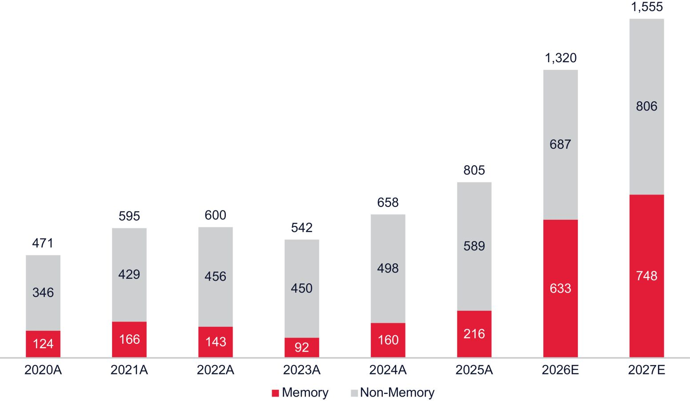
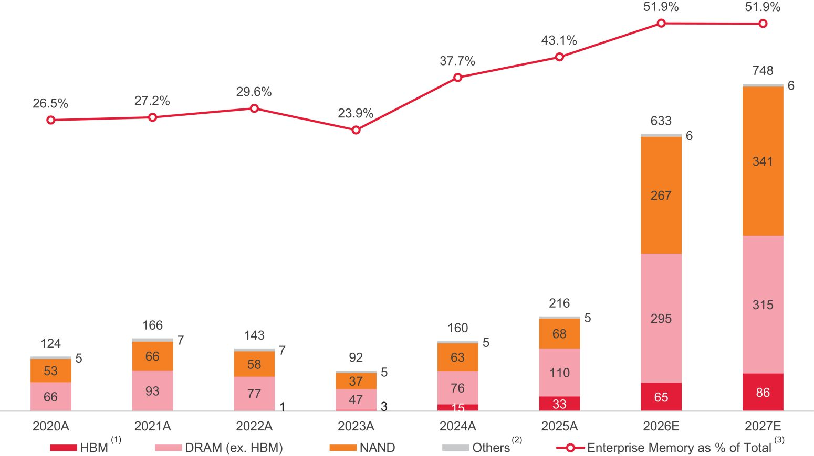
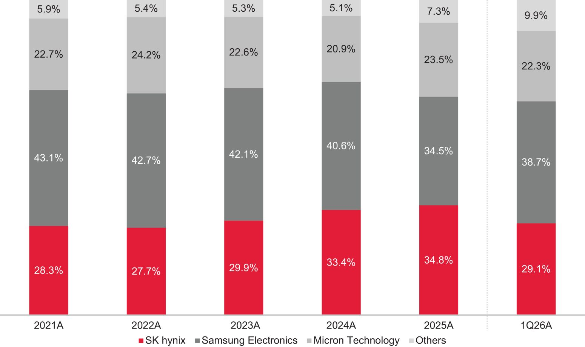
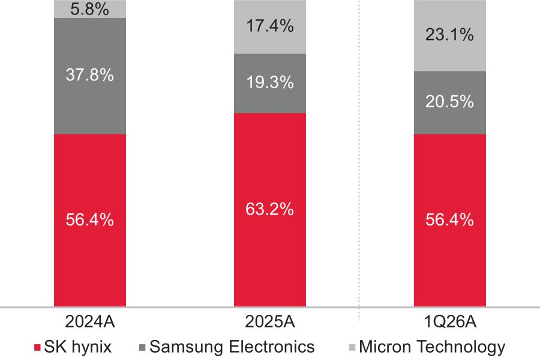
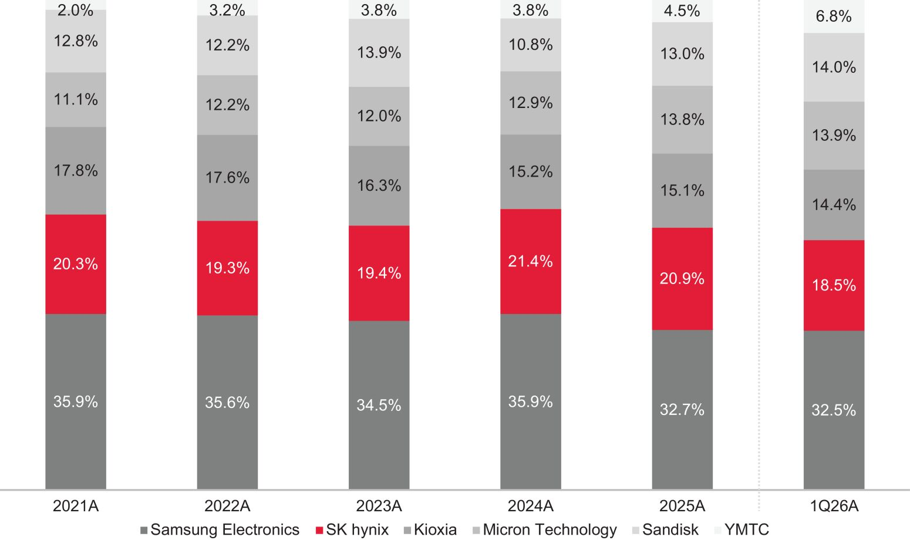

## Document Metadata

- Document ID: e5aa2a816739c7d443c2ce38b493d7aec48009b9
- Document Title: SK hynix Inc. Prospectus
- Document Type: Prospectus (HTML)
- Issuing Organization: SK hynix Inc.
- Publication Date: July 9, 2026
- Reporting Period: null
- Source File: [9_sec.gov_snapshot.html](https://github.com/jadennevercode/CJCC-Knowledge-Base/blob/564ab11aa9785e569e3853c8a4d7ce86f88e7535/materials/%E5%9F%BA%E7%A1%80%EF%BC%9A%E8%A1%8C%E4%B8%9A%E6%9C%AF%E8%AF%AD%E4%B8%8E%E6%8C%87%E6%A0%87/9_sec.gov_snapshot.html)

## Structured Content

[Source Page: 8]

### Market and Industry Data

Market data and other statistical information used in this prospectus is based on data collected by and available from Gartner, Inc. (“Gartner”) and International Data Corporation (“IDC”), among other sources. The Gartner content described herein (the “Gartner Content”) represents research opinions or viewpoints published as part of a syndicated subscription service by Gartner, and is not a representation of fact. The Gartner Content speaks as of its original publication date (and not as of the date of this prospectus), and the opinions expressed in the Gartner Content are subject to change without notice.

Certain data is also based on our estimates, which are derived from our review of internal surveys as well as independent sources. Although we believe these sources are reliable, we have not independently verified the information and cannot guarantee its accuracy or completeness.

[Printed Page: 2]

[Source Page: 9]

Similarly, internal company surveys, industry forecasts and market research, which we believe to be reliable based upon management’s knowledge of the industry, have not been verified by any independent sources. Forecasts are particularly likely to be inaccurate, especially over long periods of time. In addition, we do not know what assumptions were used in preparing the industry forecasts cited. See “Cautionary Note Regarding Forward-Looking Statements.”

[Source Page: 11]

## GLOSSARY OF TERMS

|  |  |
| --- | --- |
| Mass Reflow-Molded Underfill (“MR-MUF”) | A process in which a liquid protective material is injected between the spaces of stacked chips before hardening to protect the circuits. MR-MUF offers more efficient heat dissipation compared to the method of laying film material between each chip. |

## RISK FACTORS

### Risks Relating to Our Business and Industry

[Source Page: 24]

#### The memory semiconductor industry is subject to cyclical fluctuations, including recurring periods of oversupply, which may result in volatility in our operating results, which in turn may adversely affect our financial position and cash flows.

Our DRAM products accounted for 77.3% of our total sales in the first quarter of 2026 and 77.1% in 2025 and our NAND flash memory products accounted for 22.0% of our total sales in the first quarter of 2026 and 21.3% in 2025. Accordingly, our business is affected by market conditions in the highly cyclical memory semiconductor industry. The industry’s cyclical demand cycles are due, in large part, to fluctuations in demand for the end products that use memory semiconductors. The largest end product industries that use memory semiconductors are the information and technology industry and the consumer electronics industry, which are sensitive to general macroeconomic conditions impacting the global economy. Uncertainties in the global economy have increased in recent years, with global financial and capital markets experiencing substantial volatility. A prolonged period of high interest rates may negatively impact the demand for our products. Such uncertainties have been caused by, and continue to be exacerbated by, among other things, deterioration in economic and trade relations between major economies (particularly between the United States and China), the outbreak of the Russia-Ukraine war in February 2022 and the military conflicts between Iran and other countries, including the United States and Israel, that have destabilized the global energy sector, the slowdown of economic growth in China and other major emerging market economies, adverse economic and political conditions in Europe and Latin America, continuing geopolitical and social instability in North Korea and various parts of the Middle East and impositions of tariffs and other trade protective measures around the world. Any future deterioration in global economic conditions may result in a decline in demand for our memory semiconductors.

The long lead times for new facilities to become operational have in some cases resulted in significant increases in the industry’s production capacity coinciding with weakening demand, resulting in global oversupply of products and declining prices. Demand growth expectations in the end markets that use memory semiconductors have typically been accompanied by increased capital investment by manufacturers. In addition, semiconductor manufacturers worldwide have migrated to finer line-width processes and advanced stacking technologies, which have increased the number of bits produced per wafer. These capital investments and the adoption of new technologies may result in increases in the supply of memory semiconductors that are not matched by commensurate growth in demand in the end markets for such products. From time to time, the memory semiconductor industry has experienced significant and sometimes prolonged periods of oversupply and weak prices.

[Printed Page: 18]

[Source Page: 25]

As a result of such fluctuations in global demand and increases in the manufacturing capacity available to produce memory semiconductors, our results of operations may be volatile from period to period. Following a period of strong global demand for memory semiconductors in 2021 and the first half of 2022, the global prices of memory products meaningfully decreased starting in the third quarter of 2022, reflecting weakening demand and a general oversupply in the market, which in turn negatively impacted our results of operations. As a result, in 2023, we recorded loss for the year of W9,138 billion. However, in recent years, global demand for DRAMs, particularly for HBMs designed to meet the greater data-processing speed requirements of graphics applications that incorporate deep learning and AI technologies, and NAND flash memory products rebounded strongly, and we recorded profit for the period of W40,346 billion in the first quarter of 2026 and W8,108 billion in the first quarter of 2025, and profit for the year of W42,948 billion in 2025 and W19,797 billion in 2024.

Actual or anticipated deterioration in market conditions may result in a decline in demand for our products that may have a negative impact on the prices at which they can be sold. In such a case, we will likely face pressure to reduce prices and may need to rationalize our production capacity and reduce fixed costs. In general, our ability to significantly reduce expenditures for production facilities and research and development during an industry downturn is limited because of the need to maintain our competitive position. If we are unable to reduce our expenses sufficiently to offset reductions in prices and sales volume, our margins will deteriorate and our business, financial condition and results of operations may be materially and adversely affected.

[Source Page: 26]

#### Our future long-term growth depends to a significant extent on our ability to increase production capacity.

Our future long-term growth will be dependent on our ability to continue to expand our production capacity and total output beyond current levels. As part of our efforts to reduce unit manufacturing costs, improve manufacturing yields and enhance our profitability, we periodically phase out the operations of our older fabs or upgrade them to new fabs that implement more advanced processing technologies. In addition to regular maintenance and enhancement of existing fabs, in October 2025, we opened the cleanroom of a new extension fab called “M15X” in Cheongju, which we plan to utilize to further increase our production capacity of next-generation DRAMs such as HBM. We began wafer input at the M15X in the first quarter of 2026 and expect to gradually ramp up our production volume. As part of our efforts to ensure our long-term competitiveness, we have also announced initiatives to construct an integrated industrial complex in Yongin, Korea for our next generation of fabs and research and development facilities. We began construction of our first fab at the Yongin complex in February 2025 with the phase 1 cleanroom of the first fab expected to open in the first quarter of 2027. We are currently constructing an advanced packaging plant called “P&T7” in Cheongju and expect to complete construction by the end of 2027. In December 2024, we also announced plans to build an advanced packaging plant in Indiana, United States, and expect to commence operations in the second half of 2028. See “Business — Our Strategy — 3. Pursuing Production Capacity Expansion in Korea to Address Growing Demand” for a discussion of our production capacity expansion strategy.

Our ability to expand and successfully operate additional production facilities and increase output is subject to significant risks and uncertainties, including:

- our ability to secure adequate purchase orders from customers to maintain optimal production capacity;

- our ability to raise sufficient funds to build and operate new production facilities, including securing adequate working capital for labor costs and the purchase of raw materials and other supplies;

[Printed Page: 20]

[Source Page: 27]

- delays and cost overruns associated with the build-out of additional facilities due to factors, many of which may be beyond our control, such as delays in government approvals, problems with equipment vendors or raw material suppliers and equipment malfunctions and breakdowns; and

- diversion of significant management attention and other resources.

Our cash outflows for acquisitions of property, plant and equipment amounted to W7,657 billion in the first quarter of 2026 and W6,284 billion in the first quarter of 2025, and W27,519 billion in 2025, W15,946 billion in 2024 and W8,325 billion in 2023. In 2026, we plan to increase our capital expenditures considerably compared to 2025. We periodically adjust our capital expenditure plans based on market demand for our products, the production outlook of the global memory semiconductor industry and general global economic conditions. We may delay or not implement some of our announced capital expenditure plans based on our assessment of such market conditions. If we are unable to expand our production capacity and ramp up our operations within our anticipated timeframe and budgeted costs, we may not be able to meet customer demand and pursue additional economies of scale and growth, which could have a material adverse effect on our business, financial condition and results of operations.

[Source Page: 27]

#### Our revenue and profitability may decline if we are unable to obtain adequate supplies of raw materials, purified water, electricity and equipment in a timely manner and at reasonable prices.

We require timely and adequate supplies of raw materials, purified water, electricity and equipment in order to manufacture our products. We source most of our raw materials, including wafers, from suppliers in Korea, Japan and the United States. We are not dependent on any one supplier for a substantial portion of our raw material requirements for fabrication and packaging, and we believe that we generally have access to alternative sources of supply for our principal raw materials. However, from time to time, we and other semiconductor manufacturers have experienced shortages and increases in lead times for the delivery of raw materials, which in turn have resulted in interruptions in production and delivery of products from time to time. In particular, the manufacture of advanced memory products such as HBM is more complex and resource-intensive than traditional DRAM products and requires greater wafer input and specialized materials and components used in advanced packaging processes. As demand for HBM products increases, we may experience supply constraints, extended lead times or price increases with respect to such materials or components. In addition, the suppliers of certain advanced packaging materials and components may be more limited than those for traditional memory products, which could increase supply chain risks. To minimize the risk of significant interruptions to supplies of our principal raw materials, we have entered into multi-year supply agreements with our key material suppliers and plan to enter into similar agreements with other major suppliers, as well as diversify the geographic location of key international suppliers and increase sourcing from suppliers in Korea.

Like other memory semiconductor manufacturers, we also depend on a limited number of manufacturers in the Netherlands, the United States and Japan for our key equipment. We generally seek to obtain testing equipment with similar functionality from various vendors. However, our purchases of high-end equipment have historically been limited to several manufacturers. In periods of high market demand, the lead times from order to delivery of such equipment can be over one year. We seek to manage this process through the early reservation of appropriate delivery slots and constant communication with our equipment suppliers. However, unavailability of equipment, delays in delivery of key equipment or failure of equipment to meet our specifications could delay implementation of our expansion plans and impair our ability to deliver products to our customers in a timely manner.

It is possible that any of our key supplier relationships could be interrupted or terminated due to events beyond our control, including international supply disruptions caused by geopolitical issues,

[Printed Page: 21]

[Source Page: 28]

natural disasters or severe health pandemics such as COVID-19. For example, in October 2022, the Bureau of Industry and Security of the U.S. Department of Commerce (the “BIS”) announced export controls to restrict China’s ability to obtain advanced computing chips, develop and maintain supercomputers, and manufacture advanced semiconductors. As part of such measures, the BIS added certain semiconductor manufacturing equipment and related items to the Commerce Control List as well as new license requirements for items destined to semiconductor fabrication facilities in China that fabricate certain advanced semiconductors. In October 2022, we received permission from the BIS that enables us to supply our China-based manufacturing facilities with the equipment and items needed for one year without meeting additional licensing requirements. In October 2023, we were designated as a Validated End-User (“VEU”) by the BIS, thereby obtaining a general authorization for supplying our China-based manufacturing facilities with necessary equipment and items, subject to certain restrictions, without having to seek multiple individual licenses. On August 29, 2025, the BIS announced that our designation as a VEU would be revoked effective December 31, 2025. In lieu of the VEU framework, the BIS implemented an annual approval mechanism under which we are required to submit yearly plans detailing our anticipated needs for U.S.-origin equipment. In December 2025, the BIS granted us an annual license for 2026, allowing approved U.S.-origin equipment to be shipped to our facilities in China and removing the burden of obtaining case-by-case export licenses during such year. Failure to obtain the required licenses in a timely manner may materially impact our manufacturing operations in China, which in turn may have a material adverse effect on our business, financial condition and results of operations.

There can be no assurance that we will be able to secure sufficient supplies of the relevant raw materials that meet our quality standards from alternative suppliers in a timely manner and at reasonable prices to satisfy our long-term needs. Furthermore, in the event that trade restrictions are imposed in the future by foreign governments in countries where our key suppliers are located, our failure to mitigate the impact of such restrictions could materially and adversely affect our operations. If we are unable to obtain adequate amounts of key raw materials, purified water, electricity and equipment that meet our quality standards in a timely manner and at a reasonable cost, the production of our products could be disrupted, which would negatively impact our business, financial condition and results of operations.

[Source Page: 28]

#### The complexity of memory semiconductor production makes us highly susceptible to potential manufacturing issues.

Manufacturing memory semiconductors is a highly complex and precise process, requiring production in a tightly controlled, clean environment. Even very small impurities in raw materials, flaws in the wafer fabrication process, defects in the masks used to print circuits on a wafer or other factors can cause a substantial percentage of wafers to be rejected or numerous chips on each wafer to be nonfunctional. We may experience problems in achieving an acceptable yield rate in the manufacture of chips and memory module products, and the likelihood of facing such difficulties is higher in connection with the transition to new manufacturing methods. From time to time, we have experienced minor disruptions in our manufacturing process as a result of temporary power outages. We may also experience manufacturing problems in our assembly and test operations as a result of the introduction of new packaging materials. In addition, as technological advances in semiconductors become more rapid, manufacturing activities become more complex and prone to problems. Disruption of operations may also occur due to fire, flood or other natural disasters or calamities, the effects of climate change (such as sea level rise, drought, flooding, wildfires, increased average temperatures and increased storm severity), human error, or acts of terrorism or war. Any interruption of wafer fabrication at any of our facilities resulting in the failure to achieve acceptable manufacturing yields or inability to meet our customers’ requirements would adversely affect our business, financial condition and results of operations.

[Printed Page: 22]

[Source Page: 29]

[Source Page: 29]

#### Our long-term profitability depends on our ability to respond to rapid technological changes in the manufacturing process in a timely and cost-effective manner.

The average selling prices of memory semiconductors have declined in general and are expected to continually decline with time irrespective of industry-wide cyclical fluctuations and seasonality, as a result of, among other factors, technological advancements and cost reductions in the memory semiconductor manufacturing process. We may be able to take advantage of temporary higher selling prices typically associated with the launch of new products or the emergence of external factors that increase demand, but such prices will likely decline over time, and in certain cases, very rapidly. If the average per-bit selling price for DRAM and NAND flash memory products that we produce decreases faster than the pace at which we are able to reduce our per-bit manufacturing costs, our gross margins would decrease. Accordingly, our ability to respond to rapid technological changes in the manufacturing process and achieve higher manufacturing yields in a timely and cost-effective manner is critical to our long-term profitability.

Due to the competitive nature of the memory semiconductor market, manufacturers are continually seeking to optimize their production methods. For example, we continue to invest in enhancing TSV interconnection technology that links upper and lower chips with an electrode that vertically passes through the base logic chip and DRAM chips, which is critical in the development of our next-generation of HBMs. In addition, we continue to invest in enhancing our NAND stacking technology, which enables NAND flash memory cells to be stacked vertically in multiple layers, and have been transitioning the mass production of our NAND flash memory products from utilizing 176 layer technology to 238 and 321 layer technologies. If we do not anticipate enhancements in manufacturing technology and fail to adopt new process technologies in a timely and cost-effective manner, we may not be able to produce products that meet our customers’ demands at competitive prices. Although new technologies typically yield more chips per wafer once ramp-up has been successfully completed, yields are typically low during the initial stage of transition where new technologies are applied to existing manufacturing processes. There is no guarantee that we will not experience material delays in connection with future migrations to new technologies. If we are unable to respond to rapid technological changes in the manufacturing process in a timely and cost-effective manner, we may lose market share, which in turn could have a material adverse effect on our business, financial condition and results of operations.

#### Requirements of the customers in the information and technology industry and the consumer electronics industry are continually and rapidly evolving, and our success depends on our ability to anticipate and respond to these changes and trends.

Memory semiconductors are becoming increasingly diversified in terms of specifications, with customers demanding solutions that are optimized for their particular needs to manufacture specific electronic devices, including PCs, servers, graphics cards, mobile devices such as smartphones and tablets, and other consumer electronics products. In addition, technologies that impact demand for memory semiconductors are continually and rapidly evolving. For example, in March 2026, Google unveiled TurboQuant, advanced and theoretically grounded quantization algorithms that potentially enable massive compression for LLMs and vector search engines, which may allow high-performance GPUs to process significantly more data with the same amount of physical memory.

[Source Page: 30]

#### If demand for our products exceeds our available supply, the necessity of allocating our finite supply among customers may adversely impact customer relationships, and we may accordingly face heightened political, legal and regulatory scrutiny.

Demand for memory semiconductors is driven by diverse and rapidly evolving end markets, including AI and data center infrastructure, consumer electronics, automotive, telecommunications, medical devices and industrial applications. Periods in which aggregate demand for our products materially exceeds our available manufacturing capacity may require us to make allocation decisions among customers, product lines and end markets. In recent quarters, demand for our products has exceeded our available supply. Customers whose supply requirements are not sufficiently met may seek alternative sources, redesign products to use competing technologies or reduce their reliance on our products, which could adversely impact our customer relationships, competitive position and market share. See “— Our future long-term growth depends to a significant extent on our ability to increase production capacity.”

In addition, when supply constraints result in significant price increases or sustained shortages affecting broad segments of the economy, our customers, industry coalitions, trade associations and other stakeholders may seek to draw the attention of legislators, regulators and other government officials to perceived imbalances in the supply of memory semiconductors. Such advocacy has occurred and may continue or intensify. Political, legal and regulatory scrutiny of our industry’s supply-and-demand dynamics, pricing practices or capacity-investment decisions could lead to government inquiries, civil litigations, increased regulatory oversight, new or modified conditions on government incentives or subsidies, or legislative or executive actions that could affect how we manufacture, price, allocate or distribute our products. For example, on June 25, 2026, indirect purchasers of conventional DRAM filed a putative antitrust class action suit in the U.S. District Court for the Northern District of California alleging violations of various federal and state antitrust and related business practice laws. See “Business — Litigation and Regulatory Proceedings.” The technology industry is subject to intense media, political and regulatory scrutiny, which exposes companies to investigations, legal and regulatory actions, and penalties and sanctions. Any of the foregoing risks, individually or in the aggregate, could have a material adverse effect on our business, financial condition and results of operations.

[Source Page: 30]

#### A slowdown in demand for our products from AI infrastructure investment could adversely affect our results of operations.

Recent growth in our revenue and profitability has been driven in significant part by strong demand for our memory products, including HBM and server DRAM products, from the expansion of AI infrastructure, such as AI accelerators and data centers. Demand for AI infrastructure has been driven in large part by significant capital expenditures by hyperscale cloud service providers and other large technology companies. If such customers reduce, delay or reprioritize their capital expenditures, including as a result of macroeconomic conditions, changes in business priorities, concerns regarding returns on investment or a sudden correction following a period of elevated spending, demand for AI infrastructure and related components could slow down materially, which in turn would decrease the demand for our products.

In addition, customers may place orders in anticipation of future demand or supply constraints, which may result in periods of excess channel or customer inventory, inventory corrections, order

[Printed Page: 24]

[Source Page: 31]

cancellations, order delays or reduced purchasing activity. To the extent that current industry demand reflects inventory accumulation, actual end-market demand for our products may be lower than current order trends suggest.

Furthermore, technological developments may reduce the demand for, or alter the specifications required of, our products. For example, emerging technologies, architectures or efficiency improvements, including technologies intended to reduce memory usage, bandwidth requirements or computing resource consumption in AI workloads, may decrease demand for high-performance memory products such as HBM and server DRAM products. If the adoption, utilization or commercialization of AI technologies does not continue to develop as expected, or if technological changes reduce the volume of memory required for AI infrastructure, capital expenditures on the buildout and expansion of AI infrastructure may slow or decline. Any such slowdown or decline could adversely affect the demand for our products and materially adversely affect our business, financial condition and results of operations.

[Source Page: 31]

#### We sell a substantial portion of our products to a select group of key customers in the United States and China, and any significant decrease in their order levels will negatively affect our business.

A substantial portion of our sales is attributable to a limited number of customers located in the United States and China. Our two largest customers represented 14.8% and 12.4%, respectively, of our total revenue in the first quarter of 2026 and our largest customer represented 23.9% of our total revenue in 2025. See note 4 of the notes to the Interim Financial Statements and note 4 of the notes to the Audited Financial Statements, respectively. We cannot provide any assurance that our key customers will continue to place orders with us in the future at the same levels as in prior periods, or at all. The supply arrangements for our products are designed to take into consideration our ongoing partnerships with key customers. Specific quantities and pricing are typically determined through mutual agreement at the time of purchase, taking into account market conditions and demand. Key customers may reduce quantities purchased, delay or cancel purchase orders or elect to terminate their business relationship with us at any time for a number of reasons, including industry consolidation through mergers and acquisitions. Because much of our costs and operating expenses are relatively fixed, termination of business relationships with key customers or significant reductions in sales to any key customers would have a material adverse effect on our business, financial condition and results of operations.

In recent years, we have relied on sales to customers in the United States and China, and prolonged tensions in economic and trade relations between the two countries may have a material adverse effect on demand for our products from key customers in such countries. Revenue of sales subsidiaries located in the United States accounted for 64.7% of our revenue in the first quarter of 2026 and 68.8% in 2025, while revenue of sales subsidiaries located in China accounted for 24.3% of our revenue in the first quarter of 2026 and 19.7% in 2025. Ongoing tensions between the United States and China and tariffs and other trade restrictions imposed by them on each other, including restrictions and penalties imposed by their respective governmental agencies such as the BIS, may lead to a decrease in the volume of products manufactured by our key customers located in such countries, which in turn could decrease demand for our memory semiconductors used as components in their products. In addition, we may be prohibited from selling products to certain of our key customers as a result of the ongoing trade tensions. For example, in August 2020, the BIS published a final rule that further tightened restrictions under the Export Administration Regulations on Huawei Technologies Co., Ltd. (“Huawei”) and its affiliates designated on the Entity List administered by the BIS. Under the final rule, any item produced based on the relevant categories of U.S.-origin technology or software in any meaningful way may no longer be provided to Huawei for use by it or for use in any Huawei product without obtaining a license. Sales of any such items without obtaining the proper

[Printed Page: 25]

[Source Page: 32]

license would result in a violation of U.S. law. Starting in September 2020, we have suspended sale of our products to Huawei and its affiliates designated on the Entity List administered by the BIS. In May 2025, the BIS also issued guidance alerting the semiconductor industry that the use of semiconductors manufactured by Chinese companies risks violating U.S. export controls and may subject companies to BIS enforcement action.

In addition, in August 2022, the U.S. Government enacted the CHIPS Act, which provides federal aid to promote emerging industries in the United States, including measures to strengthen its domestic semiconductor manufacturing capabilities. Such efforts may incentivize U.S. semiconductor companies to invest in the expansion of their production capabilities, which in turn may reduce our sales in the United States. In February 2023, the U.S. Government announced the requirements for the federal subsidies to be granted under the CHIPS Act, including (i) a ban on certain new, high-tech investments in China or other “countries of concern” for at least a decade, (ii) provision of affordable child care for the workers, (iii) limitation of stock buybacks, (iv) sharing of certain excess profits with the U.S. Government and (v) the submission of certain information regarding management and technology. Both U.S. and non-U.S. semiconductor companies that choose to invest in the United States and meet such terms are eligible for the federal subsidies. In September 2023, the U.S. Government released the final rules on the guardrails applicable to such federal subsidy program. The final rules prohibit recipients of the federal subsidy from materially expanding their semiconductor manufacturing capacities in foreign countries of concern for 10 years and restrict them from certain joint research or technology licensing efforts with foreign entities of concern. In December 2024, we announced plans to build an advanced packaging plant in Indiana, United States, and expect to commence operations in the second half of 2028. Under the CHIPS Act, upon meeting certain project milestones, we may receive federal subsidies of up to US$458 million and loans of up to US$570 million from the U.S. Department of Commerce in connection with the Indiana complex. In March 2025, U.S. President Donald J. Trump (the “U.S. President”) signed an executive order establishing the United States Investment Accelerator, an office within the U.S. Department of Commerce that is responsible for administering and overseeing the implementation of the programs under the CHIPS Act. Although we believe that our investment to construct an advanced packaging plant in Indiana, United States currently meets the requirements of the CHIPS Act, there can be no assurance that the CHIPS Act will not be further amended or terminated, or that our Indiana investment will continue to satisfy such requirements.

As part of its efforts to promote a robust semiconductor supply chain, the U.S. Government also initiated the Chip 4 Alliance, a new U.S.-Asian semiconductor partnership among the United States, Korea, Japan and Taiwan. Such an alliance has led China to take measures to more actively develop its semiconductor manufacturing capabilities, which in turn has reduced the percentage of our sales in China in recent years. See “ — The memory semiconductor industry is highly competitive and our failure to successfully compete would adversely affect our business.”

In response to the above measures adopted by the United States, the Cyberspace Administration of China announced in May 2023 that Micron Technology had failed a security review and banned China’s critical information infrastructure operators from purchasing products from Micron Technology. We are unable to predict the duration of tensions in economic and trade relations between the two countries, and prolonged trade restrictions could have a material adverse effect on our business, financial condition and results of operations.

[Source Page: 32]

#### Impositions of anti-dumping duties, safeguard duties, countervailing duties, quotas or tariffs may have an adverse impact on our export sales.

We sell substantially all of our products outside Korea. We continue to carefully monitor developments with respect to trade remedy policies, including anti-dumping duties, safeguard duties,

[Printed Page: 26]

[Source Page: 33]

countervailing duties, quotas or tariffs, in all major markets in which we sell our products and seek to mitigate the related risks by adjusting supply and export arrangements as necessary and entering into trade agreements and, where necessary, vigorously defend our rights. However, there can be no assurance that the trade agreements between Korea and its major trading partners will not be amended or that anti-dumping duties, safeguard duties, countervailing duties, quotas or tariffs will not be imposed on our sales of products outside Korea in the future. The occurrence of any such events, including those described below, may have a material adverse impact on our business, financial condition and results of operations.

In April 2025, under the International Emergency Economic Powers Act of 1977 (the “IEEPA”), the U.S. President imposed a universal “reciprocal” tariff which applies to all imports from all of the trading partners (including those with free trade agreements with the United States), with a base rate of 10%, subject to certain exceptions including semiconductors. In addition, the U.S. President imposed higher rates on imports from certain enumerated countries on a country-by-country basis (including Korea at 15%), subject to certain exceptions including semiconductors, which implementation became effective on August 7, 2025. In February 2026, the United States Supreme Court ruled that the U.S. President has no peacetime authority to impose such tariffs under the IEEPA and that the power to impose such tariffs must come from a clear congressional grant to the U.S. President. In response, on the same day the decision was published, the U.S. President issued a Proclamation “Imposing a Temporary Import Surcharge to Address Fundamental International Payments Problems,” imposing a 10% temporary import surcharge on imports from all U.S. trading partners under section 122 of the Trade Act of 1974, which rate was subsequently increased to 15%. Such “Section 122” tariff, which remains subject to certain exceptions including semiconductors, took effect on February 24, 2026, and remains in effect for 150 days. No assurance can be provided that such tariffs will not be extended or that similar tariffs will not be imposed on different grounds.

In addition to the tariff discussed above, in August 2025 and January 2026, the U.S. government threatened to impose a tariff of 100% on all imports of semiconductors, subject to certain exceptions for businesses that make a commitment to build semiconductor facilities and invest in the United States. The imposition of any such tariffs may have a material adverse effect on our sales of semiconductor products in the United States as well as on our downstream customers that produce finished products using our products in countries subject to such tariffs and export those products to the United States. The increases in costs and prices due to the imposition of any such tariffs may reduce consumer demand for such products in the United States, which may in turn adversely affect the demand for our products.

Historically, tariffs have led to increased trade and political tensions. In response to the recent tariffs imposed by the U.S. government, various countries have implemented, or have announced plans to implement, retaliatory tariffs on goods produced in the United States. Political tensions as a result of trade policies could reduce trade volume, investment, technological exchange and other economic activities between major international economies, resulting in a material adverse effect on global economic conditions and the stability of global financial markets. If further tariffs are imposed on a broader range of our or our customers’ exports, or if further retaliatory trade measures are taken by impacted foreign countries in response to additional tariffs, we or our customers may be required to adjust their prices or incur additional expenses, which may have a material adverse impact on our business, financial condition and results of operations.

[Source Page: 37]

In the event that any third party is adjudicated to have a valid intellectual property claim against us, we may be required to:

- refrain from selling the affected products in certain markets;

- make royalty payments or pay significant monetary damages, which may exceed our reserves for such matters;

- seek to develop non-infringing technologies, which may be costly or time-consuming or may not be feasible; and

- seek to acquire licenses to the infringed technology, which may not be available on commercially reasonable terms, if at all.

Any of the foregoing, as well as our inability to adequately protect our intellectual property rights, could have a material adverse effect on our business, financial condition and results of operations.

[Source Page: 37]

#### We rely on technology provided by third parties, and our business may suffer if we are unable to renew our licensing arrangements with them.

We have entered into technology license and cross-license agreements with third parties that give those parties the right to use patents and other technologies developed by us, as well as provide us with the right to use patents and other technologies developed by them. We anticipate that we will continue to enter into various licensing and cross-licensing arrangements in the future, which may increase our payments of licensing fees and royalties. If we are unable to enter into or renew technology licensing arrangements on acceptable terms, we may lose the legal right to use certain of the technologies we employ in manufacturing our products, which may prevent us from manufacturing and selling key products. In addition, we could be disadvantaged if our competitors obtain licenses for important technologies on more favorable terms than us. In the future, we may also need to obtain additional licenses for new or existing technologies. Our failure to secure or renew license agreements on acceptable terms may materially and adversely affect our business, financial condition and results of operations.

[Source Page: 38]

#### Breaches of our security systems or products, systems failures, interruptions, delays in service, catastrophic events and resulting interruptions in the availability of our systems or those of our customers, suppliers or business partners could expose us to losses.

We maintain a system of controls over the physical security of our facilities. We also manage and store various proprietary information and confidential data relating to our operations. In addition, we process, store and transmit data relating to our customers, suppliers and employees, including sensitive personal information. Unauthorized persons, employees, former employees, nation states or other parties may gain access to our facilities or technology infrastructure and systems through fraudulent means and may steal trade secrets or other proprietary information, compromise confidential information, create system disruptions or have other impacts. This risk is exacerbated as competitors for talent, particularly engineering talent, attempt to hire our employees. Through cyberattacks on technology infrastructure and systems, unauthorized parties may obtain access to our computer systems, networks and data, including cloud-based platforms. Our technology infrastructure and systems and those of our suppliers, vendors, service providers, cloud solution providers and partners have in the past experienced, and may in the future experience, such attacks, which could materially impact our operations.

Breaches of our physical security, including break-ins, sabotage or vandalism, attacks on our technology infrastructure and systems, security breaches or incidents, or attacks on our customers, suppliers, or business partners who maintain or otherwise process confidential or sensitive information regarding us and our customers and suppliers, could result in damage to, or loss, disruption, or unavailability of data or systems, or inappropriate disclosure, destruction or loss of confidential or sensitive information. In addition, our systems and those of our third-party vendors may experience service interruptions, data loss or compromise and outages, for other reasons, including human error, pandemics, fires, other natural disasters, power losses, disruptions in telecommunications services, fraud, military or political conflicts, terrorist attacks and other geopolitical unrest, computer viruses, ransomware, and other malicious software, changes in social, political, or regulatory conditions or in laws and policies, or other changes or events. Any such event, or the perception it has occurred, may result in significant losses and damage our reputation with customers and suppliers and may expose us to claims, demands and litigation.

[Source Page: 40]

#### Sanctions against us and other memory semiconductor producers for allegedly anti-competitive practices may have a direct or indirect material adverse impact on our operations.

From time to time, we may become subject to investigations by government authorities as well as legal proceedings related to alleged involvement in anti-competitive practices. In the past, we and other DRAM manufacturers were investigated by the Antitrust Division of the U.S. Department of Justice, and class action lawsuits have been filed against us and other DRAM manufacturers in various federal district courts and state courts alleging violations of U.S. antitrust laws, unfair competition laws and other related laws. Generally, such class action cases are filed on behalf of classes of individuals and entities who purchased DRAM directly or indirectly from the various DRAM suppliers. The “indirect purchaser” plaintiffs include purchasers of consumer products, such as computers, in which DRAM is a component, and other purchasers that did not purchase DRAM directly from a manufacturer. Any sanctions imposed against us, or adverse outcomes from legal proceedings, for allegedly anti-competitive practices could result in liability to us, damage to our reputation, loss of experienced personnel or other consequences, any of which may have a material adverse effect on our business, financial condition and results of operations.

[Source Page: 40]

#### Severe health epidemics (such as the global COVID-19 pandemic and any possible occurrences of other types of widespread infectious diseases) could materially and adversely affect our business, results of operations or financial condition.

If severe health epidemics were to occur in the future in any area where any of our assets, suppliers or customers are located, our business, results of operations or financial condition could be adversely affected. For example, COVID-19, an infectious disease caused by severe acute respiratory syndrome coronavirus 2, was declared a “pandemic” by the World Health Organization in March 2020. The global outbreak of COVID-19 led to global economic and financial disruptions and adversely affected our business operations. Risks associated with COVID-19 or other types of widespread infectious diseases include:

- disruption in the normal operations of our business resulting from contraction of infectious diseases by our employees, which may necessitate our employees to be quarantined and/or our manufacturing facilities or offices to be temporarily shut down;

- fluctuations of the Won against major foreign currencies (see “— Fluctuations in exchange rates may result in foreign exchange losses”);

- an increase in unemployment among, and/or decrease in disposable income of, consumers who purchase the products manufactured by our customers and a decline in overall consumer confidence and spending levels, which in turn may decrease demand for our products;

- disruption in the normal operations of the businesses of our customers, which in turn may decrease demand for our products;

- disruption in the supply of raw materials, components and equipment from our suppliers and vendors;

- disruption in the delivery of our products to our customers;

- unstable global and Korean financial markets, which may adversely affect our ability to meet our funding needs on a timely and cost-effective basis; and

- decreases in the fair value of our investments in companies that may be adversely affected by the pandemic.

In the event that a future recurrence of COVID-19 or an occurrence of other types of widespread infectious diseases cannot be effectively and timely contained, our business, financial condition and results of operations may be materially and adversely affected.

[Printed Page: 34]

[Source Page: 41]

[Source Page: 41]

#### Work stoppages and other labor-related issues may adversely affect our operations.

As of March 31, 2026, we had collective bargaining agreements with three labor unions, the two largest of which represented a total of 15,684 employees. Our latest collective bargaining agreements with such labor unions came into effect in April 2024 for a two-year term. We also engage in wage negotiations each year, which are retroactively applied for that year. In addition, we operate a profit-sharing incentive program linked to our operating results, which utilizes 10% of our operating profit as determined under the Korean International Financial Reporting Standards (“K-IFRS”).

We have not experienced a strike or other material work stoppage in recent years. However, there can be no assurance that our relationship with our employees will not deteriorate in the future and any labor unrest, work stoppages or strikes could prevent our production facilities from continuing normal operations, which in turn may have a material adverse effect on our business, financial condition and results of operations.

[Source Page: 41]

#### We are subject to strict environmental, health and safety regulations, and we may become subject to penalties or restrictions that could cause our operations to be interrupted or result in significant compliance expenses.

We have manufacturing facilities in Korea and China. Our operations involve the use of chemicals and generate chemical waste, wastewater and other industrial waste at various stages in the manufacturing process, and we are subject to a variety of environmental, health and safety laws and regulations of local or national governments relating to the use, storage, discharge and disposal of such chemical by-products and waste substances. We are also subject to restrictions on using certain raw materials in our manufacturing process in fabs located in certain locations. We have installed various types of anti-pollution equipment, consistent with industry standards, for the treatment of chemical waste and equipment for the recycling of treated water and other industrial waste at our various facilities. Our ESG Management Committee, chaired by our Chief Executive Officer, serves as the core executive-level decision-making body for our environmental, social and governance (“ESG”) management policies. Key matters discussed by such committee are reported upward to the Sustainable Management Committee under the Board, which provides company-wide oversight and final endorsement of ESG strategy, targets and performance. For a description of our Sustainable Management Committee, see “Management — Committees of the Board — Sustainable Management Committee.”

Furthermore, heightened global awareness and international and national commitments to reduce greenhouse gas emissions and counteract climate change (including increased activism by non-governmental and political organizations campaigning against fossil fuel extractions) may lead to increased costs for us, our customers and our suppliers. Investor preferences and sentiments are also influenced by ESG considerations including climate change and the transition to a lower carbon economy. Changes in such preferences and sentiment, including increased scrutiny from market

[Printed Page: 35]

[Source Page: 42]

participants, environmental organizations or the press, as well as compliance with such new and more stringent environmental obligations relating to greenhouse gas emissions may require additional capital expenditures or modifications in operating practices, as well as additional reporting obligations.

We cannot provide assurance that environmental, health and safety claims will not be brought against us or that local or national governments will not take steps toward adopting more stringent standards. Sourcing of raw materials could also present reputational risks if our direct or indirect suppliers are found to be in violation of environmental, health and safety regulations, or of ethical or human rights regulations or standards. Any failure on our part to comply with any present or future environmental, health and safety regulations could result in the assessment of damages or clean-up costs or the imposition of fines or other penalties against us, a suspension of production, cessation of operations or relocation of manufacturing facilities to different locations. In addition, new environmental, health and safety regulations could require us to acquire costly equipment or to incur other significant compliance expenses that may materially and negatively affect our business, financial condition and results of operations.

### Risks Relating to Korea

[Source Page: 43]

### Risks Relating to Korea

#### If economic conditions in Korea deteriorate, our current business and future growth could be materially and adversely affected.

We are incorporated in Korea and a significant portion of our assets are located in Korea. As a result, we are subject to political, economic, legal and regulatory risks specific to Korea, and our performance and successful execution of our operational strategies are dependent on the overall Korean economy. The economic indicators in Korea in recent years have shown mixed signs of growth and uncertainty, and future growth of the Korean economy is subject to many factors beyond our control, including developments in the global economy.

Following a period of deterioration due to the debilitating effects of the COVID-19 pandemic on the Korean economy as well as on the economies of Korea’s major trading partners in 2020, the overall Korean economy showed signs of recovery in 2021. However, adverse conditions and volatility in the worldwide financial markets, fluctuations in oil and commodity prices, supply chain disruptions and the increasing weakness of the global economy, as well as significant fluctuations in policy interest rates globally (including Korea), have contributed to the uncertainty of global economic prospects in recent years and have adversely affected, and may continue to adversely affect, the Korean economy. The value of the Won relative to major foreign currencies, in particular the U.S. dollar, has fluctuated

[Source Page: 44]

significantly and, as a result of uncertain global and Korean economic, social and political conditions, there has been significant volatility in the stock prices of Korean companies recently. Future declines in the Korea Composite Stock Price Index (the “KOSPI”), and large amounts of sales of Korean securities by foreign investors and subsequent repatriation of the proceeds of such sales may adversely affect the value of the Won, the foreign currency reserves held by financial institutions in Korea, and the ability of Korean companies to raise capital. Any future deterioration of the Korean or global economy could adversely affect our business, financial condition and results of operations and the market price of our common shares and the ADSs.

Other developments that could have an adverse impact on Korea’s economy include:

- declines in consumer confidence and a slowdown in consumer spending, including as a result of higher levels of market interest rates;

- the imposition of significant tariffs on the Republic’s exports by any of the Republic’s major export markets, including the United States, as well as any countermeasures or policy responses adopted by the Government;

- shortages of imported raw materials, natural resources, rare earth minerals or component parts due to disruptions to the global supply chain;

- rising inflationary pressures leading to increases in costs of goods and services and a decrease in purchasing power;

- hostilities or political or social tensions involving countries in the Middle East (including those resulting from the military conflicts between Iran and other countries, including the United States and Israel) and Northern Africa and any material disruption in the global supply of oil or sudden increase in the price of oil;

- hostilities or political or social tensions involving Russia (including the Russia-Ukraine war and the ensuing actions against Russia) and any resulting adverse effects on the global supply of oil and other natural resources or the global financial markets;

- adverse conditions or developments in the economies of countries and regions that are important export markets for Korea, such as China, the United States, Europe and Japan, or in emerging market economies in Asia or elsewhere, including as a result of the deterioration of economic and trade relations among such countries or impositions of significant tariffs by any such country and increased uncertainties in the global financial markets and industry;

- adverse changes or volatility in foreign currency reserve levels, interest rates, inflation rates, commodity prices (including oil prices), exchange rates (including fluctuations of the U.S. dollar, Euro or Japanese Yen exchange rates or revaluation of the Chinese Yuan) or stock markets;

- political uncertainty or increasing strife among or within political parties in Korea following the declaration of martial law by former President Yoon Suk-yeol in December 2024 that led to his impeachment and subsequent removal in April 2025 and the election of Mr. Lee Jae-myung as President in June 2025;

- interest rate fluctuations as well as perceived or actual changes in policy rates, or other monetary and fiscal policies set forth, by the U.S. Federal Reserve, Korea and other central banks;

- the occurrence of severe health epidemics in Korea or other parts of the world;

- a deterioration in economic or diplomatic relations between Korea and its trading partners or allies, including deterioration resulting from territorial or trade disputes or disagreements in foreign policy;

[Source Page: 45]

#### Escalations in tensions with North Korea could have an adverse effect on us and the market value of our common shares and the ADSs.

Relations between Korea and North Korea have been tense throughout Korea’s modern history. The level of tension between Korea and North Korea has fluctuated and may increase abruptly as a result of current and future events. In particular, there have been heightened security concerns in recent years stemming from North Korea’s nuclear weapon, ballistic missile and satellite programs as well as its hostile military actions against Korea.

North Korea renounced its obligations under the Nuclear Non-Proliferation Treaty in January 2003 and has conducted six rounds of nuclear tests since October 2006, including claimed detonations of hydrogen bombs and warheads that can be mounted on ballistic missiles. Over the years, North Korea has continued to conduct a series of missile tests, including missiles launched from submarines and intercontinental ballistic missiles that it claims can reach the United States mainland. North Korea has increased the frequency of such activities since the beginning of 2022, firing numerous ballistic missiles, including intercontinental ballistic missiles, and in November 2023, successfully launched its

[Printed Page: 39]

[Source Page: 46]

first spy satellite. In response, the Government has repeatedly condemned North Korea’s provocations and flagrant violations of relevant United Nations Security Council resolutions. Over the years, the United Nations Security Council has passed a series of resolutions condemning North Korea’s actions and significantly expanding the scope of sanctions applicable to North Korea as did the United States and the European Union.

North Korea’s economy also faces severe challenges, which may further aggravate social and political pressures within North Korea. Although bilateral summit meetings between Korea and North Korea were held in April, May and September 2018 and between North Korea and the United States in June 2018, February 2019 and June 2019, there can be no assurance that the level of tensions affecting the Korean peninsula will not escalate in the future. Any increase in tensions, which may occur, for example, if North Korea experiences a leadership crisis, high-level contacts between Korea and North Korea or between the United States and North Korea break down or military hostilities occur, could have a material adverse effect on the Korean economy and on our business, financial condition and results of operations and the market value of our common shares and the ADSs.

## MANAGEMENT’S DISCUSSION AND ANALYSIS OF FINANCIAL CONDITION AND RESULTS OF OPERATIONS

[Source Page: 58]

## USE OF PROCEEDS
We estimate that the net proceeds from our issuance and sale of 17,790,000 common shares represented by ADSs in the offering will be approximately US$26.2 billion, after deducting the underwriting discount and commissions and estimated offering expenses payable by us, and based on the initial public offering price of US$149.00 per ADS.

We intend to use the net proceeds we receive from this offering for (i) capital expenditures of W45.5 trillion related to the construction of our production facilities in Korea as indicated below and (ii) our acquisition of EUV scanners, which we expect will cost approximately W11.9 trillion and receive delivery by December 2027. We expect to fund the amounts required to complete the construction and acquisitions in excess of the net proceeds from this offering using cash flows from our operating activities, borrowings under current and future credit facilities and debt securities and other funding resources.

| Project | Targeted Completion Date of Planned Investments | Total Expected Cost of Project(1) | Previously Invested Amount(2) | Additional Planned Investment Amount(1): Total | Additional Planned Investment Amount(1): 2026 | Additional Planned Investment Amount(1): 2027 | Additional Planned Investment Amount(1): 2028 | Additional Planned Investment Amount(1): 2029 | Additional Planned Investment Amount(1): 2030 |
| --- | --- | --- | --- | --- | --- | --- | --- | --- | --- |
| Fab 1 at the Yongin complex, Korea(3) | End of 2030 | W 31.0 | W 4.4 | W 26.6 | W 7.4 | W 10.1 | W 6.6 | W 2.5 | W 0.0 |
| P&T7 (advanced packing plant) in Cheongju, Korea(4) | End of 2030 | 19.0 | 0.1 | 18.9 | 0.5 | 2.1 | 2.7 | 5.8 | 7.8 |
| Total |  | W 50.0 | W 4.5 | W 45.5 | W 7.9 | W 12.2 | W 9.3 | W 8.3 | W 7.8 |

(In trillions of Won)

|  |  |
| --- | --- |
| (1) | Estimates only and are subject to change depending on prevailing market conditions, changes in construction process specifications, exchange rates and other factors. |

|  |  |
| --- | --- |
| (2) | As of May 31, 2026. |

|  |  |
| --- | --- |
| (3) | Not including installation of equipment. |

|  |  |
| --- | --- |
| (4) | Including installation of equipment. |

We periodically adjust our capital expenditure plans based on market demand for our products, the production outlook of the global memory semiconductor industry and general global economic conditions. We may adjust our use of proceeds based on our assessment of such market conditions.

[Source Page: 67]

#### Cyclical Nature, Volatility and Seasonality of the Semiconductor Industry

Our business is affected by market conditions in the highly cyclical memory semiconductor industry. The industry’s cyclical demand cycles are due, in large part, to fluctuations in demand for the end products that use memory semiconductors. The largest end product industries that use memory semiconductors are the information and technology industry and the consumer electronics industry, which are sensitive to general macroeconomic conditions impacting the global economy. Uncertainties in the global economy have increased in recent years, with global financial and capital markets experiencing substantial volatility. Such uncertainties have been caused by, and continue to be exacerbated by, among other things, deterioration in economic and trade relations between major economies (particularly between the United States and China), the outbreak of the Russia-Ukraine war in February 2022 and the military conflicts between Iran and other countries, including the United States and Israel, that have destabilized the global energy sector, the slowdown of economic growth in China and other major emerging market economies, adverse economic and political conditions in Europe and Latin America, continuing geopolitical and social instability in North Korea and various parts of the Middle East and impositions of tariffs and other trade protective measures around the world. Actual or anticipated improvement or deterioration in economic conditions in any of our major markets may affect customer confidence and spending, resulting in a corresponding fluctuation in consumption of end products that may impact the level of demand for our products and prices at which they can be sold.

The following table presents changes in our bit sales volumes and average selling prices (in U.S. dollars) of our DRAMs for each quarter, compared to the immediately preceding quarter, for the periods indicated.

|  | **1Q 2023** | **2Q 2023** | **3Q 2023** | **4Q 2023** | **1Q 2024** | **2Q 2024** | **3Q 2024** | **4Q 2024** | **1Q 2025** | **2Q 2025** | **3Q 2025** | **4Q 2025** | **1Q 2026** |
| --- | --- | --- | --- | --- | --- | --- | --- | --- | --- | --- | --- | --- | --- |
| **DRAM** **Bit**  **Sales**  **Volume** | Around 20% Decrease | Mid-30% Increase | Around 20% Increase | Low-single% Increase | Mid-teen% Decrease | Low-20% Increase | Slight Decrease | Mid-single% Increase | High-single% Decrease | Mid-20% Increase | High-single% Increase | Low-single% Increase | Flat |
| **DRAM** **Average**  **Selling Price** | High-teen% Decrease | High-single% Increase | Around 10% Increase | High-teen% Increase | Over 20% Increase | Mid-teen% Increase | Mid-teen% Increase | Around 10% Increase | Flat | Low-single% Increase | Mid-single% Increase | Mid-20% Increase | Mid-60% Increase |

The following table presents changes in our bit sales volumes and average selling prices (in U.S. dollars) of our NAND flash memory products for each quarter, compared to the immediately preceding quarter, for the periods indicated.

|  | **1Q 2023** | **2Q 2023** | **3Q 2023** | **4Q 2023** | **1Q 2024** | **2Q 2024** | **3Q 2024** | **4Q 2024** | **1Q 2025** | **2Q 2025** | **3Q 2025** | **4Q 2025** | **1Q 2026** |
| --- | --- | --- | --- | --- | --- | --- | --- | --- | --- | --- | --- | --- | --- |
| **NAND Flash** **Bit**  **Sales Volume** | Mid-teen% Decrease | Around 50% Increase | Mid-single% Increase | Low-single% Decrease | Flat | Low-single% Decrease | Mid-teen% Decrease | Mid-single% Decrease | High-teen% Decrease | Over 70% Increase | Mid-single% Decrease | Around 10% Increase | Around 10% Decrease |
| **NAND Flash**  **Average**  **Selling Price** | Around 10% Decrease | Around 10% Decrease | Slight Decrease | Over 40% Increase | Over 30% Increase | Mid-high-teen% Increase | Mid-teen% Increase | Mid-single% Decrease | Around 20% Decrease | High-single% Decrease | Low-teen% Increase | Low 30% Increase | Mid 70% Increase |

The long lead times for new facilities to become operational have in some cases resulted in significant increases in the industry’s production capacity coinciding with weakening demand, resulting in global oversupply of products and declining prices. Demand growth expectations in the end markets that use memory semiconductors have typically been accompanied by increased capital investment by manufacturers. In addition, semiconductor manufacturers worldwide have migrated to finer line-width processes and advanced stacking technologies, which have increased the number of bits produced per wafer. These capital investments and the adoption of new technologies may result in increases in the supply of memory semiconductors that are not matched by commensurate growth in demand in the end markets for such products. From time to time, the memory semiconductor industry has experienced significant and sometimes prolonged periods of oversupply and weak prices. As a result of such fluctuations in global demand and in the manufacturing capacity available to produce memory semiconductors, our results of operations may be volatile from period to period.

[Printed Page: 61]

[Source Page: 68]

#### Fluctuation in Exchange Rates of Major Foreign Currencies

Our consolidated financial statements are prepared based on the local currency-denominated financial results, assets and liabilities and cash flows of us and our subsidiaries around the world, which are then translated into Won. There has been considerable volatility in exchange rates in recent years, including exchange rates between the Won and the U.S. dollar. To the extent that we incur costs in one currency and make sales in another, our profit margins may be affected by changes in the exchange rates between the two currencies. In particular, our investments in manufacturing facilities in China have increased the proportion of our expenses that are incurred in Chinese Yuan, while our sales in China are denominated in U.S. dollars. Accordingly, an unhedged increase in the value of the Chinese Yuan would increase our construction and manufacturing costs and adversely impact our profitability. Changes in exchange rates can also affect the Won value of sales proceeds and operating and non-operating costs that are denominated in foreign currencies. We are unable to increase the prices of our products to adjust fully for the negative effects of exchange rate movements because prices in the memory semiconductor industry are dictated by worldwide supply and demand. In addition, exchange rate fluctuations can affect the Won value of our equity investments and monetary assets and liabilities denominated in foreign currencies. See “Exchange Rates” and “Risk Factors — Fluctuations in exchange rates may have a material adverse effect on our financial condition and results of operations.”

Appreciation of the Won may materially and adversely affect our results of operations because, among other things, it reduces the Won value of our export sales, which are primarily denominated in U.S. dollars, and causes our export products to be less competitive by raising their prices in U.S. dollar terms. On the other hand, depreciation of the Won would create foreign exchange translation losses and increase the amount, in Won terms, of interest and principal of our foreign currency-denominated debt, as well as increase in Won terms the cost of raw materials and equipment that we purchase from overseas sources. Under our current operating and capital structure, appreciation of the Won generally has a net negative impact on our operating income. Although the impact of exchange rate fluctuations has in the past been partially mitigated by hedging strategies, our results of operations have historically been affected by exchange rate fluctuations. See “ — Market Risks — Foreign Exchange Risk” for a sensitivity analysis on our foreign currency exposure from foreign exchange rate change against the Won.

[Source Page: 71]

### Results of Operations – First Quarter of 2026 Compared to First Quarter of 2025

#### Revenue

Our revenue increased by 198.1%, or W34,937 billion, to W52,576 billion in the first quarter of 2026 from W17,639 billion in the first quarter of 2025, primarily due to increases in revenue from DRAM and NAND flash sales. Specifically:

- Revenue from DRAM sales increased by 189.7%, or W26,622 billion, to W40,659 billion in the first quarter of 2026 from W14,037 billion in the first quarter of 2025, primarily due to (i) an increase in the average selling price of such products and (ii) an increase in their sales volume. The average selling price of DRAMs on a U.S. dollar basis increased significantly in the first quarter of 2026 compared to the first quarter of 2025 reflecting an acceleration in global demand for DRAMs, particularly for advanced server DRAMs that are used to support the data processing and storage requirements of AI accelerators and data centers. See “— Cyclical Nature, Volatility and Seasonality of the Semiconductor Industry.” Our overall DRAM bit sales volume increased in the first quarter of 2026 compared to the first quarter of 2025 reflecting increases in demand for DRAMs and HBMs. See “— Cyclical Nature, Volatility and Seasonality of the Semiconductor Industry.”

[Printed Page: 65]

[Source Page: 72]

- Revenue from NAND flash sales increased by 258.5%, or W8,345 billion, to W11,574 billion in the first quarter of 2026 from W3,229 billion in the first quarter of 2025, primarily due to (i) an increase in the average selling price of such products and (ii) an increase in their sales volume. The average selling price of NAND flash memory products on a U.S. dollar basis increased significantly in the first quarter of 2026 compared to the first quarter of 2025 reflecting a strong increase in global demand across all our major NAND flash memory product categories, particularly high-density, high-performance eSSDs. See “— Cyclical Nature, Volatility and Seasonality of the Semiconductor Industry.” Our overall NAND flash bit sales volume increased in the first quarter of 2026 compared to the first quarter of 2025 reflecting such increases in demand. See “— Cyclical Nature, Volatility and Seasonality of the Semiconductor Industry.”

#### Cost of Sales and Gross Profit

Our gross profit increased by 312.6%, or W31,577 billion, to W41,679 billion in the first quarter of 2026 from W10,102 billion in the first quarter of 2025. Our gross profit margin increased to 79.3% in the first quarter of 2026 from 57.3% in the first quarter of 2025, primarily due to an increase in revenue reflecting a strong increase in demand for memory semiconductor products and their average selling prices, which outpaced an increase in cost of sales as described above.

[Source Page: 77]

### Results of Operations – 2025 Compared to 2024

#### Revenue

Our revenue increased by 46.8%, or W30,954 billion, to W97,147 billion in 2025 from W66,193 billion in 2024, primarily due to increases in revenue from DRAM and NAND flash sales. Specifically:

- Revenue from DRAM sales increased by 67.5%, or W30,172 billion, to W74,904 billion in 2025 from W44,732 billion in 2024, primarily due to (i) an increase in the average selling price of such products, (ii) an increase in their sales volume and (iii) depreciation of the average value of the Won against the U.S. dollar in 2025 compared to 2024 that contributed to an increase in our revenue from such products in Won terms. The average selling price of DRAMs on a U.S. dollar basis increased significantly in 2025 compared to 2024 reflecting a general increase in global demand for DRAMs, particularly for premium products such as HBMs designed to meet faster data-processing speed requirements of graphics applications that incorporate deep learning and AI technologies as well as advanced server DRAMs that are used to support the data processing and storage requirements of AI accelerators and data centers. See “— Cyclical Nature, Volatility and Seasonality of the Semiconductor Industry.” Our overall DRAM bit sales volume increased significantly in 2025 compared to 2024 in response to such increase in demand for DRAMs. See “— Cyclical Nature, Volatility and Seasonality of the Semiconductor Industry.” The noon buying rate depreciated to an average of W1,421.4 to US$1.00 in 2025 compared to an average of W1,363.4 to US$1.00 in 2024. The noon buying rate was W1,291.0 to US$1.00 as of December 31, 2023.

- Revenue from NAND flash sales increased by 7.3%, or W1,416 billion, to W20,690 billion in 2025 from to W19,274 billion in 2024, primarily due to (i) an increase in their sales volume and (ii) depreciation of the average value of the Won against the U.S. dollar in 2025 compared to 2024 as discussed above, the impact of which was partially offset by a decrease in the average selling price of such products. Our overall NAND flash bit sales volume increased significantly in 2025 compared to 2024 reflecting an increase in global demand for high-density, high-performance eSSDs in the second half of 2025. See “— Cyclical Nature, Volatility and Seasonality of the Semiconductor Industry.” On the other hand, the average selling price of NAND flash memory products on a U.S. dollar basis decreased significantly in 2025 compared to 2024. See “— Cyclical Nature, Volatility and Seasonality of the Semiconductor Industry.” Despite a recovery in demand centered on eSSDs in the second half of 2025, the annual blended selling price of NAND flash memory products declined due to sluggish market conditions in the first half of 2025 and a reduction in the overall proportion of high-value NAND flash memory solutions within NAND flash sales in 2025 compared to 2024.

[Source Page: 83]

### Results of Operations – 2024 Compared to 2023

#### Revenue

Our revenue increased by 102.0%, or W33,427 billion, to W66,193 billion in 2024 from W32,766 billion in 2023, primarily due to increases in revenue from DRAM and NAND flash sales. Specifically:

- Revenue from DRAM sales significantly increased by 115.4%, or W23,963 billion, to W44,732 billion in 2024 from W20,769 billion in 2023, primarily due to (i) an increase in the average selling price of such products, (ii) an increase in their sales volume and (iii) depreciation of the average value of the Won against the U.S. dollar in 2024 compared to 2023 that contributed to an increase in our revenue from such products in Won terms. The average selling price of DRAMs on a U.S. dollar basis increased significantly in 2024 compared to 2023 reflecting a general increase in global demand for DRAMs, particularly for premium products such as HBMs designed to meet faster data-processing speed requirements of graphics applications that incorporate deep learning and AI technologies. See “— Cyclical Nature, Volatility and Seasonality of the Semiconductor Industry.” Our overall DRAM bit sales volume increased significantly in 2024 compared to 2023 in response to such increase in demand for DRAMs. See “— Cyclical Nature, Volatility and Seasonality of the Semiconductor Industry.” The noon buying rate depreciated to an average of W1,363.4 to US$1.00 in 2024 compared to an average of W1,306.8 to US$1.00 in 2023. The noon buying rate was W1,260.2 to US$1.00 as of December 31, 2022.

- Revenue from NAND flash sales increased by 99.7%, or W9,621 billion, to W19,274 billion in 2024 from W9,653 billion in 2023, primarily due to (i) an increase in the average selling price of such products and (ii) depreciation of the average value of the Won against the U.S. dollar in 2024 compared to 2023 as discussed above. The average selling price of NAND flash memory products on a U.S. dollar basis increased significantly in 2024 compared to 2023 reflecting an increase in global demand for high-density, high-performance eSSDs and an improved supply-demand balance in the overall NAND flash memory market. See “— Cyclical Nature, Volatility and Seasonality of the Semiconductor Industry.” The increase in our overall NAND flash bit sales volume in 2024 compared to 2023 was marginal. See “— Cyclical Nature, Volatility and Seasonality of the Semiconductor Industry.”

## INDUSTRY OVERVIEW

[Source Page: 94]

### B. Market Size and Growth: An AI-Driven Semiconductor Upcycle

The following graph provides information regarding the size of the global semiconductor market by product category for the periods indicated.

**Global Semiconductor Market Size**

(In billions of U.S. dollars)

| | 2020A | 2021A | 2022A | 2023A | 2024A | 2025A | 2026E | 2027E |
| --- | --- | --- | --- | --- | --- | --- | --- | --- |
| Memory | 124 | 166 | 143 | 92 | 160 | 216 | 633 | 748 |
| Non-Memory | 346 | 429 | 456 | 450 | 498 | 589 | 687 | 806 |
| Total shown | 471 | 595 | 600 | 542 | 658 | 805 | 1,320 | 1,555 |

Source: Gartner, *Forecast: Semiconductors and Electronics, Worldwide* (4Q22 update for 2020A and 2021A figures, 4Q23 update for 2022A figures, 2023-2029, 4Q25 update for 2023A figures and 2024-2030, 1Q26 update for 2024A–2027E figures), R. Rajput et al., March 26, 2026.

Note: “A” means actual and “E” means estimate forecast.

The semiconductor market is experiencing significant growth momentum, driven by the proliferation of AI. According to Gartner, total semiconductor revenues are forecast to reach US$1.32 trillion in 2026 and are projected to grow at a compounded annual growth rate (“CAGR”) of 38.9% from 2025 to 2027, reaching US$1.56 trillion in 2027.

The memory semiconductor segment is central to this growth. According to Gartner, the overall memory semiconductor market is projected to increase from US$216 billion in 2025 to US$633 billion in 2026, representing year-over-year growth of 192.7%, and to grow at a CAGR of 86.0% from 2025 to reach approximately US$748 billion in 2027. This expansion is expected to be driven primarily by the rapid growth of the HBM segment, an important component supporting AI computing and storage demand, along with strong increases in the average selling prices of DRAM and NAND products.

[Printed Page: 88]

[Source Page: 95]

The following graph provides information regarding the size of the global memory semiconductor market by product category for the periods indicated.

**Global Memory Semiconductor Market Size**

(In billions of U.S. dollars)

| | 2020A | 2021A | 2022A | 2023A | 2024A | 2025A | 2026E | 2027E |
| --- | --- | --- | --- | --- | --- | --- | --- | --- |
| HBM (1) | | | 1 | 3 | 15 | 33 | 65 | 86 |
| DRAM (ex. HBM) | 66 | 93 | 77 | 47 | 76 | 110 | 295 | 315 |
| NAND | 53 | 66 | 58 | 37 | 63 | 68 | 267 | 341 |
| Others (2) | 5 | 7 | 7 | 5 | 5 | 5 | 6 | 6 |
| Total shown | 124 | 166 | 143 | 92 | 160 | 216 | 633 | 748 |
| Enterprise Memory as % of Total (3) | 26.5% | 27.2% | 29.6% | 23.9% | 37.7% | 43.1% | 51.9% | 51.9% |

Source: Gartner, *Forecast: DRAM Market Statistics, Supply and Demand, Worldwide* (2020-2027, 4Q23 update for 2020A and 2021A figures, 2022-2029, 4Q25 update for 2022A figures and 2023-2030, 1Q26 update for 2023A–2027E figures), S. Pant, March 26, 2026, Gartner, *Forecast: NAND Flash Market Statistics, Supply and Demand, Worldwide* (2023-2030, 1Q26 update for 2020A-2027E figures), J. Unsworth, April 9, 2026, and Gartner, *Forecast: Semiconductors and Electronics, Worldwide* (4Q22 update for 2020A and 2021A figures, 4Q23 update for 2022A figures, 2023-2029, 4Q25 update for 2023A figures and 2024-2030, 1Q26 update for 2024A-2027E figures), R. Rajput et al., March 26, 2026.

|  |  |
| --- | --- |
| (1) | HBM figures are available from 2022 onwards. |

|  |  |
| --- | --- |
| (2) | Includes emerging memory (phase-change memory, conductive bridge RAM, magnetoresistive RAM, etc.) and other memory (static RAM, pseudostatic RAM, Not-OR (“NOR”) flash memory, etc.). |

|  |  |
| --- | --- |
| (3) | Includes HBM, server DRAM and eSSD (enterprise server and storage SSDs). |

Note: “A” means actual and “E” means estimate forecast.

According to Gartner, overall DRAM revenues are forecast to grow at a CAGR of 67.3% from US$143 billion in 2025 to US$401 billion in 2027, while HBM revenues are forecast to increase from US$33 billion in 2025 to US$86 billion in 2027, representing a CAGR of 60.5%.

According to Gartner, NAND revenues are forecast to grow at a CAGR of 123.7% from US$68 billion in 2025 to US$341 billion in 2027.

[Source Page: 95]

Driven by AI-related demand, the memory industry is experiencing a significant shift from consumer to enterprise applications. An increasing number of AI servers are designed and deployed using a tiered memory architecture in which HBM is positioned adjacent to GPUs and comprises the highest bandwidth memory, server DRAM is positioned adjacent to CPUs and comprises the working memory layer supporting task orchestration and eSSD is positioned at the bottom of the stack and provides persistent, high capacity storage. This tiered architecture reinforces the structural interdependence of these three memory categories. As AI server configurations scale in complexity, the demand for each tier grows in tandem. HBM, server DRAM and eSSD have therefore benefited from the expansion of AI server deployments and the increase in required memory and storage content

[Printed Page: 89]

[Source Page: 96]

per server node. According to Gartner, the enterprise segment’s contribution to the overall memory semiconductor market increased from 26.5% in 2020 to 43.1% in 2025 and is projected to reach 51.9% in 2027. This growing demand from enterprise customers, supported by long-term AI and cloud infrastructure investments, is expected to provide a more resilient demand base and mitigate the historical cyclicality of the memory semiconductor market.

### C. Key Trends and Growth Drivers

#### 1. Traditional DRAM: A Structural Supply Constraint

- In recent periods, major memory semiconductor producers have allocated their limited cleanroom space and capital expenditure to the production of HBM, given its robust demand and the significantly higher complexity and wafer intensity of its manufacturing process compared to traditional DRAM. In addition, expanding data processing and storage demand from AI accelerators and data centers is driving increasing demand not only for HBM but also for traditional DRAM products such as server DDR5 and RDIMM. In particular, as agentic AI and AI inference proliferate, CPU-orchestrated workloads, including scheduling, data preprocessing and memory management, are expanding, which has accelerated the demand for high-capacity server DRAM. This significant increase in demand for HBM and server DRAM has significantly constrained the supply of PC, mobile and consumer DRAM for the traditional DRAM market as semiconductor producers seek to allocate their manufacturing capacity.

- As a result, the traditional DRAM market has been experiencing a significant price recovery since the third quarter of 2025, driven by (i) structural undersupply arising from the industry-wide reallocation of production capacity to HBM, (ii) increase in demand for server DRAMs and (iii) growing demand from PC and smartphone manufacturers driven by rising on-device AI adoption. According to Gartner, traditional DRAM’s average selling price increased by 45.2% year-over-year in the fourth quarter of 2025 and is forecast to increase 136.4% and 198.1% year-over-year in the first quarter of 2026 and the second quarter of 2026, respectively, with the favorable pricing environment being expected to continue throughout 2026.

#### 2. HBM: The Epicenter of AI Growth

- The rapid growth in the size and complexity of AI models has created what is often referred to as a “memory wall,” where the performance of AI accelerators is limited not by their processing power, but by the speed at which data can be fed to them. HBM directly addresses such bottleneck by providing a wide data interface and bandwidth that are significantly higher than traditional DRAM, making it an important component for high-performance AI systems. Demand for HBM is therefore closely tied to the robust growth of the AI market.

- Relative to traditional memory products, HBM has demonstrated strong pricing resilience, reflecting its important role in AI infrastructure. Supported by sustained demand from AI accelerators and a highly complex and capacity-limited supply chain, HBM has maintained double-digit year-over-year average selling price growth throughout 2024 and 2025, according to Gartner, and this robust pricing trend is expected to continue over the next several quarters.

#### 3. NAND: Foundation for Pervasive Data Storage and AI Infrastructure

[Source Page: 97]

- The AI infrastructure build-out, driven by the rapid expansion of AI inference workloads, is fueling the need for scalable, low-latency memory storage solutions across AI data centers, and driving an increase in demand for high-capacity, high-performance eSSD. The increased demand for eSSD in AI servers has been driven by existing requirements for data staging, model checkpointing and high-speed access to large datasets and the expanding compute workloads required by agentic AI. We believe this demand will continue to grow as eSSD emerges as a critical throughput storage layer for AI operations.

- Favorable strong demand, primarily driven by robust and long-term demand for eSSDs from AI data centers, reflects NAND flash memory’s important role across various digital ecosystems in the AI era. This demand has contributed to strong price recovery beginning in the fourth quarter of 2025. According to Gartner, NAND flash memory’s average selling price is expected to increase year-over-year by 111.1% and 243.8% in the first quarter of 2026 and the second quarter of 2026, respectively, and more than 250% in each of the third and fourth quarters of 2026.

### D. Competitive Landscape

The memory semiconductor market is highly consolidated, with distinct competitive dynamics in each key segment.

#### DRAM

The following graph provides market share information of the global DRAM market for the periods indicated.

**Global DRAM Market Shares by Revenue(1)**

| | 2021A | 2022A | 2023A | 2024A | 2025A | 1Q26A |
| --- | --- | --- | --- | --- | --- | --- |
| SK hynix | 28.3% | 27.7% | 29.9% | 33.4% | 34.8% | 29.1% |
| Samsung Electronics | 43.1% | 42.7% | 42.1% | 40.6% | 34.5% | 38.7% |
| Micron Technology | 22.7% | 24.2% | 22.6% | 20.9% | 23.5% | 22.3% |
| Others | 5.9% | 5.4% | 5.3% | 5.1% | 7.3% | 9.9% |

[Printed Page: 91]

[Source Page: 98]

Source: IDC, *Worldwide Memory Market Shares* (4Q25 update for 2021A-2025A figures), S. Kim, March 9, 2026, and IDC, *Worldwide DRAM Demand and Supply* (1Q26-4Q27 and 2026-2030 update for 1Q26A figures), S. Kim, May 27, 2026.

|  |  |
| --- | --- |
| (1) | Includes HBM. |

Note: “A” means actual.

The following graph provides market share information of the global HBM market for the periods indicated.

**Global HBM Market Shares by Revenue**

| | 2024A | 2025A | 1Q26A |
| --- | --- | --- | --- |
| SK hynix | 56.4% | 63.2% | 56.4% |
| Samsung Electronics | 37.8% | 19.3% | 20.5% |
| Micron Technology | 5.8% | 17.4% | 23.1% |

Source: IDC, *Worldwide DRAM Demand and Supply* (4Q25-4Q26 and 2026-2030 update for 2024A figures and 1Q26-4Q27 and 2026-2030 update for 2025A and 1Q26A figures), S. Kim, May 27, 2026.

Note: “A” means actual.

The overall DRAM market is largely concentrated among three players, collectively accounting for more than 90% of market share by revenue in the first quarter of 2026, according to IDC. Leveraging our strengths in high-value products such as HBM, SK hynix ranked as the second largest DRAM supplier globally in the first quarter of 2026 with a 29.1% market share by revenue, according to IDC. Other major players include Samsung Electronics and Micron Technology, according to IDC.

As the first company to mass-produce multiple generations of HBM products, including HBM3 and HBM3E, SK hynix is a leading player in the HBM market, with a 56.4% market share by revenue in the first quarter of 2026, according to IDC.

[Printed Page: 92]

[Source Page: 99]

#### NAND Flash Memory

The following graph provides market share information of the global NAND flash memory market for the periods indicated.

**Global NAND Flash Memory Market Shares by Revenue(1)**

| | 2021A | 2022A | 2023A | 2024A | 2025A | 1Q26A |
| --- | --- | --- | --- | --- | --- | --- |
| Samsung Electronics | 35.9% | 35.6% | 34.5% | 35.9% | 32.7% | 32.5% |
| SK hynix | 20.3% | 19.3% | 19.4% | 21.4% | 20.9% | 18.5% |
| Kioxia | 17.8% | 17.6% | 16.3% | 15.2% | 15.1% | 14.4% |
| Micron Technology | 11.1% | 12.2% | 12.0% | 12.9% | 13.8% | 13.9% |
| Sandisk | 12.8% | 12.2% | 13.9% | 10.8% | 13.0% | 14.0% |
| YMTC | 2.0% | 3.2% | 3.8% | 3.8% | 4.5% | 6.8% |

Source: IDC, *Worldwide Memory Market Shares* (4Q25 update for 2021A-2025A figures), S. Kim, March 9, 2026, and IDC, *Worldwide NAND Flash Demand and Supply* (1Q26 4Q27 and 2026-2030 update for 1Q26A figures), S. Kim, June 2, 2026.

|  |  |
| --- | --- |
| (1) | SK hynix figures include Solidigm. Sandisk figures prior to 2025 are those of Western Digital. |

Note: “A” means actual.

The NAND flash memory market includes a slightly larger number of players with five companies accounting for more than 90% of market share by revenue in the first quarter of 2026, according to IDC. As the second-largest supplier in the overall NAND flash memory market, with an 18.5% market share by revenue in the first quarter of 2026, according to IDC, our key strength lies in eSSD, an important sub-segment in the AI era.

#### High Barriers to Entry

The memory semiconductor industry is highlighted by significant barriers to entry, which helps to solidify established players’ competitive positioning against new market entrants:

- **Technological Complexity**: The production of memory semiconductor products requires highly integrated and multifaceted capabilities across stable supply chain management, design, fabrication and packaging processes. While continual development in advanced node technologies and sophisticated packaging solutions achieve stable manufacturing yields as well as scalability for mass production, they also require significant technical expertise and resources that only few players in the market possess.

- **Intense Capital Requirements**: The industry is capital-intensive, particularly with respect to the construction and equipping of a new, advanced semiconductor fabrication plant. A high level of sustained capital expenditure is feasible only for a small number of large, well-capitalized global players with the ability to generate returns on that investment. According to Gartner, the total global semiconductor capital spending in 2026 is projected to be US$237 billion, of which the top 20 spenders account for US$208 billion, representing 87.6% of total expenditures.

[Printed Page: 93]

[Source Page: 100]

## BUSINESS

[Source Page: 103]

#### 5. Visionary Research and Development and Best-in-Class Production Execution

- Our leading position in the global memory semiconductor market and technology, HBM in particular, reflects our long-term investment in research and development. Recognizing the potential of HBM to overcome the performance barriers of memory semiconductors, we began the development of core technologies used in HBM production such as TSV packaging technology and MR-MUF, which enable high density die stacking by overcoming key challenges including thermal management and warpage while supporting high-volume, high-yield manufacturing.

[Source Page: 104]

#### 6. Strong Customer and Partner Relationships Driving Collaborative Innovation

- We actively engage with our customers and partners from the earliest stages of product conceptualization and design, ensuring our memory solutions are designed to meet the evolving requirements in the AI era. These collaborations position us as a long-term key supplier in the memory value chain as deep customization and integration lead to substantial switching costs, which serve as a strong barrier to entry.

[Source Page: 105]

#### 2. Strengthening Customer and Partner Relationships and Developing Customized HBM Products

- We are proactively preparing for future demands by strengthening our customer relationships, better understanding their needs and developing custom HBM solutions. In June 2026, we announced a technology partnership with NVIDIA Corporation (“NVIDIA”) to advance next-generation memory aligned with NVIDIA’s AI infrastructure roadmap, which also includes the supply of memory semiconductors. The two companies expect to collaborate on memory technology for NVIDIA’s platforms such as Vera Rubin AI supercomputers, Vera CPUs, RTX Spark-owered PCs and Jetson Thor robotic computing platforms. We expect to integrate NVIDIA’s software stack, including CUDA-X, PhysicsNeMo and Omniverse, to accelerate semiconductor design, simulate manufacturing processes and develop digital twins for autonomous fab operations. To further solidify our HBM leadership, we are strengthening customer relationships through dedicated personnel that cover specific key customers and work closely with them to better understand their specific needs. We plan to provide

[Printed Page: 99]

[Source Page: 106]

comprehensive support during various development phases of the customers’ end products and proactively offer them solutions through differentiated technological capabilities while maintaining cost competitiveness. Concurrently, we are strategically pursuing customer diversification beyond traditional AI accelerator providers, including leading cloud service providers to broaden our market presence.

- We are investing in the development of HBM4E and future generations of DRAMs, focusing on critical technologies such as custom base die integration and advanced stacking techniques. These innovations enable customized HBM solutions that are designed to improve performance for our customers’ specific architecture and workload requirements. These efforts, pursued in close collaboration with key AI ecosystem partners, are strategically aimed at addressing evolving AI market demands that are shifting from general-purpose performance to inference efficiency and cost optimization, thereby ensuring that our HBM solutions continue to support advancements in performance of AI accelerators.

#### 3. Pursuing Production Capacity Expansion in Korea to Address Growing Demand

- To meet the rising demand for advanced memory driven by AI training, inference and cloud-scale workloads, we are executing capacity expansion plans over the next decade. Subject to market demand for our products, the production outlook of the global memory semiconductor industry and general global economic conditions, we are targeting to double our wafer production capacity within the next five years and continue to expand our capacity beyond such period. We currently expect to invest approximately W600 trillion for the Yongin complex (which includes the acquisition of land, construction of four fabs, purchase and installation of equipment and ancillary expenses), with target completion of the first cleanroom of the fourth fab by 2033. Other than W31 trillion approved for the construction of the first fab (not including purchase and installation of equipment), the remainder of such investment plan remains subject to further internal determination and approval by our board of directors.

- On June 29, 2026, we also announced preliminary plans to invest (i) approximately W100 trillion for the Cheongju complex, which includes W80 trillion for the construction of a new NAND flash memory fab (including installation of equipment and ancillary expenses) on land we currently own with a target opening date of the cleanroom in the first half of 2029, as well as W20 trillion for the enhancements of advanced packaging facilities, including construction of the P&T7 advanced packing plant with a target opening date of the cleanroom by the end of 2027 and installation of equipment following such construction and (ii) approximately W400 trillion for our next-generation complex to be located in the Southwestern region of Korea, with the target opening date subject to further consideration. The estimated long-term investment amount relating to the Southwestern region includes the acquisition of land, construction of a multi-fab cluster, purchase and installation of equipment and ancillary expenses. Our investment plans announced on June 29, 2026 remain subject to further internal determination, discussion with the Government and approval by our board of directors. We may delay or not implement some of our capital expenditure plans based on our ongoing assessment of market conditions. We believe that our efforts to better understand the needs of our customers will enable us to optimally adjust our capital expenditure plans on a timely basis and more effectively respond to changes in market conditions.

- Our current capacity expansion projects in Korea include:

- **Yongin Semiconductor Cluster:** We are currently constructing a multi-fab cluster in Yongin, Korea. The first fab will consist of six cleanrooms, and we are currently planning to sequentially construct three additional fabs, subject to evolving market conditions of the memory semiconductor industry. We began construction of our first fab at the Yongin complex in February 2025 with the phase 1 cleanroom of the first fab expected to open in the first quarter of 2027.

[Printed Page: 100]

[Source Page: 107]

- **Cheongju M15X:** M15X is a next-generation extension fab in Cheongju, Korea that is dedicated primarily to the production of HBM and high-performance DRAM products. It incorporates EUV lithography and advanced cleanroom automation, serving as a blueprint for future fabs. This site anchors our near-term ability to meet rapidly increasing HBM demand. We began wafer input in the first quarter of 2026 and expect to gradually ramp up our production volume.

- **Cheongju P&T7 Fab:** We are currently constructing an advanced packaging plant in Cheongju, Korea primarily for packaging AI memory products. We expect to complete construction by the end of 2027.

- We maintain a disciplined capital allocation policy, targeting a capex-to-sales ratio in the mid-30% range based on a rolling three-year average. This approach is intended to preserve financial flexibility while supporting our long-term technology leadership.

#### 4. Investing in U.S.-Based Advanced Packaging Facility to Support AI Memory Demand

- As part of our strategy to establish a local manufacturing presence in our largest market, we are investing approximately W5,900 billion to construct our first U.S. production facility in West Lafayette, Indiana. The facility will focus on the advanced packaging of HBMs for use in AI accelerators, and we are targeting completion of the first cleanroom in the second half of 2028.

- The Indiana site will also house research and development and reliability evaluation centers, enabling closer collaboration with North American customers including large cloud service providers, AI chipmakers and system original equipment manufacturers (“OEMs”).

- This investment enhances geographic diversification of our production facilities and enables us to benefit from federal subsidies and loans from the U.S. Department of Commerce under the CHIPS Act. We believe that it also enhances joint activities with our key customers in the United States for customized memory solutions, including reduction of product development lead time and acceleration of commercialization.

[Source Page: 110]

### Customers, Sales and Marketing

We have a global customer base consisting of leading manufacturers and OEMs of consumer electronics products, AI accelerators, communications equipment, PCs, servers and workstations. Our

[Printed Page: 104]

[Source Page: 111]

two largest customers represented 14.8% and 12.4%, respectively, of our total revenue in the first quarter of 2026 and our largest customer represented 23.9% of our total revenue in 2025. See note 4 of the notes to the Interim Financial Statements and note 4 of the notes to the Audited Financial Statements, respectively. In addition to establishing a strong long-term customer base, we actively seek to expand our customer base by targeting emerging markets.

The following table sets forth our revenue by region based on the location of sales entities and the related percentage data for the periods indicated.

(In billions of Won, except for percentages)

|  | Three Months Ended March 31, 2026 Revenue | Three Months Ended March 31, 2026 % | Three Months Ended March 31, 2025 Revenue | Three Months Ended March 31, 2025 % | Year ended December 31, 2025 Revenue | Year ended December 31, 2025 % | Year ended December 31, 2024 Revenue | Year ended December 31, 2024 % | Year ended December 31, 2023 Revenue | Year ended December 31, 2023 % |
| --- | --- | --- | --- | --- | --- | --- | --- | --- | --- | --- |
| United States | W 33,999 | 64.7% | W 12,795 | 72.5% | W 66,885 | 68.8% | W 41,961 | 63.4% | W 15,390 | 47.0% |
| China | 12,797 | 24.3 | 2,694 | 15.3 | 19,136 | 19.7 | 15,534 | 23.5 | 10,110 | 30.9 |
| Asia(1) | 4,473 | 8.5 | 1,258 | 7.1 | 7,216 | 7.4 | 5,381 | 8.1 | 4,297 | 13.1 |
| Europe | 1,128 | 2.1 | 449 | 2.5 | 1,977 | 2.0 | 1,413 | 2.1 | 935 | 2.9 |
| Korea | 179 | 0.3 | 443 | 2.5 | 1,932 | 2.0 | 1,904 | 2.9 | 2,034 | 6.2 |
| Total | W 52,576 | 100.0% | W 17,639 | 100.0% | W 97,147 | 100.0% | W 66,193 | 100.0% | W 32,766 | 100.0% |

|  |  |
| --- | --- |
| (1) | Other than China and Korea. |

[Source Page: 112]

#### Intel NAND Business Acquisition

In October 2020, we agreed to acquire the NAND flash memory and storage business of Intel, including the NAND flash memory manufacturing facility in Dalian, China, NAND flash memory and SSD-related intellectual property and research and development personnel. As consideration for the Intel NAND Business Acquisition, we paid US$6.6 billion in December 2021 and US$2.2 billion in March 2025. The Chinese State Administration for Market Regulation granted a conditional business combination approval for such acquisition with certain conditions, including the obligation to maintain a reasonable pricing policy and production level and support the entry of third-party competitors in the Chinese eSSD market for five years from December 2021. Given our current outlook for sustained strong demand for NAND flash memory products throughout 2026, we expect the obligation to maintain a reasonable pricing policy will limit our ability to significantly increase the price of our NAND

[Printed Page: 106]

[Source Page: 113]

flash memory products sold in China in 2026. We may apply for a waiver of such conditions after expiration of the five-year period, and the Chinese State Administration for Market Regulation would then determine whether to approve the waiver based on the competitive landscape of the Chinese eSSD market at that time, among others.

We believe that the Intel NAND Business Acquisition has enhanced the competitiveness of our storage solution (including eSSDs) capabilities in the rapidly growing NAND flash memory market. We created a subsidiary in the United States to operate the acquired business under the brand name “Solidigm.” Solidigm utilizes its industry-leading NAND SSD and quad-level cell NAND flash memory technology and manufacturing capability to offer a portfolio of advanced NAND flash memory solutions, particularly high-end eSSDs.

#### SK keyfoundry Acquisition

As part of our efforts to expand our foundry business and 8-inch foundry capacity, we acquired SK keyfoundry in August 2022 for W576 billion.

### Competition

We operate in an intensely competitive market, which has been characterized by the erosion of selling prices, frequent product enhancements from changes in technology and relatively short product life cycles. During the past decade, the memory semiconductor industry has experienced consolidation as well as the formation of strategic alliances. Our major competitors in the DRAM market include Samsung Electronics, Micron Technology and CXMT. Our major competitors in the NAND flash memory market include Samsung Electronics, Kioxia, Micron Technology and Sandisk.

The competitiveness of our principal product lines are based on the following factors:

- pricing;

- manufacturing costs, yields and product availability;

- product performance, quality and reliability;

- successful and timely development of new products and manufacturing processes;

- ability to tailor products to specific designs required by customers;

- ability to deliver products in large volumes on a timely basis;

- ability to meet changes in customer demand;

- marketing and distribution capability;

- customer service, including technical support; and

- brand recognition and financial strength.

Entry into the memory semiconductor industry requires substantial capital expenditures and significant technological and manufacturing expertise. Although we believe that our production capabilities, experience and technological expertise provide “time to market” and economies of scale advantages, we face increasing competition from emerging companies that may significantly expand the scale of their operations, as well as from potential repositioning and expansion by storage solution companies and customers that may develop memory solutions in-house. In addition, in recent years, various industrialized countries have taken measures to promote the development and expansion of high-technology industries, which may intensify the competitive landscape of the semiconductor industry. For example, in August 2022, the U.S. Government enacted the CHIPS Act, which provides

[Printed Page: 107]

[Source Page: 114]

federal aid to promote emerging industries in the United States, including measures to strengthen the United States’ domestic semiconductor manufacturing capabilities. Such efforts may incentivize U.S. semiconductor companies to invest in the expansion of their production capabilities. As part of its efforts to promote a robust semiconductor supply chain, the U.S. Government has also initiated the Chip 4 Alliance, a new U.S.-Asian semiconductor partnership among the United States, Korea, Japan and Taiwan. In recent years, such an alliance has led China to take measures to more actively develop its semiconductor manufacturing capabilities, which may further intensify competition in the global semiconductor industry.

[Source Page: 114]

### Equipment and Suppliers

Like other memory semiconductor manufacturers, we also depend on a limited number of manufacturers in the Netherlands, the United States and Japan for our key equipment. The principal pieces of equipment we use to manufacture our semiconductors include steppers, scanners, tracks, etchers, furnaces, wet stations, implanters, chemical vapor deposition equipment, metrology inspection equipment and chemical mechanical planarization equipment. We also seek to maintain equipment with the ability to test a variety of different memory semiconductors. In addition to specialized testing equipment, we maintain a variety of other types of equipment which are also used in the testing process, such as automated handlers and probers (with special handlers for wafer probing), reformers and PC workstations for use in software development.

We generally seek to obtain testing equipment with similar functionality from various vendors. However, our purchases of high-end equipment have historically been limited to several manufacturers. In periods of high market demand, the lead times from order to delivery of such equipment can be over one year. We seek to manage this process through the early reservation of appropriate delivery slots and constant communication with our equipment suppliers.

### Raw Materials and Supplies

The raw materials used in our semiconductor fabrication process include polished silicon wafers, chemicals, metals such as titanium and aluminum, gases and subsidiary materials. Wafers are the most significant raw material in terms of cost, representing approximately 10% of our cost of sales in recent years. The other principal raw materials used in the assembly of our products include substrates, gold wire, wafer backside lamination tape and printed circuit boards. We source most of our raw materials, including wafers, from suppliers in Korea, Japan and the United States. In addition, our manufacturing processes also require a significant amount of electricity and purified water. In order to obtain reliable electricity and water supplies, we maintain back-up power and water storage facilities.

We are not dependent on any one supplier for a substantial portion of our raw material requirements for fabrication and packaging, and we believe that we generally have access to alternative sources of supply for our principal raw materials. However, from time to time, we and other semiconductor manufacturers have experienced shortages and increases in lead times for the delivery of raw materials, which in turn have resulted in interruptions in production and delivery of products from time to time. To minimize the risk of significant interruptions to supplies of our principal raw materials, we have entered into multi-year supply agreements with our key material suppliers and plan to enter into similar agreements with other major suppliers, as well as diversify the geographic location of key international suppliers and increase sourcing from suppliers in Korea.

Our purchasing strategy prioritizes the capability of a supplier to meet our development and production requirements. Our principal raw material suppliers are selected primarily based on the technical requirements established by our engineers, quality control staff and purchase staff. Our purchases are generally planned at the end of the year based on the non-binding forecasts provided by

[Printed Page: 108]

[Source Page: 115]

our customers. To improve material quality, we have also undertaken regular information exchange and joint research and product development with strategic suppliers of raw materials.

### Manufacturing

#### Manufacturing Processes

The manufacturing process for DRAMs involves etching a hole into the substrate. The front-end production of a semiconductor begins with the mask-making process, in which each layer of the pattern of the circuit is duplicated on a photographic negative, known as a mask, by an electron beam generator. Next, raw silicon wafers are oxidized and modified to form transistors, and semiconductor materials are applied to the wafer in multiple layers through a series of patterning, etching, deposition and implantation processes. Each of these processes is conducted in a highly controlled, clean environment. Dust particles, equipment errors, minute impurities in materials or defects in photo masks cause wafers to be discarded or chips to be non-functional.

The back-end production process involves inspection of individual semiconductors, called “chips” or “dies.” Chips that fail this test are either scrapped or repaired by laser trimming. A wafer is then cut into individual dies. Good chips are connected to a conductive lead frame through wire bonding and the bonded semiconductors are then encapsulated using a plastic mold compound or a ceramic casing. These packaged semiconductors are fully tested for functionality and reliability using specialized testing equipment. DRAMs in HBM configurations are manufactured by stacking multiple memory chips vertically and connected using TSV packaging technology.

The manufacturing process for NAND flash memory products is substantially similar to that of DRAMs, but does not include the capacitor manufacturing step. Consequently, NAND flash memory production, as compared to that for DRAMs, results in increased efficiency in utilizing fab space, reduced yield risk and reduced turn-around time.

Due to the competitive nature of the memory semiconductor market, manufacturers are continually seeking the most optimal production methods. The five most important determinants of competitive advantage in production are:

***Yield.*** Yield means the percentage of “good dies” per wafer. Manufacturing processes and quality control need to be optimized to generate maximum yield.

***Line Width/Layer.*** Line width is the minimum feature size or distance between two features (lines) on a chip. Transitioning to finer line-widths is important in order to increase the number of dies per wafer and eventually reduce cost per bit. Leading manufacturers are currently manufacturing using 1a, 1b and 1c nm class technology for DRAMs and 176/238/321 layers technology for NAND flash memory products. Different manufacturers define line width differently and there may be slight variations in feature size for any given line-width process technology.

***Wafer Size.*** The number of chips produced depends on the technology used and the size of the wafer. Typically, semiconductor manufacturers, including us, manufacture using wafers with a diameter of 12 inches.

***Density.*** Density is measured by the number of memory cells per chip. For a given wafer size, assuming the same process technology, doubling the density doubles the area used on the wafer and the price received upon selling the chip. The assembly and final testing costs remain the same.

***Cycle Time.*** Semiconductor manufacturing is composed of several hundred wafer processing steps. As more advanced technology such as finer line width is adopted, additional manufacturing process steps are required, which results in lengthened cycle time. Controlling the level of cycle time is becoming more critical in order to maintain competitiveness.

[Printed Page: 109]

[Source Page: 116]

#### Manufacturing Facilities

We own and operate fabs located in Icheon and Cheongju, Korea and Wuxi and Dalian, China. The Icheon facility is located approximately 80 kilometers from Seoul. The Cheongju facility is located approximately 140 km from Seoul. The Wuxi facility is located approximately 140 kilometers from Shanghai. The Dalian facility, which was purchased from Intel in December 2021, is located in the third-most populous city of Northeast China on the southern tip of the Liaodong peninsula.

The following table sets forth information regarding our fabs as of March 31, 2026:

| **Fab** | **Product Category** | **Commencement of Operations** |
| --- | --- | --- |
| **Icheon, Korea** |  |  |
| M10 | DRAM | Second quarter of 2005 |
| M14 | DRAM | Third quarter of 2015 |
| M16 | DRAM | First quarter of 2021 |
| **Cheongju, Korea** |  |  |
| M11 | NAND flash | Second quarter of 2008 |
| M12 | NAND flash | Second quarter of 2012 |
| M15 | NAND flash | Fourth quarter of 2018 |
| **Wuxi, China** |  |  |
| C2 | DRAM | Third quarter of 2006 |
| C2F | DRAM | Second quarter of 2019 |
| **Dalian, China** |  |  |
| Dalian | NAND | Purchased from Intel in December 2021(1) |

|  |  |
| --- | --- |
| (1) | For a discussion of the Intel NAND Business Acquisition, see “Business — Investments and Acquisitions — Intel NAND Business Acquisition.” |

Our fabs operate at full utilization, 365 days a year, 24 hours a day on a three-shift, eight hours per shift basis, providing capacity to support expected growth while maintaining operational flexibility. Maintenance at each facility is performed concurrently with production. Our fabs are staffed with engineers, technicians and other employees whose duty is to monitor design and production processes to ensure high quality. These employees include line inspectors who work with members of the production staff to conduct examination, testing and fine-tuning of products during the production process. Quality control personnel are involved from initial design to production. We may periodically adjust our production capacity based on market demand for our products, the production outlook of the global memory semiconductor industry as well as general global economic conditions.

We also own and operate assembly and testing facilities for back-end processing of our products in Icheon and Cheongju, Korea and Chongqing, China. We also utilize a factory operated by HITECH Semiconductor in Wuxi, China, a joint venture company established by us and Wuxi Taiji Industry Co., Ltd. (“Wuxi Taiji Industry”). As of March 31, 2026, we held a 45.0% interest in HITECH Semiconductor.

As part of our efforts to reduce unit manufacturing costs, improve manufacturing yields and enhance our profitability, we periodically phase out the operations of our older fabs or upgrade them to new fabs that implement more advanced processing technologies. In addition to regular maintenance and enhancement of existing fabs, in October 2025, we opened the cleanroom of a new extension fab called “M15X” in Cheongju, which we plan to utilize to further increase our production capacity of next-generation DRAMs. We began wafer input at the M15X in the first quarter of 2026 and expect to gradually ramp up our production volume. As part of our efforts to ensure our long-term competitiveness, we have also announced initiatives to construct an integrated industrial complex in Yongin, Korea for our next generation of fabs and research and development facilities. We began construction of our first fab at the Yongin complex in February 2025 with the phase 1 cleanroom of the first fab expected to open in the first quarter of 2027. We plan to finance the construction of the Yongin complex primarily through cash generated from our operating activities. We are currently constructing

[Printed Page: 110]

[Source Page: 117]

an advanced packaging plant called “P&T7” in Cheongju and expect to complete construction by the end of 2027. In December 2024, we also announced plans to build an advanced packaging plant in Indiana, United States, and expect to commence operations in the second half of 2028. Under the CHIPS Act, upon meeting certain project milestones, we may receive federal subsidies of up to US$458 million and loans of up to US$570 million from the U.S. Department of Commerce in connection with the Indiana complex. We plan to finance the remaining costs related to construction of the Indiana complex primarily through cash generated from our operating activities.

Our cash outflows for acquisitions of property, plant and equipment amounted to W7,657 billion in the first quarter of 2026 and W6,284 billion in the first quarter of 2025, and W27,519 billion in 2025, W15,946 billion in 2024 and W8,325 billion in 2023. In 2026, we plan to increase our capital expenditures considerably compared to 2025. We periodically adjust our capital expenditure plans based on market demand for our products, the production outlook of the global memory semiconductor industry and general global economic conditions. We may delay or not implement some of our announced capital expenditure plans based on our assessment of such market conditions.

The following table summarizes our planned major capital expenditures projects as of March 31, 2026:

| **Project** | **Expected Cleanroom Open Date(1)** | **Total Expected Cost of Project** **(In billions of Won)** |
| --- | --- | --- |
| Phase 1 of fab 1 at the Yongin complex, Korea | First quarter of 2027 | W 9,412 (2) |
| Phases 2 to 6 of fab 1 at the Yongin complex, Korea | End of 2030 | 21,608 (2) |
| P&T7 (advanced packing plant) in Cheongju, Korea | End of 2027 | 19,000 (3) |
| Advanced packaging plant in Indiana, United States | Second half of 2028 | 5,900 (3) |

|  |  |
| --- | --- |
| (1) | Not including installation of equipment. |

|  |  |
| --- | --- |
| (2) | Fab construction costs only and not including equipment and ancillary costs. |

|  |  |
| --- | --- |
| (3) | Including equipment and ancillary costs. |

[Source Page: 117]

### Research and Development

We have entered into a number of licensing and cross-licensing agreements with other manufacturers pursuant to which we obtain access to advanced technologies for incorporation into our own manufacturing processes. See “— Patents and Licensed Technologies.”

[Printed Page: 111]

[Source Page: 118]

### Patents and Licensed Technologies

Both our ability to develop our own technologies as well as our access, through licenses or other arrangements, to technologies of other leading international companies are important to our ability to design and manufacture competitive products. Our success depends in part on our ability to obtain patents, licenses and other intellectual property rights relating to our products. As of March 31, 2026, on a standalone basis, we owned 4,823 patents, 130 trademarks, 18 copyrights and seven design rights in Korea and 16,680 patents, 263 trademarks, one copyright and four design rights outside Korea. Our patents are related primarily to semiconductors and semiconductor manufacturing processes.

We also license a number of patented technologies and processes from third parties under cross-licensing, technical assistance and other agreements. These agreements generally grant us a non-exclusive license to manufacture products in return for payment of royalties or a cross-license to manufacture and sell certain products both in Korea and overseas during a fixed but usually renewable term. We consider our technical assistance and licensing agreements to be important to our business and believe that we will be able to negotiate additional licenses as needed and renew existing agreements on commercially reasonable terms that will not adversely affect our ability to use the related technology.

[Source Page: 119]

### Litigation and Regulatory Proceedings

We are subject to a number of claims and are a party to a number of legal and regulatory proceedings, including those that are incidental to the normal course of our business.

#### ITC Investigation in the United States

On February 17, 2026, as supplemented on February 25, 2026 and March 16, 2026, MonolithIC filed a complaint with the ITC naming us and Kioxia as respondents, alleging among others that certain of our DRAM and NAND flash memory products infringe seven patents owned by MonolithIC. The complaint requested that the ITC institute an investigation pursuant to Section 337 of the Tariff Act of

[Printed Page: 113]

[Source Page: 120]

1930 and issue a limited exclusion order and cease and desist orders. On March 26, 2026, the ITC announced its decision to institute an investigation. Subsequently, the ITC set August 30, 2027 as the target date for the completion of the investigation. In addition, on May 11, 2026, as supplemented on May 28, 2026 and June 1, 2026, MonolithIC filed a second complaint with the ITC naming us and Kioxia as respondents, alleging among others that certain of our DRAM and NAND flash memory products infringe an additional five patents owned by MonolithIC and seeking relief similar to those sought in the above-described initial complaint. On June 10, 2026, the ITC announced its decision to institute an investigation. The target date for the completion of the second investigation has not been set by the ITC. The investigations are ongoing, and we are currently unable to predict their outcomes.

#### Litigation Related to the Construction of our Indiana Facility

In June 2025, three residents of West Lafayette, Indiana filed lawsuits in the Tippecanoe County Circuit Court seeking to void a re-zoning ordinance adopted by the West Lafayette City Council. The ordinance re-zoned certain areas from residential to industrial use to facilitate the construction of our advanced packaging plant in Indiana, United States. See “— Manufacturing — Manufacturing Facilities” for a discussion of our plan to build such plant. The plaintiffs allege, among other things, that the re-zoning ordinance lacks a rational basis, was procedurally deficient and violated open door laws. We and the other defendants have moved for summary judgment, contending that the plaintiffs lack standing, among others. In May 2026, the court denied the defendants’ motion for summary judgment on the standing issue without prejudice, leaving the matter to be addressed at trial. The plaintiffs have also moved for summary judgment on certain issues and have sought a preliminary injunction to halt construction of the facility. Additional hearings on the outstanding motions are scheduled through the fall of 2026, and a bench trial on the merits has been scheduled for December 2026. The litigation is ongoing, and we are currently unable to predict its outcome.

#### Antitrust Litigation in the United States

On June 25, 2026, a putative antitrust class action suit was filed in the U.S. District Court for the Northern District of California. The case was brought by indirect purchasers of conventional DRAM products against SK hynix Inc., SK hynix America Inc. and two other memory semiconductor manufacturers alleging that the defendants conspired to restrict the supply of and inflate prices for conventional DRAM beginning in approximately October 2022, through coordinated production cuts, capacity shifts toward HBM production, product-line exits and other allegedly coordinated conduct. Plaintiffs seek injunctive relief and monetary damages under various federal and state antitrust and related business practice laws. While we intend to defend this suit vigorously, the case is in its initial stages, and as such, we are unable to reasonably evaluate the outcome of the action or estimate the potential loss or range of loss, if any.

## CERTAIN RELATIONSHIPS AND RELATED PARTY TRANSACTIONS

[Source Page: 135]

### Transactions with SK ecoplant Co., Ltd.

Our transactions with SK ecoplant Co., Ltd. (“SK ecoplant” and formerly SK Engineering & Construction Co., Ltd.) consist primarily of SK ecoplant’s construction of facilities and our acquisition of such assets. SK ecoplant is a subsidiary of SK Inc. and a leading construction company in Korea. Our acquisition of assets from SK ecoplant amounted to W986 billion in the first quarter of 2026 and W292 billion in the first quarter of 2025, and W4,708 billion in 2025, W1,068 billion in 2024 and W465 billion in 2023.

### Transactions with ESSENCORE Limited

Our transactions with ESSENCORE Limited (“ESSENCORE”) consist primarily of sales of our NAND flash memory products. ESSENCORE is a subsidiary of SK Inc. Operating revenues and others received from ESSENCORE amounted to W1,550 billion in the first quarter of 2026 and W347 billion in the first quarter of 2025, and W2,726 billion in 2025, W644 billion in 2024 and W754 billion in 2023.

### Transactions with HITECH Semiconductor

Our transactions with HITECH Semiconductor consist primarily of provision by HITECH Semiconductor of back-end processing services for our products. HITECH Semiconductor is a provider

[Printed Page: 129]

[Source Page: 136]

of integrated circuit packaging and testing services for semiconductors and was established in November 2009 as a joint venture between us and Wuxi Taiji Industry. As of March 31, 2026, we held a 45.0% interest in HITECH Semiconductor. Operating expenses and others paid to HITECH Semiconductor amounted to W217 billion in the first quarter of 2026 and W178 billion in the first quarter of 2025, and W789 billion in 2025, W697 billion in 2024 and W712 billion in 2023.

### Transactions with Clean Industrial REIT Co., Ltd.

Our transactions with Clean Industrial REIT Co., Ltd., a subsidiary of SK REIT Co., Ltd., consist primarily of our sale of our wastewater management facility located in Icheon, Korea, to Clean Industrial REIT Co., Ltd. in September 2023 for W1,120 billion and the following leaseback of the facility. SK REIT Co., Ltd. principally engages in the real estate investment trusts business.

### Transactions with PRISM Energy International Pte. Ltd.

Our transactions with PRISM Energy International Pte. Ltd., a subsidiary of SK E&S Co., Ltd., consist primarily of sales by PRISM Energy International Pte. Ltd. of liquified natural gas. Operating expenses and others paid to PRISM Energy International Pte. Ltd. amounted to W173 billion in the first quarter of 2026 and W818 billion in 2025.

[Source Page: 159]

## KOREAN FOREIGN EXCHANGE CONTROLS AND SECURITIES REGULATIONS
### General

The Foreign Exchange Transactions Act of Korea and the Presidential Decree and regulations under that Act and Decree, collectively referred to as the “Foreign Exchange Transaction Laws,” regulate investments in Korean securities by non-residents and issuances of securities outside Korea by Korean companies. Non-residents may invest in Korean securities pursuant to the Foreign Exchange Transaction Laws. The FSC has also adopted, pursuant to its authority under the FSCMA, regulations that restrict investments by foreigners in Korean securities and regulate issuances of securities outside Korea by Korean companies.

Subject to certain limitations, the Ministry of Finance and Economy has the authority to take the following actions under the Foreign Exchange Transaction Laws:

- if the Government deems it necessary on account of war, armed conflict, natural disaster or grave and sudden and significant changes in domestic or foreign economic circumstances or similar events or circumstances, the Ministry of Finance and Economy may (i) temporarily suspend payment, receipt or performance under any or all foreign exchange transactions, in whole or in part, to which the Foreign Exchange Transaction Laws apply (including suspension of payment and receipt of foreign exchange), (ii) impose an obligation to deposit, safe-keep or sell precious metal or any means of payment to the Bank of Korea, a foreign exchange equalization fund or certain other governmental agencies or financial companies, or (iii) require resident creditors to collect and recover debts owed by non-resident debtors and to send such amounts to the creditors’ accounts in Korea; and

- if the Government concludes that the international balance of payments and international financial markets are experiencing or are likely to experience significant disruption or that the movement of capital between Korea and other countries is likely to adversely affect its currency policies, exchange rate policies or other macroeconomic policies, the Ministry of Finance and Economy may take action to require any person who intends to effect a capital transaction to obtain permission or to require any person who effects a capital transaction to deposit a portion of the means of payment acquired in such transaction with the Bank of Korea, a foreign exchange equalization fund or certain other governmental agencies or financial companies.

Such authority of the Ministry of Finance and Economy would not, however, be applicable to foreign investments made pursuant to the Foreign Investment Promotion Act of Korea.

### Notes to the Consolidated Financial Statement

#### 1. General Information, Continued

[Source Page: 212]

| **Company** | **Controlling company** | **Location** | **Business** | **Ownership (%)** **2025** | **Ownership (%)** **2024** |
| --- | --- | --- | --- | --- | --- |
| SK hynix system ic Inc. | SK hynix Inc. | Korea | Semiconductor research and development and business support | 100 | 100 |
| HappyNarae Co., Ltd. | SK hynix Inc. | Korea | Industrial material supply | 100 | 100 |
| SK Keyfoundry Inc. | SK hynix Inc. | Korea | Semiconductor sales, manufacturing and others | 100 | 100 |
| SK hynix Semiconductor (China) Ltd. | SK hynix Inc. | China | Semiconductor manufacturing | 100 | 100 |
| SK hynix NAND Product Solutions Corp.1 | SK hynix Inc. | U.S.A | Semiconductor sales, research and development and others | 97.48 | 98.49 |
| SK Powertech2 | SK Keyfoundry Inc. | Korea | Semiconductor manufacturing | 99.42 | — |
| SkyHigh Memory Limited3 | SK hynix system ic Inc. | Hong Kong | Semiconductor manufacturing and sales | — | 60.00 |
| SUZHOU HAPPYNARAE Co., Ltd. | HappyNarae Co., Ltd. | China | Overseas industrial material supply | 100 | 100 |
| HappyNarae America LLC | HappyNarae Co., Ltd. | U.S.A | Overseas industrial material supply | 100 | 100 |

[Source Page: 213]

| **Company** | **Controlling company** | **Location** | **Business** | **Ownership (%)** **2025** | **Ownership (%)** **2024** |
| --- | --- | --- | --- | --- | --- |
| HappyNarae Hungary Kft4 | HappyNarae Co., Ltd. | Hungary | Overseas industrial material supply | 100 | 100 |
| SK hynix Semiconductor (Chongqing) Ltd. | SK APTECH Ltd. | China | Semiconductor manufacturing | 100 | 100 |
| SK hynix Semiconductor West Lafayette LLC | SK hynix America Inc. | U.S.A | Semiconductor manufacturing | 100 | 100 |
| SK hynix NAND Product Solutions Taiwan Co., Ltd.1 | SK hynix NAND Product Solutions Corp. | Taiwan | Semiconductor research and development and sales | 97.48 | 98.49 |
| SK hynix NAND Product Solutions Canada Ltd.1 | SK hynix NAND Product Solutions Corp. | Canada | Semiconductor research and development | 97.48 | 98.49 |
| SK hynix NAND Product Solutions Mexico, S. DE R.L. DE C.V.1 | SK hynix NAND Product Solutions Corp. | Mexico | Semiconductor research and development | 97.48 | 98.49 |
| SK hynix NAND Product Solutions UK Limited1 | SK hynix NAND Product Solutions Corp. | U.K. | Semiconductor sales | 97.48 | 98.49 |
| SK hynix NAND Product Solutions Israel Ltd.1 | SK hynix NAND Product Solutions Corp. | Israel | Semiconductor sales | 97.48 | 98.49 |
| SK hynix NAND Product Solutions Japan G.K.6 | SK hynix NAND Product Solutions Corp. | Japan | Semiconductor sales | — | 98.49 |
| SK hynix NAND Product Solutions International LLC1 | SK hynix NAND Product Solutions Corp. | U.S.A | Semiconductor sales | 97.48 | 98.49 |
| SK hynix NAND Product Solutions Asia Pacific LLC1 | SK hynix NAND Product Solutions Corp. | U.S.A | Semiconductor sales | 97.48 | 98.49 |
| SK hynix NAND Product Solutions Singapore Pte. Ltd.1 | SK hynix NAND Product Solutions Corp. | Singapore | Semiconductor sales | 97.48 | 98.49 |
| SK hynix NAND Product Solutions Malaysia Sdn. Bhd.1 | SK hynix NAND Product Solutions Corp. | Malaysia | Semiconductor sales | 97.48 | 98.49 |
| SK HYNIX NAND PRODUCT SOLUTIONS POLAND sp. z o.o.1 | SK hynix NAND Product Solutions Corp. | Poland | Semiconductor research and development | 97.48 | 98.49 |
| SK hynix NAND Product Solutions (Beijing) Co., Ltd.1 | SK hynix NAND Product Solutions Corp. | China | Semiconductor sales | 97.48 | 98.49 |
| SK Hynix NAND Product Solutions (Shanghai) Co., Ltd.1 | SK hynix NAND Product Solutions Corp. | China | Semiconductor research and development | 97.48 | 98.49 |
| Intel NDTM US LLC.7 | SK hynix NAND Product Solutions Corp. | U.S.A | Semiconductor research and development | 97.48 | — |
| SK hynix semiconductor storage technology (Dalian) Co., Ltd.7,8 | SK hynix Semiconductor (Dalian) Co., Ltd. | China | Semiconductor manufacturing support | 100 | — |

[Source Page: 214]

|  |  |
| --- | --- |
| 1 | The Group’s ownership interest decreased due to exercise of stock options by the employees of SK hynix NAND Product solutions Corp. and its subsidiaries during the year ended December 31, 2025. |

|  |  |
| --- | --- |
| 2 | SK Powertech was included as a consolidated subsidiary through acquisition during the year ended December 31, 2025. |

|  |  |
| --- | --- |
| 3 | SkyHigh Memory Limited and its subsidiaries, SkyHigh Memory China Limited and SkyHigh Memory Limited Japan, were excluded from the Group’s consolidated subsidiaries upon disposal the year ended December 31, 2025. |

|  |  |
| --- | --- |
| 7 | Intel holds the legal ownership of these entities as of December 31, 2024. However, the Group consolidated these entities since the initial closing of the acquisition when management determined that it obtained control over these entities as it has the power to direct the relevant activities of these entities and is exposed to, or has rights to, variable returns. The Group acquired legal ownership through the 2nd Closing of Intel NAND business acquisition during the year ended December 31, 2025. |

|  |  |
| --- | --- |
| 8 | The entity changed its name from Intel Semiconductor Storage Technology (Dalian) Ltd. to SK hynix semiconductor storage technology (Dalian) Co., Ltd. during the year ended December 31, 2025. |

[Source Page: 226]

#### 4. Operating Segment and Entity-wide Information

The Group has a single reportable segment that is engaged in the manufacture and sale of semiconductor products. The Chief Operating Decision Maker of the Group reviews the operational results of the semiconductor business with the reporting information which is prepared in the same manner with that used by management during the establishment of the Group’s business strategy.

(1) The Group’s non-current assets (excluding financial assets, loans and other receivables, investment in associates and joint ventures and deferred tax assets etc.) information by region based on the location of the Parent Company and its subsidiaries as of December 31, 2025 and 2024 are as follows:

*(In millions of Korean won)*

|  | **December 31, 2025** | **December 31, 2024** |
| --- | --- | --- |
| Korea | W 74,293,530 | W 54,926,692 |
| China | 10,533,204 | 12,415,083 |
| Asia(other than China) | 15,424 | 19,044 |
| U.S.A. | 738,739 | 627,323 |
| Europe | 5,672 | 3,647 |
|  | W 85,586,569 | W 67,991,789 |

(2) For the year ended December 31, 2025, revenue of W23,260,076 million (2024: W10,902,817 million), or 23.9% (2024: 16.5%) of the Group’s revenue, is derived from an external customer A. For the year ended December 31, 2023, no revenue derived from a single customer reached over 10% of the Group’s revenue.

[Source Page: 242]

#### 11. Investments in Associates and Joint Ventures

(1) General information of investments in associates and joint ventures is as follows:

| Type | Investee | Location | Business |
| --- | --- | --- | --- |
| Associates | SiFive, Inc.2 | U.S.A | Design and manufacture of semiconductor |
| Joint ventures | HITECH Semiconductor (Wuxi) Co., Ltd.3 | China | Manufacture of semiconductor parts |
| Joint ventures | SK hynix system ic (Wuxi) Co., Ltd.4, 5 | China | Foundry factory construction |

|  |  |
| --- | --- |
| 2 | The Group is able to exercise significant influence through its right to appoint a director to the Board of Directors of investee. Accordingly, the investment has been classified as an associate. |

|  |  |
| --- | --- |
| 3 | It has been classified to a joint venture as it is stated in the agreement that unanimous vote is required for relevant activities. |

|  |  |
| --- | --- |
| 4 | Net asset share amount and carrying amount of SK hynix system ic (Wuxi) Co., Ltd. were prepared based on the consolidated financial statements including Hystars Semiconductor (Wuxi) Co., Ltd. |

|  |  |
| --- | --- |
| 5 | The Group disposed 49.9% of its shares of SK hynix system ic (Wuxi) Co., Ltd. and lost control over SK hynix system ic (Wuxi) Co., Ltd. based on the agreement that major decisions of SK hynix system ic (Wuxi) Co., Ltd. require the approval of more than two-thirds of the shareholders during the year ended December 31, 2024. The fair value of remaining shares has been recognized as an investment in a joint venture. The Group’s ownership decreased due to a capital increase by issuing new shares to a third party during the year ended December 31, 2025. Due to accumulated losses, an impairment loss of W470,869 million was recognized during the year ended December 31, 2025 for the difference between the recoverable amount and the carrying amount. |

[Source Page: 256]

#### 18. Provisions, Continued

(3) Provision for emission allowances

The Group recognizes estimated future payment for the number of emission certificates required to settle the Group’s obligation exceeding the actual number of certificates on hand as emission allowances according to the Act on Allocation and Trading of Greenhouse Gas Emission Permits.

(a) Details of the allocated amount of emission permits are as follows:

*(In ten thousand tons CO2-eq)*

**The third compliance period** **(2021 - 2025)**

|  | **2021** | **2022** | **2023** | **2024** | **2025** | **Total** |
| --- | --- | --- | --- | --- | --- | --- |
| Allocated emission permits | 548 | 524 | 504 | 577 | 554 | 2,707 |

(c) The estimated net volume of emission made by the Group is 6.23 million tons as of December 31, 2025.

[Source Page: 272]

#### 31. Transactions with Related Parties and Others

|  |  |
| --- | --- |
| (2) | Significant transactions with related parties for the years ended December 31, 2025, 2024 and 2023 are as follows: |

*(In millions of Korean won)*

**For the year ended December 31, 2025**

|  | **Company** | **Sales and others** | **Purchase and others** | **Asset acquisition** |
| --- | --- | --- | --- | --- |
| Joint ventures | HITECH Semiconductor (Wuxi) Co., Ltd. | 14,053 | 789,250 | 225,459 |
| Joint ventures | SK hynix system ic (Wuxi) Co., Ltd. | 8,672 | — | — |
| Other related parties | ESSENCORE Limited | 2,726,387 | — | — |
| Other related parties | SK Ecoplant Co., Ltd. | 57,967 | 215 | 4,707,561 |
| Other related parties | SK enpulse Co., Ltd. | 807 | 28,977 | — |
| Other related parties | SK Specialty Co., Ltd. | 1,017 | 26,810 | — |
| Other related parties | SK Siltron Co., Ltd. | 39,232 | 502,707 | — |
| Other related parties | SK Airplus Inc. (formerly, SK Materials Airplus Inc.) | 5,283 | 110,780 | 75,832 |
| Other related parties | SK Tri Chem Co., Ltd. | 889 | 147,021 | — |
| Other related parties | PRISM Energy International Pte. Ltd. | — | 818,419 | — |

[Source Page: 273]

#### 31. Transactions with Related Parties and Others, Continued

(In millions of Korean won; For the year ended December 31, 2024)

| Type | Company | Sales and others | Purchase and others | Asset acquisition |
| --- | --- | --- | --- | --- |
| Joint ventures | HITECH Semiconductor (Wuxi) Co., Ltd. | 11,307 | 697,217 | 26,445 |
| Joint ventures | SK hynix system ic (Wuxi) Co., Ltd.1 | 2,271 | — | — |
| Joint ventures | Hystars Semiconductor (Wuxi) Co., Ltd.3 | — | 11,725 | 40,415 |
| Other related parties | ESSENCORE Limited | 643,886 | — | — |
| Other related parties | SK Ecoplant Co., Ltd. | 29,913 | 5 | 1,067,550 |
| Other related parties | SK enpulse Co., Ltd. (formerly, SKC Solmics Co., Ltd.) | 405 | 62,439 | 1,496 |
| Other related parties | SK Specialty Co., Ltd. (formerly, SK Materials Co., Ltd.) | 5,173 | 109,967 | — |
| Other related parties | SK Siltron Co., Ltd. | 37,248 | 440,230 | — |
| Other related parties | SK Airplus Inc. (formerly, SK Materials Airplus Inc.) | 811 | 104,504 | 145,563 |
| Other related parties | SK Tri Chem Co., Ltd. | 1,079 | 151,943 | — |
| Other related parties | SK LNG Trading Pte., Ltd. | — | 591,128 | 37,826 |

|  |  |
| --- | --- |
| 1 | Including transactions only after classification as a joint venture. |

|  |  |
| --- | --- |
| 2 | Subsidiary of SK hynix system ic (Wuxi) Co., Ltd., which was incorporated as a joint venture during the year ended December 31, 2024. |

|  |  |
| --- | --- |
| 3 | Hystars Semiconductor (Wuxi) Co., Ltd. was incorporated as a subsidiary of SK hynix system ic (Wuxi) Co., Ltd., during the year ended December 31, 2024. |

[Source Page: 274]

#### 31. Transactions with Related Parties and Others, Continued

(In millions of Korean won; For the year ended December 31, 2023)

| Type | Company | Sales and others | Purchase and others | Asset acquisition |
| --- | --- | --- | --- | --- |
| Joint ventures | HITECH Semiconductor (Wuxi) Co., Ltd. | 6,109 | 711,627 | 82,994 |
| Joint ventures | Hystars Semiconductor (Wuxi) Co., Ltd. | 46 | 15,639 | 38,637 |
| Other related parties | ESSENCORE Limited | 754,144 | — | — |
| Other related parties | SK Ecoplant Co., Ltd. | 33,791 | 176 | 464,685 |
| Other related parties | SK enpulse Co., Ltd. (formerly, SKC Solmics Co., Ltd.) | 1,021 | 131,140 | 97 |
| Other related parties | SK Specialty Co., Ltd. (formerly, SK Materials Co., Ltd.) | 5,081 | 134,057 | — |
| Other related parties | SK Siltron Co., Ltd. | 36,555 | 416,726 | — |
| Other related parties | SK Airplus Inc. (formerly, SK Materials Airplus Inc.) | 458 | 64,089 | 88,105 |
| Other related parties | SK Tri Chem Co., Ltd. | 893 | 142,710 | — |
| Other related parties | SK LNG Trading Pte., Ltd. | — | 214,582 | 14,143 |

The above related party transactions include transactions executed based on agreements executed in the course of the Group’s business activities such as purchase or construction of property, plant and equipment, procurements of steam, gas and raw materials, and system developments and maintenance services.

[Source Page: 280]

#### 32. Commitments and Contingencies

|  |  |
| --- | --- |
| (1) | Significant pending litigations and claims of the Group as of December 31, 2025 are as follows: |

|  |  |
| --- | --- |
| (a) | The antitrust investigation in China |

The State Administration for Market Regulation of China initiated to investigate the violation of the antitrust law regarding major DRAM companies’ sales in China in May 2018. The pending case currently is under investigation. As of December 31, 2025, the Group cannot predict the outcome of this investigation.

|  |  |
| --- | --- |
| (b) | Other patent infringement claims and litigation |

In addition to the above litigations, as of December 31, 2025, the Group is involved in various legal claims and litigation. In connection with those legal claims and litigation for which no provision was recognized, management does not believe the Group has a present obligation, nor is it expected any of these claims or litigation will have a significant impact on the Group’s financial position or operating results in the event an outflow of resources is ultimately necessary.

|  |  |
| --- | --- |
| (2) | Back-end process service contract with HITECH Semiconductor (Wuxi) Co., Ltd. (HITECH) |

The Group has entered into an agreement with HITECH to be provided with back-end process service by HITECH. The conditions of the service provided include package, package test, modules and others. According to the agreement, the Group has paid a certain level of guaranteed margin to HITECH as the Group has priority to use HITECH’s equipment.

[Source Page: 287]

#### 35. Subsequent Event

|  |  |
| --- | --- |
| (1) | On January 28, 2026, SK hynix NAND Product Solutions Corp., a subsidiary, resolved at the board of directors’ meeting to transfer its business to a newly formed entity, Solidigm Inc. as part of a restructuring of its business structure. On March 1, 2026, SK hynix NAND Product Solutions Corp. transferred to Solidigm Inc. its business relating to the sale and research and development of Nand Flash Memory and SSD, including all related assets, contracts, rights and personnel, as well as the assets and liabilities contracted between the transferee and the transferor under their agreement. Accordingly, SK hynix NAND Product Solutions Corp. acquired from Solidigm Inc. shares issued by Solidigm inc. equivalent in value to the transfer consideration. |

|  |  |
| --- | --- |
| (4) | The board of the Directors of the Group resolved to merge SK hynix Semiconductor (Dalian) Co., Ltd. with its subsidiary, SK hynix semiconductor storage technology (Dalian) Co., Ltd. on April 22, 2026. Following this resolution, the two companies entered into a merger agreement, and the effective date of the merger is July 1, 2026. |

### Notes to the Condensed Consolidated Interim Financial Statements

#### 1. General Information, Continued

[Source Page: 296]

| **Company** | **Controlling company** | **Location** | **Business** | **Ownership (%)** **2026** | **Ownership (%)** **2025** |
| --- | --- | --- | --- | --- | --- |
| SK hynix system ic Inc. | SK hynix Inc. | Korea | Semiconductor research and development and business support | 100 | 100 |
| HappyNarae Co., Ltd. | SK hynix Inc. | Korea | Industrial material supply | 100 | 100 |
| SK Keyfoundry Inc. | SK hynix Inc. | Korea | Semiconductor sales, manufacturing and others | 100 | 100 |
| SK hynix Semiconductor (China) Ltd. | SK hynix Inc. | China | Semiconductor manufacturing | 100 | 100 |
| SK hynix NAND Product Solutions Corp.2,4 | SK hynix Inc. | U.S.A | Semiconductor sales, research and development and others | 100 | 97.48 |
| SK hynix Semiconductor (Dalian) Co., Ltd. | SK hynix Inc. | China | Semiconductor manufacturing | 100 | 100 |
| SK Powertech | SK Keyfoundry Inc. | Korea | Semiconductor manufacturing | 99.42 | 99.42 |
| SUZHOU HAPPYNARAE Co., Ltd. | HappyNarae Co., Ltd. | China | Overseas industrial material supply | 100 | 100 |
| HappyNarae Hungary Kft1 | HappyNarae Co., Ltd. | Hungary | Overseas industrial material supply | 100.00 | 100.00 |
| SK hynix Semiconductor (Chongqing) Ltd. | SK APTECH Ltd. | China | Semiconductor manufacturing | 100.00 | 100.00 |

[Source Page: 297]

| **Company** | **Controlling company** | **Location** | **Business** | **Ownership (%)** **2026** | **Ownership (%)** **2025** |
| --- | --- | --- | --- | --- | --- |
| SK hynix Semiconductor West Lafayette LLC | SK hynix America Inc. | U.S.A | Semiconductor manufacturing | 100.00 | 100.00 |
| Solidigm Inc.3,4 | SK hynix NAND Product Solutions Corp. | U.S.A | Semiconductor sales, research and development and others | 100.00 | — |
| SK hynix NAND Product Solutions Taiwan Co., Ltd.2 | SK hynix NAND Product Solutions Corp. and Solidigm Inc.5 | Taiwan | Semiconductor research and development and sales | 100.00 | 97.48 |
| SK hynix NAND Product Solutions Canada Ltd.2 | SK hynix NAND Product Solutions Corp. and Solidigm Inc.5 | Canada | Semiconductor research and development | 100.00 | 97.48 |
| SK hynix NAND Product Solutions Mexico, S. DE R.L. DE C.V.2 | SK hynix NAND Product Solutions Corp. and Solidigm Inc.5 | Mexico | Semiconductor research and development | 100.00 | 97.48 |
| SK hynix NAND Product Solutions UK Limited2 | SK hynix NAND Product Solutions Corp. and Solidigm Inc.5 | U.K. | Semiconductor sales | 100.00 | 97.48 |
| SK hynix NAND Product Solutions Israel Ltd.2 | SK hynix NAND Product Solutions Corp. and Solidigm Inc.5 | Israel | Semiconductor sales | 100.00 | 97.48 |
| SK hynix NAND Product Solutions International LLC2 | SK hynix NAND Product Solutions Corp. and Solidigm Inc.5 | U.S.A | Semiconductor sales | 100.00 | 97.48 |
| SK hynix NAND Product Solutions Asia Pacific LLC2 | SK hynix NAND Product Solutions Corp. and Solidigm Inc.5 | U.S.A | Semiconductor sales | 100.00 | 97.48 |
| SK hynix NAND Product Solutions Singapore Pte. Ltd.2 | SK hynix NAND Product Solutions Corp. and Solidigm Inc.5 | Singapore | Semiconductor sales | 100.00 | 97.48 |
| SK hynix NAND Product Solutions Malaysia Sdn. Bhd.2 | SK hynix NAND Product Solutions Corp. and Solidigm Inc.5 | Malaysia | Semiconductor sales | 100.00 | 97.48 |
| SK HYNIX NAND PRODUCT SOLUTIONS POLAND sp. z o.o.2 | SK hynix NAND Product Solutions Corp. and Solidigm Inc.5 | Poland | Semiconductor research and development | 100.00 | 97.48 |
| SK hynix NAND Product Solutions (Beijing) Co., Ltd.2 | SK hynix NAND Product Solutions Corp. and Solidigm Inc.5 | China | Semiconductor sales | 100.00 | 97.48 |
| SK Hynix NAND Product Solutions (Shanghai) Co., Ltd.2 | SK hynix NAND Product Solutions Corp. and Solidigm Inc.5 | China | Semiconductor research and development | 100.00 | 97.48 |

[Source Page: 298]

| **Company** | **Controlling company** | **Location** | **Business** | **Ownership (%)** **2026** | **Ownership (%)** **2025** |
| --- | --- | --- | --- | --- | --- |
| Intel NDTM US LLC.2 | SK hynix NAND Product Solutions Corp. and Solidigm Inc.5 | U.S.A | Semiconductor research and development | 100.00 | 97.48 |
| SK hynix semiconductor storage technology (Dalian) Co., Ltd. | SK hynix Semiconductor (Dalian) Co., Ltd. | China | Semiconductor manufacturing support | 100.00 | 100.00 |
| CHONGQING HAPPYNARAE Co., Ltd. | SUZHOU HAPPYNARAE Co., Ltd. | China | Overseas industrial material supply | 100.00 | 100.00 |

|  |  |
| --- | --- |
| 1 | Liquidation is in progress as of March 31, 2026. |

|  |  |
| --- | --- |
| 2 | The ownership interest increased due to the acquisition of non-controlling interests during the three-month period ended March 31, 2026. |

|  |  |
| --- | --- |
| 3 | The entity was newly established as a subsidiary of SK Hynix NAND Product Solutions Corp. during the three-month period ended March 31, 2026. |

|  |  |
| --- | --- |
| 4 | As part of the business reorganization of SK hynix NAND Product Solutions Corp., the NAND flash memory and SSD sales and research and development, including related assets, contracts, rights, employees, and the associated assets and liabilities previously held by SK hynix NAND Product Solutions Corp., were transferred to Solidigm Inc. during the three-month period ended March 31, 2026. |

|  |  |
| --- | --- |
| 5 | Certain subsidiaries have been transferred to Solidigm Inc. as of March 31, 2026, and the transfer of the remaining related subsidiaries to Solidigm Inc. is expected to be completed by December 31, 2026. |

[Source Page: 302]

**SK hynix Inc. and Subsidiaries**

**Notes to the Condensed Consolidated Interim Financial Statements**

**March 31, 2026 and 2025 and December 31, 2025 (Unaudited)**

#### 4. Operating Segment and Entity-wide Information, Continued

(1) The Group’s non-current assets (excluding financial assets, loans and other receivables, investment in associates and joint ventures and deferred tax assets etc.) information by region based on the location of the Parent Company and its subsidiaries as of March 31, 2026 and December 31, 2025 are as follows:

*(In millions of Korean won)*

|  | **March 31, 2026** | **December 31, 2025** |
| --- | --- | --- |
| Korea | W 78,295,807 | W 74,293,530 |
| China | 10,903,323 | 10,533,204 |
| Asia (other than China) | 15,049 | 15,424 |
| U.S.A. | 817,705 | 738,739 |
| Europe | 5,544 | 5,672 |
|  | W 90,037,428 | W 85,586,569 |

(2) For the three-month period ended March 31, 2026, revenues of W7,780,590 million and W6,536,458 million, or 14.80% and 12.43% of the Group’s revenue, were derived from external Customers A and B, respectively. For the three-month period ended March 31, 2025, revenue of W4,786,233 million, or 27.13% of the Group’s revenue, is derived from an external Customer A.

[Source Page: 319]

**SK hynix Inc. and Subsidiaries**

**Notes to the Condensed Consolidated Interim Financial Statements**

**March 31, 2026 and 2025 and December 31, 2025 (Unaudited)**

#### 16. Provisions, Continued

(3) Provision for emission allowances

The Group recognizes estimated future payment for the number of emission certificates required to settle the Group’s obligation exceeding the actual number of certificates on hand as emission allowances according to the Act on Allocation and Trading of Greenhouse Gas Emission Permits.

(a) Details of the allocated amount of emission permits and the estimated amount of emission as of March 31, 2026 are as follows:

*(In ten thousand tons CO2-eq)*

|  | **March 31, 2026** |
| --- | --- |
| Allocated emission permits | 664 |

[Source Page: 330]

#### 28. Transactions with Related Parties and Others, Continued

|  |  |
| --- | --- |
| (2) | Significant transactions with related parties for the three-month periods ended March 31, 2026 and 2025 are as follows: |

*(In millions of Korean won)*

**2026**

|  | **Company** | **Sales and others** | **Purchase and others** | **Asset acquisition** |
| --- | --- | --- | --- | --- |
| Joint ventures | HITECH Semiconductor (Wuxi) Co., Ltd. | 478 | 216,662 | 5,438 |
| Joint ventures | SK hynix system ic (Wuxi) Co., Ltd. | 3,442 | — | — |
| Other related parties | ESSENCORE Limited | 1,550,318 | — | — |
| Other related parties | SK Ecoplant Co., Ltd. | 19,176 | — | 986,370 |
| Other related parties | SK Siltron Co., Ltd. | 10,076 | 122,086 | — |
| Other related parties | SK Airplus Inc. | 1,841 | 1,863 | — |
| Other related parties | SK Tri Chem Co., Ltd. | 204 | 42,908 | — |
| Other related parties | SK Aircore Co., Ltd. | 139 | 33,756 | — |
| Other related parties | PRISM Energy International Pte. Ltd. | — | 172,799 | — |

[Source Page: 331]

#### 28. Transactions with Related Parties and Others, Continued

|  |  |
| --- | --- |
| (2) | Significant transactions with related parties for the three-month periods ended March 31, 2026 and 2025 are as follows, Continued: |

(In millions of Korean won; 2025)

| Type | Company | Sales and others | Purchase and others | Asset acquisition |
| --- | --- | --- | --- | --- |
| Joint ventures | HITECH Semiconductor (Wuxi) Co., Ltd. | 4,878 | 178,096 | 6,967 |
| Joint ventures | SK hynix system ic (Wuxi) Co., Ltd. | 2,576 | — | — |
| Other related parties | ESSENCORE Limited | 346,692 | — | — |
| Other related parties | SK Ecoplant Co., Ltd. | 11,414 | — | 291,863 |
| Other related parties | SK enpulse Co., Ltd | 792 | 13,678 | — |
| Other related parties | SK Specialty Co., Ltd. | 1,017 | 26,810 | — |
| Other related parties | SK Siltron Co., Ltd. | 10,820 | 122,608 | — |
| Other related parties | SK Airplus Inc. | 88 | 25,771 | — |
| Other related parties | SK Tri Chem Co., Ltd. | 265 | 34,598 | — |
| Other related parties | SK LNG Trading Pte., Ltd. | — | 246,882 | — |

[Source Page: 337]

#### 29. Commitments and Contingencies, Continued

In regard to the Group’s interests in KIOXIA through the investments in BCPE Pangea Intermediate Holdings Cayman, L.P. and BCPE Pangea Cayman2 Limited, the equity interests in KIOXIA that the Group may hold, directly or indirectly, are limited to a certain percentage for a specified period following the acquisition. In addition, during the same restricted period, the Group is also prohibited from appointing directors to KIOXIA and as a result, is unable to exercise significant influence over KIOXIA’s operations and management.

|  |  |
| --- | --- |
| (7) | Acquisition of the Intel NAND business |

In the process of obtaining a conditional business combination approval for the Intel NAND business acquisition from the Chinese competition authority (Chinese State Administration for Market Regulation) in connection with the first closing of the Intel NAND business completed during the year ended December 31, 2021, the Group was imposed with certain conditions, mainly including the obligation to maintain a reasonable pricing policy, increase production and to support the entry of third-party competitors into the Chinese eSSD market. These obligations apply for a five-year period from December 2021. After the end of this period, the Group may apply for a waiver of the conditions, and the Chinese State Administration for Market Regulation will determine whether to approve the waiver based on the competitive landscape of the Chinese eSSD market at that time.
