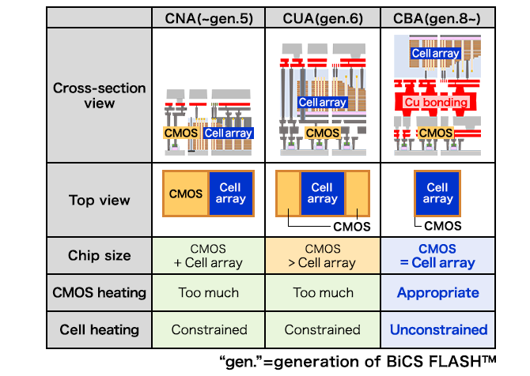
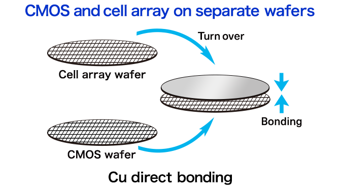
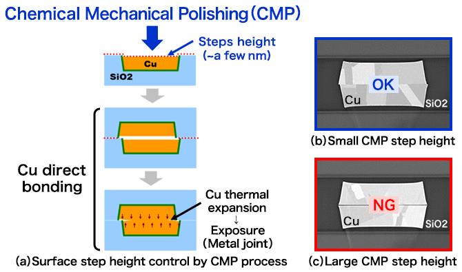
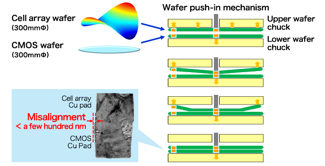

## Document Metadata

- Document ID: 812676bec6713595e64e5e7241b4301f3071913a
- Document Title: What is CMOS directly Bonded to Array (CBA) Technology? | KIOXIA - Japan (English)
- Document Type: HTML
- Issuing Organization: KIOXIA Corporation
- Publication Date: null
- Reporting Period: null
- Source File: [S2d9bcce1ad9a_kioxia.com_cba.html](https://github.com/jadennevercode/CJCC-Knowledge-Base/blob/564ab11aa9785e569e3853c8a4d7ce86f88e7535/materials/%E5%9F%BA%E7%A1%80%EF%BC%9A%E8%A1%8C%E4%B8%9A%E6%9C%AF%E8%AF%AD%E4%B8%8E%E6%8C%87%E6%A0%87/S2d9bcce1ad9a_kioxia.com_cba.html)

## Structured Content

# What is CMOS directly Bonded to Array (CBA) Technology?

3D flash memory is a semiconductor device indispensable for realizing various technologies that support modern society, such as the internet of things (IoT), artificial intelligence (AI), and big data. To enable these technologies, improvements in 3D flash memory performance—such as faster operation speeds and lower power consumption—are required. Furthermore, if these demands can be met at low cost and supplied worldwide affordably, 3D flash memory can be utilized in a wider range of fields. At KIOXIA, to meet these requirements, we have developed the CMOS directly Bonded to Array (CBA) technology and achieved mass production, which we will introduce here.

## What is CBA Technology?

3D flash memory has a structure in which memory cells, traditionally formed in a two-dimensional layout, are stacked vertically.

Table 1 shows a comparison of the generational structures of KIOXIA’s 3D flash memory BiCS FLASH™. The structure of 3D flash memory is broadly divided into the memory cell array region (hereafter “cell array”), which stores information, and the CMOS circuit region (hereafter “CMOS”), which operates the cell array. Up to BiCS FLASH™ generation 5 (hereafter referred to as “BiCS FLASH™ gen.”), the CMOS Next to Array (CNA) structure was adopted. In the CNA structure, CMOS is formed beside the cell array, so the chip size is approximately the sum of the CMOS and cell array sizes. Also, since the cell array is formed after CMOS, the CMOS is exposed to high-temperature heat during cell array formation. This high temperature degrades CMOS characteristics, so the heat during cell array formation had to be limited to the minimum temperature that maintains cell characteristics.

One way to reduce the cost of 3D flash memory is to reduce chip size to obtain more chips from a 300 mm wafer. Therefore, BiCS FLASH™ gen. 6 introduced the CMOS Under Array (CUA) structure, where CMOS is formed beneath the cell array. The CUA structure allows chip size reduction by forming the cell array continuously on top of CMOS on a single Si wafer. However, like CNA, the temperature during CMOS and cell array formation is limited, creating a trade-off between improving cell and CMOS performance, making it difficult to achieve both simultaneously.

The proposed solution is the CBA structure. In the CBA structure, CMOS and the cell array are formed on separate Si wafers, each with copper (Cu) bonding pads formed on their surfaces. Then, as shown in Fig.1, the Si wafers are bonded together using a Cu direct bonding process, electrically connecting CMOS and the cell array via the Cu bonding pads to form the 3D flash memory. As a result, by stacking CMOS and the cell array, chip size is reduced while allowing optimal thermal processes for both CMOS and the cell array, enabling performance improvements.

Table 1 Comparison of the generational structures of BiCS FLASH™

| | CNA (~gen.5) | CUA (gen.6) | CBA (gen.8~) |
| --- | --- | --- | --- |
| Chip size | CMOS + Cell array | CMOS > Cell array | CMOS = Cell array |
| CMOS heating | Too much | Too much | Appropriate |
| Cell heating | Constrained | Constrained | Unconstrained |

Cross-section view 和 Top view 的结构如原图。图中 “gen.” = generation of BiCS FLASH™。

图中标示：CMOS and cell array on separate wafers；Cell array wafer；CMOS wafer；Turn over；Bonding；Cu direct bonding。

Fig.1 CBA structure formation by Cu direct bonding process

Two key technologies enable the realization of the CBA structure.

First is the Cu bonding pad step height reduction technology. As mentioned, the CBA structure requires gapless bonding of both Cu bonding pads and SiO₂ interlayer films using the Cu direct bonding process. Therefore, as shown in Fig.2(a), the step height between the Cu bonding pads and SiO₂ interlayer films formed on the surfaces of the CMOS and cell array wafers must be suppressed to the nanometer level.

This extremely fine step height control is achieved by the chemical mechanical polishing (CMP) process. Polishing the surface of a 300 mm wafer by CMP to achieve a step height of a few nanometers is akin to controlling morphology with the precision of reducing a step to less than the thickness of a single sheet of copy paper inside the Tokyo Dome. After bonding the CMOS and cell array wafers with such nanometer-level surface step control face-to-face at the SiO₂ interlayer film surfaces, annealing causes thermal expansion of Cu, resulting in metallic bonding between Cu pads and enabling electrical connection. When the step height is small, as in Fig.2(b), the Cu pads on the upper and lower sides connect without gaps. Conversely, if the step height is large, as in Fig.2(c), gaps form between the Cu pads, preventing electrical connection. Since millions of Cu bonding pads connect CMOS and the cell array, the CBA structure requires extremely high CMP process control.

图中标示：Chemical Mechanical Polishing (CMP)；Steps height (~a few nm)；Cu direct bonding；Cu thermal expansion；Exposure (Metal joint)；(a) Surface step height control by CMP process；(b) Small CMP step height (OK)；(c) Large CMP step height (NG)；Cu；SiO₂。

Fig.2 Surface step height control process

The second key technology is the alignment technology between the upper and lower wafers in the Cu direct bonding process. Fig.3 shows the sequence of the Cu direct bonding process. In this process, the surfaces of the CMOS wafer and the cell array wafer are faced together and gradually brought closer from the center to the outer edge of the wafer. To electrically connect CMOS and the cell array from the center to the outermost edge of a 300 mm wafer, wafer positioning must be controlled within a few hundred nanometers or less. Furthermore, as shown in Table 1, the cell array wafer contains numerous memory cells and word lines, resulting in very large and complex stresses. Consequently, as shown in Fig.3, the cell array wafer exhibits a complex warp shape resembling a potato chip.

This warped cell array wafer is bonded to the nearly flat CMOS wafer with a positional deviation of only a few hundred nanometers or less. This precision is comparable to repeatedly landing a golf ball hit 200 yards within just a few millimeters of the pin. This demonstrates the extremely high process control of the Cu direct bonding process in the CBA structure.

图中标示：Cell array wafer (300mmΦ)；CMOS wafer (300mmΦ)；Wafer push-in mechanism；Upper wafer chuck；Lower wafer chuck；Cell array Cu pad；CMOS Cu Pad；Misalignment < a few hundred nm。

Fig.3 Cu direct bonding process and bonding position control
