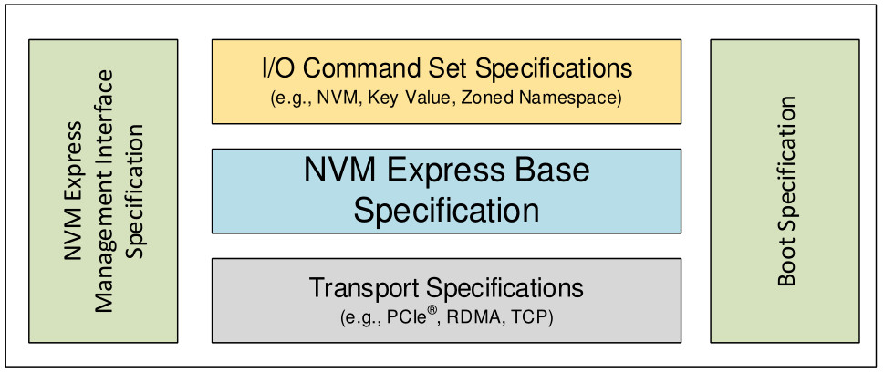

## Document Metadata

- Document ID: 93224888ce81cd033a68d2bfbed65150bf72ee65
- Document Title: NVM Express® Base Specification, Revision 2.1
- Document Type: PDF
- Issuing Organization: NVM Express, Inc.
- Publication Date: 2024-08-05
- Reporting Period: null
- Source File: [S485d5fc8c5ee_nvmexpress.org_NVM-Express-Base-Specification.pdf](https://github.com/jadennevercode/CJCC-Knowledge-Base/blob/564ab11aa9785e569e3853c8a4d7ce86f88e7535/materials/%E5%9F%BA%E7%A1%80%EF%BC%9A%E8%A1%8C%E4%B8%9A%E6%9C%AF%E8%AF%AD%E4%B8%8E%E6%8C%87%E6%A0%87/S485d5fc8c5ee_nvmexpress.org_NVM-Express-Base-Specification.pdf)

## Structured Content

[Source Page: 23]

# 1 Introduction

## 1.1 Overview

The NVM Express® (NVMe®) interface allows host software to communicate with a non-volatile memory subsystem (NVM subsystem). This interface is optimized for all storage solutions, attached using a variety of transports including PCI Express®, Ethernet, InfiniBandTM, and Fibre Channel. The mapping of extensions defined in this document to a specific NVMe Transport are defined in an NVMe Transport binding specification. The NVMe Transport binding specification for Fibre Channel is defined in INCITS 556 Fibre Channel – Non-Volatile Memory Express - 2 (FC-NVMe-2).

For an overview of changes from revision 2.0 to revision 2.1, refer to https://nvmexpress.org/changes for a document that describes the new features, including mandatory requirements for a controller to comply with revision 2.1.

### 1.1.1 NVM Express® Specification Family

Figure 1 shows the relationship of the NVM Express specifications to each other within the NVMe® family of specifications.

Figure 1: NVMe Family of Specifications

The NVM Express specification family structure shown in Figure 1 is intended to show the applicability of NVM Express specifications to each other, not a hierarchy, protocol stack, or system architecture.

The NVM Express Base Specification (i.e., this specification) defines a protocol for host software to communicate with an NVM subsystem over a variety of memory-based transports and message-based transports.

The NVM Express Management Interface (NVMe-MI) Specification defines an optional management interface for all NVM Express Subsystems.

NVM Express I/O Command Set specifications define data structures, features, log pages, commands, and status values that extend the NVM Express Base Specification.

NVM Express Transport specifications define the binding of the NVMe protocol including controller properties to a specific transport.

The NVM Express Boot Specification defines constructs and guidelines for booting from NVM Express interfaces.

[Source Page: 24]

## 1.2 Scope

This specification defines a set of properties and commands that comprise the interface required for communication with a controller in an NVM subsystem. These properties are to be implemented by an instance of a controller using a specific NVMe Transport. This specification also defines common aspects of the NVMe I/O Command Sets that may be supported by a controller.

There are three types of controllers with different capabilities (refer to section 3.1.3):

- a) I/O controllers;
- b) Discovery controllers; and
- c) Administrative controllers.

In this document the generic term controller is often used instead of enumerating specific controller types when applicable controller types may be determined from the context.

## 1.3 Outside of Scope

The property interface and command set are specified apart from any usage model for the NVM, but rather only specifies the communication interface to the NVM subsystem. Thus, this specification does not specify whether the NVM subsystem is used as a solid-state drive, a main memory, a cache memory, a backup memory, a redundant memory, etc. Specific usage models are outside the scope, optional, and not licensed.

This specification defines requirements and behaviors that are implementation agnostic. The implementation of these requirements and behaviors are outside the scope of this specification. For example, an NVM subsystem that follows this specification may be implemented by an SSD that attaches directly to a fabric, a device that translates between a fabric and a PCIe NVMe SSD, or software running on a general-purpose server.

This interface is specified above any non-volatile media management, like wear leveling. Erases and other management tasks for NVM technologies like NAND are abstracted.

This specification does not contain any information on caching algorithms or techniques.

The implementation or use of other published specifications referred to in this specification, even if required for compliance with the specification, are outside the scope of this specification (e.g., PCI, PCI Express, and PCI-X). This includes published specifications for fabrics and other technologies referred to by this document or any NVMe Transport binding specification.

[Source Page: 25]

#### 1.4.1.7 shall

A keyword indicating a mandatory requirement. Designers are required to implement all such mandatory requirements to ensure interoperability with other products that conform to the specification.

[Source Page: 43]

## 2.2 Message-Based Transport Model (Fabrics)

The message-based transport model used for NVMe over Fabrics has the following differences from the memory-based transport model:

- There is a one-to-one mapping between I/O Submission Queues and I/O Completion Queues. NVMe over Fabrics does not support multiple I/O Submission Queues being mapped to a single I/O Completion Queue;
- NVMe over Fabrics does not define an interrupt mechanism that allows a controller to generate a host interrupt. It is the responsibility of the host fabric interface (e.g., Host Bus Adapter) to generate host interrupts;
- NVMe over Fabrics uses different mechanisms for I/O Submission Queue and I/O Completion Queue creation and deletion (refer to section 3.5);
- NVMe over Fabrics does not support transferring metadata from a separate buffer (e.g., does not support the Metadata Pointer field, refer to Figure 92);
- NVMe over Fabrics does not support PRPs but requires use of SGLs for Admin, I/O, and Fabrics commands. This differs from the memory-based transport model where SGLs are not supported for Admin commands and are optional for I/O commands;
- NVMe over Fabrics does not support Completion Queue flow control (refer to section 3.3.1.2.1). This requires that the host ensures there are available Completion Queue slots before submitting new commands; and
- NVMe over Fabrics allows Submission Queue flow control to be disabled if the host and controller agree to disable Submission Queue flow control. If Submission Queue flow control is disabled, the host is required to ensure that there are available Submission Queue slots before submitting new commands.

[Source Page: 52]

### 2.3.2 I/O Command Sets

I/O commands perform operations on namespaces, and each namespace is associated with exactly one I/O command set. For example, commands in the NVM Command Set access data represented in a namespace as logical blocks, and commands in the Key Value Command Set access data represented in a namespace as key-value pairs.

The association of a namespace to an I/O command set is specified when the namespace is created and is fixed for the lifetime of that namespace.

A controller may support one or more I/O command sets. Namespaces that are associated with the I/O command sets that are supported and enabled on a controller may be attached to that controller. A host issues commands to a namespace and those commands are interpreted based on the I/O command set associated with that namespace.

[Source Page: 54]

### 2.4.1 Multi-Path I/O and Namespace Sharing

This section provides an overview of multi-path I/O and namespace sharing. Multi-path I/O refers to two or more completely independent paths between a single host and a namespace while namespace sharing refers to the ability for two or more hosts to access a common shared namespace using different NVM Express controllers. Both multi-path I/O and namespace sharing require that the NVM subsystem contain two or more controllers. NVM subsystems that support Multi-Path I/O and Namespace Sharing may also support asymmetric controller behavior (refer to section 2.4.2). Concurrent access to a shared namespace by two or more hosts requires some form of coordination between hosts. The procedure used to coordinate these hosts is outside the scope of this specification.

[Source Page: 407]

## 5.1.25.1.14 Host Behavior Support (Feature Identifier 16h)
This Feature enables use of controller functionality that is associated with and depends upon specific host behavior that may or may not be supported by all hosts. A controller does not use such functionality unless the host has indicated that the host supports the specific host behavior upon which the functionality depends. The host indicates that support to the controller by setting a field in this Feature. That host action enables controller use of the associated functionality with that host. A controller shall not use functionality with a host that has not indicated support for the associated specific host behavior upon which that controller functionality depends. The attributes in Figure 407 are transferred in the data buffer.
For example, the Command Interrupted status code is associated with and depends upon the specific host behavior that the host is expected to retry commands that are aborted with that status code. That command retry behavior may or may not be supported by all hosts (e.g., hosts compliant with versions 1.3 and earlier of the NVM Express Base Specification are unlikely to retry commands aborted with the Command Interrupted status code as that status code was introduced after NVM Express Base Specification, Revision 1.3). A host that supports that command retry behavior indicates its support to the controller by setting a field to 1h in the Host Behavior Support Feature.Setting that field to 1h enables controller use of the Command Interrupted status code, with the result that this status code is used only with hosts that have indicated support for the associated command retry behavior.

[Source Page: 505]
## Boot Partitions

Boot Partitions provide an optional area of NVM storage that may be read by the host without the host initializing queues or enabling the controller. The simplified interface to access Boot Partitions may be used for platform initialization code (e.g., a bootloader that is executed from host ROM) to boot to a pre-OS environment (e.g., UEFI) instead of storing the image on another non-volatile storage medium (e.g., SPI flash). Refer to section 8.1.3.1 for the procedure to read the contents of a Boot Partition.

[Source Page: 514]
## Fixed Capacity Management

A Media Unit represents a component of the underlying media in a domain. An implementation may choose to represent each die as a separate Media Unit; however, this is not required. A Media Unit is the smallest media component for which the controller reports wear information (refer to the Available Spare field and the Percentage Used field in the Media Unit Status Descriptor, Figure 255).
Two or more I/O operations to a Media Unit at the same time may interfere with each other as they contend for resources internal to or shared by that Media Unit.

Media Units are accessed by way of Channels that represent communication pathways that may be a source of contention. This information is reported to facilitate the composition of NVM Sets that minimize interference between independent writers competing for this type of resource.

[Source Page: 538]
## Flexible Data Placement

#

[Source Page: 544]
## Host Managed Live Migration

The migration of a controller, by a host that is using the Host Managed Live Migration capability involves one or more NVM subsystems, multiple hosts, and multiple controllers. In this section, to differentiate between the multiple hosts and controllers, each is given a unique name as illustrated in Figure 619. In an NVM subsystem that supports Host Managed Live Migration, each controller that sets the HMLMS bit to '1' is referred to as a Migration Management Controller (MMC) and each host associated with an MMC is referred to as a Migration Management Host (MMH). In that same NVM subsystem, all other controllers (i.e., those that clear the HMLMS bit to '0') are referred to as Migratable Controllers.
The Host Managed Live Migration capability allows an MMH to use an MMC to migrate a Migratable Controller from a Source NVM Subsystem to a Migratable Controller in a Destination NVM Subsystem. During that migration, a host is actively submitting commands to a Migratable Controller in the Source NVM Subsystem and that controller is processing those commands.
The MMH that is managing the migration of a Migratable Controller from the Source NVM Subsystem is responsible for ensuring that the Migratable Controller in the Destination NVM Subsystem is compatible with controller state of the Migratable Controller from the Source NVM Subsystem. It is also the responsibility of the MMH to transfer the migrating data between the NVM subsystems.

[Source Page: 545]
A controller indicates support for the Host Managed Live Migration capability by setting the Host Managed Live Migration Support (HMLMS) bit to '1' in the Optional Admin Command Support (OACS) field in the Identify Controller data structure (refer to Figure 312).
An MMC is not permitted to be migrated and:

- shall support:
  - the Migration Send command with the Management Operations:
    - Suspend (i.e., 0h);
    - Resume (i.e., 1h); and
    - Set Controller State (i.e., 2h);
  - the Migration Receive command with the Management Operations:
    - Controller State (i.e., 1h); and
  - the CNS value of 21h in the Identify command (i.e., Supported Controller State Formats data structure (refer to section 5.1.13.2.21)).

If the NVM subsystem contains one or more Migration Management Controllers, then:

- each controller (i.e., MMC and Migratable Controller) in that NVM subsystem does not support the Host Memory Buffer (refer to the Host Memory Buffer Preferred Size (HMPRE) field in the Identify Controller data structure in Figure 312); and
- each Migratable Controller in that NVM subsystem is allowed to be migrated and shall not support:
  - the Migration Send command (refer to section 5.1.17);
  - the Migration Receive command (refer to section 5.1.16);
  - the CNS value of 21h in the Identify command (i.e., returning Supported Controller State Formats data structure (refer to section 5.1.13.2.21)); and
  - the Controller Data Queue command with the Create Queue management operation specifying the User Data Migration Queue (refer to section 5.1.4.1.1).

[Source Page: 559]
## Host Controlled Thermal Management

A controller may support host controlled thermal management (HCTM), as indicated in the Host Controlled Thermal Management Attributes of the Identify Controller data structure in Figure 312. Host controlled thermal management provides a mechanism for the host to configure a controller to automatically transition between active power states or perform vendor specific thermal management actions in order to attempt to meet thermal management requirements specified by the host. If active power states transitions are used to attempt to meet these thermal management requirements specified by the host, then those active power states transitions are vendor specific.

[Source Page: 560]
The host specifies and enables the thermal management requirements by setting the Thermal Management Temperature 1 field and/or Thermal Management Temperature 2 field (refer to section 5.1.25.1.9) in a Set Features command to a non-zero value. The supported range of values for the Thermal Management Temperature 1 field and Thermal Management Temperature 2 field are indicated in the Identify Controller data structure in Figure 312.
The Thermal Management Temperature 1 specifies that if the Composite Temperature (refer to Figure 207) is:
a) greater than or equal to this value; and
b) less than the Thermal Management Temperature 2, if non-zero,
then the controller should start transitioning to lower power active power states or perform vendor specific thermal management actions while minimizing the impact on performance in order to attempt to reduce the Composite Temperature (e.g., transition to an active power state that performs light throttling).
The Thermal Management Temperature 2 field specifies that if the Composite Temperature is greater than or equal to this value, then the controller shall start transitioning to lower power active power states or perform vendor specific thermal management actions regardless of the impact on performance in order to attempt to reduce the Composite Temperature (e.g., transition to an active power state that performs heavy throttling).
If the controller is currently in a lower power active power state or performing vendor specific thermal management actions because of this feature (e.g., throttling performance) because the Composite Temperature is:
a) greater than or equal to the current value of the Thermal Management Temperature 1 field; and
b) less than the current value of the Thermal Management Temperature 2 field,
and the Composite Temperature decreases to a value below the current value of the Thermal Management Temperature 1 field, then the controller should return to the active power state that the controller was in prior to going to a lower power active power state or stop performing vendor specific thermal management actions because of this feature, the Composite Temperature and the current value of the Thermal Management Temperature 1 field.
If the controller is currently in a lower power active power state or performing vendor specific thermal management actions because the Composite Temperature is greater than or equal to the current value of the Thermal Management Temperature 2 field and the Composite Temperature decreases to a value less than the current value of the Thermal Management Temperature 1 field, then the controller should return to the active power state that the controller was in prior to going to a lower power active power state or stop performing vendor specific thermal management actions because of this feature, and the Composite Temperature.
The temperature at which the controller stops being in a lower power active power state or performing vendor specific thermal management actions because of this feature is vendor specific (i.e., hysteresis is vendor specific).

[Source Page: 561]
Note: Since the host controlled thermal management (HCTM) feature uses the Composite Temperature, the actual interactions between a platform (e.g., tablet, or laptop) and two different device implementations may vary even with the same Thermal Management Temperature 1 and Thermal Management Temperature 2 temperature settings. The use of this feature requires validation between those devices' implementations and the platform in order to be used effectively.

[Source Page: 592]
The Overwrite sanitize operation is media specific and may not be appropriate for all media types. For example, if the media is NAND, multiple pass overwrite operations may have an adverse effect on media endurance.

[Source Page: 608]
### 8.1.28 Universally Unique Identifiers (UUIDs) for Vendor Specific Information

#### 8.1.28.1 UUIDs for Vendor Specific Information Introduction

Several commands send or receive information that contains fields described as Vendor Specific or that is specified by a command field containing a value in a vendor specific range. Examples include the Set Features command, which may specify a vendor specific feature identifier, and the Identify command, which may retrieve a data structure having a vendor specific area. 

The vendor specific information may have different definitions (e.g., a vendor specific log page identifier with the contents of the page defined differently by different entities, such as an NVM subsystem vendor and an NVM subsystem customer). By associating each definition of the information with a UUID specified by the defining entity, a command is able to specify the particular definition of the information. 

A command specifies a particular definition of the information by specifying an index into a list of UUIDs supported by the controller (refer to section 5.1.13.2.14). The NVMe Invalid UUID (refer to section 8.1.28.2) is used to replace a previously valid UUID in the UUID List (refer to Figure 320). This is done to keep the values in the list at a static index, as that index is used by the Host to access the UUID List contents. 

NVM subsystem vendors and customers communicate (by means outside the scope of this specification) the UUID used for each definition of the information.

[Source Page: 609]
If a firmware image is activated that has a UUID List in which an entry is different from that of the previously-active firmware image, then a host that is unaware of the change may issue a command with the UUID index value for that entry. Such a command may produce unexpected results because the UUID specified by that UUID Index has changed. To avoid this, vendors should follow the following revision guidelines for UUID lists when constructing firmware images that support UUID selection:

a) Add UUIDs that are not supported in prior firmware image revisions to the end of the UUID List in subsequent firmware image revisions;

b) Remove UUIDs that are supported in prior firmware image revisions by replacing the UUID with the NVMe Invalid UUID in the same entry in the UUID list in subsequent firmware image revisions;

c) Do not replace the NVMe Invalid UUID with a valid UUID in the same UUID list entry in subsequent firmware image revisions; and

d) Do not shorten or remove the UUID list in subsequent firmware image revisions. 

In these guidelines, the terms “prior” and “subsequent” refer to a linear sequence of firmware versions (e.g., based on the date and time of the construction of the downloadable firmware image). 

Following these guidelines prevents the host from inadvertently specifying the wrong UUID because there is at most one valid UUID for each entry in the UUID list. Hence a command that specifies a UUID Index either specifies the intended UUID or is aborted because that entry in the UUID list is empty or contains the NVMe Invalid UUID. 

The controller shall require a reset to activate a downloaded firmware image (refer to section 5.1.8) if the downloaded image reports a UUID list with at least one slot in which a valid UUID replaces the NVMe Invalid UUID or a different valid UUID in the existing image. All controllers that are affected by the UUID list change caused by activation of a downloaded firmware image shall be reset as part of activating that downloaded firmware image.

[Source Page: 613]
### 8.2.3 Host Memory Buffer

The Host Memory Buffer (HMB) feature allows the controller to utilize an assigned portion of host memory exclusively. The use of the host memory resources is vendor specific. Host software may not be able to provide any or a limited amount of the host memory resources requested by the controller. The controller shall function properly without host memory resources. Refer to section 5.1.25.2.4. 

The controller may indicate limitations for the minimum usable descriptor entry size and the maximum number of descriptor entries (refer to the HMMINDS and HMMAXD fields in the Identify Controller data structure, Figure 312). If the host does not create the Host Memory Buffer within the indicated limits, then the host memory allocated for use by the controller may not be fully utilized (e.g., descriptor entries beyond the maximum number of entries indicated may be ignored by the controller).

[Source Page: 696]
## Annex A. Sanitize Operation Considerations (Informative)

 

## A.1 Overview

 

The Sanitize command starts a sanitize operation that makes all user data previously written to the sanitization target inaccessible (i.e., all user data has been purged, as defined in IEEE Std 2883-2022). It is very difficult to prove that the sanitize operation successfully purged all user data. This annex provides some context and considerations for understanding the result of the operation and the practical limitations for auditing the result of the sanitize operation. 

## A.2 Hidden Storage (Overprovisioning)

 

Sanitize operations purge all physical storage in the sanitization target that is able to hold user data. Many NVMe SSDs contain more physical storage than is addressable through the interface (e.g., overprovisioning). That physical storage is used for vendor specific purposes which may include providing increasing endurance, improving performance, and providing extra capacity to allow retiring bad or worn-out storage without affecting capacity. This excess capacity as well as any retired storage are not accessible through the interface. Vendor specific innovative use of this extra capacity supports advantages to the end user, but the lack of observability makes it difficult to ensure that all storage within the sanitization target was correctly purged. Only the accessible storage is able to be audited for the results of a sanitization operation.
