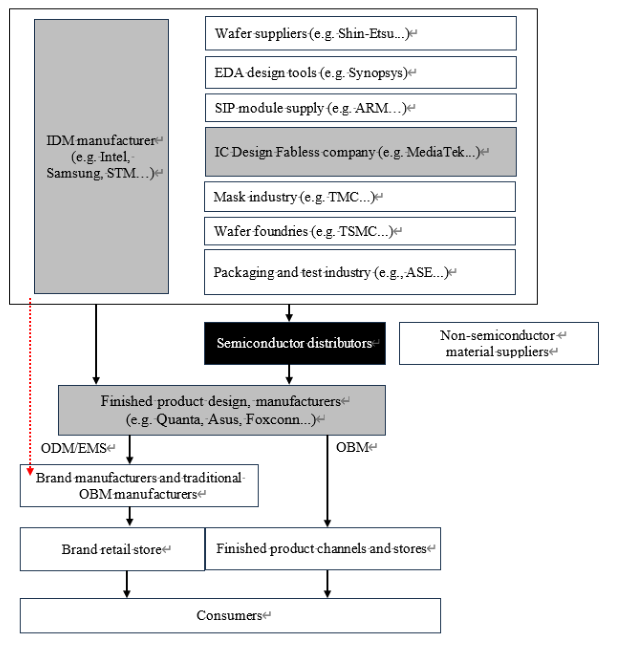
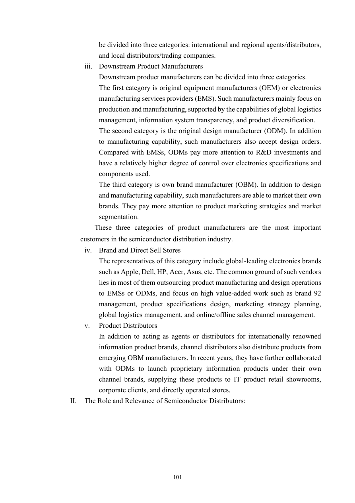
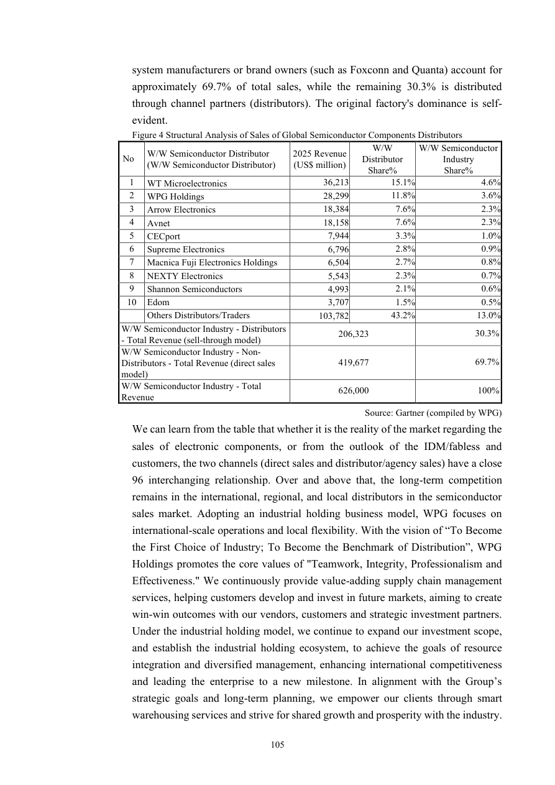

## Document Metadata

- Document ID: 1e13dbff6a811445c60344f63469b69ec67d6128
- Document Title: WPG Holdings Limited 2025 Annual Report
- Document Type: PDF
- Issuing Organization: WPG Holdings Limited
- Publication Date: null
- Reporting Period: 2025
- Source File: [43_wpgholdings.com_ARP00000038.pdf](https://github.com/jadennevercode/CJCC-Knowledge-Base/blob/564ab11aa9785e569e3853c8a4d7ce86f88e7535/materials/%E6%B5%81%E9%80%9A%EF%BC%9A%E6%B8%A0%E9%81%93%E4%B8%8E%E4%BA%A4%E6%98%93%E5%85%B3%E7%B3%BB/43_wpgholdings.com_ARP00000038.pdf)

## Structured Content

# WPG Holdings Limited 2025 Annual Report

[Source Page: 5]

In the semiconductor components distribution segment, the Company’s Board of Directors approved a group restructuring plan in November. Through a share exchange, the Company successfully integrated the two major groups, "WPI" and "SAC," under the umbrella of AIT Group, thereby formally establishing a “dual parallel core engine” structure led by the two major business groups, "WPI" and "AIT." The “four-into-two” consolidation plan is designed to integrate and further strengthen strategic partnerships with leading global manufacturers while expanding the Company’s global footprint. At the same time, the Company aims to optimize resource allocation and organizational efficiency, enhance per capita productivity, and leverage increased scale to strengthen the Company’s financial structure, thereby building an efficient and resilient growth engine.

In the development of the intelligent logistics (LaaS) business, the Company officially initiated an equity integration of its smart warehousing operations in 2025. Warehousing units previously managed by different regional subsidiaries were consolidated and rebranded as “LaaS Limited," which now serves as the Group’s "flagship company for smart warehousing and supply chain services." Through a capital increase, its paid-in capital was significantly expanded to NT$1.51 billion, enabling cross-regional resource sharing. In 2025, the total gross merchandise value (GMV) of electronic components handled by LaaS Limited reached $32.8 billion, representing a substantial year-on-year growth of 29%. The company was also awarded the Authorized Economic Operator (AEO) certification, underscoring WPG’s establishment of

[Source Page: 6]

a strong competitive moat in supply chain security and operational efficiency. Furthermore, to extend the scope of its ICT supply chain services, the Company resolved at a Board meeting in February 2025 to acquire, on a cumulative basis, a 48.49% equity stake in Fortune Information Systems Corp., a professional provider of information integration services. Fortune specializes in enterprise cloud architecture, cybersecurity, and logistics warehouse management systems. It delivered outstanding operating performance in 2025, with consolidated revenue reaching NT$2.6 billion, representing a 20% increase compared to the previous year.

[Source Page: 7]

- Risk management in operation: The Company will deepen operational risk management across three levels—holding company, sub-groups, and logistics operations—to ensure business resilience. Key focuses areas include implementing cross-border cloud backup systems and conducting Business Continuity Plan (BCP) drills, as well as strengthening emergency response capabilities in light of geopolitical risks and natural disasters. In addition, the Company will advance trade compliance management by steadily expanding the implementation and control of Statements of Assurance (SOA) signed by all customers, while promoting paperless electronic signature processes to support ESG policies. From legal and information security perspectives, the Company will further enhance its personal data privacy protection framework and establish an AI-driven credit management platform to reduce overdue receivables risk and improve operational efficiency.

- Smart logistics management: In response to customer factory relocations and heightened ESG awareness, the Company continues to deepen its B2B2P business model. The Company's LaaS operations integrate vertically through a centralized model (B2B2P

[Source Page: 8]

stable services) and horizontally through a decentralized approach (In-Plant BBP), driving automated processes and intelligent scheduling. The Company actively promotes ESG principles by adopting multimodal transportation and reusable logistics containers to reduce carbon footprint. The Company is also preparing to apply for RBA (Responsible Business Alliance) certification, aiming to strengthen management mechanisms according to international standards and to encourage partners to collectively advance toward high-standard sustainable development.

[Source Page: 64]

Climate-Related Information of TWSE/TPEx Listed Company Implementation of Climate-Related Information

| Item | Implementation Status |
| --- | --- |
| 2. Describe how the identified climate risks and opportunities affect the business, strategy, and finances of the business (short, medium, and long term). | The Company has identified five climate risks and five climate opportunities through internal discussion and assessment of climate-related issues, with reference to the Recommendations of the Task Force on Climate-related Financial Disclosures (TCFD) issued by the Task Force on Climate-related Financial Disclosures Financial Stability Board (FSB) of the United Nations. The impact period is divided into short-term (1 to 3 years), medium-term (3 to 10 years), and long-term (more than 10 years). The identification results were as follows: |

I. Climate Risks

| Risk Type | Item | Risk Factor | Potential Financial Impact | Impact Period |
| --- | --- | --- | --- | --- |
| Transition Risk | Policies and Regulation | Commodity transportation carbon emissions cost transfer | The introduction of a carbon tax or carbon charge by the government will lead to an increase in operating costs and the transfer of logistics distribution costs | Medium term |
| Transition Risk | Market | Energy transition, leads to increased electricity prices | Increased operating costs | Medium term |
| Physical Risk | Immediacy | Flooding disaster | Natural disasters will damage storage equipment, damp goods, interrupt information network system services or cause casualties, resulting in supply chain disruption and suspension of operations | Short term |
| Physical Risk | Long term | Rising global average temperature | To maintain office temperature, the demand for air-conditioning operation has increased, resulting in an increase in related operating costs such as electricity charges | Medium term |
| Physical Risk | Long term | Sea level rising | Inundation of the operating locations will results in financial losses | Long term |

[Source Page: 65]

II. Climate Opportunities

| Type | Opportunity Factor | Potential Financial Impact | Impact Period |
| --- | --- | --- | --- |
| Products and Services | Develop and increase low-carbon goods and services | The demand for electronic components for non-toxic, harmless substances and low-carbon products will continue to increase, and we will actively develop relevant solutions with customers through application engineers (FAE) to create business opportunities | Medium term |
| Market | Enter new markets | Carbon reduction policies in various countries will drive the demand for electronic components and business opportunities continuously increase, stepping into low-carbon/green markets such as green electricity or vehicle electricity, creating business opportunities | Long term |

[Source Page: 66]

| Item | Implementation Status |
| --- | --- |
| 4. Describe how climate risk identification, assessment, and management processes are integrated into the overall risk management system. | The Company's climate change risk management process has been integrated into the general risk management, and six major risks are defined through risk identification, including environmental risks (natural disasters resulting in suspension of operations, etc.), and emergency response procedures for disruption of operations are in place; The climate risk management process is divided into three major steps, namely "Identify and Assess", "Monitor and Respond" and "Report". |
| 5. If scenario analysis is used to assess resilience to climate change risks, the scenarios, parameters, assumptions, analysis factors and major financial impacts used should be described. | To understand the potential impacts of various future climate pathways, the Company conducts climate change scenario analysis to assess the risks arising under different assumptions. This includes evaluating two physical risks—flood hazards and rising global average temperatures— as well as one transition risk, namely the pass-through of carbon emission costs in goods transportation. Based on the impacts identified under each scenario, the Company formulates appropriate response strategies to mitigate the potential effects of climate-related risks. The risk scenarios adopted, analytical factors, and assessment results are disclosed in the table below: |

| Risk Scenario | Analysis Factor | Climate Environment | Assessment Results |
| --- | --- | --- | --- |
| Flooding disaster | Hazard, vulnerability | The Company adopts flood risk map data published by the National Science and Technology Center for Disaster Reduction (NCDR) Climate Change Disaster Risk Adaptation Platform, and conducts simulations under the SSP1-2.6 and SSP5-8.5 scenarios | SSP5-8.5 scenario: One office site and one warehouse are identified as high-risk. The office is located on higher floors, and assessments indicate limited impact on equipment and operations. The warehouse has established emergency response procedures for business interruption, with regular risk monitoring and the implementation of corresponding mitigation strategies. |

[Source Page: 67]

| Risk Scenario | Analysis Factor | Climate Environment | Assessment Results |
| --- | --- | --- | --- |
| Rising global average temperature | Air-conditioning energy cost | Warming trend of Networking for Greening the Financial System (NGFS) simulation (RCP 2.6, RCP 4.5, RCP 6.0, RCP 8.5) | The impact of financial shock amount in each scenario is low |
| Commodity transportation carbon emissions cost transfer | Transportation cost | Scenario analysis has been conducted under the NGFS framework, covering the STEPS, APS, and NZE 2050 scenarios | In the scenario of net-zero emissions scenarios by 2050, the total cost of passing on carbon emissions will exceed NT$427 million |

[Source Page: 68]

| Item | Implementation Status |
| --- | --- |
| 7. If internal carbon pricing is used as a planning tool, the basis for setting the price should be stated. | To fulfill its commitment to achieving net-zero emissions by 2050 in line with its decarbonization pathway, WPG Holdings implemented an internal carbon pricing mechanism in 2025. The Company adopts a “Shadow price” approach, integrating it into its operational decision-making processes. Through this internal carbon pricing mechanism, it supports the evaluation of decarbonization projects and investment decisions, thereby driving the Group’s overall low-carbon transformation. The carbon price is primarily determined based on the “unit cost of carbon reduction” derived from the Company’s internally executed carbon reduction projects. In addition, reference is made to domestic and international carbon pricing trends and policy recommendations, including the suggested carbon price range under the WB2C decarbonization scenario in the World Bank’s State and Trends of Carbon Pricing 2024 report, the carbon pricing recommendations for high-income countries under the International Carbon Price Floor (ICPF) proposed by the International Monetary Fund (IMF) in 2021, as well as Taiwan’s carbon fee rates set by the Ministry of Environment and the 2025 market prices of the EU Emissions Trading System (EU ETS). Following a comprehensive evaluation, the internal carbon price was approved by the Sustainability Committee and reported to the Board of Directors, and set at NT$2,500 per ton of CO₂e. The Nangang headquarters and Linkou warehouse have been designated as the initial implementation sites. The primary application of internal carbon pricing is in the cost-benefit analysis of decarbonization projects and investments, serving as a key decision-making indicator. By incorporating climate impact considerations into decision-making, the mechanism helps prioritize projects for implementation. It also reflects the implicit benefits of emissions reduction, guiding resource allocation toward low-carbon initiatives. Going forward, the Company will continue to regularly review its decarbonization performance and dynamically adjust the internal carbon pricing mechanism and price level. The Company also plans to introduce an internal carbon fee mechanism and gradually expand the scope of implementation to further strengthen the promotion of decarbonization actions. |

[Source Page: 97]

II. Sales Percentage (2025)

| Product Name | Sales Percentage |
| --- | --- |
| Core components | 37.45% |
| Analog IC and mixed-signal IC | 8.43% |
| Discrete logic IC | 8.72% |
| Memory components | 27.68% |
| Optical components | 7.74% |
| Passive components, electromagnetic | 7.69% |
| Other components | 2.29% |
| Total | 100.00% |

III. Current Products/Services

i. Franchised Semiconductor Brands WPG Group is the authorized distributor of more than 250 semiconductor brands, including Airoha, AMD, Amphenol, ams OSRAM, AOS, Awinic, Broadcom, Cree LED, Diodes, Elan, Everlight, FORESEE, Infineon, Intel, Kingston, Kioxia”, Liteon, Littelfuse, MaxLinear, MediaTek”, Micron, Molex, MPS, MXIC, Nanya, Nexperia, Novatek, Nuvoton, NXP, OmniVision, onsemi, Phison, Pixart, Qualcomm, Realtek, Richtek, Richwave, Robert Bosch, Rockchip, Samsung Electronics, Samsung SEMCO, SemiDrice, Synaptics Semtech, SGMicro, Silergy, SiTime, STMicro, Toshiba, UPI, Vanchip, Vishay, Winbond, Zilltek.

[Source Page: 98]

4.1.2 Industry Overview 1. Current State and Future Development of the Industry In April 2025, U.S. President Donald Trump intensified semiconductor restrictions on China and imposed additional cumulative import tariffs. These measures are reshaping semiconductor procurement policies across the electronics supply chain. In particular, electronic products exported to the United States are increasingly shifting toward the use of non-China-origin semiconductors. The electronics supply chain may respond to the U.S.–China trade tensions by adjusting production allocations across different locations or reconsidering the establishment of manufacturing facilities in the United States to better address both U.S. and non-U.S. market demands. This development is expected to trigger order reallocation effects within the semiconductor industry, benefiting non-China semiconductor supply chains amid geopolitical dynamics, particularly the U.S.– China technology rivalry. President Trump’s “Make America Great Again (MAGA)” initiative to promote the reshoring of manufacturing is likely to remain a key source of uncertainty for the global semiconductor supply chain and the foundry industry over the next five years. Policies related to restrictions on chip design or manufacturing, as well as efforts to strengthen domestic semiconductor production capabilities, will continue to influence the competitive landscape and strategic positioning of global semiconductor foundries.

[Source Page: 99]

Generative AI driven by large language models (LLMs) gained rapid momentum in the first half of 2024. The evolution from large language models (LLMs) to small language models (SLMs), from cloud computing to edge computing, and from training to inference workloads has outpaced the computing capacity of general-purpose data center servers. Major cloud service providers in North America have significantly increased investment in AI server infrastructure, driving strong demand for expanded data center computing capacity. This trend has created substantial opportunities for high-performance computing (HPC) chips, including those incorporating GPUs, HBM, FPGAs, ASICs, HPCs, SSDs, and other high-bandwidth memory technologies. Generative AI and HPC have become the primary growth drivers of the semiconductor market, not only directly boosting demand for advanced chips but also fundamentally reshaping the industry’s technology roadmap and value chain.

According to the latest forecast by Gartner, Inc., the global semiconductor market is expected to continue its growth trajectory in 2025, driven by cloud service providers expanding generative AI data center computing infrastructure, following the momentum seen in 2024. The total semiconductor market size is projected to reach $793 billion, representing a 21.0% increase from $656 billion in 2024. In 2026, demand from large cloud operators in North America and China, as well as national AI sovereign infrastructure initiatives, is expected to continue rising, primarily driven by AI servers (including those equipped with GPUs, FPGAs, ASICs, and other AI semiconductors), high-performance computing (HPC), AI edge computing, high-bandwidth memory (HBM), high-speed networking, and power-related components. The global semiconductor market is expected to maintain double-digit growth for four consecutive years from 2024 to 2027. Total market size in 2026 is projected to exceed USD 1 trillion, reaching approximately $1.052 trillion, a 21.0% increase year-over-year. Within this, AI semiconductors are expected to account for 27.4% of the market with a 42.3% YoY growth rate; memory is expected to account for 34.5% with a 74.6% YoY growth rate; and other semiconductors are expected to account for 37.8% with a 4.5% YoY growth rate. The global semiconductor revenue CAGR for 2024–2029 is forecast at 15.0%, as illustrated in Figure 1:

Figure 1. Estimated Revenue of Global Semiconductor from 2024 to 2029　(2024-2029) CAGR: 15.0%

| Year | 2024 | 2025 | 2026(F) | 2027(F) | 2028(F) | 2029(F) |
| --- | --- | --- | --- | --- | --- | --- |
| Revenue (Unit: US$ billion) | 656.0 | 793.0 | 1,052.0 | 1,185.0 | 1,188.0 | 1,320.0 |
| Year-on-year | 21.0% | 21.0% | 32.6% | 12.6% | 0.3% | 11.1% |

Source: Gartner March. 2025

2. Main Application Markets and Development Trends As AI demand continues to rise, supply constraints in advanced process semiconductors (HPC) and advanced packaging (CoWoS) are becoming increasingly evident. In particular, memory products such as HBM, DRAM, and NAND Flash have experienced significant price increases. While AI-related application ecosystems continue to perform strongly, demand in other end markets is expected to face a crowding-out effect. The following analysis provides demand outlooks for four major application markets—notebook, smartphones, servers, and automotive/EV: (Data from DigiTimes)

[Source Page: 100]

### Server

With the emergence of large language models (LLMs) such as ChatGPT, AI servers powered by AI chips from NVIDIA, AMD, and ASIC-based solutions have become a key growth driver. These include NVIDIA’s AI GPU Hopper platform, AMD’s MI300/325X AI GPUs, Google TPU, as well as HBM, FPGA, and ASIC-based architectures. Driven primarily by North American cloud service providers, DigiTimes forecasts global server shipments to reach 15.63 million units in 2025, representing a 5.0% year-over-year increase. Among these, AI server shipments are expected to reach approximately 1.79 million units, increasing by 24.8% compared with 2024. The penetration rate of AI servers within total server shipments is projected to rise from 9.6% in 2024 to 11.4% in 2025, surpassing the 10% threshold and reflecting rapidly growing demand for AI computing workloads.

As global IC and component supply gradually normalizes and next-generation GPUs from NVIDIA and AMD enter mass production, along with ASICs developed by North American cloud service providers, server shipments in 2026 are projected to reach 16.06 million units, a 2.7% year-over-year increase. AI server shipments are expected to reach approximately 2.10 million units, growing 17% year-over-year, with penetration further increasing to 13.0%.

[Source Page: 101]

1. Demand side: The second term of U.S. President Donald Trump and the implementation of reciprocal tariffs in April 2025 have increased global trade barriers, which may suppress economic growth over the next two years. While public cloud market penetration will continue to rise, its pace is expected to moderate. The maturation of generative AI development tools and applications will continue to stimulate demand from hyperscale cloud providers and enterprises, driving strong AI server shipment growth. Capital expenditure growth among major North American cloud providers peaked in 2024 and is expected to gradually decline in subsequent years. However, inference applications will continue to support growth in AI-related ASIC semiconductors.

2. Supply side: Industry resources remain heavily concentrated on AI and GPU development, which has slowed CPU platform advancement. The next major wave of platform technology upgrades is not expected until 2027. The increasing demand for generative AI and HPC is driving higher rack computing density and power consumption, making efficient thermal management across server system architectures a critical technological focus over the next five years.

Smart Phone In 2025, demand for smartphones is expected to slow down. The integration of AI edge applications into end devices remains a key driver of replacement demand. As the smartphone market approaches maturity, the consumer replacement cycle is expected to extend to approximately 4–5 years. Supply chain restructuring, cost pressures, and geopolitical factors have become key variables. The trend toward diversified manufacturing bases is becoming increasingly evident, with “Made in India” emerging as a significant production hub. Both supply and demand sides are under pressure, affecting end-user pricing and overall market demand. According to DigiTimes, global smartphone shipments are projected to reach 1.22 billion units in 2025, representing a modest 2.7% increase year-over-year. Among these, 5G smartphones are expected to account for 880 million units, representing 72% of total shipments and growing 18.4% year-over-year. AI smartphones are projected to reach 449 million units, accounting for 37% of total shipments and increasing by 104.7% year-over-year compared with 2024.

Looking ahead to 2026, global smartphone shipments are expected to reach 1.23 billion units, a slight increase of 0.3% year-over-year. 5G smartphone shipments are forecast to reach 1.0 billion units, accounting for 80.2% of total shipments and growing 13.9% year-over-year. AI smartphones are expected to reach 596 million units, representing 48% of total shipments and increasing 32.7% year-over-year compared with 2025.

Automotive/EV The global automotive market in 2025 is expected to remain challenging. Factors such as tariff disputes are increasing vehicle costs, inflation is limiting downward price

[Source Page: 102]

adjustments, and auto loan interest rates are constraining consumers’ purchasing power. As a result, total global vehicle sales are projected to reach 91.4 million units, representing a 1.7% year-over-year increase.

According to DigiTimes, global electric vehicle (EV) sales in 2025 are forecast to reach 20.47 million units, growing 18.8% year-over-year. Regional performance is expected to diverge further, forming a pattern of “rapid growth in China, stable recovery in Europe, and slowing growth in the United States.” China will continue to dominate the global EV market, with sales reaching 14.25 million units and a market penetration rate of up to 54.6%, driven by automakers’ continued launch of cost-effective EV models and sustained government policy support. The European market is expected to return to growth, reaching 3.30 million units, up 11.7% year-over-year, supported by the transition toward affordable EV models amid stringent EU carbon emission regulations and competitive pressure from Chinese automakers. In contrast, the U.S. market is expected to experience weaker growth momentum due to policies under President Trump that are less favorable to EV development, with sales reaching 1.65 million units and a modest 3% year-over-year growth rate.

According to the latest DigiTimes observations, total global vehicle sales in 2026 are projected to reach 92 million units, representing a 0.7% year-over-year increase. The global EV market is expected to enter a phase of moderated growth, with sales reaching 22.8 million units and a growth rate of approximately 17.1%. In China, EV sales are projected to reach 16.0 million units in 2026, also growing 17.1% year-over-year, with market penetration expected to reach 60%, lower than the high-growth period of over 20% seen in 2025 and earlier. This reflects the emergence of intensified market competition (“involution”) following rapid expansion, as automakers increasingly shift their strategic focus toward intelligent driving technologies to maintain competitiveness. The global EV industry is transitioning from “electrification” to “intelligent driving,” with competition shifting away from battery technology and cost toward algorithms, computing power, and data ownership. Although Tesla and BYD adopt different strategies, both share the common objective of enhancing intelligent driving penetration and AI-driven competitive advantage.

[Source Page: 103]

4. Relationships among Upstream, Midstream, and Downstream Entities in the Industry:

The figure below (Figure 2) is a simplified representation of the relationships among upstream, midstream, and downstream entities in the supply chain of the semiconductor industry. The correlation of these relationships are analyzed as follows:

Figure 2 Semiconductor Supply Chain Analysis

[Source Page: 104]

I. Basic Structure of the Semiconductor Supply Chain

i. Upstream Semiconductor Component Suppliers Upstream semiconductor component suppliers can be broadly divided into two categories. The first category is integrated design manufacture (IDM), which has the strong capability of vertical integration and has relatively complete portfolios.

The second category is Fabless IC design houses with no foundry. This category is classified as high industrial specialization. Fabless IC design houses focus on specific applications of semiconductor components.

These two categories of semiconductor component suppliers are the upstream suppliers in the semiconductor distribution industry. Semiconductor components distributors mostly secure the franchises through a distribution or agency model.

ii. Semiconductor Distributors Semiconductor distributors have no manufacturing plants themselves. They mainly distribute or act as agents for the semiconductor components of IDM or Fabless IC design houses. With their own value-added services, semiconductor distributors sell franchised semiconductor components to downstream electronics manufacturers including EMS, ODM and OBM. According to the scale and scope of business, semiconductor distributors can

[Source Page: 105]

be divided into three categories: international and regional agents/distributors, and local distributors/trading companies.

iii. Downstream Product Manufacturers Downstream product manufacturers can be divided into three categories.

The first category is original equipment manufacturers (OEM) or electronics manufacturing services providers (EMS). Such manufacturers mainly focus on production and manufacturing, supported by the capabilities of global logistics management, information system transparency, and product diversification.

The second category is the original design manufacturer (ODM). In addition to manufacturing capability, such manufacturers also accept design orders. Compared with EMSs, ODMs pay more attention to R&D investments and have a relatively higher degree of control over electronics specifications and components used.

The third category is own brand manufacturer (OBM). In addition to design and manufacturing capability, such manufacturers are able to market their own brands. They pay more attention to product marketing strategies and market segmentation.

These three categories of product manufacturers are the most important customers in the semiconductor distribution industry.

iv. Brand and Direct Sell Stores The representatives of this category include global-leading electronics brands such as Apple, Dell, HP, Acer, Asus, etc. The common ground of such vendors lies in most of them outsourcing product manufacturing and design operations to EMSs or ODMs, and focus on high value-added work such as brand [OCR_UNCERTAIN] 92 management, product specifications design, marketing strategy planning, global logistics management, and online/offline sales channel management.

v. Product Distributors In addition to acting as agents or distributors for internationally renowned information product brands, channel distributors also distribute products from emerging OBM manufacturers. In recent years, they have further collaborated with ODMs to launch proprietary information products under their own channel brands, supplying these products to IT product retail showrooms, corporate clients, and directly operated stores.

[Source Page: 106]

For upstream semiconductor suppliers, the role of semiconductor distributors is to support suppliers' sales of semiconductor components; for downstream product manufacturers, the main function of semiconductor distributors is to assist customers in purchasing semiconductor components that are indispensable to manufacturing. In addition to dealing with various semiconductor components with complex specifications that are irreplaceable, the supplementary value added services provided cover an even more extensive range that includes financial services, material management, logistics, and technical support, etc. The analysis of the seven major aspects is as follows:

i. Product Promotion To deliver semiconductor components to a large number of customers in the shortest possible time, upstream suppliers must cooperate with professional regional distributors. As the transactions involve specialized semiconductors products and professional buyers, distributors often have to recruit sales representatives and technicians who are familiar with the suppliers' products in order to provide suitable products and technical support and respond to customer needs instantly.

ii. Inventory Management Due to requirement of semiconductor manufacturing, the standard delivery time for upstream semiconductor suppliers or manufacturers averages around 12 weeks. Yet, for most of the customers, it is difficult to predict the exact demand 12 weeks beforehand. In recent years, due to fierce competition in the electronic information industry, customers have predicted shorter and more varied demand. The reason lies in brands have been making greater changes in demand forecast for products manufacturers (EMSs and ODMs) as well.

[Source Page: 107]

Usually, demand is only confirmed for one to two weeks. Amidst the 10-week demand gap, distributors play a pivot role in coordinating and preparing appropriate safety stock to narrow the huge difference, thus maintaining the normal operation of the overall supply chain.

As a result, the more intense the competition of information industry is and the more uncertain future demand is, the more important semiconductor distributors' roles play.

[Source Page: 108]

III. Sales and Competition in the Global Semiconductor Industry: There is a clear substitute relationship between electronic component manufacturers and electronic component distributors (distributors) in terms of sales of electronic components. When electronic component manufacturers think it is more advantageous to sell products through their own marketing department, they are likely to withdraw the franchises. If electronic component manufacturers think it is more advantageous to sell products through electronic component distributors, they will transfer the original territories or customers to the distributors. As a result, these two channels (direct sales and franchises) mutually substitute.

According to Gartner analysis, as shown in Table 4, it can be clearly seen that in the global semiconductor component sales structure, upstream semiconductor manufacturers (such as NVIDIA, Intel, Samsung, and MediaTek) to downstream

[Source Page: 109]

system manufacturers or brand owners (such as Foxconn and Quanta) account for approximately 69.7% of total sales, while the remaining 30.3% is distributed through channel partners (distributors). The original factory's dominance is self- evident. Figure 4 Structural Analysis of Sales of Global Semiconductor Components Distributors

| No | W/W Semiconductor Distributor (W/W Semiconductor Distributor) | 2025 Revenue (US$ million) | W/W Distributor Share% | W/W Semiconductor Industry Share% |
| --- | --- | --- | --- | --- |
| 1 | WT Microelectronics | 36,213 | 15.1% | 4.6% |
| 2 | WPG Holdings | 28,299 | 11.8% | 3.6% |
| 3 | Arrow Electronics | 18,384 | 7.6% | 2.3% |
| 4 | Avnet | 18,158 | 7.6% | 2.3% |
| 5 | CECport | 7,944 | 3.3% | 1.0% |
| 6 | Supreme Electronics | 6,796 | 2.8% | 0.9% |
| 7 | Macnica Fuji Electronics Holdings | 6,504 | 2.7% | 0.8% |
| 8 | NEXTY Electronics | 5,543 | 2.3% | 0.7% |
| 9 | Shannon Semiconductors | 4,993 | 2.1% | 0.6% |
| 10 | Edom | 3,707 | 1.5% | 0.5% |
|  | Others Distributors/Traders | 103,782 | 43.2% | 13.0% |

| W/W Semiconductor Industry | 2025 Revenue (US$ million) | W/W Semiconductor Industry Share% |
| --- | --- | --- |
| W/W Semiconductor Industry - Distributors - Total Revenue (sell-through model) | 206,323 | 30.3% |
| W/W Semiconductor Industry - Non- Distributors - Total Revenue (direct sales model) | 419,677 | 69.7% |
| W/W Semiconductor Industry - Total Revenue | 626,000 | 100% |

Source: Gartner (compiled by WPG)

[Source Page: 111]

4.1.4 Long-Term and Short-Term Business Development Plans

1. Short and Mid-Term Plans

I. In response to the challenges and structural changes in the current global economic environment, the Company continues to strengthen its global footprint and investment strategy. In light of the trend of customers establishing regional production bases worldwide, it is essential for the Company to closely monitor the relocation of customer manufacturing sites and understand their localized service requirements. Accordingly, the Company is developing a global supply chain and logistics network to provide localized and regionalized services, thereby meeting customers’ demand for global service support. The Company will focus its strategic expansion on Southeast Asia, Europe, and the Americas, broadening its operational coverage to deliver localized services on a global scale. At the same time, the Company will strengthen the division of responsibilities and collaboration between the holding company and its subsidiaries, actively expand its customer base, and increase its global market share and influence. Amid ongoing global economic uncertainty, supply chains are shifting from globalization toward regionalization and localization. To ensure business continuity, the Company is committed to enhancing supply chain resilience. In addition, it will continue to strengthen internal management and optimize operational processes to improve overall efficiency and effectiveness.

[Source Page: 112]

ii. Expanding global marketing locations and building a flexible supply chain network In response to customers’ relocation of production bases and their global expansion needs, the Company has established a comprehensive semiconductor component distribution network, with marketing channels spanning Taiwan, China, Southeast Asia, India, North America, and Europe. Going forward, the Company will further strengthen its global presence by establishing subsidiaries, forming joint ventures and strategic partnerships, and pursuing local mergers and acquisitions, thereby enhancing supply chain resilience and localized service capabilities.

[Source Page: 115]

4.2 Market and Sales Overview 4.2.1 WPG Holdings Ltd.: N/A 4.2.2 WPG Group: 1. Market Analysis I. Sales Region of Main Products (Services)

Unit: NT$ thousands; %

| Region/Year | 2024 Net Sales | 2024 Percentage | 2025 Net Sales | 2025 Percentage |
| --- | --- | --- | --- | --- |
| Taiwan | 115,673,377 | 13.14 | 129,557,222 | 12.97 |
| Mainland China | 660,212,443 | 74.98 | 719,559,184 | 72.02 |
| Others | 104,666,515 | 11.88 | 149,993,176 | 15.01 |
| Total | 880,552,335 | 100.00 | 999,109,582 | 100.00 |

II. Market Share According to the sales statistics of Gartner in 2025, WPG is the second-largest semiconductor distributor both globally and in Asia, accounting for approximately 3.6% of the global semiconductor market sales.

III. Future Market Supply/Demand and Growth

i. Supply In 2025, the semiconductor industry underwent a significant transformation, primarily driven by the rapid advancement of artificial intelligence (AI). In particular, the rise of large language models (LLMs), such as DeepSeek, has led to exponential growth in demand for high-performance computing (HPC) chips. This, in turn, has driven the development of high-bandwidth memory (HBM) and advanced packaging technologies, serving as a strong catalyst amid otherwise sluggish demand in end- market electronic products. Key semiconductor components—including AI GPUs, HBM, and high-speed networking interface chips—continue to face supply constraints. The limited capacity of TSMC’s advanced wafer fabrication processes and CoWoS advanced packaging remains a bottleneck, which is expected to persist into 2026.

ii. Demand For details regarding future demand conditions and development trends in major application markets, please refer to Section 4.1 “Business Overview” of this annual report under Main Application Markets and Development Trends for details.

iii. Growth Geopolitical tensions, particularly the ongoing U.S.–China technology rivalry, are unlikely to ease in the short term. Trends such as “Out of China (OoC),” “China+1,” and “Out of Taiwan (OoT)” are accelerating the relocation of production bases by Taiwanese and Chinese enterprises to regions such as Vietnam, India, Thailand, and Mexico, in addition to serving domestic demand in China. WPG Holdings has long established a strong presence in South Asia and India, with an extensive network of

[Source Page: 116]

operations, and is actively supporting Taiwanese and Chinese enterprises in achieving seamless global production deployment. In recent years, WPG’s business groups have actively expanded into automotive electronics—particularly electrification, connectivity, and autonomous driving—as well as generative AI-related applications, including Edge AI and Device AI accelerators, to capture future growth opportunities.

(B) Asia-wide operating locations The Company operates approximately 104 locations worldwide, including around 76 in the Asia-Pacific region and 28 in North America. The expansion of its distribution network not only establishes a strong sales channel to support

[Source Page: 117]

customers’ overseas manufacturing needs and enhances inventory deployment flexibility, but also strengthens its bargaining power when negotiating new product line authorizations with global suppliers.

[Source Page: 121]

4. A List of Customers in the Most Recent Two Fiscal Years I. Suppliers that Accounted for at Least 10% of Annual Consolidated Net Purchases in Either of the Most Recent Two Years Unit: NT$ thousands; %

| Item | 2024 Name | 2024 Amount | 2024 As % of Total Net Purchases | 2024 Relationship with WPG | 2025 Name | 2025 Amount | 2025 As % of Total Net Purchases | 2025 Relationship with WPG |
| --- | --- | --- | --- | --- | --- | --- | --- | --- |
| 1 | Company A | 132,810,059 | 14.78 | None | Company A | 89,546,639 | 9.43 | None |
| 2 | Company B | 128,786,746 | 14.33 | None | Company B | 166,623,934 | 17.55 | None |
| 3 | Company C | 118,843,923 | 13.23 | None | Company C | 150,645,041 | 15.87 | None |
| 4 | Others | 518,059,085 | 57.66 | – | Others | 542,651,311 | 57.15 | – |
|  | Net Purchases | 898,499,813 | 100.00 | – | Net Purchases | 949,466,926 | 100.00 | – |

Reason for increase or decrease: WPG maintains long-term partnership with main suppliers; the source of purchase is stable. Due to a 13.46% increase in revenue in 2025, the Company’s purchases from suppliers in 2025 increased compared with 2024. II. Customers that Accounted for at Least 10% of Annual Consolidated Net Revenue in Either of the Most Recent Two Years: WPG has a wide range of product lines and various customers. No customer was accounted for more than 10% of the net revenue in either of the most recent two years.

[Source Page: 137]

5.2 Financial Performance

5.2.1 Consolidated Statement - Financial Performance Comparison and Analysis Unit: NT$ thousands

| Item\Year | 2025 | 2024 | Difference: Amount | Difference: % |
| --- | --- | --- | --- | --- |
| Operating revenue | 999,109,582 | 880,552,335 | 118,557,247 | 13.46 |
| Operating costs | (959,569,737) | (849,249,696) | (110,320,041) | 12.99 |
| Net gross profit | 39,539,845 | 31,302,639 | 8,237,206 | 26.31 |
| Operating expenses | (19,569,071) | (16,602,126) | (2,966,945) | 17.87 |
| Operating profit | 19,970,774 | 14,700,513 | 5,270,261 | 35.85 |
| Non-operating revenues and expenses | (6,315,255) | (5,466,694) | (848,561) | 15.52 |
| Income before income tax | 13,655,519 | 9,233,819 | 4,421,700 | 47.89 |
| Income tax expenses | (3,109,935) | (1,818,083) | (1,291,852) | 71.06 |
| Net income | 10,545,584 | 7,415,736 | 3,129,848 | 42.21 |

Note: The financial statements above have been duly audited by independent auditors. 5.2.2 Major Reasons and Impacts for Significant Changes in Consolidated Operating Income, Net Operating Profit and Pre-tax Income in the Most Recent Two Years: Net gross profit, operating profit, income before income tax, income tax expenses, and net income: Due to revenue growth driven by rising demand in the AI server market.

[Source Page: 139]

1. Net cash inflow from operating activities of approximately NT$22,216,104 thousand: This was mainly attributable to the rapid adoption of generative AI applications and the transition into a new upgrade cycle for AI and traditional servers, power supplies, networking equipment, and related electronic components, which led to increased revenue and cash inflows.

[Source Page: 142]

5.6.1 Impact of Interest Rate, Exchange Rate, and Inflation on the Company’s Profit and Loss and Countermeasures:

1. Interest Rate Changes The Company's financial cost in 2025 was NT$9,439,580 thousand, an increase of NT$784,790 thousand from 2024, increased by 9.07%. The Company continuously mitigates the impact of interest rate fluctuations by regularly assessing interest rate trends, utilizing both short- and long-term financing instruments, and managing its working capital efficiently.

2. Exchange Rate Changes The Company operates internationally, and the main exchange rate risks come from USD and RMB. Foreign exchange risk arises from future commercial transactions, recognized assets and liabilities and net investments in foreign operations. WPG policies require companies in the Group to manage the exchange rate risks of their corresponding functional currencies. The companies in the Group are required to hedge their entire foreign exchange risk exposure via the finance department. In order to manage the exchange rate risk from future commercial transactions and the recognized assets and liabilities, the companies in the Group use forward foreign exchange contracts through the finance department to reduce the impact of exchange rate changes on the Company's gain and loss. The profit on exchange for 2025 was NT$504,990 thousand, accounting for 4.79% of the net profit for the period.

3. Inflation The main products distributed by the Company are semiconductor components. The characteristics and prices of the products sold by the Company mostly reflect the market supply and demand status and technological progress, which are updated quickly. In 2025, inflation or deflation in the various countries has no significant impact on the Company’s annual operating results.

[Source Page: 143]

5.6.5 Impact of Technological (including the Risk of Cyber Security) and Market Changes on the Company’s Financial and Business, and Countermeasures: The company operates in the midstream of the semiconductor component supply chain and adopts strategies such as expanding the product line and increasing customer coverage across various types to respond to the ever-changing semiconductor component supply and demand dynamics driven by rapid technological advancements. We continuously provide value- adding supply chain management services, helping customers develop and invest in future markets, aiming to create win-win outcomes with our vendors, customers and strategic investment partners;

Given the intense competition in the industry and the continuous acquisition activities undertaken by domestic and international counterparts to ensure market competitiveness, the company will continue to pursue industry investment holdings and seek strategic alliance partnerships to achieve the goals of resource integration and diversified management to enhance international competitiveness.

[Source Page: 144]

5.6.9 Risks associated with any Consolidation of Sales or Purchasing Operations and Countermeasures taken: The Company's customers are extremely dispersed and distributed throughout the Asia- Pacific region. The products produced covered the computer peripherals, communications, consumer electronics, and automotive electronics markets. In the most recent year and the first quarter of this year, the sales amount of a single customer did not exceed 10% of the consolidated revenue; there is no risk of concentrated sales. The Company maintains good long-term relationships with suppliers; sources of supply are stable and normal.
