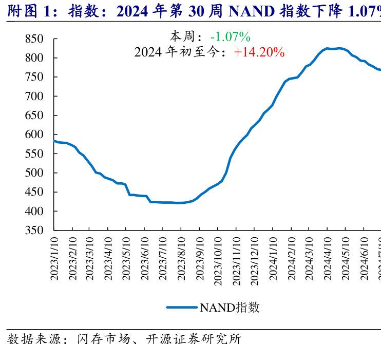
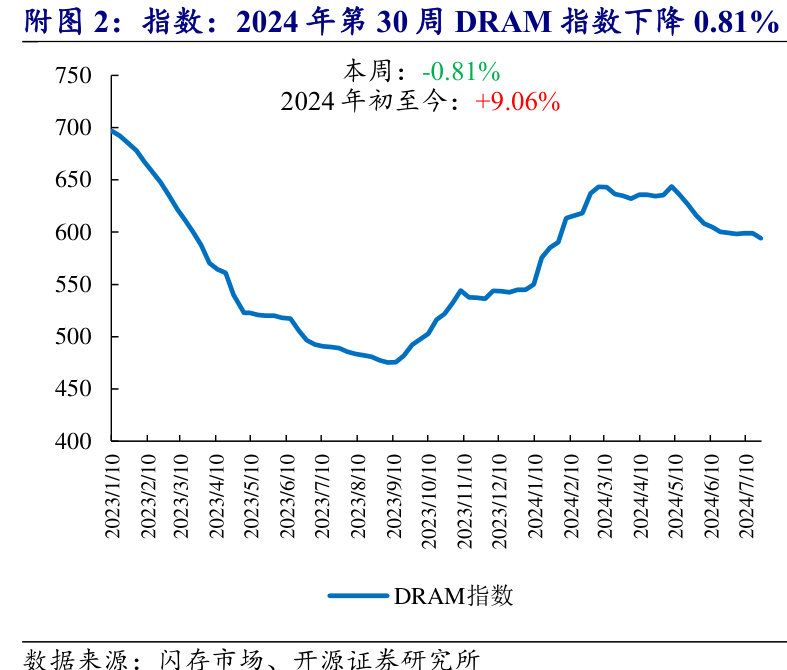
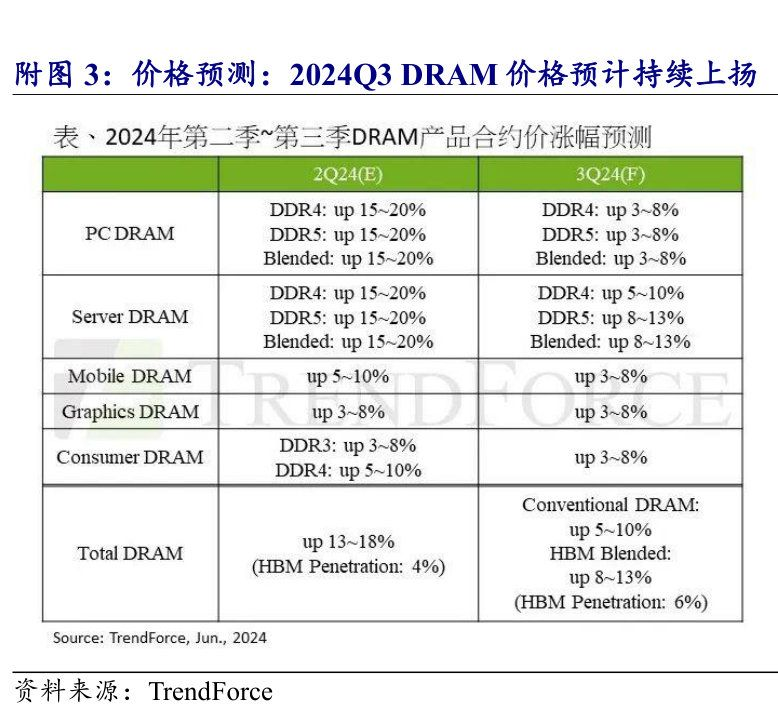
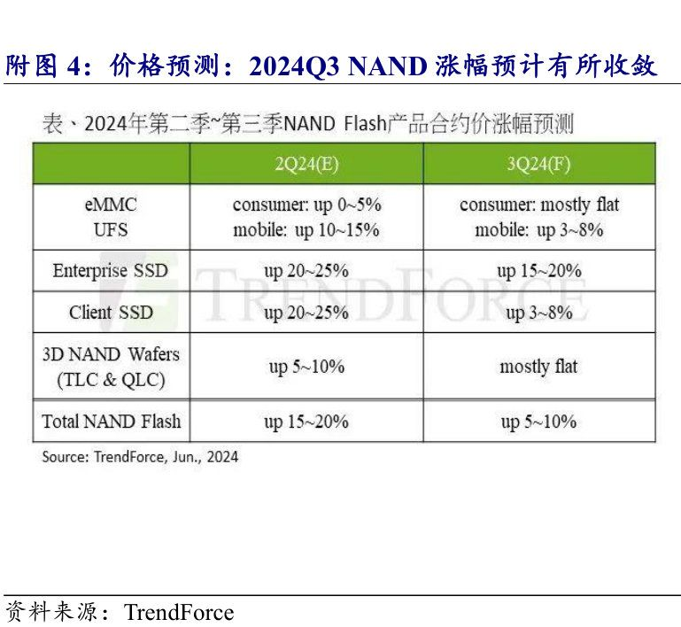
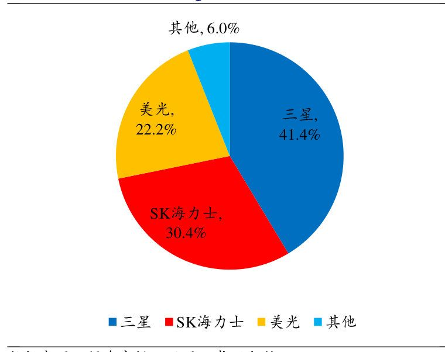
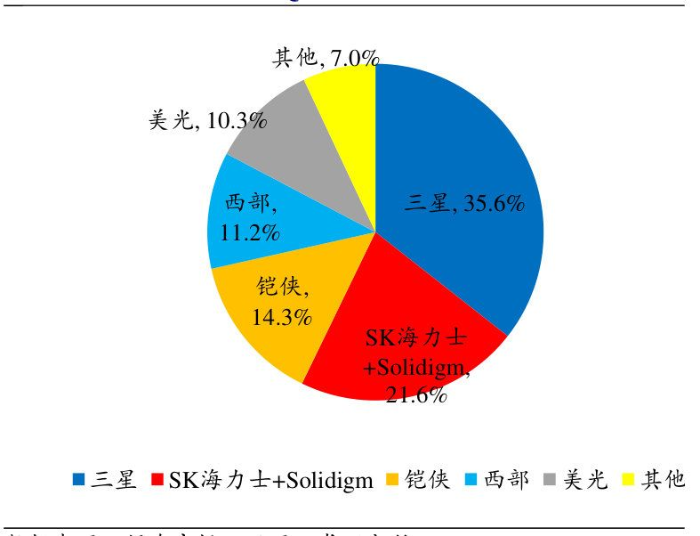
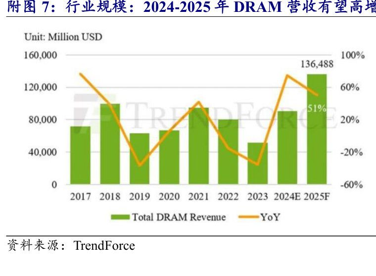
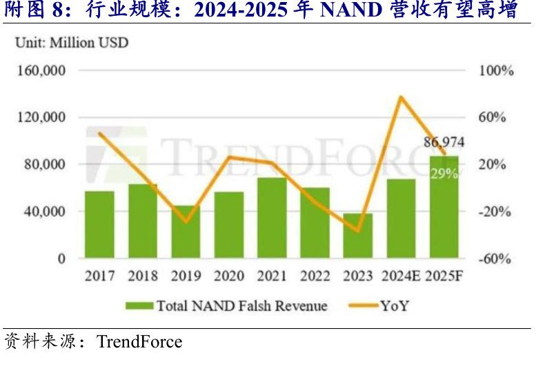
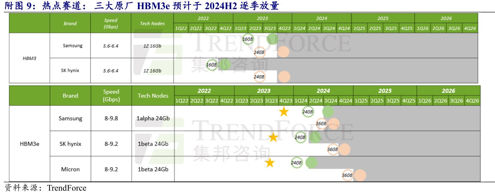
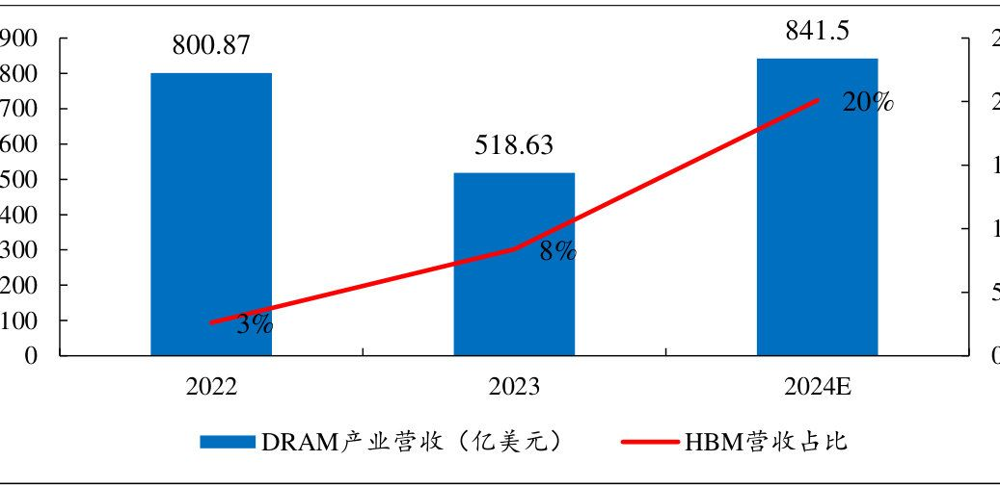

## Document Metadata

- Document ID: 7ed059595526f9d6b47b80319fbc5694243e55ac
- Document Title: 2024-2025年行业有望持续扩容，高端产品渗透加速——存储芯片板块跟踪报告（十）
- Document Type: PDF
- Issuing Organization: 开源证券股份有限公司
- Publication Date: 2024-07-26
- Reporting Period: null
- Source File: [M154_pdf.dfcfw.com_H3_AP202407261638338520_1.pdf](https://github.com/jadennevercode/CJCC-Knowledge-Base/blob/5ec8511eb834073c8bfbd79c94af196282d483cf/materials/%E8%B7%A8%E9%93%BE%EF%BC%9A%E4%BE%9B%E9%9C%80%E4%B8%8E%E4%BB%B7%E6%A0%BC%E5%8F%A3%E5%BE%84/M154_pdf.dfcfw.com_H3_AP202407261638338520_1.pdf)

## Structured Content

> 原文件：[M154_pdf.dfcfw.com_H3_AP202407261638338520_1.pdf](https://github.com/jadennevercode/CJCC-Knowledge-Base/blob/5ec8511eb834073c8bfbd79c94af196282d483cf/materials/%E8%B7%A8%E9%93%BE%EF%BC%9A%E4%BE%9B%E9%9C%80%E4%B8%8E%E4%BB%B7%E6%A0%BC%E5%8F%A3%E5%BE%84/M154_pdf.dfcfw.com_H3_AP202407261638338520_1.pdf)
> 转换方式：多模态逐页转录（页面图像 + 文本层交叉校验）

[Source Page: 1]

开源证券证券研究报告

行业研究
行业点评报告

半导体
2024年07月26日

# 2024-2025年行业有望持续扩容，高端产品渗透加速

## ——存储芯片板块跟踪报告（十）

- **本周复盘：价格指数走势承压，现货市场持续震荡静待需求回暖**指数方面：据闪存市场，2024年第30周DRAM/NAND指数走势承压，单周分别-1.07%/-0.81%。价格方面：Flash wafer价格持平不变，DDR价格小幅下跌（环比-0.6%）；渠道市场方面，低端资源价格下跌叠加终端需求承压，渠道SSD和内存条价格均继续下探；行业市场方面，存储行业SSD和内存条价格持平，工控客户释出部分SSD小单需求，行业厂商接单较为积极；嵌入式方面，市场行情普遍趋于平稳，终端仍然持续关注原厂官价的落地情况。整体来看，目前存储现货行情处于小幅震荡调整的磨底阶段，行情磨底时长视实际需求而定。
- **DRAM：2024-2025年行业营收有望高增，DDR5/LPDDR5渗透率持续提升**据TrendForce预测，2024和2025年DRAM产品均价有望分别增长53%和35%，推升2024/2025年DRAM产业营收分别年增75%/51%至907/1,365亿美元，产业营收高速增长主要系（1）HBM高速发展、（2）DRAM产品时代演进、（3）原厂资本支出收缩以及（4）服务器需求复苏。此外，DDR5和LPDDR5/5X等高附加值产品的渗透同样有助提高产品均价，TrendForce预计，DDR5将分别贡献2024、2025年Server DRAM位元出货量40%、60-65%，LPDDR5/5X有望贡献2024、2025年Mobile DRAM位元出货量50%和60%。
- **NAND：2024-2025年行业营收有望高增，QLC技术加速崛起**据TrendForce预测，2024年NAND Flash营收有望达674亿美元，年增77%；2025年，在（1）大容量QLC Enterprise SSD崛起、（2）智能手机采用QLC UFS、（3）原厂资本支出收缩和（4）服务器需求复苏等因素带动下，NAND Flash营收将达870亿美元、年增29%。北美CSPs（云端服务业者）已开始在Inference AI Server大量采用QLC Enterprise SSD，尤其是大容量规格。TrendForce预估，QLC将贡献2024年NAND Flash位元出货量20%，此比重2025年将再提升。智能手机方面，QLC预计逐步渗透UFS市场，部分中国智能手机业者预计于2024Q4起采用QLC UFS方案，Apple则预计2026年开始导入至iPhone。

[Source Page: 2]

附图1：指数：2024年第30周NAND指数下降1.07%

纵轴：NAND指数，350至850；横轴：2023/1/10至2024/7/10
图例：NAND指数
图内标注：本周：-1.07%；2024年初至今：+14.20%

数据来源：闪存市场、开源证券研究所

附图2：指数：2024年第30周DRAM指数下降0.81%

纵轴：DRAM指数，400至750；横轴：2023/1/10至2024/7/10
图例：DRAM指数
图内标注：本周：-0.81%；2024年初至今：+9.06%

数据来源：闪存市场、开源证券研究所

附表2：价格复盘：2024年第30周Wafer价格持平

| 产品名称 | 当前价（美元） | 周涨跌幅 | 2024年初至今涨跌幅 | 产品名称 | 当前价（美元） | 周涨跌幅 | 2024年初至今涨跌幅 |
|---|---|---|---|---|---|---|---|
| Wafer:256Gb TLC | 1.90 | 0.00% | 11.76% | Wafer:1Tb TLC | 7.40 | 0.00% | 21.31% |
|  |  | 0.00 | 0.20 |  |  | 0.00 | 1.30 |
| Wafer:512Gb TLC | 4.00 | 0.00% | 26.98% | Wafer:1Tb QLC | 6.80 | 0.00% | 23.64% |
|  |  | 0.00 | 0.85 |  |  | 0.00 | 1.30 |

数据来源：闪存市场、开源证券研究所

附表3：价格复盘：2024年第30周DDR价格平均跌幅0.6%

| 产品名称 | 当前价（美元） | 周涨跌幅 | 2024年初至今涨跌幅 | 产品名称 | 当前价（美元） | 周涨跌幅 | 2024年初至今涨跌幅 |
|---|---|---|---|---|---|---|---|
| DDR4/8Gb/3200 | 1.35 | 0.00% | -4.93% | DDR4/8Gb/eTT | 1.16 | 0.00% | 7.41% |
|  |  | 0.00 | -0.07 |  |  | 0.00 | 0.08 |
| DDR4/16Gb/3200 | 3.01 | 0.00% | 3.79% | DDR4/4Gb/eTT | 0.68 | -2.86% | -2.86% |
|  |  | 0.00 | 0.11 |  |  | -0.02 | -0.02 |
| DDR4/16Gb/eTT | 2.70 | 0.00% | 11.57% |  |  |  |  |
|  |  | 0.00 | 0.28 |  |  |  |  |

数据来源：闪存市场、开源证券研究所

[Source Page: 3]

附表4：价格复盘：2024年第30周SSD（渠道市场）价格平均跌幅3.8%

| 产品名称 | 当前价（美元） | 周涨跌幅 | 2024年初至今涨跌幅 |
|---|---|---|---|
| SSD/120GB/SATA3 | 6.00 | -3.23% | -22.08% |
|  |  | -0.20 | -1.70 |
| SSD/240GB/SATA3 | 11.50 | -4.17% | -7.26% |
|  |  | -0.50 | -0.90 |
| SSD/480GB/SATA3 | 20.50 | -7.66% | -4.21% |
|  |  | -1.70 | -0.90 |
| SSD/256GB/PCIe3.0 | 13.80 | -3.50% | -0.72% |
|  |  | -0.50 | -0.10 |
| SSD/512GB/PCIe3.0 | 23.80 | -4.80% | 1.28% |
|  |  | -1.20 | 0.30 |
| SSD/1TB/PCIe3.0 | 45.80 | -2.55% | 11.71% |
|  |  | -1.20 | 4.80 |
| SSD/512GB/PCIe4.0 | 30.50 | -3.17% | -0.33% |
|  |  | -1.00 | -0.10 |
| SSD/1TB/PCIe4.0 | 48.00 | -2.04% | 11.63% |
|  |  | -1.00 | 5.00 |
| SSD/2TB/PCIe4.0 | 92.00 | -3.16% | 12.20% |
|  |  | -3.00 | 10.00 |

数据来源：闪存市场、开源证券研究所

附表5：价格复盘：2024年第30周SSD（行业市场）价格持平

| 产品名称 | 当前价（美元） | 周涨跌幅 | 2024年初至今涨跌幅 |
|---|---|---|---|
| SSD/256GB/SATA3 | 17.50 | 0.00% | -2.78% |
|  |  | 0.00 | -0.50 |
| SSD/512GB/SATA3 | 29.00 | 0.00% | -9.38% |
|  |  | 0.00 | -3.00 |
| SSD/1TB/SATA3 | 56.00 | 0.00% | 1.82% |
|  |  | 0.00 | 1.00 |
| SSD/256GB/PCIe3.0 | 20.00 | 0.00% | 0.00% |
|  |  | 0.00 | 0.00 |
| SSD/512GB/PCIe3.0 | 33.50 | 0.00% | -1.47% |
|  |  | 0.00 | -0.50 |
| SSD/1TB/PCIe3.0 | 59.00 | 0.00% | 1.72% |
|  |  | 0.00 | 1.00 |
| SSD/512GB/PCIe4.0 | 36.00 | 0.00% | 0.00% |
|  |  | 0.00 | 0.00 |
| SSD/1TB/PCIe4.0 | 62.00 | 0.00% | 3.33% |
|  |  | 0.00 | 2.00 |
| SSD/2TB/PCIe4.0 | 120.00 | 0.00% | 21.21% |
|  |  | 0.00 | 21.00 |

数据来源：闪存市场、开源证券研究所

附表6：价格复盘：2024年第30周内存条（渠道市场）价格平均跌幅4.60%

| 产品名称 | 当前价（美元） | 周涨跌幅 | 2024年初至今涨跌幅 |
|---|---|---|---|
| DDR4/UDIMM/8GB/3200 | 10.00 | -7.41% | -18.03% |
|  |  | -0.80 | -2.20 |
| DDR4/UDIMM/16GB/3200 | 19.80 | -3.88% | -12.00% |
|  |  | -0.80 | -2.70 |
| DDR4/UDIMM/32GB/3200 | 40.00 | -2.44% | -6.98% |
|  |  | -1.00 | -3.00 |

数据来源：闪存市场、开源证券研究所

[Source Page: 4]

附表7：价格复盘：2024年第30周内存条（行业市场）价格持平

| 产品名称 | 当前价（美元） | 周涨跌幅 | 2024年初至今涨跌幅 |
|---|---|---|---|
| DDR4/SODIMM/4GB/3200 | 9.60 | 0.00% | 6.67% |
|  |  | 0.00 | 0.60 |
| DDR4/SODIMM/8GB/3200 | 15.50 | 0.00% | 0.00% |
|  |  | 0.00 | 0.00 |
| DDR4/SODIMM/16GB/3200 | 26.50 | 0.00% | 1.92% |
|  |  | 0.00 | 0.50 |

数据来源：闪存市场、开源证券研究所

附表8：价格复盘：2024年第30周eMMC价格持平

| 产品名称 | 当前价（美元） | 周涨跌幅 | 2024年初至今涨跌幅 |
|---|---|---|---|
| eMMC/8GB/5.1 | 1.70 | 0.00 | -10.53% |
|  |  | 0.00% | -0.20 |
| eMMC/16GB/5.1 | 2.30 | 0.00 | -4.17% |
|  |  | 0.00% | -0.10 |
| eMMC/32GB/5.1 | 2.45 | 0.00 | -5.77% |
|  |  | 0.00% | -0.15 |
| eMMC/64GB/5.1 | 4.90 | 0.00% | 28.95% |
|  |  | 0.00 | 1.10 |
| eMMC/128GB/5.1 | 9.20 | 0.00 | 35.29% |
|  |  | 0.00% | 2.40 |
| eMMC/256GB/5.1 | 18.00 | 0.00 | 35.34% |
|  |  | 0.00% | 4.70 |

数据来源：闪存市场、开源证券研究所

附表9：价格复盘：2024年第30周eMCP价格持平

| 产品名称 | 当前价（美元） | 周涨跌幅 | 2024年初至今涨跌幅 |
|---|---|---|---|
| eMCP(eMMC+LPDDR4X)64GB+32Gb | 14.50 | 0.00 | 20.83% |
|  |  | 0.00% | 2.50 |
| eMCP(eMMC+LPDDR4X)128GB+32Gb | 18.20 | 0.00 | 21.33% |
|  |  | 0.00% | 3.20 |
| eMCP(eMMC+LPDDR4X)128GB+48Gb | 23.20 | 0.00 | 28.89% |
|  |  | 0.00% | 5.20 |

数据来源：闪存市场、开源证券研究所

附表10：价格复盘：2024年第30周LPDDR价格持平

| 产品名称 | 当前价（美元） | 周涨跌幅 | 2024年初至今涨跌幅 | 产品名称 | 当前价（美元） | 周涨跌幅 | 2024年初至今涨跌幅 |
|---|---|---|---|---|---|---|---|
| LPDDR4X/96Gb | 27.00 | 0.00% | 42.11% | LPDDR4X/32Gb | 8.00 | 0.00 | 6.67% |
|  |  | 0.00 | 8.00 |  |  | 0.00% | 0.50 |
| LPDDR4X/64Gb | 19.50 | 0.00 | 21.88% | LPDDR4/16Gb | 3.70 | 0.00% | 12.12% |
|  |  | 0.00% | 3.50 |  |  | 0.00 | 0.40 |
| LPDDR4X/48Gb | 14.00 | 0.00 | 16.67% | LPDDR4/8Gb | 2.35 | 0.00% | 6.82% |
|  |  | 0.00% | 2.00 |  |  | 0.00 | 0.15 |

数据来源：闪存市场、开源证券研究所

[Source Page: 5]

附表11：价格复盘：2024年第30周UFS价格持平

| 产品名称 | 当前价（美元） | 周涨跌幅 | 2024年初至今涨跌幅 |
|---|---|---|---|
| UFS 2.2 64GB | 5.30 | 0.00% | 20.45% |
|  |  | 0.00 | 0.90 |
| UFS 2.2 128GB | 10.00 | 0.00% | 36.99% |
|  |  | 0.00 | 2.70 |
| UFS 2.2 256GB | 19.00 | 0.00% | 37.68% |
|  |  | 0.00 | 5.20 |
| UFS 2.2 512GB | 38.00 | 0.00% | 0.00% |
|  |  | 0.00 | 0.00 |

数据来源：闪存市场、开源证券研究所

附表12：价格复盘：2024年第30周uMCP价格持平

| 产品名称 | 当前价（美元） | 周涨跌幅 | 2024年初至今涨跌幅 |
|---|---|---|---|
| uMCP(LPDDR4X+ UFS2.2)4GB+128GB | 18.50 | 0.00% | 27.59% |
|  |  | 0.00 | 4.00 |
| uMCP(LPDDR4X + UFS2.2)6GB+128GB | 23.50 | 0.00% | 23.68% |
|  |  | 0.00 | 4.50 |
| uMCP(LPDDR4X+ UFS2.2)8GB+128GB | 29.00 | 0.00% | 26.09% |
|  |  | 0.00 | 6.00 |
| uMCP(LPDDR4X+ UFS2.2)8GB+256GB | 39.00 | 0.00% | 32.20% |
|  |  | 0.00 | 9.50 |

数据来源：闪存市场、开源证券研究所

附图3：价格预测：2024Q3 DRAM价格预计持续上扬

表、2024年第二季~第三季DRAM产品合约价涨幅预测

|  | 2Q24(E) | 3Q24(F) |
|---|---|---|
| PC DRAM | DDR4: up 15~20%；DDR5: up 15~20%；Blended: up 15~20% | DDR4: up 3~8%；DDR5: up 3~8%；Blended: up 3~8% |
| Server DRAM | DDR4: up 15~20%；DDR5: up 15~20%；Blended: up 15~20% | DDR4: up 5~10%；DDR5: up 8~13%；Blended: up 8~13% |
| Mobile DRAM | up 5~10% | up 3~8% |
| Graphics DRAM | up 3~8% | up 3~8% |
| Consumer DRAM | DDR3: up 3~8%；DDR4: up 5~10% | up 3~8% |
| Total DRAM | up 13~18% (HBM Penetration: 4%) | Conventional DRAM: up 5~10%；HBM Blended: up 8~13% (HBM Penetration: 6%) |

Source: TrendForce, Jun., 2024

资料来源：TrendForce

附图4：价格预测：2024Q3 NAND涨幅预计有所收敛

表、2024年第二季~第三季NAND Flash产品合约价涨幅预测

|  | 2Q24(E) | 3Q24(F) |
|---|---|---|
| eMMC / UFS | consumer: up 0~5%；mobile: up 10~15% | consumer: mostly flat；mobile: up 3~8% |
| Enterprise SSD | up 20~25% | up 15~20% |
| Client SSD | up 20~25% | up 3~8% |
| 3D NAND Wafers (TLC & QLC) | up 5~10% | mostly flat |
| Total NAND Flash | up 15~20% | up 5~10% |

Source: TrendForce, Jun., 2024

资料来源：TrendForce

[Source Page: 6]

附表13：价格预测：各类型DRAM产品市场情况

| 项目 | 内容 |
|---|---|
| 整体情况 | 根据全球市场研究机构TrendForce集邦咨询最新调查显示，由于通用型服务器(general server)需求复苏，加上DRAM供应商HBM生产比重进一步拉高，使供应商将延续涨价态度，第三季DRAM均价将持续上扬。DRAM价格涨幅达8~13%，其中Conventional DRAM涨幅为5-10%，较第二季涨幅略有收缩。 |
|  | TrendForce集邦咨询指出，第二季买方补库存意愿渐趋保守，供应商及买方端的库存水平未有显著变化。观察第三季，智能手机及CSPs仍具补库存的空间，且将进入生产旺季，因此预计智能手机及服务器将带动第三季存储器出货量放大。 |
| PC DRAM | 第三季考量通用型服务器需求复苏，加上供应商的HBM生产比重进一步拉高，预估PC DRAM价格将延续涨势，均价涨幅季增3-8%，涨幅低于Server DRAM，并较第二季涨幅收缩，主要因为PC DRAM库存偏高，消费性需求亦未有显著改善。 |
| Server DRAM | 第三季通用型服务器受惠于旺季备货需求，TrendForce集邦咨询预测，这将使得DDR5 Server DRAM合约价涨幅上修至8-13%区间。由于DDR4买方平均库存仍高，因此拉货动能集中在DDR5，使得涨势较DDR4来得高，因此综合两者的平均合约价应落在季增8-13%。 |
| Mobile DRAM | 自去年第四季以来，Mobile DRAM的连续涨价使品牌端的营利面临较大挑战，加上目前库存充足，品牌进入第三季的议价流程放缓，议价态度被动。然而，原厂为填补先前几个季度的获利缺口，以及考量明年供需将转为紧缺，因此维持对合约价格的拉涨态度，但受买方议价态度被动以及高库存影响，可能会压缩第三季涨幅。TrendForce集邦咨询预估，季度涨幅将落在季增3-8%，其中以LPDDR4(X)涨幅最小，不排除有再收缩的可能。 |
| Graphics DRAM | 第三季整体Graphics DRAM需求依旧较为平淡，价格走势主要受到其他DRAM产品的连动影响，在原厂强势进入上涨周期且涨势尚未停歇之下，使得采购端采取持续备货的策略，因此在心态上较能接受卖方提出的涨价。在供给端，因新款GPU将进入验证阶段，原厂将陆续提高GDDR7的生产，而目前GDDR7比GDDR6约有20-30%溢价，随着3Q24的样品出货将略推升平均销售价格，预估Graphics DRAM价格将呈现季增3-8%。 |
| Consumer DRAM | 整体Consumer DRAM市场仍显得供过于求，但三大供应商在HBM产能挤压影响，涨价意图明显，加上其他供应商尚未回到获利状态，故仍有价格上涨的压力存在，预估价格仍维持小幅上涨趋势。 |

资料来源：TrendForce、开源证券研究所

附表14：价格预测：各类型NAND Flash产品市场情况

| 项目 | 内容 |
|---|---|
| 整体情况 | 根据全球市场研究机构TrendForce集邦咨询最新调查显示，第三季除了企业端持续投资服务器建设，尤其Enterprise SSD受惠AI扩大采用，继续受到订单推动，消费性电子需求持续不振，加上原厂下半年增产幅度趋于积极，第三季NAND Flash供过于求比例(Sufficiency Ratio)上升至2.3%，NAND Flash均价(Blended Price)涨幅收敛至季增5-10%。 |
| NAND Flash Wafer | 综观NAND Flash今年价格走势，由于原厂上半年控制增产，NAND Flash价格加速反弹帮助原厂重回获利。但随着各家厂商下半年开始明显扩大投产，零售市场买气仍未复苏，wafer现货价走跌，跌幅扩大导致部分wafer价格已低于合约价超过二成，wafer合约价格未来上涨空间面临挑战。 |
| Client SSD | Client SSD方面，即便NB销售在进入传统旺季，但客户备货意愿较保守，尤其PC终端产品未完全反应去年以来的价格涨幅，因此，下半年采购容量未明显增长。随着供应商开始升级PC client SSD制程至2XX层，原厂供应产能仍持续上升，但拉动价格上涨的动能并不强劲。此外，随着QLC与TLC产品价差明显，更多PC买家扩大使用QLC方案，加剧价格竞争，预料本季价格涨幅空间相对有限，PC Client SSD第三季合约价预估季增3-8%。 |
| Enterprise SSD | Enterprise SSD方面，许多企业持续扩大AI服务器建设，信息设备支出明显复苏，第三季服务器OEMs订单明显回升，采购需求仍较前一季增长。不过，由于智能手机和NB的订单需求保守，NAND Flash市况转向更为平衡。除了大容量QLC Enterprise SSD供应由二家厂商主导外，其他供应商积极争抢Enterprise SSD订单，以加速下半年产能去化，这导致第三季Enterprise SSD合约价格上涨幅度收敛至季增15-20%。 |
| eMMC | eMMC方面，第三季eMMC缺乏驱动需求的因素，但原厂持续提价态度明确，预估最终价格的涨幅甚微，合约价将呈现约略持平状态。 |
| UFS | UFS方面，受到智能手机OEMs库存水位充足且去化较慢的影响，加上模组厂也开始供应UFS物料让需求端选择更多，面对第三季原厂欲再大幅度涨价的情况，势必出现反弹阻力。此外，在买方手上库存充足且市场需求平淡的情况下，预估供应商有可能让步，第三季UFS合约价涨幅将落在季增3-8%。 |

资料来源：TrendForce、开源证券研究所

[Source Page: 7]

附表15：需求预测：预计2024年三大终端DRAM/NAND单机平均搭载容量将同比增加

| 项目 | DRAM 2023 | DRAM 2024（E） | NAND Flash 2023 | NAND Flash 2024（E） |
|---|---|---|---|---|
| 智能手机 | 17.50% | 14.10% | 19.20% | 9.30% |
| 服务器 | 13.60% | 17.30% | 14.90% | 13.20% |
| 笔电 | 9.00% | 12.40% | 10.10% | 9.70% |

数据来源：TrendForce、开源证券研究所

附表16：需求预测：2024年智能手机、服务器、PC出货量预计同比增长4%/2%/8%

|  | 2024F | 2024F YoY |
|---|---|---|
| 智能手机（亿部） | 12.00 | +4.00% |
| 服务器（百万台） | 14.20 | +2.00% |
| PC（亿台） | 2.70 | +8.00% |

数据来源：闪存市场、开源证券研究所

附图5：供给侧：2024Q1 DRAM市场CR3高达94.0%

饼图图例：三星、SK海力士、美光、其他
图内标注：三星41.4%、SK海力士30.4%、美光22.2%、其他6.0%

数据来源：闪存市场、开源证券研究所

附图6：供给侧：2024Q1 NAND市场CR5高达93.0%

饼图图例：三星、SK海力士+Solidigm、铠侠、西部、美光、其他
图内标注：三星35.6%、SK海力士+Solidigm 21.6%、铠侠14.3%、西部11.2%、美光10.3%、其他7.0%

数据来源：闪存市场、开源证券研究所

附图7：行业规模：2024-2025年DRAM营收有望高增

单位：Million USD；横轴：2017至2025F；左纵轴：Total DRAM Revenue，0至160,000；右纵轴：YoY，-60%至100%
图例：Total DRAM Revenue（柱）、YoY（折线）
图内标注：136,488（2025F柱）、51%（YoY折线）

资料来源：TrendForce

附图8：行业规模：2024-2025年NAND营收有望高增

单位：Million USD；横轴：2017至2025F；左纵轴：Total NAND Falsh Revenue，0至160,000；右纵轴：YoY，-60%至100%
图例：Total NAND Falsh Revenue（柱）、YoY（折线）
图内标注：86,974（2025F柱）、29%（YoY折线）

资料来源：TrendForce

[Source Page: 8]

附图9：热点赛道：三大原厂HBM3e预计于2024H2逐季放量

路线图列为Brand、Speed (Gbps)、Tech Nodes及2022–2026各季度（1Q22至4Q26）

| 代次 | Brand | Speed (Gbps) | Tech Nodes |
|---|---|---|---|
| HBM3 | Samsung | 5.6-6.4 | 1Z 16Gb |
| HBM3 | SK hynix | 5.6-6.4 | 1Z 16Gb |
| HBM3e | Samsung | 8-9.8 | 1alpha 24Gb |
| HBM3e | SK hynix | 8-9.2 | 1beta 24Gb |
| HBM3e | Micron | 8-9.2 | 1beta 24Gb |

时间轴标注：HBM3行标注16GB、24GB；HBM3e行于2023Q3附近标注星标，2024年内标注24GB、36GB及圆点标记

资料来源：TrendForce

附表17：热点赛道：2023-2024 HBM市场竞争格局预计将由三星和SK海力士主导

| 公司 | 2022 | 2023（E） | 2024（F） |
|---|---|---|---|
| SK海力士 | 50% | 46%~49% | 47%~49% |
| 三星 | 40% | 46%~49% | 47%~49% |
| 美光 | 10% | 4%~6% | 3%~5% |

数据来源：TrendForce、开源证券研究所

附图10：热点赛道：2024年HBM产值预计占DRAM产值20.1%

横轴：2022、2023、2024E；左纵轴：DRAM产业营收（亿美元），0至900；右纵轴：HBM营收占比，0%至25%
图例：DRAM产业营收（亿美元）柱、HBM营收占比折线
图内标注：柱800.87、518.63、841.5；折线3%、8%、20%

数据来源：TrendForce、开源证券研究所

附表18：热点赛道：2024年三星海力士HBM产能规划积极，美光占比提升

| 项目 | 三星 | SK海力士 | 美光 |
|---|---|---|---|
| 截至2023年底HBM TSV产能预估 | 45K/m | 45K/m | 3K/m |
| 占比 | 48.39% | 48.39% | 3.23% |
| 截至2024年底HBM TSV产能预估 | 130K/m | 120-125K/m | 20K/m |
| 占比 | 47.71% | 44.95%（中值） | 7.34% |

数据来源：TrendForce、开源证券研究所
