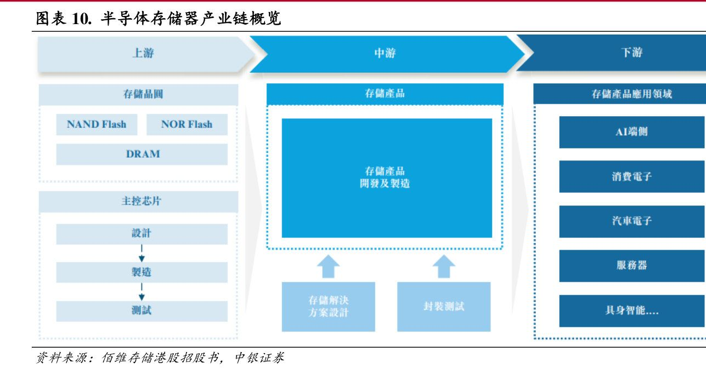
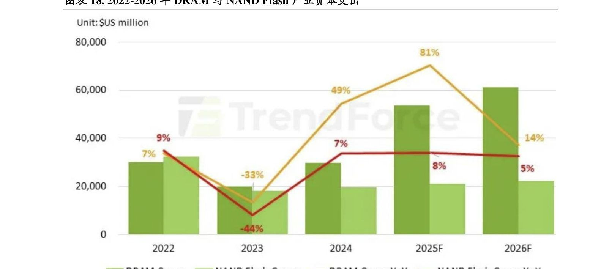

## Document Metadata

- Document ID: 65e073c4170184feb382379c710c9fc84da39c13
- Document Title: 存储行业深度报告：骐骥驰骋，AI“存”变，国产“储”势，星火燎原
- Document Type: PDF
- Issuing Organization: 中银国际证券股份有限公司
- Publication Date: 2026-01-23
- Reporting Period: null
- Source File: [M159_pdf.dfcfw.com_H3_AP202601231818318213_1.pdf](https://github.com/jadennevercode/CJCC-Knowledge-Base/blob/5ec8511eb834073c8bfbd79c94af196282d483cf/materials/%E8%B7%A8%E9%93%BE%EF%BC%9A%E4%BE%9B%E9%9C%80%E4%B8%8E%E4%BB%B7%E6%A0%BC%E5%8F%A3%E5%BE%84/M159_pdf.dfcfw.com_H3_AP202601231818318213_1.pdf)

## Structured Content

> 原文件：[M159_pdf.dfcfw.com_H3_AP202601231818318213_1.pdf](https://github.com/jadennevercode/CJCC-Knowledge-Base/blob/5ec8511eb834073c8bfbd79c94af196282d483cf/materials/%E8%B7%A8%E9%93%BE%EF%BC%9A%E4%BE%9B%E9%9C%80%E4%B8%8E%E4%BB%B7%E6%A0%BC%E5%8F%A3%E5%BE%84/M159_pdf.dfcfw.com_H3_AP202601231818318213_1.pdf)
> 转换方式：多模态逐页转录（页面图像 + 文本层交叉校验）

[Source Page: 1]

电子 | 证券研究报告 — 行业深度

2026年1月23日

强于大市

# 存储行业深度报告

## 骐骥驰骋，AI“存”变，国产“储”势，星火燎原

AI与数据扩张推动存储进入新周期，供需紧张致价格持续上涨，HBM等新技术迭代需求旺盛，国产存储加速发展机遇显现，给予行业强于大市的评级。

### 支撑评级的要点

- **综述：数据扩张+AI扩散，存储新周期加速到来。** 在数字经济各领域对存储技术需求不断扩大的推动下，存储市场规模持续上升。从下游应用结构来看，AI端侧存储需求增长速度显著高于其他细分市场，已成为推动全球存储市场扩张的关键动力。同时大模型技术热潮带动AI服务器存储需求快速增长，服务器领域存储需求亦将保持较高增速。价格方面，存储全系产品价格2025年已出现较大幅度涨幅，2026年或进一步上涨，我们认为本轮价格上涨则是由AI服务器和通用服务器共同驱动，还存在着结构性的产能转换和多个维度的需求竞争，情况更为复杂，短缺和涨价或将会持续更长时间。
- **供需：结构性供给受限持续，原厂竞逐新技术蓝海，AI产业链健康度打开远期需求空间。** 资本支出方面：2026年资本支出重点将转向制程技术升级与混合键合等先进工艺的导入，位元供给增长幅度有限，供不应求的市场状态或将持续全年。技术升级方面：HBM加速迭代，带宽等性能指标不断迈进。同时随着AI推理市场迅速增长，存储行业逐渐步入“后HBM时代”——HBF应运而生。需求方面：从国际领先供应商对于AI基础设施配置来看，高性能HBM、LPDDR5X仍需求旺盛。从终端需求来看，服务器市场对于存储需求将保持快速增长态势。
- **国产：原厂端奔赴全球标准+产业链自主，产品端锚定平台化+品类升级。** DRAM方面，长鑫存储已正式推出LPDDR5X产品，NAND方面，长江存储三期建设正迈向100%设备国产化目标。技术方面，CBA+4F2在制程节点压力以及混合键合技术积累加持之下或成为国产存储弯道超车的必由之路。我们认为，长江存储和长鑫存储作为国内存储芯片制造龙头企业，生产经营稳中向好，推动建设意志坚定不移，有望为产业链带来诸多机会。此外国内利基存储市场亦将在AI定制化存储推动下迎来发展良机。

### 评级面临的主要风险

- 行业周期性波动风险
- 技术迭代与竞争加剧风险
- 地缘政治与供应链风险
- AI需求可持续性风险
- 国产替代与技术突破不及预期风险

[Source Page: 4]

## 综述：数据扩张+AI扩散，存储新周期加速到来

### AI驱动数据生成总量增长，存储需求伴随基础设施应运而生

根据国际数据公司IDC预计，2025年全球将产生213.56ZB数据，到2029年将增长一倍以上达到527.47ZB。其中，中国市场2025年将产生51.78ZB数据，到2029年增长至136.12ZB，CAGR将达到26.9%。

[Source Page: 5]

资本支出方面，随着北美云端服务大厂陆续更新指引，TrendForce将2025年全球八大主要CSPs资本支出总额年增率从原本的61%上修至65%。2026年CSPs仍将维持积极的投资节奏，合计资本支出将进一步推升至6,000亿美元以上，同比增长约40%。我们认为AI基础建设的长期成长潜能依然充沛。

而存储为数据中心资本支出中重要组成部分，典型数据中心的资本支出中存储占比约为12%，伴随AI基础设施资本支出的持续投入以及存储技术的加速迭代，我们认为其在数据中心成本中的占比还有望提升，我们将在后文逐一论述。

[Source Page: 6]

### 现货价格一路上扬，半导体存储器有望开启景气新周期

从现货价格来看，无论是上游的Flash Wafer和DDR以及下游的SSD及内存条均出现大幅上涨。根据闪存市场，从资源端看，25Q4现货512Gb及以上容量的NAND资源价格累计涨幅环比普遍超一倍。而25Q4末，部分原厂释放小批量资源供应但价格高昂，下游存储厂商基于此前囤积的较低价库存结合当下回补的高价资源，尚能平铺整体成本。随着低价库存快速消耗，未来高成本压力将日益显著增加。

存储产业链可分为上游、中游和下游三大环节。我们认为本轮周期受益下游需求变化，进而有望带动上游厂商跟进，届时行业或将呈现自下而上的景气循环。

**上游：基础资源供给**

上游主要为行业提供基础资源，包括存储晶圆制造（如NAND Flash、DRAM芯片）和主控芯片等核心组件。存储芯片主要分为易失性存储器（如DRAM）和非易失性存储器（如NAND Flash）两大类。

**中游：核心制造与价值创造**

中游环节负责存储解决方案的设计、封装及测试，是连接上游基础元件与下游应用的关键。行业主要有两种运营模式：

专业代工模式：企业专注于存储解决方案的设计、封装（自营或外包）及测试，并实现大规模交付，以满足市场对存储器产品的多样化需求。其中，封装测试环节对性能验证、缺陷检测和良率提升至关重要。

集成设备制造模式：企业业务覆盖从芯片设计、晶圆制造到封装测试的全流程生产。

**下游：多元化应用驱动创新**

下游应用领域高度多元化，涵盖AI终端（如AI智能手机、AI PC、AI眼镜）、消费电子、智能驾驶及工业能源等。各应用市场对存储产品在容量、速度、功耗及可靠性等方面有独特要求，推动存储技术持续升级。

[Source Page: 7]

**图表10. 半导体存储器产业链概览**

流程图分三栏，从左至右为：上游（存储晶圆：NAND Flash、NOR Flash、DRAM；主控芯片：设计→制造→测试）、中游（存储产品：存储产品研发及制造，下方为存储解决方案设计、封装测试）、下游（存储产品应用领域：AI端侧、消费电子、汽车电子、服务器、具身智能…）。

资料来源：佰维存储港股招股书，中银证券

### “端”“云”两侧纷至沓来，下游诸多细分迎来边际催化

存储产品长期增长态势稳健。根据佰维存储港股招股书，2020年全球市场规模为1499亿美元。在数字经济各领域对存储技术需求不断扩大的推动下，市场规模持续上升，至2024年达到1928亿美元，期间复合年增长率为6.5%。展望未来，随着人工智能技术更深层次地融入各类产业，存储产品的应用场景预计将进一步拓宽。全球市场规模有望从2025年的2633亿美元增长至2029年的4071亿美元，此期间的复合年增长率将达到11.5%。

从下游应用结构来看，AI端侧领域存储需求的增长速度显著高于其他细分市场，已成为推动全球存储市场扩张的关键动力。根据佰维存储港股招股书，随着AI手机、AI PC、AI眼镜以及智能驾驶等新兴应用场景的快速发展，AI端侧应用对存储产品的需求呈现迅速增长态势。2020年至2024年间，AI端侧存储市场的复合年增长率高达99.5%，2024年市场规模达到179亿美元。2025年至2029年期间，其复合年增长率将保持在36.4%的较高水平，领先于所有下游应用领域。

大模型技术热潮带动AI服务器需求快速增长，服务器领域存储需求亦将保持较高增速。根据佰维存储港股招股书，其存储市场规模从2020年的268亿美元提升至2024年的594亿美元，复合年增长率为22.0%。到2029年，该市场规模或将进一步扩大至1458亿美元。同时，全球数据中心的持续建设与扩容，以及大模型部署、实时数据处理等场景对AI推理需求的高速增长，也成为重要的驱动因素，持续刺激对高性能存储产品的需求，进而推动整体市场的增长。

[Source Page: 8]

**云侧方面：AI服务器为核心驱动**

根据佰维存储港股招股书，2024年，全球服务器出货量约为1600万台，2029年或有望增长至约1880万台。作为人工智能应用的核心计算基础设施，AI服务器提供了强大的并行计算能力。随着AI技术在各行业的持续渗透，市场对AI服务器的需求呈现稳步增长态势。2024年，全球AI服务器出货量约为200万台，2029年或将增至约540万台。

在AI服务器架构中，DRAM主要用于临时数据存储。DDR5等内存凭借其高带宽与低延迟特性，有效保障了深度学习、图像识别等高计算密度任务的顺畅执行。此外，LPDDR凭借其低功耗与小体积的优势，常被应用于对功耗和空间有严格限制的AI服务器场景。同时，SSD承担长期数据存储任务，为满足AI应用需求，需具备更大容量与更高传输速度。上述存储器件共同协作，推动AI服务器在性能与能效方面的整体提升。

[Source Page: 12]

## 供给端：结构性供给受限持续，原厂竞逐新技术蓝海

### 原厂26年资本支出供给仍有限，现货资源供给趋紧或将持续

根据TrendForce，随着存储器平均销售价格持续提升，供应商获利也有所增加，DRAM与NAND Flash后续的资本支出将会持续上涨，但对于2026年的位元产出成长的助力有限。DRAM和NAND Flash产业的投资重心正逐渐转变，从单纯地扩充产能，转向制程技术升级、高层数堆栈、混合键合以及HBM等高附加价值产品。

**图表18. 2022-2026年DRAM与NAND Flash产业资本支出**

Unit: $US million

| 年份 | DRAM Capex YoY | NAND Flash Capex YoY |
| --- | --- | --- |
| 2022 | 9% | 7% |
| 2023 | -33% | -44% |
| 2024 | 49% | 7% |
| 2025F | 81% | 8% |
| 2026F | 14% | 5% |

图例：DRAM Capex、NAND Flash Capex、DRAM Capex YoY、NAND Flash Capex YoY

资料来源：Trendforce，中银证券

**DRAM方面**，美光是资本支出策略最为积极的厂商，其2026年资本支出预计为135亿美元，年增长率达23%，主要投资方向为1 gamma制程技术的导入及TSV设备建设。SK海力士亦呈现显著增长，2026年资本支出预计为205亿美元，同比增长17%，主要用于M15x厂区HBM4产能的扩张。三星预计资本支出为200亿美元，同比增长11%，重点投向HBM相关1C制程的推进及P4L晶圆产能的小幅提升。

然而，在产能扩张方面存在结构性制约。据TrendForce分析，目前无尘室资源已趋于紧张，在现有DRAM供应商中，仅三星与SK海力士仍具备小幅扩产的空间。美光则需待其美国ID1新厂于2027年投产后方可实现产能提升，因此2026年内任何资本支出的上修对实际位元产出的贡献均较为有限。

**NAND Flash方面**，铠侠/闪迪因未涉足DRAM业务，是最为积极扩产的厂商，其2026年资本支出预计为45亿美元，同比增长41%，主要用于加速BiCS8量产及投入BiCS9研发。美光计划小幅提升NAND Flash产能，并聚焦于G9制程发展与企业级固态硬盘业务，预计资本支出年增幅高达63%。相比之下，三星与SK海力士/Solidigm则计划缩减或限制NAND Flash资本支出，将资源优先配置于HBM与DRAM领域。

尽管需求强劲，部分厂商因历经多次行业景气循环，在资本支出与产能扩张策略上趋于保守。2026年资本支出重点将转向制程技术升级与混合键合等先进工艺的导入，而非规模性扩产。我们认为，2026年NAND Flash位元供给增长幅度有限，供不应求的市场状态或将持续全年。

[Source Page: 13]

### HBM仍是兵家必争之地，HBF专门为推理而生

根据TrendForce的预测，从供应端来看，2025年全球DRAM供应将同比增长24%，2026年将同比增长20%。从具体的内存类型来看，在2025年的DRAM供应当中，HBM同比增长88.1%，消费类内存同比下滑1.2%，用于图形处理的显存同比下滑0.3%，移动端内存同比增长23.3%，服务器内存同比增长28.4%，PC端内存同比增长4.4%。从2026年的DRAM供应来看，HBM的增长幅度降至38.2%，消费类将增长6.2%，显存将增长23.6%，移动端将增长17.3%，服务器将增长23.1%，PC端将增长5.1%。

**图表19. 全球2025/2026年内存市场与各类别产品成长率预估**

| Year of 2026 | YoY(%) | % of Total Supply |
| --- | --- | --- |
| PC | 5.1 | 8.2 |
| Server | 23.1 | 39.2 |
| Mobile | 17.3 | 35.3 |
| Graphics | 23.6 | 2.8 |
| Consumer | 6.2 | 5.4 |
| HBM | 38.2 | 9.1 |

| Year of 2025 | YoY(%) | % of Total Supply |
| --- | --- | --- |
| PC | 4.4 | 9.3 |
| Server | 28.4 | 38.0 |
| Mobile | 23.3 | 36.0 |
| Graphics | (0.3) | 2.7 |
| Consumer | (1.2) | 6.1 |
| HBM | 88.1 | 7.9 |

资料来源：Trendforce，芯智讯，中银证券

[Source Page: 14]

随着AI推理市场迅速增长，存储行业逐渐步入“后HBM时代”——不仅三星、SK海力士等存储巨头纷纷推进第六代HBM，更有全新技术如HBF，试图参与到这场AI存力竞争的浪潮中来，三星、SK海力士、闪迪等存储厂商正纷纷投入HBF技术的研发。

HBF，全称High Bandwidth Flash，即高带宽闪存，其结构与堆叠DRAM芯片的HBM类似，是一种通过堆叠NAND闪存而制成的产品。被称作“HBM之父”的韩国科学技术院教授金正浩指出，虽然NAND闪存比DRAM慢，但它提供了大约10倍的容量，这对于支持下一代AI可能至关重要。

根据闪迪和SK海力士的路线规划，2026年下半年就会有首批HBF样品出现，2027年初或有搭载HBF的AI推理设备面世。我们认为GPU厂商和服务器厂商或将率先尝鲜，伴随产业持续成熟，边缘设备和个人计算领域有望跟进。

[Source Page: 15]

## 需求端：AI产业链健康度打开远期需求空间

### AI存储需求激发HDD替代效应，NAND Flash结构性需求旺盛

根据TrendForce，AI推理应用快速推升实时存取、高速处理海量数据的需求，传统作为海量数据存储基石的Nearline HDD（近线硬盘）已出现供应短缺。由于全球主要HDD制造商近年未规划扩大产线，无法及时满足AI刺激的突发性、巨量储存需求。目前NL HDD交期已从原本的数周，急剧延长为52周以上，加速扩大CSP的存储缺口。在此背景下，高效能、高成本的SSD逐渐成为市场焦点，特别是大容量的QLC SSD出货或有望于2026年显著增长。

根据TrendForce，HDD产业正值技术换代的阵痛期，投资新一代热辅助磁记录技术产线初期的高昂成本，不仅造成产能扩张瓶颈，也迫使供应商将费用转嫁给客户，导致每GB的平均售价从过往的0.012-0.013美元，提高至0.015-0.016美元，削弱了HDD最核心的成本优势。相比之下，NAND Flash通过3D堆栈技术的演进，产能提升速度远快于HDD。此外，随着堆栈层数从上百层迈向200层以上或更高，晶圆的储存位元密度不断提升。预期2026年2Tb QLC芯片的产出将逐步放量，成为降低Nearline SSD成本的主力。

AI推理工作负载涉及大量小型数据的随机读取，以及对模型参数的快速调用。从效能角度分析，SSD的IOPS（每秒读写次数）是HDD的数百甚至数千倍，其微秒级的延迟更是HDD毫秒级延迟无法比拟的。而SSD在运作时无需马达驱动磁盘，每TB的功耗远低于HDD。对于大型数据中心而言，改用SSD所节省的电费、冷却成本以及机柜空间，长期足以抵销其较高的初始购置成本。

**图表22. Nearline HDD与QLC SSD重点比较**

| 产品 | 交付周期 | 每GB平均售价（美元） | 最大容量 | 性能 | 能效 |
| --- | --- | --- | --- | --- | --- |
| Nearline HDD | 52周 | 0.015 | 32TB | 弱 | 较低 |
| QLC SSD | 8周 | 0.05-0.06 | 122TB | 强 | 较高 |

资料来源：Trendforce，中银证券

北美CSP早已规划于温数据应用扩大采用SSD，但因为HDD缺口严峻，CSP甚至开始考虑于冷数据采用SSD。我们认为，在AI需求带动下，NAND Flash存在结构性需求旺盛，相关供应链有望深度受益。

### 高端DRAM仍为AI标配，终端加速转向LPDDR5X

[Source Page: 16]

除HBM外，随着CSP扩大资本支出，并计划采购更多的英伟达GB300和VR200机架解决方案。英伟达GB/VR机架需求的增长或将进一步推动Grace和Vera CPU需求。伴随英伟达AI服务器出货量的增长，其对于LPDDR5X的需求亦将持续增长。

根据TrendForce，2025年市场对于LPDDR5X的需求同比增长558%，2026年还将继续增长169%，2025-2030年的年复合增长率将会高达51%。而对于LPDDR5X的整体需求当中，来自英伟达AI/服务器的需求占据了极高的比重。

此外，目前智能手机内存解决方案基本都是LPDDR4、LPDDR5。但是由于上游原厂逐步停止LPDDR4的供应，产线转产新制程，使得LPDDR4缺货涨价，并且是不可逆的，所以手机厂商亦需要加速转向最先进的LPDDR5/LPDDR5X。

根据TrendForce的预计，从智能手机生产的角度来看，LPDDR5(X) Gb当量预计将在2025年占比52%，在2026年将提升至66%。2025年配备LPDDR5(X)的智能手机将占智能手机总产量的37%，到2026年将占51%。

[Source Page: 17]

### KV Cache催生NAND新需求，以存带算趋势渐进

根据华尔街见闻，在黄仁勋在CES演讲中，敏锐地捕捉到了AI模型侧的根本性变化——Test-time Scaling（测试时扩展）。“推理不再是一次性的回答，而是一个思考的过程。”他指出，随着DeepSeek R1和OpenAI o1等模型的出现，AI开始展现出思维链能力。这意味着AI在给出答案前，需要消耗大量的算力进行多步推理、反思和规划。

同时，当AI从简单的问答转向长时间的复杂推理时，记忆瓶颈涌现。在Agentic AI时代，智能体需要记住漫长的对话历史和复杂的上下文，这会产生巨大的KV Cache。传统的解决方案是将这些数据塞进昂贵的HBM显存中，但HBM容量有限且价格高昂，这被称为“显存墙”。AI的工作记忆存储在HBM内存中。每生成一个token，它都要读取整个模型和所有工作记忆。对于需要长期运行、拥有持续记忆的AI智能体，这种架构显然不可持续。

英伟达的解决方案是一套全新的存储架构：基于BlueField-4 DPU构建的推理上下文内存存储平台（Inference Context Memory Storage Platform）。在每个GPU原有1TB内存的基础上，英伟达通过这个平台为每个GPU额外增加了16TB的“思考空间”。这个平台被放置在离计算单元最近的位置，通过高达200Gb/s的带宽连接，避免了传统存储带来的延迟瓶颈。

[Source Page: 18]

### 服务器市场持续快速增长，涨价或抑制部分消费需求

从终端需求来看，服务器市场对于存储需求将保持快速增长。根据Trendforce预计，通用服务器方面，对于DRAM需求，2025年同比增长19%，2026年将继续同比增长20%；对于NAND Flash的需求，2025年同比增长30%，2026年同比增长19%。AI服务器方面，2025年LPDDR需求同比增长67%，RDIMM同比增长31%；2026年LPDDR需求同比增长15%，RDIMM同比增长21%。对于NAND Flash需求方面，2025年同比增长60%，2026年将继续增长70%。

而由于存储芯片价格持续上涨，将迫使PC厂商和智能手机提升产品价格，或将抑制客户需求。2025年来自笔记本电脑的需求分别增长14%和3%，2026年将继续分别增长10%和6%；2025年来自智能手机的需求分别增长9%和11%，2026年将继续增长8%和8%。

**图表30. 2025/2026各终端应用存储位元需求量涨跌幅预测**

| YoY |  | NB | Server | AI Server | Smartphone |
| --- | --- | --- | --- | --- | --- |
| Shipment or Production Volume | 2025 | 5% | 8% | 25% | 2% |
|  | 2026 | (3%) | 9% | 24% | (2%) |
| DRAM Content | 2025 | 14% | 19% | LPDDR:67% RDIMM:31% | 9% |
|  | 2026 | 10% | 20% | LPDDR:15% RDIMM:21% | 8% |
| NAND Flash Content | 2025 | 3% | 30% | over 60% | 11% |
|  | 2026 | 6% | 19% | over 70% | 8% |

资料来源：Trendforce，芯智讯，中银证券

[Source Page: 19]

## 国产侧：原厂端奔赴全球标准+产业链自主，产品端锚定平台化+品类升级

### 国产高端新品+产能稳步扩张，抢占AI时代国际话语权

**DRAM方面**，据长鑫存储官方网站信息更新，长鑫存储已正式推出LPDDR5X产品，最高速率达到10667Mbps。据官网产品信息介绍，LPDDR5/5X是第五代超低功耗双倍速率动态随机存储器。通过创新的封装技术和优化的内存设计，长鑫存储LPDDR5X在容量、速率、功耗上都有显著提升，目前提供12Gb和16Gb两种单颗粒容量，最高速率达到10667Mbps，达到国际主流水平，较上一代LPDDR5提升了66%，同时可以兼容LPDDR5，功耗则比LPDDR5降低了30%。

从技术与产业价值来看，10667Mbps速率的突破堪称“解渴”。当前端侧AI应用蓬勃发展，内存带宽已成为制约设备性能的关键瓶颈——实测数据显示，搭载10.7Gbps（即上述10667Mbps）速率内存的设备，运行Llama 2等大型语言模型时，响应速度、语音转译等任务效率都大大提升。对旗舰手机而言，这一速率可轻松支撑8K视频连拍、高帧率游戏多开等高频场景，解决了此前国产终端完全依赖韩系内存才能实现极致性能的痛点。

2025年7月，长鑫存储母公司长鑫科技启动A股上市辅导。长鑫存储2016年成立，专注DRAM芯片，2024年DDR4全球市占约5%，2025年底预计升至8%。其无控股股东，第一大股东为合肥清辉集电，合肥国资等多机构加持，合肥政府早期助力其发展，2025年DRAM晶圆产量预计增长68%。

**NAND方面**，长江存储正迈向100%设备国产化。长江存储的发展轨迹是中国半导体产业在高压制裁下实现战略性突围的典型范例。2022年，美国将其列入实体清单，导致其先进设备进口受阻，产能规划一度腰斩，面临严峻生存危机。然而，这场危机也强力催化了其供应链的全面国产化进程。通过国内设备厂商组成“攻坚联盟”，长江存储实现了设备国产化率的快速提升，从制裁前的较低水平升至2024年的约45%，远超国内同业平均水平，2023年推出的232层TLC芯片X4-9070，通过双层堆叠实现294层等效密度，接口速度达3600MT/s，性能比肩三星、SK海力士的旗舰产品。其自主研发的Xtacking晶栈架构成为关键技术，不仅使产品在存储密度和性能上比肩国际巨头，更在2025年吸引了三星公司为其混合键合技术支付专利授权费，标志着中国企业在全球半导体核心技术领域首次掌握了重要的话语权。2025年9月，注册资本高达207.2亿元的三期工厂正式成立，明确了“100%使用国产半导体设备”的雄心，计划于2026年投产后将总产能提升至30万片/月，届时其全球市场份额有望从当前的12%增至约15%，从而有望获得影响全球市场定价的能力。

[Source Page: 20]

### 约束条件寻求“最优解”，CBA+4F²技术引领“弯道超车”

当DRAM制造商面对在1α纳米节点以下继续传统缩放的挑战时，行业站在了一个关键的转折点，渐进式改进已经不再足够。前进的道路需要在架构上进行创新，重新思考存储单元的构建方式以及DRAM芯片不同功能模块的集成方式。两种互补的方法已经成为延续DRAM缩放至2020年代后期最可行的近期解决方案：向4F²布局的过渡以及CMOS键合阵列架构的采用。

[Source Page: 21]

中国供应商长鑫存储于2023年底公开了基于垂直沟道晶体管（VCT）的4F²布局方案，并将其用于18纳米节点DRAM的开发。相较于三星、SK海力士和美光等头部厂商仍可通过现有架构延续微缩，我们认为长鑫的选择反映了其在制程节点追赶压力下更为激进的架构转型，或有望借此实现技术迭代。

然而，4F²需要的工艺条件和材料与高性能外围线路的要求存在兼容问题。存储阵列中的垂直晶体管需要专门的外延生长技术、新型栅极介电层以及针对DRAM电荷存储而非开关速度优化的精心控制的掺杂轮廓。与此同时，外围线路受益于具有高介电常数金属栅极、应变硅沟道以及多个阈值电压选项的先进逻辑工艺，这些可最大化性能并最小化功耗。试图在同一晶圆上制造这两个部分会强制进行次优妥协，从而抵消了4F²的大部分潜在收益。

为解决上述问题，CBA技术或将成为重要技术思路。CMOS键合阵列架构代表了制造范式的转变，将DRAM芯片分离成两个独立处理的晶圆，然后键合在一起形成最终器件。一个晶圆包含存储单元阵列及其数十亿个存储电容器和访问晶体管，而第二个晶圆容纳所有外围线路，包括感测放大器、行和列解码器、输入/输出驱动器以及控制逻辑。在使用优化技术处理每个晶圆后，制造商使用晶圆对晶圆混合键合将它们连接起来，通过界面处的直接铜对铜和介电对介电键合创建电气连接。

[Source Page: 22]

从时间节点上看，主要DRAM供应商将在2026年左右开始CBA-DRAM的风险生产，全面大规模生产或将于2027年开始。采用CBA架构将对DRAM制造与供应链产生深远影响。制造环节需为阵列与外围晶圆设立独立工艺流程及相应的洁净室或生产隔离区，且键合过程对环境控制的要求接近先进逻辑工艺水准，导致现有产线需进行重大基础设施升级。设备投资模式也将显著变化，晶圆键合作为新增设备类别，单价高且需求量较大，同时键合前后的检测与计量系统变得更为关键，以降低合损风险。此外，该架构在理论上为供应链分解创造了可能，但由于设计集成度高、技术专有及竞争敏感，短期内更可能由整合器件制造商控制核心晶圆制造，而将键合等环节外包以获取产能弹性。我们认为，伴随CBA架构的推进，以长鑫为代表的国产供应链有望迎来全新增量机会。

### 利基市场温和起涨，国产存储产品发力做大做强

2025年以来，台股三大利基存储厂商旺宏、华邦电、南亚科合计营收大体呈现逐月攀升情况。2025年12月，三大利基存储厂合计实现营收244.20亿新台币，同比+134.94%，环比+14.96%。其中，南亚科技2025Q4营业收入达300.94亿新台币，环比增长60.3%，季度DRAM ASP（平均售价）环比增长超三成，销售规模亦增长超10%；毛利率达到49.0%，相较25Q3提升30.5个百分点。

[Source Page: 23]

NOR Flash方面，根据TechNowvoice新闻，国产NOR Flash芯片大厂，开始减少在本土晶圆厂代工，并寻求与其他晶圆代工厂合作。由于大量的产能承接需要磨合技术、良率、产品等认证，NOR FLASH可能会存在摩擦性的供给缺口，进而推升行业价格起涨。而根据芯极速此前报道，继DRAM和NAND价格持续上涨后，NOR Flash市场也传出报价即将调涨的消息，从25Q4开始，各区域市场或将全面反映价格上调，单季涨幅可能达到双位数百分比。NOR Flash市场此前因终端需求低迷，价格长期疲软。中国市场率先在25Q3调涨报价，涨幅约为5%至10%。尽管市场供需仍处于博弈状态，但原材料和封测成本的双重上涨推动了这一趋势。存储器封测厂商南茂表示，25Q3起已调涨存储器相关封测报价5%至18%，以应对材料成本的增加。

我们认为，NOR Flash的需求自2024年下半年以来表现疲软，但随着AI数据中心需求增加以及车用市场逐步回暖，NOR Flash市场供需趋于健康，适时调涨报价成为必然趋势，NOR Flash价格25Q4有望调升至双位数百分比，或有望延续至2026年。

利基DRAM方面，根据科创板日报报道，兆易创新在2025半年度业绩说明会中表示，目前公司预期下半年利基型DRAM营收相比于上半年会有显著的增长。公司DRAM产品合约价格在25Q2出现了上涨的现象，25Q3仍在上涨。随着海外大厂淡出利基型DRAM市场，市场供需格局发生变化，市场面临供不应求的局面，产品价格也随之上涨。据兆易创新判断，利基DRAM产品的涨价目前还在持续，紧缺预计持续全年。

利基市场当前最主流的是DDR4和LPDDR4接口的产品，目前兆易创新已经有DDR32Gb和4Gb、DDR4 4Gb和8Gb以及LPDDR4的小容量颗粒。从现阶段来看，兆易创新仍处于产能爬坡期。公司表示，在Flash产品方面，公司短期感受到供给侧产能相对紧张，未来随着合作fab厂新开产能投入使用，有望逐渐缓解。在利基型DRAM产品方面，公司逐年结合自身的营收和市场份额拓展计划与供应链合作伙伴洽谈关联交易采购额度。展望未来5年，公司有信心在国内利基型DRAM市场取得约三分之一的份额。

[Source Page: 24]

定制化存储方面，随着ChatGPT等人工智能应用的增长，全球对算力的需求正以指数级态势攀升。然而，人工智能的发展不仅依赖于性能强劲的计算芯片，更离不开高性能内存的协同配合。传统内存已难以满足AI芯片对数据传输速度的要求，而高带宽内存（HBM）凭借创新的堆叠设计，成功攻克了带宽瓶颈、功耗过高以及容量限制这三大关键难题，为AI应用的高效运行提供了重要支撑。但如今，传统HBM已经受限，3D DRAM能够提供更高带宽。同时还能进一步优化功耗表现，全球的存储厂商也普遍将3D DRAM视为下一代内存技术突破带宽瓶颈的关键方向。

[Source Page: 25]

### 风险提示

地缘政治与供应链风险：全球各国推进“主权AI”，贸易政策、技术禁运等不确定性可能扰乱全球供应链，影响中国存储企业的技术获取和市场拓展。

AI需求可持续性风险：当前行业增长高度依赖AI驱动，若AI应用商业化落地进程放缓，或云厂商资本开支减弱，将直接影响存储需求的增长动能。
