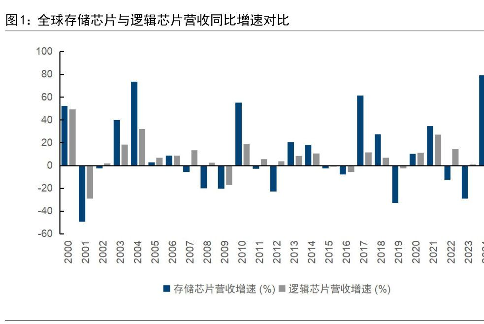
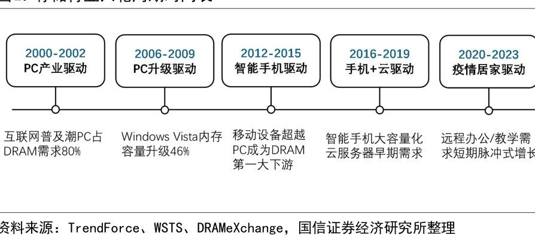

## Document Metadata

- Document ID: 029310346eb5a43937a82545263a6baa8d9d3416
- Document Title: 存储行业周期的历史回顾、现状解析与未来展望
- Document Type: PDF
- Issuing Organization: 国信证券股份有限公司
- Publication Date: 2026-08-25
- Reporting Period: null
- Source File: [M160_pdf.dfcfw.com_H3_AP202608251828419638_1.pdf](https://github.com/jadennevercode/CJCC-Knowledge-Base/blob/5ec8511eb834073c8bfbd79c94af196282d483cf/materials/%E8%B7%A8%E9%93%BE%EF%BC%9A%E4%BE%9B%E9%9C%80%E4%B8%8E%E4%BB%B7%E6%A0%BC%E5%8F%A3%E5%BE%84/M160_pdf.dfcfw.com_H3_AP202608251828419638_1.pdf)

## Structured Content

> 原文件：[M160_pdf.dfcfw.com_H3_AP202608251828419638_1.pdf](https://github.com/jadennevercode/CJCC-Knowledge-Base/blob/5ec8511eb834073c8bfbd79c94af196282d483cf/materials/%E8%B7%A8%E9%93%BE%EF%BC%9A%E4%BE%9B%E9%9C%80%E4%B8%8E%E4%BB%B7%E6%A0%BC%E5%8F%A3%E5%BE%84/M160_pdf.dfcfw.com_H3_AP202608251828419638_1.pdf)
> 转换方式：多模态逐页转录（页面图像 + 文本层交叉校验）

[Source Page: 1]

## 存储行业周期的历史回顾、现状解析与未来展望

## 核心观点

从历史周期规律来看，“需求快变、供给慢变”的天然错配是周期波动的核心根源。2000年以来行业共经历六轮完整周期，按核心驱动场景可划分为PC主导、智能手机主导、数据中心与AI主导三大阶段；伴随行业从分散竞争走向寡头垄断，单轮周期价格波动幅度持续收窄，头部原厂逐步形成逆周期调节能力。复盘历史可提炼出“超级周期”的三大刚性触发条件：下游出现行业级增量需求、供给端经历充分出清、技术迭代带来单位价值量跃升；2023年第四季度启动的本轮周期，是六轮中唯一同时高强度满足三大条件的周期，AI算力需求的长期持续性使其与传统消费电子驱动周期存在本质差异。

从本轮周期运行现状来看，行业呈现极致的结构性分化特征，核心运行逻辑已脱离传统周期框架。需求端，AI算力基础设施建设成为绝对增长引擎，HBM需求爆发式增长，企业级存储依托长协订单提供长期刚性支撑，消费电子需求占比历史性回落、对周期边际影响显著弱化，行业从“消费电子单引擎”转向“AI算力主导、企业级支撑、消费电子托底”的多元驱动格局。供给端，产能约束呈现三重结构性叠加：三大原厂高度垄断高端产能并定向投向HBM与企业级产品，消费级产能加速退出；先进封装与配套设备构成关键供给瓶颈，短期供给弹性显著低于晶圆产能；技术迭代释放的有效供给被HBM更高的晶圆消耗强度对冲，高端存储供需紧平衡持续强化。投融资端，全球产业资本大幅上调开支，资金高度聚焦HBM扩产、先进封装配套与下一代技术前瞻布局，韩、美、中三大产业集群各自加码产能建设，区域聚集特征突出。交易定价端，长协锁价模式全面替代现货成为高端存储主流交易方式，合约价主导定价权，不同品类价格走势显著分化，全产业链库存处于历史低位，进一步拉长景气周期时长。利润分配端，产业链利润向掌握高端产能的原厂环节集中，三大原厂利润率创下半导体制造业历史罕见水平，上游瓶颈配套环节分享次级红利，下游按客户绑定深度分层；国内产业已形成“通用市场全球前列、高端赛道从零起步”的二层格局，HBM领域与国际头部仍存2—3年代差。

从未来趋势推演来看，AI资本开支落地节奏、原厂扩产与技术迭代进度、宏观地缘变化是决定周期走向的三大核心变量。基于变量的不同组合，行业存在三类情景：乐观情景下超级周期景气度延续至2028年底，高端品类供需缺口持续存在；中性情景下结构性景气持续至2027年底，2028年逐步温和分化；悲观情景下周期或于2027年中见顶，通用存储出现阶段性价格调整。无论情景如何演化，产品结构高端化、供应链区域化分离是两大长期确定性方向，

[Source Page: 2]

以HBM为核心的高端存储将成为行业长期成长主线，三大产业集群的独立演进将逐步弱化存储价格的全球联动性。

[Source Page: 5]

# 一、历史回顾

## （一）存储周期的底层逻辑与经典阶段划分

存储行业是半导体行业中周期性最显著的细分赛道。以营收口径衡量，根据WSTS（世界半导体贸易统计组织）历年统计，全球存储芯片营收在周期高点年份的同比增速可达60%以上（如2017年同比+61.5%），在低点年份的同比降幅可达30%上下（如2019年同比-32.6%、2023年约-29%），波动幅度显著大于同期逻辑芯片及半导体整体市场。周期波动的核心根源，在于天然的供需错配属性。

图1：全球存储芯片与逻辑芯片营收同比增速对比

资料来源：WSTS，国信证券经济研究所整理；注：单位为%

需求端方面，下游PC、手机、服务器等终端需求属于快变量。据IDC与Gartner Dataquest统计，2001年全球PC出货量同比下滑约4.6%（Dataquest口径），出现自1985年以来的首次年度负增长；而据IDC季度跟踪，2020年第三季度全球PC出货量在疫情居家需求驱动下同比增长14.6%，前后两个时点的增速振幅超过20个百分点。手机端波动同样剧烈，据IDC统计，2022年全球智能手机出货量同比下滑11.3%，为2013年以来最大年度降幅。需求侧单季度级别的剧烈波动，直接决定了存储订单节奏的高频变化。

供给端方面，存储晶圆产能属于慢变量。据SEMI《World Fab Forecast》及三星、SK海力士、美光历年公开项目建设时间表，一座新建12英寸存储晶圆厂从土建动工到实现稳定量产通常需要24-36个月；即便在既有厂区内进行产线改造或制程转换，从设备搬入到良率爬坡完成也需12-18个月。产能投放以“年”计，而需求变化以“季度”计，两者之间存在天然时差。

“需求快变、供给慢变”的内在矛盾，天然决定了行业“价格上行→产能扩张→产能过剩→价格下跌→产能收缩→供需再平衡”的周期性轮回，这是所有存储周期运行的底层逻辑。

在周期划分上，不同机构对存储周期的划分可能并不统一。本报告按DRAM价格完整“上行-下行”闭环细拆，即以DRAM合约价趋势性拐点为划分基准、以WSTS年度营收增速交叉验证，将2000-2026年划分为六轮完整周期。

从波动幅度看，深度调整在历史上反复出现：1996-1998年亚洲金融危机期间，DRAM价格累计最大跌幅超过90%；

[Source Page: 6]

2001年互联网泡沫破裂后，据美光财报，其2001财年第四季度（2001年6-8月）存储产品平均售价环比下跌约55%、较上年同期下跌约85%，可作为行业价格深跌的缩影；2022-2023年的调整中，DRAM价格累计下跌约58%。综合来看，单次下行最大跌幅超80%的深度调整，主要集中于2009年以前厂商分散竞争的阶段；2012年后随行业集中度提升，单轮最大跌幅收窄至50%-70%区间，30%-60%的区间波动为行业常态。

表1：DRAM主流颗粒价格（美元/颗）

| 年份 | 周期阶段 | 主流DRAM规格 | 代表性价格（美元/颗） | 价格区间（美元/颗） | 关键事件 |
| --- | --- | --- | --- | --- | --- |
| 2000 | 上行顶点 | 64Mb SDRAM | 1.5 | 1.5-8.0 | 互联网泡沫顶点，年初8.0年末暴跌至1.5 |
| 2001 | 深度下行 | 128Mb SDRAM | 0.8 | <1.0 | 泡沫破裂，需求崩塌，价格跌破现金成本 |
| 2002 | 弱复苏 | 256Mb DDR | 3.5 | 3.0-4.0 | 行业触底，DDR开始替代SDRAM |
| 2003 | 上行期 | 256Mb DDR | 3.5 | 3.5-3.8 | 供需紧平衡，价格温和上涨 |
| 2004 | 周期高点 | 256Mb DDR | 5.8 | 5.0-6.5 | 严重供需错配，价格暴涨 |
| 2005 | 下行期 | 512Mb DDR2 | 4.5 | 4.0-5.0 | 供给增加，价格从高位回落 |
| 2006 | 震荡筑底 | 512Mb DDR2 | 2.5 | 2.0-3.0 | Vista预期落空，库存积压 |
| 2007 | 上行期 | 1Gb DDR2 | 2.5 | 2.0-3.0 | 价格阶段性反弹，次贷危机初现 |
| 2008 | 深度下行 | 1Gb DDR2 | 0.8 | <1.0 | 全球金融危机，需求骤停，价格雪崩 |
| 2009 | 周期底部 | 1Gb DDR2/DDR3 | 0.8 | 0.8-2.0 | 历史级低谷，奇梦达破产，年末DDR3反弹 |
| 2010 | 强劲复苏 | 1Gb DDR3 | 2.8 | 2.5-3.0 | 经济复苏+智能机初期红利，量价齐升 |
| 2011 | 下行期 | 2Gb DDR3 | 1.5 | 1.5 | 泰国洪灾+PC疲软，供过于求 |
| 2012 | 出清/拐点 | 4Gb DDR3 | 1.4 | 1.2-1.5 | 尔必达破产，三大寡头格局初现 |
| 2013 | 上行期 | 4Gb DDR3 | 3.5 | 3.0-4.0 | 寡头控产效应显现，价格反弹 |
| 2014 | 高位盘整 | 4Gb DDR3 | 3.5 | 3.5-3.7 | 智能手机大容量化，供需两旺 |
| 2015 | 下行期 | 4Gb DDR3 | 1.5 | 1.5 | PC需求衰退，新一轮去库存 |
| 2016 | 筑底反转 | 8Gb DDR4 | 4 | 2.5-4.0 | 云计算+数据中心，DDR4渗透突破 |
| 2017 | 超级周期 | 8Gb DDR4 | 9.5 | 9.0-9.5 | 手机+云爆发，产能严重不足，价格翻倍 |
| 2018 | 见顶回落 | 8Gb DDR4 | 6 | 6.0-9.0 | 前三季度$9.0，Q4库存高企+贸易摩擦暴跌 |
| 2019 | 深度下行 | 8Gb DDR4 | 2.5 | 2.5 | 贸易战+产能过剩，全年单边下跌 |
| 2020 | 弱复苏 | 8Gb DDR4 | 3 | 3 | 疫情居家办公，PC/笔电短期需求 |
| 2021 | 上行高点 | 8Gb DDR4 | 4.5 | 4.0-5.0 | 缺芯潮，供应链恐慌性囤货 |
| 2022 | 崩塌下行 | 8Gb DDR4 | 2 | 2 | 疫情红利消退，手机/PC出货量双位数下滑 |
| 2023 | 历史级大底 | 8Gb DDR4 | 1.1 | 1.0-1.2 | 极致去库存，价格跌破所有厂商现金成本 |
| 2024 | 复苏反转 | DDR4/DDR5 | 1.8 | 1.5-2.0 | AI训练算力爆发，DDR5渗透率过半 |
| 2025 | 加速上行 | DDR5/HBM | 2.5 | >2.5 | AI推理+长协锁价，HBM极度紧缺 |
| 2026E | 超级周期 | DDR5/HBM4 | - | 长协溢价极高 | AI基础设施重构，HBM产能售罄 |

资料来源：DRAMeXchange、TrendForce、iSuppli，国信证券经济研究所整理

按核心驱动场景，本文将六轮周期归为三大经典阶段。划分标准为“该轮上行期DRAM比特需求增量的主导来源”，而非当时的叙事热点。前两轮（2000-2002、2006-2009）为PC及服务器驱动周期。据行业历史数据，2001年前后PC占DRAM总需求约80%，是绝对主导下游；2006-2009年周期的上行主要由Windows Vista操作系统带动的PC内存容量升级与企业服务器需求驱动，同期功能机单机存储以NOR闪存及小容量芯片为主，占DRAM比特需求的比重很低。因此该轮虽伴随功能机普及的叙事，需求增量的主导权仍在PC端，归入PC驱动阶段。中间两轮（2012-2015、2016-2019）为智能手机驱动周期。据IHS iSuppli统计，2012年第二季度PC占DRAM比特需求的份额首次跌破50%，智能手机与平板合计首次超越PC成为第一大下游，智能手机换机潮与单机容量升级构成该阶段需求增量的主导来源。

[Source Page: 7]

最近两轮（2020-2023、2023年至今）为数据中心与AI驱动周期。据TrendForce统计，2023年服务器DRAM位元产出占比（37.6%）正式超越移动DRAM（36.8%），成为第一大应用领域；2023年以来，HBM与AI服务器需求成为行业增量的绝对主导。

每一轮周期的上行幅度、持续时长、产业传导特征，均由核心下游需求增量与供给端产能扩张节奏共同决定；而阶段驱动力的切换（PC→智能手机→数据中心/AI）正是理解各轮周期量价特征差异的第一把钥匙。

## （二）历史周期的核心驱动因素与波动特征复盘

### 1、六轮周期的驱动与运行复盘

**第一阶段为PC产业主导的两轮周期。2000-2002年周期核心驱动为互联网普及潮带动的PC放量，当时PC占DRAM总需求约八成。**上行期自1999年至2000年约一年半：据Gartner Dataquest当年统计，2000年全球DRAM市场规模约315亿美元，较1999年增长约三成（另一行业统计口径为289亿美元，同比增长28.4%），全年持续供不应求。下行期自2001年初持续约两年：据美光2001财年财报，其2001财年第四季度（自然年2001年6-8月）存储产品平均售价较上年同期下跌约85%，较上季度下跌约55%；行业层面，据Gartner Dataquest统计，DRAM价格在2000年中至2001年中累计下降约80%，当年128Mbit芯片现货价一度跌破2美元，合约价跌破3美元，双双击穿制造成本；同期全球DRAM市场营收自2000年的315亿美元骤降至2001年的约140亿美元，同比萎缩约55%-56%，为当时行业史上最严重年度收缩。终端侧，据IDC与Gartner Dataquest统计，Dataquest口径下2001年全球PC出货量同比下滑约4.6%，出现1985年以来首次年度负增长。这一轮深跌加速了全球厂商分化：韩系厂商凭借成本优势逆势扩大份额，美、日、欧厂商逐步退出主流市场或转向利基产品。据美国国会研究处记载，到2001年全球DRAM市场已由四家主要厂商主导，为此后韩系主导格局埋下伏笔。

图2：存储行业六轮周期时间表

- 2000-2002 PC产业驱动：互联网普及潮PC占DRAM需求80%
- 2006-2009 PC升级驱动：Windows Vista内存容量升级46%
- 2012-2015智能手机驱动：移动设备超越PC成为DRAM第一大下游
- 2016-2019手机+云驱动：智能手机大容量化 云服务器早期需求
- 2020-2023疫情居家驱动：远程办公/教学需求 短期脉冲式增长
- 2023至今AI算力驱动：HBM需求爆发AI服务器出货+31%

资料来源：TrendForce、WSTS、DRAMeXchange，国信证券经济研究所整理

**第二阶段的首轮（2006-2009年）核心驱动为Windows Vista操作系统带动的PC内存容量升级预期叠加企业服务器需求。**三星与IDC当年曾估计，仅Vista操作系统即可带动单台PC平均内存容量提升约46%，对应约230亿美元的产值空间。上行期自2006年至2007年上半年约一年半。据iSuppli统计，2006年全球DRAM市场营收约340亿美元，同比增长约三成半；2007年1月Vista正式上市，但上半年行业已因扩产竞赛陷入供过于求，主流DDR2合约价累计下跌约五成，直至当年7月，Vista备货叠加旺季预期才带动DDR2现货价格反弹约12%-20%，升势未能延续。下行期自2007年下半年至2009年初约两年。据iSuppli统计，2007年DRAM市场营收萎缩约7%-8%至约315亿美元，第四季度全行业营业亏损近30亿美元；2008年进一步萎缩约25%至约236亿美元。2008年第四季度为这一轮深谷，当季产业营收仅约42亿美元。

[Source Page: 8]

据iSuppli统计业界收入平均环比下滑约38%，集邦DRAMeXchange口径更是逾40%，为当时有统计以来最大单季降幅；主流DDR2 667MHz 1Gb颗粒现货价自10月初的约1.25美元崩落至12月中旬最低的约0.58美元，10月底起跌破厂商约1美元的现金成本，逼近材料成本线，价格自这一轮峰值累计跌幅超过八成。这一轮周期是行业整合的分水岭。2009年1月23日，曾为全球第三大、彼时全球供货份额约一成的德国DRAM厂商奇梦达向慕尼黑地方法院提交破产申请，成为本轮出清的标志性事件，消息公布后现货价格随即见底回升；据集邦DRAMeXchange统计，韩系双雄（三星+SK海力士）合计市场份额由2008年第四季度的46.3%升至2009年第一季度的50.1%，首次突破五成，第三季度进一步升至54.1%，韩系主导格局自此确立。

**第二阶段为智能手机主导的两轮周期。2012-2015年周期核心驱动为智能手机普及初期需求。**据IHS iSuppli统计，2012年第二季度移动设备（智能手机与平板合计）DRAM比特需求占比首次超越PC成为第一大下游。上行期自2012年下半年至2014年约两年。据集邦DRAMeXchange统计，2013年4GB内存模组合约均价自约17美元涨至约33美元，涨幅逼近一倍；2013年全球DRAM产业营收达352亿美元，同比增长32.5%；2014年产业景气超预期，第四季度单季产值达130亿美元，创单季历史新高，全年产值约460亿美元，明显超出该机构2013年末395亿美元的预估。这一轮周期见证了行业史上最重要事件，2012年2月27日，日本最大DRAM厂商尔必达在连续五个季度亏损后，依《公司更生法》向东京地方法院申请破产保护，负债高达4480亿日元（约55亿美元），为日本制造业史上最大破产案；2012年7月，美光与其签署收购协议，以约25亿美元收购尔必达全部股权（其中7.5亿美元以现金支付，其余17.5亿美元于2019年前分期支付），另以3.34亿美元从力晶手中收购其台湾合资厂瑞晶电子24%股权（交易完成后美光合计掌握瑞晶89%股权），交易于2013年7月31日完成交割，美光借此跃升为全球第二大DRAM厂商。2013年9月4日，SK海力士无锡工厂发生火灾，该厂产量约占全球DRAM的12%，占SK海力士总产出的一半。据集邦DRAMeXchange统计，火灾后至9月24日DRAM现货价累计上涨42%，创两年来新高，成为本轮上行斜率最陡的一段。下行期自2014年第四季度至2016年上半年，4GB DDR3模组合约价自2014年10月的32.75美元跌至2016年6月的12.5美元，累计跌幅约六成二，至2016年6月方止跌回稳。

**2016-2019年周期核心驱动为智能手机大容量化（单机存储搭载量持续攀升）叠加云服务器早期需求**；同时三大原厂将产能自标准型DRAM转向移动式与服务器用产品，叠加先进制程转换良率不及预期，供给端扩张保持纪律。上行期自2016年第三季度至2018年第三季度，持续九个季度。据集邦DRAMeXchange统计，2016年第四季度标准型DRAM合约价飙涨逾30%，带动当季全球DRAM营收环比增长18.2%；据IC Insights统计，2017年DRAM平均售价同比上涨约47%，创当时历史最大年度涨幅；全上行期主流4GB模组合约均价自2016年6月谷底的约12.5美元升至2018年第三季度的34.5美元，累计涨幅超过一倍半。据TrendForce统计，2018年10月合约价正式起跌，4GB模组均价自34.5美元滑落至31美元，单月跌幅约一成，结束持续逾两年的上涨。下行期自2018年第四季度持续约一年余。据TrendForce统计，2019年全年DRAM报价累计跌幅超过五成；据WSTS统计，2019年全球存储营收同比下滑32.6%，其中DRAM下滑37.1%。这一轮周期后，三星、SK海力士、美光三大原厂垄断格局正式确立。据TrendForce统计，2018年三家合计DRAM市场份额达95.4%（第一季度）至95.7%（第三季度），当年第三季度三大原厂营业利润率亦同步创下历史新高（三星70%、SK海力士66%、美光62%）。

**第三阶段为数据中心与AI主导的两轮周期。2020—2023年周期的核心驱动为全**球疫情下的居家办公与远程教学需求。

[Source Page: 9]

上行期自2020年第四季度至2021年第三季度约四个季度：2021年第一季度DRAM现货价格同比上涨约50%，但同期合约价涨幅仅0%至5%，涨势主要由利基型产品现货领涨；至2021年第二季度整体DRAM合约价环比涨幅扩大至18%至23%，其中PC DRAM环比上涨23%至28%、服务器DRAM环比上涨20%至25%，全上行期整体合约价累计涨幅约三至四成。下行期自2021年第四季度起合约价连跌八个季度，至2023年第三季度仍环比小幅下跌，至2023年第四季度方见底回升。受价格回落影响，2022年全球存储市场规模同比下滑约13%至14%，终结2020至2021年的连续增长。下行后期产业出清加速：2022年第四季度DRAM产业营收环比下滑32.5%，逼近2008年金融海啸时约36%的历史最大单季跌幅；该季度DDR4服务器DRAM合约价环比下跌23%至28%、DDR5环比下跌30%至35%。这一轮下行价格自峰值累计跌幅约五至六成。下行期间三星电子DS部门2022年第四季度营业利润自8830亿韩元骤降至2700亿韩元，同比下滑约97%，美光于2022年11月宣布DRAM与NAND晶圆投片较2022财年第四季度削减约20%并大幅削减资本开支，SK海力士亦自2022年第四季度起宣布减产，稼动率自92%向82%下调，供给端约束自此持续强化。

**2023年第四季度启动的新一轮周期，核心驱动为AI算力基础设施建设。**据TrendForce统计，2023年第四季度Mobile DRAM合约价环比上涨13%至18%，为当季领涨品类并带动DRAM合约价普遍上行，本轮上行正式开启。2025年全球DRAM产值达1657亿美元，同比增长73%；其中2025年第四季度在DDR5需求拉动下单季合约价涨幅达53%至58%，高于其统计的历史循环单季最高约35%的水平，该机构评价本轮涨势幅度显著高于历史循环，被市场称为AI驱动的存储“超级周期”。

纵观六轮复盘，每轮周期的驱动切换、量价幅度与格局演化，构成了归纳行业周期波动特征与传导规律的事实基础。

### 2、周期波动的核心特征

从六轮周期的长期演化来看，行业运行呈现若干稳定特征，其中最具产业含义的有二：格局决定波动、消费电子决定节奏。

**其一，行业格局决定周期波动幅度，二者呈显著负相关。**2000年代中后期，全球DRAM市场仍有三星、SK海力士、美光、奇梦达、尔必达及南亚科、力晶、茂德、华邦等近十家主要厂商同台竞争，集中度较低。分散竞争格局下，各家厂商在价格上行期竞相扩产、下行期降价保份额，价格战没有刹车机制：2001-2002年与2007-2009年两轮下行，DRAM价格自峰值累计跌幅均超过八成，其中2008年第四季度单季产业营收环比下滑约38%至40%，创当时历史纪录。此后行业集中度拾级而上，2009年第一季度韩系双雄合计份额首次突破50%，2014年第四季度三大原厂合计份额达90%以上，2018年进一步升至约95%。与集中度提升同步，单轮最大跌幅明显收窄，2015-2016年下行累计约六成，2018-2019年下行全年跌幅超五成，2021-2023年下行累计约58%，深度调整从分散竞争时代的超八成，收敛至寡头格局时代的六成左右。

格局改善之所以能熨平波动，核心在于头部原厂形成了逆周期调节能力。价格下行期主动缩减供给，比如2022年第四季度起美光等原厂陆续宣布减产以应对价格深跌；价格上行期则优先将产能投向高毛利产品而非全面扩产，比如2016-2018年上行期中，三大原厂持续将产能自标准型DRAM转向移动式与服务器用产品，以供给纪律维持价格弹性。

**其二，消费电子是传统周期的核心边际影响变量。**传统周期中，PC与智能手机合计长期占据DRAM比特需求的五成以上，比如2001年前后PC单一品类即占约80%，至2019年移动设备与PC仍分别占约41%、13%。

[Source Page: 10]

由于消费电子需求基数大、换机与购机节奏弹性高，其边际变化直接主导行业周期节奏。2018年、2022年两轮深度调整，核心诱因均为消费电子需求的周期性崩塌：据IDC统计，2018年全球智能手机出货量14.05亿部、同比下滑4.1%，连续两年减少，叠加2016-2018年上行期扩产产能的集中释放，DRAM合约价自2018年10月见顶回落，2019年全年累计跌幅超过五成；2022年疫情红利消退后，据IDC统计，全球PC出货量2.923亿台、同比下滑16.5%（其中第四季度单季下滑28.1%），全球智能手机出货量同比下滑11.3%、为2013年以来最大年度降幅，双双出现两位数下滑，叠加原厂前期扩张产能集中投产与产业链库存高企，本轮下行DRAM价格累计下跌约58%。

需要指出的是，消费电子对周期的边际主导力在本轮周期中正显著弱化。2023年以来的上行由AI算力与数据中心需求驱动，消费电子复苏幅度不足以左右行业走向。这一变化本身，正是本轮周期区别于传统周期的重要注脚。

### 3、价格传导机制与传导时滞

存储行业的价格传导遵循“现货价格→合约价格→渠道库存→原厂产能调整”的链条，各环节存在节奏明确的时滞，且各环节的时滞量级差异很大，需要分层理解。

第一层是现货向合约的传导，时滞约一个季度。存储现货市场按日交易、对供需边际变化即时反应，而合约价是原厂与品牌客户之间的长期订单价格，通常按季度谈判重签。历史上现货的领先性反复得到验证：2013年9月4日SK海力士无锡工厂火灾后，现货价在20天内累计飙升42%，而当月合约价一度“难产”，至中秋节后才明朗，9月合约均价环比上涨8.86%，更明显的涨幅落在10-11月；2016年第三季度现货起涨后，第四季度标准型DRAM合约价单季即上涨逾30%；2020年第四季度现货启动上涨，2021年第一季度现货价同比涨幅已达约50%，而同期合约价环比仅上涨约8%，至第二季度合约价环比涨幅才扩大至18%-23%。需要说明的是，现货领先并非铁律，2023年第三季度至2024年的上行由供给收缩主导，DRAM现货价格涨幅反而落后于合约，区间涨幅仅20%-70%。传导方向与弹性，取决于周期由需求拉动还是供给收缩驱动。

第二层是价格与库存向原厂产能决策的传导，时滞约两至四个季度。价格持续上行、合约价覆盖扩张成本后，原厂才会正式启动新产能建设；价格持续下行、渠道库存高企时，原厂才会落实减产。以最近一轮下行为例，DRAM合约价自2021年第四季度转跌，产业链库存一度累积至创纪录的约3-4个月供应量，而美光等原厂至2022年第四季度才陆续宣布减产。从价格信号到产能决策，间隔约三至四个季度。

第三层是产能决策到有效产能落地的传导，时滞以年计。据SEMI《World Fab Forecast》及原厂公开项目建设时间表，新建12英寸存储晶圆厂从动工到稳定量产需24-36个月。综合来看，价格信号在现货与合约之间的传导约需1个季度，但“价格信号→原厂产能决策→有效产能变化”的全链条时滞长达两年以上。这正是之前所述“需求快变、供给慢变”矛盾在价格机制上的具体体现，也是周期得以自我强化的传动装置。

值得注意的是，本轮周期中传统传导机制正在发生结构性变化。随着三大原厂将新增产能全部定向投向HBM与企业级产品，并以长期供货协议锁定核心客户需求，合约价的主导权显著强化，现货市场的领先指标意义相应弱化。2026年以来现货与合约走势多次“撕裂”：3月国内主流DDR4现货价单月跳水超30%，而同期合约价延续上涨；7月64GB服务器DRAM现货报价突破3100美元，较约1380美元的合约价高出约146%；据TrendForce统计，2026年第一季度合约价涨幅达60%以上、部分产品线接近翻倍，

[Source Page: 11]

原厂对核心客户普遍转向竞价与长协锁量模式。传统周期中“现货领涨领跌→合约跟随→产能滞后调整”的节律，正在让位于“长协定价→产能定向投放”的新机制。

## （三）历史周期的核心驱动因素与波动特征复盘

复盘六轮周期可以发现，涨幅最大、持续性最强的上行阶段，通常在需求、供给、技术三个维度同时具备某些共性条件。

表2：六轮存储周期三大条件

| 条件编号 | 条件名称 | 具体内涵 |
| --- | --- | --- |
| 条件一 | 下游出现行业级增量需求 | 非简单存量升级，而是全新应用场景带来的结构性需求增量 |
| 条件二 | 供给端经历充分出清 | 头部厂商无盲目扩产计划、产能纪律显著改善 |
| 条件三 | 技术迭代带来单位价值量跃升 | 同等产能下行业营收规模显著放大 |

资料来源：TrendForce集邦咨询，国信证券经济研究所整理

**2023年启动的本轮周期是六轮中唯一三大条件同时以高强度满足的周期。**需求维度，AI算力基础设施建设不仅创造了HBM这一全新需求品类，更具备长期持续性。历史超级周期的增量多为单一赛道的短期爆发，比如疫情远程需求仅支撑约四个季度的上行，而TrendForce预计本轮DRAM涨势将延续至2027年，需求量级与持续时长均远超传统周期。供给维度，本轮出清更彻底，纪律更刚性：2022-2023年深跌中，三大原厂将产能利用率降至历史低点，并以近乎对半砍的力度削减资本开支，比如SK海力士2023年资本开支同比下降约54%；此后产能扩张逻辑从“价格上涨即全面扩产”彻底转向“基于长期需求的定向扩产”，2023年第四季度起，SK海力士宣布新增投资集中于HBM、DDR5、LPDDR5等高端产品，美光2026财年资本开支预算上调至约200亿美元，主要投向HBM产能，新增产能不再对消费级市场形成供给冲击。技术维度，HBM带来真正的单位价值量跃迁：据TrendForce统计，HBM3e定价原为服务器DDR5的四至五倍，不过2025年末以来随DDR5价格大涨，价差有所收敛；且HBM对晶圆资源的消耗约为常规DRAM的三倍，每多投1片HBM晶圆，常规DRAM供给约减少3片；2025年HBM占DRAM产业总产值的比重预计已超过30%。同时，HBM的良率控制与先进封装工艺大幅抬高了行业技术壁垒，进一步强化供给端刚性约束。

表3：六轮存储周期三大条件满足情况对比

| 周期轮次 | 时间区间 | 驱动因素 | 条件一 | 条件二 | 条件三 | 满足条数 | 典型特征 |
| --- | --- | --- | --- | --- | --- | --- | --- |
| 第一轮 | 2000-2002年 | 互联网PC普及 | 满足 | 不满足 | 不满足 | 1条 | 行业处于近十家厂商分散竞争阶段，供给无出清；SDR→DDR切换属常规迭代 |
| 第二轮 | 2006-2009年 | Vista带动内存升级 | 不满足 | 不满足 | 不满足 | 0条 | Vista偏存量升级且销量不及预期；奇梦达破产发生在周期尾段（是结果而非前提）；DDR2→DDR3属常规迭代 |
| 第三轮 | 2012-2015年 | 智能手机普及 | 满足 | 满足 | 不满足 | 2条 | 尔必达破产实现深度出清（2012年全球DRAM资本开支同比-33%至57亿美元）；移动DRAM放量未带来单位价值量数倍跃迁 |
| 第四轮 | 2016-2019年 | 智能手机大容量化+云服务器早期需求 | 满足 | 满足 | 不满足 | 2条 | 三大原厂合计份额约95%支撑供给纪律，成就2016-2018年“超级周期”上行；DDR4渗透属常规迭代 |
| 第五轮 | 2020-2023年 | 疫情远程需求 | 部分满足 | 部分满足 | 不满足 | 1.5条 | 疫情需求属短期脉冲（上行仅约4季度即逆转）；SK海力士资本开支2021-2022年大幅回升至19.7万亿韩元（超2018年峰值），纪律不彻底；DDR5渗透占比极低 |
| 第六轮 | 2023年至今 | AI算力基础设施建设 | 满足 | 满足 | 满足 | 3条 | 六轮中唯一三大条件同时以高强度满足 |

资料来源：TrendForce集邦咨询，国信证券经济研究所整理

[Source Page: 12]

还应注意，本轮周期在三大条件之外额外叠加了长期成长变量：AI需求正从大模型训练端向推理端延伸，存储需求从“一次性投入”转向“长期算力基础设施投入”，这使本轮周期与传统消费电子驱动的周期存在本质差异，也是其被摩根士丹利等机构定义为AI驱动“超级周期”的核心原因。

厘清历史周期的底层逻辑、演化特征与本轮周期的定位差异后，下文将进一步从供需格局、投融资、价格机制、利润分配等维度，全面拆解本轮存储超级周期的现状特征与结构性矛盾。

# 二、现状解析

2023年下半年，存储行业在经历三个季度的价格下行后，正式结束疫情周期调整期，进入新一轮上行周期。2025年下半年起，行业运行节奏彻底脱离传统周期框架，价格上涨幅度、需求持续强度、供给约束刚性程度均远超市场此前最乐观预期。本轮周期核心特征体现为极致的结构性分化：一端是AI算力驱动的高端存储持续紧缺，另一端是传统消费级存储供需总体平稳。本章按照需求、供给、投融资、交易定价、利润分配的逻辑框架，逐层拆解本轮周期的现状特征与内在矛盾。

## （一）需求端：AI算力爆发与结构性分化

本轮存储超级周期最核心的变化是需求结构重构，行业从此前“消费电子单引擎主导”的格局，转向“AI算力主导、企业级需求支撑、消费电子托底”的多元驱动结构，消费电子对周期的边际影响被大幅弱化。

### 1、AI算力是核心增长引擎

**AI算力基础设施建设是拉动本轮存储需求爆发的绝对核心驱动**，其需求量级显著超出行业传统认知边界。从传导逻辑看，AI大模型的训练、推理、多模态数据处理都伴随参数与数据在计算单元与存储单元之间的高频搬运，存储带宽而非算力本身日益成为系统性能的瓶颈，即业界所称的“内存墙”约束。“HBM之父”、韩国科学技术院（KAIST）金正浩教授在2026年公开访谈中指出，受内存带宽制约，GPU真正用于有效计算的时间仅约10%，要充分释放GPU算力，必须配套足量的高带宽存储。

从需求总量看，据TrendForce集邦咨询AI Server产业研究，2026年全球AI服务器出货量同比增速已上调至31%左右（该机构2025年10月30日预估为“年增20%以上”，2026年1月上修至“28%以上”，2026年8月3日再度上调至31%左右，年内连续三次上调），占整体服务器出货比重升至17%以上。需要说明的是，31%为出货量口径；叠加单机存储搭载量的代际提升，AI服务器拉动的存储需求在金额与位元量口径下的增速均显著高于出货量增速。据美光科技在2023年6月财报电话会议上的披露，AI服务器的DRAM用量约为普通服务器的6-8倍，NAND用量约为3倍；以整机规格实证，NVIDIA DGX H100系统搭载8颗H100 GPU，合计配置640GB HBM显存与2TB DDR5系统内存，而同期传统双路服务器的内存配置通常为512GB-1TB DRAM且不含HBM。

从品类结构看，HBM是AI算力的核心刚需载体。据SEMI中国总裁冯莉援引的行业预测，2026年全球HBM市场规模将同比增长58%至约546亿美元，占整体DRAM市场比重接近四成；据TrendForce集邦咨询预估，2026年全球HBM位元出货量将突破300亿Gb，HBM4已于2026年第二季度量产出货，下半年起超越HBM3e成为市场主流。单加速器搭载容量沿英伟达产品路线图持续跃升：H100的80GB（HBM3）→H200的141GB（HBM3e）→B200/GB200的192GB（HBM3e）→GB300的288GB，

[Source Page: 13]

下一代Rubin平台单GPU将搭载288GB HBM4。

更关键的是需求结构正在持续优化。2026年以前，核心增量来自大模型训练端；2026年起，需求重心加速转向以AI智能体（Agent）为核心的推理端。据TrendForce集邦咨询2026年5月发布的AI产业研究，2026年北美五大云厂商合计AI训练算力同比增长约56%，而AI推理算力同比增长高达120%；AMD公司CEO苏姿丰预计2026年全球约60%的AI算力将用于推理，巴克莱预测2026年推理计算需求将占AI总算力需求的70%以上。训练需求近似一次性投入，推理需求则随应用渗透持续放量，这一结构变化意味着AI存储需求正从“一次性训练投入”转向“长期持续的算力基础设施运营投入”，是支撑本轮周期长期景气的核心底层逻辑。另外，资金端也可直接佐证需求刚性。据TrendForce集邦咨询，2026年全球九大云厂商（美系Google、AWS、Meta、微软、Oracle及中系字节跳动、腾讯、阿里巴巴、百度）合计资本支出预估将突破约8867亿美元，同比年增约九成，且年内多次上修。

### 2、企业级存储提供长期刚性支撑

**企业级存储是本轮超级周期的第二增长极，也是行业刚性增量的基础。**与历史周期中企业级需求跟随宏观IT支出波动不同，本轮企业级需求直接绑定AI算力基础设施资本开支，与消费电子周期的相关性显著弱化。云厂商是企业级存储的核心下游，据TrendForce集邦咨询，2026年全球九大云厂商合计资本支出预估将突破约8867亿美元，同比年增约九成，资本开支向AI服务器、数据中心SSD与服务器内存的集中投放，直接带动企业级存储需求同步爆发。

表4：北美五大云厂商资本支出预估

| 厂商 | 2026年资本支出预估 | 同比增幅 | 主要投向 |
| --- | --- | --- | --- |
| Amazon/AWS | 2000亿美元 | +141%（对比2025年830亿美元） | AWS、AI芯片、机器人 |
| Google/Alphabet | 1800亿-1900亿美元 | +257%（对比2025年525亿美元） | TPU芯片、AI算力、云需求 |
| Microsoft | 1900亿美元 | +78%（对比2025年813亿美元） | Azure、OpenAI算力 |
| Meta | 1250亿-1450亿美元 | +73%（对比2025年722亿美元） | 超级智能实验室、自研ASIC |
| Oracle | 500亿美元（2026财年） | +138%（对比2025年210亿美元） | OCI、数据中心 |

资料来源：TrendForce集邦咨询，国信证券经济研究所整理

SSD端，据TrendForce集邦咨询2026年1月产业调查，受北美云厂商加码AI基础建设驱动，2026年全球服务器市场迎来成长高峰，企业级SSD需求预期将首度超越智能手机，成为NAND Flash第一大应用。实际运行数据印证了该判断，据TrendForce集邦咨询官方披露，2026年第一季度全球前五大企业级SSD品牌合计营收达184.6亿美元、环比大增86.1%，创单季历史新高，其中三星以70.5亿美元居首（环比+92.8%），SK海力士集团（含Solidigm）46.4亿美元，美光30.9亿美元；当季企业级SSD合约价环比上涨约80%，各供应商库存已降至历史低点，产出速度远赶不上订单增长。

内存端，服务器用内存已完成向DDR5的代际切换。据TrendForce数据，2025年DDR5在服务器内存市场的渗透率已跨过80%门槛，2026年预计进一步推高至90%；同期DDR4新需求持续萎缩，行业甚至已有供应商开始讨论其停产时间表。这意味着服务器内存的增量需求全部落在DDR5及更高端的HBM品类上，企业级需求增长与原厂的高端产能倾斜战略形成闭环。

更关键的是交易模式的重构。企业级存储采购已从传统现货交易全面转向长期供货协议（LTA）锁价，构成需求刚性的机制性保障。据高盛2026年8月发布的三星、SK海力士、美光、闪迪四家原厂LTA条款横向对比研报，本轮长协覆盖率由2023-2025年行业常规的20%-30%跃升至2026年的50%以上，

[Source Page: 14]

合约期限以五年为主，部分三年，并普遍引入预付款与财务担保机制。从原厂一手披露看，三星预计多年期订单将达计划产能的60%-70%，其中HBM先进产能锁定率超90%，且已收到约四分之一的合约预付款；美光已签署16份战略客户协议，覆盖约20%的DRAM出货量与三分之一的NAND出货量，预计收到约220亿美元预付款；闪迪已签署八份长期供货协议，最低总收入达939亿美元，加权平均期限超过四年。头部云厂商以真金白银的预付款锁定未来三至五年的供应，意味着企业级存储需求的量级已被合约结构化锚定。这种“先付款、后提货”的需求形态在历轮周期中从未出现，是“长期刚性支撑”的核心依据。

### 3、消费电子需求边际影响显著弱化

**与历史周期的一个本质差异在于：本轮超级周期中，消费电子已从存储周期的“驱动者”变为“承受者”，其对行业周期的边际影响能力大幅下降。**

从需求结构看，消费电子的占比已发生历史性易位。据TrendForce集邦咨询MTS 2026存储产业趋势研讨会发布的数据，AI服务器（含HBM与服务器DDR5）对DRAM位元的消耗量自2024年起急剧增加，预计2026年约占全球DRAM总供应量的66%，2027年可能进一步提升至70%以上；智能手机、PC、汽车/工控/网通及其他消费电子合计仅分得约34%，其中智能手机约12%，PC/笔电约10%。与传统周期中PC与智能手机合计长期占据DRAM总需求六成以上相对比，消费电子的需求占比已从主导量级压缩至约三分之一，这一占比结构表明消费电子对行业周期走向的边际定价权已经易手。

从终端出货看，2026年消费电子正经历的不是复苏，而是存储涨价挤压下的深度收缩。据IDC于2026年3月发布的全球PC与智能手机市场预测，受存储芯片供应紧缺与价格持续上涨冲击，2026年全球智能手机出货量预计同比下降12.9%，为有记录以来最大年度跌幅；全球PC出货量预计下降11.3%，复苏时间被推迟至2028年；两大品类平均售价预计上涨约14%，部分OEM厂商被迫以降配应对成本压力（如12GB+256GB机型调整为8GB+128GB）。Gartner与Counterpoint的同期预测方向一致，2026年全球PC出货量下滑约10.4%，智能手机出货量跌破11亿部，为2013年以来最低水平。IDC在报告中明确指出，短缺的结构性因素在于“AI基础设施需求与消费设备争夺同一DRAM和NAND产能”，并预计存储危机将持续至2027年。换言之，本轮消费电子的收缩本身就是超级周期的结果而非原因。即便智能手机与PC出现历史性下滑，2026年存储价格与原厂盈利仍屡创历史新高，这是“消费电子边际影响显著弱化”最直接的现实证据。

从供给响应看，消费电子需求的任何波动都已无法获得产能端的响应。三大原厂不仅停止了消费级产能扩张，更在主动退出成熟产品线。据TrendForce报道，三星已于2025年6月停止接收DDR4订单，同年12月完成最后出货，美光于2026年第一季度完成DDR4最后出货，SK海力士于2026年4月完成DDR4退出，三家产能全面转向DDR5与HBM；三星DDR4产能已降至2025年水平的20%以下，产线设备多已拆除，即便市场价格信号反转，重建产能也需18-24个月。供给端的结构性退出意味着消费电子与行业景气之间的传统传导链条已被切断，消费级需求的短期波动既不会引发原厂产能回补，也不会对行业高景气度造成实质性冲击，这与前述“2018年、2022年消费电子崩塌直接主导周期下行”的历史机制形成鲜明对照，本轮周期的运行逻辑已截然不同。

## （二）供给端：产能约束、先进封装瓶颈与技术迭代

需求端的结构性爆发是本轮周期的核心拉动力，供给端的刚性约束则是紧缺格局得以持续的核心支撑。

[Source Page: 15]

本轮供给端的约束并非简单的产能总量不足，而是由三重结构性因素叠加而成。一是产能高度集中且定向倾斜，三大原厂将绝大部分新增产能投向HBM与企业级存储，消费级产能加速退出；二是先进封装与配套设备构成关键瓶颈，台积电CoWoS产能缺口约20%、TC键合设备市场高度垄断，短期供给弹性远低于晶圆产能本身；三是技术迭代对有效供给的边际调节，HBM4代际升级提升单颗带宽与容量，但良率爬坡仍需时间，名义产能与有效产出之间存在显著折扣。三重约束共同塑造了当前“高端持续紧缺、低端弱平衡”的结构性供给格局。

### 1、产能高度集中与倾斜式分配格局

**当前全球高端存储产能呈现极高集中度**，三星、SK海力士、美光三大原厂合计占据全球HBM市场约99%的份额，但内部结构正随HBM4世代切换发生微妙松动。分代际、口径看，HBM3E时代的2025年，SK海力士以绝对优势领跑。进入HBM4世代后，海力士的龙头地位仍然稳固，但三星借HBM4率先量产收复了部分份额。更核心的变化是三大原厂的产能分配逻辑，自2025年起，头部原厂将绝大部分新增产能优先投向HBM与企业级存储，消费级产能则加速退出，“高端挤压低端”成为本轮供给格局的主线。

具体来看，三星正以激进的扩产与率先量产扭转上一代的落后局面。据韩媒ETNews报道，三星计划将HBM月产能从约17万片提升至2026年底的约25万片，增幅接近50%，并将平泽P4产线转型为HBM4专属制造基地，把P5 Fab 2动工时间提前至2026年7月。其12层HBM4于2026年1月通过英伟达最终质量认证，2月12日全球率先量产出货并交付英伟达，量产后仅四个月累计销售额即突破10亿美元，现有HBM4产能已被客户全数预订。SK海力士则以更大规模的资本开支巩固龙头地位，2026年8月7日经董事会批准，将投资54.3万亿韩元（约383亿美元）在韩国本土扩建产能，其中清州M17工厂约134.7亿美元（2031年前完成），龙仁半导体产业园第二阶段约249亿美元（2031年10月底前完成），重点扩大HBM、下一代DRAM及NAND产能；其HBM4自2026年2月起出货，量产步调相对稳健。美光的处境则体现“售罄但追赶”的双重特征，据美光FY2026 Q1财报电话会披露，2026年全年HBM产能已被客户预订一空，但目前仅能满足核心客户约一半至三分之二的订单需求，公司预计三年后HBM潜在市场规模可达千亿美元；为追赶产能，美光将FY2026资本支出上调至超过250亿美元，日本、新加坡新建晶圆厂及纽约Megafab预计2028-2029年陆续投产。这种“产能全部锁定、仍供不应求”的格局直接造成了行业结构性紧缺现状，“高端挤压低端”的分配模式进一步拉长了本轮周期的上行时长。

表5：HBM市场份额与产能规划

| 机制名称 | SK海力士 | 三星电子 | 美光科技 |
| --- | --- | --- | --- |
| 2025年HBM市场份额 | 59% | 20% | 20% |
| 2026年HBM市场预测份额 | 50% | 28% | 22% |
| HBM产能规划 | 扩产投资54.3万亿韩元（约383亿美元）；主要项目包括清州M17工厂（134.7亿美元）、龙仁产业园二期（249亿美元） | 2026年底目标约25万片，增幅接近50%；主要基地包括平泽P4（HBM4专属）、P5 Fab 2（2026年7月动工） | 2026财年资本支出超过270亿美元；新建日本、新加坡晶圆厂、纽约Megafab，2028-2029年陆续投产。 |

资料来源：TrendForce集邦咨询，国信证券经济研究所整理

### 2、先进封装与配套环节的供给瓶颈

存储行业的供给约束并非单纯的晶圆产能不足，而是核心配套资源的多重约束，其中封装环节是限制短期供给弹性的最关键变量。需要区分两个层级的封装瓶颈：

[Source Page: 16]

其一是存储原厂内部的HBM堆叠封装（TSV加微凸点，三星与美光采用TC-NCF路线、SK海力士采用MR-MUF路线），其二是晶圆代工端将GPU与HBM集成于硅中介层的2.5D封装（以台积电CoWoS为代表）。

就代工端而言，据行业统计，台积电CoWoS月产能已从2022年的约1.5万片提升至2026年的约7万片，2026年底预计达13-14万片，五年扩产近十倍仍供不应求。摩根大通测算2026年CoWoS供需缺口约20%，英伟达一家即预订了台积电2026年约80-85万片的CoWoS产能，台积电被迫扩大CoW前段工序外包，日月光等OSAT厂商承接后全行业月产能才接近20万片。

**在原厂堆叠封装环节，设备与材料构成第一重约束。**HBM堆叠键合设备高度集中，韩美半导体在HBM用TC键合机（TC Bonder）市场的份额约71.2%。设备供应的紧张程度可从两笔交易实证：2026年6月8日，SK海力士向韩美半导体下单442亿韩元（约2900万美元）的“TC Bonder 4.5 Griffin”设备用于HBM4生产，单笔订单相当于韩美半导体上年全年营收的7.66%；同期SK海力士多家一级设备供应商反向提出3%-4%的供货涨价要求并被接受，半导体设备行业延续多年的“买方市场”惯例在本轮周期中被打破，原厂被迫以涨价锁定设备供应。技术路线上，三星的TC-NCF与SK海力士的MR-MUF之争仍在持续，JEDEC上调HBM4封装厚度上限后，混合键合的导入节奏暂缓，但16层堆叠的散热与翘曲控制仍是各家工艺攻关的焦点。

**良率是名义产能与有效产出之间的第二重折扣**，且口径必须区分厂商与代际。以爬坡最陡的三星HBM4为例，2026年2月量产初期良率不足60%，至2026年8月已接近80%的“黄金良率”门槛，提前约四个月达成年度目标，三星进而将12层HBM4的良率目标上调至85%，HBM4E的可靠性测试良率也于2026年6月突破70%。SK海力士则凭借MR-MUF路线的良率优势被视为领跑者。综合来看，本轮供给弹性由“封装产能×良率爬坡×设备交付”三重变量共同决定。头部原厂虽在2026年快速跨越良率门槛，但代工端约20%的封装缺口与设备议价权的逆转表明，配套环节仍是本轮供给约束中最紧的一环。

### 3、技术迭代对有效供给的边际调节

技术迭代是影响有效供给规模的重要变量，本轮周期中其作用集中体现为HBM的代际升级。2026年，HBM4在三大原厂全面进入量产。三星于2026年2月12日率先宣布HBM4量产并启动商用出货，采用第六代10纳米级（1c）DRAM工艺与4纳米逻辑基础裸片（Base Die），稳定传输速率11.7Gbps、最高可达13Gbps，单堆叠带宽最高3.3TB/s，为HBM3E的2.7倍，12层堆叠容量24-36GB，并规划以16层堆叠扩展至48GB。

SK海力士于2025年9月全球率先完成HBM4开发并构建量产体系，2026年7月15日启动面向英伟达Vera Rubin平台的12层HBM4量产交付，其HBM4采用2048条数据传输通道（I/O数量较HBM3E翻倍），运行速率突破10Gbps（超出JEDEC标准8Gbps上限），单颗12层产品每秒数据处理能力超2TB，能效较前代提升40%以上，并计划自2026年9月起扩大出货规模。

美光于2026年第一季度实现HBM4 36GB 12层产品批量出货，引脚速率超11Gb/s、带宽超2.8TB/s（为HBM3E的2.3倍），并已向客户交付48GB 16层样品。代际升级使同等晶圆投入下的单颗带宽与容量持续提升，对供给紧张局面形成双向调节，也就是说短期加剧晶圆消耗强度，但长期来看，底层制程密度提升能摊薄单位存储的晶圆消耗。

与技术参数提升同步的是良率爬坡对有效供给的二次放大。HBM良率随工艺成熟快速改善：

[Source Page: 17]

三星HBM4量产初期（2026年2月）良率不足60%，至2026年8月已提升至约80%，提前约四个月达成原定年底目标，其依托的1c DRAM裸片良率年初已达80%；SK海力士HBM4良率亦已进入80%区间，接近上一代成熟产品HBM3E的水平。此外，底层制程迭代提供基础性的位元供给增量：第六代10纳米级工艺（三星/SK海力士称1c、美光称1γ）较上一代位元密度提升约30%，并首次在美光产线引入EUV光刻；美光预计到2026年年中，1γ工艺DRAM将占其位元出货量一半以上。

但需要明确的是，技术迭代同时抬高了生产门槛与资源消耗，其供给释放效应被两重机制对冲。其一，HBM对晶圆资源的消耗远高于通用产品。相同位元产出下，HBM较DDR5约需消耗3倍投片量，且美光在财报电话会中明确“每一代换算比还在往上走”，即HBM4的晶圆消耗强度高于HBM3E。这意味着HBM在DRAM总投片中的占比每提高一个百分点，对通用存储供给的挤出就放大一分。TrendForce估算HBM晶圆投入占DRAM总投片比例将从2025年底的18%升至2026年底的22%、2027年底的30%。其二，需求增速持续跑赢供给释放。2026年HBM位元需求同比增速仍在70%以上，TrendForce预计2027年HBM位元出货量同比增长50%-60%却仍低于需求增速，市场延续紧平衡。因此，技术迭代无法改变产能倾斜的核心分配逻辑，也无法从根本上扭转高端存储供需紧平衡的格局；HBM4E将重复“参数跃升—良率爬坡—资源消耗加剧”的同一循环。

## （三）投融资进展：赛道热度、区域分布与阶段特征

在AI算力驱动的存储超级周期背景下，全球存储及上下游产业链的投融资热度显著提升，资本逻辑从过往的周期博弈转向长期成长赛道布局。本节从赛道热度、细分投向、区域分布与阶段特征四个维度展开分析。

### 1、赛道热度

从产业资本维度看，三大原厂2026年资本开支集体大幅上调。从公司层面总投入口径（含代工、NAND与研发）来看，三星电子计划2026年研发及设施投入超过110万亿韩元，同比增长约21.7%，创历史新高，重点投向HBM产能扩张与先进制程，目标2026年HBM产能提升50%；SK海力士2026年资本支出计划约35万亿韩元，同比增幅42%，重点投向HBM4产能扩张与先进封装；美光2026财年资本开支从年初指引的约180亿美元上调至超过270亿美元，同比接近翻倍，投向先进DRAM、HBM、先进NAND及新增制造设施。从股权融资维度看，中国市场2025年初至2026年2月5日集成电路领域披露融资规模达835亿元、累计1197起，平均单笔约7000万元，其中20起大额融资中12个超10亿元，资金集中流向存储芯片、AI芯片、半导体制造三大领域。

### 2、细分投向

全球范围内，投融资围绕三条主线展开且均有代表性项目落地。一是HBM为核心的高端存储扩产。三大原厂资本开支如上所述，且美光明确HBM先进封装设施2026年投入运营、2027年形成实质供应贡献。二是先进封装与配套环节的扩产。安靠（Amkor）于2025年10月启动总投资70亿美元的先进封装园区建设；国内封测环节2026年以来长电科技、甬矽电子等A股封测及存储模组厂商扩产计划合计超400亿元。三是下一代技术路线的前瞻布局。存算一体方向，杭州微纳核芯2026年完成B3、B4轮融资后B轮系列总额突破10亿元，资方覆盖兆易创新、佰维存储等存储产业资本与运营商、大模型公司，形成“终端—存储—云端—大模型”全链条资本闭环。国内市场则聚焦国产替代主线。长鑫科技科创板IPO资金拟投向晶圆制造量产线升级（75亿元）、DRAM技术升级（130亿元）与前瞻技术研发（90亿元）；

[Source Page: 18]

长江存储方面，其控股方长存集团完成94亿元B轮融资用于3D NAND产能扩张与先进工艺研发。政策资本层面，国家集成电路产业投资基金三期注册资本3440亿元，超过前两期之和，首次引入六大国有银行合计超1000亿元，存续期15年，首批已投项目包括通过子基金注资拓荆键科（混合键合设备）、参与中微公司收购杭州众硅的配套募资等，投资逻辑从“广撒网”转向设备材料补短板与先进封装、AI存储布局。

### 3、区域分布

投融资的区域聚集特征明显。韩国集群方面，SK海力士规划向龙仁半导体集群投资约600万亿韩元建设四座晶圆厂，清州厂区投资约100万亿韩元扩产NAND，SK集团层面宣布在韩国国内投入约1100万亿韩元用于存储及基础设施；三星平泽P5总投资预计超60万亿韩元，并规划龙仁国家先进系统半导体产业园区投资360万亿韩元。

美国集群方面，美光计划在2035年前将美国投资扩大至2500亿美元，包括爱达荷州博伊西两座晶圆厂、纽约州克莱园区，目标四成DRAM在美国本土生产；SK海力士亦在印第安纳州西拉斐特投资约40亿美元建设先进封装基地，预计2028年完工。

国内方面，投融资高度聚集于合肥与长三角、珠三角产业带。长鑫科技合肥厂区周边已聚集广钢气体、盛美半导体、北方华创、华海清科、合肥沛顿等配套企业，形成设备材料就地配套格局；配套扩产同步落地，如深科技旗下深圳沛顿及合肥沛顿实施总投资14.7亿元的高端存储封测产能扩充项目。

表6：存储行业投融资区域分布

| 区域 | 企业/项目 | 投资金额 | 投资项目/地点 | 投资领域 |
| --- | --- | --- | --- | --- |
| 韩国集群 | SK海力士 | 约600万亿韩元 | 龙仁半导体集群 | 四座晶圆厂 |
| 韩国集群 | SK海力士 | 约100万亿韩元 | 清州厂区 | NAND扩产 |
| 韩国集群 | SK集团 | 约1100万亿韩元 | 韩国国内总计 | 存储及基础设施 |
| 美国集群 | 美光 | 2500亿美元 | 美国总投资 | - |
| 美国集群 | SK海力士 | 约40亿美元 | 印第安纳州 | 先进封装基地 |
| 中国集群 | 大基金三期 | 3440亿元 | 全国 | 设备材料、先进封装 |
| 中国集群 | 长鑫科技IPO | 579亿元 | 合肥 | DRAM制造 |
| 中国集群 | 长江存储三期 | 207.2亿元 | 武汉 | 3D NAND扩产 |
| 中国集群 | 长存集团B轮 | 94亿元 | 武汉 | 3D NAND |
| 中国集群 | 深科技沛顿 | 14.7亿元 | 深圳/合肥 | 高端存储封测 |
| 中国集群 | 盈新发展 | 17.79亿元 | - | DDR5/服务器存储模组 |

资料来源：万得，TrendForce集邦咨询，国信证券经济研究所整理

### 4、阶段特征

海外存储扩产以成熟期产业资本与战略投资为主，单项目投资动辄百亿美金、建设周期5年以上，并配套五年期HBM战略供货协议等长期锁定安排（美光已签署行业首批五年期HBM供货协议）。国内则呈现二元结构。一端是早期技术攻关融资集中于设备、材料、存算一体等卡脖子环节；另一端是成熟产能项目的融资放量，除长鑫IPO外，2026年以来华海清科、拓荆科技、通富微电、江波龙等多家产业链公司启动再融资，盈新发展亦公告拟定增募资不超17.79亿元投向先进存储模组封测与存储主控芯片研发。整体看，存储赛道的投融资已呈现“投向聚焦高端、区域集群落地、阶段分层清晰”的格局，与前述的需求爆发与供给约束形成资本层面的印证。

[Source Page: 19]

## （四）交易与价格机制：长协定价主导下的价格分化与库存重塑

供需格局的结构性分化，直接传导至交易定价与库存运行层面。与传统周期中现货价格主导定价的机制不同，本轮周期交易模式发生根本性变革：长协锁价成为高端存储的主流交易方式，价格形成机制从现货驱动转向合约驱动，库存运行则呈现“财报口径与渠道口径双重低位”的特征，二者共同熨平了短期价格波动、延长了景气周期持续时间。

### 1、品类间价格走势结构性分化

本轮周期的价格走势呈现与历史周期截然不同的结构性分化，且分化结构本身在2026年发生了二次演化。从合约价环比序列看，一般型DRAM合约价2026年第一季度环比上涨90%-95%，第二季度环比上涨58%-63%，TrendForce预计第三季度涨幅收敛至13%-18%、第四季度进一步放缓至3%-8%；NAND Flash合约价同期从第一季度的55%-60%收敛至预计第三季度季增10%-15%、第四季度0%-5%。企业级SSD的第三季度合约价环比涨幅预计为25%-30%，服务器DDR5为10%-20%。

**分化的第一层是高端与通用的差距。**HBM处于配额制供货状态，TrendForce测算2026年HBM供需缺口高达50%-60%，全部采用长协定价、市场上几乎无现货流通；Bernstein跟踪的HBM现货参考价2026年约为16.6美元/GB，并预测2027年可能升至53美元/GB。

**分化的第二层是2026年新出现的“退出品类尾部拉升”。**DDR4因三大原厂加速退出而供给坍塌，但服务器、工控、网通设备的存量需求仍在，摩根士丹利预计2026年7-9月DDR4单月涨幅可能超过20%，整个第三季度累计涨幅超30%，涨幅反超DDR5；部分大型云厂商甚至开始为DDR4签署1-2年期长期采购协议。

**分化的第三层是消费端的承受力见顶。**Counterpoint数据显示2026年第二季度批发价200美元以内低端手机的BOM成本同比上涨约70%，几乎全部由存储涨价推动，PC、智能手机等消费端客户对合约价的承受力已达极限，这是第三季度涨幅收敛的直接原因。

### 2、长协定价替代现货成为主流模式

本轮周期交易模式变革的核心证据，是三大原厂及闪迪在2026年集中落地的长期供货协议（LTA）体系，其覆盖率、条款结构与资金锁定规模均有可核验数据。覆盖率方面，三星披露LTA通常基于5年期并通过滚动续约机制每年延续一年，已与全球前五大数据中心客户完成签约，正与另外5家大客户最终谈判，预计签约完成后多年期合约量将达到其计划产能的约60%-70%；美光已签署16份战略客户协议，覆盖约20%的DRAM出货量和约三分之一的NAND出货量，最终目标是LTA收入占比超过50%；SK海力士已完成约10份长期协议条款谈判，覆盖率约50%-60%；闪迪已签署5项多年期协议，覆盖FY2027超过三分之一的BiCS供应量。

**定价条款方面，本轮长协区别于以往周期的最大特征是“价格区间+底价保护+预付款”三重机制。**美光明确其最大合约设有价格上下限，以2026年第二季度市价为定价基准，即便按底价销售毛利率仍高于历史峰值水平；三星按客户群体和产品类别采用差异化定价模型，并为通用产品设置底价；SK海力士则选择取消价格上限，保留普通DRAM最大的价格上涨弹性。预付款机制的体量空前，美光预计将收到220亿美元现金存款及相关财务承诺，闪迪披露的财务担保（含预付款）超过110亿美元，三星已收到约四分之一的合约总预付款。

### 3、全链条库存处于历史低位

[Source Page: 20]

库存数据有两套口径第一套是原厂财报口径的库存周转天数，CY2026年第一季度，三星库存384.4亿美元，周转天数101天，环比+3天；美光库存82.67亿美元，周转天数123天，环比-2天，收入环比+75%背景下，周转天数反而下降；SK海力士库存105.37亿美元，周转天数123天，环比+4天，系优先保障HBM及高附加值产品的战略备货；闪迪周转天数约156天，与其NAND长协模式下的战略备货有关。

第二套是成品库存口径，截至2026年第二季度末，三星和SK海力士的DRAM及NAND成品库存均在2-4周以内，低于约4-5周的正常水平，更远低于历次下行周期前常见的10周以上水平。

渠道层面，模组厂库存确因消费端疲软有所上升，但模组厂市场仅占整体存储市场的个位数百分比，对行业基本面影响有限；下游服务器客户即便积极采购，到货物也基本直接用于即时生产，库存维持正常区间。整体看，“原厂全链条库存健康偏低+成品库存极低+渠道结构性分化”的组合，印证了“高端紧缺、低端弱平衡”的格局。

## （五）产业链利润分配：从微笑曲线到瓶颈环节的超额利润攫取

供需与定价机制的双重变化，最终传导至产业链利润分配层面。传统存储周期中，产业链利润分配符合“微笑曲线”规律，上游设备材料厂商、下游存储模组和渠道厂商的利润弹性高于中间的存储制造原厂。但本轮超级周期的产能紧缺格局彻底重构了这一分配逻辑。掌握高端产能的瓶颈环节拿走了绝大部分超额利润，2026年第二季度三大原厂财报提供了直接的实证。

### 1、利润分配逻辑的根本性重构

**本轮利润分配的实测格局呈现清晰的“哑铃倒置”特征。**中间的制造原厂环节利润率均达到半导体制造业历史罕见水平。美光2026财年第三季度GAAP毛利率84.6%，营业利润率80.4%；SK海力士2026年第二季度毛利率83%，营业利润率76%；三星DS部门同期营业利润率约70%。

上游设备材料环节同步受益但弹性次之。SEMI预测2026年全球半导体制造设备销售额达1659亿美元，同比增长23.2%，创历史新高，国内设备商盛美上海2026年上半年归母净利润同比增长42.14%。

下游环节则明显分层。头部模组与封测厂商凭借与原厂和长鑫产业链的绑定实现满产与扩产，而中小模组厂、渠道商拿货成本飙升，部分面临“有订单无货源”；不过模组厂整体仅占全球存储市场的个位数百分比，其库存波动不改变行业基本面。

本轮周期中利润向掌握高端产能的原厂集中，上游瓶颈配套环节分享次级红利，下游按客户绑定深度分层，能与原厂签长协、与国产原厂绑定的头部厂商受益，中小厂商被挤出。

### 2、全球头部原厂的盈利表现

三星电子2026年第二季度综合营收171.5万亿韩元，同比增长130%，营业利润89.5万亿韩元，同比增长1813.8%，销售额与营业利润连续三个季度刷新单季历史纪录；其中DS（半导体）部门营收127.5万亿韩元，营业利润89.2万亿韩元，同比增长超250倍，DS部门营业利润率约70%，因DX（整机）部门亏损8000亿韩元，DS部门对集团营业利润的贡献实际接近100%。存储业务营收与利润双创历史新高，服务器存储收入占比创纪录，HBM4大规模出货，并向主要客户交付业界首批HBM4E样品。

[Source Page: 21]

SK海力士2026年第二季度营收79.32万亿韩元，同比增长257%，营业利润60.54万亿韩元，同比增长557%，营业利润率76%，高于第一季度的71.5%，毛利率83%。HBM4已于第二季度量产出货、良率与品质接近成熟HBM3E水平，HBM4E完成客户送样、目标2027年批量生产，公司已与约10家客户完成长期供货协议谈判。

美光2026财年第三季度（截至2026年5月28日）营收414.6亿美元，环比增长73.8%，同比增长345.7%；GAAP毛利率84.6%，GAAP营业利润率80.4%，GAAP净利润282.4亿美元，同比增长约14倍；分事业部看，云存储（CMBU）营收137.7亿美元，营业利润率78%，核心数据中心营收115.2亿美元，营业利润率83%。HBM收入连续第二个季度突破10亿美元，2026年HBM产能已被全额锁定；公司同时给出FY26Q4指引，营收500亿美元±10亿、毛利率约86%。

### 3、国内存储产业的全球定位与发展现状

通用存储市场，国内厂商已进入全球前列。长鑫科技按Omdia口径为中国第一，全球第四大DRAM厂商，全球份额从2025年第一季度的约3%逐季攀升至2026年第一季度的7.7%-8%，17nm DDR5良率突破90%，LPDDR6已完成核心客户送样，规划2026年下半年量产导入，将跻身全球LPDDR6首发第一梯队；长江存储2026年第一季度全球NAND份额约13%，294层3D NAND量产，良率突破90%，并于2025年初向三星反向授权混合键合技术专利，实现中国芯片企业首次向韩国原厂收取专利费。另外，今日头条转引华尔街日报报道，苹果已在iPhone和Mac产品线中测试长鑫DRAM芯片。业绩层面，长鑫科技2026年第一季度营收508亿元，归母净利润247.6亿元，预计上半年营收1100-1200亿元，归母净利润500-570亿元；SemiAnalysis预测其2028年全球DRAM市占率或达17%。

但在HBM这一本轮周期价值量最高的赛道上，国内仍存明显代差。长鑫HBM3样品已交付华为等国内客户验证，预计2026年底至2027年初小批量试产，2027年规模化供货（月产能目标约5万片晶圆），2027-2028年进入国内主流AI服务器供应链，HBM国产化率预计从不足1%向5%-10%攀升；华为昇腾950PR已搭载128GB国产HBM实现量产，形成“国产算力芯片+国产HBM”的本土闭环。综合来看，国内存储产业的全球定位已从“中低端补充”升级为“通用市场全球前四、高端市场从零到一”的二层格局。DRAM/NAND通用市场对全球供给格局开始产生实质影响，但HBM领域与三大原厂仍保持2-3年代差，份额不足1%，且产能扩张持续受先进设备进口限制约束，这一结构性短板在2028年前难以根本改变。

厘清当前行业供需、定价与利润的结构性特征后，下文将基于三大核心变量对2026-2028年行业走向进行多情景推演，明确长期发展的确定性方向。

# 三、未来展望

基于2026年上半年产业数据及财报季最新披露，结合头部存储原厂的扩产规划、云厂商资本开支指引与行业机构的供需量化测算，本章对2026-2028年行业走向进行多情景推演。需要说明的是，在中性情景（基准情形）下，本轮超级周期的景气度预计延续至2027年底，部分高端存储品类的紧缺格局将延续至2028年以后；在悲观情景下，周期存在2027年中提前见顶的可能。行业边际变化的节奏，由需求端AI资本开支落地速度、供给端产能释放与技术迭代进度、宏观地缘环境三大核心变量共同博弈决定。本章先拆解三大核心变量的影响逻辑，再通过多情景演绎推演行业走向，最后明确不受短期波动影响的长期确定性方向。

[Source Page: 22]

## （一）影响行业周期走向的核心变量前瞻

三大核心变量的边际变化，将直接决定行业价格走势、产能扩张节奏与产业格局的演变方向，是判断周期演化路径的核心锚点。

### 1、需求端变量：AI资本开支的落地节奏

需求端的核心变量是全球头部云厂商的AI资本开支落地节奏，这一变量在2026年第二季度财报季后呈现出“当期超预期、远期有分歧”的清晰图景。从已验证的最新数据看，2026年第二季度微软、谷歌、亚马逊、Meta四家资本开支合计1712亿美元（含融资租赁），同比增长78.7%，高于市场一致预期；四家2026年全年资本开支指引合计约7200亿-7450亿美元，中值约7325亿美元，较第一季度指引中值7100亿美元进一步上调。分公司看：亚马逊将2026年资本开支预期由约2000亿美元上调至约2200亿美元，CEO贾西在财报电话会中明确表示“即使投入2200亿美元，仍无法满足2026年的全部需求，2027年也将如此，而已知的2028年需求规模令人瞩目”；谷歌将全年指引上调至1950亿-2050亿美元，CFO明确表示2027年资本开支还将“大幅增加”；微软预计FY2027Q1单季资本开支将超过500亿美元；Meta将指引区间收窄至1300亿-1450亿美元，其CFO称“可预见的未来行业整体算力仍将保持紧张”。

但远期存在明显分歧。支持放缓的证据集中在财务可持续性：谷歌2026Q2出现几十年来首次季度自由现金流为负（-59亿美元），亚马逊7月初发行250亿美元债券专项为AI基础设施融资，摩根士丹利测算五大云厂商（亚马逊、谷歌、Meta、微软、甲骨文）2026-2028年资本开支占收入比可能高达38%、44%、45%，超过互联网泡沫时期约32%的峰值。支持延续的证据则在于需求可见度，微软商业合同积压达6270亿美元（同比+99%），亚马逊AWS的AI业务年化收入已超250亿美元且增速创18个季度新高，美光、SK海力士财报均确认长协订单能见度延伸至2028年以后。综合来看，2026-2027年资本开支高增速为大概率事件（已验证+指引锁定），2028年起的不确定性来自商业化变现效率而非投资意愿，这是悲观情景的核心触发条件。

此外，推理侧需求正在接棒训练侧。亚马逊判断“企业在生产环境中规模化应用推理仍处非常早期”，推理流量的持续性是2027年后需求的第二引擎。

### 2、供给端变量：头部原厂的扩产节奏与技术迭代进度

供给端变量决定高端存储供需缺口的持续时长。一是产能释放节奏：SK海力士M15X加速量产、龙仁首座晶圆厂洁净室提前至2027年2月试产（初期月产能约2万片，主打1c DRAM与HBM4E）；三星平泽P4于2026年投入运营、P5 Fab1目标2028年量产；美光爱达荷ID1厂预计2027年中期出片；NAND方面，按TrendForce官方口径，行业总产能约136.5万片/月，2026年底可提升至约133万片/月，真正的新建产能增量（约占总产能17%-19%）要到2027年中以后释放。二是产能结构分配：TrendForce估算HBM晶圆投入占DRAM总投片比例将从2025年底的18%升至2026年底的22%、2027年底的30%。三是技术迭代节奏：HBM4已于2026年上半年在三大原厂全面量产，良率爬坡（三星从2月不足60%升至8月约80%）持续释放有效供给；HBM4E三星已于2026年上半年送样、SK海力士与美光均规划2027年量产，其进度若超预期，将“单颗带宽提升→等效扩大有效供给”的机制间接缓解紧缺。综合来看，供给端的不确定性集中于2027年，新建产能释放时点、良率爬坡斜率、HBM4E量产进度三者叠加，构成乐观与悲观情景在供给侧的分野。

### 3、宏观端变量：全球汇率波动与地缘政策变化

[Source Page: 23]

宏观变量是三大变量中唯一的外生不可控项。汇率方面，韩元兑美元自2021年初至2026年7月初累计贬值一度超43%，2026年7月以来在韩国央行加息与出口创汇改善推动下反弹超8%，8月初现货约1421，机构对2026年全年均值预测约1400。汇率对行业的作用机制是双向的：韩元弱势抬升三星、SK海力士以韩元计价的出口利润，为其扩产提供财务缓冲；但若韩元快速升值叠加存储价格见顶，将同时压缩利润与扩产能力，这一敏感性将在悲观情景中计入。出口景气方面，韩国2026年7月出口同比大增62.8%至988.9亿美元，其中对华半导体出口连续6个月保持三位数增长，印证需求端的地缘分布尚未因政策摩擦恶化。

地缘政策方面，三个可观测事实构成本变量的现状基准：其一，美国对华半导体设备出口限制持续约束中国存储厂商的产能爬坡与HBM攻坚，这是供给端区域分割的长期变量；其二，韩国政府设立规模150万亿韩元的“国民成长基金”（2025年9月公布，2026年初启动首批投资）定向投资AI与半导体等战略产业，产业政策竞争在加码而非缓和；其三，2026年7月29日韩国副总理召开紧急市场会议应对存储股剧烈波动，标志存储板块已成为国家级金融稳定议题。综合来看，当前地缘政策处于“管制存量维持、增量未恶化”的均衡态，这正是乐观与中性情景的公共前提；若出现对华管制升级（如设备限制扩展至成熟制程）或韩美产业政策冲突显性化，则构成悲观情景的外生触发器。

## （二）基于核心变量的周期情景推演

基于上述三大核心变量的不同组合，参照1996年以来六轮存储周期的历史特征与2026年8月中旬的最新产业跟踪结果，对2026-2028年全球存储行业的发展趋势进行多情景推演，分为乐观、中性、悲观三类情景。

表7：周期情景推演

| 维度 | 乐观情景 | 中性情景 | 悲观情景 |
| --- | --- | --- | --- |
| 核心假设 | 云厂商资本开支2026-2027年保持高增速且2028年不见顶；推理侧规模化商用加速；扩产持续受先进封装设备与核心材料约束 | 2026年资本开支高增速兑现，2027年增速边际放缓但绝对额仍增长；推理增量基本抵消训练需求边际回落；原厂按当前规划扩产 | 云厂商资本开支在2026年底提前边际放缓；推理增量无法抵消训练需求回落；原厂扩产超规划 |
| 周期演绎 | HBM、企业级SSD供需缺口延续至2028年；2026年下半年高端品类维持环比上涨；原厂维持产能纪律 | HBM、企业级SSD紧缺延续至2027年底，2028年供需缺口逐步收窄；2027年高端价格在长协机制下高位平稳；原厂将部分新增产能回投通用存储，但核心产能仍优先保障高端 | HBM、企业级SSD供需缺口在2027年中前后基本收窄；2027年下半年高端存储价格阶段性回调；原厂产能纪律弱化，中低端产能释放过快 |
| 触发条件 | 四家云厂商2027年合计资本开支指引不低于2026年水平等 | 四家云厂商2026年全年资本开支落在7200亿-7450亿美元指引区间等 | 四家云厂商2027年合计指引跌破7000亿美元（较2026年中值7325亿美元负增长），或单一厂商下调超15%等 |

资料来源：万得，TrendForce集邦咨询，国信证券经济研究所整理

### 1、乐观情景

核心假设：需求端，AI大模型商业化落地进度超预期，头部云厂商资本开支在2026-2027年保持高增速且2028年不见顶。可观测依据为四家2026年合计指引7200亿-7450亿美元的基础上，2027年指引继续上调（谷歌已预告“大幅增加”、微软FY2027Q1单季指引超500亿美元）；推理侧规模化商用加速，接棒训练需求。供给端，扩产持续受先进封装设备与核心材料约束，HBM良率爬坡慢于预期；HBM4E量产进度符合而非超出当前时间表。宏观端，地缘政策维持“管制存量维持、增量未恶化”的均衡态。

周期演绎：分品类看，HBM、企业级SSD供需缺口延续至2028年，DDR5紧缺延续至2028年前后；

[Source Page: 24]

HBM4长协订单覆盖率向三星口径的60%-70%上限演进，原厂产能无法完全覆盖云厂商需求。价格走势方面，2026年下半年高端品类维持环比上涨，其中第三季度企业级SSD合约价季增20%-25%、服务器DDR5季增10%-20%已有TrendForce官方预测支撑，第四季度涨幅预测收敛至3%-8%；2027年在长协价格区间机制下维持高位，已签合约的底价条款，为价格底部提供了可验证的支撑。行业格局上，原厂维持产能纪律，高景气延续至2028年。

触发条件：四家云厂商2027年合计资本开支指引不低于2026年水平；长协覆盖率向计划产能的70%演进且无重大解约；推理端需求指标（云厂商AI收入年化规模）保持翻倍级增速。

### 2、中性情景

核心假设：需求端，2026年资本开支高增速兑现，2027年增速边际放缓但绝对额仍增长，但微软6270亿美元商业合同积压与美光“2026年HBM产能售罄”的长协锁定保证了需求惯性；推理增量基本抵消训练需求的边际回落。供给端，原厂按当前规划扩产，龙仁洁净室2027年2月试产，美光ID1厂2027年中期出片，NAND新建产能2027年中后释放约17%-19%；HBM投片占DRAM比例按TrendForce口径从2026年底的22%提升至2027年底的30%；良率爬坡符合已验证轨迹。宏观端无系统性冲击。

周期演绎：分品类看，HBM、企业级SSD紧缺延续至2027年底，2028年供需缺口逐步收窄；DDR5等通用存储缺口在2027年内逐步缓解。供给端，美光ID1与NAND新产能释放、需求端消费类疲软。价格走势方面，2026年下半年涨幅逐季收敛，2027年高端价格在长协机制下高位平稳，通用存储价格2027年内见顶后小幅回落，全年跌幅不超过10%。行业格局上，原厂将部分新增产能回投通用存储，但核心产能仍优先保障高端；HBM4E按2027年量产节奏接棒，行业高景气延续至2027年底，2028年进入温和分化。高端缓释、通用回落、DDR4等退出品类随国产补位而正常化。技术侧方面，存算一体在2027年后开始进入端侧推理场景，作为需求结构的边际补充。

触发条件：核心变量按当前公开轨迹演进即为本情景，四家2026年全年资本开支落在7200亿-7450亿美元指引区间；TrendForce季度价格预测与实际值偏差不超±5个百分点；HBM投片占比沿22%→30%路径演进。

### 3、悲观情景

核心假设：需求端，AI商业化变现效率不及预期，云厂商资本开支在2026年底提前边际放缓。可观测信号为四家合计2027年指引跌破7000亿美元或任一头部厂商明确下调；推理增量无法抵消训练需求回落。供给端出现三重超预期：原厂扩产超规划、HBM良率提升超预期。宏观端，韩元快速升值叠加存储价格见顶压缩原厂利润与扩产现金流，或对华设备管制扩展至成熟制程引发供应链割裂，多重风险形成负面共振。

周期演绎：分品类看，HBM、企业级SSD供需缺口在2027年中前后基本收窄，通用存储出现阶段性小幅过剩。触发机制是2027年中后期NAND新建产能与龙仁、ID1 DRAM产能的集中释放恰好叠加上需求降速。价格走势方面，2027年下半年高端存储价格阶段性回调10%-15%，通用存储自2027年中见顶后回调15%-20%。行业格局上，原厂产能纪律弱化，中低端产能释放过快，高景气于2027年中提前结束。

触发条件：四家云厂商2027年合计指引跌破7000亿美元（较2026年中值7325亿美元负增长），

[Source Page: 25]

或单一厂商下调超15%；原厂财报DOI口径库存回升至130天以上；TrendForce季度合约价预测转为环比持平或负增长；长鑫HBM3年底产能达1.5-2万片/月且获华为批量导入，明年目标5万片。上述信号出现两项及以上，即应从中性情景切换至悲观情景。

## （三）行业长期趋势下的确定性方向

基于行业技术迭代节奏与下游长期需求布局的跟踪结果，无论三种情景如何演化，本轮超级周期下行业长期发展存在两大确定性较高的核心方向。

### 1、产品结构高端化

从长期趋势看，HBM、DDR5、企业级SSD等高端存储已成为行业增长的核心支撑。关于HBM市场规模的量化预测，不同机构口径差异较大，本节并列呈现三组可溯源的预测。保守口径来自Yole，预计HBM市场2025年约340亿美元、2026年约460亿美元、2030年约980亿美元，2024-2030年复合增速约33%，HBM营收占全球DRAM市场的比例将从2024年的约18%升至2030年的约50%，成为存储第一大细分品类；中性偏乐观口径来自TrendForce与美银证券的联合测算，2026年HBM市场约546亿美元（同比+58%），2028年突破1000亿美元，2030年达1200亿-1680亿美元区间；最激进的口径来自汇丰，预计HBM市场2026年约730亿美元、2027年约1370亿美元、2028年约1960亿美元，2025-2028年复合增速约70%。三组口径的年度数值相差最高近一倍，差异主要来自是否计入定制HBM与涨价假设，但方向完全一致。位元口径可交叉得到验证：汇丰预计HBM位元需求从2025年约230亿Gb增至2028年约590亿Gb，占DRAM总位元需求的比例从7%升至10%；TrendForce预计2027年HBM位元出货同比增长50%-60%仍低于需求增速。

高端化趋势的长期支撑来自供需两端的独立证据。需求侧方面，HBM下游从训练扩展至推理与边缘计算的复合场景，推理端HBM需求占比已提升至约28%-31%，且推理算力占AI总算力比重已超60%，英伟达Vera Rubin单GPU最高配置288GB HBM4、AMD MI455平台预计达432GB，单平台搭载量代际跃升。供给侧方面，HBM对晶圆资源的消耗约为DDR5的3倍且逐代上升，产能扩张受先进封装设备与良率爬坡的双重约束，行业集中度高、新进入者短期无法形成有效供给。

### 2、供应链格局重构

从全球产业格局看，供应链区域化分离趋势将进一步强化，这一判断有明确的投资流向数据支撑。美国集群：美光计划2035年前在美国投资2500亿美元，SK海力士在印第安纳州投资约40亿美元建设先进封装基地，三星德州Taylor厂总投资约117亿美元；韩国集群：SK海力士规划龙仁集群约600万亿韩元、清州约100万亿韩元，三星规划龙仁系统半导体园区360万亿韩元，SK集团层面在韩投入约1100万亿韩元；中国集群：大基金三期注册资本3440亿元重点投向设备材料与先进封装，长鑫科技IPO募资579亿元、长存集团B轮融资94亿元。三大集群的投资规模均为历史峰值量级，且开工时点集中于2026-2028年，区域化不是趋势推演而是已在发生的事实，其长期影响在于，三大集群各自的供需平衡将相对独立，存储价格的全球联动性下降，国内市场的价格弹性与海外可能出现阶段性背离。

上述长期趋势与情景推演均基于当前可观测的产业数据与公开规划，仍存在多项不可控的尾部风险。除各情景已列明的需求不及预期、供给超预期、宏观地缘波动外，需重点关注技术替代风险，若存算一体、近内存计算等新架构的商用节奏超预期，将在推理侧分流对传统高端存储的需求，对行业短期景气度与演化节奏形成显著冲击。基于对行业未来趋势与风险的研判，本轮超级周期将对全产业链与全球产业格局产生深远影响，

[Source Page: 26]

也对应着全新的投资逻辑与跟踪框架，下文将系统梳理产业影响与投资启示。

# 四、产业影响与投资启示

本轮AI驱动的存储超级周期不仅重塑存储行业内部供需、价格与利润结构，更向上游半导体设备材料、向下游算力终端、再到全球半导体整体产业周期形成全方位传导，同时重构全球存储区域分工体系。基于产业结构性变革，传统周期股投资框架不再适用，需切换为稀缺产能资源配置思路，并搭建完整常态化行业跟踪体系，结合周期领先指标动态判断景气拐点。本章分为产业影响、投资启示与投资风险提示三大板块，系统梳理产业链价值重构与区域格局变化、行业配置逻辑与产业跟踪体系以及本轮周期特有的风险因素。

## （一）产业影响：产业链价值重构与区域格局调整

本轮存储超级周期对产业链的影响不止于存储行业内部，而是沿“上游设备材料—中下游模组与终端—全球半导体周期—区域分工”四个维度形成结构性传导。

### 1、对上游设备与材料行业的价值重塑

本轮周期上游的增长逻辑已从“随存储整体产能同步扩张”切换为“仅高端存储配套环节享受量价红利”。设备维度方面，SEMI预测2026年全球半导体制造设备总销售额达1659亿美元，同比增长23.2%，创历史新高，并预计增长延续至2028年的2295亿美元；扩产投资中超过七成用于设备采购，三大原厂HBM相关的刻蚀、薄膜沉积、测试与先进封装键合设备成为采购核心。国产设备商的订单弹性同样可观测，盛美上海2026年上半年营收37.18亿元、同比增长13.87%，归母净利润9.89亿元、同比增长42.14%；大基金三期首批投资通过子基金注资拓荆键科，直指决定3D堆叠能力上限的混合键合设备。设备交付周期方面，设备商订单饱满，原厂被迫接受涨价以锁定设备交付。材料维度方面，HBM专用ABF载板、TC-NCF键合胶等特种封装材料的供给紧张程度不亚于芯片本身，佐证材料包括国产材料的突破式导入，比如华海诚科的环氧塑封料已适配12层HBM3E并通过SK海力士认证，雅克科技前驱体、联瑞新材Low-α球形硅微粉已进入三星/海力士供应链。价值分配层面，进入三大原厂高端产线验证体系的头部供应商获取超额订单，成熟制程配套商增长空间收缩，上游集中度提升。

### 2、对中下游模组、服务器及终端的分层冲击

存储涨价成本沿产业链传导，不同下游主体因长协获取能力而显著分化。头部云厂商与一线模组企业通过5年期LTA及滚动续约锁定供给，头部模组厂可向上转嫁成本，比如深科技旗下沛顿存储满产并启动14.7亿元高端封测扩产、盈新发展拟定增17.79亿元投向DDR5/服务器存储模组。中小模组与渠道商无原厂直供长协渠道，只能采购高价现货，“有订单、无货源”的困境持续；但模组厂市场仅占整体存储市场的个位数百分比，其库存波动对行业基本面的实质影响有限。长期看，份额向具备长协能力的头部集中的趋势明确。

传导链条的价值量方面，据UBS/高盛对英伟达Vera Rubin Superchip的拆解显示，存储首次成为算力硬件的第一大成本项。终端侧，Counterpoint数据显示2026Q2批发价200美元以内低端手机BOM成本同比上涨约70%、几乎全部由存储推动，苹果已上调iPad与Mac全系价格。“算力价格第一次由存储决定”是本轮周期区别于以往所有周期的产业级影响。

[Source Page: 27]

### 3、对全球半导体整体周期的拉动作用

WSTS 2026年6月预测：2026年全球半导体市场规模约1.51万亿美元、同比增长约90%（较2025年12月预测的9754亿美元大幅上调55%，因数据中心普及速度超预期），2027年预计达1.91万亿美元；存储侧，2026年第一季度全球DRAM营收970亿美元（同比+260%）、DRAM+NAND合计1371.4亿美元（环比+81.6%、同比+245%），按逐季爬坡年化估算，2026年存储营收约6500亿-7500亿美元区间，占全球半导体总规模的比例约43%-48%，创历史最高（2018年超级周期顶点约34%）。存储以四成以上的占比贡献了全球半导体增量的主体（2026年WSTS预测存储与逻辑增速均超30%，为主要增长动能），本轮全球半导体景气度确实由存储板块主导。同时，头部原厂凭借HBM产能建立的技术、资本、客户三重壁垒持续强化全球话语权。

### 4、全球供应链区域化分离长期趋势

三大集群的形成正在产生三个可观测的结构性后果。其一，价格联动性下降，美国集群与韩国集群各自优先供给本区域云厂商，区域间供需再平衡的摩擦加大，同一品类在不同区域可能出现阶段性价差；其二，交付与配套半径收缩，SK海力士印第安纳封装基地与美光新加坡NAND投资表明“晶圆—封装—模组”的就地配套正在重建，设备材料商的全球交付网络需跟随重组；其三，中国集群的独立演进，在设备进口限制约束下，国产设备采购占比已突破50%，长鑫合肥厂区周边已形成设备材料就地配套格局，中国集群正在形成“内需驱动、自主配套”的平行生态。

[Source Page: 28]

## （三）投资风险提示

第三，长协履约与价格机制风险。长协锁定价格而非产能，当2027年中后新建产能集中释放时，合约重签价格存在重定价风险，届时“底价保护”条款的实际执行尚无历史先例可循。

第四，政策风险。第四梯队（国产替代链）的产能爬坡受设备进口管制约束，若管制范围从先进制程扩展至成熟制程设备，国内扩产节奏将受到直接冲击；反之若管制边际放松，全球供给释放可能快于预期。

第五，国产替代政策风险。第四梯队（国产替代链）的发展不仅受设备进口管制约束，还面临技术标准制定、市场准入门槛、政府采购政策等多重政策变量。若国产存储产品性能达标但遭遇市场准入壁垒，或技术路线被新兴标准替代，国内厂商的产能爬坡与市场拓展将面临系统性风险。

第六，汇率与跨境结算风险。全球存储供应链涉及美元、韩元、人民币等多币种结算，三大原厂资本开支与营收以本币计价，而长协订单多以美元计价。若美元指数大幅波动或区域货币出现竞争性贬值，将影响原厂实际盈利水平与长协履约意愿，进而扰动全球供需定价体系。

第七，技术迭代与路线替代风险。HBM4/5、存算一体、新型存储器（如MRAM、ReRAM）等技术路线正在快速演进。若某一代技术出现重大良率突破或成本塌方，可能改变现有竞争格局，导致已锁定的长协产能面临技术性贬值风险，或使部分产能投资提前进入折旧周期。

[Source Page: 29]

第八，地缘政治与供应链重组风险。中美科技竞争持续深化，区域供应链“去全球化”趋势加速。若主要经济体出台更严格的出口管制或本地化生产要求，可能迫使企业重复建设产能，增加全球存储行业的资本开支负担，同时引发区域性价差与交付周期延长。
