## Document Metadata

- Document ID: 1ad70c459efcd027a196e9e5b177bfeca9f84f3d
- Document Title: Global Memory: MEMORY TRACKER (Mar): Some dip in spot price, but 2QCY26 contract price is expected to be an upside surprise
- Document Type: PDF
- Issuing Organization: Bernstein (Société Générale Group)
- Publication Date: 2026-04-03
- Reporting Period: 2026-03（2026年3月现货/合约价数据，覆盖1QCY26）
- Source File: [M163_2026-04-03_Bernstein_行业定期_全球内存_n内存追踪（3月）：现货价格有所回落，但2026年第二季度合约价格有望超预期上.pdf](https://github.com/jadennevercode/CJCC-Knowledge-Base/blob/5ec8511eb834073c8bfbd79c94af196282d483cf/materials/%E8%B7%A8%E9%93%BE%EF%BC%9A%E4%BE%9B%E9%9C%80%E4%B8%8E%E4%BB%B7%E6%A0%BC%E5%8F%A3%E5%BE%84/M163_2026-04-03_Bernstein_%E8%A1%8C%E4%B8%9A%E5%AE%9A%E6%9C%9F_%E5%85%A8%E7%90%83%E5%86%85%E5%AD%98_n%E5%86%85%E5%AD%98%E8%BF%BD%E8%B8%AA%EF%BC%883%E6%9C%88%EF%BC%89%EF%BC%9A%E7%8E%B0%E8%B4%A7%E4%BB%B7%E6%A0%BC%E6%9C%89%E6%89%80%E5%9B%9E%E8%90%BD%EF%BC%8C%E4%BD%862026%E5%B9%B4%E7%AC%AC%E4%BA%8C%E5%AD%A3%E5%BA%A6%E5%90%88%E7%BA%A6%E4%BB%B7%E6%A0%BC%E6%9C%89%E6%9C%9B%E8%B6%85%E9%A2%84%E6%9C%9F%E4%B8%8A.pdf)

## Structured Content

> 原文件：[M163_2026-04-03_Bernstein_行业定期_全球内存_n内存追踪（3月）：现货价格有所回落，但2026年第二季度合约价格有望超预期上.pdf](https://github.com/jadennevercode/CJCC-Knowledge-Base/blob/5ec8511eb834073c8bfbd79c94af196282d483cf/materials/%E8%B7%A8%E9%93%BE%EF%BC%9A%E4%BE%9B%E9%9C%80%E4%B8%8E%E4%BB%B7%E6%A0%BC%E5%8F%A3%E5%BE%84/M163_2026-04-03_Bernstein_%E8%A1%8C%E4%B8%9A%E5%AE%9A%E6%9C%9F_%E5%85%A8%E7%90%83%E5%86%85%E5%AD%98_n%E5%86%85%E5%AD%98%E8%BF%BD%E8%B8%AA%EF%BC%883%E6%9C%88%EF%BC%89%EF%BC%9A%E7%8E%B0%E8%B4%A7%E4%BB%B7%E6%A0%BC%E6%9C%89%E6%89%80%E5%9B%9E%E8%90%BD%EF%BC%8C%E4%BD%862026%E5%B9%B4%E7%AC%AC%E4%BA%8C%E5%AD%A3%E5%BA%A6%E5%90%88%E7%BA%A6%E4%BB%B7%E6%A0%BC%E6%9C%89%E6%9C%9B%E8%B6%85%E9%A2%84%E6%9C%9F%E4%B8%8A.pdf)
> 转换方式：多模态逐页转录（页面图像 + 文本层交叉校验）

[Source Page: 1]

## 内存追踪器（3月）：现货价格略有下跌，但2026年第二季度合同价格预计将带来上行惊喜

2026年4月3日

**本月度跟踪报告（数据集下载此处）汇总了TrendForce/DRAMeXchange发布的现货及合约价格数据，并将其与我们的模型及投资者预期进行对比。**

**DRAM：3月合约价涨幅略有扩大，2026年第二季度（2QCY26）合约价可能环比再涨40-50%。**

**现货价：** PC DRAM现货价在3月份有所下跌，DDR5环比下跌5.3%，因部分分销商降价。尽管如此，现货价仍远高于合约价。服务器DRAM现货价在3月份也持续上涨。

**合同价格：** 3月DRAM合同价格环比小幅上涨，因大部分谈判已结束。3月整体DRAM合同价格较2025年第四季度上涨105%，其中PC上涨109%，服务器上涨103%，移动上涨89%，消费类上涨~130%。短缺仍存，预计2026年第二季度合同价格将再环比上涨40-50%。2026年第二季度之后，进一步上涨的空间将缩小，供应商越来越关注长期协议（LTA）以确保2027年及以后的价格和盈利能力。

**NAND：3月份合约价环比进一步上涨，预计2026年第二季度将再环比上涨70-75%。**

**现货价：** 尽管月末略有下跌，但NAND晶圆现货价在3月份环比涨幅加快至24-26%。

**合同价格：** 3月NAND晶圆合同价格环比进一步上涨16-20%，较2025年第四季度上涨128-176%。对于主要用于移动设备的eMMC/UFS，TrendForce预计2026年第一季度环比增长95%。尽管部分模组厂商变得更加谨慎，但eSSD需求仍使供应紧张，价格持续上涨。预计2026年第一季度晶圆及移动NAND的3月整体合同价格环比上涨136%，我们认为SSD价格也出现类似涨幅。预计2026年第二季度合同价格将再环比上涨70-75%，涨幅强于我们的预测，也领先于DRAM的价格涨幅。

**总之，合约价格在3月继续环比上涨，意味着2026年第一季度较2025年第四季度的价格涨幅为DRAM上涨105%，NAND上涨136%。** 尽管部分现货价格在月末下跌，但这似乎更像是投机者获利了结，因为需求依然强劲且供应仍紧张。此外2026年第二季度的预览也表明合约价格将符合或强于我们的预期，尤其是NAND。2026年第二季度之后，进一步涨价的空间将有限，供应商越来越注重确保长期协议（LTA）以实现长期价格和盈利能力。我们预测内存价格今年将继续上涨，NAND近期可能涨幅更大，但将在2027年上半年见顶，并在2027年下半年和2028年随着更多产能上线而开始更大幅度下跌。详情请见全球内存：2026年第二季度价格涨幅超预期和闪迪2026财年第二季度：大幅超出预期，指引开启火马年，目标价上调至1000美元。

[Source Page: 3]

*TrendForce（发布内存市场研究并运营DRAMeXchange内存现货市场）已发布2026年3月DRAM和NAND合约价，覆盖不同应用（数据集可在内存价格tracker下载）。我们从各细分市场选取主流产品，赋予不同权重以计算行业平均ASP变化。SSD和HBM未纳入样本，将额外考虑以便与我们的预测对比。现货价波动较大，但我们也汇总了部分现货价数据，因其可作为合约价的领先指标。请查阅我们的最新市场评论，并通过以下链接下载行业和公司模型。*

- **DRAM合约价格3月小幅上涨，但部分现货价格回调。未见需求走弱或短缺缓解的迹象，初步调研显示2QCY26合约价格将再环比上涨40-50%，且未来关注点将转向LTAs。**
  - **现货价格：**
    - **PC DRAM：** PC DRAM芯片现货价在3月初持续上涨，但3月末有所疲软。到3月底，DDR4芯片现货价环比上涨3.2%，但DDR5环比下跌5.3%（图表1、图表3、图表4、图表5、图表6）。TrendForce在上个月确实指出，由于买家表现出更多犹豫，供需可能仍在达到平衡。3月份，部分分销商确实降价以吸引更多购买，因此现货价出现了一些回调。TrendForce还观察到，模块厂商在采购和库存水平上变得更加保守，因此现货价可能面临持续压力。不过我们也指出，尽管现货价下跌，但其仍显著高于合约价，而且尽管部分现货价下跌，合约价仍有充足的上涨空间。
    - **服务器DRAM：** 服务器DRAM现货价在3月份更为坚挺。服务器DDR4现货价环比涨幅加快至近40%。DDR5现货价也环比再上涨10%。两者均显著高于最新合约价（图表1、图表11、图表12）。这可能是因为服务器客户的需求和购买力比PC和消费客户更强。服务器DRAM的现货市场库存也可能更为有限，因为绝大多数销售是由内存制造商直接与客户进行的。
  - **合约价：**
    - **平均值：** 总体而言，通过对多个样本进行加权平均，我们发现3月份签订的合约显示，传统DRAM价格在2026年第一季度环比上涨105%（图表1）。这一涨幅强于我们最新的预期，但公司实际报告的ASP可能不会如此显著，因为合约的覆盖期通常与日历季度不完全一致。随着供应商优化利润，PC、移动、服务器等产品的组合可能与我们的样本不同，这也会对ASP产生重大影响。此外，混合DRAM ASP的上涨可能会被HBM稀释，因为HBM价格通常受年度合约约束，随着新供应协议的生效，2026年第一季度HBM价格可能会环比下跌。因此，此处的加权平均合约价涨幅不会与公司财报中报告的涨幅一致，但确实可以作为市场走向的重要指标。

[Source Page: 4]

- **PC DRAM：** 3月合约价环比仅小幅上涨，3月PC混合合约价仍较2025年第四季度合约价~105高110%（图表1、图表3、图表7）。3月新合约极少，因2026年第一季度大部分合约已在1-2月签署，故合约价基本持平。PC销售保持稳健，消费者因预期PC涨价而提前采购。PC OEM的DRAM库存大多下降。3月PC DRAM芯片价环比小幅上涨，主要集中在DDR5。芯片价仍显著高于模块价，因内存厂商直接供应不足，OEM被迫从模块厂商采购，尽管后者收取显著溢价。在此背景下，2026年第二季度合约的初步讨论已启动，TrendForce预计PC DRAM合约价将再环比上涨40-45%。未来，PC需求预计最终将放缓，因提前采购结束及高PC价格导致的需求破坏效应显现。TrendForce仍预计2026年全年PC出货量下降8%，但我们认为降幅可能更严重至两位数，且主要集中在2026年下半年。
- **PC DDR4：** PC DDR4合同价格也略有上涨。因此DDR5相对于DDR4的价格折扣保持稳定在16%（图表5、图表8、图表9、图表10）。PC DDR4现在主要由南亚科技供应，但低端PC驱动的需求仍具韧性。因此，TrendForce预计DDR4价格涨幅可能甚至强于DDR5。
- **服务器DRAM：** 3月服务器DRAM合同价格环比小幅上涨，混合平均价较2025年第四季度上涨~100%（图表1、图表11、图表13）。合同价格大多稳定，但SK海力士略微上调月度报价使整体价格略有上升。随着讨论重点转向2026年第二季度，三星发布了早期报价，较2026年第一季度上涨25-30%。不过这些报价附带灵活调整选项，TrendForce认为随着其他供应商报价的跟进，价格很可能进一步上调。综合考虑，TrendForce认为2026年第二季度服务器DRAM价格涨幅可能稳定在43-48%环比。此后，进一步上涨的空间有限，因为企业和原始设备制造商（OEM）越来越感受到压力。因此，TrendForce观察到内存供应商正将重点转向长期协议（LTA），以确保2027年及以后的价格和盈利能力。美国云服务提供商（CSP）仍是LTA最积极的客户，也是供应商的优先对象，但中国CSP和企业OEM也加入了谈判，因为他们预计短缺将持续到2027年。除了数量承诺外，LTA条款还可能包括预付款和最低价格，作为内存供应商的保障机制。
- **服务器DDR4：** 服务器DDR4合同价格环比持平，仍较2025年第四季度上涨97%（图表12、图表14）。DDR5的溢价略微上升至15%（图表15）。DDR4可能仍处于严重短缺状态，因为大型供应商的供应已接近生命周期结束（EOL）。然而，DDR5在2026年第一季度的市场占比可能已超过90%，因此应成为关注重点。
- **移动DRAM：** TrendForce仅在每季度第一个月更新移动DRAM合约价数据。截至1月末，除北美少数客户外，大多数客户尚未开始2026年第一季度（1QCY26）供应合约的谈判。但从其他终端市场的涨价情况及供应链调研来看，TrendForce预计2026年第一季度移动DRAM合约价可能环比上涨85-90%（Exhibit 1、Exhibit 16、Exhibit 17、Exhibit 18）。美国移动设备原始设备制造商（OEM）已在2025年第四季度（4QCY25）基本完成2026年第一季度的供应谈判。其早期确实享受了更优惠的价格，但2026年第一季度也面临大幅涨价。供应紧张在意料之中，供应商普遍希望在所有终端市场实现类似的价格和盈利水平。进入2026年第二季度，移动DRAM合约价预计还将上涨20-25%。在如此高的存储器价格下，中国及低端品牌可能面临最严重的收缩，TrendForce预计今年整体智能手机出货量可能下降7-15%。但我们认为这一预测过于乐观，存在下行风险。
- **特种DRAM：** 特种DRAM合约价格在3月环比上涨25-36%，涨幅加快，且3月合约价格较2025年第四季度（图表1、图表19）上涨114-153%。价格上涨主要由台湾供应商支撑，因为前三大供应商继续降低传统DRAM产量。低密度产品的价格上涨尤为强劲，大型供应商对此类产品的供应极少甚至没有。TrendForce观察到韩国供应商的价格已经很高，而台湾供应商正试图跟上价格。未来预计2026年第二季度价格将继续环比上涨45-50%，且可能主要由台湾供应商推动。
- **总之，3月DRAM合约价较2月小幅上涨，因为2026年第一季度的大部分合约谈判已在之前已完成。尽管现货价有所回调，但无需求放缓迹象或短缺缓解。2026年第二季度的初步讨论已开始，TrendForce普遍预计PC、服务器及消费级DRAM合约价将再环比上涨40-50%，与我们最新预测一致。此外，继续涨价的空间将缩小，供应商正转向长期协议（LTA）以保障长期价格和盈利能力。我们也预计价格将全年维持上涨，但随着消费需求下降及更多供应逐步释放，价格预计将在2027年上半年见顶并逐步回落。我们预计2028年价格和利润率将随着更多产能投产回归正常水平。详见全球内存：2026年第二季度价格涨幅超预期。**

[Source Page: 5]

**3月NAND晶圆合同价格持续上涨，整体NAND合同价格预计涨幅快于DRAM。**

- **现货价：**
  - **NAND晶圆：** 3月NAND晶圆现货价格涨幅加快至环比24-26%（图表2、图表20、图表21）。本月初价格涨幅尤为强劲，但3月末出现小幅回调。我们的调研确实发现，近期NAND价格涨幅高于DRAM，这可能是因为洁净室空间优先用于DRAM而非NAND。
- **合同价格：**
  - **平均值：** 通过对多个样本取平均值，我们发现3月签订的合约显示NAND价格从2025年第四季度到2026年第一季度环比上涨136%，高于我们最新预测（Exhibit 2）。我们的样本不包括客户端和企业级SSD，但我们认为目前SSD的涨价幅度与其他NAND产品类似，正如本次上行周期中的其他情况所示。尽管如此，公司实际报告的2026年第一季度ASP可能不会达到这一水平，因为新合约并非全部从季度初开始生效，且其他因素（如供应商为盈利产品组合优化生产）可能与我们的样本存在偏差，也会对综合ASP产生重大影响。
  - **NAND晶圆：** 3月NAND晶圆合约价格继续环比上涨16-20%。与4QCY25相比，3月合约价格上涨了128-176%（图表20、图表21、图表22、图表23）。以企业级SSD和AI为引领的整体需求依然强劲。尽管部分模组厂商对晶圆价格愈发谨慎，但对供应短缺加剧的担忧使得供应商得以进一步提价。3月，由于大型供应商退出2D生产以腾出空间用于3D NAND生产，2D MLC价格涨幅显著更大。不过，由于其在整体产量中的占比很小，我们认为这不会对综合ASP产生显著提振。尽管现货价格有所下跌，但TrendForce认为NAND晶圆合约价格将因产能有限而持续获得支撑，并在近期进一步上涨。预计下一季度合约价格将环比再涨60-65%。
  - **eMMC/UFS：** 预计2026年第一季度移动NAND合约价将环比上涨~95%（图表24、图表25）。2026年第一季度智能手机需求仍健康，因为原始设备制造商（OEM）和模块厂商急于获得更多库存，原因是上一季度库存相对较低，且担心短缺进一步加剧。供应持续紧张，尤其是消费级eMMC，因为其盈利能力不佳。此外，通过技术升级增加产能仍处于早期阶段，尚未对显著的供应增加做出贡献。因此，价格普遍大幅上涨。未来，由于价格上涨和内存降配，智能手机出货量可能会大幅下降。但TrendForce认为这不会改变NAND价格的上涨趋势，反而认为企业需求和供应增加是关键因素。
- **总之，3月NAND晶圆合同价格也进一步上涨。尽管晶圆现货价格略有下降，但短缺缓解的迹象并未出现。2026年第二季度合同价格预计将普遍再上涨70-75%，涨幅强于DRAM和我们的模型。短期内，由于产能扩充空间更有限，NAND价格可能继续比DRAM上涨更多。我们预计价格全年将持续上涨，但随着更多洁净室建成，价格将在2027年上半年见顶，并从2027年下半年开始回落，2028年回落幅度更大。长期来看，由于来自中国的竞争加剧，我们对NAND仍持更谨慎态度（详情见我们对长江存储的深度研究）。**

[Source Page: 6]

**EXHIBIT 1: Mar DRAM contract price grew a bit further MoM for PC and server DRAM.**

Spot Price (US$/GB), price at end of month, MoM and quarterly average:

| DRAM | Product | Jan-26 | Feb-26 | Mar-26 | MoM Jan-26 | MoM Feb-26 | MoM Mar-26 | 4QCY25 | 1QCY26 QTD | QoQ |
|---|---|---|---|---|---|---|---|---|---|---|
| PC DRAM | DDR4 8Gb Chip | 30.8 | 32.9 | 34.0 | 27.2% | 7.0% | 3.2% | 13.4 | 31.2 | 132.7% |
| PC DRAM | DDR5 16Gb Chip | 18.6 | 19.8 | 18.7 | 27.6% | 6.3% | -5.3% | 10.1 | 18.6 | 84.6% |
| Server DRAM | DDR4 64GB RDIMM* | 14.5 | 14.6 | 20.3 | 16.3% | 0.2% | 39.5% | 10.2 | 15.4 | 50.9% |
| Server DRAM | DDR5 64GB RDIMM* | 29.3 | 34.0 | 37.5 | 109.5% | 16.0% | 10.3% | 9.7 | 30.4 | 213.4% |

Contract Price (US$/GB, except the price of uMCP & eMCP is module price):

| DRAM | Product | Prior Price 3QCY25 | Prior Price 4QCY25 | QoQ | Price for 1QCY26 Jan-26 | Price for 1QCY26 Feb-26 | Price for 1QCY26 Mar-26 | 1QCY26 Over 4QCY25 Jan-26 | 1QCY26 Over 4QCY25 Feb-26 | 1QCY26 Over 4QCY25 Mar-26 |
|---|---|---|---|---|---|---|---|---|---|---|
| PC DRAM | DDR4 8Gb Chip | 5.3 | 8.1 | 53.5% | 11.5 | 13.0 | 13.0 | 41.4% | 59.8% | 59.8% |
| PC DRAM | DDR5 16Gb Chip | 2.8 | 8.2 | 195.2% | 14.3 | 15.0 | 15.5 | 74.5% | 83.7% | 89.8% |
| PC DRAM | DDR5 16GB UDIMM* | 2.9 | 4.1 | 39.4% | 8.4 | 8.8 | 8.9 | 104.6% | 113.7% | 116.8% |
| PC DRAM | DDR4 16GB UDIMM* | 3.2 | 4.6 | 45.1% | 10.0 | 10.3 | 10.6 | 117.7% | 124.5% | 131.3% |
| PC DRAM | DDR4 8GB UDIMM* | 3.4 | 4.9 | 45.3% | 10.6 | 10.6 | 10.6 | 117.9% | 117.9% | 117.9% |
| Server DRAM | DDR5 96GB RDIMM* | 4.5 | 6.9 | 55.4% | 13.2 | 13.9 | 14.6 | 89.9% | 100.0% | 110.1% |
| Server DRAM | DDR5 64GB RDIMM* | 4.2 | 6.6 | 57.4% | 12.6 | 13.0 | 13.3 | 89.9% | 95.1% | 100.2% |
| Server DRAM | DDR5 48GB RDIMM* | 4.5 | 7.1 | 57.4% | 13.5 | 13.8 | 14.2 | 89.9% | 95.1% | 100.2% |
| Server DRAM | DDR4 64GB RDIMM* | 3.6 | 5.8 | 62.6% | 11.5 | 11.5 | 11.5 | 97.3% | 97.3% | 97.3% |
| Mobile DRAM | LPDDR5 16GB Discrete | 2.8 | 4.0 | 45.3% | 7.6 |  |  | 89.7% |  |  |
| Mobile DRAM | LPDDR5 12GB Discrete | 2.8 | 4.0 | 45.4% | 7.6 |  |  | 89.7% |  |  |
| Mobile DRAM | LPDDR4X 8GB Discrete | 2.6 | 3.9 | 50.7% | 7.4 |  |  | 87.5% |  |  |
| Mobile DRAM | LPDDR4X 4GB Discrete | 2.6 | 3.9 | 51.2% | 7.4 |  |  | 87.5% |  |  |
| Mobile DRAM | uMCP (LPDDR4X 64Gb+NAND 128GB)** | 28.0 | 40.9 | 45.9% | 74.5 |  |  | 82.3% |  |  |
| Mobile DRAM | eMCP (LPDDR4X 32Gb+NAND 64GB)** | 14.7 | 20.9 | 42.5% | 38.5 |  |  | 84.2% |  |  |
| Specialty DRAM | DDR4 4Gb | 4.7 | 7.0 | 50.0% | 11.0 | 12.0 | 15.0 | 57.1% | 71.4% | 114.3% |
| Specialty DRAM | DDR3 4Gb | 3.2 | 5.9 | 85.4% | 10.0 | 11.0 | 15.0 | 68.5% | 85.4% | 152.8% |
| Weighted Average |  | 3.5 | 5.4 | 55.1% | 10.1 | 10.5 | 11.2 | 85.6% | 92.0% | 104.8% |

Bernstein Estimate (Blended ASP, inc HBM)****:

| Company | Prior Price 3QCY25 | Prior Price 4QCY25 | QoQ | Price for 1QCY26 | 1QCY26 Over 4QCY25 |
|---|---|---|---|---|---|
| Samsung | 3.5 | 4.9 | 40.0% | 7.8 | 57.3% |
| SK hynix | 4.1 | 5.1 | 22.5% | 7.1 | 40.5% |
| Micron*** | 3.6 | 4.3 | 19.5% | 7.0 | 61.6% |
| Weighted Average | 3.8 | 4.8 | 28.2% | 7.3 | 52.1% |

*: DIMM = Dual In-line Memory Module; UDIMM (Unbuffered DIMM) is the DIMM mostly for desktop PC; RDIMM (Registered DIMM) is mostly for server
**: eMCP (Embedded Multi-Chip Package) is mostly used in mobile applications & is a package standard that extends the eMMC standard (which consists of NAND & controller) to include DRAM too in the package.  uMCP (UFS + MCP) is similar to eMCP but replace eMMC with UFS. Their prices include the DRAM, NAND & controller in the package but are classified as part of DRAM statistics as DRAM contributes more value.
***: Micron's quarter ends a month earlier.
****: Our models were last updated in Mar 2026.

Source: DRAMeXchange, Bernstein estimates and analysis

**我们的行业平均水平来自众多应用的平均值，按其对整体市场的贡献加权，并调整DDR5和LPDDR5的权重以反映其渗透率。HBM和SSD未纳入我们的样本，将单独讨论。**

- 上述DRAM合约价平均变化为多应用加权平均，移动、服务器、PC及特种DRAM分别占34%、34%、9%和15%。PC DRAM内部，我们将DRAM芯片和模块价纳入样本，假设芯片/模块权重为10%/90%（图表26）。此外，DDR5和LPDDR5的权重将根据其渗透率调整。NAND方面，平均值基于eMMC/UFS（40%）和NAND晶圆（60%）的加权平均（图表27）。我们还将额外讨论HBM和SSD的影响，因其未纳入样本。

[Source Page: 7]

**EXHIBIT 2: NAND wafer contract price continued to see robust MoM growth in Mar.**

Spot Price (US$/GB):

| NAND | Product | Jan-26 | Feb-26 | Mar-26 | MoM Jan-26 | MoM Feb-26 | MoM Mar-26 | 4QCY25 | 1QCY26 QTD | QoQ |
|---|---|---|---|---|---|---|---|---|---|---|
| NAND Wafer | 1Tb 3D TLC/QLC | 0.152 | 0.168 | 0.212 | 17.0% | 10.5% | 26.1% | 0.080 | 0.177 | 122.9% |
| NAND Wafer | 512Gb 3D TLC | 0.255 | 0.280 | 0.346 | 24.9% | 10.1% | 23.5% | 0.118 | 0.294 | 148.6% |

Contract Price (US$/GB):

| NAND | Product | Prior Price 3QCY25 | Prior Price 4QCY25 | QoQ | Price for 1QCY26 Jan-26 | Price for 1QCY26 Feb-26 | Price for 1QCY26 Mar-26 | 1QCY26 Over 4QCY25 Jan-26 | 1QCY26 Over 4QCY25 Feb-26 | 1QCY26 Over 4QCY25 Mar-26 |
|---|---|---|---|---|---|---|---|---|---|---|
| NAND Wafer | 1Tb 3D QLC | 0.045 | 0.091 | 102.2% | 0.161 | 0.188 | 0.225 | 76.1% | 105.7% | 145.9% |
| NAND Wafer | 1Tb 3D TLC | 0.047 | 0.099 | 113.2% | 0.170 | 0.196 | 0.227 | 70.6% | 97.1% | 128.1% |
| NAND Wafer | 512Gb 3D TLC | 0.053 | 0.134 | 154.8% | 0.252 | 0.312 | 0.370 | 88.0% | 132.7% | 175.9% |
| eMMC/UFS* | 512GB UFS | 0.064 | 0.067 | 4.1% | 0.132 |  |  | 97.2% |  |  |
| eMMC/UFS* | 256GB UFS | 0.063 | 0.068 | 7.8% | 0.131 |  |  | 91.9% |  |  |
| eMMC/UFS* | 128GB TLC eMMC | 0.061 | 0.067 | 9.1% | 0.131 |  |  | 97.3% |  |  |
| Weighted Average |  | 0.054 | 0.092 | 70.0% | 0.169 | 0.192 | 0.217 | 84.0% | 108.7% | 136.0% |

Bernstein Estimate (Blended ASP, inc eSSD)****:

| Company | Prior Price 3QCY25 | Prior Price 4QCY25 | QoQ | Price for 1QCY26 | 1QCY26 Over 4QCY25 |
|---|---|---|---|---|---|
| Samsung | 0.067 | 0.083 | 24.0% | 0.157 | 90.0% |
| SK hynix | 0.078 | 0.104 | 32.6% | 0.176 | 70.0% |
| Micron** | 0.069 | 0.079 | 14.5% | 0.150 | 90.0% |
| KIOXIA | 0.047 | 0.052 | 12.0% | 0.094 | 80.0% |
| SanDisk | 0.077 | 0.101 | 30.4% | 0.154 | 53.0% |
| Weighted Average | 0.066 | 0.081 | 23.5% | 0.145 | 78.5% |

*: eMMC (Embedded Multi Media Card) is a standard that packages NAND dies & controller together. UFS (Universal Flash Storage) is an enhancement over eMMC.
**: Micron's quarter ends a month earlier.
***: Our models were last updated in Mar 2026.

Source: DRAMeXchange, Bloomberg, Bernstein estimates and analysis

**EXHIBIT 3: PC DDR5 DRAM chip spot price saw some decline in Mar but remained considerably above contract price.**

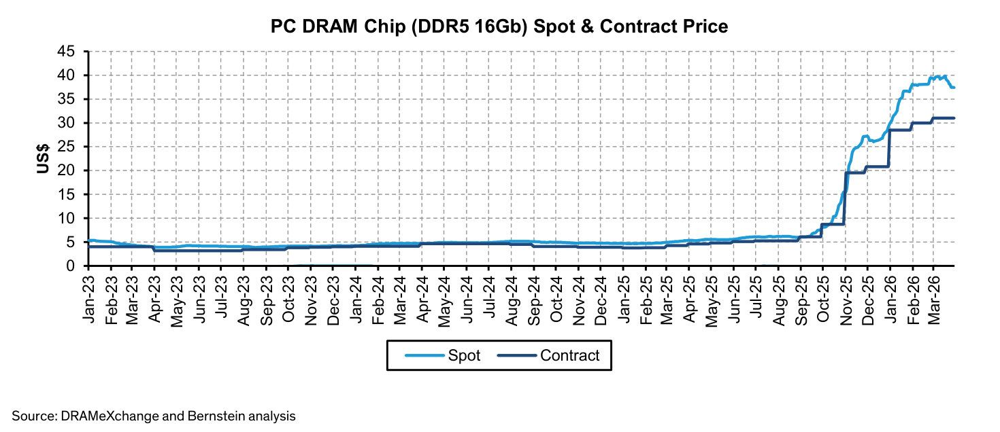

Chart title: PC DRAM Chip (DDR5 16Gb) Spot & Contract Price
Y-axis: US$ (0–45); X-axis: Jan-23 to Mar-26
Legend: Spot, Contract

Source: DRAMeXchange and Bernstein analysis

[Source Page: 8]

**EXHIBIT 4: PC DDR5 chip spot price started seeing some correction towards end of Mar.**

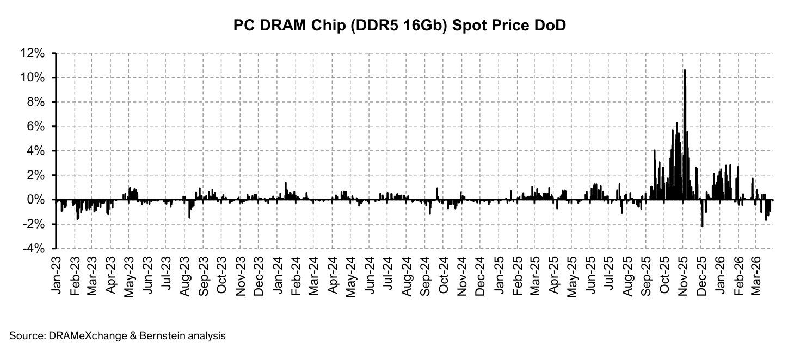

Chart title: PC DRAM Chip (DDR5 16Gb) Spot Price DoD
Y-axis: % (-4% to 12%); X-axis: Jan-23 to Mar-26
Legend: none

Source: DRAMeXchange & Bernstein analysis

**EXHIBIT 5: PC DDR4 chip spot price remained growing in Mar.**

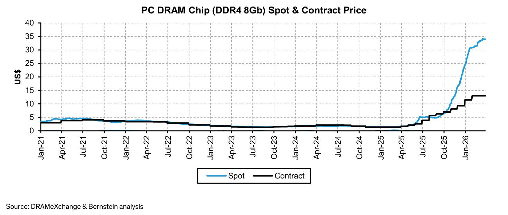

Chart title: PC DRAM Chip (DDR4 8Gb) Spot & Contract Price
Y-axis: US$ (0–40); X-axis: Jan-21 to Jan-26 (quarterly ticks)
Legend: Spot, Contract

Source: DRAMeXchange & Bernstein analysis

[Source Page: 9]

**EXHIBIT 6: PC DDR4 spot price growth momentum also showed some slow down in late Mar.**

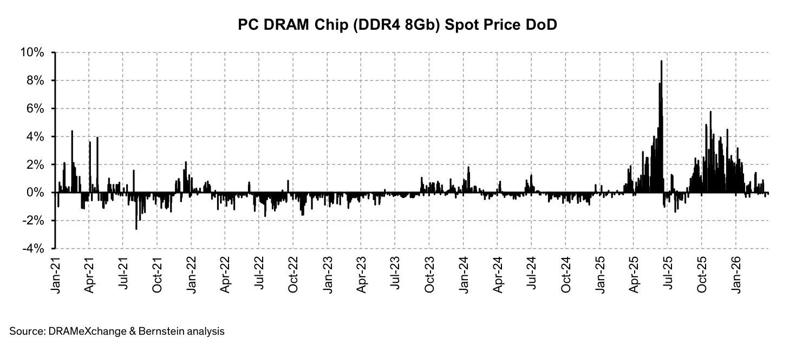

Chart title: PC DRAM Chip (DDR4 8Gb) Spot Price DoD
Y-axis: % (-4% to 10%); X-axis: Jan-21 to Jan-26 (quarterly ticks)
Legend: none

Source: DRAMeXchange & Bernstein analysis

**EXHIBIT 7: PC DDR5 module contract price was largely flattish in Mar as most contract negotiations had been completed in previous months.**

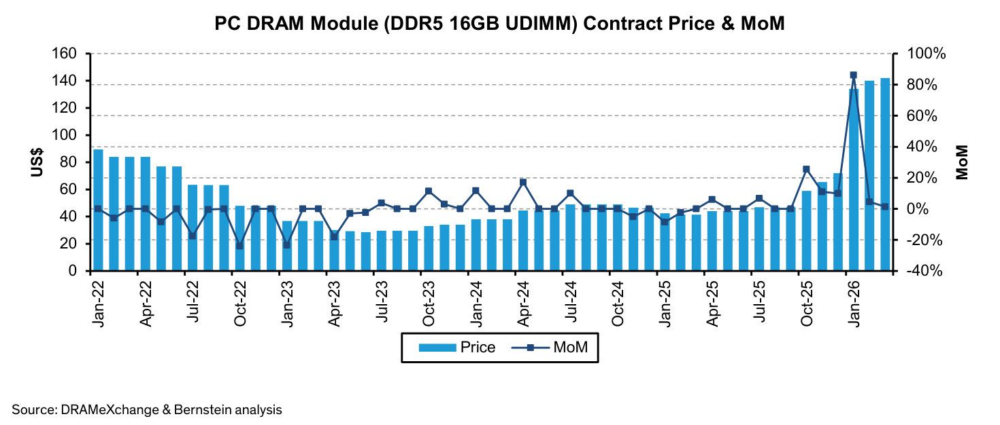

Chart title: PC DRAM Module (DDR5 16GB UDIMM) Contract Price & MoM
Y-axis: US$ (0–160, left); MoM (-40% to 100%, right); X-axis: Jan-22 to Jan-26 (quarterly ticks)
Legend: Price, MoM

Source: DRAMeXchange & Bernstein analysis

[Source Page: 10]

**EXHIBIT 8: PC DDR4 module contract price was unchanged for 8GB...**

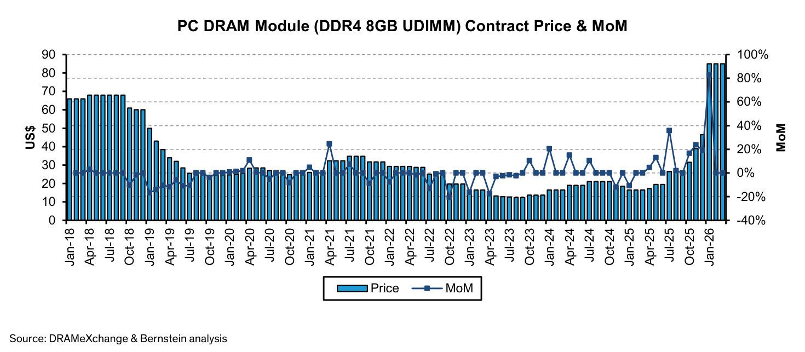

Chart title: PC DRAM Module (DDR4 8GB UDIMM) Contract Price & MoM
Y-axis: US$ (0–90, left); MoM (-40% to 100%, right); X-axis: Jan-18 to Jan-26 (quarterly ticks)
Legend: Price, MoM

Source: DRAMeXchange & Bernstein analysis

**EXHIBIT 9: ...while 16GB modules saw some minor growth in Mar.**

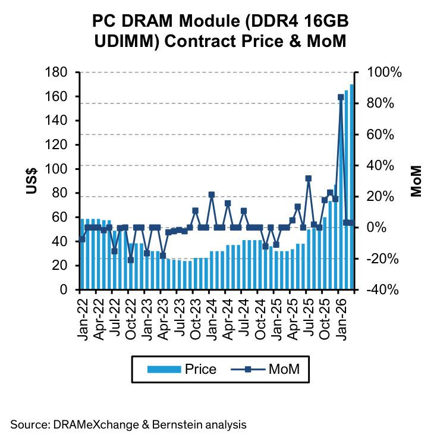

Chart title: PC DRAM Module (DDR4 16GB UDIMM) Contract Price & MoM
Y-axis: US$ (0–180, left); MoM (-40% to 100%, right); X-axis: Jan-22 to Jan-26 (quarterly ticks)
Legend: Price, MoM

Source: DRAMeXchange & Bernstein analysis

**EXHIBIT 10: PC DDR5 price discount vs. DDR4 was stable at 16%.**

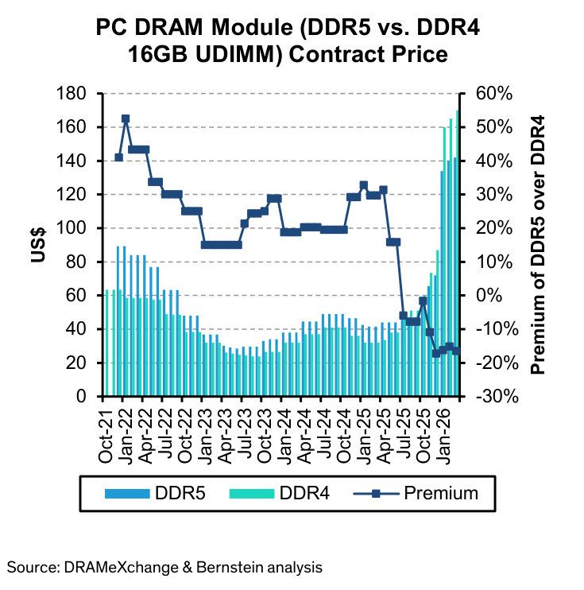

Chart title: PC DRAM Module (DDR5 vs. DDR4 16GB UDIMM) Contract Price
Y-axis: US$ (0–180, left); Premium of DDR5 over DDR4 (-30% to 60%, right); X-axis: Oct-21 to Jan-26 (quarterly ticks)
Legend: DDR5, DDR4, Premium

Source: DRAMeXchange & Bernstein analysis

[Source Page: 11]

**EXHIBIT 11: Server DDR5 module spot price increase continued in Mar after brief pause in Feb.**

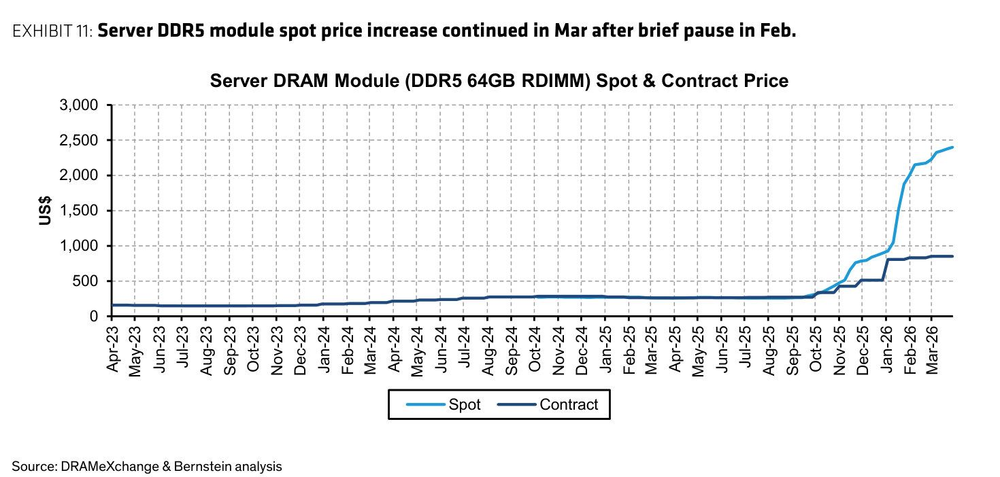

- 标题：Server DRAM Module (DDR5 64GB RDIMM) Spot & Contract Price｜Y轴：US$（0–3,000）｜X轴：Apr-23–Mar-26（月度）｜图例：Spot / Contract
- 来源：DRAMeXchange & Bernstein analysis

**EXHIBIT 12: Server DDR4 spot price increase accelerated significantly in Mar.**

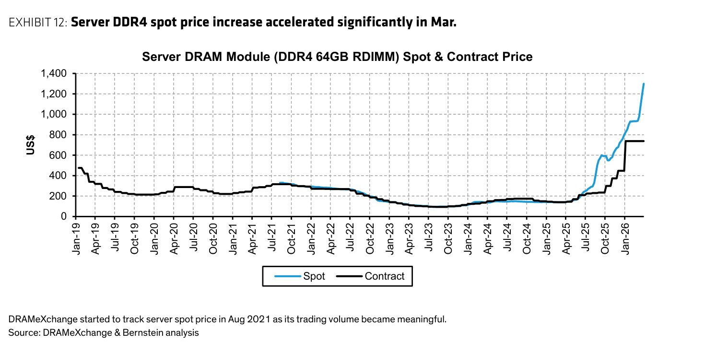

- 标题：Server DRAM Module (DDR4 64GB RDIMM) Spot & Contract Price｜Y轴：US$（0–1,400）｜X轴：Jan-19–Jan-26（月度）｜图例：Spot / Contract
- DRAMeXchange started to track server spot price in Aug 2021 as its trading volume became meaningful.
- 来源：DRAMeXchange & Bernstein analysis

[Source Page: 12]

**EXHIBIT 13: As most of 1Q26 contracts had been set in previous months, Mar server DDR5 module contract price was up only slightly.**

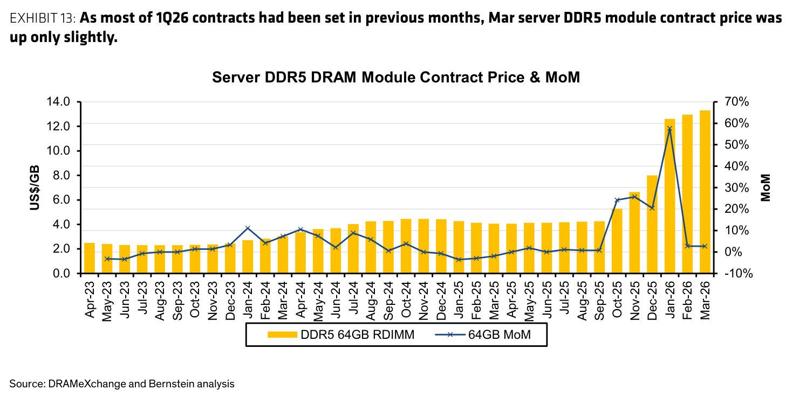

- 标题：Server DDR5 DRAM Module Contract Price & MoM｜左Y轴：US$/GB（0.0–14.0）｜右Y轴：MoM（-10%–70%）｜X轴：Apr-23–Mar-26（月度）｜图例：DDR5 64GB RDIMM / 64GB MoM
- 来源：DRAMeXchange and Bernstein analysis

**EXHIBIT 14: Server DDR4 module contract price was unchanged in Mar MoM.**

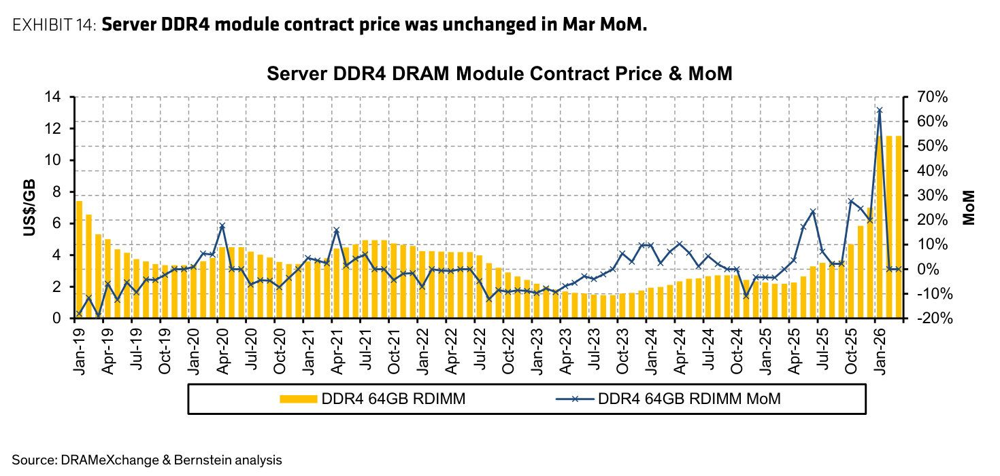

- 标题：Server DDR4 DRAM Module Contract Price & MoM｜左Y轴：US$/GB（0–14）｜右Y轴：MoM（-20%–70%）｜X轴：Jan-19–Jan-26（月度）｜图例：DDR4 64GB RDIMM / DDR4 64GB RDIMM MoM
- 来源：DRAMeXchange & Bernstein analysis

[Source Page: 13]

**EXHIBIT 15: Server DDR5 premium over DDR4 rose slightly to 15%.**

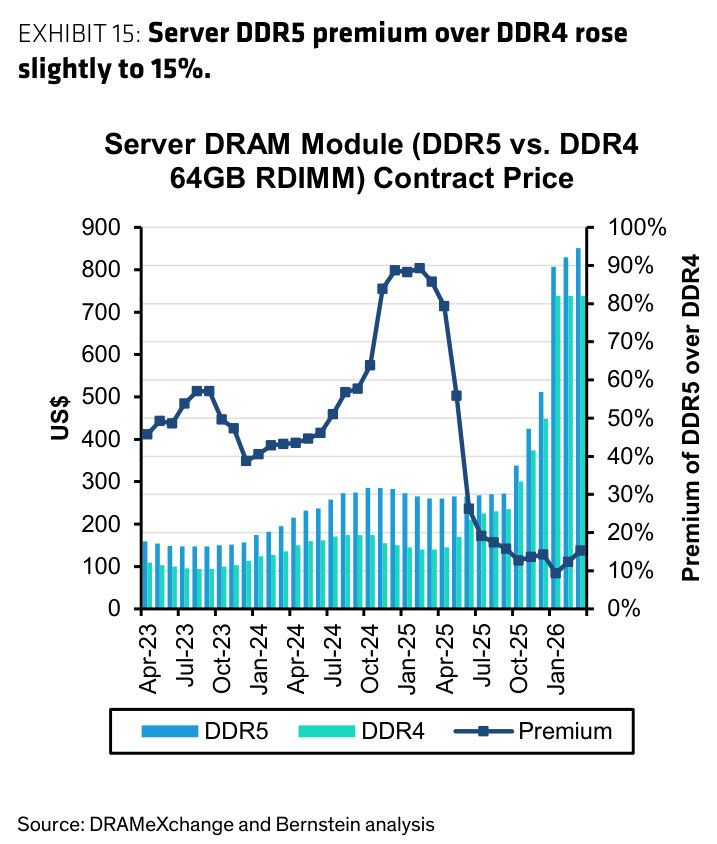

- 标题：Server DRAM Module (DDR5 vs. DDR4 64GB RDIMM) Contract Price｜左Y轴：US$（0–900）｜右Y轴：Premium of DDR5 over DDR4（0%–100%）｜X轴：Apr-23–Jan-26｜图例：DDR5 / DDR4 / Premium
- 来源：DRAMeXchange and Bernstein analysis

**EXHIBIT 16: LPDDR5 contract price was estimated to surge by 90% QoQ.**

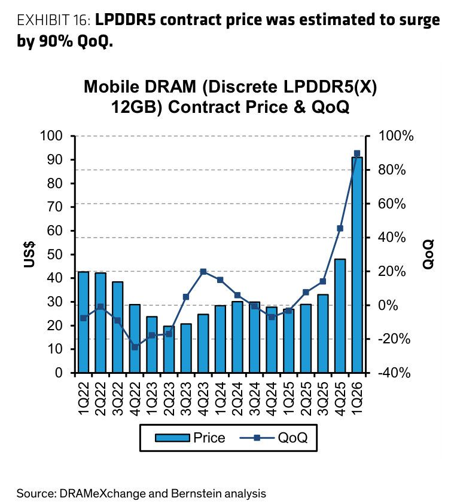

- 标题：Mobile DRAM (Discrete LPDDR5(X) 12GB) Contract Price & QoQ｜左Y轴：US$（0–100）｜右Y轴：QoQ（-40%–100%）｜X轴：1Q22–1Q26（季度）｜图例：Price / QoQ
- 来源：DRAMeXchange and Bernstein analysis

**EXHIBIT 17: LPDDR4 price is expected to grow at similar paces.**

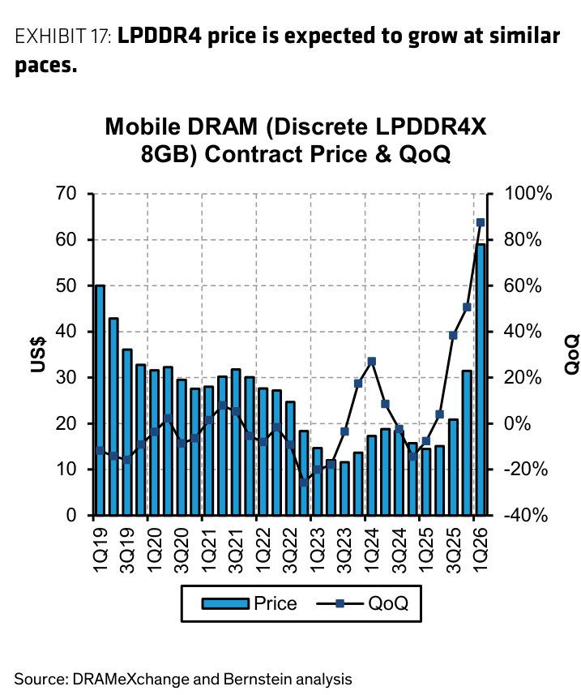

- 标题：Mobile DRAM (Discrete LPDDR4X 8GB) Contract Price & QoQ｜左Y轴：US$（0–70）｜右Y轴：QoQ（-40%–100%）｜X轴：1Q19–1Q26（季度）｜图例：Price / QoQ
- 来源：DRAMeXchange and Bernstein analysis

**EXHIBIT 18: The price of low-end eMCP packages is also estimated to rise by 84%, similar to overall mobile DRAM.**

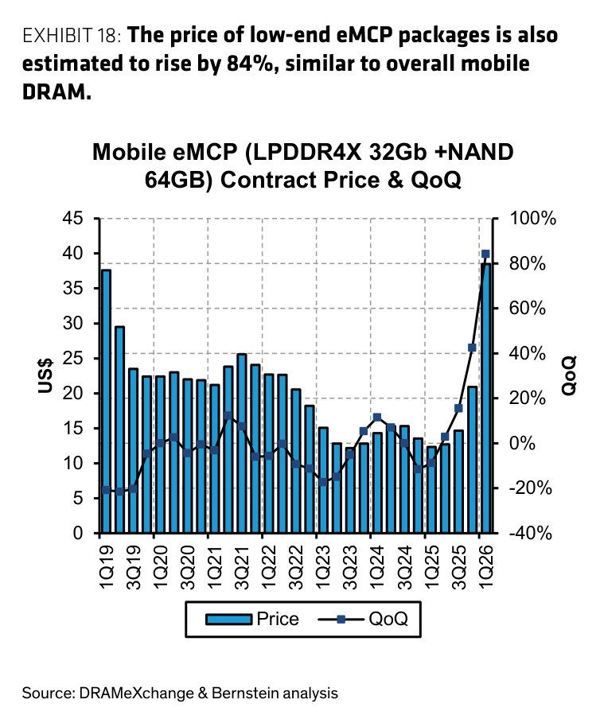

- 标题：Mobile eMCP (LPDDR4X 32Gb +NAND 64GB) Contract Price & QoQ｜左Y轴：US$（0–45）｜右Y轴：QoQ（-40%–100%）｜X轴：1Q19–1Q26（季度）｜图例：Price / QoQ
- 来源：DRAMeXchange & Bernstein analysis

[Source Page: 14]

**EXHIBIT 19: Consumer DRAM contract price went up more in Mar by 25% led by Taiwanese suppliers.**

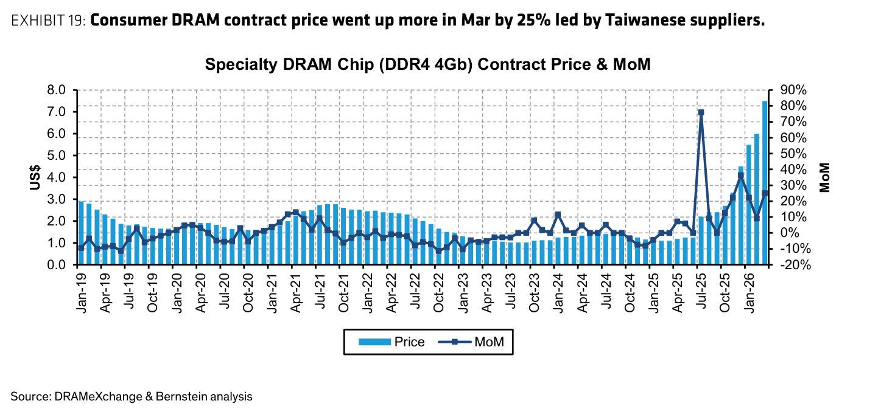

- 标题：Specialty DRAM Chip (DDR4 4Gb) Contract Price & MoM｜左Y轴：US$（0.0–8.0）｜右Y轴：MoM（-20%–90%）｜X轴：Jan-19–Jan-26（月度）｜图例：Price / MoM
- 来源：DRAMeXchange & Bernstein analysis

**EXHIBIT 20: NAND 512Gb spot price increase accelerated in Mar despite some correction towards month end.**

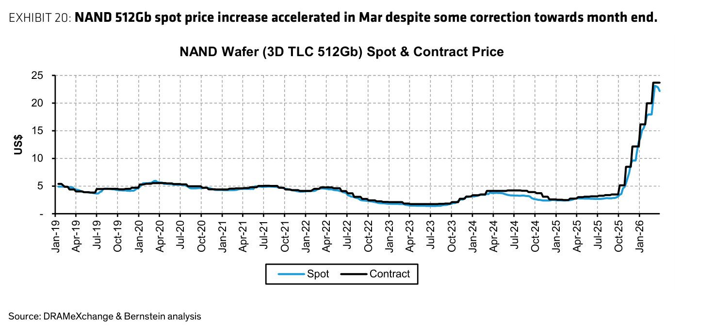

- 标题：NAND Wafer (3D TLC 512Gb) Spot & Contract Price｜Y轴：US$（刻度：-、5、10、15、20、25）｜X轴：Jan-19–Jan-26（月度）｜图例：Spot / Contract
- 来源：DRAMeXchange & Bernstein analysis

[Source Page: 15]

**EXHIBIT 21: 1Tb wafer spot prices also rose rapidly in early Mar though dropped a bit towards month end.**

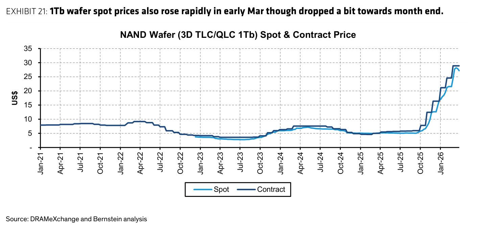

- 标题：NAND Wafer (3D TLC/QLC 1Tb) Spot & Contract Price｜Y轴：US$（刻度：-、5、10、15、20、25、30、35）｜X轴：Jan-21–Jan-26（月度）｜图例：Spot / Contract
- 来源：DRAMeXchange and Bernstein analysis

**EXHIBIT 22: TLC NAND wafer contract price was up another 16-19% MoM in Mar, primarily driven by scarce supply, even though module houses were getting more cautious on buying.**

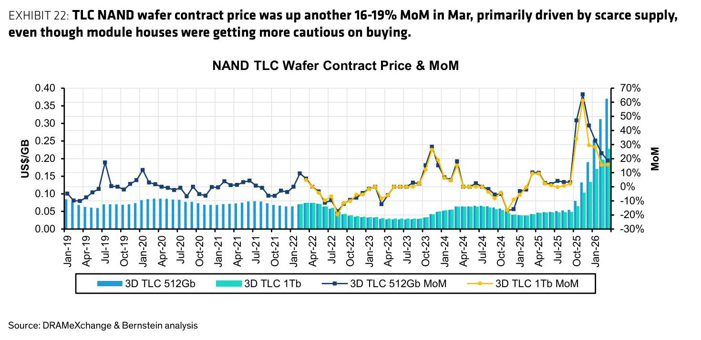

- 标题：NAND TLC Wafer Contract Price & MoM｜左Y轴：US$/GB（0.00–0.40）｜右Y轴：MoM（-30%–70%）｜X轴：Jan-19–Jan-26（月度）｜图例：3D TLC 512Gb / 3D TLC 1Tb / 3D TLC 512Gb MoM / 3D TLC 1Tb MoM
- 来源：DRAMeXchange & Bernstein analysis

[Source Page: 16]

**EXHIBIT 23: 1Tb QLC NAND wafer contract price increase accelerated to 20% MoM in Mar.**

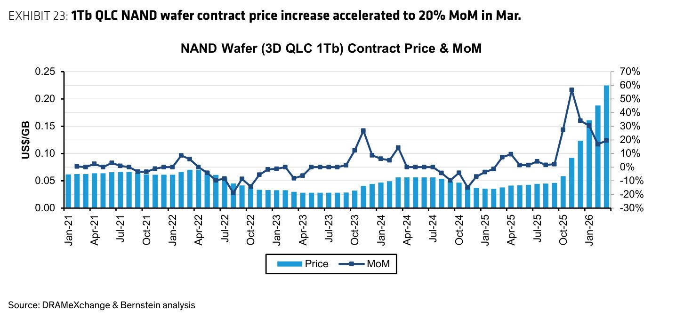

- 标题：NAND Wafer (3D QLC 1Tb) Contract Price & MoM｜左Y轴：US$/GB（0.00–0.25）｜右Y轴：MoM（-30%–70%）｜X轴：Jan-21–Jan-26（月度）｜图例：Price / MoM
- 来源：DRAMeXchange & Bernstein analysis

**EXHIBIT 24: Mobile NAND contract price for 1QCY26 was revised to be up by close to 100% QoQ.**

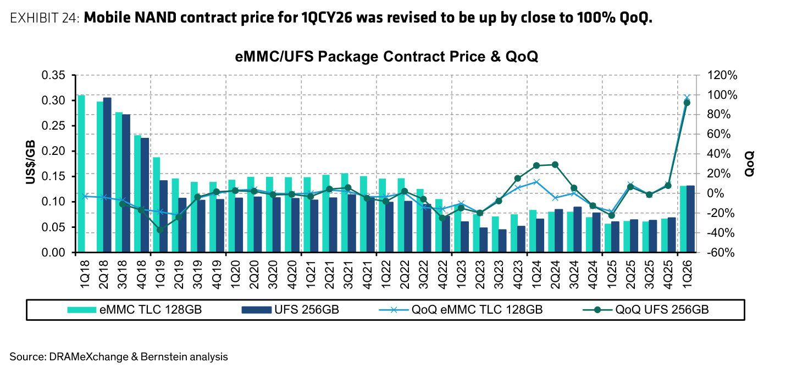

- 标题：eMMC/UFS Package Contract Price & QoQ｜左Y轴：US$/GB（0.00–0.35）｜右Y轴：QoQ（-60%–120%）｜X轴：1Q18–1Q26（季度）｜图例：eMMC TLC 128GB / UFS 256GB / QoQ eMMC TLC 128GB / QoQ UFS 256GB
- 来源：DRAMeXchange & Bernstein analysis

[Source Page: 17]

**EXHIBIT 25: High-density 512GB UFS contract price is also expected to rise by ~100% in 1QCY26.**

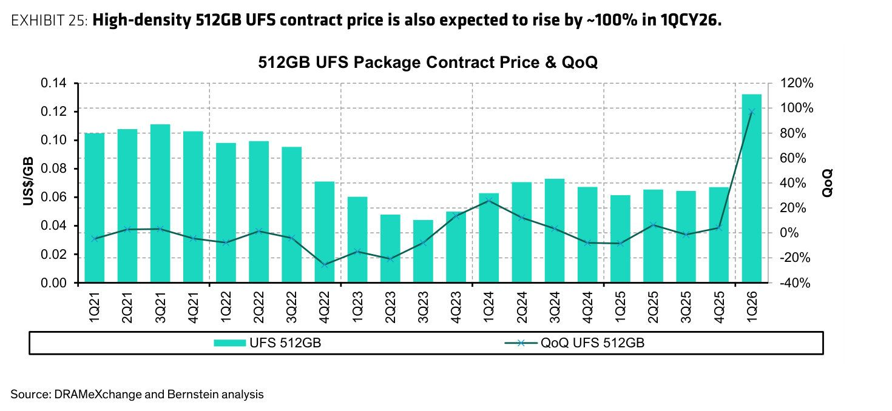

- 标题：512GB UFS Package Contract Price & QoQ｜左Y轴：US$/GB（0.00–0.14）｜右Y轴：QoQ（-40%–120%）｜X轴：1Q21–1Q26（季度）｜图例：UFS 512GB / QoQ UFS 512GB
- 来源：DRAMeXchange and Bernstein analysis

**EXHIBIT 26: Our industry ASP is a weighted average of different products based on the size of their demand. We then further adjust it for HBM.**

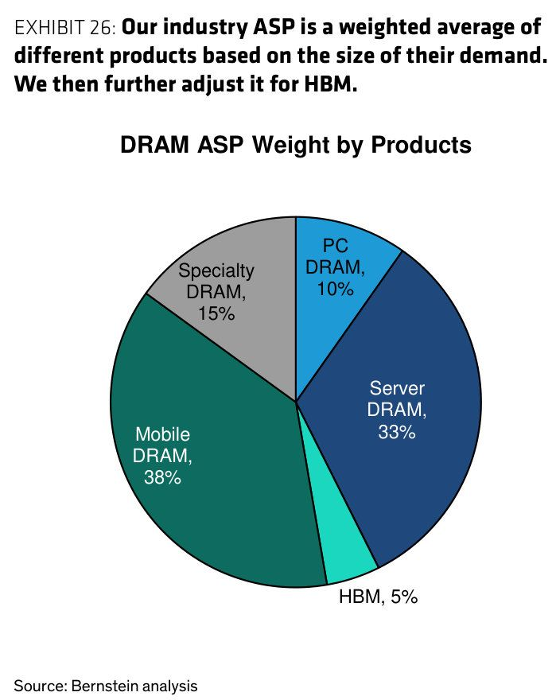

- 标题：DRAM ASP Weight by Products（饼图）｜标注：PC DRAM 10%、Server DRAM 33%、Mobile DRAM 38%、Specialty DRAM 15%、HBM 5%
- 来源：Bernstein analysis

**EXHIBIT 27: We allocate 40% & 60% to eMMC/UFS & wafer, respectively, to derive the industry NAND ASP. eSSD is then considered in addition.**

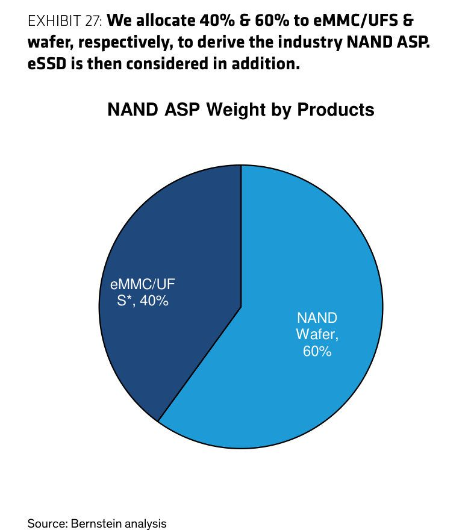

- 标题：NAND ASP Weight by Products（饼图）｜标注：eMMC/UFS*, 40%、NAND Wafer, 60%
- 来源：Bernstein analysis
