## Document Metadata

- Document ID: 9624dbcc9431808c3a5c2d1f0d365c7043db64f3
- Document Title: Global Memory Tech: Top-5 checkpoints for 2026 memory super-cycle and stock ideas
- Document Type: PDF
- Issuing Organization: BofA Global Research（BofA Securities / 美国银行）
- Publication Date: 2025-12-12
- Reporting Period: 2024–2027E
- Source File: [M164_2025-12-12_美国银行_行业策略_2026年内存超级周期的五大关键点及股票思路（含翻译）.pdf](https://github.com/jadennevercode/CJCC-Knowledge-Base/blob/5ec8511eb834073c8bfbd79c94af196282d483cf/materials/%E8%B7%A8%E9%93%BE%EF%BC%9A%E4%BE%9B%E9%9C%80%E4%B8%8E%E4%BB%B7%E6%A0%BC%E5%8F%A3%E5%BE%84/M164_2025-12-12_%E7%BE%8E%E5%9B%BD%E9%93%B6%E8%A1%8C_%E8%A1%8C%E4%B8%9A%E7%AD%96%E7%95%A5_2026%E5%B9%B4%E5%86%85%E5%AD%98%E8%B6%85%E7%BA%A7%E5%91%A8%E6%9C%9F%E7%9A%84%E4%BA%94%E5%A4%A7%E5%85%B3%E9%94%AE%E7%82%B9%E5%8F%8A%E8%82%A1%E7%A5%A8%E6%80%9D%E8%B7%AF%EF%BC%88%E5%90%AB%E7%BF%BB%E8%AF%91%EF%BC%89.pdf)

## Structured Content

> 原文件：[M164_2025-12-12_美国银行_行业策略_2026年内存超级周期的五大关键点及股票思路（含翻译）.pdf](https://github.com/jadennevercode/CJCC-Knowledge-Base/blob/5ec8511eb834073c8bfbd79c94af196282d483cf/materials/%E8%B7%A8%E9%93%BE%EF%BC%9A%E4%BE%9B%E9%9C%80%E4%B8%8E%E4%BB%B7%E6%A0%BC%E5%8F%A3%E5%BE%84/M164_2025-12-12_%E7%BE%8E%E5%9B%BD%E9%93%B6%E8%A1%8C_%E8%A1%8C%E4%B8%9A%E7%AD%96%E7%95%A5_2026%E5%B9%B4%E5%86%85%E5%AD%98%E8%B6%85%E7%BA%A7%E5%91%A8%E6%9C%9F%E7%9A%84%E4%BA%94%E5%A4%A7%E5%85%B3%E9%94%AE%E7%82%B9%E5%8F%8A%E8%82%A1%E7%A5%A8%E6%80%9D%E8%B7%AF%EF%BC%88%E5%90%AB%E7%BF%BB%E8%AF%91%EF%BC%89.pdf)
> 转换方式：多模态逐页转录（页面图像 + 文本层交叉校验）

[Source Page: 1]

# Global Memory Tech

## Top-5 checkpoints for 2026 memory super-cycle and stock ideas

### 1. 2026 super-cycle: similar to 1990s, DRAM sales up 51%

Global memory sales are expected to hit new highs in 2026 (DRAM US$196bn, +51% YoY; NAND US$114bn, +45%) even after 2024-25 upturn. ASP hike (DRAM +33% YoY / NAND +26%) should be the key contributor rather than bit growth (+14% / +15%). We also assume 10%+ sales growth in 2027. This is an exceptionally longer upturn due to AI and similar to 1992-95 upcycle with PC boom. See Exhibit 2 for our estimates summary.

### 2. HBM shortage: more likely with new GPU/ASIC

Strongly growing memory content per GPU/ASIC (Rubin Ultra, v7, Trm3, etc.) will easily warrant 50-100% HBM demand growth pa vs sub-50% wafer capacity growth.

### 3. Supply constraint: high capex but low productivity

SK Hynix's strongly growing capex (our estimate: W23tn/W35tn in 2025/26) includes infrastructure-related spend (30%+ of total) and node migration (40%+). Manufacturing cycle time for new HBM4/LPDDR5/SOCAMM/GDDR7/eSSD is also rising. Net-net, DRAM and NAND production volume will likely remain low at sub-20% YoY.

### 4. Price: high ASP sustainable despite spot correction

Conventional DRAM spot (US$25-50 for DDR4/5) and contract (sub-US$10) price should meet at US$10-15 range. This suggests 50%+/- contract price upside despite spot correction. Our analysis also reveals higher margin for conventional DRAM vs HBM (4Q25E). Global ASP is mostly based on contract price. HBM can also be a seller's market (minimal price-cut pressure) given stronger demand coupled with new ASIC/GPU.

### Exhibit 1: Memory upcycle continues

BofA global memory forecasts

| YoY | 24 | 25E | 26E | 27E |
|---|---|---|---|---|
| DRAM sales | 86% | 47% | 51% | 10% |
| NAND sales | 84% | 1% | 45% | 10% |
| DRAM ASP | 62% | 25% | 33% | -2% |
| NAND ASP | 65% | -10% | 26% | -4% |
| DRAM bit | 15% | 18% | 14% | 13% |
| NAND bit | 11% | 12% | 15% | 14% |
| DRAM capex | 42% | 29% | 36% | 1% |
| NAND capex | 14% | 7% | 13% | 2% |
| DRAM capa | 7% | 8% | 11% | 8% |
| NAND capa | -2% | -4% | 6% | 5% |

Source: BofA Global Research estimates

[Source Page: 2]

## Global memory cycle upturn likely to continue in 2026-27E

**Exhibit 2: We expect global DRAM sales to grow 47%/51% YoY in 2025/26E even after 80%+ in 2024; key contributor should be Hynix's HBM. NAND, however, is expected to grow low-single digit in 2025, but strongly recover in 2026 (+45%); that said, we expect memory upturn to continue in 2026E**

Global memory forecast summary

| | 1Q25 | 2Q25 | 3Q25 | 4Q25E | 1Q26E | 2Q26E | 3Q26E | 4Q26E | 2020 | 2021 | 2022 | 2023 | 2024 | 2025E | 2026E | 2027E |
|---|---|---|---|---|---|---|---|---|---|---|---|---|---|---|---|---|
| **Revenue US$bn** | | | | | | | | | | | | | | | | |
| DRAM | 23.4 | 28.2 | 35.1 | 42.6 | 45.6 | 46.5 | 51.0 | 52.6 | 65.4 | 92.1 | 77.7 | 47.3 | 87.9 | 129.2 | 195.8 | 215.9 |
| NAND | 15.3 | 18.3 | 20.9 | 24.0 | 26.3 | 27.1 | 29.8 | 30.7 | 58.5 | 73.3 | 67.3 | 42.4 | 78.1 | 78.5 | 113.9 | 125.1 |
| DRAM+NAND total | 38.7 | 46.5 | 56.0 | 66.6 | 71.9 | 73.7 | 80.8 | 83.3 | 123.9 | 165.4 | 144.9 | 89.7 | 166.0 | 207.7 | 309.7 | 341.0 |
| **% QoQ** | | | | | | | | | | | | | | | | |
| DRAM | -10% | 20% | 24% | 21% | 7% | 2% | 10% | 3% |  |  |  |  |  |  |  |  |
| NAND | -23% | 20% | 15% | 14% | 10% | 3% | 10% | 3% |  |  |  |  |  |  |  |  |
| DRAM/NAND total | -16% | 20% | 21% | 19% | 8% | 2% | 10% | 3% |  |  |  |  |  |  |  |  |
| **% YoY** | | | | | | | | | | | | | | | | |
| DRAM | 39% | 33% | 48% | 63% | 95% | 65% | 45% | 24% | 5% | 41% | -16% | -39% | 86% | 47% | 51% | 10% |
| NAND | -8% | -9% | -3% | 21% | 72% | 48% | 42% | 28% | 26% | 25% | -8% | -37% | 84% | 1% | 45% | 10% |
| DRAM/NAND total | 16% | 12% | 24% | 45% | 86% | 59% | 44% | 25% | 14% | 34% | -12% | -38% | 85% | 25% | 49% | 10% |
| **Blended ASP US$/unit** | | | | | | | | | | | | | | | | |
| DRAM 8Gb equiv | 3.2 | 3.2 | 3.6 | 4.2 | 4.7 | 4.7 | 4.9 | 4.8 | 3.3 | 3.8 | 3.2 | 1.8 | 2.9 | 3.6 | 4.8 | 4.7 |
| NAND 256Gb equiv | 2.3 | 2.2 | 2.3 | 2.7 | 3.0 | 3.0 | 3.1 | 3.0 | 3.8 | 3.4 | 3.0 | 1.6 | 2.6 | 2.4 | 3.0 | 2.9 |
| **% QoQ** | | | | | | | | | | | | | | | | |
| DRAM ASP | -7% | 2% | 11% | 18% | 11% | 1% | 3% | -1% |  |  |  |  |  |  |  |  |
| NAND ASP | -16% | -7% | 6% | 15% | 11% | 1% | 2% | -2% |  |  |  |  |  |  |  |  |
| **% YoY** | | | | | | | | | | | | | | | | |
| DRAM ASP | 38% | 19% | 17% | 23% | 47% | 47% | 36% | 15% | -15% | 14% | -16% | -45% | 62% | 25% | 33% | -2% |
| NAND ASP | 4% | -18% | -20% | -4% | 27% | 38% | 32% | 12% | -2% | -9% | -13% | -46% | 65% | -10% | 26% | -4% |
| **Shipments bn units** | | | | | | | | | | | | | | | | |
| DRAM 8Gb equiv | 7.4 | 8.7 | 9.8 | 10.1 | 9.8 | 9.8 | 10.5 | 10.9 | 19.5 | 24.1 | 24.2 | 26.7 | 30.6 | 36.1 | 41.1 | 46.4 |
| NAND 256Gb equiv | 6.6 | 8.4 | 9.1 | 9.0 | 8.9 | 9.0 | 9.8 | 10.3 | 15.4 | 21.3 | 22.6 | 26.6 | 29.5 | 33.0 | 37.9 | 43.3 |
| **% QoQ** | | | | | | | | | | | | | | | | |
| DRAM bit growth | -4% | 19% | 12% | 3% | -4% | 1% | 7% | 4% |  |  |  |  |  |  |  |  |
| NAND bit growth | -9% | 28% | 8% | -1% | -2% | 2% | 8% | 5% |  |  |  |  |  |  |  |  |
| **% YoY** | | | | | | | | | | | | | | | | |
| DRAM bit growth | 1% | 11% | 26% | 32% | 33% | 13% | 7% | 8% | 23% | 23% | 0% | 10% | 15% | 18% | 14% | 13% |
| NAND bit growth | -11% | 11% | 22% | 25% | 35% | 8% | 8% | 14% | 29% | 38% | 6% | 18% | 11% | 12% | 15% | 14% |
| **Capacity 300mm k wpm** | | | | | | | | | | | | | | | | |
| DRAM wafer capacity | 1,830 | 1,832 | 1,874 | 1,947 | 2,001 | 2,047 | 2,088 | 2,140 | 1,377 | 1,481 | 1,561 | 1,628 | 1,734 | 1,871 | 2,069 | 2,234 |
| NAND wafer capacity | 1,700 | 1,688 | 1,714 | 1,758 | 1,770 | 1,802 | 1,826 | 1,845 | 1,662 | 1,681 | 1,783 | 1,820 | 1,786 | 1,715 | 1,811 | 1,903 |
| DRAM+NAND total | 3,530 | 3,520 | 3,588 | 3,705 | 3,771 | 3,849 | 3,914 | 3,985 | 3,039 | 3,162 | 3,344 | 3,447 | 3,520 | 3,586 | 3,880 | 4,137 |
| **% QoQ** | | | | | | | | | | | | | | | | |
| DRAM capacity total | 1% | 0% | 2% | 4% | 3% | 2% | 2% | 2% |  |  |  |  |  |  |  |  |
| NAND capacity total | -3% | -1% | 2% | 3% | 1% | 2% | 1% | 1% |  |  |  |  |  |  |  |  |
| DRAM/NAND total | -1% | 0% | 2% | 3% | 2% | 2% | 2% | 2% |  |  |  |  |  |  |  |  |
| **% YoY** | | | | | | | | | | | | | | | | |
| DRAM capacity | 10% | 8% | 6% | 8% | 9% | 12% | 11% | 10% | 4% | 8% | 5% | 4% | 7% | 8% | 11% | 8% |
| NAND capacity | -7% | -6% | -4% | 0% | 4% | 7% | 7% | 5% | 1% | 1% | 6% | 2% | -2% | -4% | 6% | 5% |
| DRAM+NAND total | 2% | 1% | 1% | 4% | 7% | 9% | 9% | 8% | 2% | 4% | 6% | 3% | 2% | 2% | 8% | 7% |
| **Capex spending** | | | | | | | | | | | | | | | | |
| DRAM | 12.0 | 10.6 | 11.0 | 12.4 | 16.2 | 15.6 | 15.0 | 15.6 | 21.4 | 27.1 | 31.0 | 25.2 | 35.7 | 46.0 | 62.4 | 63.3 |
| NAND | 5.5 | 5.8 | 6.2 | 6.5 | 6.8 | 6.8 | 7.1 | 6.5 | 22.5 | 27.9 | 29.0 | 19.7 | 22.4 | 24.0 | 27.1 | 27.8 |
| Total (DRAM+NAND) | 17.5 | 16.3 | 17.3 | 18.9 | 23.0 | 22.4 | 22.0 | 22.1 | 43.9 | 55.0 | 60.0 | 45.0 | 58.2 | 69.9 | 89.5 | 91.0 |
| **QoQ/YoY in capex** | | | | | | | | | | | | | | | | |
| DRAM | 10% | -12% | 4% | 13% | 31% | -4% | -4% | 4% | -2% | 27% | 14% | -19% | 42% | 29% | 36% | 1% |
| NAND | -15% | 4% | 8% | 4% | 5% | 0% | 4% | -8% | 12% | 24% | 4% | -32% | 14% | 7% | 13% | 2% |
| Total (DRAM+NAND) | 0% | -7% | 6% | 9% | 22% | -3% | -2% | 0% | 5% | 25% | 9% | -25% | 29% | 20% | 28% | 2% |

Source: WSTS, Companies, BofA Global Research estimates

[Source Page: 3]

### Exhibit 4: Only 3-4 weeks for both DRAM and NAND as of Dec-25; lower than normal (1-2 months)

Memory chipmakers' inventories - finished chips in weeks

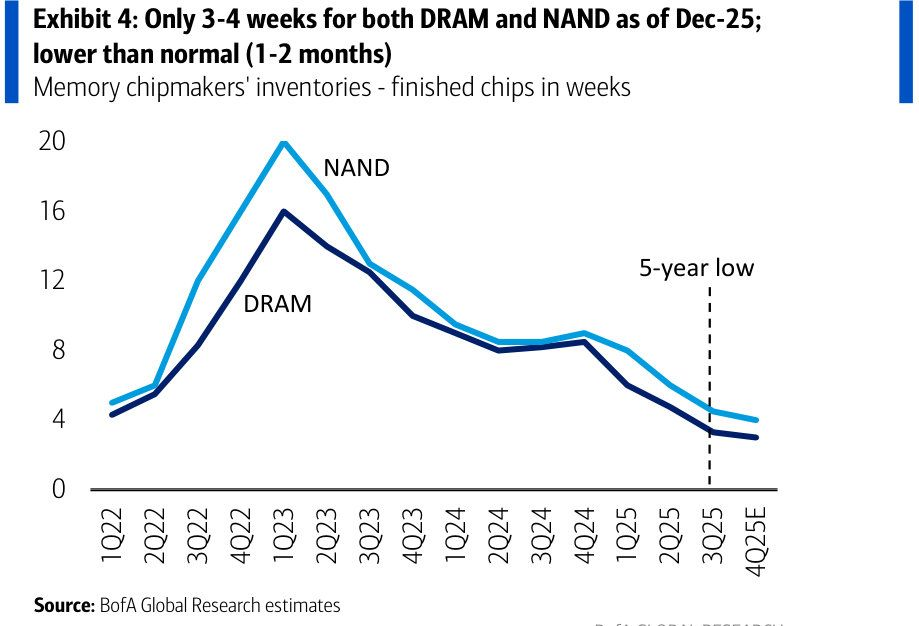

Y-axis: weeks (0/4/8/12/16/20); X-axis: 1Q22-4Q25E; series: DRAM, NAND; callout: 5-year low; no data labels on chart

Source: BofA Global Research estimates

### Exhibit 5: Both DRAM and NAND fabs fully utilized ex old idle capacity as Dec-25

Memory chipmakers' fab utilization

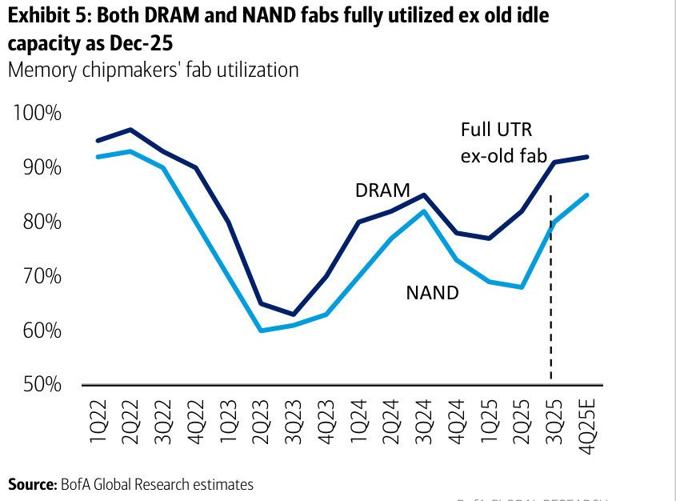

Y-axis: utilization (50%-100%); X-axis: 1Q22-4Q25E; series: DRAM, NAND; callout: Full UTR ex-old fab; no data labels on chart

Source: BofA Global Research estimates

[Source Page: 4]

## Exhibit 6: Mostly server (including HBM) and smartphone-driven sales seen

DRAM sales mix and ASP by application

| | 2016 | 2017 | 2018 | 2019 | 2020 | 2021 | 2022 | 2023 | 2024 | 2025E | 2026E | 2027E |
|---|---|---|---|---|---|---|---|---|---|---|---|---|
| **DRAM sales mix** | | | | | | | | | | | | |
| Servers | 25% | 26% | 35% | 24% | 30% | 31% | 41% | 33% | 48% | 52% | 55% | 58% |
| PCs | 10% | 14% | 14% | 13% | 14% | 15% | 14% | 11% | 11% | 12% | 12% | 12% |
| Smartphones | 26% | 31% | 29% | 45% | 38% | 36% | 34% | 33% | 34% | 35% | 35% | 35% |
| Spot, consumer, etc* | 39% | 29% | 22% | 18% | 18% | 18% | 12% | 22% | 7% | 2% | -3% | -5% |
| Demand mix total | 100% | 100% | 100% | 100% | 100% | 100% | 100% | 100% | 100% | 100% | 100% | 100% |
| **DRAM sales, US$bn** | | | | | | | | | | | | |
| Servers | 10.2 | 18.9 | 34.4 | 14.9 | 19.4 | 28.5 | 31.6 | 15.8 | 42.3 | 66.8 | 108.5 | 125.7 |
| PCs | 4.1 | 10.0 | 13.9 | 8.4 | 8.9 | 14.2 | 10.6 | 5.3 | 9.6 | 15.0 | 24.2 | 25.8 |
| Smartphones | 10.6 | 22.9 | 29.0 | 27.9 | 25.0 | 32.9 | 26.1 | 15.7 | 29.6 | 44.8 | 68.9 | 76.2 |
| Spot, consumer, etc* | 16.3 | 21.0 | 22.0 | 11.3 | 12.0 | 16.6 | 9.4 | 10.5 | 6.5 | 2.6 | -5.9 | -11.8 |
| Total sales US$bn | 41.2 | 72.8 | 99.3 | 62.5 | 65.4 | 92.1 | 77.7 | 47.3 | 87.9 | 129.2 | 195.8 | 215.9 |
| **DRAM ASP, US$/8Gb** | | | | | | | | | | | | |
| Servers | 5.9 | 7.7 | 9.9 | 3.3 | 3.1 | 3.6 | 3.2 | 1.8 | 3.2 | 3.6 | 4.5 | 4.4 |
| PCs | 2.6 | 5.8 | 7.2 | 3.7 | 3.0 | 3.6 | 3.0 | 1.5 | 2.4 | 3.2 | 4.5 | 4.2 |
| Smartphones | 4.1 | 6.6 | 6.9 | 5.1 | 4.1 | 4.4 | 3.5 | 2.0 | 2.9 | 3.7 | 4.8 | 4.6 |
| Spot, consumer, etc* | 4.5 | 5.7 | 6.6 | 3.0 | 2.9 | 3.4 | 2.7 | 1.7 | 2.0 | 4.3 | 2.2 | 2.5 |
| DRAM ind avg price | 4.3 | 6.4 | 7.7 | 3.9 | 3.3 | 3.8 | 3.2 | 1.8 | 2.9 | 3.6 | 4.8 | 4.7 |
| **ASP change YoY** | | | | | | | | | | | | |
| Servers | -20% | 31% | 29% | -66% | -7% | 17% | -11% | -46% | 82% | 13% | 25% | -2% |
| PCs | -48% | 122% | 26% | -49% | -18% | 21% | -19% | -48% | 58% | 30% | 41% | -7% |
| Smartphones | -42% | 60% | 5% | -26% | -20% | 8% | -20% | -45% | 48% | 27% | 32% | -5% |
| Spot, consumer, etc* | -35% | 25% | 17% | -54% | -6% | 19% | -21% | -37% | 18% | 113% | -47% | 10% |
| DRAM ind avg price | -34% | 48% | 20% | -49% | -15% | 14% | -16% | -45% | 62% | 25% | 33% | -2% |

*Implied amount after server/PC/smartphone demand, thus negative figures possible due to channel inventories (not consumed)

Source: Company data, BofA Global Research estimates, industry data

## Exhibit 7: Mostly for SSD and smartphone applications

NAND sales mix and ASP by application

| | 2016 | 2017 | 2018 | 2019 | 2020 | 2021 | 2022 | 2023 | 2024 | 2025E | 2026E | 2027E |
|---|---|---|---|---|---|---|---|---|---|---|---|---|
| **NAND sales mix** | | | | | | | | | | | | |
| SSD | 30% | 33% | 34% | 36% | 45% | 47% | 48% | 40% | 49% | 47% | 49% | 51% |
| Smartphone | 36% | 38% | 33% | 34% | 33% | 34% | 33% | 31% | 35% | 36% | 40% | 44% |
| Spot, inventories, etc | 34% | 29% | 33% | 30% | 22% | 19% | 18% | 29% | 16% | 17% | 10% | 6% |
| Demand mix total | 100% | 100% | 100% | 100% | 100% | 100% | 100% | 100% | 100% | 100% | 100% | 100% |
| **NAND sales, US$bn** | | | | | | | | | | | | |
| SSD | 11.1 | 19.8 | 22.9 | 16.7 | 26.5 | 34.3 | 32.6 | 16.9 | 38.6 | 36.7 | 56.3 | 63.2 |
| Smartphone | 13.7 | 22.3 | 22.0 | 15.5 | 19.2 | 24.9 | 22.4 | 13.1 | 27.2 | 28.4 | 46.0 | 54.6 |
| Spot, inventories, etc | 12.8 | 17.2 | 22.6 | 14.1 | 12.7 | 14.1 | 12.3 | 12.4 | 12.3 | 13.3 | 11.6 | 7.3 |
| Total sales US$bn | 37.6 | 59.2 | 67.4 | 46.3 | 58.5 | 73.3 | 67.3 | 42.4 | 78.1 | 78.5 | 113.9 | 125.1 |
| **NAND ASP, US$/8Gb** | | | | | | | | | | | | |
| SSD | 8.5 | 10.6 | 8.8 | 4.5 | 4.4 | 4.0 | 3.4 | 1.7 | 3.1 | 2.3 | 3.1 | 2.9 |
| Smartphone | 8.7 | 10.5 | 8.6 | 4.4 | 4.3 | 4.1 | 3.3 | 1.7 | 2.8 | 2.4 | 3.1 | 3.0 |
| Spot, inventories, etc | 7.7 | 9.2 | 6.9 | 3.0 | 2.6 | 2.1 | 2.0 | 1.4 | 1.7 | 2.6 | 2.4 | 2.0 |
| NAND ind avg price | 8.3 | 10.1 | 8.0 | 3.9 | 3.8 | 3.4 | 3.0 | 1.6 | 2.6 | 2.4 | 3.0 | 2.9 |
| **ASP change YoY** | | | | | | | | | | | | |
| SSD | -29% | 25% | -17% | -49% | -1% | -10% | -13% | -49% | 76% | -24% | 31% | -5% |
| Smartphone | -30% | 21% | -18% | -48% | -2% | -4% | -21% | -48% | 64% | -15% | 33% | -3% |
| Spot, inventories, etc | -27% | 19% | -24% | -57% | -14% | -17% | -8% | -31% | 26% | 50% | -7% | -16% |
| NAND ind avg price | -28% | 22% | -21% | -52% | -2% | -9% | -13% | -46% | 65% | -10% | 26% | -4% |

*Implied amount after SSD/smartphone demand, thus negative figures possible due to channel inventories (not consumed)

Source: Company data, BofA Global Research estimates, industry data

[Source Page: 5]

## Capacity expansion & node migration = capex acceleration

### Exhibit 8: Hynix's DRAM capex amount already close to Samsung's far exceeding US/China/Taiwan peers; this is mostly for HBM capacity expansion using new fabs (M15X and Yongin in Korea)

DRAM capex trend

| | 2020 | 2021 | 2022 | 2023 | 2024 | 2025E | 2026E | 2027E |
|---|---|---|---|---|---|---|---|---|
| Samsung | 8.2 | 11.6 | 12.2 | 13.9 | 15.0 | 15.1 | 18.7 | 21.2 |
| SK Hynix | 5.6 | 7.3 | 8.9 | 3.8 | 9.0 | 13.0 | 20.7 | 21.7 |
| Micron | 5.3 | 5.6 | 5.7 | 3.9 | 6.3 | 12.8 | 17.7 | 15.0 |
| Nanya | 0.3 | 0.4 | 0.7 | 0.4 | 0.5 | 0.6 | 1.0 | 1.0 |
| CXMT | 1.5 | 1.5 | 1.7 | 2.6 | 4.0 | 3.5 | 3.3 | 3.4 |
| DRAM capex total | 21.4 | 27.1 | 31.0 | 25.2 | 35.7 | 46.0 | 62.4 | 63.3 |
| Capex change YoY | -2% | 27% | 14% | -19% | 42% | 29% | 36% | 1% |
| DRAM capex to sales | 33% | 29% | 40% | 53% | 41% | 36% | 32% | 29% |
| **DRAM capex share** | | | | | | | | |
| Samsung | 38% | 43% | 39% | 55% | 42% | 33% | 30% | 34% |
| SK Hynix | 26% | 27% | 29% | 15% | 25% | 28% | 33% | 34% |
| Micron | 25% | 21% | 19% | 16% | 18% | 28% | 28% | 24% |
| Nanya | 1% | 1% | 2% | 2% | 2% | 1% | 2% | 2% |
| CXMT | 7% | 6% | 5% | 10% | 11% | 8% | 5% | 5% |
| Total | 100% | 100% | 100% | 100% | 100% | 100% | 100% | 100% |
| **DRAM capex YoY** | | | | | | | | |
| Samsung | -8% | 42% | 5% | 14% | 8% | 1% | 23% | 14% |
| SK Hynix | -23% | 30% | 22% | -58% | 138% | 45% | 59% | 5% |
| Micron | 24% | 6% | 3% | -32% | 62% | 102% | 38% | -15% |
| Nanya | 62% | 40% | 72% | -39% | 27% | 3% | 80% | 0% |
| CXMT | 114% | 0% | 13% | 50% | 57% | -13% | -6% | 3% |
| Total | -2% | 27% | 14% | -19% | 42% | 29% | 36% | 1% |

Source: Companies, BofA Global Research estimates

### Exhibit 9: NAND capex recovery not yet strong due to low margin profile and node migration difficulties from 128/178 layers to 200-300+; YMTC's capex increase limited (vs CXMT) due to US government's control (entity list)

NAND capex trend

| | 2020 | 2021 | 2022 | 2023 | 2024 | 2025E | 2026E | 2027E |
|---|---|---|---|---|---|---|---|---|
| Samsung | 9.2 | 10.9 | 10.3 | 10.1 | 10.1 | 9.1 | 10.6 | 11.7 |
| Kioxia & JVs | 4.5 | 5.7 | 6.5 | 2.7 | 4.5 | 5.5 | 6.0 | 6.0 |
| Micron | 3.4 | 4.6 | 5.2 | 2.7 | 3.1 | 4.5 | 4.6 | 3.9 |
| SK Hynix | 2.7 | 3.4 | 4.1 | 1.6 | 2.3 | 2.5 | 3.3 | 3.4 |
| Intel China | 0.8 | 1.5 | 0.0 | 0.0 | 0.0 | 0.0 | 0.0 | 0.0 |
| YMTC | 1.6 | 1.5 | 2.5 | 2.3 | 2.0 | 2.0 | 2.3 | 2.3 |
| NAND capex total | 22.5 | 27.9 | 29.0 | 19.7 | 22.4 | 24.0 | 27.1 | 27.8 |
| NAND capex chg YoY | 12% | 24% | 4% | -32% | 14% | 7% | 13% | 2% |
| NAND capex to sales | 38% | 38% | 43% | 46% | 29% | 31% | 24% | 22% |
| **NAND capex share** | | | | | | | | |
| Samsung | 41% | 39% | 36% | 51% | 45% | 38% | 39% | 42% |
| Kioxia & JVs | 20% | 20% | 22% | 14% | 20% | 23% | 22% | 22% |
| Micron | 15% | 17% | 18% | 14% | 14% | 19% | 17% | 14% |
| SK Hynix | 12% | 12% | 14% | 8% | 10% | 10% | 12% | 12% |
| Intel China | 4% | 5% | n/a | n/a | n/a | n/a | n/a | n/a |
| YMTC | 7% | 5% | 9% | 11% | 9% | 8% | 8% | 8% |
| NAND capex total | 100% | 100% | 100% | 100% | 100% | 100% | 100% | 100% |
| **NAND capex growth (YoY)** | | | | | | | | |
| Samsung | 87% | 19% | -5% | -2% | 0% | -10% | 17% | 11% |
| Kioxia & JVs | 18% | 27% | 14% | -58% | 67% | 22% | 9% | 0% |
| Micron | -22% | 35% | 11% | -47% | 13% | 47% | 0% | -14% |
| SK Hynix | -38% | 26% | 19% | -60% | 42% | 5% | 33% | 4% |
| Intel China | -48% | 88% | na | na | na | na | na | na |
| YMTC | 129% | -6% | 67% | -10% | -11% | 0% | 15% | 0% |
| NAND capex total | 12% | 24% | 4% | -32% | 14% | 7% | 13% | 2% |

Source: Companies, BofA Global Research estimates

[Source Page: 6]

### Exhibit 10: Ex-conventional DRAM equipment capex spend likely up strongly due to HBM, but conventional DRAM and NAND spend broadly disciplined; non-equipment spend for buildings and utilities remain high

SPE vs non-SPE capex spend

| | 2019 | 2020 | 2021 | 2022 | 2023 | 2024 | 2025E | 2026E | 2027E |
|---|---|---|---|---|---|---|---|---|---|
| **SPE capex** | | | | | | | | | |
| DRAM | 12.1 | 12.7 | 16.2 | 17.3 | 14.1 | 22.6 | 29.3 | 43.7 | 45.4 |
| NAND | 12.1 | 14.3 | 18.2 | 18.7 | 11.9 | 14.2 | 16.4 | 18.7 | 20.0 |
| Total | 24.3 | 26.9 | 34.4 | 35.9 | 26.0 | 36.8 | 45.7 | 62.4 | 65.3 |
| **SPE capex YoY** | | | | | | | | | |
| DRAM | -22% | 4% | 28% | 7% | -18% | 60% | 29% | 49% | 4% |
| NAND | -24% | 17% | 28% | 3% | -36% | 19% | 16% | 14% | 7% |
| Total | -23% | 11% | 28% | 5% | -28% | 41% | 24% | 37% | 5% |
| **Non-SPE to capex** | | | | | | | | | |
| DRAM | 45% | 41% | 40% | 44% | 44% | 37% | 36% | 30% | 28% |
| NAND | 39% | 37% | 35% | 36% | 40% | 37% | 32% | 31% | 28% |
| Total | 42% | 39% | 38% | 40% | 42% | 37% | 35% | 30% | 28% |
| **Total capex, US$bn** | | | | | | | | | |
| DRAM | 21.9 | 21.4 | 27.1 | 31.0 | 25.2 | 35.7 | 46.0 | 62.4 | 63.3 |
| NAND | 20.1 | 22.5 | 27.9 | 29.0 | 19.7 | 22.4 | 24.0 | 27.1 | 27.8 |
| Total | 42.0 | 43.9 | 55.0 | 60.0 | 45.0 | 58.2 | 69.9 | 89.5 | 91.0 |

Source: Company data, BofA Global Research estimates, industry data

### Exhibit 11: DRAM capex increase mostly driven by Hynix and Micron - Samsung's spend relatively disciplined; NAND capex growth no longer strong due to low margin and ROIC)

SPE capex spend by memory chipmakers

| | 2019 | 2020 | 2021 | 2022 | 2023 | 2024 | 2025E | 2026E | 2027E |
|---|---|---|---|---|---|---|---|---|---|
| **DRAM SPE** | | | | | | | | | |
| Samsung | 5.5 | 4.8 | 6.9 | 7.0 | 7.8 | 8.7 | 9.4 | 13.6 | 15.5 |
| SK Hynix | 2.9 | 2.5 | 3.4 | 4.3 | 1.6 | 6.1 | 7.3 | 14.5 | 15.7 |
| Micron | 2.9 | 3.5 | 3.7 | 3.8 | 2.1 | 3.8 | 8.8 | 11.7 | 10.2 |
| Nanya | 0.1 | 0.2 | 0.4 | 0.5 | 0.3 | 0.4 | 0.4 | 0.6 | 0.7 |
| CXMT | 0.3 | 1.2 | 1.3 | 1.2 | 2.0 | 3.2 | 2.8 | 2.6 | 2.7 |
| DRAM SPE total | 12.1 | 12.7 | 16.2 | 17.3 | 14.1 | 22.6 | 29.3 | 43.7 | 45.4 |
| **YoY** | | | | | | | | | |
| Samsung | -25% | -14% | 44% | 1% | 12% | 12% | 8% | 45% | 14% |
| SK Hynix | -21% | -14% | 32% | 27% | -63% | 284% | 20% | 99% | 8% |
| Micron | -14% | 24% | 6% | 3% | -45% | 80% | 133% | 32% | -13% |
| DRAM SPE total | -22% | 4% | 28% | 7% | -18% | 60% | 29% | 49% | 4% |
| **NAND SPE** | | | | | | | | | |
| Samsung | 3.4 | 5.7 | 6.7 | 6.6 | 6.2 | 6.5 | 5.9 | 7.3 | 8.6 |
| Micron | 3.0 | 2.3 | 3.1 | 3.5 | 1.4 | 1.9 | 3.0 | 3.2 | 2.7 |
| SK Hynix | 2.3 | 1.8 | 2.4 | 2.5 | 1.0 | 1.5 | 1.9 | 2.2 | 2.6 |
| YMTC | 0.0 | 1.0 | 1.2 | 1.8 | 1.8 | 1.3 | 1.4 | 1.5 | 1.6 |
| NAND SPE total | 12.1 | 14.3 | 18.2 | 18.7 | 11.9 | 14.2 | 16.4 | 18.7 | 20.0 |
| **YoY** | | | | | | | | | |
| Samsung | -26% | 68% | 19% | -2% | -6% | 5% | -10% | 23% | 18% |
| Micron | -3% | -22% | 35% | 11% | -59% | 33% | 59% | 8% | -14% |
| SK Hynix | -38% | -24% | 36% | 2% | -61% | 57% | 27% | 16% | 16% |
| YMTC |  |  | 25% | 46% | 3% | -28% | 8% | 7% | 8% |
| NAND SPE total | -24% | 17% | 28% | 3% | -36% | 19% | 16% | 14% | 7% |

Source: Company data, BofA Global Research estimates, industry data

[Source Page: 7]

## 2026E HBM TAM expansion to US$55bn

**Exhibit 12: We maintain our bullish view on HBM. We assume stronger growth in 2026 sales (US$55bn; +58% YoY). This is based on a limited price cut (blended ASP -6%; similar to 5-10% cost reduction; 5-10% price cut for 12-hi HBM3e offset by a 20% price premium for HBM4) and robust bit growth (+69%). Hynix's proven 12-hi HBM3e and HBM4 (mass production started in Sept) should be the key contributors; industry average OPM above 40% thanks to Hynix's high margin profile (60%+); no downturn in 2027 given volume growth and cost reduction fully offset price cut**

Global HBM market - record high revenue continues into 2025/26/27E (US$35bn/55bn/64bn)

| | 2022 | 2023 | 2024 | 2025E | 2026E | 2027E | 2028E | 2029E | 2030E | CAGR 2025-28E |
|---|---|---|---|---|---|---|---|---|---|---|
| **HBM earnings** | | | | | | | | | | |
| Sales, US$bn | 1.6 | 4.2 | 17.4 | 34.5 | 54.6 | 64.3 | 72.4 | 85.5 | 98.1 | 28% |
| Shipment units, GB bn | 0.1 | 0.5 | 1.6 | 3.1 | 5.2 | 6.8 | 8.4 | 10.5 | 12.7 | 40% |
| ASP, US$/GB | 16.7 | 8.8 | 11.0 | 11.3 | 10.5 | 9.4 | 8.6 | 8.1 | 7.7 | -9% |
| Price premium | 430% | 436% | 355% | 292% | 168% | 145% | 146% | 90% | 72% |  |
| OP, US$bn | 0.4 | 1.8 | 8.3 | 14.6 | 23.7 | 28.1 | 31.0 | 36.9 | 42.2 | 28% |
| OP margin | 25% | 42% | 48% | 42% | 43% | 44% | 43% | 43% | 43% |  |
| **% YoY** | | | | | | | | | | |
| Sales, US$bn | 55% | 155% | 316% | 98% | 58% | 18% | 13% | 18% | 15% |  |
| Shipment units, GB bn | 95% | 383% | 233% | 94% | 69% | 32% | 23% | 25% | 21% |  |
| ASP, US$/GB | n/a | n/a | 25% | 2% | -6% | -11% | -8% | -5% | -5% |  |
| **HBM shipment mix** | | | | | | | | | | |
| HBM5+ | 0% | 0% | 0% | 0% | 0% | 0% | 10% | 51% | 75% |  |
| HBM4e | 0% | 0% | 0% | 0% | 0% | 13% | 53% | 36% | 19% |  |
| HBM4 | 0% | 0% | 0% | 0% | 17% | 68% | 27% | 10% | 5% |  |
| HBM3e | 0% | 0% | 58% | 83% | 79% | 17% | 10% | 3% | 1% |  |
| HBM3 | 10% | 60% | 27% | 14% | 2% | 1% | 0% | 0% | 0% |  |
| HBM2e & below | 90% | 40% | 15% | 3% | 2% | 1% | 0% | 0% | 0% |  |
| HBM mix total | 100% | 100% | 100% | 100% | 100% | 100% | 100% | 100% | 100% |  |
| % to DRAM shipment | 0.4% | 1.8% | 5.2% | 8.5% | 12.6% | 14.8% | 16.3% | 17.9% | 19.7% |  |
| % to DRAM sales | 2.1% | 8.9% | 19.8% | 26.7% | 27.9% | 29.8% | 32.3% | 29.3% | 29.7% |  |
| Wafer capacity, k wpm | 68 | 87 | 204 | 360 | 473 | 602 | 714 | 811 | 873 | 26% |
| % to DRAM wafer capacity | 4.4% | 5.4% | 11.8% | 19.2% | 22.8% | 26.9% | 29.6% | 32.0% | 32.8% |  |
| Main node | 1z | 1z | 1a, 1b | 1a, 1b | 1b, 1c | 1c | 1c, 1d | 1d | 1d, 1e |  |
| Implied demand, GB bn units | 0.1 | 0.5 | 1.8 | 3.3 | 4.8 | 6.2 | 7.7 | 9.7 | 11.8 | 33% |
| AI+HBM server units, mn | 0.3 | 1.0 | 1.9 | 2.8 | 3.5 | 4.0 | 4.4 | 4.7 | 5.0 | 17% |
| AI+HBM server shipment YoY | 42% | 289% | 88% | 50% | 25% | 15% | 10% | 7% | 6% |  |
| GB HBM per AI+HBM server | 340 | 530 | 954 | 1,171 | 1,389 | 1,538 | 1,753 | 2,051 | 2,359 | 14% |
| GB content growth QoQ/YoY | 13% | 56% | 80% | 23% | 19% | 11% | 14% | 17% | 15% |  |
| AI+HBM to total server units* | 1.7% | 8.1% | 12.9% | 16.1% | 17.5% | 19.2% | 20.1% | 20.5% | 20.7% |  |
| Global server units, mn | 14.9 | 12.3 | 14.5 | 17.3 | 19.9 | 20.9 | 22.0 | 23.1 | 24.2 | 8% |
| Global server units YoY | 10% | -17% | 18% | 20% | 15% | 5% | 5% | 5% | 5% |  |
| Excess supply, GB bn units | 0.01 | -0.05 | -0.20 | -0.20 | 0.34 | 0.68 | 0.69 | 0.82 | 0.88 |  |
| HBM sufficiency (supply to demand) | 13% | -10% | -11% | -6% | 7% | 11% | 9% | 8% | 7% |  |

Source: Companies, BofA Global Research estimates

[Source Page: 8]

### Exhibit 13: Our bottom-up approach based on Big-3 players' track record and long-term plans; SK Hynix's dominant position should continue in 2025-27E; Samsung 20%+/- market share (HBM sales basis) assumed (vs Hynix 50%+)

Global HBM market share by company

| | 2022 | 2023 | 2024 | 2025E | 2026E | 2027E | 2028E | 2029E | 2030E | CAGR 2025-28E |
|---|---|---|---|---|---|---|---|---|---|---|
| **HBM units, GB bn** | | | | | | | | | | |
| SK Hynix | 0.06 | 0.27 | 0.87 | 1.78 | 2.58 | 3.37 | 4.07 | 5.20 | 6.26 | 32% |
| Samsung | 0.03 | 0.20 | 0.61 | 0.67 | 1.55 | 2.20 | 2.75 | 3.30 | 4.03 | 60% |
| Others | 0.00 | 0.01 | 0.10 | 0.62 | 1.06 | 1.27 | 1.60 | 2.00 | 2.40 | 37% |
| Global HBM total GB bn units | 0.10 | 0.47 | 1.58 | 3.07 | 5.18 | 6.85 | 8.42 | 10.50 | 12.69 | 40% |
| % of global DRAM volume | 0.4% | 1.8% | 5.2% | 8.5% | 12.6% | 14.8% | 16.3% | 17.9% | 19.7% |  |
| **HBM wafer capa, k wpm - yr avg** | | | | | | | | | | |
| SK Hynix | 35 | 37 | 100 | 153 | 190 | 249 | 274 | 293 | 307 | 22% |
| Samsung | 30 | 45 | 78 | 133 | 178 | 225 | 248 | 265 | 273 | 23% |
| Others | 3 | 5 | 27 | 75 | 105 | 128 | 193 | 253 | 293 | 37% |
| Global HBM wafer capa total | 68 | 87 | 204 | 360 | 473 | 602 | 714 | 811 | 873 | 26% |
| % of global DRAM capacity | 4.4% | 5.4% | 11.8% | 19.2% | 22.8% | 26.9% | 29.6% | 32.0% | 32.8% |  |
| Main node | 1z | 1z | 1a, 1b | 1a, 1b | 1b, 1c | 1c | 1c, 1d | 1d | 1d, 1e |  |
| **HBM ASP, US$/GB** | | | | | | | | | | |
| SK Hynix | 16.2 | 8.5 | 11.1 | 11.8 | 11.4 | 10.2 | 9.4 | 8.9 | 8.6 | -7% |
| Samsung | 17.8 | 9.3 | 11.0 | 9.8 | 8.8 | 8.1 | 7.2 | 6.7 | 6.2 | -9% |
| Global average - HBM ASP | 16.7 | 8.8 | 11.0 | 11.3 | 10.5 | 9.4 | 8.6 | 8.1 | 7.7 | -9% |
| HBM price premium | 430% | 436% | 355% | 292% | 168% | 145% | 146% | 90% | 72% |  |
| **HBM sales, US$bn** | | | | | | | | | | |
| SK Hynix | 1.1 | 2.3 | 9.6 | 20.9 | 29.3 | 34.3 | 38.2 | 46.3 | 53.6 | 22% |
| Samsung | 0.6 | 1.8 | 6.7 | 6.6 | 13.6 | 17.7 | 19.9 | 22.2 | 25.0 | 45% |
| Others | 0.0 | 0.1 | 1.1 | 7.0 | 11.7 | 12.3 | 14.3 | 16.9 | 19.5 | 27% |
| Global HBM sales total | 1.6 | 4.2 | 17.4 | 34.5 | 54.6 | 64.3 | 72.4 | 85.5 | 98.1 | 28% |
| % of global DRAM sales | 2.1% | 8.9% | 19.8% | 26.7% | 27.9% | 29.8% | 32.3% | 29.3% | 29.7% |  |
| **HBM OPM** | | | | | | | | | | |
| SK Hynix | 25% | 47% | 63% | 64% | 63% | 62% | 61% | 61% | 61% |  |
| Samsung | 27% | 38% | 33% | 20% | 38% | 39% | 38% | 38% | 38% |  |
| HBM OPM weighted avg | 26% | 42% | 49% | 50% | 52% | 51% | 51% | 51% | 51% |  |
| **HBM bit market share** | | | | | | | | | | |
| SK Hynix | 66% | 57% | 55% | 58% | 50% | 49% | 48% | 50% | 49% |  |
| Samsung | 32% | 42% | 39% | 22% | 30% | 32% | 33% | 31% | 32% |  |
| **HBM sales market share** | | | | | | | | | | |
| SK Hynix | 64% | 54% | 55% | 61% | 54% | 53% | 53% | 54% | 55% |  |
| Samsung | 34% | 44% | 39% | 19% | 25% | 28% | 28% | 26% | 25% |  |
| **HBM wafer capa mkt share** | | | | | | | | | | |
| SK Hynix | 51% | 43% | 49% | 42% | 40% | 41% | 38% | 36% | 35% |  |
| Samsung | 44% | 52% | 38% | 37% | 38% | 37% | 35% | 33% | 31% |  |
| HBM wafer capa mkt share total | 100% | 100% | 100% | 100% | 100% | 100% | 100% | 100% | 100% |  |

Source: Companies, BofA Global Research estimates

[Source Page: 11]

**Exhibit 16: Hynix's dominant position in HBM market likely to continue in 2026; Hynix's HBM4 progress is 1-2 quarters ahead of its competitors**

HBM3e/4 specs comparison – Hynix, Micron, Samsung

| Specification | SK Hynix HBM3e 12-hi | SK Hynix HBM4 12-hi | Micron HBM3e 12-hi | Micron HBM4 12-hi | Samsung HBM3e 12-hi | Samsung HBM4 12-hi |
| --- | --- | --- | --- | --- | --- | --- |
| Sampling | Mar-24 | Mar-25 | Sep-24 | Jun-25 | Feb-24* | Nov-25 |
| Mass production | Sep-24 | Sep-25 | Feb-25 | CY2026 | Sep-25 | 1H26 |
| HBM capacity | 36 GB | 36 GB | 36 GB | 36 GB | 36 GB | 36GB |
| HBM bandwidth | 1.25 TB/s | 2.5+ TB/s | 1.2+ TB/s | 2.8+ TB/s | 1.25 TB/s | 2.8+ TB/s |
| Data transfer rate | 9.6 Gbps | 10.0+ Gbps | 9.2 Gbps | 11.0+ Gbps | 9.8 Gbps | 11.0 Gbps |
| Bit interface (# of I/O pins) | 1024 | 2048 | 1024 | 2048 | 1024 | 2048 |
| Layers (# of DRAM dies) | 12 | 12 | 12 | 12 | 12 | 12 |
| Fabrication node | 1b | 1b | 1b | 1b | 1a | 1c |
| Voltage | 1.1 V | 1.1 V | 1.1 V | 1.1 V | 1.1 V | Undisclosed |

*Samsung redesigned 12-hi HBM3e sample in 1Q25; full qualification and mass production confirmed in Sep-25
Source: Companies, media reports, BofA Global Research

[Source Page: 13]

**Exhibit 21: H200/B200/B300 will lead to 2025 HBM demand growth and later by Rubin/Rubin Ultra in 2026/27**

NVIDIA GPUs that use HBM memory

| Company | Name | Type | AI function | Launch date | DRAM spec | Remarks |
| --- | --- | --- | --- | --- | --- | --- |
|  | Mainstream Feynman | GPU | AI training | 2028 | HBM5 (likely) | Based on Next-gen HBM |
|  | Rubin Ultra | GPU | AI training | 2H27 | 1TB HBM4e | 4 reticles leading to 16 HBM chips each with 64GB memory (based on 16-hi layer 32Gb DRAM) |
|  | Rubin | GPU | AI training | 2H26 | 288/384GB HBM4 | HBM4 with 12-hi/16-hi layer 24Gb DRAM die; bandwidth at 13TB/s |
|  | B300 | GPU | AI training | 3Q25 | 288GB HBM3e | Based on 8 units of 12-hi layer 24Gb DRAM die; bandwidth at 8TB/s |
|  | B100/200 | GPU | AI training | 1Q25 | 192GB HBM3e | Nvidia confirmed production ramp-up and shipment in FY4Q25 (Oct-Jan) |
|  | H200 SXM/NVL | GPU | AI training | 2Q24 | 141GB HBM3e | First GPU with HBM3e (1.2TB/s) memory |
|  | H100 NVL | GPU | AI training | Sep-22 | 188GB HBM3; 7.8TB/s | Powerful AI training GPU using 188GB HBM3 |
|  | H100 SXM5 | GPU | AI training | Sep-22 | 80GB HBM3; 3.35TB/s | High-speed AI training GPU (900GB/sec) PCIe / NVL (600GB/sec) |
|  | H100 PCIe | GPU | AI training | Sep-22 | 80GB HBM2e; 2TB/s | Still based on HBM2e - HBM3 not yet |
|  | A100 | GPU | AI training | Jun-20 | 40/80GB HBM2/2e; 2TB/s | Old gen but still actively used for AI training |
| Superchip | Rubin Ultra NVL576 | Giant Superchip | AI training/inference | 2H27 | 288TB HBM4e (likely) + 72TB DRAM | Combines 288x Rubin Ultra GPU via NV Link |
|  | Vera Rubin NVL144 CPX | Giant Superchip | AI training/inference | 2H26 | 40TB HBM4 (likely) + 36TB DRAM + 18TB GDDR7 | Combines 144x Rubin GPU and 114x CPX GPU and Vera CPUs via NV Link |
|  | Vera Rubin NVL144 | Giant Superchip | AI training/inference | 2H26 | 40TB HBM4 (likely) + 36TB DRAM | Combines 144x Rubin GPU along with Vera CPUs via NV Link |
|  | Vera Rubin | Superchip | AI training/inference | 2H26 | 576GB HBM4 + 1.4TB LPDDR5X | Combines 2 x Rubin GPUs with a 1 x Vera CPU |
|  | GB300 NVL72 | Giant Superchip | AI training/inference | 3Q25 | 20TB HBM3e + 18TB LPDDR5X | Combines 36x GB300 superchips via NV Link |
|  | GB300 | Superchip | AI training/inference | 3Q25 | 576GB HBM3e + 1.2TB LPDDR5X | Combines 2 x B300 GPUs with a 1 x Grace CPU |
|  | GB200 NVL72 | Giant Superchip | AI training/inference | 1H25 | 13.5TB HBM3e + 17TB LPDDR5X | Combines 36x GB200 superchips to form one supercomputer |
|  | GB200 | Superchip | AI training/inference | 1H25 | 384GB HBM3e + 480GB LPDDR5X | Combines 2 x B200 GPUs with a 1 x Grace CPU |
|  | GH200 v2 | Superchip | AI training/inference | 2Q24 | 144GB HBM3e | 2nd gen of GH200 using "HBM3e (1.2TB/sec)" |
|  | GH200 | Superchip | AI training/inference | Dec-23 | 96GB HBM3 | Superchip based on both GPU+HBM3 and CPU+LPDDR5 |
| China | B30/B40 | GPU | AI training/inference | 2H25 | GDDR7 | Despec version of B300 for China; multiple B30 chips can be connected together to form cluster |
|  | H20 | GPU | AI training | 1Q24 | 96GB HBM3; 4TB/s | Despec version of H100 for China export; major difference is computing power |
|  | L2 | GPU | AI training/inference | Jan-24 | 24GB GDDR6; 300GB/s | Despec version of L40S for China export; lower bandwidth vs L20 |
|  | L20 | GPU | AI training/inference | Dec-23 | 48GB GDDR6; 864GB/s | Despec version of L40S for China export; major difference is computing power |
|  | L40S | GPU | AI training/inference | Oct-23 | 48GB GDDR6; 864GB/s | No HBM, just GDDR6 used but 1.2x/1.7x better AI inference/training vs A100 |

Source: Company reports, media reports, BofA Global Research

[Source Page: 14]

**Exhibit 24: Lots of GPU line-ups for AI training/inference; LPDDR5 and GDDR6 are also used for AI inferencing but we newly see upbeat demand for 12-hi HBM3e from new ASICs (e.g., Google's TPU v7)**

AI accelerators that use HBM memory

| Company | Name | Type | AI function | Launch date | DRAM spec | Remarks |
| --- | --- | --- | --- | --- | --- | --- |
| AMD | MI450 | APU | AI training | 2026 | 432GB HBM4 | Fabricated on TSMC's 2nm technology; can be scaled to a sever rack combining 72x GPUs (to a total of 30TB HBM) |
|  | MI400 | APU | AI training | 2026 | 384GB HBM4 | To compete with NVIDIA's Rubin GPU using HBM4; based on 16-hi |
|  | MI350X | APU | AI training | 2H25 | 288GB HBM3e; 8TB/s | Announced during its Advancing AI 2024 event; target production in 2H25 |
|  | MI325X | APU | AI training | 4Q24 | 256GB HBM3e; 6TB/s | 256GB HBM3e stated during its Advancing AI 2024 event on 10 Oct |
|  | MI300A | APU | AI training | Dec-23 | 128GB HBM3; 5.3TB/s | Slightly higher bandwidth vs MI300X |
|  | MI300X | APU | AI training | Jun-23 | 192GB HBM3; 5.2 TB/s | More advanced version vs MI300 |
|  | MI300 | APU | AI training | Jan-23 | 128GB HBM3; 1.2TB/s | Combination of CPU+GPU |
| Intel | Crescent Island | GPU | AI inference | 2H26 | 160GB LPDDR5X | Xe3P architecture with 640-bit memory interface |
|  | Gaudi3 | GPU | AI training | 3Q24 | 128GB HBM2e; 3.7TB/s | Target to compete with NVIDIA H100 |
|  | Gaudi2 | GPU | AI training | May-22 | 96GB HBM2e; 2.45TB/s | Stated stronger than NVIDIA A100 |
|  | Gaudi | GPU | AI training | NA | 32GB HBM2; 1TB/s |  |
| Meta | MTIA v2 | ASIC | AI inference | Apr-24 | LPDDR5 128GB; 204.8GB/s | TSMC's 5nm process vs first-gen 7nm |
|  | MTIA v1 | ASIC | AI inference | May-23 | LPDDR5 64GB; 176GB/s | AI accelerator - to be better than GPU |
| Amazon | Trainium3 | ASIC | AI training | 4Q25 | 144GB HBM3e | 2x faster and 40% more energy-efficient vs previous gen |
|  | Trainium2 | ASIC | AI training | Dec-2024 | 96GB HBM3e | Apple reportedly will use these chips for training its AI Intelligence |
|  | Inferentia2 | ASIC | AI inference | 2H22 | 32GB HBM2e | More advanced AI inference vs 2019 generation |
|  | Trainium | ASIC | AI training | 2H22 | 32GB HBM2e; 1.6TB/s | Used for training AI models in cloud |
| Google | TPU v7 (Ironwood) | ASIC | AI inference | 4Q25 | 192GB HBM3e | Designed specifically for inference workloads, for AI agents to retrieve and generate data |
|  | TPU v6e | ASIC | AI training | Late-2024 | 64GB HBM3 | 2x higher capacity and bandwidth vs its predecessor |
|  | TPU v5p | ASIC | AI training | Dec-23 | 95GB HBM2e | 2.8x faster in AI training vs its predecessor |
|  | TPU v5e | ASIC | AI training | Aug-23 | 16GB HBM2 | Pre-version of v5 2024; combines tens of thousands of v5e TPUs |
|  | TPU v4 | ASIC | AI training | May-22 | 32GB HBM2 | Claimed to be more efficient vs Nvidia's A100 |
| Microsoft | Maia 200 (next-gen) | ASIC | AI training | 2026 | 288GB HBM3e | For large-scale training and inference tasks within Microsoft cloud |
|  | Maia 100 | ASIC | AI inference | 2024 | 64GB HBM2e | Optimized for Azure/Bing inference workloads; 1.8TB/s bandwidth |
|  | Cobalt CPU | CPU | AI inference | TBC | DDR5 | Undisclosed |
| Huawei | Ascend 910D | NPU | AI Training | 4Q25 | 256GB HBM2e (likely) | Claims to outperform H100 GPU performance |
|  | Ascend 910C | NPU | AI Training | 1H25 | 128GB HBM2e (likely) | ASIC for China AI training and inference |
|  | Ascend 910B | NPU | AI Training | Oct-23 | 64GB HBM2e | Mostly used Ai chips in China besides the US chips |
| Alibaba | Hanguang 800 | NPU | AI inference | Sep-19 | not mentioned | Mainly for Alibaba AI inference |
| Biren | BR104 | GPU | AI training/inference | Sep-23 | 32GB HBM2e | HBM3 not yet adopted; memory content also low at 32GB |
|  | BR100 | GPU | AI training | Aug-22 | 64GB HBM2e | China's new AI training and also inference |
| Enflame | T20 | ASIC | AI training | Jul-21 | 32/64GB HBM2E | Mainly for China AI training |
| Cambricon | MLU370 | ASIC | AI inference | Mar-22 | 48GB LPDDR5 | Mainly for AI inference |

Source: Company reports, media reports, BofA Global Research

[Source Page: 15]

## Memory spot price trend

**Exhibit 27: DRAM spot price rally exceptionally strong since Sept-25; record-high level for current mainstream DRAM 16Gb DDR5 at US$26 and 16Gb DDR4 at $50; DRAM price hit the highest levels in the past 25 years. Previous high level was hit in Oct-17, but only $10 level vs current $20+**

DRAM spot price – long-term trend (2000-2025)

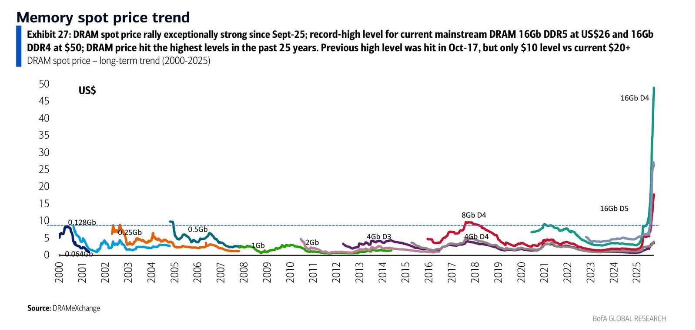

纵轴：US$ 0–50（间隔5）；横轴：2000–2025
图例：8Gb D4、4Gb D4、4Gb D3、2Gb、1Gb、0.5Gb、0.25Gb、0.128Gb、0.064Gb、16Gb D4、16Gb D5
Source: DRAMeXchange

**Exhibit 28: More than tripled through Oct/Nov/Dec; abnormally high at US$25; no hardlanding but mild correction expected in 1Q26**

DRAM spot price outlook - US$/16Gb equiv

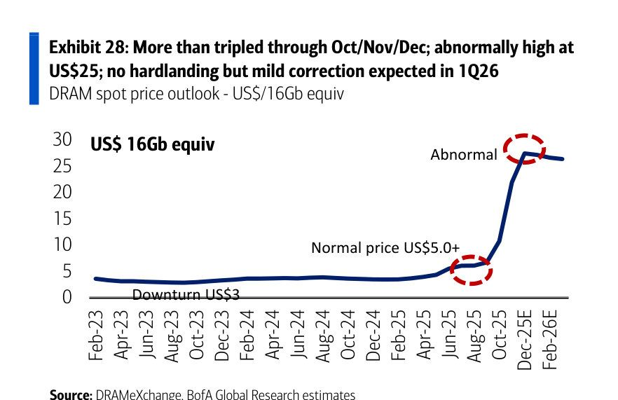

纵轴：US$ 16Gb equiv 0–30（间隔5）；横轴：Feb-23至Feb-26E（两月间隔）
图内标注：Downturn US$3、Normal price US$5.0+、Abnormal
Source: DRAMeXchange, BofA Global Research estimates

**Exhibit 29: Like DRAM, more than doubled through Oct/Nov/Dec; thus abnormally high at US$10+; no hardlanding but mild correction also expected in 1Q26**

NAND spot price outlook - US$/512Gb equiv

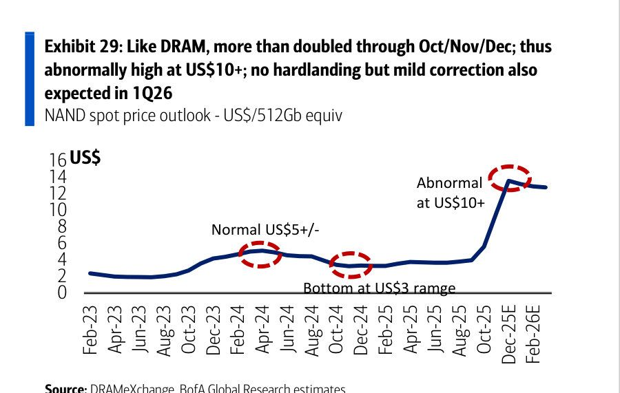

纵轴：US$ 0–16（间隔2）；横轴：Feb-23至Feb-26E（两月间隔）
图内标注：Normal US$5+/-、Bottom at US$3 ramge、Abnormal at US$10+
Source: DRAMeXchange, BofA Global Research estimates

**Exhibit 30: DDR4 crossover occurred in Jun-25; current price of 16Gb DDR4 ($50) much higher vs 16Gb DDR5 ($26)**

Long term price trend of 16Gb DDR5 and 16Gb DDR4 products

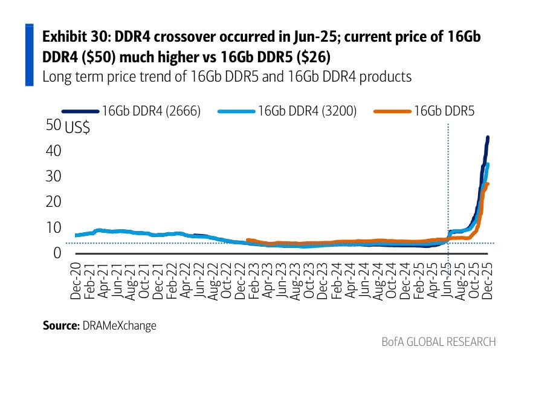

纵轴：US$ 0–50（间隔10）；横轴：Dec-20至Dec-25（两月间隔）
图例：16Gb DDR4 (2666)、16Gb DDR4 (3200)、16Gb DDR5
Source: DRAMeXchange

**Exhibit 31: Current 8Gb DDR4 price hits ~$18 level, exceeds previous high of $10 (Oct-17), and way above historical average of $4-5**

Long term price trend of 8Gb DDR4 products

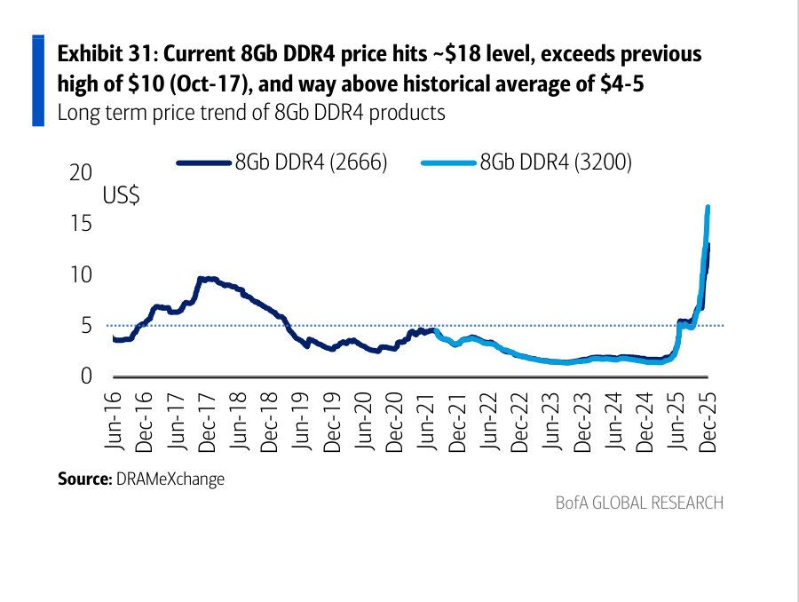

纵轴：US$ 0–20（间隔5）；横轴：Jun-16至Dec-25（半年间隔）
图例：8Gb DDR4 (2666)、8Gb DDR4 (3200)
Source: DRAMeXchange

[Source Page: 16]

**Exhibit 34: 8Gb DDR4 rally more notable (1000%+ YTD) due to big-3 chipmakers' production cut; price hit $18 exceeding previous high levels of $10 hit in Oct-17**

8Gb DDR4 spot price trend, Feb '23-Dec '25

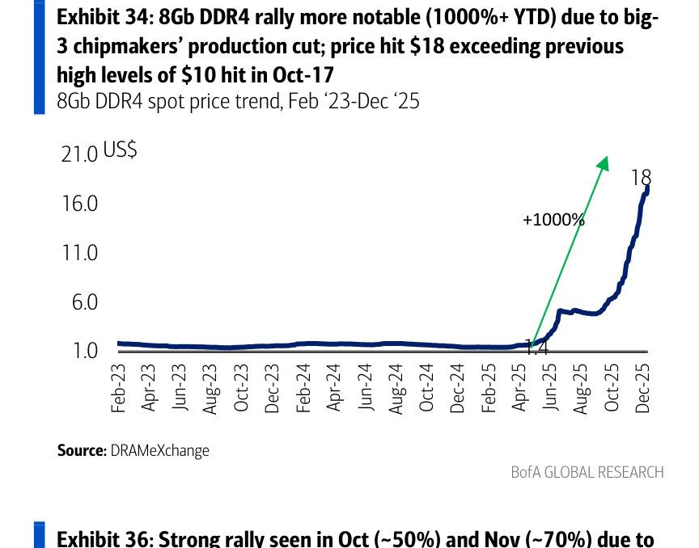

纵轴：US$ 1.0–21.0（标注值1.0、6.0、11.0、16.0、21.0）；横轴：Feb-23至Dec-25（月间隔）
图内数值标注：1.4、18；涨跌幅标注：+1000%
图例：16Gb DDR4 DRAM
Source: DRAMeXchange

**Exhibit 35: Also recovered well in Sep (+33%), Oct (+70%), Nov (+50%) and early Dec (16%) to reach US$50; price up 1000%+ YTD**

16Gb DDR4 spot price trend, Jan '23-Dec '25

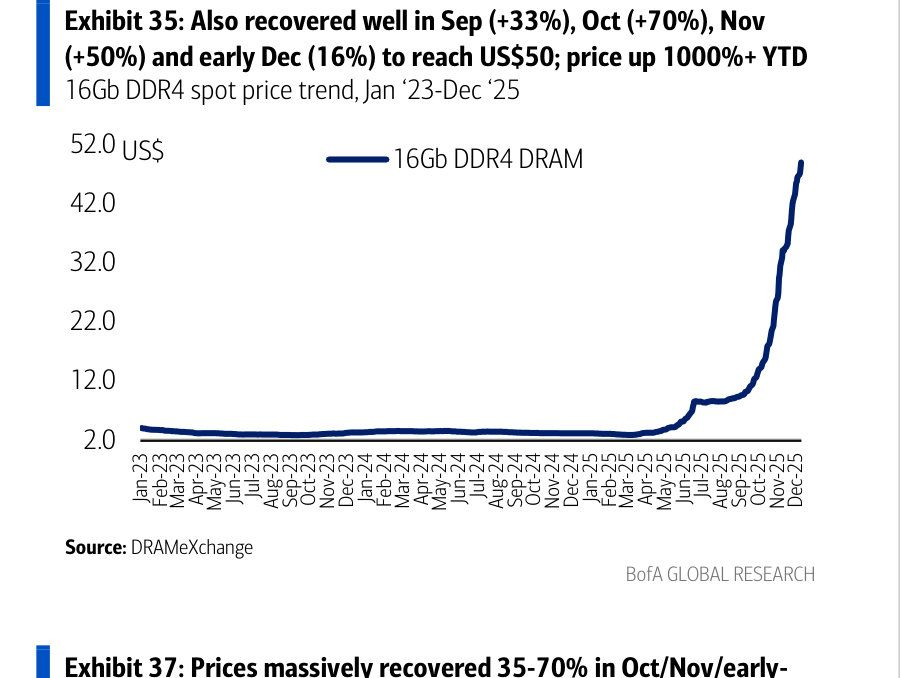

纵轴：US$ 2.0–52.0（标注值2.0、12.0、22.0、32.0、42.0、52.0）；横轴：Jan-23至Dec-25（月间隔）
图例：16Gb DDR4 DRAM
Source: DRAMeXchange

**Exhibit 36: Strong rally seen in Oct (~50%) and Nov (~70%) due to production cut and demand recovery driven price upside; early Dec price also up +6%, but flat this week**

512Gb NAND wafer spot price – weekly, Dec '20-Dec '25

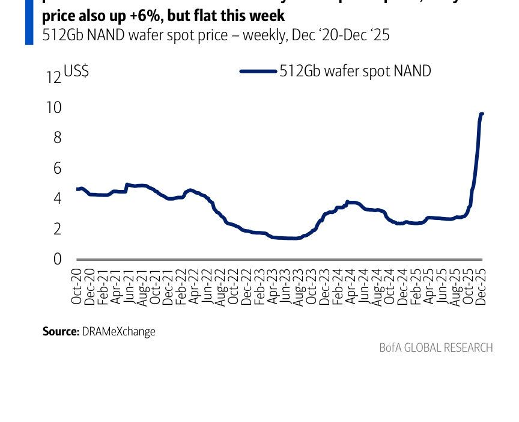

纵轴：US$ 0–12（间隔2）；横轴：Oct-20至Dec-25（月间隔，按周取点）
图例：512Gb wafer spot NAND
Source: DRAMeXchange

[Source Page: 17]

**Exhibit 38: DRAM spot and contract price rose multifold YTD vs NAND**

Current price vs end of 2024 price comparison for DRAM/NAND spot and contract prices

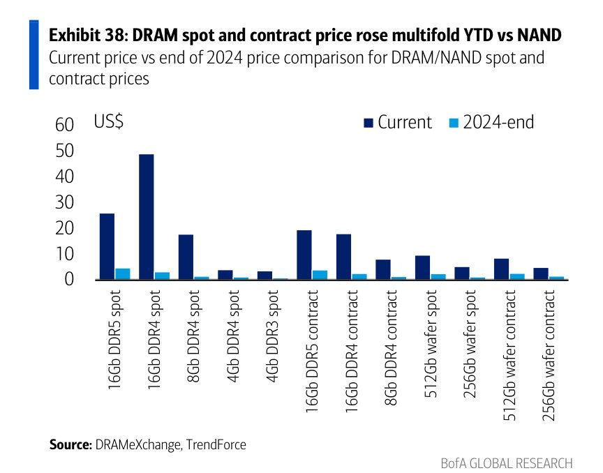

纵轴：US$ 0–60（间隔10）；横轴（12类）：16Gb DDR5 spot、16Gb DDR4 spot、8Gb DDR4 spot、4Gb DDR4 spot、4Gb DDR3 spot、16Gb DDR5 contract、16Gb DDR4 contract、8Gb DDR4 contract、512Gb wafer spot、256Gb wafer spot、512Gb wafer contract、256Gb wafer contract
图例：Current、2024-end
Source: DRAMeXchange, TrendForce

**Exhibit 39: DRAM spot and contract on average up 600%+ vs NAND on average up 250%+**

YTD price change of DRAM/NAND spot and contract prices

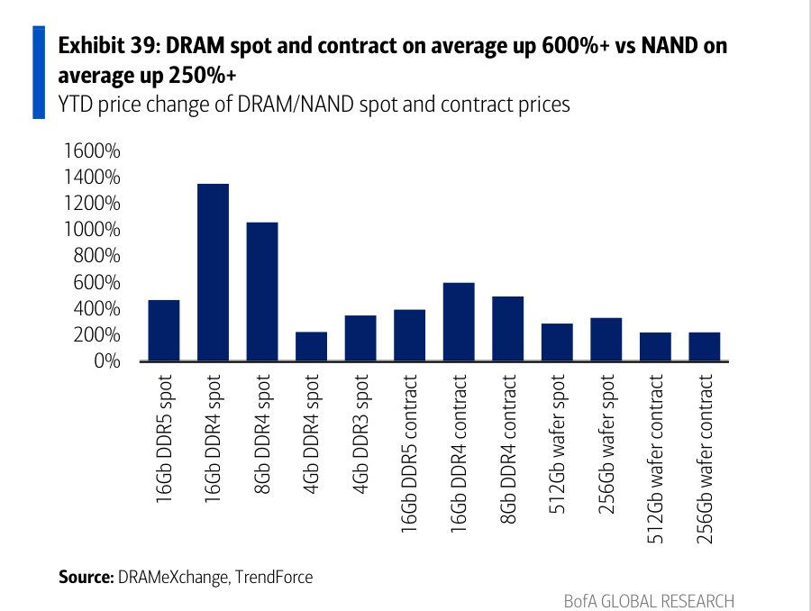

纵轴：0%–1600%（间隔200%）；横轴（12类）：16Gb DDR5 spot、16Gb DDR4 spot、8Gb DDR4 spot、4Gb DDR4 spot、4Gb DDR3 spot、16Gb DDR5 contract、16Gb DDR4 contract、8Gb DDR4 contract、512Gb wafer spot、256Gb wafer spot、512Gb wafer contract、256Gb wafer contract
Source: DRAMeXchange, TrendForce

**Exhibit 40: Spot and contract price 3x higher than our company/industry ASP assumptions**

16Gb equivalent spot, contract price, company specific and industry 4Q ASP

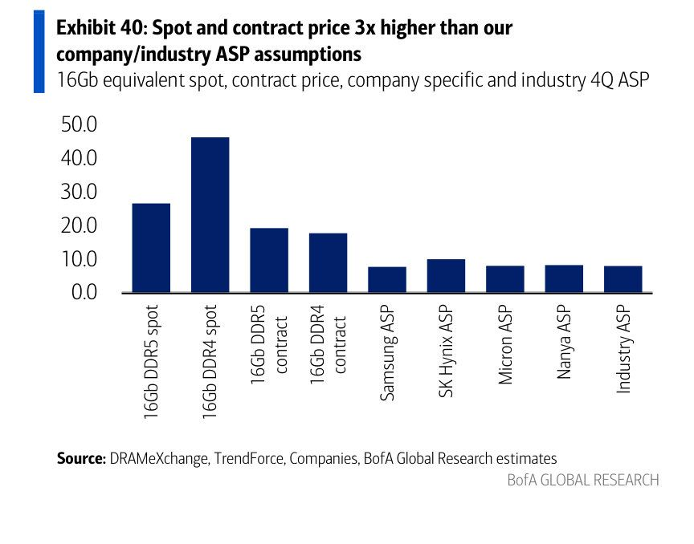

纵轴：US$ 0.0–50.0（间隔10.0）；横轴（9类）：16Gb DDR5 spot、16Gb DDR4 spot、16Gb DDR5 contract、16Gb DDR4 contract、Samsung ASP、SK Hynix ASP、Micron ASP、Nanya ASP、Industry ASP
Source: DRAMeXchange, TrendForce, Companies, BofA Global Research estimates

[Source Page: 18]

**Exhibit 48: The average uptrend duration for DRAM ASP in terms of YoY change is 18 months and downtrend on 27 months**

Duration (# of months) of uptrend and downtrend of WSTS DRAM ASP

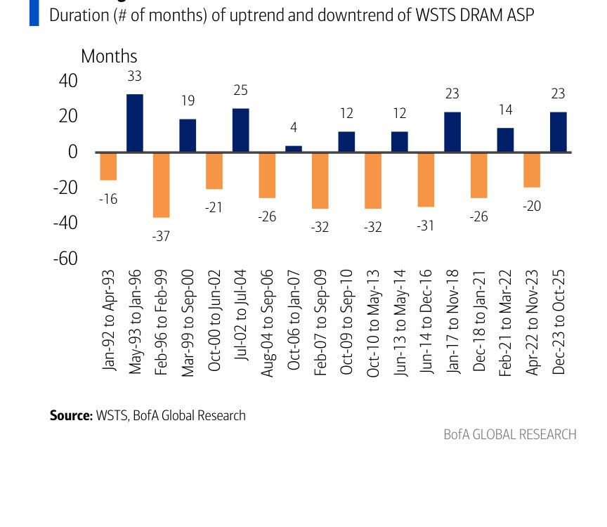

纵轴：Months -60至40（间隔20）

| Period | Months |
| --- | --- |
| Jan-92 to Apr-93 | -16 |
| May-93 to Jan-96 | 33 |
| Feb-96 to Feb-99 | -37 |
| Mar-99 to Sep-00 | 19 |
| Oct-00 to Jun-02 | -21 |
| Jul-02 to Jul-04 | 25 |
| Aug-04 to Sep-06 | -26 |
| Oct-06 to Jan-07 | 4 |
| Feb-07 to Sep-09 | -32 |
| Oct-09 to Sep-10 | 12 |
| Oct-10 to May-13 | -32 |
| Jun-13 to May-14 | 12 |
| Jun-14 to Dec-16 | -31 |
| Jan-17 to Nov-18 | 23 |
| Dec-18 to Jan-21 | -26 |
| Feb-21 to Mar-22 | 14 |
| Apr-22 to Nov-23 | -20 |
| Dec-23 to Oct-25 | 23 |

Source: WSTS, BofA Global Research

**Exhibit 49: The average uptrend duration for unit DRAM price in terms of YoY change is 29 months and downtrend on 20 months**

Duration (# of months) of uptrend and downtrend of DRAM unit price

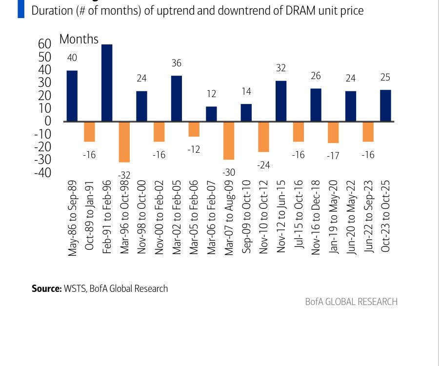

纵轴：Months -40至60（间隔10）

| Period | Months |
| --- | --- |
| May-86 to Sep-89 | 40 |
| Oct-89 to Jan-91 | -16 |
| Feb-91 to Feb-96 | 60 |
| Mar-96 to Oct-98 | -32 |
| Nov-98 to Oct-00 | 24 |
| Nov-00 to Feb-02 | -16 |
| Mar-02 to Feb-05 | 36 |
| Mar-05 to Feb-06 | -12 |
| Mar-06 to Feb-07 | 12 |
| Mar-07 to Aug-09 | -30 |
| Sep-09 to Oct-10 | 14 |
| Nov-10 to Oct-12 | -24 |
| Nov-12 to Jun-15 | 32 |
| Jul-15 to Oct-16 | -16 |
| Nov-16 to Dec-18 | 26 |
| Jan-19 to May-20 | -17 |
| Jun-20 to May-22 | 24 |
| Jun-22 to Sep-23 | -16 |
| Oct-23 to Oct-25 | 25 |

Source: WSTS, BofA Global Research

[Source Page: 20]

## Korea exports, Taiwan sales and China imports

**Exhibit 52: All-time high results in Dec (US$5.3bn; +37% MoM)**

Korea semis exports – First 10 days of month US$bn

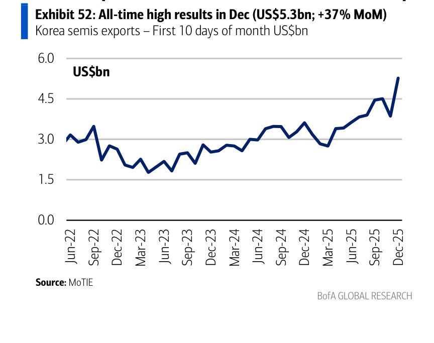

纵轴：US$bn 0.0–6.0（间隔1.5）；横轴：Jun-22至Dec-25（季度间隔）
Source: MoTIE

**Exhibit 53: YoY growth still solid in Dec (+46%); already 24 consecutive months of positive growth**

Korea semis exports – YoY change in first 10 days of month

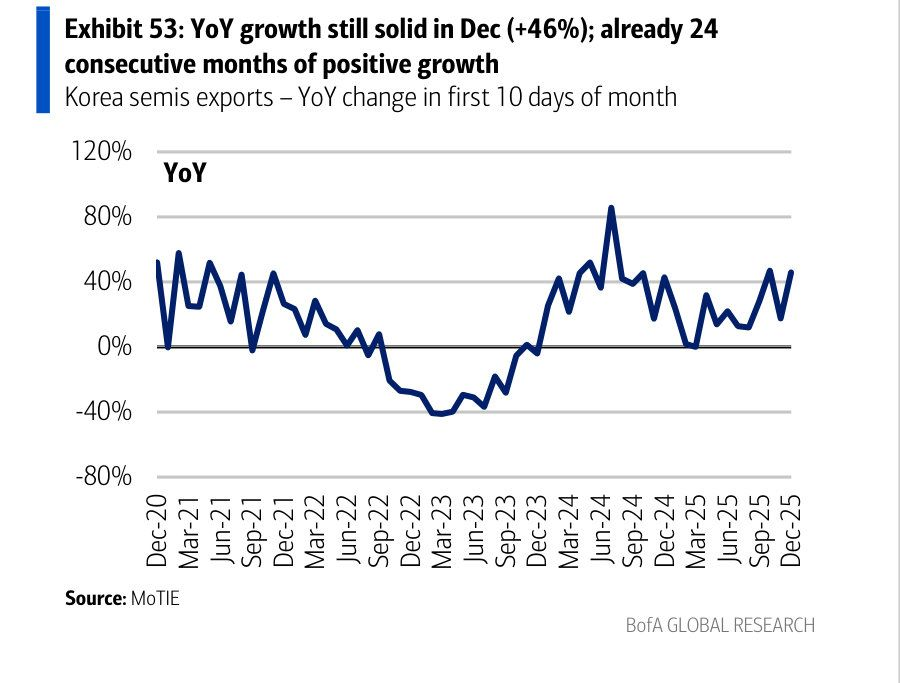

纵轴：YoY -80%至120%（间隔40%）；横轴：Dec-20至Dec-25（季度间隔）
Source: MoTIE

**Exhibit 56: Nov import value was US$39bn, +2% MoM/+14% YoY**

China monthly integrated circuit import value and YoY

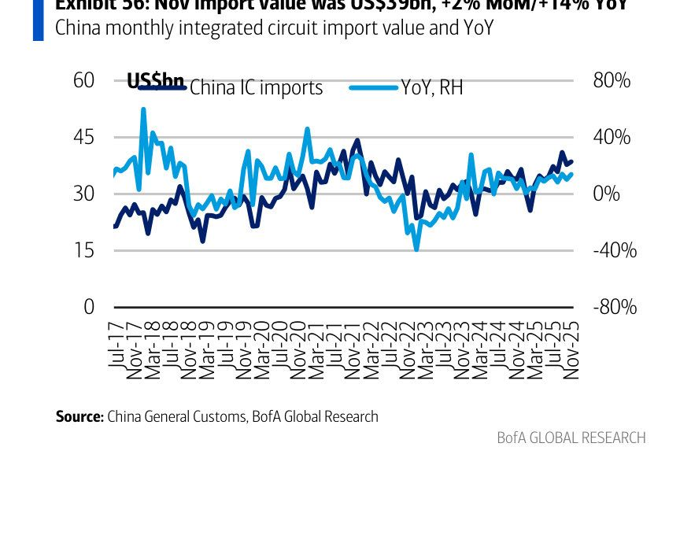

左轴：US$bn 0–60（间隔15）；右轴：YoY -80%至80%（间隔40%）；横轴：Jul-17至Nov-25（季度间隔）
图例：China IC imports、YoY, RH
Source: China General Customs, BofA Global Research

**Exhibit 57: Nov import volume 46.8bn units, -7% MoM/+2% YoY, the lowest after seven consecutive months above 50bn units**

China monthly integrated circuit import volume and YoY

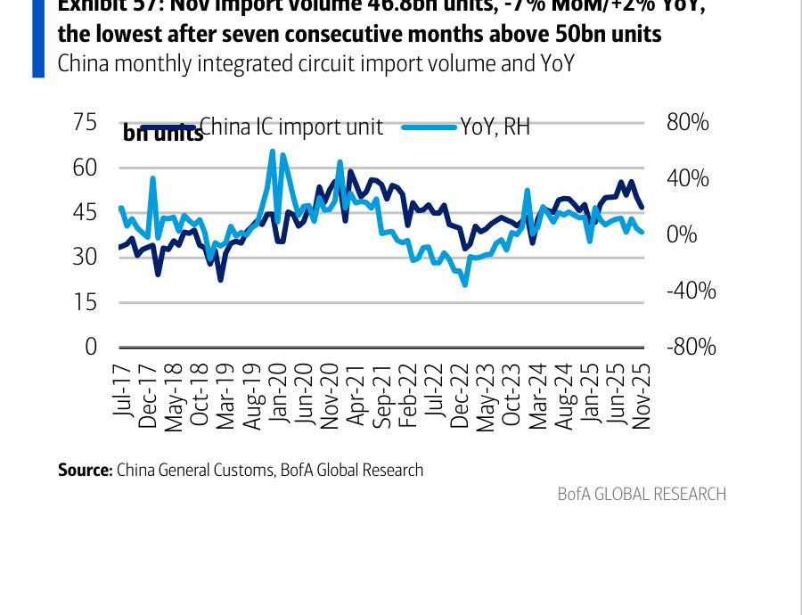

左轴：bn units 0–75（间隔15）；右轴：YoY -80%至80%（间隔40%）；横轴：Jul-17至Nov-25（季度间隔）
图例：China IC import unit、YoY, RH
Source: China General Customs, BofA Global Research

[Source Page: 24]

**Exhibit 61: Top 6 hyperscalers combined capex spend expected to grow 32% YoY in 2026E to reach US$551bn**
Top 6 hyperscalers’ combined capex trend

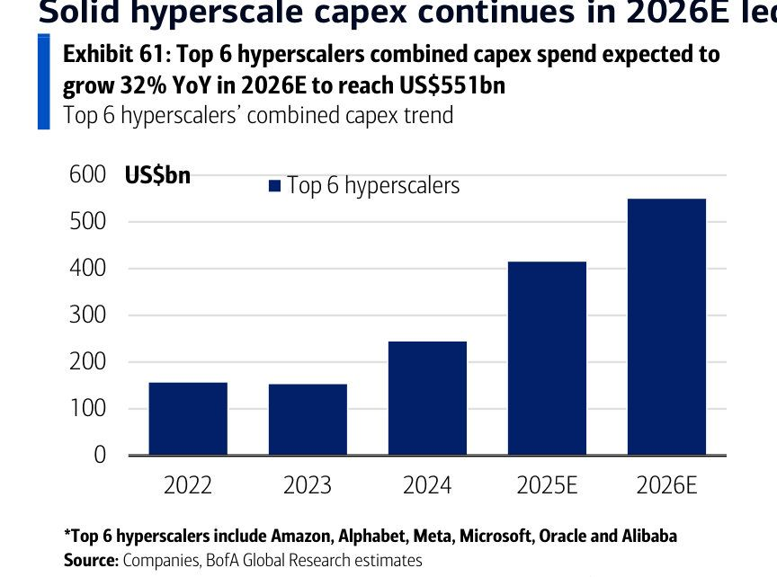

X-axis: 2022, 2023, 2024, 2025E, 2026E; Y-axis: US$bn (0-600); Series: Top 6 hyperscalers

*Top 6 hyperscalers include Amazon, Alphabet, Meta, Microsoft, Oracle and Alibaba
Source: Companies, BofA Global Research estimates

**Exhibit 65: Oct/Nov price sharply up due to seasonality and tight supply vs weak Aug-Sep**
Client SSD price trend – mostly for PC (not server), Oct ’23 - Nov ‘25

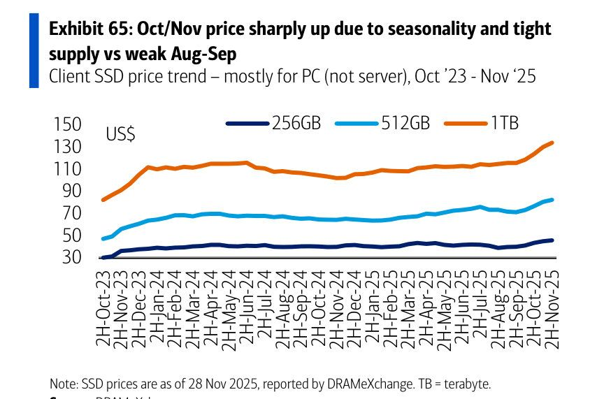

X-axis: 2H-Oct-23, 2H-Nov-23, 2H-Dec-23, 2H-Jan-24, 2H-Feb-24, 2H-Mar-24, 2H-Apr-24, 2H-May-24, 2H-Jun-24, 2H-Jul-24, 2H-Aug-24, 2H-Sep-24, 2H-Oct-24, 2H-Nov-24, 2H-Dec-24, 2H-Jan-25, 2H-Feb-25, 2H-Mar-25, 2H-Apr-25, 2H-May-25, 2H-Jun-25, 2H-Jul-25, 2H-Aug-25, 2H-Sep-25, 2H-Oct-25, 2H-Nov-25; Y-axis: US$ (30-150); Series: 256GB, 512GB, 1TB

Note: SSD prices are as of 28 Nov 2025, reported by DRAMeXchange. TB = terabyte.
Source: DRAMeXchange

**Exhibit 66: 15-20% recovery YTD; mostly NAND production cut driven**
Client SSD (for PC) price comparison – current vs. end-2024

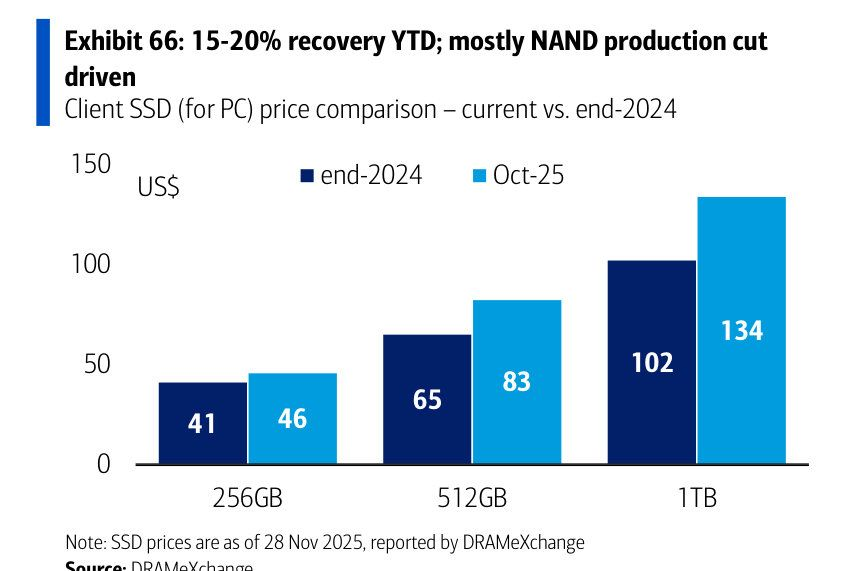

X-axis: 256GB, 512GB, 1TB; Y-axis: US$ (0-150); Series: end-2024, Oct-25; Data labels (US$): 256GB 41 (end-2024) / 46 (Oct-25), 512GB 65 / 83, 1TB 102 / 134

Note: SSD prices are as of 28 Nov 2025, reported by DRAMeXchange
Source: DRAMeXchange

[Source Page: 27]

## Price objective basis & risk

### Nanya Technology (NNYAF)

Upside risks: strong DRAM spot price rally, Big 3 memory chipmakers' more meaningful supply/capex cut for commodity DRAM due to HBM, and more successful ramp-up of DDR4 or DDR5 (better cost or margin improvement).

Downside risks: weaker legacy DDR4 demand (quicker shift to DDR5), a severe price cut coupled with bigger impact of US tariffs, and China's more successful memory production increase.

### Samsung Electronics (SSNLF / SSNHZ)

Downside risks are mostly related to US tariffs, 12-hi HBM execution, memory price cut, large foundry loss and aggressive capex increase.
Upside risks could come from US Big Tech (new orders for HBM and even 2nm node foundry), conventional memory cycle (significant price hike), restructuring plan (significant cost cut) and shareholder return (payout ratio increase).

[Source Page: 28]

### SK Hynix (HXSCF)

Upside risk is stronger HBM demand from US Big Tech.
Downside risk is competitors' more aggressive capex increase.
