## Document Metadata

- Document ID: 23878a95a4284fbe96038740e5cbf26b9baf49a5
- Document Title: Global Memory: Price increase more than expected in 2QCY26
- Document Type: PDF
- Issuing Organization: Bernstein (Société Générale Group)
- Publication Date: 2026-03-18
- Reporting Period: null
- Source File: [M167_2026-03-18_Bernstein_行业点评_全球存储：2026年第二季度价格涨幅超出预期（含翻译）.pdf](https://github.com/jadennevercode/CJCC-Knowledge-Base/blob/5ec8511eb834073c8bfbd79c94af196282d483cf/materials/%E8%B7%A8%E9%93%BE%EF%BC%9A%E4%BE%9B%E9%9C%80%E4%B8%8E%E4%BB%B7%E6%A0%BC%E5%8F%A3%E5%BE%84/M167_2026-03-18_Bernstein_%E8%A1%8C%E4%B8%9A%E7%82%B9%E8%AF%84_%E5%85%A8%E7%90%83%E5%AD%98%E5%82%A8%EF%BC%9A2026%E5%B9%B4%E7%AC%AC%E4%BA%8C%E5%AD%A3%E5%BA%A6%E4%BB%B7%E6%A0%BC%E6%B6%A8%E5%B9%85%E8%B6%85%E5%87%BA%E9%A2%84%E6%9C%9F%EF%BC%88%E5%90%AB%E7%BF%BB%E8%AF%91%EF%BC%89.pdf)

## Structured Content

> 原文件：[M167_2026-03-18_Bernstein_行业点评_全球存储：2026年第二季度价格涨幅超出预期（含翻译）.pdf](https://github.com/jadennevercode/CJCC-Knowledge-Base/blob/5ec8511eb834073c8bfbd79c94af196282d483cf/materials/%E8%B7%A8%E9%93%BE%EF%BC%9A%E4%BE%9B%E9%9C%80%E4%B8%8E%E4%BB%B7%E6%A0%BC%E5%8F%A3%E5%BE%84/M167_2026-03-18_Bernstein_%E8%A1%8C%E4%B8%9A%E7%82%B9%E8%AF%84_%E5%85%A8%E7%90%83%E5%AD%98%E5%82%A8%EF%BC%9A2026%E5%B9%B4%E7%AC%AC%E4%BA%8C%E5%AD%A3%E5%BA%A6%E4%BB%B7%E6%A0%BC%E6%B6%A8%E5%B9%85%E8%B6%85%E5%87%BA%E9%A2%84%E6%9C%9F%EF%BC%88%E5%90%AB%E7%BF%BB%E8%AF%91%EF%BC%89.pdf)
> 转换方式：多模态逐页转录（页面图像 + 文本层交叉校验）

[Source Page: 1]

# Global Memory

## Global Memory: Price increase more than expected in 2QCY26

## 全球内存：2QCY26价格上涨超出预期

**2026年第二季度存储价格涨幅超预期。** 我们近期技术考察和调研的信号显示，尽管云服务提供商（CSP）的采购能力大幅提升，但可能仍无法获得足够供应。消费应用的需求破坏也被延迟，因为终端客户预期价格上涨而提前采购。HBM和部分存储SKU的价格将更稳定，但部分产品在2026年第二季度环比上涨近100%仍是一个上行惊喜。两者之间，NAND的价格信号比DRAM更强。

就供需满足率而言，服务器领域表现最佳，尤其是对CSP而言。苹果和三星领先于其他手机OEM厂商。对于汽车/工业领域，尽管有一些长期协议（LTAs），但调查显示部分厂商也无法获得足够的供应。

**我们猜测价格在2HCY26将持续上涨但更平缓，并在1HCY27达到峰值。** 主要供应商和专业存储买家也难以预测2HCY26的价格，因为长期合同尽管比以前更长期且更具约束力，但仍无法提供足够的保证。我们做出上述猜测，因为需求破坏最终会发生，且通过技术升级增加的比特数逐渐进入市场。尽管一些人预计OpenClaw会带来另一次主要需求上升，但迄今为止的信号让我们认为它已经是CY2025年末发生的需求冲击的一部分。

随着更多洁净室投产及中国供应增加，我们预计价格下降将在2027年下半年加速，并在2028年进一步加剧。

**HBM需求增长依然强劲，三星有望获得份额。** 我们不久前上调了CoWoS和HBM预测（报告）。更多数据点表明，三星在HBM4领域与竞争对手相当，甚至可能领先。竞争应会加剧，但从HBM3E向4的升级以及供应紧张将使混合HBM价格保持稳定。

**创纪录的收益和账面价值，但它们能重复吗？值得给予倍数吗？** 这个周期无疑更强劲，但可能比我们之前的预期更长。人工智能可能会在一段时间内维持需求增长，但创纪录的收益/账面价值仅在严重短缺时出现，我们不会假设短缺会永远持续，尤其是考虑到创纪录的资本支出以及中国的更多扩张。我们使用2年期远期市净率的1.6倍、1.5倍、2倍和1倍，并分别为三星、SK hynix、美光和KIOXIA设定目标价为KRW225K、KRW1150K、US$510和JPY17,000。维持三星、SK hynix和美光的跑赢大盘评级，但对KIOXIA维持跑输大盘评级。

[Source Page: 3]

**我们预测2QCY26内存价格上涨将超出预期。**

- 我们从近期技术考察和供应链调研中获得的信号显示，超大规模云服务商需求依然强劲，部分情况下甚至可能供不应求，而终端客户因预期价格上涨而提前采购，消费需求尚未被破坏。
- 因此，失衡缩小的迹象很少，这为供应商提供了在2QCY26大幅提价的空间。某些SKU（尤其是NAND）在2QCY26的环比价格涨幅可能高达100%，但HBM和其他产品的价格将更稳定，因此我们模型预测该季度DRAM和NAND的混合ASP分别环比上涨47%和60%（Exhibit 1-Exhibit 2）。我们认为这高于买方预期，并在短期内为股价带来明显的上行风险。
- 消费类应用的供应短缺通常比企业级应用更严重。例如，低端手机原始设备制造商（OEM）正遭受痛苦挤压，苹果和三星无法避免价格上涨，但应该能够满足大部分（如果不是全部）需求。由于存储价格，面向企业客户的服务器需求可能疲软。然而，由于一些云服务提供商（CSP）要求30%+ 同比增长，超大规模数据中心的服务器需求要强劲得多，因此我们预计2026年整体服务器出货量将增长13%。尽管有一些长期合同，我们也了解到汽车和工业客户存在供应短缺的情况。我们考虑了这些因素，表3总结了我们对不同应用的需求预测。

EXHIBIT 1: **我们预测2QCY26的DRAM混合ASP环比再上涨47%。**

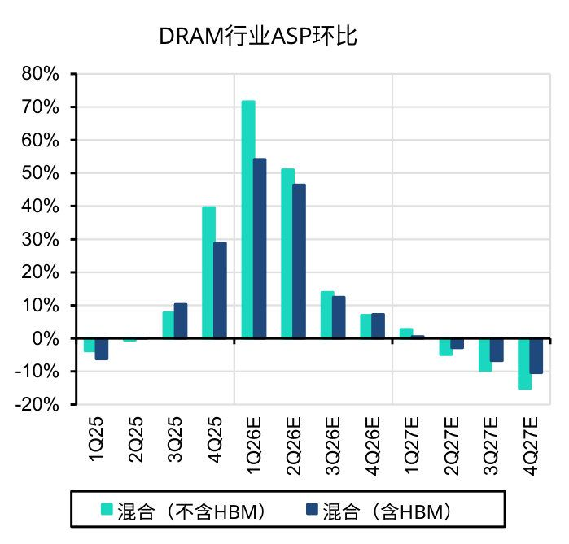
DRAM行业ASP环比
纵轴：-20%～80%（刻度 -20%、-10%、0%、10%、20%、30%、40%、50%、60%、70%、80%）；横轴：1Q25–4Q27E；图例：混合（不含HBM）、混合（含HBM）

来源：公司报告、伯恩斯坦估计及分析

EXHIBIT 2: **我们预计NAND ASP在2026年第二季度将环比上涨60%，涨幅更快。**

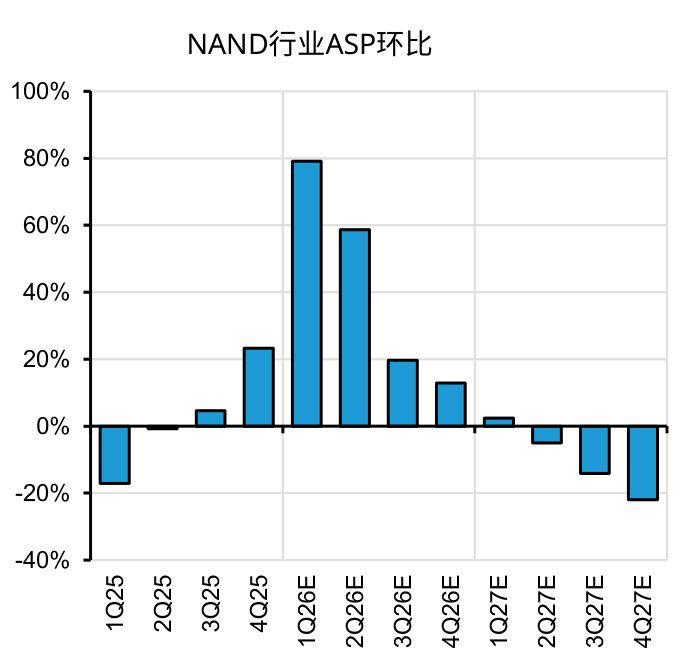
NAND行业ASP环比
纵轴：-40%～100%（刻度 -40%、-20%、0%、20%、40%、60%、80%、100%）；横轴：1Q25–4Q27E；无图例（单一柱状序列）

来源：公司报告、伯恩斯坦估计及分析

[Source Page: 4]

EXHIBIT 3: **存储需求预测假设摘要**

|  |  | 2021 | 2022 | 2023 | 2024 | 2025 | 2026E | 2027E | 2028E |
|---|---|---|---|---|---|---|---|---|---|
| **设备出货量（百万台）** |  |  |  |  |  |  |  |  |  |
| PC | 出货量 | 335 | 275 | 246 | 252 | 265 | 230 | 234 | 250 |
|  | 增长 | 10% | -18% | -10% | 2% | 5% | -13% | 2% | 7% |
| 智能手机 | 出货量 | 1,358 | 1,198 | 1,152 | 1,217 | 1,249 | 1,062 | 1,083 | 1,191 |
|  | 增长 | 5% | -12% | -4% | 6% | 3% | -15% | 2% | 10% |
| 服务器 | 出货量 | 13.0 | 13.6 | 12.8 | 13.1 | 14.1 | 15.9 | 17.0 | 18.0 |
|  | 增长 | 2% | 5% | -6% | 2% | 8% | 13% | 7% | 6% |
| **每设备DRAM含量（GB/单位）** |  |  |  |  |  |  |  |  |  |
| PC | 含量 | 7.7 | 9.1 | 9.9 | 11.1 | 12.6 | 13.5 | 14.4 | 16.3 |
|  | 增长 | 6% | 18% | 8% | 12% | 13% | 8% | 6% | 14% |
| 智能手机 | 含量 | 5.8 | 6.3 | 7.5 | 8.5 | 9.3 | 10.1 | 10.7 | 12.1 |
|  | 增长 | 25% | 10% | 18% | 14% | 10% | 8% | 6% | 13% |
| 服务器（不含HBM） | 含量 | 482 | 559 | 626 | 720 | 858 | 1,047 | 1,224 | 1,432 |
|  | 增长 | 15% | 16% | 12% | 15% | 19% | 22% | 17% | 17% |
| **每设备NAND容量（GB/单位）** |  |  |  |  |  |  |  |  |  |
| 智能手机 | 含量 | 118 | 144 | 172 | 182 | 202 | 214 | 234 | 282 |
|  | 增长 | 22% | 22% | 19% | 6% | 11% | 6% | 9% | 21% |
| Client SSD | 含量 | 529 | 624 | 692 | 757 | 781 | 702 | 733 | 870 |
|  | 增长 | 19% | 18% | 11% | 9% | 3% | -10% | 4% | 19% |
| eSSD | 含量 | 2,644 | 3,224 | 3,747 | 4,769 | 6,153 | 7,477 | 9,523 | 12,307 |
|  | 增长 | 32% | 22% | 16% | 27% | 29% | 22% | 27% | 29% |
| **总比特需求** |  |  |  |  |  |  |  |  |  |
| 总DRAM（百万Gb） | 需求 | 179,450 | 193,537 | 212,956 | 253,846 | 308,470 | 368,570 | 444,443 | 542,505 |
|  | 增长 | 21% | 8% | 10% | 19% | 22% | 19% | 21% | 22% |
| PC | 需求 | 20,750 | 20,056 | 19,502 | 22,422 | 26,727 | 24,930 | 26,889 | 32,666 |
|  | 增长 | 16% | -3% | -3% | 15% | 19% | -7% | 8% | 21% |
| 智能手机 | 需求 | 62,553 | 60,606 | 68,844 | 82,753 | 93,230 | 85,909 | 92,899 | 115,500 |
|  | 增长 | 946% | -3% | 14% | 20% | 13% | -8% | 8% | 24% |
| 服务器（不含HBM） | 需求 | 50,257 | 61,031 | 64,200 | 75,306 | 96,496 | 132,990 | 166,440 | 206,337 |
|  | 增长 | 17% | 21% | 5% | 17% | 28% | 38% | 25% | 24% |
| HBM | 需求 | 651 | 1,358 | 3,035 | 10,098 | 23,251 | 50,347 | 76,133 | 91,965 |
|  | 增长 | 109% | 109% | 123% | 233% | 130% | 117% | 51% | 21% |
| NAND总量（百万GB） | 需求 | 645,752 | 739,436 | 808,941 | 958,119 | 1,132,577 | 1,325,913 | 1,581,353 | 1,955,975 |
|  | 增长 | 36% | 15% | 9% | 18% | 18% | 17% | 19% | 24% |
| Client SSD | 需求 | 217,503 | 224,952 | 247,509 | 269,347 | 278,806 | 225,725 | 246,296 | 319,027 |
|  | 增长 | 42% | 3% | 10% | 9% | 4% | -19% | 9% | 30% |
| eSSD | 需求 | 159,583 | 225,815 | 196,193 | 296,481 | 423,130 | 693,899 | 865,500 | 995,159 |
|  | 增长 | 46% | 42% | -13% | 51% | 43% | 64% | 25% | 15% |
| 智能手机 | 需求 | 160,659 | 172,373 | 197,843 | 221,549 | 252,901 | 227,650 | 253,629 | 336,272 |
|  | 增长 | 28% | 7% | 15% | 12% | 14% | -10% | 11% | 33% |

来源：Gartner、TrendForce、Bernstein的估计和分析

**能见度低，但我们预计价格将继续上涨，但在2026年下半年会缓慢得多，然后在2027年上半年达到峰值，并在2027年下半年和2028年转为下跌。**

- 超大规模数据中心目前正在与供应商讨论长期合同。这些合同的期限更长，部分合同的覆盖范围超出CY2026年末。然而，在我们的技术考察中与主要供应商的会面并未让我们确信这些“eLTA”（扩展长期协议）在数量上有足够的锁定，更重要的是在价格上有足够的锁定，以避免未来的波动。此外，消费应用仍是内存市场的重要组成部分，我们的调查发现它们总体上仍未签订“eLTA”。因此市场非常不稳定，即使是供应商和专业内存采购经理也不知道未来几个月后的价格。
- 我们认为价格将在2026年全年持续上涨，但我们预测2026年下半年环比涨幅将趋于温和，这更多基于行业参与者的反馈或猜测，而非定量分析。
- 随着1）消费类应用的需求破坏在2HCY26逐渐显现，并在1HCY27进一步加剧，以及2）供应增加（首先通过技术升级，然后通过新洁净室和晶圆增加）在CY2026年末出现，并在CY2027更多出现，我们建模的周期在1HCY27达到峰值。随后在2HCY27，当更多洁净室变得可用时，价格下跌加速，且在CY2028年更快，届时中国新增的供应相对于整体市场将越来越大。

[Source Page: 5]

我们假设竞争将使CY2028年末的价格降至本周期起点（即CY2025年末）以下（Exhibit 4-Exhibit 7），但由于此期间的成本下降，内存供应商的利润率仍将接近历史中期周期平均水平（Exhibit 8-Exhibit 9）。

- 上述预测基于一个基本假设：2025年末出现了一次需求“冲击”（即大幅上升），但之后未再出现。自那以来，供应商一直在全力增加产能，同时高价也在破坏部分需求。然而，供需失衡的规模如此之大，因此我们假设供应商的利润率需要3年时间才能恢复到正常水平。一些人预计，例如来自OpenClaw的代理工作负载将导致另一次需求“冲击”。我们也在密切关注这一点，但迄今为止的信号使我们认为这已经是我们在2025年末看到的需求冲击的一部分。

EXHIBIT 4: **我们预测DRAM ASP在1HCY27达到峰值，之后回调。**

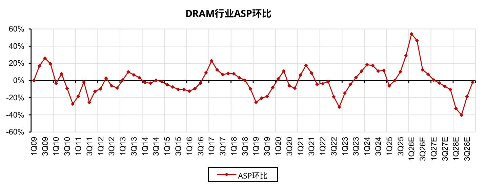
DRAM行业ASP环比
纵轴：-60%～60%的相对变化（刻度 -60%、-40%、-20%、0%、20%、40%、60%）；横轴：1Q09–3Q28E（每半年一个刻度，含1Q26E起的预测值）；图例：ASP环比

来源：公司报告、伯恩斯坦估计及分析

EXHIBIT 5: **我们预测传统DRAM ASP将在2028年降至正常水平。**

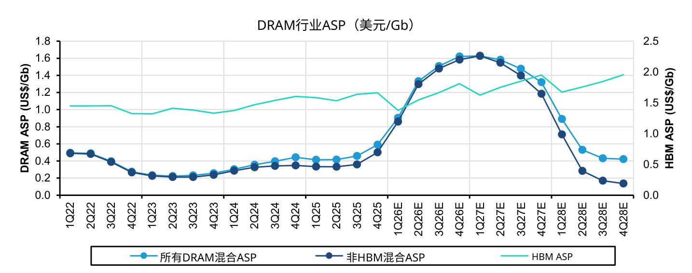
DRAM行业ASP（美元/Gb）
左纵轴：DRAM ASP (US$/Gb) 0.0–1.8；右纵轴：HBM ASP (US$/Gb) 0.0–2.5；横轴：1Q22–4Q28E（逐季）；图例：所有DRAM混合ASP、非HBM混合ASP、HBM ASP

来源：公司报告、伯恩斯坦估计及分析

[Source Page: 6]

EXHIBIT 6: **我们还预计NAND ASP从2027年下半年开始将出现显著下降。**

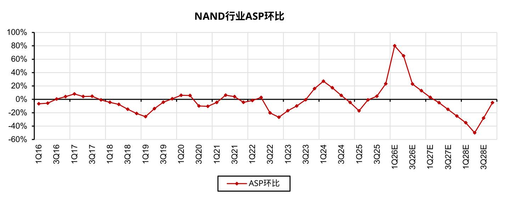
NAND行业ASP环比
纵轴：-60%～100%（刻度 -60%、-40%、-20%、0%、20%、40%、60%、80%、100%）；横轴：1Q16–3Q28E（每半年一个刻度，含1Q26E起的预测值）；图例：ASP环比

来源：公司报告、伯恩斯坦估计及分析

EXHIBIT 7: **到CY2028年，我们认为NAND价格需要回调至正常水平。**

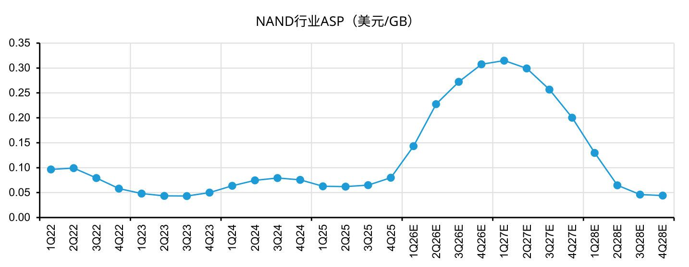
NAND行业ASP（美元/GB）
纵轴：0.00–0.35（刻度0.00、0.05、0.10、0.15、0.20、0.25、0.30、0.35）；横轴：1Q22–4Q28E（逐季）；单一序列，无图例

来源：公司报告、伯恩斯坦估计及分析

[Source Page: 7]

EXHIBIT 8: **我们预计DRAM毛利率在2026年末和2027年初将接近90%，但随着价格下跌，2028年将回落至正常水平。**

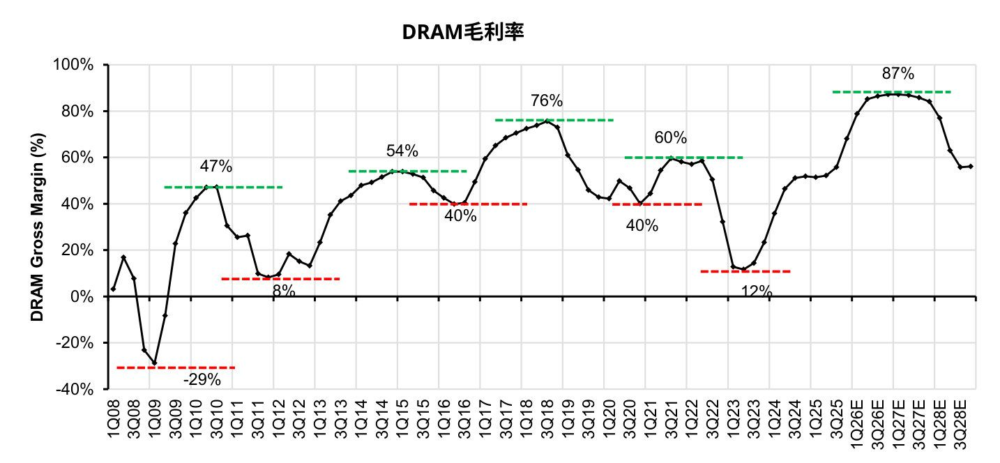
DRAM毛利率
纵轴：DRAM Gross Margin (%) -40%～100%；横轴：1Q08–3Q28E（每半年一个刻度，含1Q26E起的预测值）；图中标注参考值（按横向顺序）：-29%、47%、8%、54%、40%、76%、40%、60%、12%、87%

来源：公司报告、DRAMeXchange、Bernstein的估计和分析

EXHIBIT 9: **对于NAND，我们还建模行业毛利率在CY2028达到86%的峰值，然后迅速回落至正常水平。**

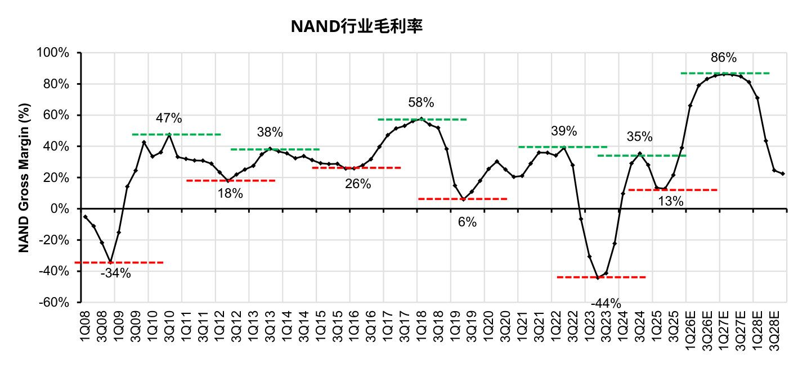
NAND行业毛利率
纵轴：NAND Gross Margin (%) -60%～100%；横轴：1Q08–3Q28E（每半年一个刻度，含1Q26E起的预测值）；图中标注参考值（按横向顺序）：-34%、47%、18%、38%、26%、58%、6%、39%、-44%、35%、13%、86%

来源：公司报告、DRAMeXchange、Bernstein的估计和分析

**HBM需求继续上升，数据显示三星在HBM方面与竞争对手相当，甚至领先。**

- 我们不久前上调了HBM和CoWoS的产能预测（CoWoS/HBM模型），并预计从现在到CY2028年HBM需求将保持上升趋势（Exhibit 10）。在从HBM3E向4过渡（Exhibit 11）以及更重要的供应紧张的推动下，我们预计今年混合HBM ASP将同比上升，尽管三星在HBM4领域更具竞争力应会施加下行压力（Exhibit 12）。然而，HBM ASP的上涨幅度要小得多，内存供应商的收益仍主要由传统内存的价格决定。

[Source Page: 8]

- 得益于DRAM和基底裸片使用的更先进节点（Exhibit 14），我们认为三星最有条件满足NVIDIA所需的更高速度。美光在基底裸片节点的选择上尤其处于劣势。根据我们的调查，SK hynix最近也因基底裸片问题出现了小延迟。所有这些因素，加上比竞争对手更充足的洁净室空间，应使三星能够逐步在HBM领域获得份额（Exhibit 13），尽管三星的产能分配可能会略微偏向传统DRAM而非HBM以优化盈利能力。

EXHIBIT 10: **我们不久前将CY2026年HBM位出货量的同比增长预测上调至117%。**

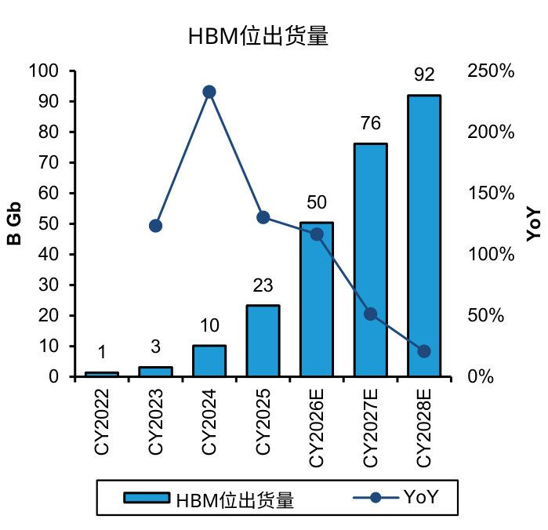
HBM位出货量
左纵轴：B Gb 0–100；右纵轴：YoY 0%–250%；横轴：CY2022–CY2028E；图例：HBM位出货量、YoY
柱上标注（B Gb）：1、3、10、23、50、76、92；YoY折线未标注数值

来源：TrendForce、Yole、Bernstein的估计和分析

EXHIBIT 11: **HBM4今年将开始占据份额，尽管大部分仍将是HBM3E。**

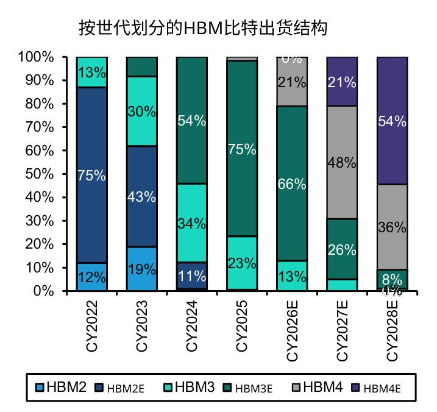
按世代划分的HBM比特出货结构
纵轴：0%–100%；横轴：CY2022–CY2028E；图例：HBM2、HBM2E、HBM3、HBM3E、HBM4、HBM4E
柱内标注（自下而上）：CY2022 HBM2 12% / HBM2E 75% / HBM3 13%；CY2023 HBM2 19% / HBM2E 43% / HBM3 30%；CY2024 HBM2E 11% / HBM3 34% / HBM3E 54%；CY2025 HBM3 23% / HBM3E 75%；CY2026E HBM3 13% / HBM3E 66% / HBM4 21%（顶部另有0%标注）；CY2027E HBM3E 26% / HBM4 48% / HBM4E 21%（底部HBM3段未标注）；CY2028E HBM3E 8% / HBM4 36% / HBM4E 54%（底部HBM3段未标注）

来源：TrendForce、伯恩斯坦估计及分析

EXHIBIT 12: **我们预计今年混合HBM ASP将保持稳定，这得益于更高的HBM4占比和整体供应紧张。**

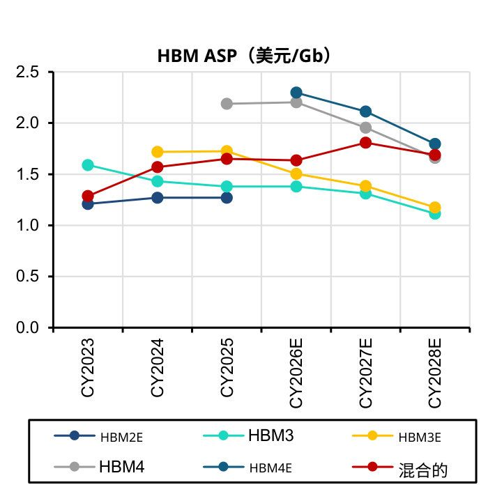
HBM ASP（美元/Gb）
纵轴：US$/Gb 0.0–2.5；横轴：CY2023–CY2028E；图例：HBM2E、HBM3、HBM3E、HBM4、HBM4E、混合的

Source: 公司报告、TrendForce、Bernstein预估及analysis

EXHIBIT 13: **我们认为三星从今年开始将在HBM领域获得市场份额。**

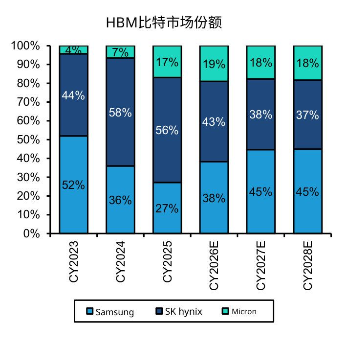
HBM比特市场份额
纵轴：0%–100%；横轴：CY2023–CY2028E；图例：Samsung、SK hynix、Micron
柱内标注（自下而上）：CY2023 Samsung 52% / SK hynix 44% / Micron 4%；CY2024 36% / 58% / 7%；CY2025 27% / 56% / 17%；CY2026E 38% / 43% / 19%；CY2027E 45% / 38% / 18%；CY2028E 45% / 37% / 18%

来源：TrendForce、伯恩斯坦估计及分析

[Source Page: 9]

EXHIBIT 14: **三家供应商HBM基底裸片技术选择摘要**

**HBM基底裸片工艺节点**

|  |  | Samsung | SK hynix | Micron |
|---|---|---|---|---|
| HBM4 | 标准 | Samsung 4nm | TSMC 12nm | 内部Planar |
| HBM4 | 定制 | Samsung 4nm | TSMC 12nm | 内部Planar |
| HBM4E | 标准 | Samsung（2纳米？）或TSMC | TSMC (12nm?) | TSMC (12nm?) |
| HBM4E | 定制 | Samsung（2纳米？）或TSMC | 台积电N4/3或N3由英伟达选择？ | 台积电N4/3或N3由英伟达选择？ |

来源：TrendForce、伯恩斯坦估计及分析

- 对于铠侠，我们确实看到其股价在短期内随NAND价格上涨而走高。然而，我们对NAND和铠侠的长期担忧依然存在。人工智能预计将为NAND带来更多需求，但这远不如HBM对DRAM的需求明确且规模庞大。最重要的是，NAND技术门槛较低且竞争压力较大（尤其是来自长江存储的竞争），这是大型厂商对NAND投资优先级较低的原因。铠侠无疑能从当前短缺中受益，但我们尚未确信其基本竞争地位已改善。因此，我们维持“跑输大盘”评级，目标价设定为17,000日元，对应2年期预期BVPS的1倍（Exhibit 30）。
- 总体而言，我们看到人工智能导致内存需求增长更快，但投资者应记住，现在的非凡收益不仅仅需要良好的需求，只有在再次出现严重短缺时才能重复。由于现有企业的资本支出创历史新高，以及中国的扩张速度更快，我们认为短缺不会永远持续。因此，尽管我们对内存行业结构性乐观，但仍提醒投资者注意收益和股价的周期性。

[Source Page: 15]

EXHIBIT 32: **三星经营指标**

**部门运营指标**

| 半导体 | 2025 | 2026E | 2027E | 2028E | 1Q25 | 2Q25 | 3Q25 | 4Q25 | 1Q26E | 2Q26E | 2026年第三季度预估 | 4Q26E |
|---|---|---|---|---|---|---|---|---|---|---|---|---|
| DRAM ASP（美元/Gb） | 0.46 | 1.43 | 1.65 | 0.67 | 0.38 | 0.38 | 0.44 | 0.62 | 0.97 | 1.42 | 1.59 | 1.71 |
| 变化百分比 | 20.9% | 208.0% | 15.3% | (59.2%) | (19.0%) | (0.2%) | 15.8% | 40.0% | 57.3% | 46.0% | 12.0% | 7.4% |
| NAND ASP（美元/GB） | 0.07 | 0.28 | 0.31 | 0.08 | 0.07 | 0.06 | 0.07 | 0.08 | 0.16 | 0.26 | 0.32 | 0.36 |
| 变化百分比 | (7.0%) | 296.5% | 10.7% | (74.2%) | (16.0%) | (4.0%) | 5.6% | 24.0% | 90.0% | 65.0% | 23.0% | 13.0% |
| DRAM每Gb成本 | 0.19 | 0.22 | 0.24 | 0.22 | 0.19 | 0.19 | 0.20 | 0.20 | 0.20 | 0.21 | 0.22 | 0.23 |
| 变化百分比 | 6.6% | 11.8% | 11.3% | (9.3%) | (11.3%) | (1.5%) | 5.1% | (0.7%) | 2.4% | 5.0% | 5.0% | 4.0% |
| NAND每GB成本 | 0.05 | 0.05 | 0.04 | 0.03 | 0.06 | 0.06 | 0.05 | 0.05 | 0.05 | 0.05 | 0.04 | 0.04 |
| 变化百分比 | (2.8%) | (12.8%) | (14.4%) | (12.6%) | 4.1% | (2.5%) | (10.1%) | (5.4%) | (0.6%) | (2.0%) | (2.0%) | (3.0%) |

来源：公司报告、伯恩斯坦估计及分析
