## Document Metadata

- Document ID: 8044b4976c3539bb808b966dc3bb8d33141ab8c8
- Document Title: Greater China Semiconductors | Asia Pacific — Old Memory: Inevitable Derating
- Document Type: PDF
- Issuing Organization: Morgan Stanley Research
- Publication Date: 2026-03-30
- Reporting Period: null
- Source File: [M168_2026-04-01_Morgan_Stanley_行业点评_大中华区半导体_亚太区;传统存储：估值下调不可避免（含翻译）.pdf](https://github.com/jadennevercode/CJCC-Knowledge-Base/blob/5ec8511eb834073c8bfbd79c94af196282d483cf/materials/%E8%B7%A8%E9%93%BE%EF%BC%9A%E4%BE%9B%E9%9C%80%E4%B8%8E%E4%BB%B7%E6%A0%BC%E5%8F%A3%E5%BE%84/M168_2026-04-01_Morgan_Stanley_%E8%A1%8C%E4%B8%9A%E7%82%B9%E8%AF%84_%E5%A4%A7%E4%B8%AD%E5%8D%8E%E5%8C%BA%E5%8D%8A%E5%AF%BC%E4%BD%93_%E4%BA%9A%E5%A4%AA%E5%8C%BA%3B%E4%BC%A0%E7%BB%9F%E5%AD%98%E5%82%A8%EF%BC%9A%E4%BC%B0%E5%80%BC%E4%B8%8B%E8%B0%83%E4%B8%8D%E5%8F%AF%E9%81%BF%E5%85%8D%EF%BC%88%E5%90%AB%E7%BF%BB%E8%AF%91%EF%BC%89.pdf)

## Structured Content

> 原文件：[M168_2026-04-01_Morgan_Stanley_行业点评_大中华区半导体_亚太区;传统存储：估值下调不可避免（含翻译）.pdf](https://github.com/jadennevercode/CJCC-Knowledge-Base/blob/5ec8511eb834073c8bfbd79c94af196282d483cf/materials/%E8%B7%A8%E9%93%BE%EF%BC%9A%E4%BE%9B%E9%9C%80%E4%B8%8E%E4%BB%B7%E6%A0%BC%E5%8F%A3%E5%BE%84/M168_2026-04-01_Morgan_Stanley_%E8%A1%8C%E4%B8%9A%E7%82%B9%E8%AF%84_%E5%A4%A7%E4%B8%AD%E5%8D%8E%E5%8C%BA%E5%8D%8A%E5%AF%BC%E4%BD%93_%E4%BA%9A%E5%A4%AA%E5%8C%BA%3B%E4%BC%A0%E7%BB%9F%E5%AD%98%E5%82%A8%EF%BC%9A%E4%BC%B0%E5%80%BC%E4%B8%8B%E8%B0%83%E4%B8%8D%E5%8F%AF%E9%81%BF%E5%85%8D%EF%BC%88%E5%90%AB%E7%BF%BB%E8%AF%91%EF%BC%89.pdf)
> 转换方式：多模态逐页转录（页面图像 + 文本层交叉校验）

[Source Page: 1]

# Greater China Semiconductors | Asia Pacific

# Old Memory: Inevitable Derating

KV cache compression, server system optimization, and LTA discussions likely to drive further valuation pressure. We cut PTs again for GC memory names with DRAM exposure and reiterate our contrarian preference for legacy NAND vs. DDR4.

## Key Takeaways

- Turboquant impact could be overblown, but better than the prior LLM weights compression from third party vendors.
- Customer affordability is becoming an issue. NAND supply vendors are offering solutions to reduce system DRAM content.
- Private placement and LTA suggest LT downside support, but with rising questions on further pricing upside.
- Pure legacy NAND vendors (e.g. Macronix) could be much less impacted (earnings even stronger), in the next few quarters.

**Even more debate… will software optimization work?** Following our old memory downgrade on March 20, we have received mostly significant push back, and a surprising private placement to Nanya. However, at the same time, the TurboQuant shock, could be overblown (see reports from Shawn Kim and Joe Moore). LLM compression was discussed in Taiwan: Skymizer (private) showcased its weight compression technique with PSMC at Computex 2025, leading to faster inference (Exhibit 1 to Exhibit 3). That said, development is slower as it's not on a KV cache and doesn't have its own LLM, unlike TurboQuant.

**Surging tokens (enterprise) demand (Exhibit 13) vs. high DRAM pricing:** At the CFM Summit in Shenzhen, we saw edge AI potentially becoming a new driver for memory demand (Exhibit 12 to Exhibit 15). Multiple Flash vendors are introducing solutions to reduce system content (Exhibit 4 to Exhibit 11). We see system houses from both the US and China discussing different solutions to optimize DRAM usage. DRAM cost per GB could be 50x vs. NAND in 2Q. We also discussed the DDR4 constraint with eSSD (cache memory). Current fulfillment rates stand at ~80%, in line with the undersupply indicated by our industry model. We also met distributors selling DRAM modules from carry-on inventory.

**Could private placement and LTA guarantee pricing?** Historically, some LTAs with fixed pricing have been honored by customers, mainly in legacy foundry, e.g. smaller MCU suppliers continued to honor Covid-era LTAs even into 2024. Whether it will be the same for DDR4 this time remains uncertain. Even if DDR4 pricing holds for the next 3 years, earnings upside may remain capped. Over time, memory players may transition into dividend plays. (Continued below)

[Source Page: 2]

**Stay selective – we reduce PTs for all DRAM-related legacy memory names:** Our downward revisions focus mainly on valuation multiples, as recent developments suggest further de-rating for legacy memory stocks is likely. We do not currently expect pricing erosion and therefore maintain EW on DDR4 plays (Exhibit 16). If pricing pressure emerges into 2027, we could turn more bearish. Conversely, we could become constructive if pricing momentum extends into 2027, or if GC memory vendors can capture 16x SRAM demand from LPUs in 2028, which currently sits with logic foundries.

[Source Page: 3]

## Exhibit 3: Skymizer: smaller weight leads to faster inference
Effective | smaller Weight leads to faster inference
By compressing the original LLaMA2 7B model (26.5GB), the HyperThought software creates a smaller model (3.27GB – 2.96GB) that is 9.17%-17.8% smaller and increases only 0.64%-3.42 % in perplexity, compared to the open-source llama.cpp's compression of LLaMa2 7B (3.6GB).

| LLaMA2 7B Weight | Size |
| --- | --- |
| Original | 26.5GB |
| llama.cpp quantized | 3.6GB |
| HyperThought | 3.27GB – 2.96GB |
Bar chart, y-axis 19.00% / 15.00% / 11.00% / 7.00% / 3.00% / -1.00% / -5.00%; legend: Inference Enhancement, Perplexity Loss. Inference Enhancement (%): 9.17%, 10.83%, 13.33%, 13.69% [OCR_UNCERTAIN], 13.89%, 13.89%, 14.17%, 16.1%, 16.1%, 17.5%, 17.8%; model size labels: 3.27GB, 3.21GB, 3.10GB, 3.10GB, 3.10GB, 3.08GB, 3.02GB, 3.02GB, 2.97GB, 2.96GB; Perplexity Loss (%): -0.64%, -1.21%, -1.67%, -2.15%, -2.15%, -2.44%, -2.70%, -2.71%, -3.28%, -3.42%

## Exhibit 4: Examples of near-memory/storage AI chip integration
Examples of Near-Memory/Storage AI Chip Integration
3D DRAM CUBE Source: Winbond
- High BW, low power, compact, and cost effective
- Edge AI near-memory computing
- For smart camera, AR/VR, etc.

MOSAIC 3D AI Chip Source: ITRI and PSMC
- Memory-cube Operability in a Stacked AI Chip
- Integrating DRAM (25nm DDR1) and SoC (40nm)
- 12" Wafer-on-Wafer (WoW) technology
- Supporting many integration modes
- For edge AI applications
- 2024 R&D 100 Award

aiDAPTIV+ for LLM Training and Inference Source: Phison
- Offloading AI models from HBM to SSD
- Train/tune AI models on premises
- Built-in memory management with middleware library
- Seamless integration with GPU memory

HyperThought for LLM Inference Source: Skymizer
- Software and Si IPs for LLM acceleration
- Customized Language ISA
- Multimodal agentic intelligence
- High bandwidth DRAM with WoW
Source: CFM Summit, Morgan Stanley Research

[Source Page: 4]

## Exhibit 5: Longsys: HLC technology reduces DRAM capacity requirement
联合开发HLC技术——UFS实现嵌入式DRAM降容
Inactive Process — DRAM — Active Process → Swap out / Swap in → FORESEE UFS 3.1
启动响应性能对比
- y-axis 1,500 / 1,000 / 500 / 0；x-axis 20 App启动响应时间 (ms)
- legend: 4GB DDR With HLC, 4GB DDR Normal, 6GB DDR Normal, 8GB DDR Normal
- values: With HLC 851 [OCR_UNCERTAIN], 4GB DDR Normal 1,143, 6GB DDR Normal 813, 8GB DDR Normal 796
Source: CFM Summit, Morgan Stanley Research

## Exhibit 6: Longsys: HLC technology reduces DRAM capacity requirement
- 存内无损压缩：2:1平均压缩比（[OCR_UNREADABLE]）→ 100GB≈30USD
- 超大容量：128TB单盘最大容量 → cSSD≤8TB、eSSD≥128TB
- HLC技术：DRAM冷数据下沉至SSD → 节省≈40% DRAM容量
Source: CFM Summit, Morgan Stanley Research

## Exhibit 7: Phison x iGPU AI PC solution reduces DRAM capacity requirement
用于AI PC推论，将可减少超过50%以上的DRAM使用量
如果要在本地端AI PC跑GPT-OSS-120B的AI模型推论 → 非常高的DRAM搭载成本
一般AI PC方案：DRAM 96GB（AI Cache）+ SSD（Storage）
Phison x iGPU AI PC方案：大幅降低DRAM的搭载成本 → DRAM 32GB（AI Cache）+ Phison Hybrid AI SSD（Cache + Storage）
Phison x iGPU AI PC方案（aiDAPTIV+ Approach）
- Phison Hybrid AI SSD群联 混合型AI SSD
- "AI Cache + 存储" = 单一顆SSD
- 存储器Storage（OS, User data）
- AI缓存DRAM/Memory缓存需求
Source: CFM Summit, Morgan Stanley Research

## Exhibit 8: Maxio: architecture innovation allows support of large capacity SSD with very small amount of DDR
技术创新：高性能、高密度与低成本融合
通过ASIC技术突破与固件架构创新，大容量、低成本成为可能
- 映射扩展技术：最大单盘容量达到512TB
- Agile ECC技术：采用第五代Agile ECC技术
- FW架构创新：极少DDR支持超大容量SSD
Source: CFM Summit, Morgan Stanley Research

[Source Page: 5]

## Exhibit 9: T-Head: ZNS technology reduces DRAM capacity requirement for use of QLC SSD
ZNS + QLC：释放QLC价值
ZNS是QLC的最佳选择
- 性能：降低写放大，显著提高顺序写入性能
- 寿命：减少垃圾回收，提高磨损均衡效率，降低SSD磨损
- 成本：大幅减少OP空间，降低DRAM容量 [OCR_UNCERTAIN]
Source: CFM Summit, Morgan Stanley Research

## Exhibit 10: Tencent Cloud: competitiveness improvement is tied to the ability to optimize DRAM cost
AI浪潮下，服务器内存运营成本飙升，内存利用率亟可提升
- 公司业务规模与复杂度不断增长，[OCR_UNREADABLE]成本也在增长。
- AI爆发式增长挤压DRAM产能，导致DRAM供应端缺货。
- 提升内存利用率，优化内存成本是公司竞争力提升的重要因素。
- TencentOS作为业务基座，有着管理内存的天然优势。
实际场景中有大量冷内存可以进行回收
- 业界调研与内部观察均发现，应用程序为了更高性能和降低开发成本，大量采用内存密集性策略，内存中存在一定比例的冷内存（https://doi.org/10.1145/3552326.3567311）
- 基于Idle Page Tracking特性，采集公司内主要负载类型5min-24h波动的冷内存情况，冷内存比例可观。
Source: CFM Summit, Morgan Stanley Research

[Source Page: 6]

## Exhibit 13: Intel: hybrid Openclaw deployment with local models supported by 32GB DRAM
OpenClaw实现了在具备32GB内存的AI PC上完整智能体环境的本地部署，支持端侧数据处理和交互，同时支持本地35B A3B和Z-image-turbo模型

## Exhibit 14: Phison: proliferation of edge AI to be a new growth driver for NAND, DRAM
AI普及地端化，将是NAND Flash全新的成长动能
AI系统需要大量的内存（DRAM/AI Cache）将为NAND Flash创造新的成长动能与机会
- AI Cache → 大语言模型运作、代理人AI
- Data Storage → 数据中心、车用电子、智能型手机、工业系统、PC计算机
NAND Flash在过去40年以来都仅被使用于资料存储

## Exhibit 15: XPeng: as VLA parameter size expands, large DRAM capacity may no longer be optional
大模型上车推动DRAM大容量从可选配置走向刚性需求
小鹏G7 Ultra车端内存已达216GB，领先行业同级车型3-9倍；随着VLA模型参数向百亿级迈进，DRAM大容量不再是配置选项，而是智驾能力的硬性边界
- 柱状图：纵轴「车端模型参数量级」；横轴「智驾路线」，节点为 端到端、VLA2.0、未来L4；标注 几十亿级、百亿级
- 示意图：4/8GB低阶辅助驾驶 → 64/96GB当前高阶智驾 → 192/384GB未来L4级辅助驾驶
1a/1b nm制程产能爬坡慢于预期；4K2K电视及智能机顶盒对专用DRAM的需求减少

[Source Page: 8]

## Exhibit 17: Token demands continue to surge

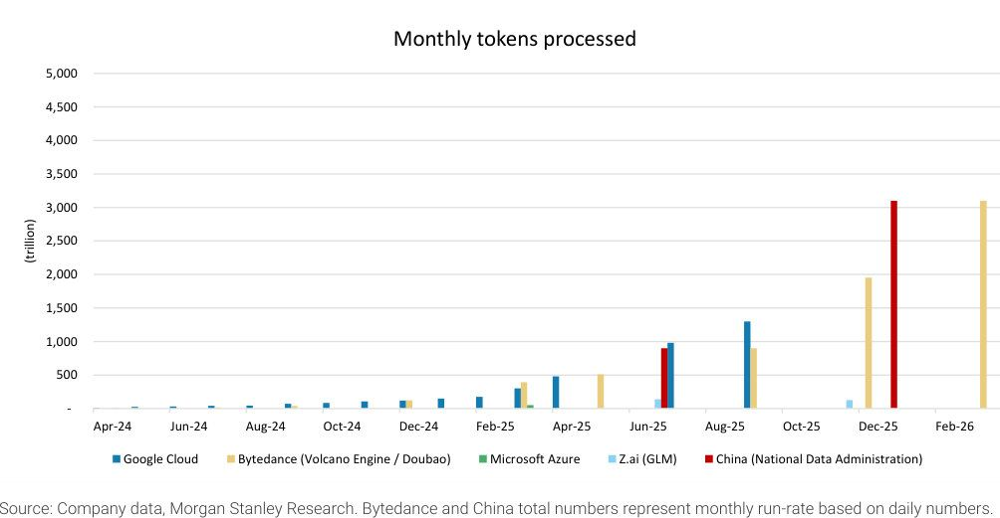

Monthly tokens processed

- y-axis：token（trillion），500–5,000
- x-axis：Apr-24至Feb-26，双月刻度
- legend：Google Cloud、Bytedance (Volcano Engine / Doubao)、Microsoft Azure、Z.ai (GLM)、China (National Data Administration)

Source: Company data, Morgan Stanley Research. Bytedance and China total numbers represent monthly run-rate based on daily numbers.

## Exhibit 18: NOR flash demand and supply growth rates

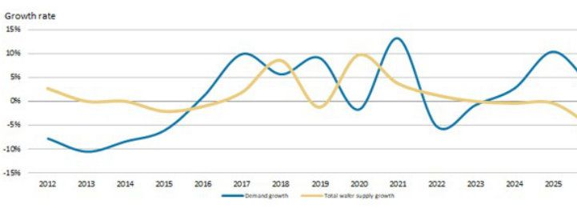

- y-axis：Growth rate，30%至 -30%
- x-axis：2012–2026
- 两条曲线，无图例

Source: Company data, Morgan Stanley Research

## Exhibit 19: NOR flash demand growth and supply growth by density

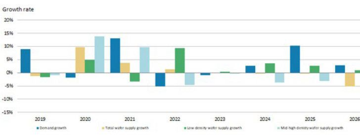

- y-axis：Growth rate，20%至 -20%
- x-axis：2012–2026
- 柱内分组标签：16Gb、32Gb、64Gb、128Gb、256Gb与1-4Gb、8-16Gb、32-64Gb、128-256Gb、512Gb-1Tb

Source: Company data, Morgan Stanley Research

## Exhibit 20: DDR4 quarterly supply and demand summary

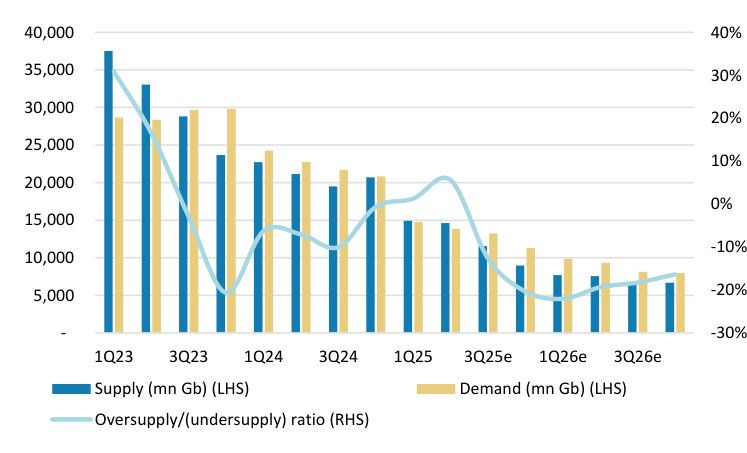

- y-axis（左）：0–40,000；y-axis（右）：-30%至40%
- x-axis：1Q23–4Q26e
- legend：Supply (mn Gb)（左轴）、Demand (mn Gb)（左轴）、Oversupply/(undersupply) ratio（右轴）

Source: Morgan Stanley Research (e) estimates

## Exhibit 21: Quarterly oversupply/undersupply ratio vs. Nanya and Winbond pricing Q/Q change

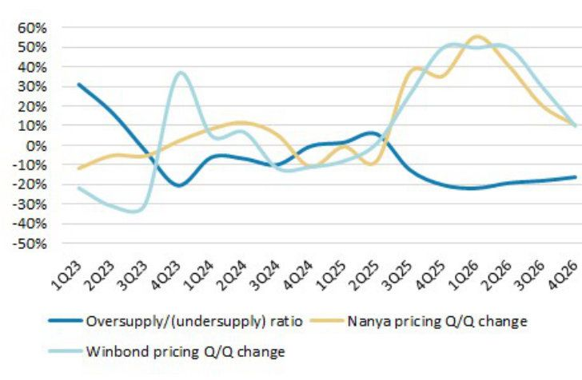

- y-axis：-50%至60%
- x-axis：1Q23–4Q26e
- legend：Oversupply/(undersupply) ratio、Nanya pricing Q/Q change、Winbond pricing Q/Q change

Source: Morgan Stanley Research (e) estimates

[Source Page: 9]

## Exhibit 22: Quarterly supply breakdown (mn Gb)

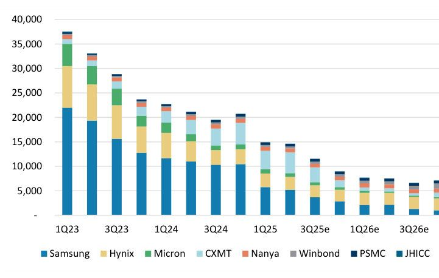

- y-axis：0–40,000
- x-axis：1Q23–3Q26e
- legend：Samsung、Hynix、Micron、CXMT、Nanya、Winbond、PSMC、JHICC

Source: Morgan Stanley Research (e) estimates

## Exhibit 23: Quarterly demand breakdown by product (mn Gb)

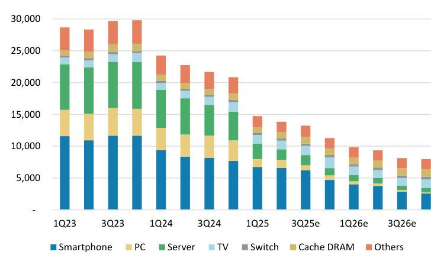

- y-axis：0–30,000
- x-axis：1Q23–3Q26e
- legend：Smartphone、PC、Server、TV、Switch、Cache DRAM、Others

Source: Morgan Stanley Research (e) estimates

## Exhibit 26: DDR4 8Gb (1Gx8) pricing chart

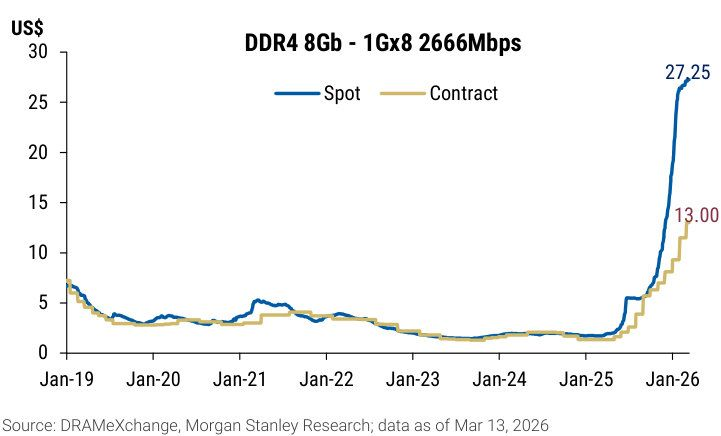

DDR4 8Gb - 1Gx8 2666Mbps
- y-axis：US$，0–30
- x-axis：Jan-19、Jan-20、Jan-21、Jan-22、Jan-23、Jan-24、Jan-25、Jan-26
- legend：Spot、Contract
- 标注：27.25、13.00
Source: DRAMeXchange, Morgan Stanley Research; data as of Mar 13, 2026

## Exhibit 27: DDR5 16Gb (2Gx8) pricing chart

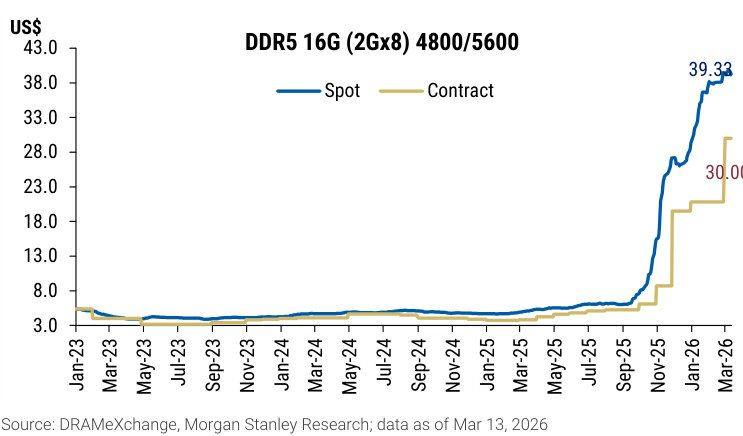

DDR5 16G (2Gx8) 4800/5600
- y-axis：US$，0–43.0
- x-axis：Jan-23至Mar-26，月度刻度
- legend：Spot、Contract
- 标注：39.33、30.00
Source: DRAMeXchange, Morgan Stanley Research; data as of Mar 13, 2026

[Source Page: 10]

# AP Memory: Estimate Revisions Summary
**We cut our 2028 EPS estimates by 4%, while keeping 2026e/27e EPS unchanged:** We slightly cut our 2028 revenue forecasts mainly due to a weaker DDR3 market, although we still anticipate strong IPD revenue.

[Source Page: 18]

# Risk Reward – Winbond Electronics Corp (2344.TW)
DDR, NOR and SLC NAND pricing upside; long-term opportunities in CUBE

## EQUAL-WEIGHT THESIS
- We expect DDR3 and DDR4 price increases to continue into 2026. However, with strong DDR4 pricing hike in the past one year, we think pricing power could moderate into 2H26 given negative demand impact.
- NOR 1Q pricing hike is skewing towards 30%, with more opportunities in data centers. We expect an ongoing market share shift in PC NOR from Mainland China to Taiwan.
- High density SLC NAND pricing is catching up in 1Q26.
- We share management's view that CUBE could be meaningful in 2026, given engagement with multiple foundry partners and customers.
- We see several headwinds ahead for the logic business.

[Source Page: 19]

## KEY EARNINGS INPUTS

| Drivers | 2025 | 2026e | 2027e | 2028e |
| --- | --- | --- | --- | --- |
| NOR ASP (%) | 0 | 71 | 9 | (9) |
| DRAM ASP (%) | (2) | 266 | 7 | (14) |
| Mobile RAM sales (NT$, mn) | 5,302 | 17,793 | 21,420 | 20,059 |
| DRAM sales (NT$, mn) | 27,808 | 145,893 | 181,454 | 171,141 |
| Flash sales (NT$, mn) | 31,106 | 51,812 | 56,548 | 51,737 |

## GLOBAL REVENUE EXPOSURE

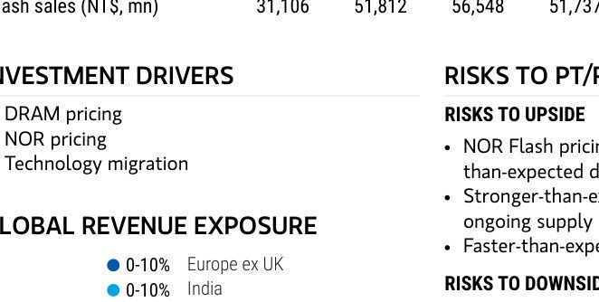

- 0-10% Europe ex UK
- 0-10% India
- 0-10% Japan
- 0-10% MEA
- 0-10% North America
- 0-10% UK
- 20-30% APAC, ex Japan, Mainland China and India
- 40-50% Mainland China

## RISKS TO PT/RATING

### RISKS TO UPSIDE

- NOR Flash pricing increase, driven by stronger-than-expected demand
- Stronger-than-expected DRAM pricing given ongoing supply shortage
- Faster-than-expected SLC NAND development

### RISKS TO DOWNSIDE

- NOR Flash downcycle, driven by weaker demand
- Lower-than-expected DRAM pricing given ongoing oversupply
- Slower-than-expected SLC NAND development

[Source Page: 22]

# Risk Reward – GigaDevice Semiconductor Beijing Inc (603986.SS)
Multiple drivers ahead

## OVERWEIGHT THESIS
▪ We expect GigaDevice to continue to gain share in China's MCU market. Auto MCUs offer bigger opportunities as local self-sufficiency is low.
▪ We expect further NOR Flash pricing upside, and we expect GigaDevice NOR quality to catch up in the auto segment.
▪ Specialty DRAM pricing started to rebound in late 1Q25, and there are opportunities such as wafer-on-wafer specialty memory.

[Source Page: 23]

## KEY EARNINGS INPUTS

| Drivers | 2024 | 2025e | 2026e | 2027e |
| --- | --- | --- | --- | --- |
| NOR Flash ASP growth (%) | (10) | 3 | 46 | 8 |
| MCU ASP growth (%) | (31) | (8) | 0 | 0 |
| Gross margin (%) | 38 | 39 | 50 | 50 |

## RISKS TO PT/RATING

### RISKS TO UPSIDE

- NOR up-cycle driven by stronger demand
- Superior chip design, leading to increasing exposure to low-density NOR
- Faster-than-expected DRAM development

### RISKS TO DOWNSIDE

- NOR down-cycle driven by weaker demand
- Inferior chip design, leading to increasing exposure to mid-/high-density NOR
- Slower-than-expected DRAM development

## GLOBAL REVENUE EXPOSURE

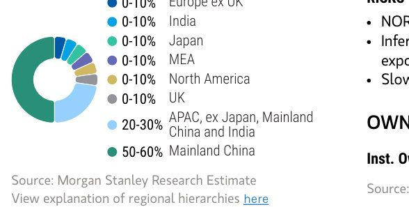

- 0-10% Europe ex UK
- 0-10% India
- 0-10% Japan
- 0-10% MEA
- 0-10% North America
- 0-10% UK
- 20-30% APAC, ex Japan, Mainland China and India
- 50-60% Mainland China

[Source Page: 27]

# Risk Reward – Powerchip Semiconductor Manufacturing Co (6770.TW)
Benefiting from specialty DRAM pricing momentum

## OVERWEIGHT THESIS
▪ Specialty DRAM pricing has been increasing since June 2025 as mainstream players exit DDR4.
▪ Interposers' revenue contribution is only 2%, and WoW is still in qualification (4-stack) and development (8-stack). Management expects interposers and WoW to be the main revenue and profit drivers in the future.

[Source Page: 28]

## KEY EARNINGS INPUTS

| Drivers | 2024 | 2025e | 2026e | 2027e |
| --- | --- | --- | --- | --- |
| Wafer shipment (k 8 inch) | 2,097 | 2,614 | 2,607 | 2,568 |
| Wafer ASP (USD) | 455.0 | 457.7 | 453.2 | 459.8 |
| Utilization rate (%) (%) | 63.5 | 79.1 | 82.6 | 82.6 |

## RISKS TO PT/RATING

### RISKS TO UPSIDE

- Pricing power is sustained in 2026.
- Listing on main board attracts investment fund flows.
- Aluminum process enjoys higher margins.

### RISKS TO DOWNSIDE

- Competition from China intensifies.
- Price erosion is faster than expected.
- Demand from consumer electronics clients weakens further.
- Inventory in the supply chain takes longer to digest.

[Source Page: 30]

# Nanya Tech: Earnings Estimate Revisions and Quarterly Financials
**We keep 2026e EPS unchanged, decrease 2027e EPS by 1% and decrease 2028e EPS by 12%:** As DDR4 spot pricing approaches its ceiling, and CXMT adds more capacity, we expect price declines from 2H27. We also expect Nanya Tech to bring new capacity online in 2H27. This will likely lead to lower revenue and margins in 2027-28e. We also reflect some consumer demand weakness, in particular the low end smartphones that heavily rely on LPDDR4. As a result, we further model Nanya Tech's ASP to start declining by 6% in each quarter during 3Q27e to 2Q28e, and further decline by 8% in 2H28.

[Source Page: 32]

# Nanya Tech: Valuation Methodology
**Our price target is based on 2.71x/1.76x 2026e/2027e BVPS vs. ROE of 60%/43% in 2026e/2027e:** As DDR4 spot pricing gradually reaches its ceiling, we no longer see our prior 3.6x 2026e BVPS as justified. Although LTA with customers might be able to provide long-term downside support, this might also cap the near-term upside for contract prices. We maintain EW and believe the stock still warrants a 2.03x 2026e BVPS multiple given near-term record profitability, with ROE reaching 60%. However, as pricing could begin to decline in 2H27 and with CXMT entering the market, we think a 1.76x 2027e BVPS multiple is more appropriate as ROE fades to 43%.

[Source Page: 34]

# Risk Reward – Nanya Technology Corp. (2408.TW)
DDR4 pricing reaching ceiling and more competitors adding capacity; move to EW

## EQUAL-WEIGHT THESIS

- Major memory suppliers are gradually exiting the DDR4 market, benefiting existing Taiwanese players, including Nanya Tech.
- We expect a DDR4 shortage into 2H26, suggesting a 2% shortage in 3Q26 vs. 12% oversupply in 2Q25, helping NTC to more than offset the competitive impact from CXMT in 2026.
- However, as DDR4 spot pricing gradually reaches its ceiling, competitors like CXMT add more capacity, and Nanya Tech brings new capacity online in 2H27, we expect prices to start declining from 2H27. This drives lower revenue and margins in 2027 and 2028.

### BULL CASE NT$588.00
5.73x 2026e BVPS

DRAM prices strong; faster-than-expected 1a/1b nm ramp; competition from Korea and China is a non-factor: DRAM pricing becomes very strong in 2025 thanks to production cuts and relief of inventory pressure. NTC's utilization rate returns to the 100% level. Korean and Chinese competitors all exit the consumer DRAM market.

### BASE CASE NT$278.00
2.71x 2026e BVPS

Strong DRAM cycle: Major DRAM players now plan to exit the DDR4 market, which positions Taiwanese players to benefit. We expect price-hike momentum to continue through 2026. However, as DDR4 spot pricing approaches its ceiling, competitors like CXMT add more capacity, and Nanya Tech brings new capacity online in 2H27, we expect prices to start declining from 2H27. This drives lower revenue and margins in 2027 and 2028.

### BEAR CASE NT$155.00
1.51x 2026e BVPS

Specialty DRAM demand remains weak in 2025 with intensifying Chinese competition: Nanya Tech could face more pressure from pricing and technological competition amid a weak cycle. Inventory remains at historical peak levels. SK hynix and Chinese DRAM competitors take all the market share in China. Nanya Tech's utilization rate falls to the 40% level.

[Source Page: 35]

## KEY EARNINGS INPUTS

| Drivers | 2025 | 2026e | 2027e | 2028e |
| --- | --- | --- | --- | --- |
| 12" Wafers Out per quarter (000s) | 825.0 | 820.0 | 845.0 | 900.0 |
| Average Wafer Yield (%) | 81.8 | 109.9 | 107.4 | 95.0 |
| Total Die shipments - 2 gb equivalent (mn) | 2,368.0 | 3,180.9 | 3,223.5 | 3,090.4 |

## GLOBAL REVENUE EXPOSURE

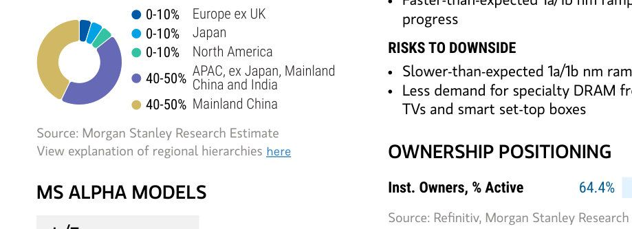

- Europe ex UK：0-10%
- Japan：0-10%
- North America：0-10%
- APAC, ex Japan, Mainland China and India：40-50%
- Mainland China：40-50%

## RISKS TO PT/RATING

### RISKS TO UPSIDE

- Sustained DRAM prices from more disciplined supply and stronger demand
- Stronger pricing environment, enabling revenue guidance to be beaten
- Faster-than-expected 1a/1b nm ramp-up progress

### RISKS TO DOWNSIDE

- Slower-than-expected 1a/1b nm ramp-up
- Less demand for specialty DRAM from 4K2K TVs and smart set-top boxes

[Source Page: 38]

# Valuation Methodology and Risks
**Micron Technology Inc. (MU.O)**

## Risks to Upside

- Customers continue to demonstrate an appetite to take on inventory around macroeconomic uncertainty
- Additional wafer intensity of HBM further improves overall supply and demand
- Micron's HBM share surpasses expectations

## Risks to Downside

- Pricing can turn quickly; a falter in end demand with inventories elevated could lead to a swift price reduction
- HBM demand falters and competition intensifies, pressuring pricing
