## Document Metadata

- Document ID: d65f7f69d8ac19071096f74aa47d614c3985ec6c
- Document Title: Global Memory: Any upside left after the recent rally?
- Document Type: PDF
- Issuing Organization: Bernstein
- Publication Date: 2025-12-08
- Reporting Period: null
- Source File: [M169_2025-12-08_bernstein_投资策略_全球内存：近期反弹后还有上涨空间吗？.pdf](https://github.com/jadennevercode/CJCC-Knowledge-Base/blob/5ec8511eb834073c8bfbd79c94af196282d483cf/materials/%E8%B7%A8%E9%93%BE%EF%BC%9A%E4%BE%9B%E9%9C%80%E4%B8%8E%E4%BB%B7%E6%A0%BC%E5%8F%A3%E5%BE%84/M169_2025-12-08_bernstein_%E6%8A%95%E8%B5%84%E7%AD%96%E7%95%A5_%E5%85%A8%E7%90%83%E5%86%85%E5%AD%98%EF%BC%9A%E8%BF%91%E6%9C%9F%E5%8F%8D%E5%BC%B9%E5%90%8E%E8%BF%98%E6%9C%89%E4%B8%8A%E6%B6%A8%E7%A9%BA%E9%97%B4%E5%90%97%EF%BC%9F.pdf)

## Structured Content

> 原文件：[M169_2025-12-08_bernstein_投资策略_全球内存：近期反弹后还有上涨空间吗？.pdf](https://github.com/jadennevercode/CJCC-Knowledge-Base/blob/5ec8511eb834073c8bfbd79c94af196282d483cf/materials/%E8%B7%A8%E9%93%BE%EF%BC%9A%E4%BE%9B%E9%9C%80%E4%B8%8E%E4%BB%B7%E6%A0%BC%E5%8F%A3%E5%BE%84/M169_2025-12-08_bernstein_%E6%8A%95%E8%B5%84%E7%AD%96%E7%95%A5_%E5%85%A8%E7%90%83%E5%86%85%E5%AD%98%EF%BC%9A%E8%BF%91%E6%9C%9F%E5%8F%8D%E5%BC%B9%E5%90%8E%E8%BF%98%E6%9C%89%E4%B8%8A%E6%B6%A8%E7%A9%BA%E9%97%B4%E5%90%97%EF%BC%9F.pdf)
> 转换方式：多模态逐页转录（页面图像 + 文本层交叉校验）

[Source Page: 1]

# Global Memory: Any upside left after the recent rally?

8 December 2025

**Imminent capex hike should "normalize" memory price starting late CY2026.** Recent signals indicate Samsung, SK hynix & Micron will increase DRAM capex significantly and price hence should turn soft starting late CY2026 when new supply arrives. We assume HBM’s growth stays structural, & hence price at late CY2027 only “normalize” (instead of “collapse”) to the levels before the recent surge began.

**Cost reduction will keep margins elevated & make this cycle a record.** Price will be back to the starting point but cost reduction over this period will keep margins high. We model industry DRAM gross margin to reach a new high of 77% in 4QCY26 & dip only to 62% in 4QCY27, effectively assuming this cycle the best ever.

**Chinese rivals will gain shares, but the magnitudes are insufficient to turn shortage into oversupply soon.** With capacity expansion, technology upgrades & yield progress, CXMT (for DRAM) & YMTC (for NAND) are modeled to gain bit share from 8% & 12% in CY2025 to 10% & 15% in CY2027, respectively. From low bases, growth rates will be impressive but the absolute sizes of supply won’t be enough to tip market over into oversupply in the next 2 years.

**Capex hike on DRAM but much less on NAND.** We expect DRAM industry capex to rise by 40% in CY2026 to support equipment & infrastructure. NAND capex will rise too, but from a very low base & stay notably below the levels in CY2022 or before.

[Source Page: 3]

## DETAILS

**Imminent capex hike should "normalize" memory price starting late CY2026. Cost reduction can keep margins high & make this cycle a record in history.**

- Becoming more convinced with CSP demand, memory suppliers, we believe, will likely begin to notably ramp up capex in 2026 to capitalize on the current supply shortage and skyrocketing memory prices. Hence we expect companies to guide a significant capex hike for 2026 in their coming earnings release. If not, we should receive similar signals from WFE (wafer fab equipment) suppliers in their next earnings releases as well. Nonetheless given the lead time between the equipment order & memory output, the added capex likely won’t contribute additional output in most of 2026, until the increased supply arrives at the market in late 2026 and expands further throughout 2027.

- As a result, the acute memory shortage should persist and pricing likely will continue rising in the near term. Then with the new supply arriving, we believe price increase should start to moderate into 2HCY26 and taper off towards the end of CY2027. And in CY2027 we should see price come down as more supply gets added (Exhibit 1-Exhibit 2). That said, we are not expecting price to plummet like in CY2019, as supply additions likely will be kept in check due to clean room space limitations. We also believe HBM demand will stay robust into CY2027 and keep capacity for conventional DRAM relatively tight. Therefore we see more of a “normalization” for prices in CY2027, and expect conventional DRAM price at the end of CY2027 "normalizes" back to the level right before the recent surge began in late 3QCY25 (Exhibit 3-Exhibit 4).

- The steep price hike in the near term will propel margins to rise as well. We expect margins to peak in 2HCY26, which will be similar or likely higher than the peak back in 2018. Price should come down in CY2027 but with cost also dropping, we model DRAM gross margin (GM) to remain higher at the end of CY2027 than it is now. As shown in Exhibit 5-Exhibit 6, this effectively makes the current cycle a record, as the upswing drives gross margins to new highs, and the downcycle is a "normalization" instead of a "correction" or "collapse", making gross margins exiting CY2027 still very elevated.

**EXHIBIT 1: We forecast DRAM price to continue rising until its begins to soft towards the end of CY26.**

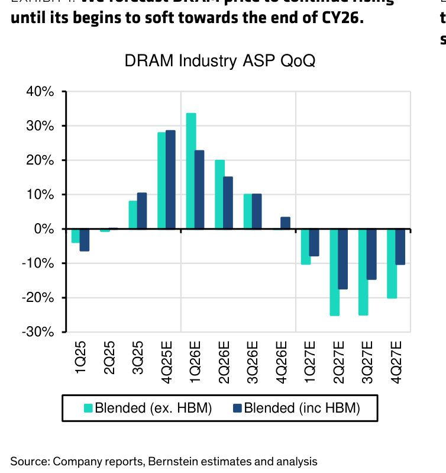

DRAM Industry ASP QoQ
Y-axis: −30% to 40%. X-axis: 1Q25–4Q27E.
Legend: Blended (ex. HBM); Blended (inc HBM).
Source: Company reports, Bernstein estimates and analysis

**EXHIBIT 2: For NAND price, we forecast a similar trajectory though the price change likely won’t be as steep as DRAM.**

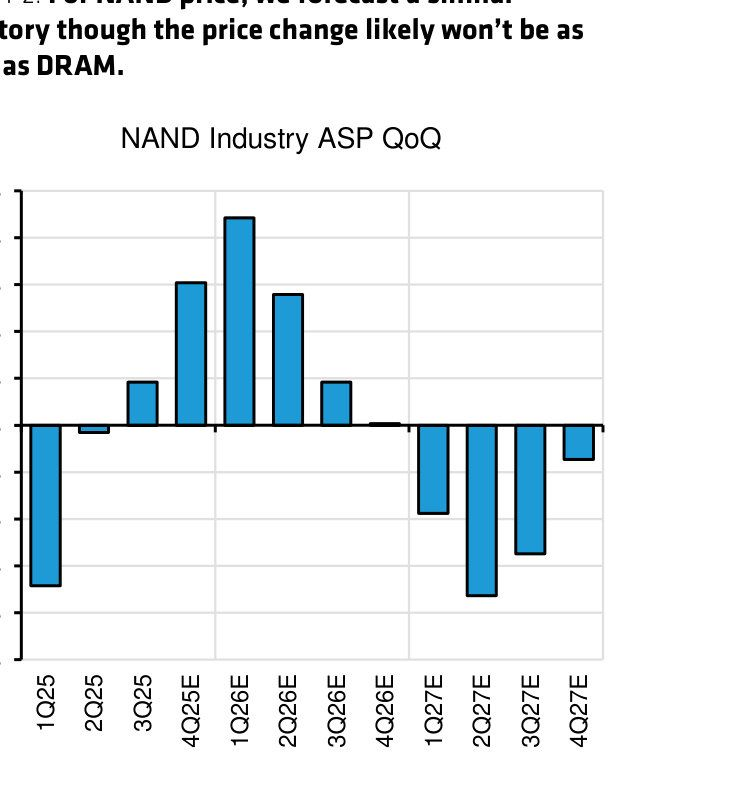

NAND Industry ASP QoQ
Y-axis: −25% to 25%. X-axis: 1Q25–4Q27E.
Source: Company reports, Bernstein estimates and analysis

[Source Page: 4]

**EXHIBIT 3: With supply arrives at the market in late CY2026 & more in CY2027, we believe DRAM price will normalize to levels before the recent surge.**

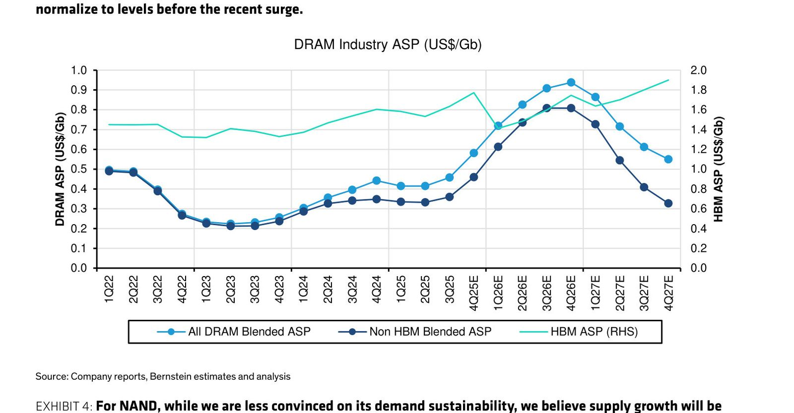

DRAM Industry ASP (US$/Gb)
Y-axis left: DRAM ASP (US$/Gb), 0.0–1.0. Y-axis right: HBM ASP (US$/Gb), 0.0–2.0. X-axis: 1Q22–4Q27E.
Legend: All DRAM Blended ASP; Non HBM Blended ASP; HBM ASP (RHS).
Source: Company reports, Bernstein estimates and analysis

**EXHIBIT 4: For NAND, while we are less convinced on its demand sustainability, we believe supply growth will be kept more cautious and hence we also only forecast price to start to normalize in late CY2026 & more into CY2027.**

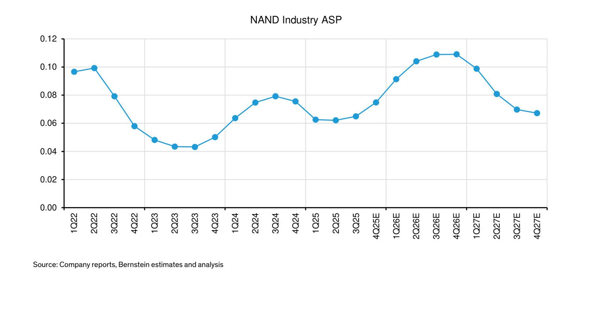

NAND Industry ASP
Y-axis: 0.00–0.12. X-axis: 1Q22–4Q27E.
Source: Company reports, Bernstein estimates and analysis

[Source Page: 5]

**EXHIBIT 5: We model industry DRAM margin to reach a historical high in late CY2026, and even with ASP normalizing afterwards, we still see margins hover at an elevated level exiting CY2027.**

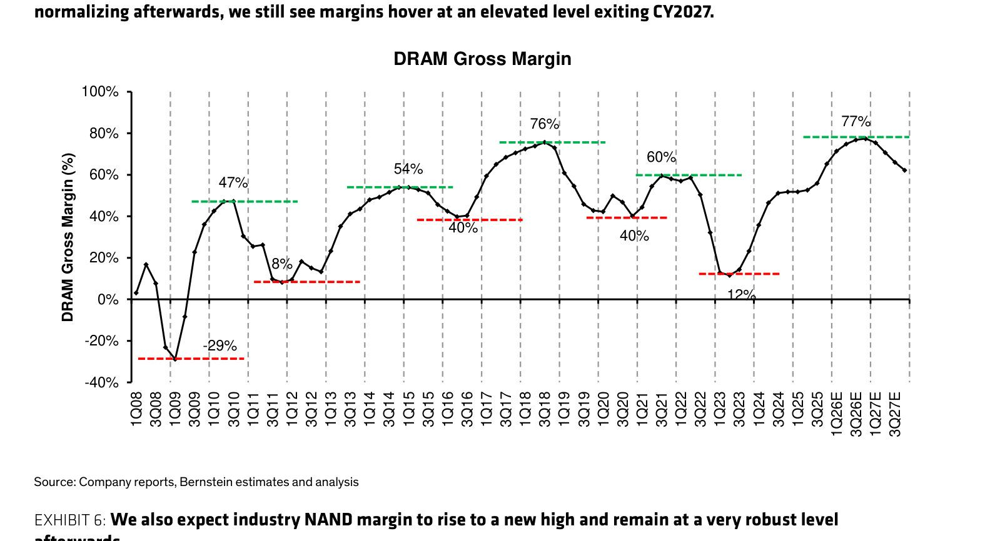

DRAM Gross Margin
Y-axis: DRAM Gross Margin (%), −40% to 100%. X-axis: 1Q08–3Q27E.
Legend: DRAM Gross Margin.
Chart annotations (left to right): -29%, 47%, 8%, 54%, 40%, 76%, 40%, 60%, 12%, 77%.
Source: Company reports, Bernstein estimates and analysis

**EXHIBIT 6: We also expect industry NAND margin to rise to a new high and remain at a very robust level afterwards.**

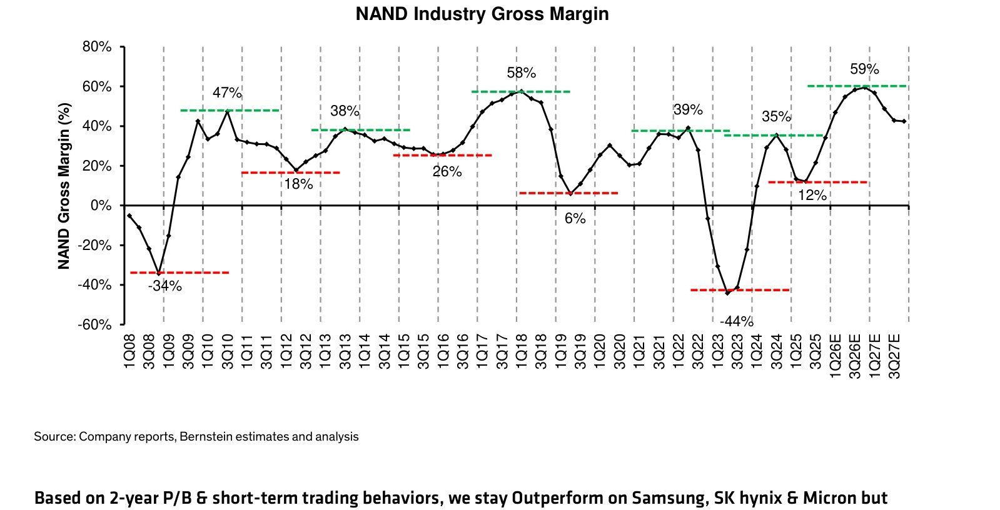

NAND Industry Gross Margin
Y-axis: NAND Gross Margin (%), −60% to 80%. X-axis: 1Q08–3Q27E.
Legend: NAND Industry Gross Margin.
Chart annotations (left to right): -34%, 47%, 18%, 38%, 26%, 58%, 6%, 39%, -44%, 35%, 12%, 59%.
Source: Company reports, Bernstein estimates and analysis

[Source Page: 11]

## HBM & CoWoS forecast is also revised up, as suppliers add more capacity to meet stronger demand.

- Given the AI projects announced in the past few months and robust downstream signals, we expect TSMC, ASE (not covered), Amkor (not covered) to expand CoWoS capacity (see our recent report on TSMC) and similarly we expect more HBM supply from Samsung, SK hynix & Micron, in order to support these projects. NVIDIA meeting its US$0.5T target is an example and more supply is probably necessary if we learn more downstream projects later. We hence revise up our HBM bit shipment forecast to grow by 100% in CY2026, and another 35% in CY2027 (Exhibit 23).
- The supply tightness will be in both HBM and conventional memory in CY2026, and we hence project HBM price to stay robust, with the erosion of HBM3E price offset by the premium of HBM4. We see over 20% decline in HBM3E price starting next year but also see over 40% price premium from HBM4 vs. HBM3E. Overall we see only mild 5% drop in blended HBM ASP YoY from CY2025 to CY2026 (Exhibit 24-Exhibit 25). The implies that the total HBM revenue to grow by 91% to reach US$75B in CY2026 (Exhibit 26).
- HBM’s revenue mix in the overall DRAM however likely will dip in CY2026, simply due to the drastic surge in conventional DRAM price & hence revenue. As conventional DRAM price normalizes in CY2027, we foresee HBM’s mix to rise again to ~40% of the total (Exhibit 27). As it returns to a strong support to the overall DRAM ASP, we model the blended DRAM ASP to remain higher at the end of CY2027 than now also thanks to the growing HBM contribution (Exhibit 3).
- For wafer consumption, HBM likely is going to consume nearly 30% of the overall DRAM wafer consumption by CY2027, perhaps surpassing conventional server DRAM to become the largest use of DRAM wafers (Exhibit 29). And as we discussed earlier, this expanding wafer consumption of HBM should continue to keep conventional DRAM capacity relatively tight, and as a result we only model a normalization in DRAM ASP and see DRAM margins to stay respectable exiting CY2027.
- Comparatively, we reiterate Samsung's position will improve from HBM3E to HBM4, especially considering that its better DRAM & base die manufacturing technology allows Samsung to better meet the higher speed required by NVIDIA & to maintain good yields at the same time. We also believe Samsung is less constrained on clean room space than SK hynix and Micron and will be able to offer more capacity to gain share in the shortage market now. As such we continue to model a rebound in market share in CY26 by Samsung (Exhibit 30).

[Source Page: 12]

**EXHIBIT 23: We raise HBM forecast to 100% growth in bit shipment in CY2026.**

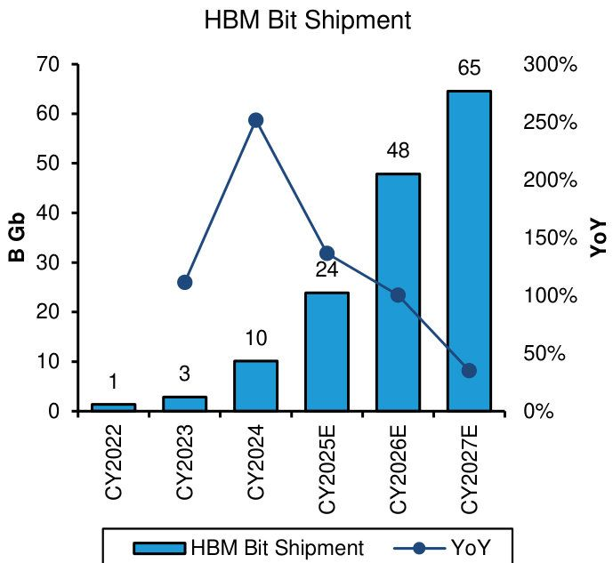

Chart title: HBM Bit Shipment
Bars: HBM Bit Shipment (B Gb), left axis 0–70
Line: YoY, right axis 0%–300%, no data labels on the line

| Year | HBM Bit Shipment (B Gb) |
| --- | --- |
| CY2022 | 1 |
| CY2023 | 3 |
| CY2024 | 10 |
| CY2025E | 24 |
| CY2026E | 48 |
| CY2027E | 65 |

Source: TrendForce, Yole, Bernstein estimates and analysis

**EXHIBIT 24: The price erosion of HBM3E should be largely compensated by the premium of HBM4.**

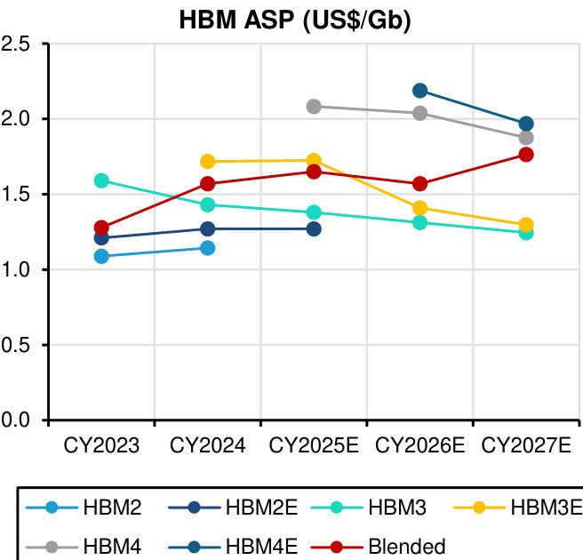

Chart title: HBM ASP (US$/Gb)
Y axis: US$/Gb, 0.0–2.5
X axis: CY2023, CY2024, CY2025E, CY2026E, CY2027E
Legend: HBM2, HBM2E, HBM3, HBM3E, HBM4, HBM4E, Blended
No data labels are printed on the lines.

Source: Company reports, TrendForce, Bernstein estimates and analysis

**EXHIBIT 25: With TPU gaining more momentum, we see more HBM3E and HBM4 only 27% of CY2026’s total bit shipment.**

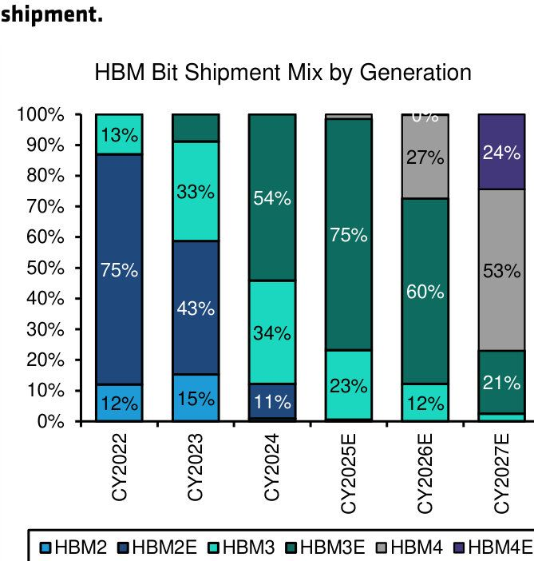

Chart title: HBM Bit Shipment Mix by Generation
Y axis: 0%–100%, stacked bars; X axis: CY2022, CY2023, CY2024, CY2025E, CY2026E, CY2027E
Legend: HBM2, HBM2E, HBM3, HBM3E, HBM4, HBM4E

| Generation | CY2022 | CY2023 | CY2024 | CY2025E | CY2026E | CY2027E |
| --- | --- | --- | --- | --- | --- | --- |
| HBM2 | 12% | 15% | 11% |  |  |  |
| HBM2E | 75% | 43% |  |  |  |  |
| HBM3 | 13% | 33% | 34% | 23% | 12% |  |
| HBM3E |  |  | 54% | 75% | 60% | 21% |
| HBM4 |  |  |  |  | 27% | 53% |
| HBM4E |  |  |  |  | 0% | 24% |

Source: TrendForce, Bernstein estimates and analysis

**EXHIBIT 26: Overall we project HBM revenue to nearly double US$75B next year.**

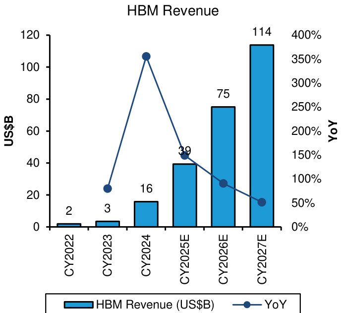

Chart title: HBM Revenue
Bars: HBM Revenue (US$B), left axis 0–120
Line: YoY, right axis 0%–400%, no data labels on the line

| Year | HBM Revenue (US$B) |
| --- | --- |
| CY2022 | 2 |
| CY2023 | 3 |
| CY2024 | 16 |
| CY2025E | 39 |
| CY2026E | 75 |
| CY2027E | 114 |

Source: TrendForce, Yole, Bernstein estimates and analysis

[Source Page: 13]

**EXHIBIT 27: Revenue mix of HBM will likely fall in CY2026 due to strong conventional DRAM pricing but rise again in CY2027.**

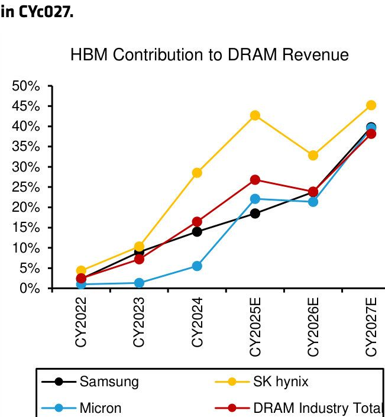

Chart title: HBM Contribution to DRAM Revenue
Y axis: 0%–50%; X axis: CY2022, CY2023, CY2024, CY2025E, CY2026E, CY2027E
Legend: Samsung, SK hynix, Micron, DRAM Industry Total
No data labels are printed on the lines.

Source: TrendForce, company reports, Bernstein estimates and analysis

**EXHIBIT 28: HBM’s bit shipment mix should grow notably next year and continue rising in CY2027.**

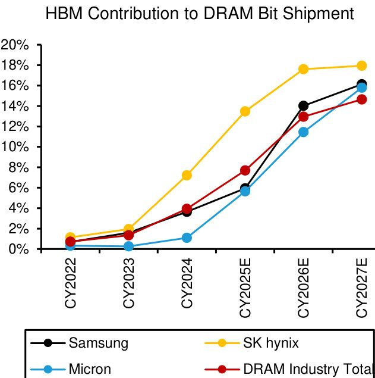

Chart title: HBM Contribution to DRAM Bit Shipment
Y axis: 0%–20%; X axis: CY2022, CY2023, CY2024, CY2025E, CY2026E, CY2027E
Legend: Samsung, SK hynix, Micron, DRAM Industry Total
No data labels are printed on the lines.

Source: TrendForce, company reports, Bernstein estimates and analysis

**EXHIBIT 29: We model HBM wafer consumption to reach 28% of the total DRAM in CY2027, perhaps surpassing the consumption of conventional server DRAM.**

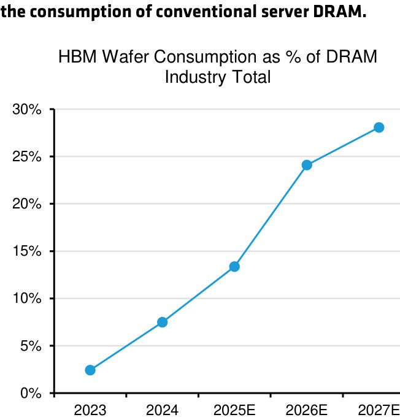

Chart title: HBM Wafer Consumption as % of DRAM Industry Total
Y axis: 0%–30%; X axis: 2023, 2024, 2025E, 2026E, 2027E
Single line, no data labels printed on the line.

Source: TrendForce, Bernstein estimates and analysis

**EXHIBIT 30: We predict Samsung to gain share in HBM as it should release more supply for HBM3E and its competitive position in HBM4 also improves than in HBM3E.**

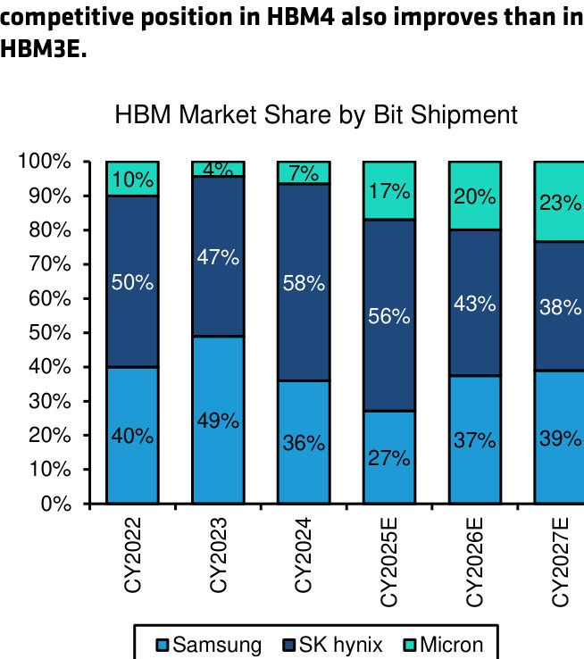

Chart title: HBM Market Share by Bit Shipment
Y axis: 0%–100%, stacked bars; X axis: CY2022, CY2023, CY2024, CY2025E, CY2026E, CY2027E
Legend: Samsung, SK hynix, Micron

| Company | CY2022 | CY2023 | CY2024 | CY2025E | CY2026E | CY2027E |
| --- | --- | --- | --- | --- | --- | --- |
| Samsung | 40% | 49% | 36% | 27% | 37% | 39% |
| SK hynix | 50% | 47% | 58% | 56% | 43% | 38% |
| Micron | 10% | 4% | 7% | 17% | 20% | 23% |

Source: TrendForce, Bernstein estimates and analysis

## With both short- & long-term visibility, we project DRAM capex to jump significantly in CY2026 but much less so for NAND.

- Micron CFO strongly suggested a notable capex hike in a recent conference. We also pick up from supply chain significant capex increases coming from Samsung and SK hynix too. With that, we model 30-65% YoY growth in CY2026 DRAM capex from them, and the aggregate DRAM industry capex up by another 40% in that year, for both WFE spending and also continued spending in infrastructure (Exhibit 31).

[Source Page: 14]

- Notably the capex hike signals are much more about DRAM, but signals on NAND are much weaker. We believe that Samsung is even re-purposing an NAND fab for DRAM. This aligns with our long-term cautious stance on NAND market, and we accordingly model NAND capex to grow 30% YoY, but from a very low base, and the overall spending will remain considerably below levels prior to CY2022 (Exhibit 32).

**EXHIBIT 31: We expect DRAM industry capex to rise by 40% to another new high in CY2026.**

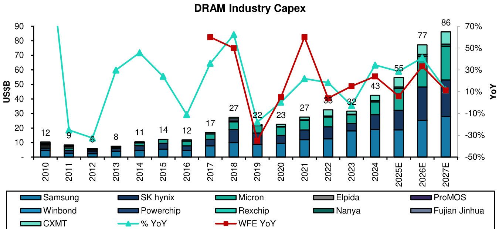

Chart title: DRAM Industry Capex
Left axis: US$B, 0–90
Right axis: YoY, -50%–70%
X axis: 2010–2027E
Legend: Samsung, SK hynix, Micron, Elpida, ProMOS, Winbond, Powerchip, Rexchip, Nanya, Fujian Jinhua, CXMT, % YoY, WFE YoY
Stacked bars carry the annual total label only; the % YoY and WFE YoY lines carry no data labels.

| Year | DRAM Industry Capex (US$B) |
| --- | --- |
| 2010 | 12 |
| 2011 | 9 |
| 2012 | 6 |
| 2013 | 8 |
| 2014 | 11 |
| 2015 | 14 |
| 2016 | 12 |
| 2017 | 17 |
| 2018 | 27 |
| 2019 | 22 |
| 2020 | 23 |
| 2021 | 27 |
| 2022 | 33 |
| 2023 | 32 |
| 2024 | 43 |
| 2025E | 55 |
| 2026E | 77 |
| 2027E | 86 |

Calendar years
Source: Company reports, TrendForce, SEMI, bernstein estimates and analysis

**EXHIBIT 32: For NAND, we expect capex growth to be slower and overall capex $ remain considerably behind levels prior to CY2022.**

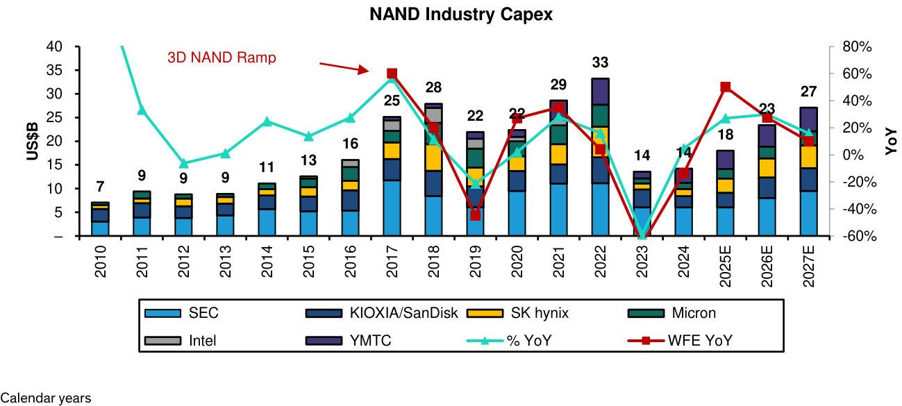

Chart title: NAND Industry Capex
Left axis: US$B, 5–40
Right axis: YoY, -60%–80%
X axis: 2010–2027E
Legend: SEC, KIOXIA/SanDisk, SK hynix, Micron, Intel, YMTC, % YoY, WFE YoY
Annotation: 3D NAND Ramp
Stacked bars carry the annual total label only; the % YoY and WFE YoY lines carry no data labels.

| Year | NAND Industry Capex (US$B) |
| --- | --- |
| 2010 | 7 |
| 2011 | 9 |
| 2012 | 9 |
| 2013 | 9 |
| 2014 | 11 |
| 2015 | 13 |
| 2016 | 16 |
| 2017 | 25 |
| 2018 | 28 |
| 2019 | 22 |
| 2020 | 22 |
| 2021 | 29 |
| 2022 | 33 |
| 2023 | 14 |
| 2024 | 14 |
| 2025E | 18 |
| 2026E | 23 |
| 2027E | 27 |

Calendar years
Source: Company reports, SEMI, TrendForce, Gartner, Bernstein estimates and analysis

## Helped by pending IPOs, China will add capacity but won't be able to turn shortage into oversupply next year.

- China is also seizing the current shortage as an opportunity to expand production and gain more share, & maybe even to enjoy decent profitability thanks to the skyrocketing memory price. We understand both YMTC and CXMT are ramping production to nearly full capacity under their existing clean room space. With node migration and yield improvement, we estimate 40-50% bit output growth from them in CY2026. Moreover, likely expecting funding from equity market (both are seeking A share IPO, see link, link), they have both started building additional fab plants, which should be completed and bring additional capacity in the next 2 years.

[Source Page: 15]

- Having said that, they will still be growing from a relatively low base and hence the magnitude of their supply increase likely won’t be enough to alter the supply shortage next year. And in particular, CXMT likely will also be tasked to supply HBM to support China’s local AI chips, which will reduce capacity available for conventional DRAM too. Therefore we model their share to expand in the next 2 years, but still with a measured magnitude, especially for DRAM (Exhibit 33). In the long run, as NAND does not require EUV to advance and China hence has good enough domestic equipment supply to expand capacity amid export controls, we advocate that China is a long-term threat to the incumbent NAND suppliers. This is one of the reasons why we're structurally cautious on NAND.

**EXHIBIT 33: We model CXMT and YMTC’s share to expand in the next 2 years, but still from a low base & hence with a measured magnitude, especially for CXMT.**

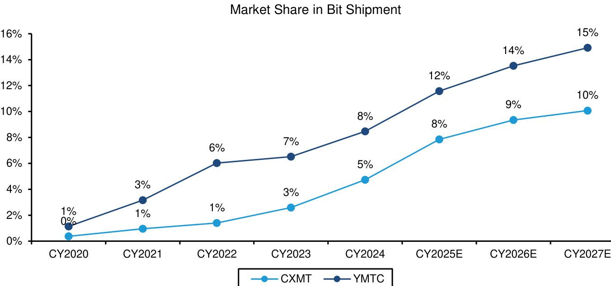

Chart title: Market Share in Bit Shipment
Y axis: 0%–16%
X axis: CY2020, CY2021, CY2022, CY2023, CY2024, CY2025E, CY2026E, CY2027E
Legend: CXMT, YMTC

| Year | CXMT | YMTC |
| --- | --- | --- |
| CY2020 | 0% | 1% |
| CY2021 | 1% | 3% |
| CY2022 | 1% | 6% |
| CY2023 | 3% | 7% |
| CY2024 | 5% | 8% |
| CY2025E | 8% | 12% |
| CY2026E | 9% | 14% |
| CY2027E | 10% | 15% |

Source: TrendForce, Gartner, Bernstein estimates and analysis

[Source Page: 17]

**EXHIBIT 35: Samsung Operating Metrics**

### Division Operating Metrics

#### Semiconductor

| Item | 2024 | 2025E | 2026E | 2027E | 1Q25 | 2Q25 | 3Q25 | 4Q25E | 1Q26E | 2Q26E | 3Q26E | 4Q26E |
| --- | --- | --- | --- | --- | --- | --- | --- | --- | --- | --- | --- | --- |
| DRAM ASP ($/Gb) | 0.38 | 0.45 | 0.87 | 0.71 | 0.38 | 0.38 | 0.44 | 0.56 | 0.73 | 0.85 | 0.93 | 0.97 |
| % change | 59.4% | 16.9% | 94.8% | (18.7%) | (19.0%) | (0.2%) | 15.8% | 27.6% | 29.2% | 16.6% | 9.9% | 3.8% |
| NAND ASP ($/GB) | 0.08 | 0.07 | 0.11 | 0.08 | 0.07 | 0.06 | 0.07 | 0.08 | 0.10 | 0.11 | 0.12 | 0.12 |
| % change | 65.9% | (7.8%) | 62.5% | (27.0%) | (16.0%) | (4.0%) | 5.6% | 20.0% | 22.0% | 15.0% | 5.0% | – |
| DRAM Bits Shipped (Gb) | 99,510 | 109,163 | 127,721 | 155,819 | 23,107 | 25,880 | 29,762 | 30,414 | 29,806 | 30,998 | 33,478 | 33,438 |
| % change | 13.5% | 9.7% | 17.0% | 22.0% | 2.2% | 12.0% | 15.0% | 2.2% | (2.0%) | 4.0% | 8.0% | (0.1%) |
| NAND Bits Shipped (GB) | 315,370 | 321,993 | 389,612 | 475,326 | 65,378 | 83,030 | 91,333 | 82,252 | 84,719 | 92,344 | 102,502 | 110,046 |
| % change | 11.2% | 2.1% | 21.0% | 22.0% | (11.0%) | 27.0% | 10.0% | (9.9%) | 3.0% | 9.0% | 11.0% | 7.4% |
| DRAM Cost/Gb | 0.18 | 0.19 | 0.20 | 0.20 | 0.19 | 0.19 | 0.20 | 0.19 | 0.19 | 0.20 | 0.21 | 0.21 |
| % change | 0.4% | 5.6% | 7.1% | (2.0%) | (11.3%) | (1.5%) | 5.1% | (3.7%) | 2.0% | 4.0% | 4.0% | 2.0% |
| NAND Cost/GB | 0.05 | 0.05 | 0.05 | 0.04 | 0.06 | 0.06 | 0.05 | 0.05 | 0.05 | 0.05 | 0.04 | 0.04 |
| % change | (5.6%) | (2.4%) | (13.2%) | (12.3%) | 4.1% | (2.5%) | (10.1%) | (3.7%) | (1.0%) | (3.0%) | (3.0%) | (3.0%) |
| NAND gross margins | 29.0% | 24.7% | 59.8% | 51.7% | 14.0% | 12.6% | 25.6% | 40.3% | 51.6% | 59.1% | 62.3% | 63.4% |
| DRAM gross margins | 53.0% | 57.4% | 76.6% | 71.8% | 50.2% | 50.9% | 55.4% | 66.3% | 73.4% | 76.3% | 77.6% | 78.0% |

Source: Company reports, Bernstein estimates and analysis

[Source Page: 19]

### Key Operating Metrics

| Item | 2024 | 2025E | 2026E | 2027E | 1Q25 | 2Q25 | 3Q25 | 4Q25E | 1Q26E | 2Q26E | 3Q26E | 4Q26E |
| --- | --- | --- | --- | --- | --- | --- | --- | --- | --- | --- | --- | --- |
| **Total Revenue** | 66,193 | 97,154 | 185,614 | 171,705 | 17,639 | 22,232 | 24,449 | 32,834 | 37,055 | 44,281 | 50,162 | 54,117 |
| **DRAM Revenue (KRW B)** | 45,092 | 76,525 | 145,805 | 136,925 | 14,041 | 17,208 | 19,168 | 26,109 | 29,126 | 34,633 | 39,377 | 42,668 |
| Gb Shipped (M Gb) | 80,522 | 99,042 | 115,879 | 135,579 | 20,062 | 24,877 | 26,743 | 27,359 | 26,539 | 28,396 | 29,816 | 31,128 |
| ASP ($/Gb) | 0.41 | 0.54 | 0.87 | 0.70 | 0.48 | 0.49 | 0.52 | 0.66 | 0.76 | 0.85 | 0.92 | 0.95 |
| Cost ($/Gb) | 0.17 | 0.16 | 0.16 | 0.15 | 0.16 | 0.16 | 0.16 | 0.17 | 0.16 | 0.16 | 0.16 | 0.15 |
| Gb Shipped Change | 16.4% | 23.0% | 17.0% | 17.0% | (7.0)% | 24.0% | 7.5% | 2.3% | (3.0)% | 7.0% | 5.0% | 4.4% |
| ASP Change | 78.1% | 33.1% | 60.6% | (19.7)% | 0.0% | 2.5% | 4.7% | 28.2% | 15.0% | 11.1% | 8.3% | 3.8% |
| Cost Change | (2.3)% | (6.0)% | (3.0)% | (3.9)% | (12.0)% | 3.9% | 1.6% | 2.0% | (2.0)% | (3.0)% | (2.0)% | (2.0)% |
| DRAM Gross Margin | 57.7% | 70.1% | 82.0% | 78.4% | 67.7% | 67.3% | 68.3% | 74.8% | 78.5% | 81.2% | 83.0% | 84.0% |
| **NAND Revenue (KRW B)** | 19,027 | 19,184 | 38,093 | 33,165 | 3,175 | 4,758 | 4,988 | 6,264 | 7,489 | 9,215 | 10,353 | 11,036 |
| GB Shipped (M GB) | 158,733 | 170,956 | 205,147 | 244,125 | 28,730 | 48,984 | 46,045 | 47,197 | 46,253 | 49,491 | 52,955 | 56,448 |
| ASP ($/GB) | 0.09 | 0.08 | 0.13 | 0.09 | 0.08 | 0.07 | 0.08 | 0.09 | 0.11 | 0.13 | 0.14 | 0.14 |
| Cost ($/GB) | 0.07 | 0.06 | 0.06 | 0.05 | 0.06 | 0.06 | 0.06 | 0.06 | 0.06 | 0.06 | 0.06 | 0.05 |
| GB Shipped Change | (1.8)% | 7.7% | 20.0% | 19.0% | (18.0)% | 70.5% | (6.0)% | 2.5% | (2.0)% | 7.0% | 7.0% | 6.6% |
| ASP Change | 92.8% | (9.9)% | 63.0% | (26.8)% | (20.0)% | (8.9)% | 12.7% | 18.0% | 22.0% | 15.0% | 5.0% | 0.0% |
| Cost Change | (0.6)% | (9.2)% | (11.1)% | (12.8)% | (13.4)% | 1.0% | 0.0% | (2.0)% | (4.0)% | (4.0)% | (4.0)% | (4.0)% |
| NAND Gross Margin | 20.3% | 19.7% | 56.2% | 47.8% | 16.7% | 7.7% | 18.1% | 32.0% | 46.5% | 55.3% | 59.1% | 60.8% |
| **Operating Profit (KRW B)** | 23,468 | 46,582 | 126,979 | 107,332 | 7,441 | 9,213 | 11,383 | 18,545 | 23,149 | 29,740 | 35,225 | 38,865 |

Source: Company reports, Bernstein estimates and analysis

[Source Page: 21]

| Key Operating Metrics | FY2024 | FY2025 | FY2026E | FY2027E | 1QFY25 | 2QFY25 | 3QFY25 | 4QFY25 | 1QFY26E | 2QFY26E | 3QFY26E | 4QFY26E |
|---|---|---|---|---|---|---|---|---|---|---|---|---|
| Total Revenue | 25,111 | 37,378 | 75,807 | 90,812 | 8,709 | 8,053 | 9,301 | 11,315 | 13,450 | 17,375 | 20,787 | 24,196 |
| DRAM Revenue | 17,603 | 28,578 | 60,984 | 74,705 | 6,400 | 6,123 | 7,071 | 8,984 | 10,875 | 13,855 | 16,631 | 19,623 |
| Gb Shipped | 59,144 | 68,444 | 79,774 | 92,414 | 16,085 | 14,726 | 17,715 | 19,918 | 19,380 | 19,283 | 20,054 | 21,057 |
| ASP ($/Gb) | 0.30 | 0.42 | 0.76 | 0.81 | 0.40 | 0.42 | 0.40 | 0.45 | 0.56 | 0.72 | 0.83 | 0.93 |
| Actual Cost ($/Gb) | 0.23 | 0.22 | 0.23 | 0.24 | 0.23 | 0.22 | 0.21 | 0.22 | 0.22 | 0.22 | 0.23 | 0.23 |
| NAND Revenue | 7,227 | 8,502 | 14,508 | 15,791 | 2,240 | 1,855 | 2,155 | 2,252 | 2,496 | 3,441 | 4,076 | 4,494 |
| GB Shipped — Trade | 101,896 | 120,664 | 138,295 | 164,161 | 26,896 | 27,163 | 34,004 | 32,601 | 30,623 | 34,604 | 35,643 | 37,425 |
| ASP ($/GB) — Total | 0.07 | 0.07 | 0.10 | 0.10 | 0.08 | 0.07 | 0.06 | 0.07 | 0.08 | 0.10 | 0.11 | 0.12 |
| ASP ($/GB) — Trade | 0.07 | 0.07 | 0.10 | 0.10 | 0.08 | 0.07 | 0.06 | 0.07 | 0.08 | 0.10 | 0.11 | 0.12 |
| Actual Cost ($/GB) — Trade | 0.07 | 0.06 | 0.05 | 0.05 | 0.06 | 0.06 | 0.06 | 0.06 | 0.06 | 0.05 | 0.05 | 0.05 |
| NOR Revenue | 200 | 200 | 200 | 200 | 50 | 50 | 50 | 50 | 50 | 50 | 50 | 50 |
| Other Revenue | 81 | 98 | 116 | 116 | 19 | 25 | 25 | 29 | 29 | 29 | 29 | 29 |
| Operating Profit (excl. restruct. & Other) | 1,054 | 9,870 | 43,650 | 53,436 | 2,172 | 1,780 | 2,225 | 3,693 | 5,887 | 9,510 | 12,641 | 15,612 |
| Tangible BVPS | 40.3 | 47.9 | 79.4 | 113.2 | 40.6 | 42.1 | 43.9 | 46.8 | 51.1 | 58.0 | 67.1 | 78.4 |
| Company gross margins | 22.4% | 39.8% | 66.1% | 66.9% | 38.4% | 36.8% | 37.7% | 44.7% | 54.9% | 64.0% | 68.6% | 71.6% |
| DRAM gross margins | 22.6% | 47.3% | 70.4% | 70.4% | 42.5% | 46.0% | 46.6% | 52.3% | 60.9% | 68.8% | 72.5% | 75.0% |
| Total NAND gross margins | 7.8% | 15.8% | 49.0% | 51.4% | 27.5% | 8.9% | 9.7% | 15.9% | 30.1% | 45.6% | 54.1% | 57.6% |
| Trade NAND gross margins | 7.8% | 15.8% | 49.0% | 51.4% | 27.5% | 8.9% | 9.7% | 15.9% | 30.1% | 45.6% | 54.1% | 57.6% |

Source: Company reports, Bernstein estimates and analysis

[Source Page: 23]

| Key Operating Metrics | FY2024 | FY2025E | FY2026E | FY2027E | 1QFY25 | 2QFY25 | 3QFY25E | 4QFY25E | 1QFY26E | 2QFY26E | 3QFY26E | 4QFY26E |
|---|---|---|---|---|---|---|---|---|---|---|---|---|
| Total Revenue (JPY M) | 1,706,460 | 1,920,416 | 3,145,578 | 2,376,803 | 342,799 | 448,346 | 528,315 | 600,957 | 711,699 | 832,003 | 837,286 | 764,589 |
| NAND Revenue (JPY M) | 1,507,888 | 1,760,950 | 2,996,425 | 2,224,904 | 299,710 | 407,341 | 488,595 | 565,304 | 676,104 | 795,098 | 797,086 | 728,138 |
| GB Shipped (M GB) | 186,291 | 224,532 | 261,155 | 302,046 | 43,306 | 59,546 | 64,381 | 57,299 | 59,591 | 66,742 | 66,909 | 67,913 |
| ASP ($/GB) | 0.05 | 0.05 | 0.08 | 0.05 | 0.05 | 0.05 | 0.05 | 0.07 | 0.08 | 0.08 | 0.08 | 0.07 |
| Cost ($/GB) | 0.03 | 0.03 | 0.03 | 0.03 | 0.04 | 0.03 | 0.03 | 0.03 | 0.03 | 0.03 | 0.03 | 0.03 |
| GB Shipped Change | 17.4% | 20.5% | 16.3% | 15.7% | 0.0% | 37.5% | 8.1% | (11.0)% | 4.0% | 12.0% | 0.3% | 1.5% |
| ASP Change | 34.5% | (0.8)% | 44.4% | (35.8)% | 7.0% | (2.5)% | 8.0% | 30.0% | 15.0% | 5.0% | 0.0% | (10.0)% |
| Cost Change | (26.9)% | 1.9% | (7.3)% | (12.8)% | 4.0% | (10.4)% | 1.0% | 1.5% | (2.0)% | (4.0)% | (2.0)% | (3.0)% |
| NAND Gross Margin | 37.8% | 36.3% | 59.0% | 44.3% | 23.8% | 30.1% | 34.6% | 48.9% | 56.5% | 60.2% | 61.0% | 58.0% |
| Operating Profit (JPY M) | 451,748 | 487,026 | 1,577,208 | 796,589 | 44,899 | 85,921 | 125,295 | 230,911 | 336,520 | 432,144 | 436,155 | 372,389 |

Source: Company reports, Bernstein estimates and analysis
