## Document Metadata

- Document ID: 9b0312430e97f6179f6cce1edf05bfa3751893e9
- Document Title: Memory Market Update: Widening gap between memory sentiment and fundamentals; remain bullish on the elongated memory cycle; 27E visibility should rejuvenate sentiment
- Document Type: PDF
- Issuing Organization: J.P. Morgan – Asia Pacific Equity Research (Technology - Semiconductors)
- Publication Date: 2026-04-01
- Reporting Period: null
- Source File: [M173_2026-04-03_JPMorgan_行业动态_内存市场更新；内存市场情绪与基本面差距扩大；对拉长的内存周期保持乐观；27年业绩能见度将重.pdf](https://github.com/jadennevercode/CJCC-Knowledge-Base/blob/5ec8511eb834073c8bfbd79c94af196282d483cf/materials/%E8%B7%A8%E9%93%BE%EF%BC%9A%E4%BE%9B%E9%9C%80%E4%B8%8E%E4%BB%B7%E6%A0%BC%E5%8F%A3%E5%BE%84/M173_2026-04-03_JPMorgan_%E8%A1%8C%E4%B8%9A%E5%8A%A8%E6%80%81_%E5%86%85%E5%AD%98%E5%B8%82%E5%9C%BA%E6%9B%B4%E6%96%B0%EF%BC%9B%E5%86%85%E5%AD%98%E5%B8%82%E5%9C%BA%E6%83%85%E7%BB%AA%E4%B8%8E%E5%9F%BA%E6%9C%AC%E9%9D%A2%E5%B7%AE%E8%B7%9D%E6%89%A9%E5%A4%A7%EF%BC%9B%E5%AF%B9%E6%8B%89%E9%95%BF%E7%9A%84%E5%86%85%E5%AD%98%E5%91%A8%E6%9C%9F%E4%BF%9D%E6%8C%81%E4%B9%90%E8%A7%82%EF%BC%9B27%E5%B9%B4%E4%B8%9A%E7%BB%A9%E8%83%BD%E8%A7%81%E5%BA%A6%E5%B0%86%E9%87%8D.pdf)

## Structured Content

> 原文件：[M173_2026-04-03_JPMorgan_行业动态_内存市场更新；内存市场情绪与基本面差距扩大；对拉长的内存周期保持乐观；27年业绩能见度将重.pdf](https://github.com/jadennevercode/CJCC-Knowledge-Base/blob/5ec8511eb834073c8bfbd79c94af196282d483cf/materials/%E8%B7%A8%E9%93%BE%EF%BC%9A%E4%BE%9B%E9%9C%80%E4%B8%8E%E4%BB%B7%E6%A0%BC%E5%8F%A3%E5%BE%84/M173_2026-04-03_JPMorgan_%E8%A1%8C%E4%B8%9A%E5%8A%A8%E6%80%81_%E5%86%85%E5%AD%98%E5%B8%82%E5%9C%BA%E6%9B%B4%E6%96%B0%EF%BC%9B%E5%86%85%E5%AD%98%E5%B8%82%E5%9C%BA%E6%83%85%E7%BB%AA%E4%B8%8E%E5%9F%BA%E6%9C%AC%E9%9D%A2%E5%B7%AE%E8%B7%9D%E6%89%A9%E5%A4%A7%EF%BC%9B%E5%AF%B9%E6%8B%89%E9%95%BF%E7%9A%84%E5%86%85%E5%AD%98%E5%91%A8%E6%9C%9F%E4%BF%9D%E6%8C%81%E4%B9%90%E8%A7%82%EF%BC%9B27%E5%B9%B4%E4%B8%9A%E7%BB%A9%E8%83%BD%E8%A7%81%E5%BA%A6%E5%B0%86%E9%87%8D.pdf)
> 转换方式：多模态逐页转录（页面图像 + 文本层交叉校验）

[Source Page: 1]

# 内存市场更新

## 内存情绪与基本面之间的差距正在扩大；继续看好延长的存储周期；27E的可见性应能提振情绪

亚太地区 股票研究 2026年4月1日

存储股已从其2月峰值回落27%（而SOX指数下跌16%），主要源于对行业发展、商业模式可持续性、软件栈技术发展以及宏观不确定性的多重担忧。本报告中，我们解答市场关注的关键常见问题解答，并分享我们分析师营销对话中相较于2月的叙事变化（注）。总体而言，我们发现存储行业正处于向增长精细化和优化转型的阶段。短期内，由于缺乏催化剂，行业风险收益仍不具吸引力，但我们认为估值极具吸引力，且存在多重催化剂，使得从中长期视角看仍可保持积极看法。我们维持对存储股（亚洲地区的SEC、SKH和铠侠）的看涨观点，并建议投资者在回调时逢低买入。

- **存储股在经历连续六个月上涨后，3月遭遇了23%的回撤，短期内投资者仓位偏向负面。** 存储股自9月以来连续六个月上涨后，3月已下跌23%。与2月的欧美分析师营销之旅不同，过去4周我们与亚洲投资者的交流（会面了韩国、中国台湾、中国香港和日本的250多位投资者）显示出日益增加的担忧：i）存储价格动能上升过快且相对于云服务提供商（CSP）过度盈利，这影响了CSP硬件资本支出的可持续性；ii）2026年第二季度（2Q26）后同比价格动能和二次变化量（环比定价势头）放缓，限制了每股收益（EPS）上调的增量。再加上持续的霍尔木兹海峡地缘政治紧张局势及相关情绪侵蚀，我们看到股价大幅回调，TurboQuant对股价起到了负面催化剂作用（详情见下方第三点）。从更广泛的周期角度来看，我们认为目前正处于从"基础设施建设：增长势头加速及超预期并上调指引"到"优化：增长精细化及收益持久性"的过渡阶段。在当前股价下，投资者很可能低估了实际晶圆厂空间限制、延长的交货周期、HBM交易损失率以及人工智能（AI）智能体和实际人工智能模型构建对内存集成系统的更高需求。详情请参考我们的存储行业情景分析图表（图10）。

- **投资者反馈摘要：对存储基本面观点的质疑有限，对长期协议持谨慎态度，且市场对HBM动态仍未充分理解。** 我们在交流中发现，投资者对我们新的2026年预测-2028年预测存储行业供需观点（GMM）质疑有限，但由于缺乏可见性，大多数投资者似乎对2028E关注度不高。延长的存储上行周期是关键的微观层面辩论点，且大多数投资者充分认识到2026年第二季度后利润率扩张在定价势头放缓的情况下有所放缓。周期延长是另一种表达对盈利周期持久性的信念的方式，而这正是大多数投资者对多年供应合同讨论持怀疑态度的地方。

[Source Page: 2]

投资者对长期协议合同的条款提出质疑，并附条件地认为，成功的长期协议结构有助于重塑存储行业周期并重新评估股票市盈率。在可执行性方面，我们认为潜在的股权投资（例如纽约时报向NAND客户的股票配售：注）可能会在长期协议合同之外传递出非常强烈的信号。最后，投资者对HBM领域的兴趣较过去相对较低，因为传统存储在过去6个月推动了大部分每股收益上调。尽管如此，我们仍然认为HBM是一款至关重要的产品，它使得传统DRAM供应持续短缺，且每一代的交易损失率更高。同样需要注意的是，存储制造商以整体方式开发人工智能存储解决方案，因为HBM和SOCAMM/eSSD是捆绑产品。我们希望重申存储行业向定制化解决方案的结构性商业模式转变，且DRAM行业内HBM位/容量占比不断提升。

- **谷歌的TurboQuant——是真实存在还是另一个DeepSeek时刻？** 主要瓶颈在于人工智能系统中的KV缓存，它驻留在有限的GPU HBM内存中，并且会随着对话长度的增加而增长。然而，对于更长的上下文窗口，由此产生的KV缓存会超过GPU HBM容量，这就需要将其卸载到动态随机存取存储器（DRAM）和NVMe固态硬盘（SSD）。TurboQuant可以将KV缓存大小缩小4-6倍，且对准确性的影响极小，这引发了对硬件需求减少的担忧。这可能是超高速搜索基础设施相关应用的一个非常强大的用例，并且扩大了在边缘AI设备解决方案中的采用潜力。然而，我们想提出一个微妙的观点：1）压缩KV缓存可以减少KV缓存向不同存储分层系统的卸载，并提高整体系统效率；2）开发者可能会利用释放的存储容量来扩展和处理更长的上下文窗口，从而维持HBM和系统内内存消耗；3）根据杰文斯悖论，更低的成本将推动更广泛的人工智能采用，增加总计算和存储需求。总体而言，我们发现云服务提供商（CSP）的软件栈方法最大化了系统级计算能力（缓解了HBM的瓶颈以实现全面利用，并最终减少额外分层内存支出）。然而，我们必须牢记挑战和局限性：a）TurboQuant和英伟达（NVDA）的KVCT（link）演示是基于18-24个月前的15亿-80亿-700亿模型参数，因此在交互式智能体集群中扩展到现代模型参数达数百亿或万亿级的环境中是否可行仍存疑；b）需要额外的令牌来处理修改后的数据以进行缓存优化，并且需要更多的GPU计算资源来读取、写入和处理压缩数据。

[Source Page: 3]

- **股价展望：短期风险收益不具吸引力；什么能恢复投资者情绪？** 由于股票未对增长和势头做出反应（即每股收益超预期和上调：SEC/SKH综合26财年预期营业利润共识在2月至3月期间上升4-8%，而SEC/SKH综合市值自2月峰值以来下跌26%），因此未来几周似乎缺乏改变负面叙事的催化剂。观察标准普尔与纳斯达克/半导体指数之间的股价表现差异，人工智能股票（尤其是存储）对获利了结的反应更为负面，但我们想强调，从26-27财年预期每股收益增长轨迹来看，估值优势从中长期视角仍极具吸引力（存储股交易于1.1倍27财年预期市净率或2-6倍27财年预期市盈率）。我们还指出，投资者在未来1-3个月（截至4-5月财报季）需要关注的三个关键点。在现货价格回调方面，我们认为100%现货溢价（相比峰值时的400%溢价）不可持续，并预计随着连续定价势头放缓，价差将继续缩小。请记住，云服务提供商销量均基于合约定价，目前现货并非价格谈判的相关定价指标。

- **催化剂#1 - 云服务提供商AI及云收入势头和新业务模式展示。** AI用例和智能体的增加推动云服务提供商的云及AI相关收入和积压订单预订势头改善，可能有利于共识营收/利润率预期上调。这也有助于缩小云服务提供商硬件资本支出（从FY26E的+65%到FY27E的15%）与存储总可寻址市场（从FY26E的+226%到FY27E的+33%）之间的差距/脱节，从而增强对人工智能硬件周期可持续性的更高信心。

**图1：前四大云服务提供商资本支出同比趋势**
十亿美元，百分比 - 右侧纵坐标

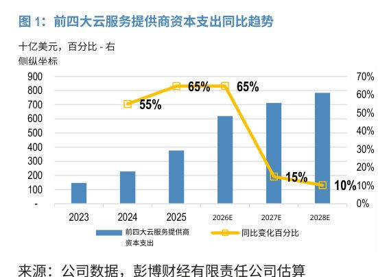

- 横轴：2023、2024、2025、2026E、2027E、2028E；左轴0–900；右轴0%–70%
- 折线标注：2024 55%、2025 65%、2026E 65%、2027E 15%、2028E 10%
- 图例：前四大云服务提供商资本支出（柱）、同比变化百分比
- 来源：公司数据，彭博财经有限责任公司估算

**图2：前三云服务提供商云收入同比趋势**
十亿美元，% - 右侧纵坐标

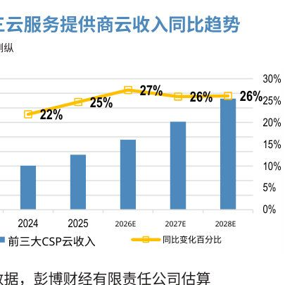

- 横轴：2023、2024、2025、2026E、2027E、2028E；左轴0–900；右轴0%–30%
- 折线标注：2024 22%、2025 25%、2026E 27%、2027E 26%、2028E 26%
- 图例：前三大CSP云收入（柱）、同比变化百分比
- 来源：公司数据，彭博财经有限责任公司估算

[Source Page: 4]

- **催化剂#3 - 长期协议披露，提供更清晰的合约可见性及利润率下行支撑。** 美光科技已启动业内首份官方长期战略客户协议，我们预计其他存储供应商将很快跟进。投资者期待听到与全周期利润率保护相关的证据（例如最低限价、数量与价格保证条款、预付款、违约金机制及其他）。我们还将关注存储供应商的战略方向（除长期协议背后的原因外，还包括其关于如何开展长期协议的经营原则和理念声明）。这对于评估盈利的可持续性至关重要，我们预计存储制造商最终将把此类长期协议及商业模式的变化与股东回报挂钩，以向投资者群体传递信心。

**图6：动态随机存取存储器营业利润率趋势**
%

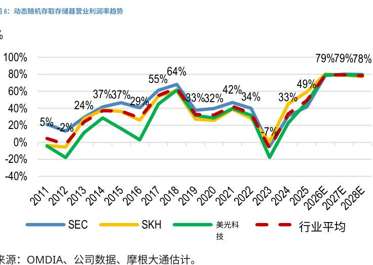

- 折线标注：5%、-2%、24%、37%、37%、29%、55%、64%、33%、32%、42%、34%、-7%、33%、49%、79%、79%、78%
- 左轴：-40%、-20%、0%、20%、40%、60%、80%、100%
- 图例：SEC、SKH、美光科技、行业平均
- 来源：OMDIA、公司数据、摩根大通估计。

**图7：动态随机存取存储器同比ASP趋势**
美元/1GB，百分比-右轴

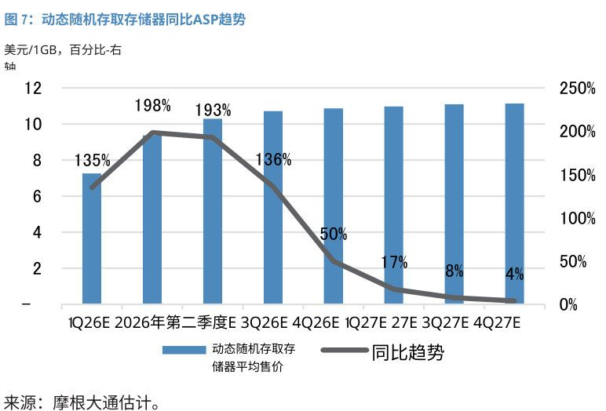

- 横轴：1Q26E、2Q26E、3Q26E、4Q26E、1Q27E、2Q27E、3Q27E、4Q27E；左轴：-、2、4、6、8、10、12；右轴：0%、50%、100%、150%、200%、250%
- 标注：135%、198%、193%、136%、50%、17%、8%、4%
- 图例：动态随机存取存储器平均售价（柱）、同比趋势（线）
- 来源：摩根大通估计。

[Source Page: 5]

**图8：DRAM - DDR5现货及合约价格与溢价百分比**
美元/8Gb，%-右侧纵坐标

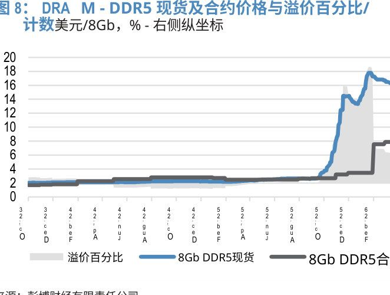

- 横轴：Oct-23、Dec-23、Feb-24、Apr-24、Jun-24、Aug-24、Oct-24、Dec-24、Feb-25、Apr-25、Jun-25、Aug-25、Oct-25、Dec-25、Feb-26；左轴：0–20；右轴：-50%、0%、50%、100%、150%、200%、250%、300%、350%、400%、450%
- 图例：溢价百分比、8Gb DDR5现货、8Gb DDR5合约
- 来源：彭博财经有限责任公司

**图9： NAND - 现货价格趋势**
美元/512Gb - 左侧纵坐标，美元/256Gb - 右侧纵坐标

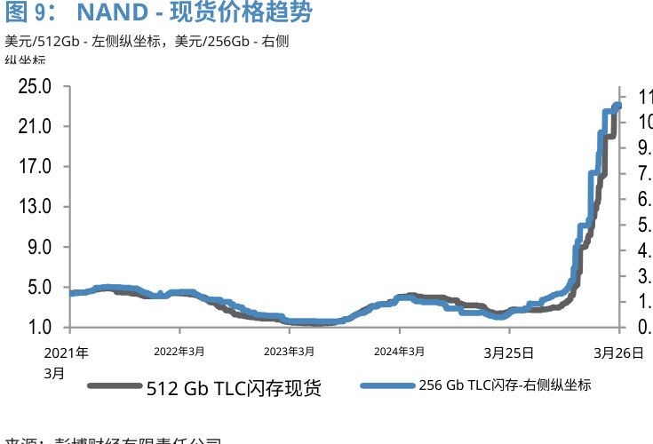

- 横轴：2021年3月、2022年3月、2023年3月、2024年3月、2025年3月、2026年3月；左轴：1.0、5.0、9.0、13.0、17.0、21.0、25.0；右轴：0.7、1.9、3.1、4.3、5.5、6.7、7.9、9.1、10.3、11.5
- 图例：512 Gb TLC闪存现货、256 Gb TLC闪存-右侧纵坐标
- 来源：彭博财经有限责任公司

**Figure 10: Memory Semiconductor cycle scenario analysis**

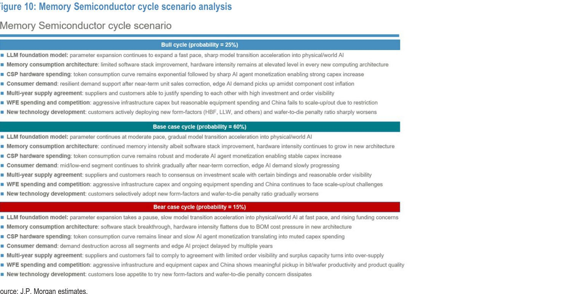

### Memory Semiconductor cycle scenario

**Bull cycle (probability = 25%)**

- **LLM foundation model:** parameter expansion continues to expand a fast pace, sharp model transition acceleration into physical/world AI
- **Memory consumption architecture:** limited software stack improvement, hardware intensity remains at elevated level in every new computing architecture
- **CSP hardware spending:** token consumption curve remains exponential followed by sharp AI agent monetization enabling strong capex increase
- **Consumer demand:** resilient demand support after near-term unit sales correction, edge AI demand picks up amidst component cost inflation
- **Multi-year supply agreement:** suppliers and customers able to justify spending to each other with high investment and order visibility
- **WFE spending and competition:** aggressive infrastructure capex but reasonable equipment spending and China fails to scale-up/out due to restriction
- **New technology development:** customers actively deploying new form-factors (HBF, LLW, and others) and wafer-to-die penalty ratio sharply worsens

**Base case cycle (probability = 60%)**

- **LLM foundation model:** parameter continues at moderate pace, gradual model transition acceleration into physical/world AI
- **Memory consumption architecture:** continued memory intensity albeit software stack improvement, hardware intensity continues to grow in new architecture
- **CSP hardware spending:** token consumption curve remains robust and moderate AI agent monetization enabling stable capex increase
- **Consumer demand:** mid/low-end segment continues to shrink gradually after near-term correction, edge AI demand slowly progressing
- **Multi-year supply agreement:** suppliers and customers reach to consensus on investment scale with certain bindings and reasonable order visibility
- **WFE spending and competition:** aggressive infrastructure capex and ongoing equipment spending and China continues to face scale-up/out challenges
- **New technology development:** customers selectively adopt new form-factors and wafer-to-die penalty ratio gradually worsens

**Bear case cycle (probability = 15%)**

- **LLM foundation model:** parameter expansion takes a pause, slow model transition acceleration into physical/world AI at fast pace, and rising funding concerns
- **Memory consumption architecture:** software stack breakthrough, hardware intensity flattens due to BOM cost pressure in new architecture
- **CSP hardware spending:** token consumption curve remains linear and slow AI agent monetization translating into muted capex spending
- **Consumer demand:** demand destruction across all segments and edge AI project delayed by multiple years
- **Multi-year supply agreement:** suppliers and customers fail to comply to agreement with limited order visibility and surplus capacity turns into over-supply
- **WFE spending and competition:** aggressive infrastructure capex and equipment capex and China shows meaningful progress in niche for mature productivity and product quality
- **New technology development:** customers lose appetite to buy new form-factors and wafer-to-die penalty concern dissipates

Source: J.P. Morgan estimates.

[Source Page: 6]

**图11：DRAM位需求与位供应**
%

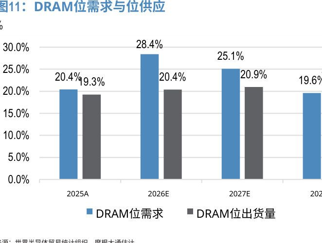

- 横轴：2025A、2026E、2027E、2028E；纵轴：0.0%、5.0%、10.0%、15.0%、20.0%、25.0%、30.0%
- DRAM位需求：20.4%、28.4%、25.1%、19.6%
- DRAM位出货量：19.3%、20.4%、20.9%、22.2%
- 来源：世界半导体贸易统计组织，摩根大通估计。

**图12：NAND位需求与位供应**
%

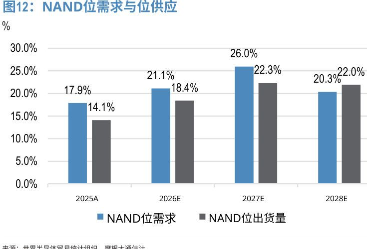

- 横轴：2025A、2026E、2027E、2028E；纵轴：0.0%、5.0%、10.0%、15.0%、20.0%、25.0%、30.0%
- NAND位需求：17.9%、21.1%、26.0%、20.3%
- NAND位出货量：14.1%、18.4%、22.3%、22.0%
- 来源：世界半导体贸易统计组织，摩根大通估计。

[Source Page: 7]

**图17：HBM供需比（CoWoS调整）**
1GB当量百万，% - 右侧纵坐标

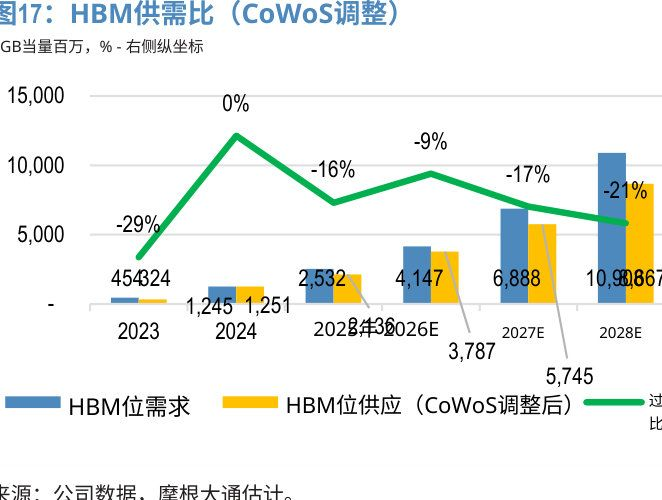

- 横轴：2023、2024、2025、2026E、2027E、2028E；左轴：-、5,000、10,000、15,000；右轴：-40%、-30%、-20%、-10%、0%、10%
- HBM位需求：454、1,245、2,532、4,147、6,888、10,908
- HBM位供应（CoWoS调整后）：324、1,251、2,136、3,787、5,745、8,667
- 过剩率（百分比）：-29%、0%、-16%、-9%、-17%、-21%
- 来源：公司数据，摩根大通估计。

**图18：累计HBM位过剩量和过剩率（周）**
周数，1GB当量百万 - 右侧纵坐标

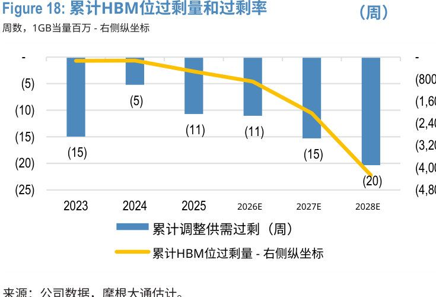

- 横轴：2023、2024、2025、2026E、2027E、2028E；左轴：-、(5)、(10)、(15)、(20)、(25)；右轴：(4,800)、(4,000)、(3,200)、(2,400)、(1,600)、(800)、-
- 柱上标注：(15)、(5)、(11)、(11)、(15)、(20)
- 图例：累计调整供需过剩（周）、累计HBM位过剩量 - 右侧纵坐标
- 来源：公司数据，摩根大通估计。
