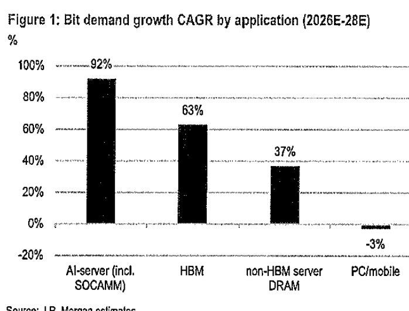
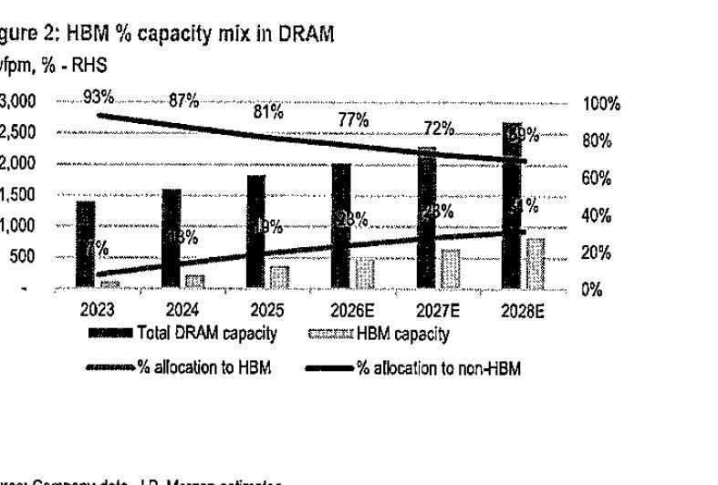
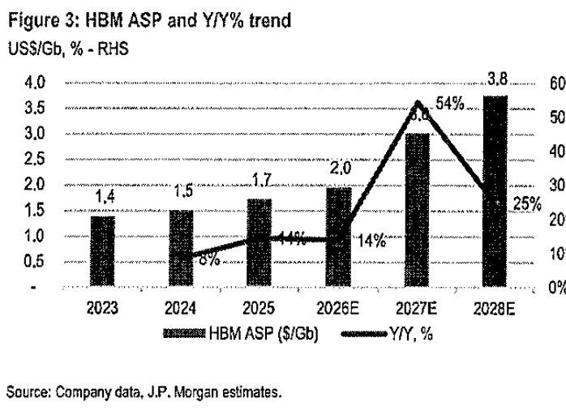
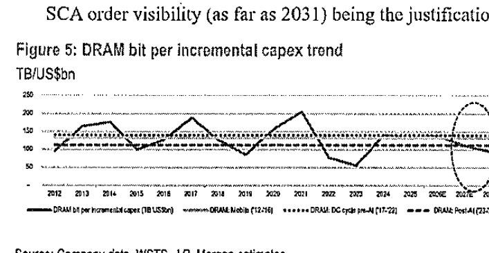
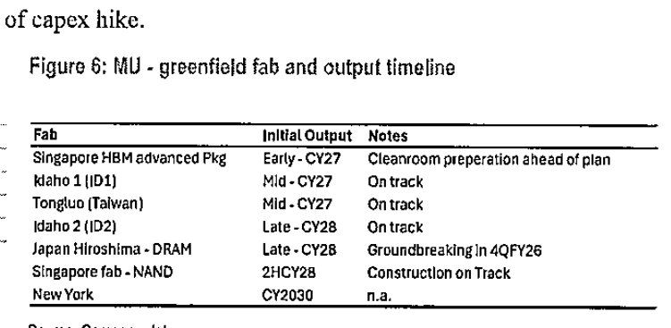
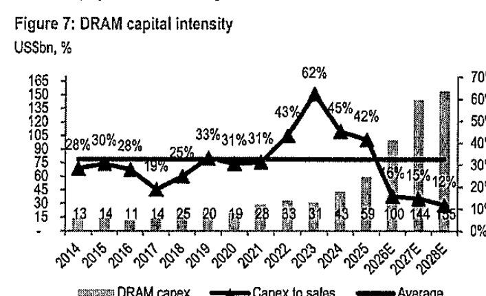
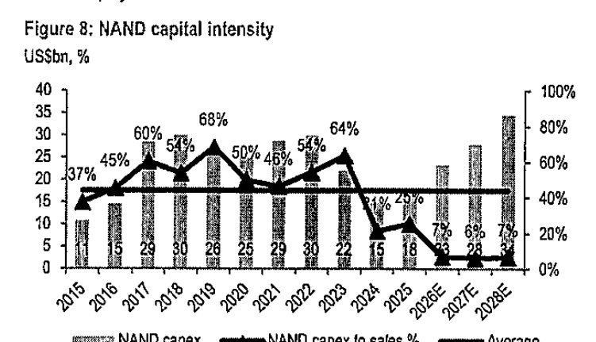

## Document Metadata

- Document ID: 394551c12df0cdfdcc5f3f94641fe71ce641bd68
- Document Title: Memory Market Update: Read-through from MU's 4QFY26 results; Order discussions until 2031 with tightness continuing into '28
- Document Type: PDF
- Issuing Organization: J.P. Morgan – Asia Pacific Equity Research
- Publication Date: 2026-10-01
- Reporting Period: null
- Source File: [M175_20261102133618-0001.pdf](https://github.com/jadennevercode/CJCC-Knowledge-Base/blob/5ec8511eb834073c8bfbd79c94af196282d483cf/materials/%E8%B7%A8%E9%93%BE%EF%BC%9A%E4%BE%9B%E9%9C%80%E4%B8%8E%E4%BB%B7%E6%A0%BC%E5%8F%A3%E5%BE%84/M175_20261102133618-0001.pdf)

## Structured Content

> 原文件：[M175_20261102133618-0001.pdf](https://github.com/jadennevercode/CJCC-Knowledge-Base/blob/5ec8511eb834073c8bfbd79c94af196282d483cf/materials/%E8%B7%A8%E9%93%BE%EF%BC%9A%E4%BE%9B%E9%9C%80%E4%B8%8E%E4%BB%B7%E6%A0%BC%E5%8F%A3%E5%BE%84/M175_20261102133618-0001.pdf)
> 转换方式：多模态逐页转录（页面图像 + 文本层交叉校验）

[Source Page: 1]

Asia Pacific Equity Research
01 October 2026

J.P.Morgan

# Memory Market Update

Read-through from MU's 4QFY26 results; Order discussions until 2031 with tightness continuing into '28

Technology - Semiconductors

- **Memory S/D outlook: tightness confirmed through CY28, no line of sight to balance.** MU guided memory S/D to be tighter in CY27/28 more so than in CY26, an extension of the cycle horizon and in-line with JPMe. Management guided industry DRAM/NAND bit shipments at low-20%/mid-20% through CY27/28, with the industry remaining supply constrained. For DRAM, management elaborated on the limited line of sight of when the S-D will return to balance as the demand growth far outpaces that of supply growth amidst significant cleanroom shortages. On HBM, management guided HBM bit shipments to grow faster than conventional DRAM through CY28, in-line with JPMe (HBM bit demand growth: +63% vs. non-HBM server: +37%).
- **SCA coverage extended to 2031.** MU disclosed that 26 SCAs were signed covering: 1)>35% of revenue through 2030 (conservative pricing assumption, as per management); 2) both DRAM and NAND (management guided DRAM mix slightly lower than NAND); 3) across all customers including AI hyperscalers, mobile, PC, auto; 4) pre-payment at US$32bn (up from US$22bn in the May-Q) and RPO at US$150bn; and 5) 75% of the estimated revenue having a defined pricing framework, with the remaining 25% negotiated based on market prices. Taking into account the SCA horizon extension, growing RPO/prepayment mix, and 75% bit output locked-in by contracts for 27E, we see little doubt about the robust memory demand profile. On the other hand, we believe MU's >35% SCA revenue coverage through 2030 is conservative compared to Asian memory makers with LTA coverage accounting for well above 50%+ of memory capacity. We believe the divergence may arise from strategic decisions (diverging priorities across contract duration, profitability (i.e. pricing), prepayment mix, contingent terms, etc.). Overall, we walk away with a more constructive impression of the memory fundamental view.

**Table 1: LTA details announced across major memory QTD**

| As of 2QCY26 [OCR_UNCERTAIN] | MU | SEC | SKH | US NAND maker | Kioxia |
| --- | --- | --- | --- | --- | --- |
| Number of Agreements | 25 SCAs signed to date (vs. 2Q: 16 SCAs); Visibility extended to 2031 for two agreements | Finalized with top 5 global DC customers; Final stages with 5 additional major accounts | 10 agreements (with key customers) | 8 HENs [OCR_UNCERTAIN] | ~10 LTAs concluded |
| Volume coverage | n.a. (20-30% of DRAM volume, ~17% of NAND) [OCR_UNCERTAIN] | 60%-70% of total DRAM capacity | n.a. | >80% of bits in FY2027, ~23% of bits in FY2028 [OCR_UNCERTAIN] | Targeting 50% LTA volume coverage by CY2029 |
| Revenue Coverage (when complete) | >35% of revenue by 2030; Ultimate ambition of ~50% of revenue through 2030 | n.a. | Maintain an appropriate level based on market conditions; (not quantified) | Minimum US$33.0bn total NBM revenue at floor pricing (actual expected above minimum) | n.a. |
| Term Length | SCAs signed into 2031 (up to 20+ years (PC/Consumer), 3 years (Auto)) [OCR_UNCERTAIN] | 5-year term, subject to annual negotiations (rolling basis; can add one total year) [OCR_UNCERTAIN] | 5 years on average; specific conditions vary by customer/product | Up to 5 years. Weighted average duration 4 years | n.a. |
| Agreement Structure | Take-or-pay, binding volume commitments | Mutually binding contractual commitments; Contract demand insurance; rolling cancellation used [OCR_UNCERTAIN] | Strategic partnership beyond volume supply; Long-term volume commitments + details | S.O commitments defined by year and by quarter; Financial guarantees released toward end of each agreement | Multi-year supply agreements; Mutually binding contractual conditions |
| Price Band - Ceiling | n.a. (2Q: Current CQ2'22E market price) [OCR_UNCERTAIN] | Differentiated pricing model by customer and product | Pricing structure will also not be uniform | Variable portion subject to ceilings; fixed + variable pricing blended | n.a. |
| Price Band - Floor | n.a. (2Q: Guaranteed GM at any price cycle year) [OCR_UNCERTAIN] | Minimum price floor established for most certain products (sufficient to mitigate future investment risk) | Range of pricing mechanism to respond to price volatility | Variable portion subject to floors; Assurance of margins even at floor pricing [OCR_UNCERTAIN] | n.a. |
| CAP Deposits & Commitments | US$32bn (increased from US$22bn in 2Q) [OCR_UNCERTAIN] | Substantial advance payments over multiple period. | Deposits incorporated to support contract fulfilment | US$2.5bn of financial guarantees (cash deposits + financial instruments), mostly held by third-party institutions | Financial transactions (e.g., deposits) incorporated |
| APC Prepayment | US$15bn reflecting contract value only for SCA | Already received significant portion; One-fifth of total received balance expected in 2Q | n.a. | US$9.5bn at quarter end; US$1.1bn reserved, to be repaid after build-out | n.a. |
| End Markets | Data Center, Consumer, Automotive | CSP, AI & [OCR_UNREADABLE] AI server & devices | Server DRAM, HBM, enterprise SSD (AI-focused) | Data center and Edge Infrastructure | Data center/enterprise & consumer electronic |

Source: Company data.; Note: MU as of 3QCY26 and others until 2QCY26

- **HBM: CY27 bit supply sold out at significant price increases; margin gap to conventional DRAM narrowing.** MU guided that the vast majority of its CY27 HBM bit supply is sold out with significant y-y price increase (JPMe: HBM blended ASP +54% y-y), explicitly narrowing the gross margin gap versus conventional DRAM. Management echoed our view of HBM bit shipment outgrowing than the conventional DRAM through CY28 (JPMc: +63% vs. non-HBM server DRAM: +37%) with HBM as a % of the TAM growing sequentially (JPME: HBM capacity mix reaching 31% in 28E vs. 19%

[Source Page: 2]

in 25A). The new pricing will be reflected from the beginning of CY27 calendar year, as per management. For NVHBM, MU noted that its HBM4E will utilize foundry base die (i.e. TSMC) instead of the in-house base die used on HBM4 (in-line with our view that all memory makers are involved in the HBM4E project with the base die manufacturing being exclusive at TSMC for NVHBM project - report).

**Figure 1: Bit demand growth CAGR by application (2026E-28E)**
%

- AI-server (incl. SOCAMM): 92%
- HBM: 63%
- non-HBM server DRAM: 37%
- PC/mobile: -3%

Source: J.P. Morgan estimates.

**Figure 2: HBM % capacity mix in DRAM**
Kwpm, % - RHS

- % allocation to non-HBM: 2023 93%, 2024 87%, 2025 81%, 2026E 77%, 2027E 72%, 2028E 68%
- % allocation to HBM: 2023 7% [OCR_UNCERTAIN], 2024 13%, 2025 19%, 2026E 23%, 2027E 28%, 2028E 32%
- Total DRAM capacity / HBM capacity (Kwpm) bars: no data labels

Source: Company data, J.P. Morgan estimates.

**Figure 3: HBM ASP and Y/Y% trend**
US$/Gb, % - RHS

- HBM ASP (US$/Gb): 2023 1.4, 2024 1.5, 2025 1.7, 2026E 2.0, 2028E 3.8; 2027E bar has no data label
- Y/Y (%): 8% [OCR_UNCERTAIN], -11%, 14%, 54%, 25%

Source: Company data, J.P. Morgan estimates.

- **Multiple greenfield fabs in the pipeline with FY27E capex revised up.** MU announced to raise FY27 capex vs. previous plan, driven predominately by an increase in construction capex to accelerate cleanroom availability in late-CY28 (see figure 12), in addition to some pull-forward of WFE to optimize output from existing cleanrooms. While capex has been revised up, we highlight MU's multiple greenfield fab projects are already baked-in to our GMM supply equations and see limited changes to our tight S/D outlook until 28E (JPMe: +25% CAGR in CY27-28E). Management retained the disciplined capex tone, citing historical low capital intensity vs. historical mid-30% framework being outdated (JPMe: DRAM capital intensity <mid-10% and NAND at <10% through FY26-28E). On technology migration, management indicated 1-gamma and G9 DRAM nodes (278L NAND) accounts for the highest mix with the next-gen node beginning volume productions in the 2HCY27, a two generation node ahead of Chinese competitors (in-line with our view - report). We believe MU's capex and supply commentaries were in-line with our industry view given limited bit output per incremental capex growth. In light of this trend, we believe the capex hike has limited impact on easing the current market tightness, and we remain constructive on extended

[Source Page: 3]

SCA order visibility (as far as 2031) being the justification of capex hike.

**Figure 5: DRAM bit per incremental capex trend**
TB/US$bn

- Legend: DRAM bit per incremental capex (TB US$bn); DRAM: Mobile ('12-'16); DRAM: DC cycle pre-AI ('17-'22); DRAM: Post-AI ('23-'28)
- X axis: 2012-2028E; Y axis: 200/150/100/50/-

Source: Company data, WSTS, J.P. Morgan estimates.

**Figure 6: MU - greenfield fab and output timeline**

| Fab | Initial Output | Notes |
| --- | --- | --- |
| Singapore HBM advanced Pkg | Early - CY27 | Cleanroom preparation ahead of plan |
| Idaho 1 (ID1) | Mid - CY27 | On track |
| Tongluo (Taiwan) | Mid - CY27 | On track |
| Idaho 2 (ID2) | Late - CY28 | On track |
| Japan Hiroshima - DRAM | Late - CY28 | Groundbreaking in 4QFY26 |
| Singapore fab - NAND | 2HCY28 | Construction on Track |
| New York | CY2030 | n.a. |

Source: Company data.

**Figure 7: DRAM capital intensity**
US$bn, %

- DRAM capex (US$bn): 2014 13, 2015 14, 2016 11, 2017 14, 2018 25, 2019 20, 2020 19, 2021 28, 2022 33, 2023 31, 2024 43, 2025 59, 2026E 100, 2027E 144, 2028E 155
- Capex to sales (%): 2014 28%, 2015 30%, 2016 28%, 2017 19%, 2018 25%, 2019 33%, 2020 31%, 2021 31%, 2022 43%, 2023 62%, 2024 45%, 2025 42%, 2026E 16%, 2027E 15%, 2028E 12%
- Average: flat line (no data label)

Source: Company data, J.P. Morgan estimates.

**Figure 8: NAND capital intensity**
US$bn, %

- NAND capex (US$bn): 2015 11, 2016 15, 2017 29, 2018 30, 2019 26, 2020 25, 2021 29, 2022 30, 2023 22, 2024 15, 2025 18, 2026E 23, 2027E 28, 2028E 33
- NAND capex to sales %: 2015 37%, 2016 45%, 2017 60%, 2018 54%, 2019 68%, 2020 50%, 2021 46%, 2022 54%, 2023 64%, 2024 21% [OCR_UNCERTAIN], 2025 25% [OCR_UNCERTAIN], 2026E 7%, 2027E 6%, 2028E 7%
- Average: flat line (no data label)

Source: Company data, J.P. Morgan estimates.

[Source Page: 4]

- **Micron's 4QFY26 results flash and 1QFY27 outlook.** MU (OW, covered by JPM's Harlan Sur) reported a strong Aug-Q print: sales of US$54.2bn (consensus: $51.5bn) and EPS of US$33 (consensus: US$32) - report from Harlan. DRAM bit shipment rose MSD % Q/Q broadly in-line with Asian memory makers (JPMe: SEC/SKH +5%/+10%) and DRAM ASP rose high-teens% Q/Q (broadly in-line with SEC/SKH of +17%/+20%). NAND bit shipments rose ~10% and ASP rose +30% Q/Q tracking higher than Asian memory makers (SEC/SKH 3Q26E B/G at +8%/+3% and ASP +12%/+12%). MU's Nov-Q guidance was stronger at ~US$61.5bn, GPM of 86.25% and EPS of US$38.2 (vs. consensus of US$56bn/87%/US$36).
