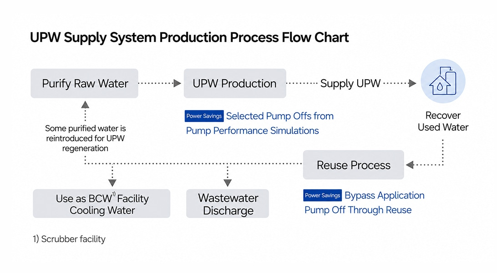
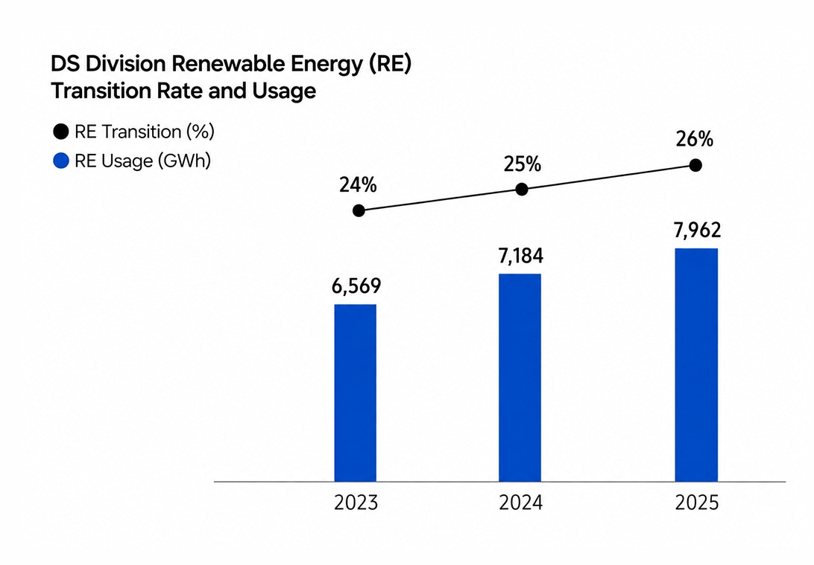

## Document Metadata

- Document ID: 244b3066345fca10046be053f6ea7aa31261f50c
- Document Title: Climate Change | Sustainability | Samsung Semiconductor Global
- Document Type: HTML
- Issuing Organization: Samsung Semiconductor
- Publication Date: null
- Reporting Period: null
- Source File: [48_semiconductor.sams_climate-change.html](https://github.com/jadennevercode/CJCC-Knowledge-Base/blob/564ab11aa9785e569e3853c8a4d7ce86f88e7535/materials/%E8%B7%A8%E9%93%BE%EF%BC%9A%E5%85%AC%E7%94%A8%E5%B7%A5%E7%A8%8B%E3%80%81%E7%89%A9%E6%B5%81%E4%B8%8E%E5%8C%BA%E5%9F%9F%E9%A3%8E%E9%99%A9/48_semiconductor.sams_climate-change.html)

## Structured Content

# Climate Change | Sustainability | Samsung Semiconductor Global

### Given the power-intensive nature of semiconductor manufacturing, Samsung Semiconductor focuses on energy optimization and energy decarbonization to reduce Scope 2 emissions. By improving energy efficiency to reduce electricity consumption and strengthening collaboration to secure carbon-free energy, we are working to enhance the stability of our power supply while reducing carbon emissions.

Power usage reduction

[原图来源](https://image.semiconductor.samsung.com/image/samsung/p6/semiconductor/sustainability/planet/en/esg-climatechange-3-pc-en.png?$ORIGIN_PNG$)

**UPW Supply System Production Process Flow Chart**

Purify Raw Water → UPW Production → Supply UPW → Recover Used Water → Reuse Process. Some purified water is reintroduced for UPW regeneration; Use as BCW¹⁾ Facility Cooling Water; Wastewater Discharge. Power Savings: Selected Pump Offs from Pump Performance Simulations; Bypass Application Pump Off Through Reuse.

1) Scrubber facility

**Manufacturing facilities**

Samsung Semiconductor is reducing Scope 2 emissions by optimizing the operational efficiency of power-intensive equipment and infrastructure. Through this, we are minimizing energy loss by tailoring UPW (Ultra Pure Water) supply to real-time process demand.

Additionally, advanced HVAC control systems have reduced chilled water usage by approximately 70%, significantly lowering the power consumption of pumps and chillers.

Renewable energy transition

Samsung Semiconductor has been powering all of its overseas business sites with 100% renewable energy since 2020 and is steadily increasing the renewable energy transition rate across its domestic sites.

[原图来源](https://image.semiconductor.samsung.com/image/samsung/p6/semiconductor/sustainability/planet/en/esg-climatechange-4-pc-en.png?$ORIGIN_PNG$)

**DS Division Renewable Energy (RE) Transition Rate and Usage**

| Year | RE Transition (%) | RE Usage (GWh) |
| --- | ---: | ---: |
| 2023 | 24% | 6,569 |
| 2024 | 25% | 7,184 |
| 2025 | 26% | 7,962 |

To expand this transition, the company utilizes a diverse range of procurement methods, including Power Purchase Agreements (PPAs), the purchase of Renewable Energy Certificates (RECs), and the implementation of on-site self-generation.

In Korea, Samsung Semiconductor expanded its renewable energy capacity by signing six new PPAs in 2025, totaling 252MW. This brings the cumulative total to 11 PPA contracts with a capacity of 681MW. Additionally, the company has increased its cumulative solar self-generation capacity at domestic and overseas sites to 7.6MW, directly producing and utilizing 5.7GWh of power in 2025 alone.

Efforts to secure energy

To meet the demands of global Big Tech customers for products supplied via carbon-free energy, Samsung Semiconductor is expanding its use of renewable energy and exploring various carbon reduction strategies utilizing carbon-free energy sources recognized by its customers.

We are also diversifying its reduction methods through academic-industrial collaborations; in 2025, it conducted four research projects on carbon-free energy transition and related policies in partnership with institutions such as Seoul National University and Hanyang University. Furthermore, Samsung Semiconductor actively participates in the board and working groups of the Carbon-Free Energy (CFE) Alliance to contribute to discussions on international technical standards and certification systems for carbon-free energy.
