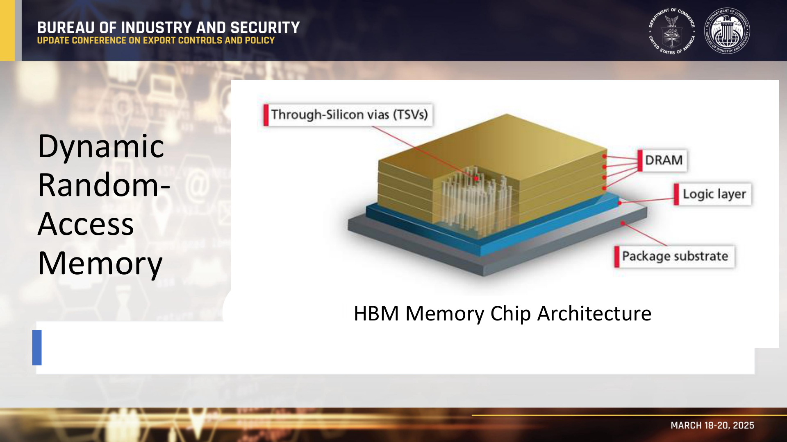

## Document Metadata

- Document ID: 66de4ba7d7c0b5ff288c7d68a0957b326397d4bf
- Document Title: Updates on Semiconductor Controls
- Document Type: PDF
- Issuing Organization: Bureau of Industry and Security
- Publication Date: null
- Reporting Period: null
- Source File: [33_bis.gov_updates-semiconductor-controls.pdf](https://github.com/jadennevercode/CJCC-Knowledge-Base/blob/564ab11aa9785e569e3853c8a4d7ce86f88e7535/materials/%E8%B7%A8%E9%93%BE%EF%BC%9A%E6%94%BF%E7%AD%96%E5%8F%8A%E5%A4%9A%E4%BA%8B%E4%BB%B6%E4%BA%A4%E4%BA%92/33_bis.gov_updates-semiconductor-controls.pdf)

## Structured Content

[Source Page: 1]

# Updates on Semiconductor Controls

BUREAU OF INDUSTRY AND SECURITY UPDATE CONFERENCE ON EXPORT CONTROLS AND POLICY

MARCH 18–20, 2025

[Source Page: 2]

| Rule Title (aka) | Pub. Date | Effective and Compliance Date | End of Public Comment Period Date |
| --- | --- | --- | --- |
| Implementation of Additional Export Controls: Certain Advanced Computing Items; Supercomputer and Semiconductor End Use; Updates and Corrections; and Export Controls on Semiconductor Manufacturing Items; Corrections and Clarifications (C&C Rule) | 04/04/2024 89 FR 23876 | 4/4/2024 | 04/29/2024 |
| Commerce Control List Additions and Revisions; Implementation of Controls on Advanced Technologies Consistent with Controls Implemented by International Partners (Quantum & Semiconductor Rule – Q&S rule) | 9/06/2024 89 FR 72926 | 9/6/2024 Compliance: 11/5/2024 | 11/5/2024 |
| Foreign-Produced Direct Product Rule Additions, and Refinements to Controls for Advanced Computing and Semiconductor Manufacturing Items (FN5 Rule) | 12/05/2024 89 FR 96790 | 12/02/2024 | 03/14/2025 |
| Implementation of Additional Due Diligence Measures for Advanced Computing Integrated Circuits; Amendments and Clarifications; and Extension of Comment Period (FDD Rule) | 1/16/2025 90 FR 5298 | 01/16/2025 Compliance: 01/31/2025 | 3/14/2025 |

[Source Page: 3]

## C&C Rule: Correction and Clarification Rule

- § 740.8 Notified Advanced Computing (NAC)
- License review policy for Gray Zone chips
- SME § 744.23 (a)(4) new end use/user control for incorporation to prevent indigenous production of SME
- Removing EUV mask substrates (3B001.j), and EUV mask making equipment (3B991.b.2) from the SME license requirement parenthetical exceptions
- Clarification to BIS responses to certain public comment topics 45, 46, 47, and 49

[Source Page: 4]

## Q&S: New Semiconductor Mfg. ECCNs

- 3B903 Scanning Electron Microscope (SEM) equipment designed for imaging semiconductor devices or integrated circuits.
- 3C907 Epitaxial materials consisting of a “substrate” having at least one epitaxially grown layer and containing other specified materials.
- 3C908 Fluorides, hydrides, chlorides, of silicon or germanium, containing other specified materials.
- 3C909 Silicon, silicon oxides, germanium or germanium oxides, containing any other specified materials.

[Source Page: 5]

## Q&S: New Semiconductor Mfg. ECCNs

- 3B001.c.1.a Isotropic dry etching equipment
- 3B001.c.1.c Anisotropic dry etching equipment
- 3B001.q (“EUV” masks and “EUV” reticles designed for integrated circuits, not specified by 3B001.g, and having a mask “substrate blank” specified by 3B001.j).
- 3D907 “Software” designed to extract “GDSII” or equivalent standard layout data and perform layer-to-layer alignment from SEM images, and generate multi-layer “GDSII” data or the circuit netlist.
- 3E905 “Technology” according to the General Technology Note for the “development” or “production” of integrated circuits or devices, using “Gate all-around Field-Effect Transistor (“GAAFET”) structures.

[Source Page: 6]

## Q&S: Summary of Exclusions and General License Authorizations

- 742.4(a)(5)(ii)(A) and 742.6(a)(10)(ii)(A) Grandfather clause - covers existing employees - Deemed exports/reexports of all technology/software (except GAAFET 3E905) to most destinations (except D:1/D:5)
- 742.4(a)(5)(ii)(B) and 742.6(a)(10)(ii)(B) deemed export/reexports going forward, e.g., new employees or an existing employee getting access to different technology.
- General Licenses in General Order No. 6 authorizations
  - (f)(1) Actual exports/reexports/transfers of GAAFET technology (3E905) for A:5 and A:6 countries
  - (f)(2) GAAFET technology (3E905) deemed exports/reexport for D:1/5 FN existing employees (grandfather clause)
  - (f)(2) Quantum technology/software deemed exports/reexports for D:1/5 FNs going forward.

[Source Page: 7]

## FN5 Rule

- Controls on 24 new types of tools and revisions to existing Cat. 3 Export Control Classification Numbers (ECCNs)
- Two new Foreign Direct Product rules and related de minimis rules:
  - FN5 FDP for fabs of concern
  - SME FDP for Macau and D:5 Countries (including concept of “contains”)
- High Bandwidth Memory (HBM) controls
- New Dynamic random-access memory (DRAM) integrated circuit parameters
- National Security and Regional Stability Controls
- New Country List – Supp. No. 4 to part 742
- § 740.25 License Exception High Bandwidth Memory (HBM) [AES C71]
- § 740.26 License Exception Restricted Fabrication “Facility” (RFF) [AES C72]
- TGL Revisions [AES C65]
- Eight new Red Flags
- Software key access clarification

[Source Page: 8]

## New Red Flags

- Red flag 22 foreign government requires a license to export the item, and the nature of the end user raises questions about whether the exporter, reexporter, or transferor would have been granted a license for the item
- Red flag 26 export, export from abroad, reexport, or transfer of a foreign-produced item described in Category 3B ECCN in FN5 or SME FDP and contains at least one IC, then there is a red flag that the foreign-produced item meets the product scope of that Entity List FDP rule.
- Red flag 27 identifies a scenario where the end user is a “facility” that is connected to a “facility” where “production” of “advance compute integrated circuits” occurs.

  "Unless the Red Flag is resolved through an Advisory Opinion, the two buildings are treated as a single “facility” for purposes of § 744.23 of the EAR."

[Source Page: 9]

## FN5 FDP Rule

**Product Scope — Footnote 5 – 734.9(e)(3)**

| Input - software or technology “subject to the EAR” used to produce foreign-produced item | Input – U.S.-origin software or technology used to produce (“direct product”) a plant or major component of a plant that produces the foreign-produced item, or such a foreign-produced commodity is contained in foreign-produced item | Output – foreign-produced item |
| --- | --- | --- |
| ECCN 3D001 (for 3B commodities), 3D901 (for 3B903), 3D991 (for 3B991 and 3B992), 3D993, 3D994, 3E001 (for 3B commodities), 3E901 (for 3B903), 3E991 (for 3B991 and 3B992), 3E993, or 3E994 | ECCN 3D001 (for 3B commodities), 3D901, 3D991 (for 3B991 and 3B992), 3D992, 3D993, 3D994, 3E001 (for 3B commodities), 3E901 (for 3B903), 3E991 (for 3B991 and 3B992), 3E992, 3E993, or 3E994 | ECCN 3B001 (except 3B001.a.4, c, d, f.1, f.5, f.6, g, h, k to n, p.2, p.4, r), 3B002 (except 3B002.c), 3B903, 3B991 (except 3B991.b.2.a through 3B991.b.2.b), 3B992, 3B993, or 3B994 |

The two input descriptions are connected by **OR**. The output includes 3B SME that contains any product of the plant/major component. Section 734.9(e)(3).

**Destination/End User/End Use “knowledge”**

“Knowledge” that:

1. The FDP will be incorporated into any “part,” “component,” or “equipment” produced, purchased, or ordered by any FN5 entity or by an entity located at a “facility” in Macau/D:5 where the “production” of logic or DRAM “advanced-node integrated circuits” occurs; OR
2. A FN5 entity or an entity located at a “facility” located in Macau/D:5 of supplement no. 1 to part 740 where the “production” of logic or DRAM “advanced-node integrated circuits” occurs is party to transaction.

[原页表格及连接关系](../../materials_md_cleaned/_assets/bis_semiconductor_controls_original/page-9.png)

[Source Page: 10]

- INPUT: US-Origin ECCN 3D001 (for 3B commodities), 3D901 (for 3B903), 3D991 (for 3B991 and 3B992), 3D993, 3D994, 3E001 (for 3B commodities), 3E901 (for 3B903), 3E991 (for 3B991 and 3B992), 3E993, or 3E994
- INPUT/OUTPUT: ECCN 3B001 (except 3B001.a.4, c, d, f.1, f.5, f.6, g, h, k to n, p.2, p.4, r), 3B002 (except 3B002.c), 3B903, 3B991 (except 3B991.b.2.a through 3B991.b.2.b), 3B992, 3B993, or 3B994
- INPUT: Any product of the 3B SME
- OUTPUT: SME that contains the output of the foreign SME

Subject to the EAR!

[原页流程图](../../materials_md_cleaned/_assets/bis_semiconductor_controls_original/page-10.png)

[Source Page: 11]

## License Requirements for Items Subject to the EAR Under FN5 FDP

| Entity HQ | Reexport/Export from Abroad from Supp. 4 | Reexport/Export from Abroad from A:5, not in Supp. 4 | Reexport/Export from Abroad from Non-A:5 | Transfers (in-country) (D:5/Macau) |
| --- | --- | --- | --- | --- |
| Supp. 4⁵ | No BIS license required for ECCNs in Lists 1–3 | List 1 ECCNs – D:5/Macau⁶ List 2 ECCNs – FN5⁶ | List 1 ECCNs – D:5/Macau List 2 ECCNs – FN5 | List 1 ECCNs – All end-users List 2 ECCNs – FN5 |
| Non-Supp. 4 (and not D:5/Macau) | No BIS license required for ECCNs in Lists 1–3 | List 1 ECCNs – D:5/Macau⁶ List 2 ECCNs – FN5⁶ | List 1 ECCNs – D:5/Macau List 3 ECCNs – FN5 | List 1 ECCNs – All end-users List 3 ECCNs – FN5 |
| D:5/Macau⁷ | List 1 – D:5/Macau List 3 – FN5 | List 1 ECCNs – D:5/Macau List 3 ECCNs – FN5 | List 1 ECCNs – D:5/Macau List 3 ECCNs – FN5 | List 1 ECCNs – All end-users List 3 ECCNs – FN5 |

ECCN List Key:

- List 1: ECCN 3B001.a.4, c, d, f.1, f.5, f.6, k to n, p.2, p.4, r, 3B002.c
- List 2: ECCN 3B993
- List 3: ECCN 3B001 (except List 1 and 3B001.g and .h), 3B002 (except 3B002.c), 3B611, 3B903, 3B991 (except 3B991.b.2.a and 3B991.b.2.b), 3B992, 3B993, 3B994.

⁵ Supplement No. 4 to Part 742 includes: Australia, Austria, Belgium, Bulgaria, Canada, Croatia, Czech Republic, Denmark, Estonia, Finland, France, Germany, Greece, Hungary, Iceland, Ireland, Italy, Japan, Latvia, Lithuania, Luxembourg, Netherlands, New Zealand, Norway, Poland, Portugal, Romania, Slovakia, Slovenia, Spain, Sweden, Switzerland, United Kingdom.

⁶ [OCR_UNREADABLE] 原页有脚注标记，但未见脚注 6 的解释。

⁷ See §742.4(a)(4)(ii)(B) and (C); §744.11(a)(2)(v)(A)(1).

[原页许可要求矩阵](../../materials_md_cleaned/_assets/bis_semiconductor_controls_original/page-11.png)

[Source Page: 12]

## Licensing Requirements for Foreign-Produced Commodities Outside the US That Are Specific to:

(i) Footnote 5 Fabs AND  
(ii) Unlisted Fabs in Macau/D5 That Produce “Advanced Node” Logic or DRAM

| Entity headquarters / ultimate parent | From Argentina, India, S. Korea, or Türkiye to FN5 Entity or Advanced Fab | From non-A5 countries (e.g., Israel, Singapore, or Taiwan) to FN5 Entity or Advanced Fab | From Supp. No. 4 countries (e.g., JP, NL, or DE) to FN5 Entity or Advanced Fab | Transfer within China to FN5 Entity or Advanced Fab |
| --- | --- | --- | --- | --- |
| HQ’d in US or that has ultimate parent company in US | License required for only 3B993 (if the commodity is not subject to equivalent controls by the relevant country). 744.11(a)(2)(v)(A)(2) | License required for all FN5 / Advanced Fab ECCNs.¹ 744.11(a)(2)(v)(A)(3)(i) | No EAR license required. (744.11(a)(2)(v)(A) provides the exclusive license requirements for items within the scope of 734.9(e)(3)) | License required for all FN5 / Advanced Fab ECCNs.¹ 744.11(a)(2)(v)(A)(4)(i) |
| HQ’d in, or with ultimate parent in Supp 4 countries | 同上（原表跨行） | License required for only 3B993. 744.11(a)(2)(v)(A)(3)(ii) | 同上（原表跨行） | License required for only 3B993. 744.11(a)(2)(v)(A)(4)(ii) |
| HQ’d in, or with ultimate parent in, Taiwan, Singapore, Israel, S. Korea, India or other non-Supp 4 countries | 同上（原表跨行） | License required for all FN5 / Advanced Fab ECCNs.¹ 744.11(a)(2)(v)(A)(3)(i) | 同上（原表跨行） | License required for all FN5 / Advanced Fab ECCNs.¹ 744.11(a)(2)(v)(A)(4)(i) |
| Macau/D5 HQ’d or ultimate parent in Macau/D5 | License required for all FN5 / Advanced Fab ECCNs.¹ 744.11(a)(2)(v)(A)(1), (4)(i)（原表跨四列） | 同左（原表跨列） | 同左（原表跨列） | 同左（原表跨列） |

¹ 3B001 (except 3B001.a.4, c, d, f.1, f.5, f.6, g, h, k to n, p.2, p.4, r), 3B002 (except 3B002.c), 3B611, 3B903, 3B991 (except 3B991.b.2.a through 3B991.b.2.b), 3B992, 3B993, or 3B994.

[原页许可要求矩阵](../../materials_md_cleaned/_assets/bis_semiconductor_controls_original/page-12.png)

[Source Page: 13]

## Logic or DRAM Adv ICs: Ineligible for De minimis

§734.4(a)(9) For items related to the Footnote 5 FDP rule, there is no de minimis level for an item meeting the parameters in ECCNs specified in Category 3B (except 3B001.a.4, c, d, f.1, f.5, f.6, k to n, p.2, p.4, r, or 3B002.c) of the Commerce Control List (CCL) in supplement no. 1 to part 774 of the EAR, when the commodity contains a U.S.-origin integrated circuit specified under Category 3, 4, or 5 of the CCL, and the commodity is destined:

- For an entity with a Footnote 5 designation in the license requirement column of the Entity List in supplement no. 4 to part 744 of the EAR, or
- To an end-user “facility” located in Macau or a destination specified in Country Group D:5 when there is “knowledge” that the commodities will be used in the “production” of logic or DRAM “advanced-node integrated circuits.”

[Source Page: 14]

## FDD Rule: Overview

- Revises License Exceptions AIA and ACM
- Adds lists of approved IC designers and approved “OSAT” companies, as well as authorized IC designers in specified destinations
- Adds reporting requirements for “front-end fabricators” producing advanced computing ICs for authorized IC designers, as well as a new “Know Your Customer” (KYC) vetting form
- Revises definition of DRAM, including revising de minimis ineligibility and FN5 FDP
- Definitions: Revises 1, Adds 5
- Adds Note 1 to 3A090 to clarify the scope of 3A090.a
- Amends and clarifies the FDP IFR: adds 3B001.f.6 immersion DUV items and Revises 3B99x ECCNs to clarify scope

[Source Page: 15]

## FDD Rule: Note 1 to 3A090.a

- Who does it apply to? “Front-end fabricators” or “OSAT” companies
- When does it apply? Exports from abroad, reexports, and transfers of “applicable advanced logic integrated circuit”
- What does it do? Presumption that the IC is 3A090.a and subject to license requirements for 3A090.a
- How can this presumption be overcome?

Applicable advanced logic integrated circuits are logic integrated circuits produced using the “16/14 nanometer node” or below, or using a non-planar transistor architecture.

[Source Page: 16]

## Ways to Overcome 3A090.a Presumption

1. If the designer of the “applicable advanced logic integrated circuit” is an approved or authorized integrated circuit designer, then a datasheet or other attestation of the ‘total processing performance’ and the ‘performance density’ from the approved or authorized integrated circuit designer indicating that the IC is not specified in 3A090.a will overcome the presumption for the “front-end fabricator” or “OSAT” company that the IC is specified in ECCN 3A090.a.

[Source Page: 17]

## 2nd and 3rd Ways to Overcome 3A090.a Presumption

2. If the integrated circuit die is: Packaged by the “front-end fabricator” at a location outside of Macau or a destination specified in Country Group D:5 in supplement no. 1 to part 740; OR

3. If the integrated circuit die is: Packaged by an approved “OSAT” company listed in supplement no. 7 to part 740 of the EAR, and the attestation of either is one of the following:
   - (a) The “aggregated approximated transistor count” of the final packaged IC is below 30 billion transistors, or
   - (b) The final packaged IC does not contain high-bandwidth memory and that the “aggregated approximated transistor count” of the final packaged IC is below
     - (i) 35 billion transistors for any exports, reexports, or transfers (in-country) completed in 2027; or
     - (ii) 40 billion transistors for any exports, reexports, or transfers (in-country) completed in 2029 or thereafter

[Source Page: 18]

## § 743.9 Reporting Requirements For “Front-end Fabricators”

- Requirement. “Front-end fabricators” producing any integrated circuit specified under ECCN 3A090.a or presumed to be specified under ECCN 3A090.a by Note 1 to 3A090 for any authorized integrated circuit designer must submit quarterly reports to BIS in accordance with this section, including:

  End-user Know Your Customer (KYC) vetting form included in supplement no. 2 to 743

[Source Page: 19]

## Dynamic Random-Access Memory

HBM Memory Chip Architecture

- Through-Silicon vias (TSVs)
- DRAM
- Logic layer
- Package substrate

[Source Page: 20]

## 12/2024: Away from “half pitch” def., toward HBM focus

| Oct 2022 | Oct 2023 | Dec 2024 |
| --- | --- | --- |
| Dynamic random-access memory (DRAM) integrated circuits using a “production” technology node of 18 nanometer half-pitch or less | Dynamic random-access memory (DRAM) integrated circuits using a “production” technology node of 18 nanometer half-pitch or less …published in the International Roadmap for Devices and Systems (IRDS) | Dynamic random-access memory (DRAM) integrated circuits having: (i) A memory cell area of less than 0.0019 µm²; or (ii) A memory density greater than 0.288 gigabits per square millimeter |

[原页比较图](../../materials_md_cleaned/_assets/bis_semiconductor_controls_original/page-20.png)

[Source Page: 21]

## Further align parameters with HBM production

|  | Cell area (µm²) | Memory Density (Gb/mm²) | Best HBM die production |
| --- | ---: | ---: | --- |
| FN5 Rule (Dec ’24) | 0.0019 | 0.288 | HBM3 |
| FDD Rule (Jan ’25) | 0.0026 | 0.20 | HBM2 |

HBM3: Export controlled to PRC via 3A090.c.

HBM2: Allowed for export to PRC for certain end uses.

Need one more parameter to differentiate HBM2 production from other end uses.

[原页表格及箭头](../../materials_md_cleaned/_assets/bis_semiconductor_controls_original/page-21.png)

[Source Page: 22]

## Dynamic Random-Access Memory (DRAM)

- Revision to “Advanced-Node Integrated Circuits”

  (3) Dynamic random-access memory (DRAM) integrated circuits having:
  - (i) A memory cell area of less than 0.0026 µm²;
  - (ii) A memory density greater than 0.20 gigabits per square millimeter; or
  - (iii) More than 3,000 through-silicon vias per die.

A through-silicon via (TSV) or through-chip via is a vertical electrical connection (via) that passes completely through a silicon wafer or die. Consistent with Note 3 to Cat. 3, TSVs included filled or unfilled at the die stage.

- Effect: This revision imposes end-use and U.S. persons controls at DRAM facilities not previously controlled by the definition of DRAM in the FN5 Rule.
