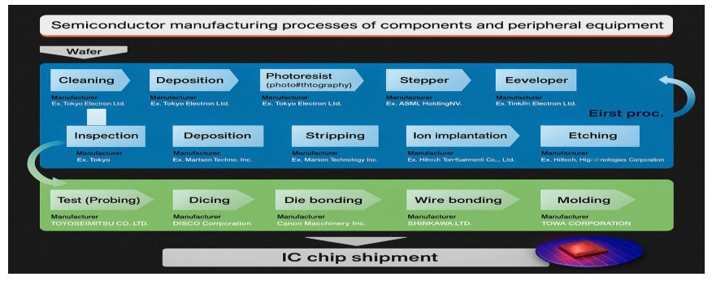
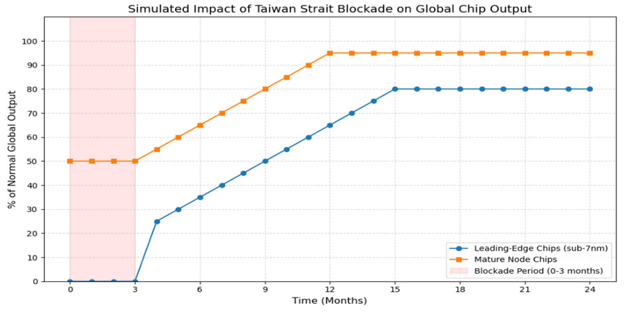

## Document Metadata

- Document ID: 4472460ad339574fd84a5441233da65b1763ee9f
- Document Title: Building a Resilient Semiconductor Supply Chain: A Stress Testing Framework
- Document Type: PDF
- Issuing Organization: IEOM Society International
- Publication Date: February 2, 2026
- Reporting Period: null
- Source File: [44_ieomsociety.org_385.pdf](https://github.com/jadennevercode/CJCC-Knowledge-Base/blob/564ab11aa9785e569e3853c8a4d7ce86f88e7535/materials/%E8%B7%A8%E9%93%BE%EF%BC%9A%E9%87%8F%E5%8C%96%E5%8F%82%E6%95%B0%E4%B8%8E%E8%AE%A1%E7%AE%97%E6%A8%A1%E6%9D%BF/44_ieomsociety.org_385.pdf)

## Structured Content

# Building a Resilient Semiconductor Supply Chain: A Stress Testing Framework

[Source Page: 2]

### 1.2. The Paradox of Efficiency and Fragility

For decades, the semiconductor supply chain has been optimized according to the principles of globalization and lean manufacturing, prioritizing cost reduction, specialization, and just-in-time inventory management (Knoblich et al., 2015). This pursuit of efficiency has resulted in a hyper-globalized network where the various inputs for a single chip may cross more than 70 international borders before the final product reaches the consumer (Thadani & Allen, 2023). While this model has successfully driven down costs and accelerated innovation, it has simultaneously engineered a system of extreme fragility. The long lead times, minimal inventory buffers, and geographic concentration of critical production stages create a network that is highly susceptible to disruption, where a single point of failure can trigger cascading effects across the entire globe (Uzsoy et al., 2018).

The COVID-19 pandemic served as a global, real-world stress test that laid these vulnerabilities bare. As lockdowns shifted consumer demand toward work-from-home electronics and simultaneously caused automotive manufacturers to cancel chip orders, a massive supply-demand mismatch occurred (Nehrebecka, 2021). Chipmakers reallocated their capacity away from automotive-grade chips, and when vehicle demand rebounded faster than expected, the industry faced a crippling shortage (Dziczek, 2022). This disruption rippled through the global economy, affecting more than 169 industries and leading to an estimated loss of $240 billion in U.S. GDP in 2021 alone (Thadani & Allen, 2023). This event was not an anomaly but rather a stark illustration of the inherent paradox of the modern SSC: a system of breathtaking efficiency that is, by its very design, dangerously fragile.

[Source Page: 3]

### 2.2. Anatomy of a Global Nerve Center: The Semiconductor Supply Chain's Structure and Complexity

The semiconductor supply chain is not a linear chain but a complex, globally distributed network of highly specialized activities. Understanding this structure is essential for identifying its inherent vulnerabilities. The end-to-end process can be segmented into several distinct, interdependent stages:

1. Research & Design: This upstream stage is where the chip's architecture and functionality are conceived. It is dominated by two key sub-segments: Electronic Design Automation (EDA) software, which provides the complex tools needed to design multi-billion transistor circuits, and Core Intellectual Property (IP), which are pre-designed circuit blocks that accelerate the design process. U.S.-based firms like Synopsys, Cadence, and Arm (UK-based, but with significant U.S. influence) hold a commanding lead in these areas (Ramirez & Le, 2025).

2. Raw Materials & Chemicals: This stage involves the production of the foundational materials for chip manufacturing. The most critical input is ultra-pure silicon wafers, the market for which is concentrated among a few companies in Japan, Taiwan, Germany, and South Korea (Thadani & Allen, 2023). Other vital inputs include specialty gases like neon (historically sourced from Ukraine), high-purity chemicals, and photoresists, a light-sensitive material essential for lithography, where Japanese firms have a dominant market share (Thadani & Allen, 2023). China holds a strong position in the supply of raw critical minerals like gallium and germanium

3. Manufacturing Equipment (SME): This segment produces the highly sophisticated and expensive machinery used in fabrication plants (fabs). The market is extremely concentrated, with a few firms from the U.S., Japan, and the Netherlands controlling the majority of the market for critical tools like deposition, etching, and lithography systems.

4. Wafer Fabrication (Front-End): This is the most capital-intensive stage, where the chip's circuits are meticulously built layer by layer on the silicon wafer. This process, detailed in Figure 1, takes place in highly advanced and sterile facilities known as fabs. The foundry model, where specialized companies manufacture chips designed by others, is dominant. This segment is geographically concentrated in Taiwan (led by TSMC) and South Korea (led by Samsung), which together account for the vast majority of advanced logic chip manufacturing.

5. Assembly, Test, and Packaging (ATP) (Back-End): Once the wafers are fabricated, they are sent to ATP facilities. Here, the wafer is sliced into individual chips (dies), which are then tested, encapsulated in protective packaging,

[Source Page: 4]

and prepared for assembly into electronic devices. This stage is more labor-intensive and is largely concentrated in Southeast Asian countries and China (Figure 1).

Figure 1. The Global Semiconductor Supply Chain Process Flow (26)

The production of a semiconductor is a multi-stage, sequential process that transforms raw silicon into a functional integrated circuit. The process begins with Wafer Production, where a purified silicon ingot is grown and sliced into thin, polished wafers. The core of the manufacturing occurs during Wafer Fabrication (Front-End), a cyclical process repeated hundreds of times to build up the layers of the circuit. Each cycle involves several key steps: Deposition, where a thin film of conductive or insulating material is applied to the wafer; Photoresist Coating, where a light-sensitive chemical is spread evenly across the surface; Lithography, the critical step where a machine projects the circuit pattern onto the photoresist; and Etching, which removes selected material to create the 3D circuit features. This is often followed by Ion Implantation to alter the electrical properties of the silicon. Throughout this cycle, extensive Metrology and Inspection steps ensure quality control. Once all layers are complete, the wafer moves to the Back-End Process. This begins with Wafer Sort/Probing, where each individual die on the wafer is electrically tested. The wafer is then sent to Assembly & Packaging, where it is diced into individual chips, which are then packaged for protection and connection to external devices. The final stage is the Final Test, where the packaged chip is tested again to ensure it meets all performance specifications before being shipped to customers for integration into final products.

## 2.3. A Typology of Critical Vulnerabilities: Geopolitical, Environmental, and Market-Driven Chokepoints

The hyper-specialized and geographically concentrated nature of the SSC creates numerous "chokepoints"—nodes or links where a disruption can have disproportionately large, systemic consequences. These vulnerabilities can be categorized into several distinct types, as detailed in Table 1. This typology provides a structured understanding of the threats facing the network and serves as a foundational input for developing realistic stress test scenarios. The vulnerabilities range from deliberate geopolitical actions and random natural disasters to inherent market structures and operational risks (Table 1).

Table 1. A Typology of Semiconductor Supply Chain Vulnerabilities

| Risk Category | Specific Vulnerability |
| --- | --- |
| Geopolitical | Trade Restrictions & Tariffs |
| Geopolitical | Military Conflict/Blockade |
| Geopolitical | Critical Mineral Embargo |
| Natural Disaster | Earthquakes & Typhoons |
| Natural Disaster | Droughts & Water Scarcity |
| Natural Disaster | Extreme Weather Events |
| Market/Structural | Supplier Concentration |
| Market/Structural | Technological Complexity |

[Source Page: 5]

Table 1 (continued):

| Risk Category | Specific Vulnerability |
| --- | --- |
| Market/Structural | Bullwhip Effect |
| Operational | Cybersecurity Threats |
| Operational | Talent Shortages |

[Source Page: 6]

### 3.3. Developing a Scenario Matrix: Defining Plausible but Severe Disruptive Events

With the Geopolitical Digital Twin as the simulation platform, the next step is to design the shocks that will be applied to it. The art of effective stress testing lies in developing scenarios that are both severe enough to meaningfully test the system's limits and plausible enough to be taken seriously by decision-makers. This process should be systematic, drawing directly from the identified vulnerabilities in the typology (Table 1). The output is a scenario matrix that defines a range of tests to be performed. Table 2 provides an illustrative matrix for the SSC, translating abstract risks into concrete, parameterizable events that can be programmed into the digital twin. Each scenario is defined by its type, a clear description of the event, and the key parameters that would be adjusted in the simulation model to represent the shock (Table 2).

Table 2. Illustrative Stress Test Scenario Matrix for the SSC

| Scenario Name | Scenario Type | Description | Key Parameters to Model |
| --- | --- | --- | --- |
| Taiwan Strait Blockade | Geopolitical/Military | A naval blockade prevents all maritime and air freight from entering or leaving Taiwan for a duration of 90 days. | Set capacity of all Taiwanese ports and airports to zero. Reroute all global shipping around the conflict zone, increasing transit times and costs. Halt all wafer output from Taiwanese fabs (e.g., TSMC, UMC). |
| Kanto Earthquake | Natural Disaster | A magnitude 8.0 earthquake strikes the Tokyo region, causing a 50% reduction in output for 60 days from key Japanese suppliers of silicon wafers and photoresists. | Reduce output capacity of specific Japanese supplier nodes (e.g., Shin-Etsu, Sumco, JSR) by 50%. Model the cascading impact on global fab inputs and subsequent production delays. |
| Rare Earth Embargo | Geopolitical/Economic | China halts all exports of critical minerals (e.g., gallium, germanium) required for specific semiconductor manufacturing steps for a duration of 180 days. | Set export capacity of specific Chinese material processing nodes to zero. Model the time, cost, and capacity constraints of activating alternative, non-Chinese sources. |
| Global Cyber-Attack on Foundries | Operational/Security | A coordinated cyber-attack targets the manufacturing execution systems (MES) of major foundries, reducing global leading-edge fab utilization by 30% for 30 days. | Reduce the utilization rate parameter for all fab nodes below 10nm by 30%. Introduce a "yield loss" factor to model quality control issues during the disruption. |

[Source Page: 8]

## 4. Case Application: Simulating a Geopolitical Disruption

To demonstrate the practical utility of the proposed framework, this section presents a case application focused on one of the most severe and widely discussed risks facing the semiconductor industry: a major geopolitical disruption centered on Taiwan.

### 4.1. Modeling the Global Semiconductor Network

For this case study, a simplified but representative Geopolitical Digital Twin of the global semiconductor network was constructed. The model was populated using publicly available data on the locations, approximate capacities, and technology nodes of major semiconductor fabs, as well as the geographic centers for other key supply chain stages (Thadani & Allen, 2023). The model's key nodes included:

Fabrication Nodes: TSMC and UMC fabs in Taiwan (leading-edge and mature logic), Samsung and SK Hynix fabs in South Korea (memory and logic), and Intel and Texas Instruments fabs in the U.S. (logic and analog).

SME & Materials Nodes: A node representing ASML in the Netherlands (EUV lithography), and aggregate nodes representing key chemical and wafer suppliers in Japan.

ATP Nodes: Aggregate nodes representing the concentration of back-end facilities in China and Southeast Asia.

Downstream Demand Nodes: Aggregate nodes representing the automotive and consumer electronics industries in North America, Europe, and Asia.

The links between these nodes were modeled with standard sea and air freight lead times. Crucially, the model's geopolitical layer identified Taiwan as a region with high geopolitical risk, and the logistical links passing through the Taiwan Strait were flagged as potential chokepoints.

### 4.2. Scenario Execution: A Simulated Blockade of the Taiwan Strait

The stress test scenario executed was the "Taiwan Strait Blockade" from the illustrative matrix in Table 2. This scenario is considered a severe but plausible event, given the persistent geopolitical tensions in the region.36 The simulation was programmed with the following parameters:

Disruption Trigger: A complete naval and air blockade of Taiwan is initiated on Day 0.

Direct Impact: The capacity of all Taiwanese seaports and airports is set to zero, halting all inbound shipments of raw materials and equipment and all outbound shipments of finished wafers.

Duration: The blockade is assumed to last for 90 days (one quarter).

Logistical Rerouting: All other global shipping routes that would normally transit the Taiwan Strait are rerouted, adding an average of 7-14 days to transit times and increasing shipping costs. This shock was applied to the digital twin to observe the dynamic, cascading consequences across the global network.

### 4.3. Analysis of Cascading Impacts: Quantifying the Ripple Effect

The simulation results reveal a rapid and catastrophic degradation of the global semiconductor supply chain, demonstrating the profound "ripple effect" that propagates from a single chokepoint.10

Immediate Impact (Weeks 1-4): The most immediate effect is the complete cessation of output from Taiwanese foundries, which account for over 60% of the global supply of semiconductor manufacturing services and over 90% of the most advanced logic chips. Companies that rely directly on these foundries see their supply of new wafers drop to zero instantly. Global logistics networks are thrown into chaos as carriers scramble to reroute vessels, causing initial delays even for supply chains not directly reliant on Taiwan.

Mid-Term Impact (Weeks 5-12): Downstream industries that hold inventory buffers begin to exhaust their supplies. Based on typical inventory levels, the simulation projects that major automotive and consumer electronics assembly lines in North America, Europe, and Asia would begin to shut down within 4 to 6 weeks of the blockade's start. This timeline aligns with the experiences of the COVID-19 chip shortage, where production halts followed quickly after the supply disruption.10 The simulation shows that even non-Taiwanese fabs (e.g., in South Korea or the U.S.) would begin to experience production slowdowns as their own inventories of specialized chemicals or other inputs that may be packaged or processed in Taiwan are depleted.

Long-Term Impact (Post-90 Days): Even after the 90-day blockade is lifted, the system faces a prolonged recovery. A massive backlog of orders floods the reopened Taiwanese fabs, and it takes months to clear the WIP that was stalled in the production pipeline. The simulation's KPI analysis projects a Time-to-Recover (TTR) for the global supply

[Source Page: 9]

chain to reach 95% of its pre-blockade output level of approximately 24 months. The total projected lost revenue across the global electronics and automotive sectors is estimated to exceed $1.5 trillion.

Figure 3. Simulated Impact of Taiwan Strait Blockade on Global Chip Output

The simulated impact of the 90-day blockade on global semiconductor output is depicted as a time-series graph. The y-axis represents the percentage of normal global output capacity, and the x-axis represents time in months. Before the disruption (Month 0), output is at 100%. At the onset of the blockade, there is a precipitous drop. The output of leading-edge logic chips (sub-7nm), which are almost exclusively produced in Taiwan, plummets to near zero and stays there for the duration of the 3-month blockade. The output of mature node chips also sees a significant decline, though less severe, as some capacity exists outside Taiwan. After the blockade is lifted at Month 3, a slow recovery begins. The graph shows a gradual, S-shaped recovery curve, reflecting the time it takes to restart complex fab operations, clear backlogs, and refill the depleted global pipeline. The leading-edge capacity takes the longest to recover, only reaching approximately 80% of its pre-disruption level a full year after the event (Month 15). The overall supply chain does not return to a stable, pre-disruption state until nearly two years have passed (Figure 3).

### 4.4. Evaluating Mitigation Levers

The true power of the stress testing framework lies in its ability to quantitatively evaluate the effectiveness of different resilience strategies. The simulation was re-run with several pre-existing mitigation levers in place to measure their impact on the key resilience KPIs. The results, summarized in Table 3, provide a data-driven basis for strategic decision-making.

- Strategic Buffering: The first mitigation scenario assumed that major downstream industries (automotive, electronics) held a six-month strategic buffer of critical chips, a shift from JIT to a JIC strategy.19 The simulation showed this extended the Time-to-Survive for their assembly lines from 4-6 weeks to over 24 weeks. While this did not shorten the overall TTR of the semiconductor supply chain itself, it significantly reduced the financial impact by allowing production to continue for much longer, reducing the total financial loss by an estimated $300 billion.

- Alternative Sourcing (Diversification): The second scenario modeled a world where the investments from the U.S. and E.U. CHIPS Acts have already resulted in the creation of new, operational leading-edge fabs in North America and Europe.44 When the Taiwan blockade occurs, these fabs are able to ramp up their production. However, the simulation highlights a critical reality: even with these new fabs, their combined capacity in the initial years is a fraction of Taiwan's. While they help mitigate the worst of the shortage, they cannot fully compensate for the loss. This strategy was shown to reduce the overall TTR to 18 months and the financial loss to $0.9 trillion (Table 3).

- Combined Strategy: A final simulation tested a combined strategy of holding a six-month buffer and having diversified fab locations. This proved to be the most effective approach, reducing the TTR to 15 months and cutting the projected financial loss by more than half, to $0.7 trillion.

[Source Page: 10]

Table 3. Quantitative Effectiveness of Mitigation Strategies

| Mitigation Strategy | Impact on Time-to-Recover (TTR) | Impact on Total Financial Loss | Implementation Cost/Trade-off |
| --- | --- | --- | --- |
| Baseline (No Mitigation) | 24 months | -$1.5 Trillion | N/A (Represents current state of high efficiency, low redundancy) |
| 6-Month Strategic Buffer | 22 months | -$1.2 Trillion | High inventory carrying costs, risk of component obsolescence. |
| Activate U.S./EU Fabs | 18 months (post ramp-up) | -$0.9 Trillion | Massive capital investment ($ billions), long lead time to build, talent shortages. |
| Combined Strategy | 15 months | -$0.7 Trillion | Highest upfront cost and complexity, but provides the highest level of resilience. |

[Source Page: 12]

While this research provides a robust foundation, it is important to acknowledge its limitations. The case application utilized a simplified, deterministic model based on publicly available data. A real-world implementation by a corporation or government agency would require proprietary, granular data on capacities, lead times, inventory levels, and specific supplier-customer relationships for higher fidelity. The current model also focuses on a single, albeit severe, scenario. The real world is stochastic, and the timing and nature of disruptions are uncertain. Finally, the model does not fully capture the complexity of human decision-making and adaptive behavior during a crisis, where actors may respond in unpredictable ways.
